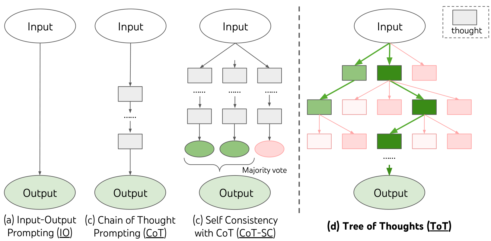
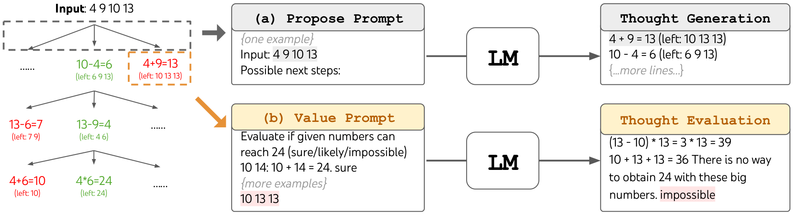
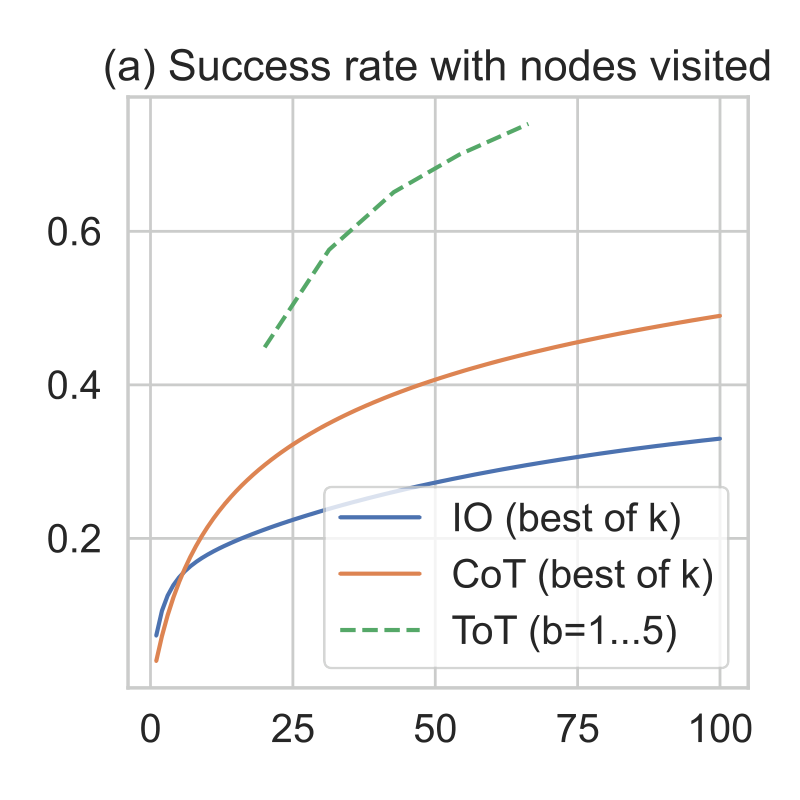
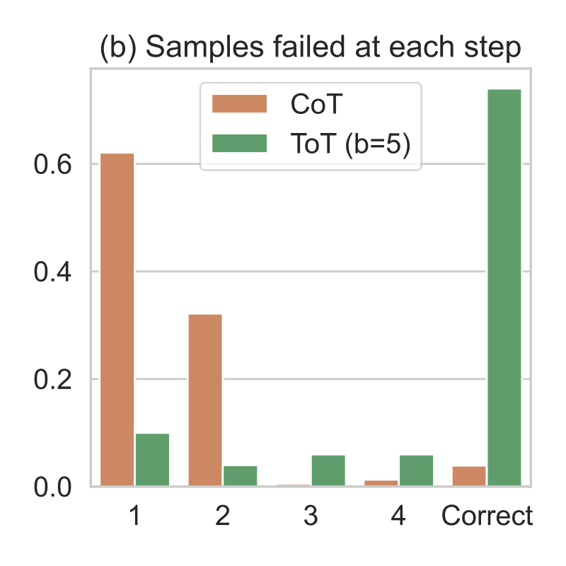
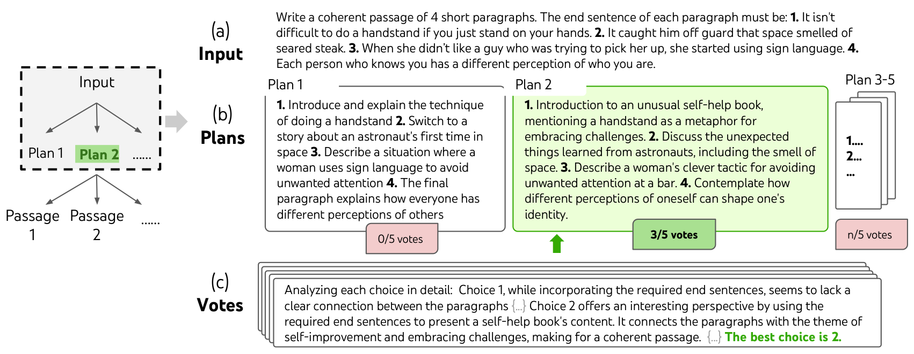
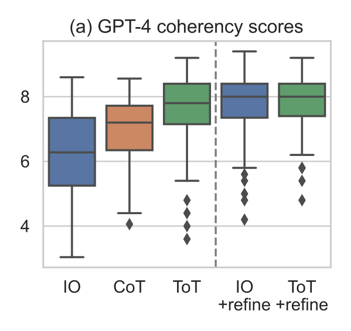
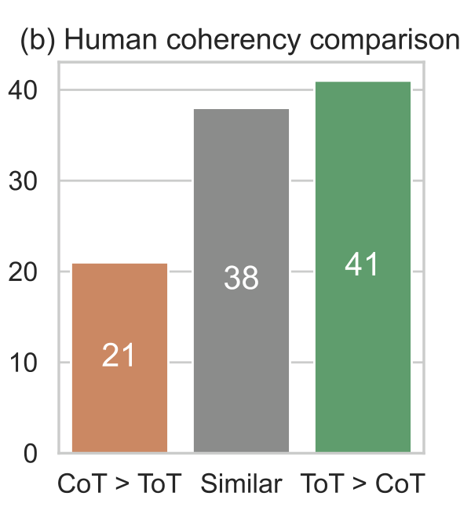
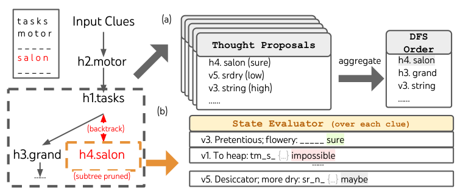

# Tree of Thoughts：用树搜索增强大模型推理

大模型在解数学题、规划写作或填字游戏时，一旦开头走错，往往只能沿错误路径继续生成，这正是自回归解码在需要探索和回溯任务上的短板。它限制的不只是答题准确率，也限制了模型在编码、数据分析和机器人等复杂决策场景中的规划能力。Tree of Thoughts（ToT）把推理从“一条链”扩展为“一棵树”：让 Language Model（LM）生成多个中间思路、自行评估，再用 BFS 或 DFS 选择、剪枝和回溯。最直观的结果是，GPT-4 在 Game of 24 上的成功率从 CoT 的 4.0% 提升到 ToT 的 74%；Mini Crosswords 的词级成功率也从 CoT 的 15.6% 提升到 60%。

## 一、为什么一条思维链还不够

GPT、PaLM 等模型已经能处理数学、符号、常识和知识推理，但其底层生成机制仍是自回归：从左到右，每次决定一个 Token。论文把这种快速、连续、不易回头的决策方式类比为人类认知中的“System 1”；而复杂问题还需要“System 2”式的慢思考，即保留多个选项、评估当前进展，并在必要时向前推演或退回上一步。

为了看清 ToT 的增量，可以先用统一符号回顾三种常见 Prompting 方式。设预训练模型为 $p_\theta$，输入和输出分别为 $x$、$y$，语言序列 $x=(x[1],\ldots,x[n])$ 的概率可分解为：

$$
p_\theta(x)=\prod_{i=1}^{n}p_\theta(x[i]\mid x[1],\ldots,x[i-1])
$$

- **Input-Output（IO）Prompting**：直接学习从输入到输出的映射，可写成 $y\sim p_\theta^{IO}(y\mid x)$。它最简单，但没有显式的中间推理过程。
- **Chain-of-Thought（CoT）**：在 $x$ 和 $y$ 之间加入中间思路 $z_1,\ldots,z_n$，逐步采样 $z_i\sim p_\theta^{CoT}(z_i\mid x,z_{1\cdots i-1})$，再基于完整思路生成答案。实际生成时，思路与答案通常仍是一段连续文本，思路粒度也没有明确约束。
- **CoT-Self-Consistency（CoT-SC）**：独立采样 $k$ 条 CoT，再取出现次数最多的答案，即 $\hat y=\arg\max_y\#\{i\mid y^{(i)}=y\}$。它增加了完整路径的多样性，却没有在单条路径内部探索不同分支；多数投票也更适合答案空间有限的问题。

> 图解：每个矩形代表一个“Thought”，即通往答案的一段连贯中间文本。IO 直接由输入到输出；CoT 只有一条链；CoT-SC 采样多条完整链后进行多数投票；ToT 则在每个中间状态分出多个候选思路，并保留有希望的分支继续搜索。绿色表示被保留或选中的路径，浅色分支表示被放弃的路径。

因此，现有方法有两个相互关联的缺口：在局部，不会从同一推理节点探索不同的后续思路；在全局，缺少规划、Lookahead 和 Backtracking。CoT-SC 虽然“多想几次”，但每次都从头走到尾，无法在某一步发现错误后只修正这一分支。

要补上这两个缺口，关键不是单纯增加采样次数，而是改变搜索的单位与组织方式。这正是 ToT 的出发点。

## 二、ToT 如何把推理变成 deliberate search

ToT 把问题求解表示为一棵树：节点是部分解，边是修改部分解的操作。每个节点的状态定义为 $s=[x,z_{1\cdots i}]$，其中包含原始输入和到目前为止的思路序列。所谓 deliberate search，就是让模型不再只顾“接着写”，还要显式决定“下一步有哪些可能、哪个更值得走、走错后回到哪里”。

一个具体的 ToT 系统需要回答四个问题：Thought 如何切分、候选 Thought 如何生成、状态如何评估，以及采用什么搜索算法。

### 1. Thought decomposition：找到合适的推理粒度

Thought 可以是一行算式、一个待填单词，也可以是一段写作计划。它的粒度需要在两个目标之间折中：

- 足够小，使 LM 能生成连贯且有多样性的候选，而不是一次写出整本书；
- 足够大，使 LM 能判断它对最终目标是否有帮助，而不是面对一个孤立 Token 无从评价。

笔者认为，这一设计是 ToT 容易被低估的关键。树搜索并不是越深越好：以 Token 为节点会得到极深、难以评估的树；以完整答案为节点又退化成“多次采样后挑一个”。Thought 层级的切分，正好位于两者之间。

### 2. Thought generator：采样，还是集中提案

给定状态 $s$，生成器 $G(p_\theta,s,k)$ 负责产生下一步的 $k$ 个候选。论文给出两种策略。

**Sample：独立采样。** 对每个候选分别使用 CoT Prompt：

$$
z^{(j)}\sim p_\theta^{CoT}(z_{i+1}\mid s),\quad j=1,\ldots,k
$$

它适合 Thought 空间丰富、每个 Thought 较长的任务，例如 Creative Writing。独立采样更容易带来内容和结构上的多样性。

**Propose：在同一上下文中连续提案。** 让模型一次列出多个不同的下一步：

$$
[z^{(1)},\ldots,z^{(k)}]\sim p_\theta^{propose}(z_{i+1}^{(1\cdots k)}\mid s)
$$

它适合候选空间更受约束、单个 Thought 很短的任务，例如 Game of 24 的一行算式或 Crosswords 的一个单词。把候选项放在同一 Prompt 中，能减少重复提案。

### 3. State evaluator：让 LM 自己提供搜索启发式

生成候选之后，还需要状态评估器 $V(p_\theta,S)$ 判断哪些部分解更接近目标。传统搜索的启发式通常来自人工规则或额外训练的评价模型；ToT 则直接让 LM 用自然语言推理当前状态的好坏。这不需要额外训练，也能处理难以写成规则的任务。

论文同样给出两种评估方式：

- **Value：独立打分。** 对每个状态生成标量分数或类别，例如 1～10 分，或 sure / likely / impossible。可写为 $V(p_\theta,S)(s)\sim p_\theta^{value}(v\mid s)$。评估既可以做少量 Lookahead，例如发现 $5,5,14$ 能通过 $5+5+14$ 到达 24，也可以利用常识排除明显无望的状态。
- **Vote：跨状态投票。** 当“绝对质量”难以打分时，把多个候选同时交给 LM，让它比较并选出最优状态 $s^*\sim p_\theta^{vote}(s^*\mid S)$，再将该状态的指示值记为 $\mathbb{1}[s=s^*]$。这相当于把“探索哪个状态”变成一道多选题，尤其适合文章连贯性这类相对判断更自然的任务。

两种方式都可以重复采样并聚合结果，用更多计算换取更稳定的启发式。评估不必完美，只要能在大体上帮助搜索区分好坏即可。

### 4. Search algorithm：BFS 保宽，DFS 回溯

**Breadth-First Search（BFS，广度优先搜索）** 适合树较浅、每层可以有效剪枝的任务。初始集合为 $S_0=\{x\}$；在第 $t$ 步，先扩展当前所有状态：

$$
S'_t=\{[s,z]\mid s\in S_{t-1},\ z\in G(p_\theta,s,k)\}
$$

然后评估 $S'_t$，只保留总价值最高的 $b$ 个状态：

$$
S_t=\arg\max_{S\subset S'_t,\ |S|=b}\sum_{s\in S}V_t(s)
$$

其中，$k$ 控制每个节点生成多少候选，$b$ 控制每层保留多少状态，$T$ 是最大步数。Game of 24 和 Creative Writing 都采用 BFS。

**Depth-First Search（DFS，深度优先搜索）** 则优先探索当前最有希望的候选，直到生成最终输出，或评估值低于阈值 $v_{th}$。后一种情况会剪掉整棵子树，并 Backtrack 到父节点尝试其他候选；到达终止条件后，同样可以回溯寻找更优路径。Mini Crosswords 使用的就是这种方式。

这里与经典 Beam Search 的区别也值得强调：ToT 保留的是语义完整的 Thought，而不是 Token 前缀；筛选依据是 LM 对目标进展的 deliberate evaluation，而不只是语言概率或 Perplexity。

由此，ToT 获得了四项性质：IO、CoT、CoT-SC 和 Self-Refinement 可被视为深度或宽度受限的特例；生成器、评估器、搜索算法和底座 LM 可以独立替换；不同任务与资源预算可采用不同配置；整个方法不要求额外训练。接下来要看的是，这套通用框架怎样落到三个差异很大的任务上。

## 三、实验总览：三个任务，三种 Thought 设计

论文选择 Game of 24、Creative Writing 和 5×5 Mini Crosswords，分别考察数学搜索、开放式规划和自然语言约束搜索。除非另有说明，实验使用 Chat Completion 模式的 GPT-4，采样温度为 0.7；实验时间为 2023 年 5 月 5 日至 16 日。

| 任务 | 输入 | 输出 | Thought 的形式与示例 | ToT 中间步数 |
|---|---|---|---|---|
| Game of 24 | 4 个数字，如 `4 9 10 13` | 得到 24 的等式，如 `(13-9)*(10-4)=24` | 3 行中间算式，如 `13-9=4`（剩 `4 4 10`）、`10-4=6`（剩 `4 6`）、`4*6=24` | 3 |
| Creative Writing | 4 个随机句子 | 一篇 4 段的连贯文章，各段依次以 4 个输入句子结尾 | 简短写作计划，如“先介绍一本把各段主题连接起来的书” | 1 |
| 5×5 Crosswords | 5 个横向与 5 个纵向线索 | 5×5 字母棋盘 | 根据线索填入的单词及其位置，如 `h1.shown`、`v5.naled` | 5～10，可变 |

这张表也说明，ToT 并没有强行给所有任务套同一种“推理模板”。它统一的是搜索框架，而不是 Thought 的具体形态。

## 四、Game of 24：为什么开头三个词就可能决定失败

### 任务与基线

Game of 24 要求用 4 个输入数字和加、减、乘、除得到 24，每个数字必须恰好使用一次。例如，`4 9 10 13` 的一个解是 `(10-4)*(13-9)=24`。

作者从 4nums.com 获取 1,362 道按人类求解时长由易到难排列的题目，选取较难的第 901～1,000 题作为测试集，共 100 题。只有等式合法、结果为 24 且数字使用完全符合要求，才算成功。

基线包括：

- 5 个 In-Context 示例的 IO Prompt；
- 在示例中加入 3 行中间算式的 CoT Prompt；
- 对 100 条 CoT 样本做多数投票的 CoT-SC；
- 最多迭代 10 次的 IO + Refine，它可以根据正确答案反馈反思并修改错误；
- IO / CoT 的 Best of 100，用于观察增加独立采样后的 Oracle 表现。

IO 和 CoT 在每道题上均采样 100 次，以估计平均成功率。

### ToT 设置

ToT 将解答拆成 3 个 Thought，每个 Thought 是一步算式。每个节点先提取剩余数字，再用同一个 Propose Prompt 生成下一步候选；虽然 Prompt 只有一个包含 4 个数字的示例，但它会复用于全部 3 步。

搜索采用 BFS，每层保留最好的 $b=5$ 个候选。评估器把候选分为 sure / maybe / impossible：少量 Lookahead 后确定能到 24 的候选会得到提升，数值明显过大或过小的无望候选被排除，其余保留为 maybe。每个 Thought 的 Value 采样 3 次。

> 图解：左侧从输入 `4 9 10 13` 展开算式树，例如先走 `10-4=6`，再由剩余数字继续分解。右侧上方展示 Propose Prompt：LM 一次提出多个可能的下一步；右侧下方展示 Value Prompt：LM 根据少量推演和数值常识判断剩余数字能否到达 24。图中 `4+9=13` 后剩下 `10 13 13`，被评估为 impossible，因此不必继续扩展该分支。

### 结果：74% 不只是“多采样”的收益

| 方法 | 成功率 |
|---|---:|
| IO Prompt | 7.3% |
| CoT Prompt | 4.0% |
| CoT-SC（$k=100$） | 9.0% |
| ToT（$b=1$） | 45% |
| **ToT（$b=5$）** | **74%** |
| IO + Refine（$k=10$） | 27% |
| IO（Best of 100） | 33% |
| CoT（Best of 100） | 49% |

即使 $b=1$，ToT 也达到 45%，说明“在中间步骤生成并评估候选”本身就很有效；把宽度增至 5 后，成功率进一步达到 74%。相比之下，100 条完整 CoT 中挑最佳答案也只有 49%，独立增加完整路径并不能替代路径内部的搜索。

> 图解：横轴是每道题访问的节点数，纵轴是成功率。蓝线和橙线分别表示 IO、CoT 在 Best of $k$ 设置下随采样数增加的表现，$k$ 最大为 100；绿色虚线表示 ToT 在 $b=1\ldots5$ 时的结果。ToT 曲线整体位于上方，Best of 100 CoT 的 49% 仍明显低于 $b>1$ 的 ToT。需要注意，横轴是节点数而不是 Token 数或美元成本，因此它展示的是搜索方式差异，不是严格的同预算成本对比。

> 图解：横轴表示样本在第 1～4 步失败，或最终正确；纵轴是样本占比。橙色为 CoT，绿色为 ToT（$b=5$）。约 60% 的 CoT 样本在第一步就已经无法得到合法解或无法到达 24，相当于开头三个词就可能决定失败；ToT 大幅降低了早期错误，最终正确柱为 74%，而 CoT 仅为 4%。

这个错误分析把 ToT 的价值说得很清楚：它并非只会让最后答案“更好看”，而是在推理刚开始时就阻止大量错误分支继续消耗计算。

数学任务展示了中间状态可以被明确评估的情形；下一个问题是，如果任务没有唯一正确答案，ToT 还能否工作。

## 五、Creative Writing：没有标准答案时，用比较代替打分

### 任务与评价方式

Creative Writing 的输入是 4 个随机句子，输出必须包含 4 个段落，并依次以这 4 句话作为每段结尾。任务没有 Ground Truth 文章，难点在于既要满足形式约束，又要让全文连贯。

作者从 randomwordgenerator.com 构造 100 组输入。由于 GPT-4 大多能遵守结尾句约束，评价重点放在 Coherency（连贯性）上：

- **自动评价**：用 Zero-Shot GPT-4 Prompt 打 1～10 分，每篇文章采样 5 次并取平均；每篇文章 5 次评分的标准差，在全部输出上平均约为 0.56。
- **人工评价**：由部分作者进行 Blind Study，对 100 组 CoT / ToT 文章做两两比较，展示顺序随机翻转。

IO 与 CoT 都是 Zero-Shot，前者直接写文章，后者先写简短计划再写正文，每组输入各生成 10 个样本。另有最多 5 轮的 Iterative Refine，在随机 IO 样本基础上判断是否“足够连贯”，否则继续修改。

### ToT 设置：两层采样与投票

ToT 的树深度为 2，只有一个中间 Thought 层。第一层生成 $k=5$ 份写作计划，采样 5 次 Vote 选出最佳计划；第二层根据该计划生成 $k=5$ 篇完整文章，再以同样方式选出最佳文章。两层都只保留一个选择，因此 $b=1$。

> 图解：输入要求写 4 段文章，并指定每段最后一句。模型先提出 5 份 Plans，再进行 5 次比较投票；图中 Plan 2 获得 3/5 票，因为它用“自我提升与迎接挑战”的主题串联了倒立、太空、手语等原本无关的句子。随后，最佳计划进入相同的“生成 5 篇文章—投票选 1 篇”流程。投票 Prompt 要求逐项分析，并在最后明确给出最佳选择。

这里的聪明之处在于：**计划与正文都作为可比较的 Thought，而不是把计划当成一次性、不可更改的草稿。**对连贯性这种难以用绝对规则刻画的属性，跨候选 Vote 也比给每个候选单独打一个精确分数更自然。

### 结果：自动分数与人类偏好一致

> 图解：纵轴是 GPT-4 给出的 1～10 连贯性分数，横轴依次为 IO、CoT、ToT，以及虚线右侧加入 Refine 的 IO 和 ToT；箱体与须线展示评分分布和离群点。正文报告的平均分为 IO 6.19、CoT 6.93、ToT 7.56。加入 Iterative Refine 后，IO 从 6.19 提升到 7.67，ToT 从 7.56 提升到 7.91。

> 图解：横轴是两两比较结论，纵轴是 100 组文章中的对应数量。人工更偏好 CoT 的有 21 组，认为两者相近的有 38 组，更偏好 ToT 的有 41 组。也就是说，ToT 胜过 CoT 的对局接近 CoT 胜过 ToT 的两倍，与自动评分的方向一致。

Refine 在自然语言写作上比 Game of 24 更有效。作者因此提出，除了独立 Sample 和集中 Propose，**从旧 Thought 中修改出新 Thought**也可以成为 ToT 的第三种生成方式。它与树搜索并不冲突，而是可以嵌入同一个模块化框架。

写作任务说明 ToT 能处理开放式目标，但它的 BFS 仍然较浅。更严峻的考验是：当搜索变深、早期填词会持续约束后续所有选择时，系统能否发现死路并回头。

## 六、Mini Crosswords：没有回溯，就很难处理硬约束

### 任务与基线

Mini Crosswords 使用 5×5 棋盘，每题包含 5 个横向线索和 5 个纵向线索，目标是填入 25 个字母。作者从 GooBix 的 156 道题中选取索引为 $1,6,\ldots,91,96$ 的 20 道题测试，并用第 136、141、146、151、156 题构造 Prompt 示例。

评价分三个层级：字母级正确率（每题 25 个字母）、单词级正确率（每题 10 个单词）和整题成功率。IO Prompt 提供 5 个输入输出示例，CoT 额外按 h1～h5、v1～v5 的顺序展示中间填词，两种方法均采样 10 次取平均。

这项实验的目标不是击败依赖大规模检索的专用填字系统，而是测试通用 LM 能否探索自己的 Thought，并用自我评估引导搜索。

### ToT 设置：候选排序、死路剪枝、父节点回溯

ToT 使用 DFS，持续探索最有希望的下一个单词，直到当前状态不再值得扩展，然后回到父节点尝试替代方案。为避免已填内容反复变化，后续 Thought 不得修改已经确定的单词或字母，因此最多有 10 个中间步骤。

具体流程分为三步：

1. 把当前已填单词转换为剩余线索的字母约束，例如 `v1. To heap: tm___`。
2. 调用 Proposal Prompt 5 次，生成“下一步填哪里、填什么”的候选，同时让 LM 给出置信度，再聚合为有序的搜索队列。
3. 对每个剩余线索判断在当前字母约束下是否仍可能填出单词；只要有一个线索被判为 impossible，就剪掉该状态的整棵子树并 Backtrack。

DFS 最多执行 100 个搜索步骤，最后把探索最深的状态渲染为答案；若并列，则取最先探索到的状态。

> 图解：左侧已填 `h2.motor` 与 `h1.tasks`，当前尝试 `h4.salon` 后形成新状态。右上方（a）把多次 Thought Proposals 及其置信度聚合成 DFS Order，决定先探索哪个候选；右下方（b）逐条检查剩余线索，例如 `tm_s_` 若被判为 impossible，当前子树就会被剪掉。左侧红色箭头表示回到父状态，再尝试 `h3.grand` 等替代分支。

### 结果与消融：剪枝有用，回溯更关键

| 方法 | 字母级成功率 | 单词级成功率 | 整题成功率 |
|---|---:|---:|---:|
| IO | 38.7% | 14% | 0% |
| CoT | 40.6% | 15.6% | 1% |
| **ToT** | **78%** | **60%** | **20%** |
| + Best State（Oracle） | 82.4% | 67.5% | 35% |
| − Prune | 65.4% | 41.5% | 5% |
| − Backtrack | 54.6% | 20% | 5% |

IO 和 CoT 的单词级成功率都不到 16%，ToT 则达到 60%，并解出 20 道题中的 4 道。原因很直接：IO 和 CoT 都无法更换某一步的填词，更不能在发现约束冲突后回到前面的决策点。

三组补充实验进一步揭示了系统瓶颈：

- **输出选择仍可改进。** 如果 Oracle 直接从每个 DFS 过程中挑选最佳状态，整题成功率从 20% 提升到 35%，即解出 7/20 题，说明“搜索到了”不等于“最终选中了”。
- **Prune 总体有效，但评估器会误杀。** 去掉 Prune 后指标全面下降；然而它能找到 4 道题的正确解，只是启发式输出只选中其中 1 道，而且其中 3 道是带 Prune 的 ToT 在 100 步内无法解决的。某些生僻或过时单词会被 GPT-4 错判为不可能，例如它把 `agend` 当成 `agenda` 的拼写错误。
- **Backtrack 不可省略。** 去掉回溯后，最多连续填 20 步且允许覆盖旧词的 Greedy 版本，单词级成功率只有 20%，接近无搜索基线，远低于完整 ToT 的 60%。

因此，Crosswords 的核心教训不是“多搜索总能成功”，而是搜索质量同时受候选生成、状态评价、输出选择和回溯机制影响。尤其是 LM 评估器的知识盲区，会直接转化为搜索盲区。

三个主实验之后，还需要把 ToT 放回更大的技术版图中，才能判断它究竟新在哪里，又与哪些方法互补。

## 七、相关工作：ToT 位于 LM 与经典搜索的交叉口

**规划与决策。** 既有 LM 规划方法通常依据环境状态提出合理计划，而 ToT 在每个步骤同时保留多个可行计划，再用价值反馈选择后续路径。与需要训练 Policy 或 Reward Model 的 Reinforcement Learning 方法不同，ToT 直接让底座 LM 估计状态价值。同期工作 RAP 也把推理看作基于内部 World Model 的规划，并使用 MCTS；论文认为 ToT 更强调模块化，可替换不同树搜索算法，且覆盖了更开放的任务。

**Self-Reflection 与 Self-Evaluation。** Reflexion、Self-Refine 等工作让 LM 评价并修改自己的输出，ToT 则把评价嵌入搜索过程，而不是只在完整轨迹结束后修订。Self-Eval Guided Decoding 同样结合树搜索和 LM 自评，但基于 PAL（Program-Aided Language Models）的代码表示；ToT 直接使用自然语言 Thought，因此也能覆盖 Creative Writing。

**程序引导与符号规划。** 一些方法用系统流程或 Symbolic Program 组织 LM 行为，或让外部段落扩展搜索树；ToT 的分支来自 LM 自身生成的 Thought，并包含反思、评估或投票。LLM+P 则把实际规划交给 Classical Planner，而 ToT 让 LM 同时参与生成和启发式评估。

**经典搜索。** 从 A* 的视角看，LM 自评相当于节点启发式；从现代解码的视角看，它又与 NeuroLogic A*esque Decoding 等方法相关。差别在于，后者主要服务句子生成，ToT 面向多步问题求解，并允许按任务选择 Thought 粒度与搜索策略。

可以看到，ToT 的贡献不是发明 BFS 或 DFS，而是把 **自然语言 Thought、LM 自评和经典搜索** 组合成一个无需训练、可拆卸的推理框架。接下来的附录实验进一步回答两个实用问题：它能否迁移，以及要多花多少钱。

## 八、附录实验：泛化能力、模型规模与真实成本

### 1. Zero-Shot ToT 能否迁移到常见任务

作者在 GSM8K 和 StrategyQA 上实现了一个通用 Zero-Shot ToT-BFS：先采样 5 个解题策略并投票，再根据最佳策略采样 5 个答案并投票。答案格式分别约束为 `the answer is n` 和 `the answer is yes/no`，只需少量额外代码即可接入。

在两个各含 100 道随机题目的子集上，结果如下：

| 方法 | GSM8K | StrategyQA |
|---|---:|---:|
| IO | 51 | 73 |
| CoT | 86 | 82 |
| **ToT** | **90** | **83** |

ToT 在两项任务上都超过 CoT，但增幅很小。原因并不神秘：GPT-4 + CoT 已经很强，StrategyQA 的主要瓶颈又是外部知识而非搜索。作者据此建议，传统 NLP 任务可尝试较小模型加 ToT，而 GPT-4 加 ToT 更适合真正让 CoT 陷入困境的难题。

### 2. 换成 GPT-3.5，瓶颈在生成还是评估

作者还在 Game of 24 和 Creative Writing 上测试 GPT-3.5-turbo。两个任务都保持“ToT > CoT > IO”的排序。

| Game of 24 | GPT-4 | GPT-3.5 |
|---|---:|---:|
| IO | 7.3% | 6% |
| CoT | 4.0% | 3% |
| **ToT** | **74%** | **19%** |

| Creative Writing | GPT-4 | GPT-3.5 |
|---|---:|---:|
| IO | 6.19 | 4.47 |
| CoT | 6.93 | 5.16 |
| **ToT** | **7.56** | **6.62** |

在写作任务上，GPT-3.5 + ToT 的 6.62 已超过 GPT-4 + IO 的 6.19，并接近 GPT-4 + CoT 的 6.93，说明搜索框架能补偿一部分底座能力差距。

但 Game of 24 上，GPT-3.5 + ToT 只有 19%。为让它正常工作，作者还把 Proposal Prompt 从 1-Shot 改成 3-Shot。更关键的是交叉实验：

- GPT-4 生成 + GPT-3.5 评估：64%；
- GPT-3.5 生成 + GPT-4 评估：31%。

这表明该任务的主要瓶颈是 **Thought Generation**，而不只是评价器不够聪明。换言之，搜索无法凭空创造高质量候选；如果每个分支都不好，再强的评估器也无力回天。不过，生成与评估可由不同模型承担，也为降低成本留下了空间。

### 3. ToT 的成本到底高在哪里

ToT 的准确率提升并非免费。Game of 24 中，ToT 的 Completion Token 数接近 100 次 CoT 的总量，但成功率更高；由于 Prompt、生成与评估调用的组合不同，其每题费用也更高。

| Game of 24 | Generate / Prompt Tokens | 每题成本 | 成功率 |
|---|---:|---:|---:|
| IO（Best of 100） | 1.8k / 1.0k | \$0.13 | 33% |
| CoT（Best of 100） | 6.7k / 2.2k | \$0.47 | 49% |
| ToT | 5.5k / 1.4k | \$0.74 | 74% |

Creative Writing 的主要开销来自多份长文本候选。ToT 的 Completion Token 和费用大约都是 IO 的 5 倍，与生成多份计划和文章的流程一致。

| Creative Writing | Generate / Prompt Tokens | 每题成本 |
|---|---:|---:|
| IO | 0.9k / 0.4k | \$0.06 |
| CoT | 0.9k / 0.4k | \$0.07 |
| ToT | 4k / 2.9k | \$0.32 |

按表中单价估算，两个主实验的 ToT 部分约为 0.74 美元/题 × 100 题 + 0.32 美元/题 × 100 题 = 106 美元；作者估计 Crosswords 的 DFS 实验也在 100 美元以内。总体而言，ToT 可能比 CoT 多生成 5～100 倍的 Token，具体取决于 Prompt 和搜索配置。

论文给出的成本优化建议很务实：

- 只对需要 deliberate reasoning、且 CoT 明显吃力的任务使用 ToT；
- 通过 Beam Size、Vote 次数、Few-Shot / Zero-Shot 和底座模型调节性能—成本折中；
- 找到解后让 BFS 提前停止，或在候选被判定为 impossible 时缩小 Beam；
- 训练更擅长 Thought Generation 和 Evaluation 的模型，从根本上减少无效搜索。

代码、完整 Prompt 和运行轨迹均已公开，便于复现不同搜索配置：

- 代码：https://github.com/princeton-nlp/tree-of-thought-llm
- Prompt：https://github.com/princeton-nlp/tree-of-thought-llm/tree/master/src/tot/prompts
- Trajectories：https://github.com/princeton-nlp/tree-of-thought-llm/tree/master/logs

## 九、讨论与总结：让 LM 从“接着写”走向“选择怎么走”

ToT 并不适用于所有任务。对于 GPT-4 已经轻松解决的问题，额外搜索只会增加成本；论文本身也只验证了三个相对简单、但足以挑战当时 GPT-4 的任务。真实应用中的 Coding、Data Analysis 和 Robotics 会带来更深的状态空间、更复杂的反馈和更高的安全性要求。

这项工作也没有尝试训练底座 LM，而是完全使用现成模型。一个自然的后续方向，是用 ToT 式的高层反事实决策进行 Fine-Tuning：训练模型比较“下一段可以怎样写、哪个选择更有前途”，而不只是预测下一个 Token。

在影响层面，可读的高层 Thought 让决策过程比隐式 Token 数值更容易检查，也为 Human Alignment 提供了更多介入点；但如果系统进一步连接外部环境或人类用户，更强的自主决策能力同样可能放大有害用途，因此能力提升不能脱离安全约束单独讨论。

最后，用 5 点回顾全文：

- ToT 把推理节点从 Token 或完整答案改为语义连贯的 Thought，在搜索深度与可评估性之间取得平衡。
- Thought Generator 负责扩展候选，State Evaluator 用 LM 自评提供启发式，BFS / DFS 负责保留、剪枝与回溯。
- Game of 24 上，GPT-4 + ToT 达到 74%，远高于 CoT 的 4.0% 和 Best of 100 CoT 的 49%。
- Creative Writing 与 Mini Crosswords 证明，同一框架既能处理开放式文本评价，也能处理深层约束搜索，但回溯与评价质量会直接影响结果。
- 性能提升伴随显著的 Token 和费用开销，而且底座模型的候选生成能力仍是硬瓶颈；ToT 不是免费增益，而是可配置的性能—成本交换。

展望未来，真正值得关注的不是把每次生成都变成树搜索，而是让模型学会在关键决策点按需思考、评价和回溯，并把这种能力逐步内化到训练过程中。

> 本文参考自 [Tree of Thoughts: Deliberate Problem Solving with Large Language Models](https://arxiv.org/abs/2305.10601)