# uni-robot-agent：统一工具让开放模型操控机器人

机器人使用智能体（Robot-Use Agent，RUA）要让通用多模态模型直接观察场景、调用工具并操控机器人，但现有研究高度依赖昂贵的闭源模型，难以本地部署和继续训练。uni-robot-agent 的核心不是再训练一个机器人策略，而是用统一工具、模块化接口和推理—执行流水线，把开放权重模型已有的视觉、推理与编程能力释放出来。在 RoboDojo 的 42 项仿真任务中，Qwen3.8-Flash-Next 不使用特权信息便取得 **31.39 Score、25.00% SR**，超过已发表的 GPT-6 Astra–RoboProbe 结果 **28.97 Score、22.48% SR**。在 19 项真机任务上，Qwen 零样本取得 **53.50 分**，GPT-6 Astra 则达到 **80.50 分**。

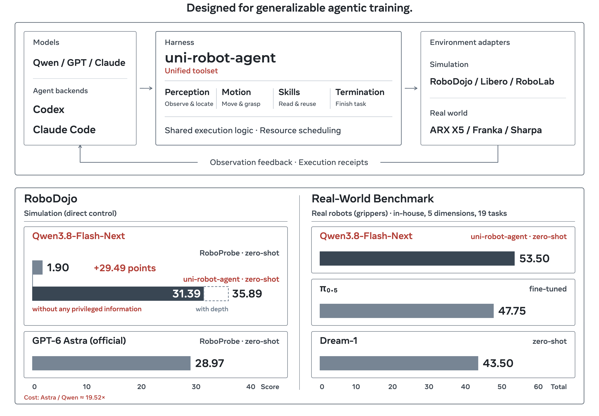

> 图解：上半部分展示模型如何通过共享工具、执行机制和反馈连接不同环境适配器，并把仿真与真机交互沉淀为可复用的训练数据；下半部分汇总仿真和真机成绩。这里的分工很关键：模型负责理解、规划和恢复，harness 负责把决策可靠地变成机器人操作。

## 为什么开放模型还需要一套 harness？

近年的前沿基础模型已经展现出零样本机器人操作能力。它们能把复杂任务拆开、根据失败反馈重新规划，这些通用能力很难只靠有限的机器人示范数据学会。

但直接使用闭源模型有三道障碍：权重不可见，无法针对机器人经验继续训练；API 成本高，大规模交互难以承受；推理与缓存优化受服务商限制，而速度恰恰是 RUA 的瓶颈。开放权重模型提供了另一条路，却通常在空间理解、长程规划和工具使用上弱于前沿闭源模型。

已有系统常用两类办法补差距：给模型提供仿真器真值深度、任务成功判定等 **特权信息**，或者加入人工编写的任务技能。它们可能有效，却也容易掩盖模型与系统的真实能力，并且难以迁移到没有这些信息的物理世界。

因此，这篇工作先不急着做任务特化，而是追问一个更基础的问题：**如果只提供真实部署中能获得的信息，并用可靠工具把观察、计算、动作和反馈组织好，开放模型究竟能做到什么？**

## 五层架构：把模型、工具与机器人后端解耦

uni-robot-agent 遵循统一、高效、真实、模块化四项原则。统一意味着同一操作在不同仿真器和机器人上具有一致语义；高效意味着模型思考与物理动作可以重叠；真实意味着主实验不依赖仿真器真值深度或任务验证器；模块化则让模型运行时、工具、环境后端和上下文策略可以独立替换。

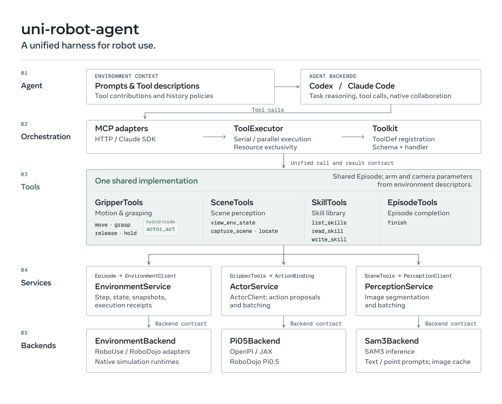

> 图解：请求自上而下经过 Agent、Orchestration、Tool、Service 和 Backend 五层。Agent 管理模型交互与上下文；Orchestration 负责调度；Tool 实现共享机器人操作；Service 管理感知、动作模型和环境资源；Backend 接入具体仿真器、机器人与模型。箭头表示逻辑交互，不代表逐条网络连接。

这个设计的价值不只是工程整洁。工具与模型、机器人后端解耦后，研究者可以只替换其中一个变量，更清楚地判断性能变化来自模型、工具还是环境。

### 统一接口：从 $N\times M$ 套实现变成 $N+M$ 个组件

“把夹爪移动到目标位姿”在仿真与真机上应当是同一个工具，即使底层控制 API 完全不同。系统为运动、感知、技能和 episode 控制规定统一参数、单位与反馈格式，再由环境适配器处理原生观测、坐标系和执行命令。

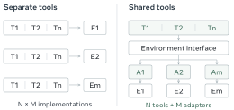

> 图解：$T$ 表示工具，$A$ 表示环境适配器，$E$ 表示环境。$N$ 个共享工具通过 $M$ 个适配器服务不同环境，不再为每个环境重写整套工具，从而避免 $N\times M$ 种工具—环境组合实现。

以 `move` 为例，共享工具负责生成中间目标并监控进度，适配器只负责把目标翻译成原生命令、返回机器人状态。新增环境时主要新增适配器与配置；统一的交互记录也更容易合并，用于后续训练。

### 两级并发：让思考与动作真正重叠

如果模型必须等每一次机械臂运动结束才能继续推理，大量时间会被白白消耗；但如果所有调用都并行，同一机械臂上的连续动作又可能互相破坏。系统因此把并发拆成两层：

- **Agent 与工具之间**：`background` 调用立即返回任务句柄，模型可继续做独立计算，之后再取结果；`immediate` 调用则等待完成。依赖该结果的决策仍然必须等待。
- **工具与工具之间**：共享独占资源的调用按提交顺序执行，不共享资源的操作可以并行。例如，同一资源上的两次 `move` 顺序运行，而读取已有图像快照可以与运动重叠。

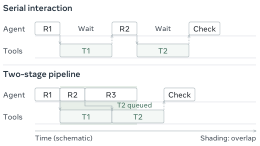

> 图解：$R$ 表示模型推理，$T$ 表示工具执行。$T_2$ 在等待 $T_1$ 时，模型已经可以开始下一轮推理，因此即使物理工具仍顺序执行，推理与执行也能形成流水线。实线和虚线分别表示提交与结果返回，阴影表示时间重叠；图中时长只是示意。

如果新观测要求改变计划，`flush_queue` 可以取消指定资源上尚未开始的调用。支持批量请求的模型还能在一次响应中提交多个工具，并批量等待结果。

### 六个细节决定工具是否可靠

统一接口解决“能不能调用”，真正影响闭环成功率的往往是状态是否一致、失败能否诊断、上下文能否持续维护。论文给出的六个设计很贴近真实机器人系统的痛点。

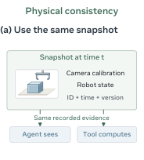

> 图解：图像、相机标定和机器人状态被绑定到同一个不可变快照。机器人随后发生运动时，定位仍使用拍照那一刻的状态，避免用新相机位姿解释旧像素。

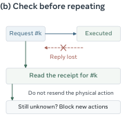

> 图解：系统记录请求身份与执行状态并拒绝重复请求。回复丢失不一定代表动作没发生，盲目重试可能让机器人再动一次；执行结果不确定时，后续动作会被阻塞，系统先尝试恢复执行记录，无法确认的请求则明确标记为不确定。

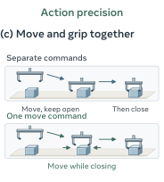

> 图解：`move` 同时接收目标位姿和可选夹爪开度，让手臂与夹爪协同动作，而不是先移动、再单独调整夹爪。

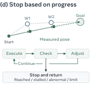

> 图解：工具根据最新测量位姿生成有界中间目标，每一步后检查进展。到达即停止，卡住、发散或达到执行上限则及时返回，不再机械地跑满固定步数。

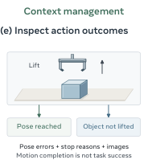

> 图解：位姿误差和停止原因说明运动本身是否准确，结果图像则说明物体是否真正被抓起或放好。到达目标位姿不等于任务成功，两类反馈结合后，模型才能判断应该微调动作还是更换操作策略。

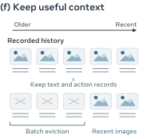

> 图解：旧图像被批量替换为文本占位符，近期图像、任务指令和动作记录继续保留。批量淘汰能让两次清理之间的提示词前缀保持稳定、复用缓存；上下文仍超预算时，再用策略模型压缩历史。

**博主认为，这套系统最聪明的地方，是把“模型是否聪明”和“交互是否可信”分开了。** 后者不会凭空增加模型知识，却能显著减少状态错配、重复动作和无反馈等待造成的非必要失败。

## 仿真验证：无深度、无验证器，开放模型超过已发表 Astra 结果

### 实验设置

RoboDojo 包含 42 项任务，覆盖五个等权维度：泛化（Gen.）、精细操作（Prec.）、长程执行（Long-Hor.）、记忆（Memory）和开放词汇指令（Open）。每任务使用 3 个随机种子、2 种布局，共 6 个 episode，总计 252 个 episode；单个 episode 最长运行 3 小时。

结果同时报告成功率 SR 和考虑部分完成的 Score，Score 范围为 0–100。每个维度内先平均任务结果，再对五个维度等权平均。

主实验只提供 RGB 图像、相机标定、机器人本体状态与描述、任务指令，明确禁止：

- 仿真器真值深度、物体 CAD 资产和隐藏场景标注；
- 任务验证器反馈和外部网络访问；
- 通过工具计算间接读取被禁止的信息。

少数任务指令本身存在歧义，例如何时确认红按钮按压次数、塔状结构如何排列。作者只补充简短规则说明，不提供评分细则或验证器逻辑，并人工检查模型没有越权访问信息。

### 主结果

下表每项均为 **SR/Score**；Avg. 是五个能力维度的非加权平均。灰色深度结果在原文中仅作参考，主结果均不使用深度。

| 模型 | Harness | Gen. | Prec. | Long-Hor. | Memory | Open | Avg. ↑ |
|---|---|---:|---:|---:|---:|---:|---:|
| $\pi_{0.5}$ | — | 8.17/13.38 | 5.50/12.40 | 14.67/23.54 | 4.67/5.89 | 1.67/1.98 | 6.93/11.44 |
| Hy-Embodied-0.5-VLA | — | 8.39/11.78 | 8.00/13.81 | 14.92/25.74 | 12.11/13.37 | 0.58/0.65 | 8.80/13.07 |
| OpenWAM-$\alpha$ | — | 14.83/20.71 | 9.25/18.45 | 25.33/34.93 | 9.11/10.41 | 1.08/1.41 | 11.92/17.18 |
| Xiaomi-Robotics-1 | — | 17.00/23.54 | 18.83/26.69 | 23.67/38.39 | 6.56/7.81 | 3.58/3.94 | 13.93/20.07 |
| GPT-6 Astra | RoboProbe | 30.50/33.36 | 4.00/12.65 | 8.25/21.45 | 38.67/43.04 | 31.00/34.36 | 22.48/28.97 |
| GPT-6 Astra | **uni-robot-agent** | 31.94/37.15 | 20.83/28.75 | 39.58/50.31 | 80.56/80.56 | 60.42/62.71 | **46.67/51.90** |
| GPT-6 Astra | uni-robot-agent + depth | 43.06/47.85 | 29.17/36.04 | 52.08/60.31 | 75.00/75.42 | 62.50/64.17 | 52.36/56.76 |
| Qwen3.8-Flash-Next | RoboProbe | 0.00/0.35 | 0.00/0.83 | 0.00/3.75 | 0.00/0.00 | 4.17/4.58 | 0.83/1.90 |
| Qwen3.8-Flash-Next | RPent | 5.56/9.24 | 4.17/8.02 | 4.17/12.40 | 5.56/5.56 | 2.08/3.54 | 4.31/7.75 |
| Qwen3.8-Flash-Next | GAP (Hybrid) | 13.89/19.31 | 8.33/16.46 | 18.75/28.85 | 16.67/16.67 | 22.92/23.75 | 16.11/21.01 |
| DeepSeek-V4.1-Flash | **uni-robot-agent** | 16.67/20.35 | 6.25/16.25 | 4.17/14.79 | 36.11/38.33 | 43.75/45.83 | **21.39/27.11** |
| DeepSeek-V4.1-Flash | uni-robot-agent + depth | 18.06/21.88 | 12.50/19.79 | 10.42/25.31 | 41.67/45.56 | 37.50/38.54 | 24.03/30.22 |
| Qwen3.8-Flash-Next | **uni-robot-agent** | **18.06/21.60** | **2.08/10.21** | **6.25/23.75** | **52.78/54.72** | **45.83/46.67** | **25.00/31.39** |
| Qwen3.8-Flash-Next | uni-robot-agent + depth | 22.22/25.28 | 18.75/26.35 | 14.58/29.69 | 52.78/56.25 | 39.58/41.88 | 29.58/35.89 |

注：GAP (Hybrid) 还引入了 $\pi_{0.5}$，因此不是与 uni-robot-agent 完全相同的纯模型配置。

三个结论尤其值得注意：

1. **开放权重模型确实可用。** Qwen 的 31.39 Score 超过表中所有 VLA/WAM 基线，也超过已发表的 Astra–RoboProbe 28.97；DeepSeek 同样超过这些 VLA/WAM 基线。
2. **Harness 不是无关紧要的包装。** 同一个 Qwen 换到最强的对比 harness GAP (Hybrid)，平均结果降至 16.11% SR、21.01 Score，相比 uni-robot-agent 少了 8.89 个百分点 SR 和 10.38 Score。
3. **长程与精细操作仍是短板。** RUA 在记忆和开放词汇任务上更有优势，但 Qwen、DeepSeek 的长程表现弱于 Xiaomi-Robotics-1 和 OpenWAM-$\alpha$。GPT-6 Astra 配合该 harness 达到 51.90，说明系统设计同样能放大闭源模型能力。

## 真机验证：19 项任务上的零样本操作

仿真结果之后，更关键的问题是这套交互方式能否落到物理机器人上。作者在 ARX AC one 双臂平台上测试 19 项桌面任务，平台包含两条 X5 机械臂和三个 Intel RealSense D405 相机，分别提供头部视角和两只手腕视角。

五个维度各占 20 分：空间理解、物体泛化、指令遵循、组合泛化和未见任务。对比对象包括每个任务使用 10 小时示范微调的 $\pi_{0.5}$、零样本 WAM Dream-1，以及分别搭配 Qwen 和 GPT-6 Astra 的 uni-robot-agent。

需要特别注意输入差异：**uni-robot-agent 的真机实验额外使用 D405 深度流，而 $\pi_{0.5}$ 和 Dream-1 只使用 RGB。** 因而这里主要证明真机可行性，不能把分数差异完全归因于模型或 harness。

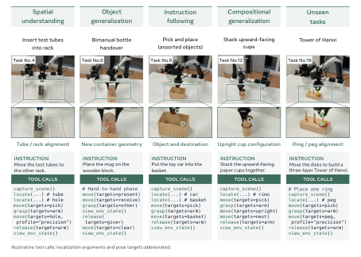

> 图解：照片和局部特写展示五个能力维度的代表性任务，并配有示例指令和工具调用。测试不仅要求抓取，还覆盖双臂协作、布料操作、颜色与方向约束、动作重组和未见任务。

### 总体结果

| 能力维度（各 20 分） | $\pi_{0.5}$：VLA | Dream-1：WAM | Astra + uni-robot-agent | Qwen + uni-robot-agent |
|---|---:|---:|---:|---:|
| 空间理解 | 11.25 | 6.50 | 17.00 | 9.00 |
| 物体泛化 | 12.50 | 13.50 | 17.50 | 10.00 |
| 指令遵循 | 14.00 | 9.50 | 18.00 | 13.50 |
| 组合泛化 | 6.00 | 10.00 | 20.00 | 13.00 |
| 未见任务 | 4.00 | 4.00 | 8.00 | 8.00 |
| **总分（100 分）** | **47.75** | **43.50** | **80.50** | **53.50** |

Qwen 没有使用这些真机示范，总分高于零样本 Dream-1，并与经过任务示范微调的 $\pi_{0.5}$ 整体可比。Astra 进一步取得 80.50，优势主要来自空间理解、双臂交接、精细抓取与动作组合。

RUA 的相对优势集中在组合泛化和未见任务：它能把“抽纸”和“丢弃”串起来，也能把按大小排列的经验改成按颜色排列。VLA/WAM 则在练过的物体操作上更稳，例如 $\pi_{0.5}$ 完成所有新物体叠碗试验，并在双臂抽出盘子上领先。

### 每项任务结果与评分口径

下表将任务变化、评分要点与各方法得分对应起来。部分完成也计分，因此总分不是“完整成功率”。

| ID | 任务与测试要点 | 满分 | $\pi_{0.5}$ | Dream-1 | Astra | Qwen |
|---:|---|---:|---:|---:|---:|---:|
| 1 | 水果抓取放置：五类水果各成功放入篮中计 1 分 | 5 | 2 | 3 | 5 | 3 |
| 2 | 折布：大小与斜放三种条件各 1 分 | 3 | 1.75 | 1.5 | 3 | 1 |
| 3 | 双臂抽盘：一臂抬瓶，另一臂取出并叠盘 | 4 | 3 | 0 | 2 | 1 |
| 4 | 试管插入架：拾取与插入分别计分 | 4 | 2 | 1 | 3 | 2 |
| 5 | 挂马克杯：抓住与成功悬挂分别计分 | 4 | 2.5 | 1 | 4 | 2 |
| 6 | 双臂瓶子交接：使用新饮料瓶和带柄杯 | 10 | 2.5 | 5.5 | 10 | 4 |
| 7 | 新物体叠碗：钢、纸、陶瓷和沙拉碗 | 10 | 10 | 8 | 7.5 | 6 |
| 8 | 按颜色顺序叠杯：两色与三色设置 | 10 | 6 | 1 | 8 | 5 |
| 9 | 多类物体抓取放置：区分物体和目标容器 | 6.5 | 6 | 6.5 | 6.5 | 6.5 |
| 10 | 按方向叠碗：区分左右、上下关系 | 3.5 | 2 | 2 | 3.5 | 2 |
| 11 | 抽纸并丢弃：连续完成两个动作 | 4 | 0 | 4 | 4 | 1 |
| 12 | 叠开口向上的纸杯：改变训练中的杯口配置 | 4 | 4 | 0 | 4 | 0 |
| 13 | 用抹布擦白板：替换训练中的擦除工具 | 4 | 2 | 4 | 4 | 4 |
| 14 | 按颜色排列方块：把大小规则换成颜色规则 | 8 | 0 | 2 | 8 | 8 |
| 15 | 关微波炉门：迁移训练流程中的子动作 | 4 | 4 | 4 | 4 | 4 |
| 16 | 从微波炉取碗：执行反向动作 | 4 | 0 | 0 | 0 | 0 |
| 17 | 展开抹布：执行折叠的反向动作 | 4 | 0 | 0 | 0 | 0 |
| 18 | 叠书：组合已有动作 | 4 | 0 | 0 | 2 | 4 |
| 19 | 三层汉诺塔：未见的新动作 | 4 | 0 | 0 | 2 | 0 |
|  | **总分** | **100** | **47.75** | **43.50** | **80.50** | **53.50** |

设维度 $d$ 中的任务集合为 $\mathcal{T}_d$，任务 $t$ 的得分和满分分别为 $p_t$、$m_t$，则总分为：

$$
S_d=\sum_{t\in\mathcal{T}_d}p_t,\qquad
\sum_{t\in\mathcal{T}_d}m_t=20,\qquad
\mathrm{Score}_{\mathrm{Real\ Eval}}=\sum_{d=1}^{5}S_d
$$

每次试验前都会重置场景并随机化物体位置和目标区域，从改写指令池中选一条作为唯一任务说明。所有方法使用同一评分规则；抓住物体但插入失败可以得到部分分，却不算完整任务成功。

真机训练目录包含 30 个任务模板、1,550 条轨迹，用于微调 $\pi_{0.5}$ 等端到端策略；uni-robot-agent 不使用这些示范。物体材质、颜色、摆放和桌面外观会按轨迹变化，测试则专门改变物体、语言规则或动作结构，以区分不同泛化能力。

## 什么能力让通用模型学会“用机器人”？

证明开放模型可用之后，作者进一步比较不同代际、家族和参数规模的模型，希望找出性能差异来自哪里。附加模型仍在 42 项 RoboDojo 任务上评估，但只使用一个种子和一种布局，因此这些结果更适合看作模式分析，而不是严格的统计显著性结论。

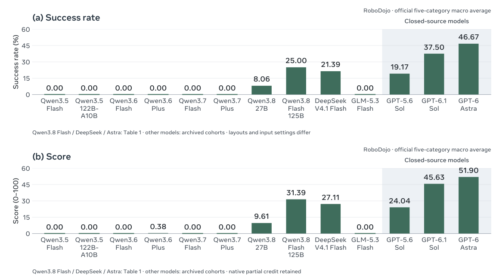

> 图解：上方为 SR，下方为 Score，阴影表示闭源模型。GPT-5.6 Sol 已取得 19.17% SR、24.04 Score，GPT-6.1 Sol 达到 37.50% SR、45.63 Score，说明机器人使用并非最新一代模型才突然出现的能力。

不同家族的轨迹并不一致。Qwen3.5–3.7 Flash、Qwen3.6–3.7 Plus 和 Qwen3.5-122B 都是 0 SR，只有 Qwen3.8 代出现成功：27B 模型为 8.06% SR，Flash-Next 为 25.00% SR。GLM-5.3 Flash 虽属新代际，SR 同样为 0。

参数规模也不是答案。Qwen3.8-27B 能完成任务，而更早、更大的 Qwen3.5-122B 和参数超过 150B 的 Qwen3.6/3.7 Plus 都失败。作者据此推测，**训练分布和由此形成的基础能力，比单纯增大参数或更新版本号更关键。**

### 四类高频失败

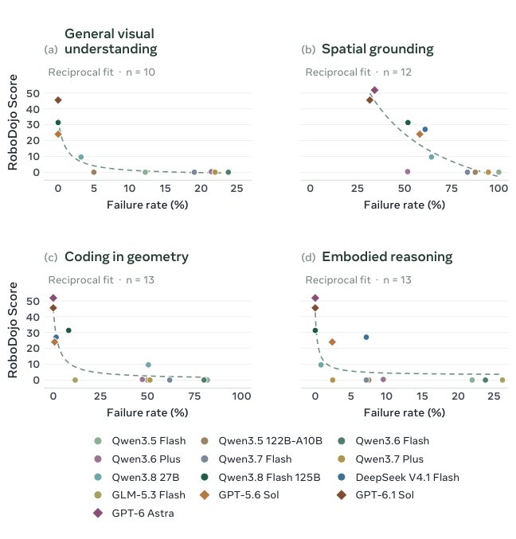

> 图解：四个子图分别把模型的 RoboDojo Score 与通用视觉理解、空间定位、几何编程、具身推理的错误率关联起来。总体趋势是错误率越低，任务表现越好；它揭示的是模型级相关性，不是单项能力的因果贡献。

- **通用视觉理解**：早期 Qwen Flash/Plus 会把 0 看成 9，或把倒扣杯子看成正放，这类错误出现在 12.2%–23.8% 的试验中；Qwen3.8-27B 降至 3.2%，更强的 Qwen3.8-Flash 和 GPT-5.6 Sol 没有记录到此类错误。
- **精细指向与空间定位**：模型需要在不同相机视图中选中同一个物理特征。对应像素不一致会产生很大的重投影误差，导致三角化工具拒绝结果。表现最好的 GPT-6.1 Sol 仍有 31.5% 的空间定位失败率，说明精确对应仍是普遍瓶颈。
- **几何计算代码**：早期 Qwen 常反转坐标变换或混用四元数约定，47.3%–81.8% 的已执行计算受影响；Qwen3.8-Flash、DeepSeek 和 GPT-5.6 Sol 分别降至 8.2%、1.5% 和 0.7%，GPT-6.1 Sol 未出现此类计算错误。
- **具身推理**：在抓取放置任务中，作者让 GPT-6 Astra 判断候选抓取位姿是否自然、可行。GLM 反复不能调整手腕方向，相关错误率达 26.2%。新 Qwen 和 GPT 更少犯这种错误，但 Astra 在双臂协调等更广泛的具身推理上仍会失败。

这些结果支持一个更具体的训练方向：未来的 RUA 训练不应只拟合动作输出，而应联合提升视觉理解、空间定位、几何编程与具身推理。

### 通用 Benchmark 能否解释机器人表现？

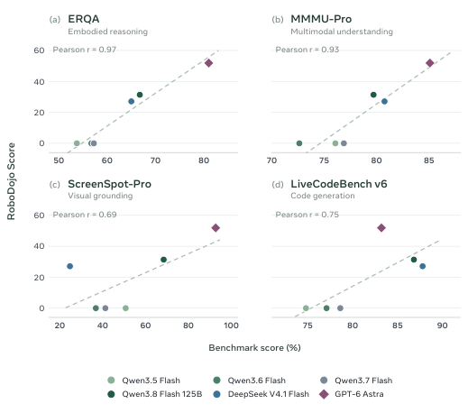

> 图解：每个点代表六个受测模型之一，横轴分别为 MMMU-Pro、ERQA、ScreenSpot-Pro 和 LiveCodeBench v6 成绩，纵轴统一为 RoboDojo Score，虚线为线性拟合。四项都呈正相关，其中具身推理和通用视觉理解更强，空间定位相对较弱。

四个 Benchmark 分别对应通用视觉理解、具身推理、空间定位和代码生成。ScreenSpot-Pro 主要考察二维屏幕定位，而机器人需要三维空间对应，这可能解释其相关性较弱。相关结果说明通用能力可以迁移到机器人使用，但并不能隔离某项能力的独立因果作用。

## 深度和技能库真的是必需品吗？

### 有相机参数时，真值深度并非必要

作者比较三种几何信息条件：RGB 加深图和相机参数、RGB 加相机参数、仅 RGB。Qwen 使用三个种子、两种布局；受评估成本限制，Astra 使用一个种子和一种布局。该消融启用技能，共 42 项任务。

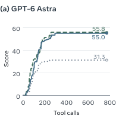

> 图解：记录 Astra 在 771 次工具调用过程中的任务进展与最终得分。去掉深度但保留相机参数时，分数仅从 55.83 变为 55.04，保留深度配置的 98.6%。

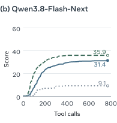

> 图解：Qwen 在相同无深度条件下从 35.89 降至 31.39，仍保留 87.5%。相机参数让模型能够通过多视图对应点恢复三维位置，因此真值深度不是唯一定位来源。

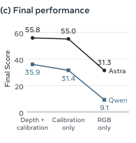

> 图解：进一步去掉相机参数、只留 RGB 后，Qwen 明显降至 9.13，Astra 降至 31.29。真正关键的转折不是“有没有深度”，而是“有没有足够约束把多视图像素转成空间几何”。

更强模型受深度缺失的影响更小。这说明模型能力提升后，可以更多依靠视觉和空间关系自行恢复几何，而不是完全依赖仿真器提供的理想测量。

### 性能并不依赖任务技能库

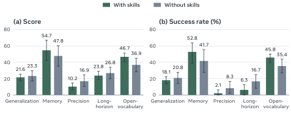

> 图解：比较 Qwen3.8-Flash-Next 启用与禁用技能时的结果，误差棒为约 95% bootstrap 置信区间。禁用技能库和技能编写后，仍保留任务指令、环境描述和标准机器人工具，最终取得 30.31 Score、24.58% SR。

无技能配置保留了有技能 Score 31.39 的 **96.6%**，SR 只差 0.42 个百分点。技能库有助于复用经验，但主结果并不是把任务答案藏进技能里得到的。

### Agent 自己写几何代码

无深度时，Qwen 不只是调用现成工具，还能根据相机内参和外参编写、执行几何程序。下面两个案例来自“无深度、无技能”配置。

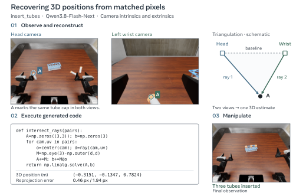

> 图解：在 `insert_tubes` 中，Agent 为管帽选择跨视图对应像素，用最小二乘视线求交计算世界坐标。记录的重投影误差分别为 0.46 和 1.94 像素，可用来检查对应关系是否一致；随后它估计管轴、选择抓取位姿，最终把三根试管全部插入架中。

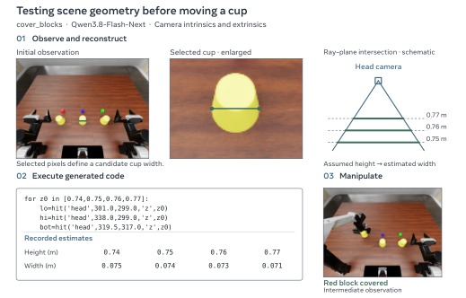

> 图解：在 `cover_blocks` 中，Agent 扫描候选桌面高度，让像素射线与不同候选平面求交，再比较推算出的杯子尺寸，并把候选形状投影回图像继续校正。它先检验几何假设，再执行抓取和放置，最终完成按顺序遮盖、揭开方块的任务。

这两个案例展示了代码工具的价值：模型可以把不确定的视觉判断转成可检查的几何计算。不过，对应点选择、场景假设和结果验证仍然必要，深度传感器本来可以简化这些步骤。

## 成本与速度：开放模型便宜多少，流水线快多少？

### Token、API 成本与任务进展

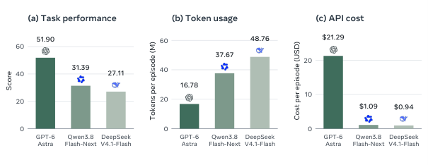

> 图解：Astra、Qwen 和 DeepSeek 各使用 252 个 episode，柱形展示 Score 和每 episode 平均资源使用。Qwen 以每 episode 1.09 美元取得 31.39 Score；Astra 取得最高的 51.90，但成本为 21.29 美元，接近 20 倍。

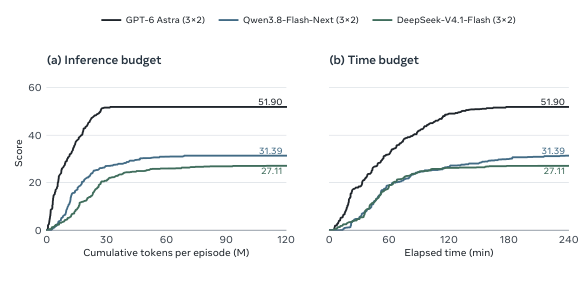

> 图解：曲线使用同一组模型的中间执行结果，横轴分别为累计 Token 和墙钟时间，纵轴为任务 Score，并保留每个 episode 最新观测成绩。达到 Score 25 时，Astra 需要 7.4M Token，Qwen 和 DeepSeek 分别需要 23.5M、49.9M；对应时间分别为 42.6、95.5、99.2 分钟。

成本按每次请求记录的实际用量和公开费率估算。普通输入、缓存输入、输出分别计费，Reasoning Token 已包含在输出中，不重复计算；记录到的重试也计入成本。

| 模型 / 价格条件 | 币种 | 输入 | 缓存输入 | 输出 |
|---|---|---:|---:|---:|
| GPT-6 Astra | USD | 10.00 | 1.00 | 50.00 |
| Qwen3.8-Flash | CNY | 0.80 | 0.10 | 2.70 |
| DeepSeek-V4.1-Flash（高峰） | CNY | 2.00 | 0.04 | 8.00 |
| DeepSeek-V4.1-Flash（非高峰） | CNY | 1.00 | 0.02 | 4.00 |

费率均为每百万 Token，存档于 2026 年 10 月 22–23 日；人民币按 6.6729 CNY/USD 换算。Astra 超过 272K 输入 Token 的请求适用更高的长上下文费率，缓存写入另计；DeepSeek 则按请求处理时间区分工作日高峰与其他时段。因此，**Token 更少并不必然意味着美元成本更低。**

### 流水线把动作时间藏进推理时间

作者选取五项任务，用 GPT-6 Astra、medium reasoning effort，对每种配置以相同种子和布局各运行一次，测量时不计仿真器初始化。

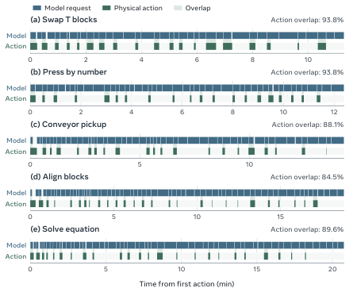

> 图解：蓝色和绿色条分别表示模型请求与物理动作，阴影表示重叠，百分比是动作时间中与模型请求重叠的比例。五个流水线 episode 的重叠率为 84.5%–93.8%，五个串行 episode 均为 0；每个子图从首个动作开始，使用各自时间范围。

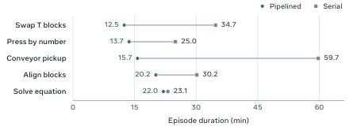

> 图解：五项任务的流水线运行都短于串行运行，观测到的 episode 时长降幅为 4.8%–73.7%。例如 `swap_T` 从 34.7 分钟降至 12.5 分钟，`press_by_number` 从 25.0 分钟降至 13.7 分钟。73.7% 是所选任务中的最大降幅，不代表所有任务的普遍收益。

流水线的意义不只是提前生成下一条命令，还包括在物理动作进行时完成具体计算。

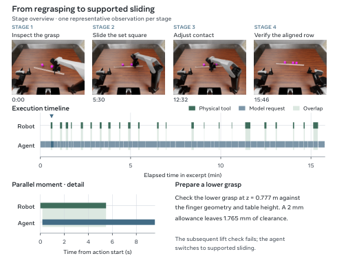

> 图解：在 `align_blocks` 中，后台 `release` 打开夹爪时，模型生成 Python 检查更低抓取位姿的桌面间隙，并计入 2 mm 不确定余量。后续短抬测试发现直角尺没有被保持住，Agent 随即改为有支撑滑动，说明提前准备与根据物理反馈改计划必须同时存在。

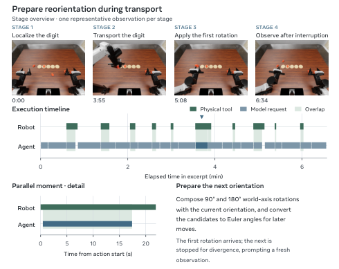

> 图解：在 `arrange_largest_number` 中，机械臂搬运数字时，模型提前组合绕世界轴的 $90^\circ$、$180^\circ$ 候选旋转并转成欧拉角。运输先用尽步数预算，后续旋转又因发散停止，Agent 只能根据返回状态继续调整；提前算好候选并不意味着可以跳过执行监控。

## 评估稳定性与运动控制推导

### 六次 rollout 够不够？

作者另外使用 **启用深度** 的 Qwen 配置，研究 rollout 数量对 Score 的影响。数据池包含 54 个任务变体，每个 50 次 rollout，共 2,700 个 episode。对每个样本量 $n=1,\ldots,50$，从每个变体无放回抽取 $n$ 次，重算五维等权 Score，并重复 10,000 次。

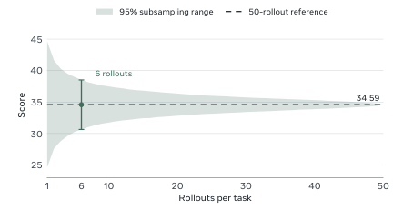

> 图解：横轴为每个任务变体的 rollout 数，纵轴为 Score；阴影表示 10,000 次子采样的中央 95% 区间，虚线为 50 次全量参考值 34.59。六次 rollout 的均值为 34.59，中央 95% 区间为 30.65–38.51，标记与误差棒对应这一设置。

如果按 pass 和 layout 标识直接取前六次，Score 为 36.55，比全量参考高 1.96 分。小样本平均而言能接近总 Score，但具体子集仍可能波动数分。图中的区间只描述对既有数据池的子采样，并在 50 次时按构造收窄，并不直接验证主实验的三个种子、两种布局设计；本节数字也不能与无深度主结果混用。

### `move` 如何知道该继续、停止还是换目标？

单次 `move` 接收目标 $g=(p_g,q_g)$，同时维护实际执行目标 $\tilde g$。两者分开，是因为规划器拒绝原目标后，系统可能在不放松原始容差的前提下，搜索一个附近的替代目标。

执行循环可以概括为：

1. 读取状态，初始化目标、进度历史和已接受步数。
2. 根据最新测量位姿生成有界 waypoint，并执行一步。
3. 检查环境是否结束、运动是否异常、命令是否被接受。
4. 更新位置和姿态误差，依次检查到达、发散和停滞。
5. 规划被拒绝且后端支持时，最多搜索一次符合原容差的替代目标；否则保留诊断并停止。
6. 返回实际位姿、目标误差、到达标记、已接受步数、停止原因和诊断证据。

平移与旋转共享位移预算 $\delta$，机械臂声明的旋转半径为 $r$。最大角步长为：

$$
\theta_{\max}=
\begin{cases}
\min\{0.6,\,2\arcsin(\min\{1,\delta/(4r)\})\}, & r>0,\\
0.6, & r=0.
\end{cases}
$$

若实际旋转为 $\Delta\theta$，剩余平移额度为：

$$
\delta_p=\max\{0,\,\delta-2r\sin(\Delta\theta/2)\}
$$

到达要求位置和姿态都回到原始目标 $g$ 的容差 $\epsilon_p$、$\epsilon_q$ 内。单位四元数之间的最短角距离定义为：

$$
d_q(q_1,q_2)=2\arccos(\min\{1,|q_1^\top q_2|\})
$$

进度则相对执行目标 $\tilde g$ 计算。设第 $t$ 个已接受步的位置、姿态误差为 $e^p_t$、$e^q_t$，发散检测跟踪 $v_t=e^p_t+0.1e^q_t$，连续两次满足 $v_t>v_{t-1}+0.01$ 即停止。停滞检测查看最近四个已接受步，如果两项误差都没有足够改善则停止：

$$
e^p_{t-3}-\min_{j=t-2}^{t}e^p_j\leq0.1\epsilon_p,
\qquad
e^q_{t-3}-\min_{j=t-2}^{t}e^q_j\leq0.1\epsilon_q
$$

异常运动单独检查：活动臂单次变化阈值为 0.2 m 或 0.8 rad，非活动臂为 0.05 m 或 0.25 rad。即使命令被拒绝，也要检查返回状态，因为“拒绝”并不保证机器人完全没动。只有被接受的步计入预算并更新进度历史。

这套设计把控制结果变成 Agent 能理解的诊断，而不是只返回“成功/失败”。不过，位姿到达仍不能证明抓取或放置成功，所以还需要前文的结果图像反馈。

## 与已有路线的关系

- **VLA 与 WAM**：VLA 把视觉语言表征和多样机器人数据迁移到动作策略，WAM 则通过预测未来视频、状态或价值进行动作生成与规划。它们扩展了可学习行为的范围，但长交互中的历史利用与失败恢复仍是挑战。
- **工具型 Agent**：SayCan、代码化感知与控制 API、环境反馈重规划和空间表征，已经证明通用模型可以通过工具组织机器人行为。uni-robot-agent 进一步处理物理动作运行期间世界仍在变化的问题。
- **RUA harness**：RoboDawn、Robo-Harness K1、OpenRUA、Harness VLA、GAP 和 ORA 分别探索运动工具、几何感知、ROS 2 终端、记忆规划、策略动作纠正及开放模型接入。本文的差异在于把共享工具、模型运行时和环境适配器明确解耦，同时统一交互记录并加入资源感知流水线。

## 总结与展望

- **核心贡献是系统底座而非新策略**：五层模块化架构、统一工具与反馈，让不同模型、任务、仿真器和真机共享交互逻辑。
- **开放权重模型已具备可用性**：无特权输入时，Qwen 在 RoboDojo 达到 31.39 Score，DeepSeek 达到 27.11；同一 Qwen 换用其他 harness 后明显下降。
- **真机结果支持零样本迁移**：Qwen 和 Astra 分别取得 53.50、80.50，但真机 Agent 使用深度而基线只用 RGB，横向比较需谨慎。
- **深度和技能都不是主结果的必要前提**：保留相机参数时去深度损失有限，去技能后仍保留 96.6% 的 Score；真正难的是无标定三维定位、精细接触和长程恢复。
- **能力与工程需要共同推进**：视觉理解、空间定位、几何代码和具身推理共同决定机器人使用能力，流水线则在五项测试任务中减少 4.8%–73.7% 的时长。

未来更有价值的方向，是利用这套统一接口收集可合并的机器人交互数据，针对四类能力联合训练开放模型，同时提升精细操作、双臂协调和可靠长程执行。

> 本文参考自 [Democratizing Robot-Use Agents: A Unified Harness with Open Models](https://arxiv.org/abs/2611.01560)