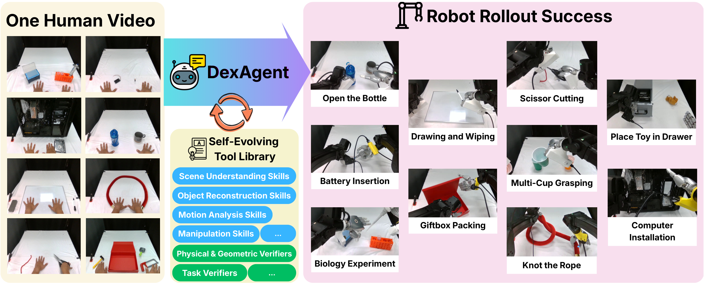
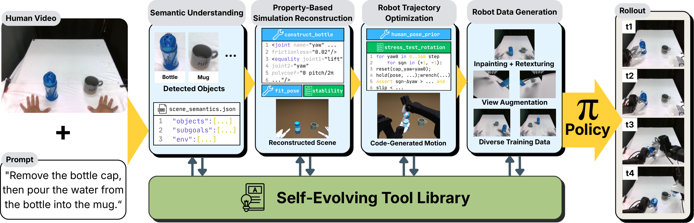
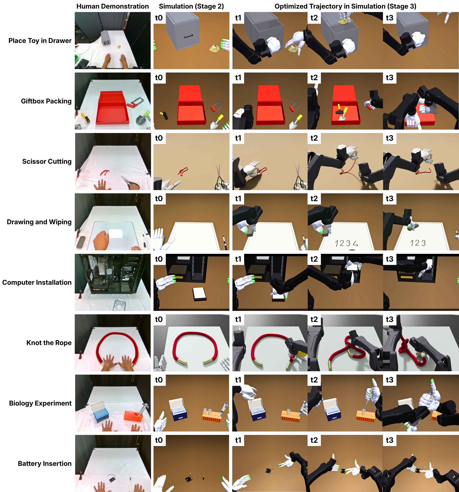
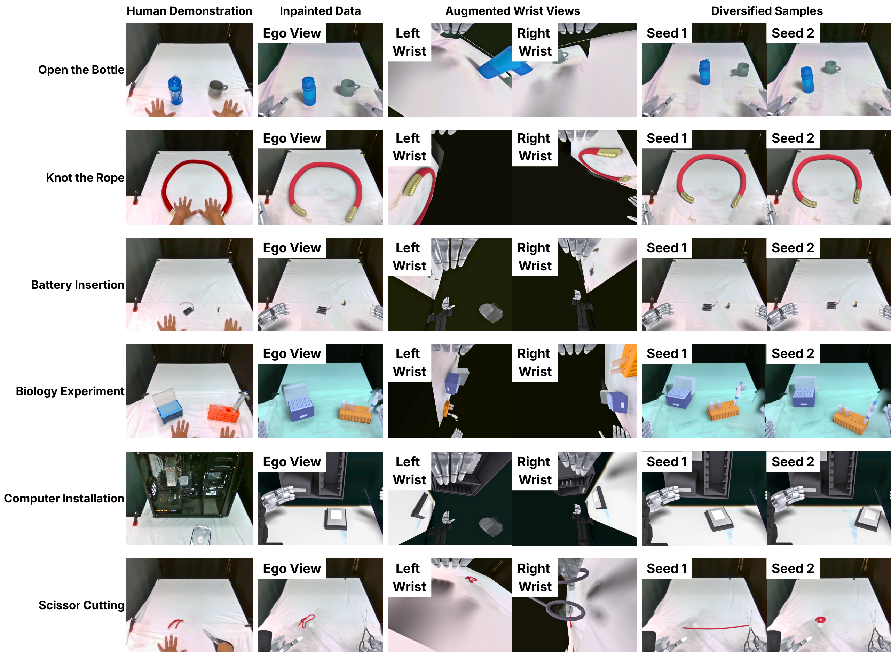
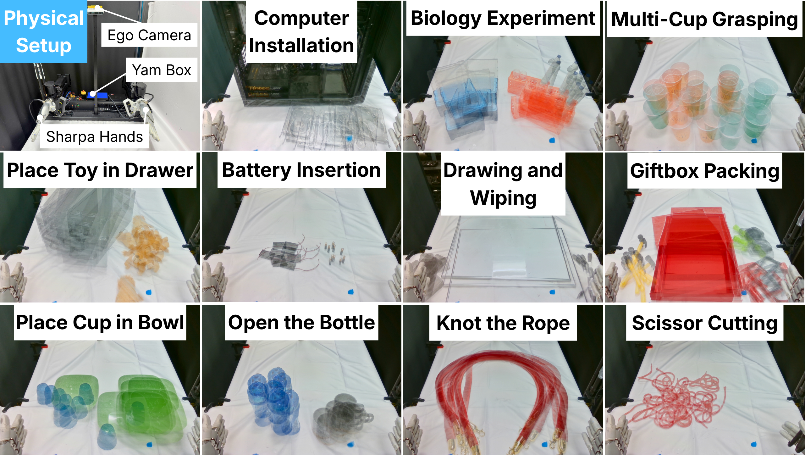
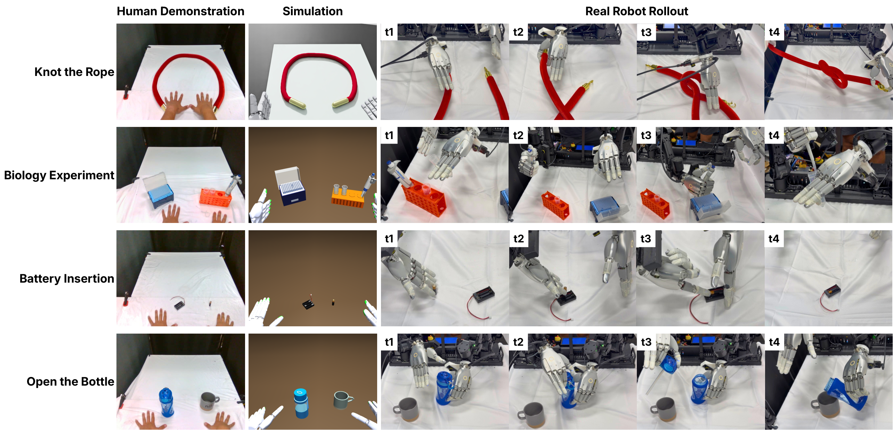
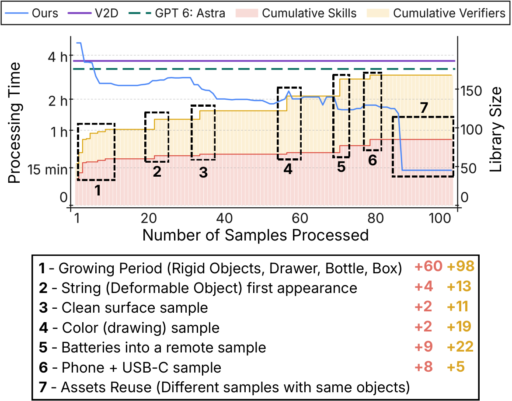
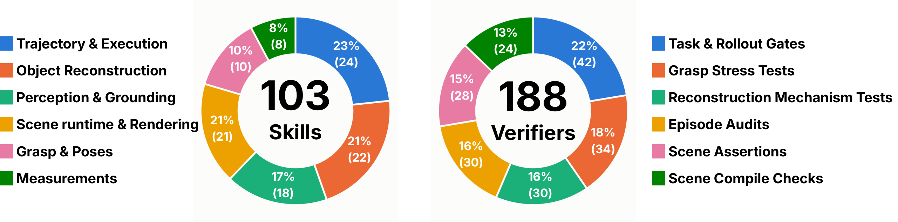

# DexAgent：自进化工具库把单条视频变成灵巧手数据

DexAgent 要解决的是：如何把一条第一视角人手操作视频，自动变成可供多指灵巧手训练的、物理上可执行的机器人数据。这个问题很关键，因为真实灵巧手数据采集昂贵，而铰接物体、可变形物体和长时程任务又很难被固定转换流程统一处理。它的核心思路是让智能体按物体属性选择或编写工具，并用仿真验证器反复检查和修正，再把验证通过的轨迹扩增成训练数据。在 11 个真机任务上，用其数据训练的策略平均成功率为 **63.6%**，约为最强基线 SPIDER 的 **3.5 倍**；开环轨迹回放则在 **11/11** 个任务上至少成功一次。

## 为什么固定流程难以覆盖灵巧操作？

多指灵巧手拥有大量自由度，手与物体之间还存在复杂接触。强化学习虽然能在仿真中训练控制策略，但探索效率和任务奖励设计仍是瓶颈；人类演示可以提供运动先验、物体轨迹和接触信息，却仍需解决人手与机器人手之间的结构差异。

已有路线大致分为三类：

- **人类视频预训练或协同训练**：R3M、EgoVLA、EgoMimic、EgoScale 等方法减少了机器人数据需求，但训练或适配阶段通常仍依赖机器人演示。
- **Human2Sim2Robot 转换**：Do as I Do、SPIDER、TopoRetarget、EgoInfinity、V2D 等方法把人类演示重建到仿真中，再通过物理交互弥合 embodiment gap，也就是人手与机器人手之间的形态和控制差异。
- **智能体式机器人框架**：CaP-X、GaP 等通过执行反馈组合和改进技能，但它们依赖可靠的底层技能，而多指灵巧手的底层技能本身就很难构建。

第二类方法与 DexAgent 最接近，但其流程通常预先固定。刚体只需要稳定的几何和位姿，抽屉、瓶盖等铰接物体却需要正确的关节轴与行程，绳索等可变形物体又涉及拓扑和形变约束。长时程任务更复杂：拿起、搬运、插入、旋转等子目标，未必适合同一种运动生成方式。

> 图解：左侧是单条第一视角人类视频和自然语言任务提示；中间是随任务选择、创建并积累技能的自进化工具库；右侧展示了覆盖多种物体与长时程交互的 11 个灵巧操作任务。整幅图强调的是从“人做一次”到“机器人获得一批训练数据”的完整转换，而不只是手势重定向。

因此，真正需要的不是再增加一条固定流水线，而是一套能识别任务差异、选择不同工具，并拒绝错误结果的生成机制。

## 核心设计：生成之后必须验证，验证工具也能沉淀

DexAgent 把转换过程分为四个阶段：语义理解、基于属性的仿真重建、机器人轨迹优化、机器人数据生成。每个阶段都可以调用工具库中的 Skill，也可以针对新需求编写 Skill；生成结果则由 Verifier 在仿真中检查。

> 图解：Stage 1 从视频和提示中提取物体属性并拆分子目标；Stage 2 调用蓝色所示的属性相关 Skill 重建仿真物体；Stage 3 结合人类运动先验优化与代码生成运动，得到机器人轨迹；Stage 4 改变视角、物体和机器人状态，并对画面进行修复与重纹理化，形成多样化训练数据。各阶段之间不是简单串联，而是带有“生成—验证—修正”的内部循环。

智能体只有在所需验证器全部通过后才进入下一阶段。如果验证失败，它会根据反馈修正结果，或者换用、改写 Skill。每阶段受给定执行预算或最多 100 个 agent turns 限制；预算耗尽仍未通过，就明确记为失败，不允许把不完整结果交给下一阶段。Backbone 可以是不同 API 提供的 VLM，框架本身不绑定某一个模型。

这个设计的关键价值在于：**它把错误拦截在产生错误的阶段**。否则，一个错误的关节轴会继续污染抓取姿态、轨迹和训练数据，最后很难定位问题究竟出在哪里。

### 工具库里到底有什么？

工具库主要保存两类普通 Python 函数，它们都使用带类型的参数：

- **Skill**：生成资产、位姿或运动，例如重建抽屉、估计深度、生成抓取姿态、连接子目标轨迹。
- **Verifier**：根据仿真交互接受或拒绝 Skill 的输出，例如检查关节能否运动、抓取能否承受摇晃、整条轨迹是否满足物理约束。

工具被改进时采用 fork，而不是覆盖原函数，从而保留已有能力。新建 Skill 和 Verifier 都会入库；物体资产也可以保存以加快后续处理，但考虑到资产大小差异，这一步是可选的。工具应面向一类具有相似属性的物体进行参数化设计，而不是只适配某一个样本。

### 阶段一：先理解“要做什么”，再决定“怎么重建”

输入只有一段第一视角 RGB 视频和一句任务提示。VLM 先从提示中推测可能涉及的物体，再抽取视频帧，根据物体运动确认属性假设。必要时，它还能调用深度估计、重力方向估计和人手姿态提取等工具。

这一阶段的输出是共享的 `scene_semantics.json`，主要包括：

1. 物体及其类型：刚体、铰接体、可变形体或其他类型。
2. 重建必须具备的属性，例如瓶盖可旋转、板擦能擦除笔迹。
3. 有序子任务，以及每个子任务的操作手、作用对象、双手角色和可观察成功条件。

任务会被尽量拆成只含一个运动的子目标。例如 pick-and-place 被拆为拿起、移动、放下三步。此时记录的是自然语言语义，而不是直接猜测关节角、尺寸等数值参数；具体参数留给后续重建和优化阶段确定。

附录中的三个例子展示了这种分解的粒度：

| 任务 | 关键物体属性 | 子目标与成功条件示例 |
|---|---|---|
| 写字并擦除 | 马克笔留下持久深色笔迹；板擦只移除接触到的笔迹 | 右手依次写 1、2、3、4；左手只擦掉 4，同时保留 1、2、3；最后归还工具 |
| 开瓶并倾倒 | 瓶盖相对瓶身旋转后脱离；瓶盖连接的长管需要避开瓶口 | 左手固定瓶身、右手反复旋松；抬起瓶盖和管；瓶口朝向杯子倾倒。视频只能确认倾倒姿态，不能清楚确认液流或液位变化 |
| 把玩具放进抽屉 | 抽屉具有单自由度移动关节，只能沿纵向轴双向滑动 | 左手拉开抽屉，右手取放玩具，最后左手推回抽屉；成功条件包括玩具无支撑地停留在抽屉内 |

值得注意的是，系统会区分“任务预期结果”和“视频中实际可观察结果”。开瓶示例没有因为提示中说“倒水”，就虚构视频里清楚可见的液流。

### 阶段二：按属性重建，而不是套用一种物体模板

有了语义约束后，DexAgent 先为物体属性选择或编写验证器，再选择重建 Skill。不同物体对应不同检查重点：

| 物体类型 | 主要验证内容 |
|---|---|
| 刚体 | 轮廓、尺度、质量、静止稳定性 |
| 铰接体 | 关节是否存在、关节轴、运动行程、自锁现象 |
| 可变形体 | 拓扑结构 |

如果库中已有适合该类物体的 Skill，智能体就传入外观、尺寸、颜色、纹理、关节数量、关节可动范围等参数；如果没有，就编写新的参数化函数。新 Skill 从没有关节的可编辑 URDF 起步，每加入一个属性，就先建立对应 Verifier，再修改 URDF，直至该属性通过检查。

所有单项属性完成后，系统还会进行两层额外检查：

- **联合验证**：同时运行全部 Verifier，防止修好一个属性却破坏另一个属性。
- **泛化复验**：增加新的资产测试，并要求参数化 Skill 再生成 3 个变体，且这些变体也能通过验证。

通过复验的 Skill 才会被视为可复用工具并入库。这个要求的聪明之处在于，它把“这次碰巧能运行”和“以后能重复使用”区分开来。

物体放置通过优化仿真渲染掩码与人类视频掩码之间的 IoU（交并比）完成：

$$
\mathrm{IoU}=\frac{|M_{\mathrm{sim}}\cap M_{\mathrm{human}}|}{|M_{\mathrm{sim}}\cup M_{\mathrm{human}}|}
$$

其中，$M_{\mathrm{sim}}$ 和 $M_{\mathrm{human}}$ 分别表示同一相机视角下的仿真物体掩码和真实视频物体掩码。相机距离主要借助深度估计，角度则结合 Sharpa 手与人手的重叠关系估计；已知参数也可以手动设置。最终输出的场景文件包含机器人、物体、匹配原视频的摆放位置和相机视角。

### 阶段三：每个子目标都可以选择不同的运动生成方式

DexAgent 先为每个子任务定义成功条件。例如，搬运要求物体到达目标位置，操作铰接物体要求关节到达目标状态。随后，它选择 Skill 生成目标机器人手姿态，可选方式包括：

- 直接把人手姿态重定向到机器人手；
- 优化手指关节，使人手演示中的手—物接触关系得到复现；
- 根据接触、力闭合和间隙等任务要求生成新的抓取。

这意味着人类动作是指导，而不是必须逐帧照抄的答案。当机器人手无法可靠复现人的抓法时，系统可以主动改变抓取方式。

目标姿态也必须通过交互验证。搬运姿态会接受抬起和摇晃测试；铰接物体操作姿态会接受滑动和旋转测试，以检查该姿态能否覆盖所需关节运动。验证失败后，智能体会修正姿态或更换工具。

通过验证的关键姿态再经逆运动学得到手臂构型，随后由代码连接成子任务轨迹，必要时使用人类轨迹作为运动先验。子任务组合为完整 episode 后，如果早期动作造成的终态妨碍后续任务，系统会回头修改早期动作。最后，整条轨迹还要通过运动限位和物理一致性检查。

> 图解：每行对应一个额外任务。第 1 列是原始人类演示，第 2 列是 Stage 2 重建的仿真场景，第 3—5 列是 Stage 3 优化轨迹中从 $t_0$ 到 $t_3$ 的代表帧。示例覆盖刚体、铰接体和可变形体，说明同一框架可以按任务采用不同重建与运动工具。

### 阶段四：从一条验证轨迹扩展成多视角训练集

一条有效轨迹还不足以训练稳健策略。DexAgent 会在机器人可达工作空间内改变物体和机器人的初始状态，并针对新配置调整轨迹。每个扩增 episode 仍需通过与原始轨迹相同的姿态和全轨迹验证。

视觉上，系统先用 VOID 移除原视频中演示者的手和被操作物体，再从标定相机渲染仿真机器人与物体并合成回去，最后在 Blender 中重纹理化，以减小仿真与真实画面的差异。除第一视角外，还能渲染左右腕部视角。

附录给出了更具体的数据扩增流程：先在桌面有效工作区采样 1,500 个随机种子，检查物体是否可达、任务是否仍可执行，并寻找有效轨迹；不合格种子被丢弃，再从通过者中选取 500 个配置。如果不足 500 个，就继续采样，直到收齐。每个配置都生成第一视角、左腕和右腕三个同步视角。

> 图解：第 1 列为原始人类演示；第 2 列为移除演示者、渲染机器人与物体并经过 Blender 重纹理化后的第一视角；第 3—4 列为左右腕部视角；第 5—6 列展示同一演示在不同随机种子下产生的数据。变化的不只是画面纹理，还包括物体初始状态和相应执行轨迹。

至此，一条视频完成了从语义、资产、运动到训练样本的转换。接下来要验证的是：这些中间结果本身是否更准确，最终真机策略是否真正受益。

## 数据质量：重建和轨迹转换分别提升了多少？

这组实验使用 MuJoCo，分别评估人体—物体交互重建和人手运动到机器人轨迹的转换质量。

### HOI4D 重建：两类物体均取得最好结果

F-5 和 F-10 是两个距离阈值下的 F-score，越高越好；CD 是 Chamfer Distance（倒角距离），越低越好。

| 方法 | 刚体 F-5 ↑ | 刚体 F-10 ↑ | 刚体 CD ↓ | 铰接体 F-5 ↑ | 铰接体 F-10 ↑ | 铰接体 CD ↓ |
|---|---:|---:|---:|---:|---:|---:|
| HO | 0.28 | 0.51 | 3.86 | 0.29 | 0.47 | 1.30 |
| IHOI | 0.42 | 0.70 | 2.70 | 0.32 | 0.47 | 1.47 |
| HORSE | 0.26 | 0.45 | 6.69 | 0.19 | 0.34 | 1.91 |
| MCC-HO | 0.52 | 0.78 | 1.36 | 0.35 | 0.55 | 1.21 |
| G-HOP | 0.69 | 0.91 | 0.63 | 0.07 | 0.09 | 1.23 |
| FoundationPose | 0.71 | 0.91 | 0.49 | 0.40 | 0.60 | 1.26 |
| Any6D | 0.71 | 0.91 | 0.50 | 0.38 | 0.60 | 1.24 |
| Do as I Do | 0.72 | 0.91 | 0.49 | 0.40 | 0.61 | 1.25 |
| **DexAgent** | **0.83** | **0.96** | **0.29** | **0.47** | **0.68** | **1.08** |

与各指标最强基线相比，DexAgent 在刚体上的 F-5、F-10 分别相对提高 15.3% 和 5.5%，CD 降低 40.8%；在更困难的铰接体上，F-5、F-10 相对提高 17.5% 和 11.5%，CD 降低 10.7%。

这些结果支持一个判断：重建收益不仅来自生成模型，也来自对几何、姿态和关节模型的持续验证与修正。

### OakInk 轨迹转换：物理成功率与运动保真度同时改善

实验通过物理仿真 rollout 检查轨迹。一个视频片段只有同时满足平均物体位置误差低于 $0.1\,\mathrm{m}$、平均物体旋转误差低于 $0.5\,\mathrm{rad}$，才计为成功。$E_{pos}$ 和 $E_{rot}$ 则分别表示仿真物体姿态相对演示的时间平均位置和旋转残差，均为越低越好。

| 方法 | Success ↑ | $E_{pos}$ (m) ↓ | $E_{rot}$ (rad) ↓ |
|---|---:|---:|---:|
| Dex-retargeting | 28.6% | 0.08 | 0.62 |
| SPIDER（MJWP，无接触引导） | 71.4% | 0.04 | 0.57 |
| SPIDER（MJWP-act，执行器接触引导） | 77.1% | 0.04 | 0.42 |
| Do-as-I-Do（Sharpa hand） | 81.0% | **0.03** | 0.15 |
| └ 去掉 transition reward | 79.0% | **0.03** | 0.14 |
| └ 仅 annealed sampling | 72.0% | 0.08 | 0.32 |
| **DexAgent** | **85.7%** | **0.03** | **0.12** |

DexAgent 的物理检查成功率比最强基线相对提高 5.8%，旋转误差降低 20.0%，位置误差则持平于 0.03 m。也就是说，它没有为了贴合人类动作而牺牲物理有效性，也没有为了提高物理成功率而明显偏离演示。

不过，仿真数据质量并不等同于真机任务成功。下一组实验进一步把转换、扩增、视觉处理和策略训练完整跑通。

## 真机实验：11 个任务上，轨迹能执行，策略也更能泛化

### 实验设置与公平比较

每个任务只录制一条完整人类演示。设备为 RealSense D435，第一视角 RGB 分辨率为 640×480、帧率为 30 FPS，并配套自然语言任务提示。仿真根据任务使用 MuJoCo 或 Isaac Sim。

真机平台是双臂 YamBox 工作站，配备两只 Sharpa 灵巧手、一台第一视角 RealSense D435 和两台腕部 Zed Mini 相机。11 个任务覆盖：

- **刚体操作**：杯子放置、多杯抓取、电池插入；
- **铰接物体**：开瓶、抽屉放置、剪刀剪切；
- **可变形物体**：绳结；
- **工具使用**：绘画与擦拭、移液；
- **长时程协调**：礼盒打包、电脑安装。

实验采用两种不同口径：

- **开环回放**：每种方法接收同一视频，生成轨迹后在真机执行 10 次；只要至少一次成功，该任务就记为成功。它衡量的是转换轨迹本身是否物理可执行，而不是学习策略的成功率。
- **闭环策略**：每种方法用同一扩增与视觉处理协议生成 500 个机器人 episodes，每个 episode 含一个第一视角和两个腕部视角，再微调同一个 $\pi_{0.5}$ 模型。每个任务在随机物体初始状态下测试 10 次，报告成功比例。

> 图解：图中展示各任务测试时随机化的物体摆放。它说明策略不能只记住一条固定轨迹或单一初始位置；这里报告的是多次、不同初始状态下的闭环执行结果。

基线覆盖的 pipeline 环节并不完全相同。为尽量公平，Dex-retargeting、SPIDER、TopoRetarget 保留自己的重定向方法，并补齐所需场景资产和物体位姿；Do as I Do、EgoInfinity、V2D 保留各自支持的重建与轨迹生成组件。所有方法随后采用相同的数据扩增、视觉处理和策略模型。GPT-6: Astra 则以 zero-shot 提示直接生成机器人轨迹，不使用 DexAgent 的验证框架。

### 开环回放：DexAgent 覆盖全部任务

下表中“成功”表示该任务 10 次回放至少有 1 次成功，“—”表示未成功。GPT-6: Astra 在第一轮评估后加入基准。

| 方法 | Cup | Giftbox | Drawer | Rope Knot | Scissors | Drawing | Computer | Bottle | Biology | Battery | Multi-object | 总计 |
|---|---|---|---|---|---|---|---|---|---|---|---|---:|
| Dex-retargeting | 成功 | — | — | — | — | — | — | — | — | — | — | 1/11 |
| Do as I Do | 成功 | — | — | — | — | — | — | — | — | — | — | 1/11 |
| SPIDER | 成功 | 成功 | 成功 | — | 成功 | — | 成功 | — | — | 成功 | — | 6/11 |
| TopoRetarget | 成功 | 成功 | 成功 | — | — | — | — | — | — | — | — | 3/11 |
| EgoInfinity | 成功 | — | — | — | — | — | — | — | — | — | — | 1/11 |
| V2D | 成功 | 成功 | 成功 | — | 成功 | — | — | — | — | 成功 | 5/11 |
| GPT-6: Astra | 成功 | 成功 | 成功 | — | — | 成功 | 成功 | — | — | — | — | 5/11 |
| **DexAgent** | **成功** | **成功** | **成功** | **成功** | **成功** | **成功** | **成功** | **成功** | **成功** | **成功** | **成功** | **11/11** |

最强基线 SPIDER 覆盖 6/11 个任务，DexAgent 则达到 11/11。差距主要出现在可变形物体、部分铰接物体和长时程任务上，正好对应固定流程最难统一处理的情况。

需要强调，11/11 不表示每次回放都成功，更不表示闭环策略成功率为 100%；它只说明每个任务至少生成并执行成功过一次。

### 闭环策略：平均成功率达到 63.6%

| 方法 | Cup | Giftbox | Drawer | Rope Knot | Scissors | Drawing | Computer | Bottle | Biology | Battery | Multi-object | 平均 |
|---|---:|---:|---:|---:|---:|---:|---:|---:|---:|---:|---:|---:|
| Dex-retargeting | 0% | 0% | 0% | 0% | 0% | 0% | 0% | 0% | 0% | 0% | 0% | 0.0% |
| Do as I Do | 50% | 50% | 10% | 0% | 0% | 0% | 10% | 0% | 0% | 0% | 0% | 10.9% |
| SPIDER | 70% | 40% | 10% | 0% | 30% | 20% | 20% | 0% | 0% | 10% | 0% | 18.2% |
| TopoRetarget | 60% | 10% | 0% | 0% | 10% | 10% | 0% | 0% | 0% | 0% | 0% | 8.2% |
| EgoInfinity | 60% | 20% | 0% | 0% | 0% | 0% | 0% | 0% | 0% | 0% | 0% | 7.3% |
| V2D | 70% | 40% | 30% | 0% | 0% | 10% | 10% | 0% | 0% | 0% | 30% | 17.3% |
| GPT-6: Astra | 60% | 40% | 50% | 0% | 0% | 30% | 0% | 0% | 0% | 0% | 0% | 16.4% |
| **DexAgent** | **90%** | **70%** | **80%** | **50%** | **80%** | **40%** | **50%** | **70%** | **40%** | **60%** | **70%** | **63.6%** |

DexAgent 的平均成功率约为 SPIDER 的 3.5 倍、V2D 的 3.7 倍。抽屉任务达到 80%，高于基线中最高的 50%；绳结任务达到 50%，而所有基线均为 0%。同时，它并非在所有单项上都接近满分，例如绘画与擦拭、移液仍只有 40%，说明复杂接触与精细操作依然存在明显提升空间。

> 图解：每行对应一个任务。第 1 列是原始人类演示，第 2 列是重建仿真场景，第 3—6 列是真机 rollout 的代表帧。四个例子分别涉及可变形物体操作、多物体交互、精确插入和铰接物体操作，直观呈现从视频到真实执行的完整链路。

真机结果说明验证机制确实能转化为更好的策略数据，但每段视频都要现场开发工具仍然昂贵。DexAgent 的最后一项关键结果，正是工具复用能否持续降低处理成本。

## 自进化工具库：处理得越多，后续转换越快

研究者在 100 个 EgoDex 视频上跟踪工具库增长。视频顺序随机，但会重复出现物体的样本被放在后面，以便检验资产复用。系统从没有任务专用工具的基础 Skill 集开始，到第 78 个样本时已积累 85 个 Skills 和 168 个 Verifiers。

> 图解：随着处理样本增加，工具库持续积累，后续视频可以复用已有 Skills、Verifiers 和物体资产，处理成本随之下降。作为固定成本参照，V2D 平均每个样本需 3.7 小时，GPT-6: Astra 需 3.3 小时；DexAgent 全新运行平均需 2.1 小时，分别减少 43.2% 和 36.4%。

更细致的时间数据进一步区分了两种复用：

- 第一个视频耗时 **4.3 小时**；
- 复用 Skill 后降至 **2.2 小时**；
- 连物体资产也可复用时，降至 **13.1 分钟**；
- 整个运行共生成 100 个验证通过的 episodes，总耗时 **210 小时**。

在工具库和资产均可复用的情况下，每个验证 episode 的生成速度约为 V2D 的 17 倍、GPT-6: Astra 的 15.1 倍。这里的高倍数对应资产复用场景，不应与全新运行的 2.1 小时平均值混为一谈。

结合 EgoDex 实验和任务样本后，论文附录报告的当前工具库进一步扩大到 **103 个 Skills、188 个 Verifiers**，按功能各分为六类：

| 工具类别 | 功能分组 |
|---|---|
| Skills | 轨迹与执行；物体重建；感知与定位；场景运行与渲染；抓取与姿态；测量 |
| Verifiers | 任务与 rollout 门控；抓取压力测试；重建机构测试；完整 episode 审计；场景断言；场景编译检查 |

这些工具既包括写字表面、螺纹盖、抽屉等重建能力，也包括接触、IoU、关节范围、穿透、悬空物体和机构缺失等检查。库仍预期随着新样本继续增长。

> 图解：图中按功能汇总 103 个 Skills 和 188 个 Verifiers。上半部分对应感知、重建、抓取与姿态、场景执行、测量和轨迹生成等能力，下半部分对应任务完成、抓取稳定性、重建机构、全轨迹一致性、任务场景条件和场景有效性等验证。它展示的不是一个静态模块清单，而是可持续追加的能力与检查集合。

## 总结：真正的扩展性来自“能力积累 + 错误拦截”

- **单条视频即可启动**：DexAgent 从一条第一视角 RGB 视频和任务提示出发，完成语义理解、仿真重建、轨迹优化和多视角数据生成。
- **按属性选择方法**：刚体、铰接体、可变形体以及不同子目标可以使用不同 Skills，人类运动先验与代码生成运动能够灵活组合。
- **验证贯穿全流程**：资产、抓取姿态、子任务和完整轨迹都要通过仿真检查，失败反馈用于修正，避免错误逐阶段传播。
- **数据质量与真机结果相互印证**：HOI4D 和 OakInk 上取得更优重建与转换指标；真机闭环策略平均成功率 63.6%，开环回放覆盖 11/11 个任务。
- **工具库会持续进化**：复用 Skills、Verifiers 和资产显著降低后续处理成本，使数据生成从一次性工程逐步变成可积累系统。

当前局限仍包括语义与几何误判、验证器覆盖不完整以及 sim-to-real 差距；未发现的错误可能进入工具库并继续传播，力敏感交互也可能通过仿真检查却在真机失败。未来需要更强的验证机制，并在现有 Skills 无法生成有效解时探索以强化学习作为后备方案。

> 本文参考自 [DexAgent: An Agentic Human2Sim2Robot Framework for Dexterous Manipulation with Self-Evolving Tool Library](https://arxiv.org/abs/2609.35318)