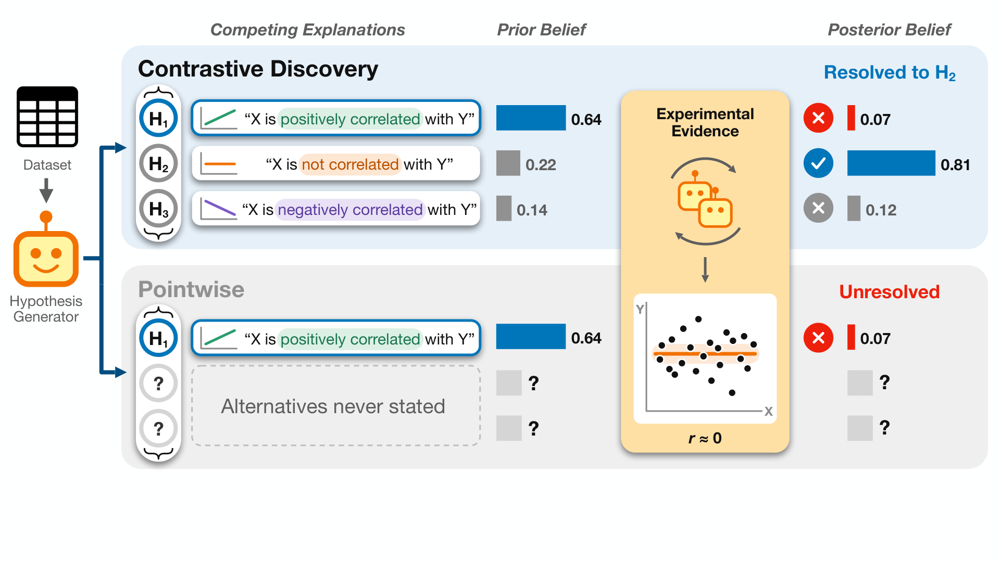
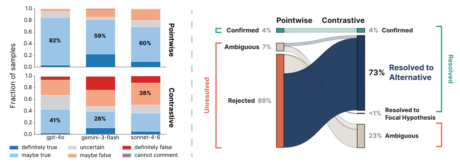
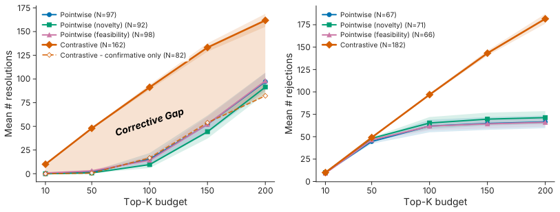
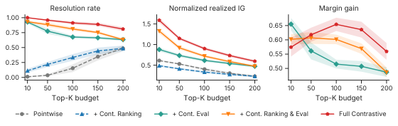
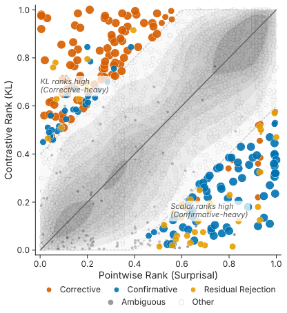
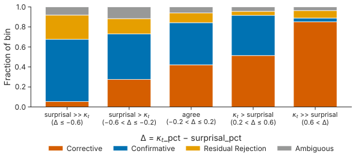
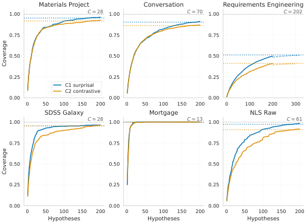
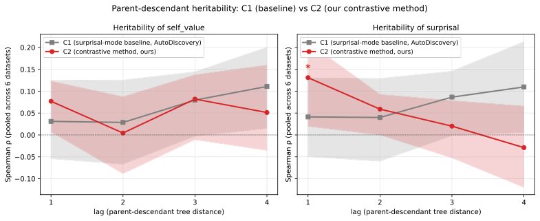

# Contrastive Discovery：让科研智能体在竞争解释间收敛

科研智能体已经能自动提出假设、写代码并分析实验，但多数系统仍只判断一个假设“成立还是不成立”。拒绝假设只说明原解释不可靠，却没有回答证据究竟支持哪一种替代解释，大量已有信息因此被浪费。Contrastive Discovery 把每次发现的单位改为“一个问题 + 一组竞争解释”，用证据在解释之间重新分配信念。六个领域的结果显示，Pointwise 高变化候选中有 **89%** 是拒绝，而同一批证据经对比式重评后，**73%** 能解析到具体替代解释；用于引导搜索时，在相同的 200 次实验验证预算下，解析的问题数比 Pointwise surprisal 多 **67%**。

## 拒绝一个假设，为什么不等于解决一个问题？

假设智能体研究这样一个问题：信用较差的申请人中，自雇是否与更高的房贷拒绝率相关？

传统做法只提出假设 $h$：“自雇申请人的拒绝率更高”。实验可能支持它，也可能反对它。若结果被拒绝，系统知道 $h$ 不太可信，却还不知道真正更有证据的是下面哪一种情况：

- 自雇申请人的拒绝率更低；
- 两组申请人的拒绝率没有明显差异；
- 原实验或分析本身不足以区分这些情况。

论文把这种做法称为 **Pointwise discovery**：每次只评估焦点假设 $h$，其余所有可能性都被压进没有结构的补集 $\neg h$。无论打分依据是新颖性、可行性，还是证据引起的信念变化，这个表示层面的限制都始终存在。

可以把 Pointwise 理解为 Contrastive Discovery 的二元特例：

$$
\mathcal{C}_t^{\mathrm{point}}=\{h_t,\neg h_t\}
$$

问题在于，$\neg h$ 并不是一个可解释的答案，而是“除 $h$ 之外的一切”。科学证据往往同时削弱一些解释、增强另一些解释；只观察 $h$ 的分数变化，相当于看到了投票总数变化，却没有看票流向了哪位候选人。

这也带出了论文的核心判断：**开放式发现的基本单位不应是单个假设，而应是一个科学问题及其合理答案的集合。**

## 核心方法：把单假设改成 Contrast Set

### 什么是 Contrast Set？

在第 $t$ 步，智能体不再只提出 $h_t$，而是提出一个局部科学问题及 $M$ 个竞争解释：

$$
\mathcal{C}_t=\{h_{t,1},\ldots,h_{t,M}\}
$$

这些解释需要在当前问题范围内满足 **MECE**，即相互独立、合起来穷尽主要结果：

- **相互独立**：任意两个解释不能同时成立；
- **集体穷尽**：实验可能产生的主要结果都能映射到某个解释；
- **局部性**：只要求覆盖这个具体问题，不要求穷尽整个科学领域。

以前面的房贷问题为例，一个三解释 Contrast Set 就是“更高、无明显差异、更低”。一次分析便能同时更新三者，而不必先拒绝“更高”，再花两次实验分别检查另外两个方向。

> 图解：生成器围绕 $X$ 与 $Y$ 的关系提出三个竞争解释 $H_1$ 至 $H_3$，随后由 coder、analyst、reviewer 和 reviser 完成实验。面对同一份证据，Contrastive Discovery 将领先解释从 $H_1$ 的 0.64 切换到 $H_2$ 的 0.81，因此解析到 $H_2$，并排除 $H_1$；Pointwise 只把 $H_1$ 从 0.64 降到 0.07，只能记录“拒绝”，问题仍未解决。

这个设计的聪明之处在于，它没有重写科研 Agent 的底层架构，只改变了 **提出什么、如何评分、什么算完成**。因此，它既能嵌入搜索流程，也能事后重评已有实验。

### 如何生成可检验的竞争解释？

生成器必须围绕一个局部问题、同一组变量和同一种分析族构造集合，并预先声明“实验结果如何映射到各解释”。论文提供了八类常用划分模板：

| 划分维度 | 典型解释结构 |
|---|---|
| SIGN | 正向、无效应、负向 |
| PRESENCE_WITH_DIRECTION | 无效应、正向效应、负向效应 |
| SUBGROUP_MODERATED | 仅在 A、仅在 B、两者都有、两者都无 |
| MECHANISM_DISCRIMINATING | 控制变量后保持、减弱、消失等可观察模式 |
| FUNCTIONAL_FORM | 线性正向、线性负向、非线性或无效应 |
| COARSE_ORDER | 单调增加、单调减少、非单调等粗粒度顺序 |
| VARIANCE_DIFFERENCE | A 方差更高、B 方差更高、无明显差异 |
| FEATURE_DOMINANCE | X 主导、Y 主导、贡献相近、都无明显贡献 |

通常优先使用 $M=3$；确有子组或机制结构时才用 $M=4$，原则上不超过 5。集合还应包含“无效应”“都不主导”之类的剩余项，但不能额外设置“我们不知道”这一解释——不确定性由后面的概率分配表达。

更关键的是，实验计划要写出机械可执行的判定规则。例如，对“博士毕业年限与总引用量”的关系，可预先规定：Spearman 相关的 95% bootstrap 置信区间完全高于 0、包含 0、完全低于 0，分别对应三个解释。这样，后续检查的不只是“代码跑通了”，还包括“结果是否真的区分了解释”。

## 信念如何更新：从标量评分到概率分布

### 实验前后的两次分配

对包含 $M$ 个解释的集合，信念状态是概率单纯形上的向量：

$$
p_t\in\Delta^{M-1}
$$

实验前，独立的 belief elicitor 只根据问题、变量和解释分配 100 个概率点，得到 $p_t^{\mathrm{prior}}$；实验后，它再读取分析摘要，分配一次 100 点，得到 $p_t^{\mathrm{post}}$。

这里没有为每种分析手工指定似然 $p(e_t\mid h_{t,m})$，而是让独立 LLM 直接给出先验和后验分布。为降低随机性，每次抽取 5 份有效分配，归一化后取平均；解释顺序在每次调用时随机化，计算指标前再映射回原始身份。所有概率还会加上 $\varepsilon=10^{-6}$ 的下限并重新归一化，避免 KL 散度出现无穷值。

### Contrastive Belief Shift：证据改变了多少信念？

论文使用从后验到先验的 KL 散度衡量实际信息增益：

$$
D_{\mathrm{KL}}\left(p_t^{\mathrm{post}}\,\|\,p_t^{\mathrm{prior}}\right)
=\sum_{m=1}^{M}p_{t,m}^{\mathrm{post}}
\log_2\frac{p_{t,m}^{\mathrm{post}}}{p_{t,m}^{\mathrm{prior}}}
$$

为了减轻集合大小的影响，再除以 $M$ 个解释的最大熵 $\log_2M$：

$$
\kappa_t=
\frac{D_{\mathrm{KL}}\left(p_t^{\mathrm{post}}\,\|\,p_t^{\mathrm{prior}}\right)}
{\log_2M}
$$

$\kappa_t$ 越大，说明证据引起的跨解释信念重分配越强。需要注意，它 **并不以 1 为上界**：证据可能把大量质量推向先验认为极不可能的解释。只有用于树搜索的奖励会被截断：

$$
r_t=\min(\kappa_t,1)
$$

信息增益分析和“是否 surprising”的判断使用未截断的 $\kappa_t$，阈值为 $\kappa_t\geq0.5$。

### 什么情况下算“解析”？

$\kappa_t$ 只描述变化幅度，不描述变化结果。论文进一步根据后验集中程度给出四类状态：

- **Resolved**：某一解释的后验质量达到 $\tau_{\mathrm{support}}=0.80$；
- **Confirmative resolution**：已解析，且领先解释与实验前相同；
- **Corrective resolution**：已解析，但证据把领先位置交给了另一个解释；
- **Unresolved**：没有任何解释达到 0.80。

此外，若某解释的后验质量低于 $\tau_{\mathrm{reject}}=0.10$，就记为被排除。排除与解析不是互斥结果：一次好的对比式更新通常既确定领先者，也排除其他解释。

Pointwise 使用另一套与五级信念刻度对应的阈值：后验均值达到 $\gamma_{\mathrm{support}}=0.625$ 为确认，不高于 $\gamma_{\mathrm{reject}}=0.375$ 为拒绝，其余为模糊。

这里的 0.80 不应被误读成“该解释有 80% 的客观概率为真”。它表示 LLM 分配的信念已经集中，系统可以给出统计层面的答案；是否构成科学真相，还需要独立验证。

## 完整科研闭环：对比式评分如何接入 MCTS？

Contrastive Discovery 沿用 AutoDiscovery 的多智能体框架，backbone 为 `gpt-4o-2024-08-06`。每个节点保存一个完整的实验验证过程：

1. **Generator** 提出 Contrast Set 和可区分各解释的实验计划；
2. **Coder** 编写 Python，**Executor** 实际运行代码；
3. **Analyst** 提取效应量、置信区间、p 值或模型比较指标；
4. **Reviewer** 分别检查实现是否忠实、证据是否具有区分力；
5. **Reviser** 修复失败或区分力不足的计划；
6. **Belief Elicitor** 给出先验与后验分布，计算 $\kappa_t$。

这里将“执行成功”和“能够区分解释”拆开非常重要。代码无报错，并不代表实验回答了问题；反之，修复实验时默认保留原有解释，避免看到数据后再收紧假设的 HARKing（Hypothesizing After Results are Known）行为。

搜索使用 Monte Carlo Tree Search（MCTS）与 UCT。每个节点获得截断奖励 $r_t$，并回传到祖先；搜索优先扩展高价值且仍有未尝试子问题的分支。主要复现参数如下：

| 设置 | 数值 |
|---|---:|
| 每个数据集的实验验证预算 | 200 |
| 每次扩展生成的后续提议 | 8 |
| 初始独立问题数 | 8 |
| 祖先上下文深度 | 3 |
| UCT 探索系数 | 1.0 |
| Agent 采样温度 | 1.0 |
| 单次代码执行超时 | 600 秒 |
| Coder 总尝试上限 | 6 次，其中 debug 至多 3 次 |
| Contrastive 先验/后验采样 | 各 5 次 |
| Pointwise 先验/后验采样 | 各 10 次 |

由此，对比式表示不只是给已有结果换一个标签，还会影响下一步实验：搜索更偏爱能真正区分竞争解释的证据。

## 实验设置：六个领域、统一预算、三类基线

实验覆盖表格型科学和社会数据，每个方法都有 200 次实验验证预算。主指标是各方法按自身分数排序后，top-$K$ 候选中已解析问题的数量；解析率再除以 $K$。计数先在数据集内对随机种子取平均，再对六个数据集等权平均。

| 数据集 | 领域 | 行数 | 列数 | 每行代表 |
|---|---|---:|---:|---|
| Materials Project | 材料科学 | 68,805 | 28 | 无机晶体 |
| SDSS Galaxy (DR19) | 天文学 | 50,000 | 28 | 星系 |
| BLADE Mortgage | 金融与政策 | 2,380 | 13 | 房贷申请 |
| BLADE Conversation | 在线讨论 | 7,975 | 70 | 辩论发言 |
| Requirements Engineering | 软件工程 | 276 | 202 | 问卷受访者 |
| NLS Raw | 社会学与劳动经济学 | 12,686 | 61 | 问卷受访者 |

Pointwise 基线分别用 surprisal、LLM 新颖性和 LLM 可行性引导搜索。所有方法共享相同实验预算与基础 Agent。前四个数据集各运行 3 个独立种子，后两个高成本数据集各运行 1 次。

数据过滤也尽量保持领域合理性。例如，Materials Project 只保留含 2 至 4 种元素且 `energy_above_hull` 不超过 0.05 eV/atom 的近稳定材料；SDSS 只保留红移拟合干净、$0.02\leq z\leq0.3$、视星等在 14 至 22 之间的星系。作者同时明确提醒：Materials Project 约 86% 的行缺少弹性模量，涉及这些属性的问题只覆盖自选择子样本；NLS 混合了不同调查年份，不能把后来的测量当作早期结果的预测变量。

## 实验一：高 Surprisal 候选为何大多只是拒绝？

作者首先检查了 Pointwise 假设的先验分布。三个不同 belief elicitor 下，至少 59% 的 Pointwise 提议集中在“maybe true”区间；当 `gpt-4o` 同时负责生成和评分时，这一比例达到 82%。作者称之为 **prior collapse**：自由生成的假设过度集中在“看起来有点可信，但还不确定”的区域。

Contrast Set 中的解释则覆盖了更宽的先验范围，在 `gpt-4o` 评分下，最大先验区间只占 41%。原因并不神秘：显式写出替代项，天然会引入一些先验较低、但可能被证据支持的解释。

> 图解：左侧比较三个 elicitor 下的先验信念分布，Pointwise 假设大量堆在“maybe true”，Contrast Set 的各解释分布更宽。右侧看每次运行 200 个验证中 Pointwise surprisal 最高的 50 个候选：89% 被拒绝、4% 被确认、7% 模糊；同一证据经事后 Contrastive companion 重评后，73% 的 50 个候选能解析到具体替代解释。

这个事后重评没有运行任何新实验。Companion 固定原假设，再生成至少两个替代解释；它能看到数据变量和先前上下文，但看不到本次分析、输出或 verdict，从而避免按答案倒推选项。

Pointwise 只把确认算作解析，因此这 50 个高价值候选中有 96% 未解析；对比式重评后，未解析比例降到 23%。这说明损失主要来自 **表示方式**，而不一定是证据不足。

## 实验二：同样 200 次验证，多解析 67% 的问题

下一步不再是事后补救，而是让 Contrast Set 从实验设计阶段就参与搜索。

> 图解：横轴为各方法按自身分数保留的 top-$K$ 候选预算，纵轴为平均已解析问题数。实线和虚线区分全部解析与仅确认式解析，阴影间隔对应 Pointwise 只能记为拒绝、Contrastive 却能给出替代答案的 corrective resolutions。$K=200$ 时，Contrastive Discovery 平均解析 161.9 个问题，Pointwise surprisal 为 97.2 个，提升 67%。

三个 Pointwise 基线的表现很接近，说明换一个单假设评分器并不能解决结构性问题。真正拉开差距的是 corrective resolution：证据不再只是否定原先最看好的解释，而是把支持转向另一个明确答案。

仅统计 confirmative resolution 时，Contrastive 在 $K=200$ 为 82.2，反而低于 Pointwise 的 97.2。也就是说，新增收益几乎全部来自“纠错”，不是更多地确认原有直觉。

解析更多也没有以放弃否定性结论为代价。典型的三解释集合中，一旦一个解释获得至少 0.80 的后验质量，其余两者合计至多 0.20，几乎总会有至少一个解释低于 0.10。若把“确认或拒绝”“解析或排除”统一记为 decisive unit，$K=200$ 时 Contrastive 的比率为 0.91，Pointwise 为 0.82，且六个数据集上都更高。

语义去重后，Pointwise 的平均解析数从 97.2 降至 87.4，Contrastive 从 161.9 降至 141.9；优势仍有 **62%**，并在六个数据集上全部领先。

## 实验三：收益主要来自哪里？

作者把系统拆成三个因素：

- **Ranking**：用 Pointwise surprisal 还是 Contrastive $\kappa_t$ 排序；
- **Evaluation**：只评焦点假设，还是评完整 Contrast Set；
- **Construction**：事后补建集合，还是在发现过程中直接构造。

> 图解：左图是解析率，中图是实际信息增益 $\kappa_t$，右图是领先解释与第二名之间的 margin gain。$K=50$ 时，Pointwise evaluation 各变体的解析率最高仅 0.22；采用 Contrastive evaluation 后达到 0.77 至 0.96。完整方法在几乎所有预算上表现最好，说明“显式替代解释参与评估”是最大收益来源，搜索期构造和对比式排序进一步增强结果。

还有一个有意思的错配：用 Contrastive 排名、却仍用 Pointwise 评估时，信息增益反而可能较低。排名器寻找的是能区分多个解释的证据，评估器却又把信息压回一个焦点命题，两者目标并不一致。

Contrastive 评分也没有抛弃过去的 surprisal 信号。把每个集合投影到先验最高的解释后，两种分数的 Spearman 相关系数为 $\rho=0.675$；分歧最大的候选中，Contrastive 更偏爱的往往是 corrective update，Pointwise 更偏爱的则是 confirmative update。

> 图解：每个点是一个 Contrastive 搜索节点，两个坐标分别是它在数据集内按 $\kappa_t$ 与 Pointwise surprisal 得到的百分位排名。颜色标出排名差至少 0.4 的节点及其结果类型，显示高分歧并非随机噪声，而是对应不同的发现语义。

> 图解：横轴为 $\kappa_t$ 排名减去 Pointwise surprisal 排名的差值 $\Delta$。随着分歧偏向 Contrastive，corrective outcome 增多；偏向 Pointwise 时，confirmative outcome 增多。中间的一致区域说明两者仍共享主要的信息变化信号。

在“最高先验解释”的投影下，Contrastive 的 Pointwise-surprising 产出与 surprisal、新颖性和可行性基线相当。换言之，它增加了跨解释解析能力，并没有明显牺牲原有评分体系所重视的惊讶度。

## 结果可信吗？专家、原始数据与跨模型检查

### 盲评专家是否选择同一个解释？

38 位具有数学、计算或自然科学硕士/博士背景的评估者，对 60 个问题进行了盲评。他们只看到问题、候选解释和实际统计证据，看不到系统信念、解析标签或 Pointwise verdict。每题至少 4 人评分，中位数为 8 人。

| 问题分组 | 数量 | 专家与系统选择一致 |
|---|---:|---:|
| Contrastive 已解析 | 51 | 40（78.4%） |
| Contrastive 未解析 | 9 | 3（33.3%） |
| Pointwise 已确认 | 32 | 23（71.9%） |
| Pointwise 已拒绝 | 22 | 18（81.8%） |
| Pointwise 模糊 | 6 | 2（33.3%） |
| 全部问题 | 60 | 43（71.7%） |

在 Pointwise 已确认的 32 题上，两种方法各有 23 项发现获得专家认可；真正的差异出现在 Pointwise 拒绝并停止的 22 题上，Contrastive 找到的替代解释有 18 项与专家多数票一致。

全部 60 题共出现 17 次不一致，其中只有 3 次专家选择了另一个具体解释，其余主要是证据不足或专家未形成多数意见。评估者认为 80% 的评分所对应集合结构良好，15% 的评分指出可能遗漏解释，51% 的评分认为结果属于实质性发现。

控制实验也支持评审有效性：把问题与不相关证据配对后，“分析合适”的比例从 73% 降至 7%；人工植入的缺项或重叠集合也大多被识别。不过，这些专家是通用定量科学评估者，不是每道题所属子领域的专门专家；一致性证明的是“系统结论符合独立专家对同一证据的阅读”，不是科学真理本身。

### 解析是否真的跟随证据？

作者做了三组不依赖 LLM 打分的机械审计：

- **只给数字**：对 14 个有文献答案的 claim，隐去 analyst 文本并固定解释措辞。有系数和置信区间的 11 例中，elicitor 全部把文献答案排在首位，并解析其中 8 例；对接近零的不完整证据会保留判断。
- **反转证据**：把 14 例统计量的符号反转，所有解析都随之反转；完全不给证据时，14 例均无法解析。
- **重跑统计**：从原始数据重建 331 个可复算分析，318 个与 Agent 报告一致，匹配率为 96.1%；已追踪的不一致主要来自复算遗漏了 Agent 的数据处理步骤，没有发现已确认的计算错误。

另有 3,015 份分析摘要包含可检查的数字，99.1% 的摘要、99.7% 的单个数字能在代码输出中找到来源。不过，这项审计不检查符号，且统计复算只覆盖约 12% 的较简单分析，不能外推成全流程无误率。

### 不同模型会收敛到同一答案吗？

在 180 个 Contrast Set 上，`gpt-4o`、`gemini-3-flash` 和 `claude-sonnet-4-6` 在看证据前仅有 55.0% 的集合选择同一领先解释，看证据后升至 88.9%，且六个数据集全部提高。

这降低了“同一模型自我附和”的担忧，但仍有一个重要限制：三个模型读取的是同一份 `gpt-4o` analyst 摘要，因此部分收敛可能来自共同的分析框架，而非完全独立的证据解释。

## 如果 Contrast Set 漏掉了正确答案？

这是方法最直接的风险：集合若不完整，概率质量可能被迫流向一个错误解释。

作者在 163 个原本已正确解析的方向性问题上，人为删除受支持的解释，再重新分配信念：

| 删除支持解释后的设置 | 拒绝解析或标记不完整 | 错解析到剩余解释 |
|---|---:|---:|
| 原始 Contrast Set | 46.6% | 53.4% |
| 加入“以上解释都不符合证据” | 99.4% | 0.6% |

加入 **abstention alternative** 后，错误解析从 53.4% 降至 0.6%。它不只是让系统少说答案：在删除正确解释的样本中，该选项有 92.6% 成为领先项，平均获得 0.85 的信念质量，能主动标记“集合可能不完整”。

在保留完整集合的对照中，加入弃权项并未造成误报，且有 162/163 解析到受支持解释；不加弃权项时为 159/163。需要强调，主实验并未启用这一保护项，因此主结果仍可能受到遗漏解释的影响；专家严格多数只在 60 个集合中的 6 个上确认存在缺项，说明该风险并非普遍，但确实存在。

## 稳健性：不是评分技巧、成本差异或阈值放水

### 联合分配概率不是主要收益来源

固定同一批 Contrast Set，把每个解释分别交给 Pointwise elicitor 独立评分，top-200 可解析 157.8 个问题；联合评分为 161.9。两者在 89.3% 的集合上选择同一个领先解释。

这意味着大头收益来自 **显式构造竞争解释**，而不是“100 点联合分配”这一特殊格式。已有 Agent 即使保留 Pointwise scorer，也能使用 Contrast Set。

### 相同 Token 或美元预算下仍领先

Pointwise 与 Contrastive 每个候选平均消耗分别为 61.1k 和 52.8k tokens。将两种方法分别截断到相同总成本后：

| 匹配方式 | Pointwise 已解析 | Contrastive 已解析 |
|---|---:|---:|
| 相同总 Token | 87.7 | 148.3 |
| 相同记录美元成本 | 92.2 | 145.8 |

Contrastive 的信念分配占总 Token 的 8.5%，高于 Pointwise 的 2.5%，但更短的分析代码和解释抵消了部分额外开销。作者并未据此宣称普遍的效率优势，因为两种提示词和分析过程不同，Token 数无法衡量实验是否更窄或更浅。

单次 200 轮运行约花费 20 至 50 美元，全部实验估计花费 1,500 至 2,000 美元。

### 阈值校准与敏感性

Pointwise 阈值来自五级信念刻度的中点；Contrastive 的 0.80 则要求后验明显集中。对同一证据的 3,215 组配对评分中，支持、拒绝和双侧联合 gate 的 $F_1$ 分别为 0.937、0.896 和 0.934，说明两套判定并非完全错位。

进一步把 $\tau_{\mathrm{support}}$ 从 0.60 调到 0.90，并为每个值匹配触发率最接近的 Pointwise 阈值，Contrastive 在所有配对、所有数据集上仍解析更多。在论文使用的 $\tau=0.80$ 处，匹配到的 Pointwise 阈值其实应为 0.695，比实际使用的 0.625 更严格，因此主结果相对保守。

### Pointwise 能否自己生成完整替代集合？

作者把 8,547 个 Pointwise 假设与 300 个 Contrast Set 做语义匹配。在相同预算的单次运行中，对至少涉及同一问题的集合，Pointwise 语料完整包含所有替代解释的比例只有 2.6%；把同数据集所有运行合并、扩大到 4 至 6 倍预算后，也只有 15.4%。

更关键的是，当证据确认原领先解释时，最终答案有 52.0% 曾出现在 Pointwise 语料中；当证据纠正原领先解释时，这一比例只有 25.4%。也就是说，恰恰在 Pointwise 最容易“拒绝后停止”的地方，它通常连正确答案都尚未提出。

## 复现时需要关注的工程细节

### 五次信念采样够不够稳定？

在 3,213 个具有完整五次先验/后验采样的集合上，先验样本的平均两两 Total Variation Distance（TVD）为 0.125，后验为 0.065；85.5% 的后验集合低于 0.10。证据让判断明显收敛。

删掉五次采样中的任意一次，后验最大概率的中位变化只有 0.005，KL 分数的中位变化为 0.053 bits。继续增加样本只能按 $1/\sqrt{n}$ 降低误差，却线性增加成本，因此五次是成本与稳定性的折中。

### 随机化解释顺序确实减少位置偏差

受控排列实验中，随机化使先验分布的两两 TVD 从 0.077 降至 0.042，后验从 0.031 降至 0.025；平均 KL、归一化 KL 和最大后验概率的变化区间均包含 0。它改善了呈现顺序的一致性，没有可检测地放大信念更新。

不同输出格式也给出相近结论：逐解释五级评分与强制选择分别在有可比决策的集合上，与 100 点分配选择相同领先者的比例为 94.2% 和 99.3%。这支持的是“证据后领先解释基本一致”，并非所有格式完全不变。

### MECE 审计：大多数有效，但不同评审严格度不同

从 3,260 个可解析集合中分层抽取 384 个，同供应商的 `gpt-4o` 评审给出 96.9% 的原始结构通过率，设计加权估计为 98.4%；Claude Sonnet 使用相同规则复审时，原始通过率为 87.0%，加权为 91.4%。

失败主要集中在两类：重复的“无效应/无模式”剩余项，以及没有额外识别假设就无法互斥的机制解释。方向性集合没有失败，而机制与排序类更脆弱。因此被标记集合更常无法达到解析阈值，缺陷主要造成发现损失，而不是大量凭空制造答案；但仍有 7 个已解析问题落在被点名的重叠解释上，需要谨慎解释。

### 去重不能跨集合误合并竞争解释

Pointwise 在节点级去重；Contrastive 则把集合展开到解释级去重，但禁止合并同一集合内部的成员。否则，“正向、负向、无效应”可能因文本相似被错误折叠。

具体流程使用相同 embedding、Ward 聚类和 LLM judge；每次合并投 10 票，至少 70% 认可语义等价才合并。去重后仍有 62% 的领先，说明主结果不是简单重复计数同一发现。

## 额外分析揭示了哪些边界？

### 探索广度存在取舍

Contrastive 并不会自动带来更宽的变量覆盖。Pointwise 在六个数据集中的五个上达到更高的渐近列覆盖率；Requirements Engineering 上，两者拟合渐近值分别只有 0.513 和 0.411。

> 图解：实线为 200 个假设下、对 20 种随机顺序取平均的累计列覆盖率，虚线为饱和指数拟合，水平虚线表示渐近覆盖率 $\alpha$。C1 为 Pointwise，C2 为 Contrastive。多数数据集最终覆盖较高，但 Requirements Engineering 的大量稀疏列始终未被触及。

Contrastive 在三个数据集上表现出更强的 sibling anchoring：同一父节点下的后续问题更倾向沿用相同变量。这有利于围绕一个问题深入比较，却可能牺牲横向探索。该分析每个数据集与条件只有一个种子，属于描述性结果，不是统计显著性结论。

### MCTS 的父子分数遗传性仍不完全清楚

> 图解：横轴为树中的祖先—后代距离，纵轴为 Spearman 排名相关。左图使用 UCT 实际传播的 `self_value`，右图使用未截断的信念变化。Contrastive 在 lag 1 的 `self_value` 相关为 $\rho=0.077$，经多重校正后不显著（$q=0.28$）；底层 surprisal 为 $\rho=0.131$ 且显著（$q=0.046$），随后到 lag 4 逐渐衰减。Pointwise 的 lag 1 基本为零。

这说明对比式奖励可能存在局部可继承信号，但也可能只是子生成器读取了父节点的结构化集合，导致分数相关。要区分二者，还需在保留上下文继承的条件下，对比 UCT 与随机父节点选择。

### 端到端恢复已知发现仍未解决

在 10 个经过答案泄漏筛查的 DiscoveryBench 已知问题上，Contrastive 只恢复 1 个，Pointwise 为 0 个。两者都接近地板，不能据此比较优劣。

失败记录显示，Agent 经常回答了不同的问题，例如换了预测变量、结果变量，或擅自加入子组；一些文献答案还依赖原始研究的建模选择，仅靠问题和字段说明无法恢复。因此，本文的强项是 **从已执行证据中区分解释**，不等于已经解决从原始数据到可靠科学发现的全过程。

## 与已有工作的关系及适用边界

Contrastive Discovery 延续了信息论实验设计和 Bayesian surprise 的思想：好实验应当改变信念。但它优化的不是预期效用，而是实验已经实现的后验—先验变化；与只评单假设的新颖性、可行性或证据支持方法相比，它进一步要求证据在多个解释之间作出区分。

它也不同于一般的成对比较或非互斥方面评估。Contrast Set 要求候选答案在同一问题下互斥，并共享一个可执行的判定规则。这使“信念变化”能够进一步转化为“哪个答案获得支持”。

不过，当前结论有明确边界：

- 实验只覆盖表格型、观察性数据，resolved 是统计结论，不是因果结论；
- 基础 Agent 和主要 elicitor 都使用 `gpt-4o`，跨 Agent、跨实验室验证仍待完成；
- 结果依赖 LLM 信念分配，虽有专家、统计复算和跨模型检查，但不能等同于校准的科学真值；
- 集合可能重叠或遗漏解释，主实验没有启用弃权项；
- 涉及房贷申请者与公开发言者的数据时，统计关联不能直接用于政策或个体决策，应配合预注册分析、单位意识与人工复核。

## 总结：把“否定旧想法”升级为“找到更好解释”

- **问题根源在表示，而不只在评分**：单假设的补集 $\neg h$ 没有结构，拒绝后无法指出证据支持谁。
- **Contrast Set 让同一实验发挥更多价值**：显式竞争解释使一次证据更新既能排除选项，也能确定领先答案。
- **最硬的收益来自 corrective resolution**：相同 200 次验证下解析数增加 67%，去重后仍增加 62%，而不是靠更多确认原有直觉。
- **增益不依赖特殊联合评分**：独立 Pointwise 评分只少解析约 4 个问题，匹配 Token、美元和阈值后优势仍存在。
- **可信但不等于终极真相**：专家在已解析问题上的选择一致率为 78.4%，机械审计支持证据驱动，但缺项、观察性数据和 LLM 信念仍是明确限制。

未来最值得验证的是：把弃权项纳入完整搜索、扩展至更多 Agent 与真实实验室闭环，并让“更集中地回答问题”与“更广泛地探索变量”不再相互牵制。

> 本文参考自 [Discovery: Open-Ended Scientific Discovery over Competing Explanations](http://arxiv.org/abs/2611.14514v1)