# DistillSpec：蒸馏对齐加速投机解码

大模型自回归解码需要逐 Token 串行执行，speculative decoding（投机解码，SD）虽能让小模型起草、大模型并行验收，却常因二者分布不一致而频繁拒绝草稿。这直接卡住了无损推理加速的上限：小模型再快，草稿不被接受也省不下多少时间。DistillSpec 的核心思路是，用 white-box knowledge distillation（白盒知识蒸馏，KD）让草稿模型在真实生成轨迹上对齐目标模型，再按任务与解码方式选择分布散度。实验中，它在多个 benchmark 上较标准 SD 再提速 10%–46%；与模型级联组合时，XSum 和 GSM8K 的相对延迟分别降低约 6.4× 和 10.7×，任务表现几乎不变。

## 一、为什么 SD 的上限取决于“草稿像不像”

自回归生成的每一步都依赖前面的 Token，大模型难以把不同位置简单并行起来。对小模型做量化、剪枝或普通蒸馏，又往往要用明显的质量下降换速度。SD 的切入点更细：不在任务或样本级别分配大小模型，而是在 **Token 级别** 让它们协作。

### 1. 草稿—验收：小模型先猜，大模型并行改

可以把它理解为“实习生先连续起草，资深编辑一次审完一段”。小模型称为 draft model，记为 $\mathcal{M}_q$；大模型称为 target model，记为 $\mathcal{M}_p$。在给定上下文中，二者对下一 Token 的预测分布分别为 $q$ 和 $p$。

一轮标准 SD 包含四步：

1. 草稿模型自回归采样 $\gamma$ 个 Token，组成一个 block。
2. 目标模型把整个 block 作为前缀一次性并行打分，而不是逐 Token 重新生成。
3. 对第 $i$ 个草稿 Token，按 $a_i = \min\left(1, \frac{p(y_i)}{q(y_i)}\right)$ 的概率依次接受。
4. 若某个 Token 被拒绝，其后的草稿全部丢弃，并从修正分布 $p'(y_i) \propto \max(0, p(y_i)-q(y_i))$ 重采样；若整个 block 都被接受，则再从目标模型补采一个 Token。

这套 rejection sampling 的关键性质是 **无损**：最终输出序列仍服从目标模型的分布。它保证的是分布一致，而不是相同随机种子下每个 Token 都与单独运行目标模型完全一致。

### 2. 接受率、块效率与真实加速

草稿与目标越像，拒绝就越少。单 Token 接受率记为 $\beta$，序列级接受率记为 $\alpha(x)$：前者衡量某个上下文下的平均接受概率，后者衡量生成完整答案时被接受 Token 的占比。

有限 block 下，更贴近系统的指标是 **block efficiency** $\tau$，即每轮平均能接受多少个 Token。若各位置的接受事件近似独立，且平均单 Token 接受率为 $\bar{\beta}$，则：

$$
\tau = \frac{1-\bar{\beta}^{\gamma+1}}{1-\bar{\beta}}
$$

由于全部接受时还会由目标模型补一个 Token，所以 $\tau$ 的最大值是 $\gamma+1$。若草稿模型单次前向耗时是目标模型的 $c$ 倍，理论期望加速为：

$$
\mathrm{Speedup} = \frac{\tau}{c\gamma+1}
$$

分母对应“草稿模型串行跑 $\gamma$ 次 + 目标模型并行验一次”的相对成本。这个公式也说明：**只降低 $c$ 不够，还必须提高 $\tau$**。而实际 kernel、batch 和硬件都会影响墙钟时间，因此论文最终仍测量真实延迟。

由此，问题就从“怎样得到一个更快的独立小模型”，转成“怎样让小模型在生成时更像目标模型”。这正是 DistillSpec 要优化的地方。

## 二、DistillSpec：把 KD 的目标改成“更好地配合”

普通 KD 主要追求学生模型自身的任务分数；DistillSpec 则把学生的用途限定为目标模型的草稿生成器，优化目标是 **student–teacher alignment**。两者相关，但并不等价。

### 1. 用完整 logits 做白盒蒸馏

DistillSpec 假设能访问两个模型的下一 Token 分布，也就是 white-box access。设可训练草稿模型为 $\mathcal{M}_q^\theta$，训练数据为 $\mathcal{G}$，其目标是在序列经过的每个上下文上，缩小目标分布 $p$ 与草稿分布 $q^\theta$ 的散度：

$$
\theta^* = \arg\min_{\theta}\; \mathbb{E}_{(x,y)\sim\mathcal{G}}\left[D(\mathcal{M}_p\|\mathcal{M}_q^\theta)(y|x)\right]
$$

其中，序列 Loss 是各位置散度的平均：

$$
D(\mathcal{M}_p\|\mathcal{M}_q^\theta)(y|x)
= \frac{1}{|y|}\sum_{t=1}^{|y|}D\left(p(\cdot|x,y_{<t})\|q^\theta(\cdot|x,y_{<t})\right)
$$

白盒监督的价值在于：教师不只留下最终答案，还提供整个词表上的概率信息。对于 temperature sampling，目标模型“第二可能的 Token 有多可能”同样会影响接受率，而只训练 one-hot 答案会丢掉这些信息。

下表是论文纳入统一比较的五类 KD 配方；其中，散度列给出各方法的代表性选择，并不限制 DistillSpec 只能使用这些组合。

| 方法 | 散度 | 蒸馏训练数据 |
|---|---|---|
| SeqKD（Black-box KD） | FKL | 教师 $\mathcal{M}_p$ 生成的数据 |
| Supervised KD | FKL | 固定的输入—标准答案对 |
| ImitKD | FKL | 固定数据 + 学生 $\mathcal{M}_q^\theta$ 生成的数据 |
| $f$-Distill | TVD | 学生与教师共同生成的数据 |
| On-policy GKD | FKL / JSD | 来自当前学生的 on-policy 数据 |

这个设计的聪明之处在于，它没有改动 SD 的验收算法，而是把已有 serving 流程中的“草稿不够像”变成一个可训练问题，因此也能与 SpecTr、SpecInfer、Medusa 等侧重验证或并行机制的加速方法互补。

### 2. TVD 是最直接的指南针，却不总是最好的 Loss

总变差距离（total variation distance，TVD）把接受率和分布对齐直接连了起来。对词表 $\Omega$ 上的两个离散分布：

$$
\mathrm{TVD}(p,q)=\frac{1}{2}\sum_{z\in\Omega}|p(z)-q(z)|
$$

speculative sampling 的单 Token 接受率满足：

$$
\beta = 1-\mathrm{TVD}(p,q)
$$

令 $L_p(x)$ 为目标模型输出的期望长度，则序列级接受率可写为：

$$
\alpha(x)=1-\frac{\mathbb{E}_{y\sim p(\cdot|x)}\left[\sum_{t=1}^{|y|}\mathrm{TVD}(p_t,q_t)\right]}{L_p(x)}
$$

所以，最大化 $\alpha$ 等价于最小化目标模型生成轨迹上的期望 TVD。不过，**理论上最直接的代理指标，不一定是有限模型、有限训练预算下最容易优化的目标**。论文还系统比较了以下散度：

- **FKL（forward KL）**：$D_{\mathrm{KL}}(p\|q)=\sum_z p(z)\log[p(z)/q(z)]$，是监督学习和经典 KD 中最常见的方向。
- **RKL（reverse KL）**：交换 KL 的方向，即 $D_{\mathrm{KL}}(q\|p)$，对学生如何覆盖教师的高概率区域有不同偏好。
- **JSD（Jensen–Shannon divergence）**：比较两个分布与其混合分布的 KL，形式更对称。用 $\lambda$ 表示混合权重：

  $$
  D_{\mathrm{JS}[\lambda]}(p\|q)
  = \lambda D_{\mathrm{KL}}(p\|m_\lambda)+(1-\lambda)D_{\mathrm{KL}}(q\|m_\lambda),\quad m_\lambda=\lambda p+(1-\lambda)q
  $$

- **TVD**：直接对应接受率，但实验中并不总是取得最高的最终块效率。

因此，DistillSpec 不是简单地“把 Loss 换成 TVD”，而是把 **散度视为随任务与解码策略调整的 Hyperparameter**。

### 3. 为什么优先用学生自己的 on-policy 数据

训练数据有四种自然来源：固定标准答案、教师生成、学生生成，以及教师与学生各生成一部分。论文的选择背后有两个现实约束：

- **固定数据会错位**：即使教师曾在这批数据上微调，其当前输出分布也可能偏离标准答案；固定数据集还更小，持续训练容易过拟合。
- **教师生成很贵**：接受率公式要求在教师轨迹上优化，但用大型教师在线生成海量蒸馏语料，成本可能抵消部署后的收益。

学生生成数据足够便宜，而且 on-policy 数据会随学生训练不断更新，使学生在自己真正会访问的上下文上接受教师监督。问题是：训练时走的是学生轨迹，接受率却定义在教师轨迹上，这种“换分布训练”真的有保证吗？

### 4. 附录推导：学生轨迹上的小 TVD 能约束教师轨迹上的接受率

论文用混合轨迹和 TVD 的变分表示回答了这个问题。把 $A_t(x)$ 记为教师轨迹在第 $t$ 步贡献的期望 TVD，把 $E_t(x)$ 记为学生轨迹的对应项，二者只统计长度至少为 $t$ 的序列。单样本 on-policy Loss 记为 $\epsilon(x)$，则有：

$$
\alpha(x)=1-\frac{1}{L_p(x)}\sum_{t=1}^{T}A_t(x),\qquad
\epsilon(x)\geq\frac{1}{T}\sum_{t=1}^{T}E_t(x)
$$

证明的核心是逐位置构造混合序列：前面若干 Token 来自一个模型，后面的 Token 换由另一个模型生成。每次只替换一个位置，就用一个 $E_k(x)$ 控制引入的误差；再做伸缩求和，得到：

$$
A_t(x)\leq 2\sum_{k=1}^{t-1}E_k(x)+E_t(x)
$$

对所有 $t$ 求和并代入接受率公式，附录最终得到：

$$
\alpha(x)\geq 1-\frac{2T^2}{L_p(x)}\epsilon(x)
$$

直觉上，第一步分布接近会减小后续上下文分叉；前面 $t$ 步都接近，则第 $t+1$ 步也不会差太多。误差会沿序列累积，但这个界是保守的最坏情况分析，不代表实际接受率一定随长度平方下降。

> 复现提醒：正文定理给出的常数形式与附录逐步推导存在差异，固定输出长度 $T$ 时，正文写作 $\mathbb{E}[\alpha]\geq 1-T\epsilon$，而附录推导对应 $1-2T\epsilon$。这里按附录的完整推导呈现；引用该理论界时应留意这一原文不一致。

这套结果给 on-policy 蒸馏提供了理论支撑：**不必一直支付教师生成成本，学生轨迹上的对齐训练也能约束教师轨迹下的接受率。**

### 5. 与相关工作的差别在哪里

- **相对普通 LLM KD**：目标不是得到一个独立使用的高分学生，而是让学生成为目标模型更兼容的协作者。
- **相对 SeqKD**：SeqKD 只用教师输出做 one-hot 标签；DistillSpec 强调教师 logits 的白盒监督，这一点在非贪心采样中尤其重要。
- **相对推理系统优化**：它不改 SD 的验证协议与服务接口，可与 token tree verification、batch 维并行等系统方法叠加。
- **相对在线 KD 加速 SD 的同期工作**：DistillSpec 同时评估真实墙钟延迟，而不只看接受率；其主设置也不是不断变化的在线查询分布。

方法已经明确，接下来要回答三个实证问题：加速能否落到墙钟时间、提升是否只来自少数样本，以及蒸馏后的草稿能否迁移。

## 三、实验验证：接受率提升能否变成真实速度

### 1. 模型、任务与评测协议

论文覆盖 decoder-only 与 encoder-decoder 两类模型。T5 实验统一以 T5-XL（3B）为目标模型、T5-Small（77M）为草稿模型；LM1B 实验使用 234M 的 GPT-like target 和 33M draft。

| 数据集 | 任务 | 目标 / 草稿模型 | 最大输入 / 输出长度 | 任务质量指标 |
|---|---|---|---|---|
| XSum | 新闻摘要 | T5-XL 3B / T5-Small 77M | 1,024 / 64 | ROUGE-2 |
| CNN/DM | 新闻摘要 | T5-XL 3B / T5-Small 77M | 2,048 / 128 | ROUGE-2 |
| WMT14 EnDe | 英德翻译 | T5-XL 3B / T5-Small 77M | 80 / 80 | BLEU |
| GSM8K | 数学推理、zero-shot CoT | T5-XL 3B / T5-Small 77M | 256 / 320 | Accuracy |
| LM1B | 语言建模 | GPT-like 234M / 33M | 128 / 128 | 主要考察 SD 效率 |

接受率和块效率在完整测试集或验证集上取平均。真实延迟在同一 TPUv4 设备上测量，不使用模型并行，batch size 为 1；每次随机抽取 500 个样本，重复 3 次后取均值。解码同时覆盖 greedy（$T=0$）与标准 temperature sampling（$T=1$）。

### 2. 总体结果：较标准 SD 再提速 10%–46%

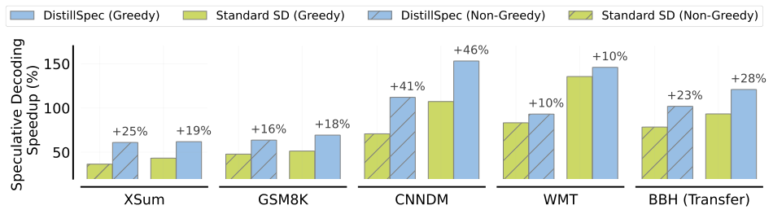

> 图解：横轴是数据集与迁移设置，纵轴是相对于目标模型普通自回归解码的加速百分比，100% 约对应 2× 加速。蓝色为 DistillSpec，绿色为标准 SD；实心柱对应 greedy，斜线柱对应 non-greedy。所有设置中蓝柱都更高，柱顶标注的增益为 10%–46%，最大的一项来自 CNN/DM greedy 解码；BBH（Transfer）则展示 GSM8K 蒸馏草稿向 23 个未见推理任务的迁移结果。

这里的提升不是相对“完全不用 SD”，而是 **在标准 SD 已经加速的基础上继续提高**。对 LM1B、XSum、CNN/DM 和 GSM8K，使用模型生成数据的蒸馏方法整体还能带来约 20% 的额外速度收益，greedy 解码下的优势尤其明显。

### 3. 块效率：模型生成数据与教师 logits 为什么关键

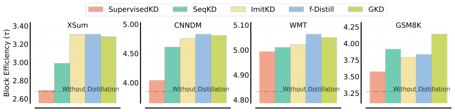

> 图解：四个面板分别对应 XSum、CNN/DM、WMT 和 GSM8K，纵轴均为块效率 $\tau$，虚线是未蒸馏草稿的基线，颜色区分五种 KD 方法。所有蒸馏柱都高于相应基线；只使用固定标准答案的 Supervised KD 提升最小，$f$-Distill 与 GKD 整体最强。各面板的纵轴刻度不同，适合比较同一数据集内的相对排序，不宜直接凭柱高跨数据集比较绝对值。

SeqKD 虽然也使用教师生成数据，却明显弱于使用教师 logits 的白盒方法。这说明“数据来自教师”并不等于“分布监督充分”；尤其在采样解码中，完整概率分布比单一答案更重要。

附录汇总了不同 block size 的完整结果。下表保留原始与蒸馏后的 $\tau$、实际加速 SPEED 及其差值 $\Delta$；每行列出该组表现最好的方法，T5 各任务的模型组合与上一节相同，BBH-AVG 是 GSM8K 蒸馏草稿在 23 个 BBH 任务上的平均结果。

| 数据集 | 解码温度 | $\gamma$ | $\tau$ 无蒸馏 | SPEED 无蒸馏 | $\tau$ 蒸馏 | SPEED 蒸馏 | $\Delta$ | 方法 |
|---|---:|---:|---:|---:|---:|---:|---:|---|
| XSum | $T=0$ | 3 | 2.31 | 1.44× | 2.62 | 1.58× | +0.14× | $f$-Distill |
| XSum | $T=0$ | 5 | 2.57 | 1.43× | 3.08 | 1.62× | +0.19× | $f$-Distill |
| XSum | $T=0$ | 7 | 2.68 | 1.36× | 3.31 | 1.57× | +0.21× | $f$-Distill |
| XSum | $T=1$ | 3 | 2.19 | 1.40× | 2.58 | 1.57× | +0.17× | $f$-Distill |
| XSum | $T=1$ | 5 | 2.39 | 1.37× | 3.01 | 1.61× | +0.25× | $f$-Distill |
| XSum | $T=1$ | 7 | 2.47 | 1.28× | 3.21 | 1.55× | +0.27× | $f$-Distill |
| CNN/DM | $T=0$ | 3 | 2.83 | 1.89× | 3.19 | 2.11× | +0.22× | $f$-Distill |
| CNN/DM | $T=0$ | 5 | 3.46 | 2.07× | 4.13 | 2.42× | +0.35× | GKD |
| CNN/DM | $T=0$ | 7 | 3.85 | 2.07× | 4.83 | 2.53× | +0.46× | $f$-Distill |
| CNN/DM | $T=1$ | 3 | 2.49 | 1.71× | 2.87 | 1.93× | +0.23× | $f$-Distill |
| CNN/DM | $T=1$ | 5 | 2.89 | 1.77× | 3.52 | 2.12× | +0.35× | $f$-Distill |
| CNN/DM | $T=1$ | 7 | 3.08 | 1.71× | 3.92 | 2.12× | +0.41× | $f$-Distill |
| WMT | $T=0$ | 3 | 3.22 | 2.08× | 3.30 | 2.13× | +0.05× | $f$-Distill |
| WMT | $T=0$ | 5 | 4.17 | 2.33× | 4.32 | 2.41× | +0.08× | $f$-Distill |
| WMT | $T=0$ | 7 | 4.83 | 2.36× | 5.06 | 2.46× | +0.10× | $f$-Distill |
| WMT | $T=1$ | 3 | 2.73 | 1.77× | 2.88 | 1.83× | +0.07× | GKD |
| WMT | $T=1$ | 5 | 3.29 | 1.83× | 3.48 | 1.93× | +0.10× | GKD |
| WMT | $T=1$ | 7 | 3.54 | 1.72× | 3.85 | 1.84× | +0.12× | $f$-Distill |
| GSM8K | $T=0$ | 3 | 2.60 | 1.51× | 2.96 | 1.69× | +0.18× | GKD |
| GSM8K | $T=0$ | 5 | 3.06 | 1.42× | 3.68 | 1.65× | +0.22× | GKD |
| GSM8K | $T=0$ | 7 | 3.27 | 1.36× | 4.14 | 1.60× | +0.24× | GKD |
| GSM8K | $T=1$ | 3 | 2.58 | 1.48× | 2.84 | 1.64× | +0.16× | $f$-Distill |
| GSM8K | $T=1$ | 5 | 3.03 | 1.39× | 3.45 | 1.58× | +0.19× | $f$-Distill |
| GSM8K | $T=1$ | 7 | 3.23 | 1.33× | 3.84 | 1.53× | +0.20× | $f$-Distill |
| LM1B | $T=0$ | 3 | 2.96 | 3.66× | 3.13 | 3.97× | +0.31× | $f$-Distill |
| LM1B | $T=0$ | 5 | 3.69 | 3.35× | 3.92 | 3.51× | +0.16× | $f$-Distill |
| LM1B | $T=0$ | 7 | 4.15 | 2.52× | 4.55 | 2.72× | +0.20× | $f$-Distill |
| LM1B | $T=1$ | 3 | 2.51 | 2.34× | 2.69 | 2.45× | +0.11× | $f$-Distill |
| LM1B | $T=1$ | 5 | 2.90 | 2.79× | 3.20 | 3.02× | +0.23× | $f$-Distill |
| LM1B | $T=1$ | 7 | 3.10 | 1.98× | 3.51 | 2.18× | +0.20× | $f$-Distill |
| BBH-AVG | $T=0$ | 3 | 2.55 | 1.90× | 2.68 | 2.06× | +0.16× | $f$-Distill |
| BBH-AVG | $T=0$ | 5 | 2.98 | 1.92× | 3.19 | 2.16× | +0.24× | $f$-Distill |
| BBH-AVG | $T=0$ | 7 | 3.20 | 1.93× | 3.49 | 2.21× | +0.28× | $f$-Distill |
| BBH-AVG | $T=1$ | 3 | 2.45 | 1.79× | 2.57 | 1.93× | +0.14× | $f$-Distill |
| BBH-AVG | $T=1$ | 5 | 2.81 | 1.80× | 3.03 | 1.98× | +0.18× | $f$-Distill |
| BBH-AVG | $T=1$ | 7 | 3.01 | 1.78× | 3.28 | 2.02× | +0.23× | $f$-Distill |

可以看到，36 组设置全部获得正收益，但收益幅度明显依赖数据集。例如 CNN/DM、$T=0$、$\gamma=7$ 的 SPEED 增量达到 0.46×，而 WMT 各组只有 0.05×–0.12×。这再次说明，分布对齐程度、任务本身的可预测性和草稿—目标延迟比会共同决定最终收益。

### 4. 训练过程：GKD 用更少时间达到更高接受率

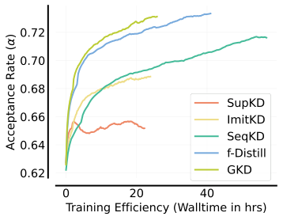

> 图解：横轴是蒸馏训练的实际耗时（小时），纵轴是接受率 $\alpha$。GKD 与 $f$-Distill 最终都达到约 0.73 的高位，但 GKD 曲线更靠左，在约 24 小时就达到相近水平；$f$-Distill 因在线调用教师生成数据，需要约 50 小时。Supervised KD 很早停滞在约 0.65–0.66，说明静态固定数据难以持续改善对齐。

这也是论文更推荐 on-policy GKD 的原因：并非它的最终表现永远显著超过教师生成方案，而是 **效果接近时，数据生成成本低得多**。

### 5. 样本级结果：不是少数简单样本拉高平均值

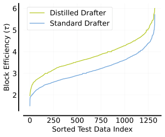

> 图解：横轴是按块效率排序后的测试样本索引，纵轴是每个样本的 $\tau$。绿色蒸馏草稿曲线几乎始终位于蓝色标准草稿曲线上方，说明提升体现为整个样本分布向上移动，而不是只靠少数高接受率样本抬高均值。由于两组分别排序，该图展示的是分布优势，不应把同一横坐标直接理解为同一个样本的配对差值。

理论估算与实测也基本一致：

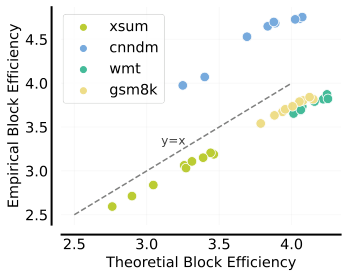

> 图解：横轴是基于 TVD 与独立同分布假设计算的理论块效率，纵轴是实测块效率，每个点对应一种蒸馏模型，颜色区分数据集，虚线为 $y=x$。点并不都落在虚线上，说明 Token 独立性假设会带来高估或低估；但不同模型的相对排序保持较好，支持用 TVD 作为蒸馏优化的代理信号。

### 6. 迁移结果：换任务、换更大的目标模型仍然有效

论文先在 GSM8K 上蒸馏 T5-Small，再直接用于 23 个未见的 BIG-Bench Hard（BBH）zero-shot CoT 推理任务。以 T5-XL 为目标模型时：

- greedy：平均加速从标准 SD 的 1.93× 提升到 2.21×；
- non-greedy：从 1.78× 提升到 2.02×；
- 两种设置的加速倍数平均增加 0.26×。

更进一步，草稿虽然是从 T5-XL 蒸馏出来的，也能直接服务从未对其蒸馏的 T5-XXL：

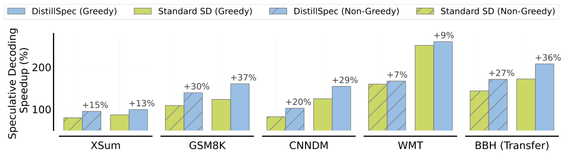

> 图解：坐标与图例含义同前面的总览图，但目标模型换成了更大的 T5-XXL。蓝色 DistillSpec 在所有数据集与解码设置中仍高于绿色标准 SD，柱顶增益为 7%–37%；BBH 迁移组也保持优势。它不是说跨教师迁移已经最优，而是证明未经重新蒸馏的草稿仍保留了可观的通用对齐能力。

知道方法有效之后，下一个问题自然变成：实际训练时，数据来源和散度到底该怎么选？

## 四、DistillSpec 配方：没有万能散度，只有任务匹配

论文在 XSum 与 GSM8K 上做了一个 4×4 网格：四种数据来源分别是固定数据、学生数据、学生+教师数据、教师数据；四种散度分别是 FKL、JSD、RKL 和 TVD。指标是蒸馏后经验块效率的增量。

### 1. XSum greedy：混合数据配 JSD 最强

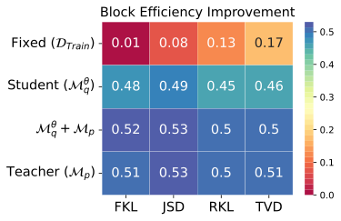

> 图解：横轴为散度，纵轴为训练数据来源，格内数字是 $\tau$ 的增量，颜色越偏蓝越高。固定数据只有 0.01–0.17，而模型生成数据普遍达到 0.45 以上。最高值 0.53 出现在 JSD 下，学生+教师数据与仅教师数据并列；学生单独生成时也达到 0.49，已相当有竞争力。

### 2. GSM8K greedy：换成学生数据配 FKL

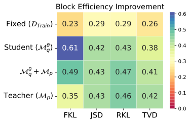

> 图解：坐标与颜色含义同上图。最佳组合变成“学生生成数据 + FKL”，增量为 0.61；教师数据在该设置下只有 0.35–0.46。XSum 上最好的混合数据并没有原样胜出，说明配方存在明显的任务依赖性。

### 3. GSM8K non-greedy：最优组合再次变化

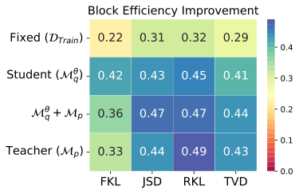

> 图解：仍展示 $\tau$ 增量，但解码改为 $T=1$。最佳值变成“教师生成数据 + RKL”的 0.49；学生数据最高为 RKL 的 0.45，学生+教师数据在 JSD 与 RKL 下均为 0.47。只改变解码策略，最优散度和数据来源就发生变化，因此不能沿用 greedy 设置下的结论。

笔者认为，这组结果是全文最重要的工程提醒之一：**TVD 虽在理论上直接对应接受率，却不能替代实证调参。** 理论给出优化方向，具体 Loss 仍要由任务、数据与解码方式共同决定。

### 4. 学生分数高，不代表它是好草稿

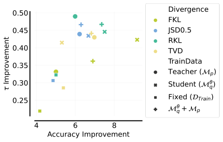

> 图解：横轴是蒸馏带来的 Accuracy 增量，纵轴是 $\tau$ 增量；颜色表示散度，点形表示训练数据来源。点并未沿一条上升直线排列：有些配置准确率提升很大但块效率一般，也有些配置以中等准确率提升取得很高的块效率。这意味着用 ROUGE 或 Accuracy 单独挑选 checkpoint，可能选不到最适合 SD 的草稿模型。

因此，部署时要区分两个目标：若学生要独立回答用户，任务分数很重要；若学生只负责给目标模型起草，就应直接验证接受率、块效率和端到端延迟。

### 5. 生成数据的温度也不能忽略

附录进一步比较了用 $T=1.0$ 和 $T=10^{-2}$ 生成蒸馏数据的差异。无论数据来自学生还是教师，较高温度都明显更好。

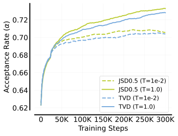

> 图解：横轴是训练步数，纵轴是 XSum 接受率；实线对应 $T=1.0$，虚线对应 $T=10^{-2}$。JSD 与 TVD 两种设置中，高温生成数据都在训练后段取得更高接受率，最终分别约为 0.73 和 0.725，而低温曲线约为 0.70。

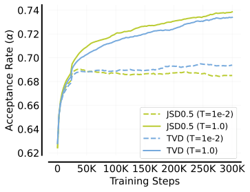

> 图解：坐标和线型含义同上图，只是训练序列改由教师生成。高温曲线的优势更大，最终接受率接近 0.735–0.74；低温曲线长期停留在约 0.685–0.695。说明采样温度影响的不只是数据多样性，也会影响可用于对齐的上下文覆盖。

### 6. 复现清单：初始化、训练与数据生成

T5 模型均从任务 SFT checkpoint 开始蒸馏。除 GSM8K 外，初始模型是 LM-adapted T5 v1.1 再经不同步数 SFT 得到：

| 数据集 | T5-Small | T5-Base | T5-Large | T5-XL | T5-XXL |
|---|---:|---:|---:|---:|---:|
| XSum SFT 步数 | 100K | 50K | 30K | 20K | 8K |
| CNN/DM SFT 步数 | 200K | 80K | 20K | 20K | 4K |
| WMT SFT 步数 | 250K | 250K | 110K | 50K | 10K |

GSM8K 则统一从 FLAN-T5 出发，在 PaLM-540 生成的 CoT 数据上 SFT 10K 步。GPT-like 模型使用 32K Token 的 T5 tokenizer；234M target 为 12 层、hidden size 1,024、FFN 4,096、每层 16 个 attention heads，33M draft 为 4 层、512、1,024 和 4 个 heads。

SeqKD 与 $f$-Distill 使用在线教师生成，而非固定离线教师语料；GKD 去掉静态标准答案，只用当前学生在线生成的数据。教师和学生生成数据时均采用 $T=1.0$，蒸馏 Loss 中的教师温度 $T_p$ 与学生温度 $T_q$ 也都固定为 1.0，以保持两者概率语义一致。

| 训练超参数 | 设置 |
|---|---|
| Optimizer | Adafactor |
| Training steps | 300,000 |
| Batch size | 32 |
| Dropout | 0.0 |
| Learning rate | 0.0003 |
| LR warmup | 前 5,000 步，从 0 线性升至 LR |
| LR cooldown | 第 150,000–300,000 步 |
| Cooldown schedule | Cosine decay，从 LR 降至 0.1 LR |

综合这些实验，论文给出的实用默认项是：**优先尝试学生 on-policy 数据以控制成本，再围绕具体任务和解码策略调节散度；不要默认 TVD、FKL 或教师生成数据一定最好。**

## 五、从无损加速到质量—延迟的精细调节

标准 DistillSpec 保持目标模型输出分布不变。但在真实产品中，有时愿意牺牲少量质量换更低延迟，于是论文又把它扩展到 lossy SD，并研究多个尺寸模型同时可用时的最佳组合。

### 1. Lenience：把验收标准从“严格”调成“宽松”

lossy SD 引入宽容参数 $\varepsilon\in[0,1]$ 和 lenience function $f$，将接受概率改为：

$$
a_i=\min\left(1,\frac{f(p(y_i),\varepsilon)}{q(y_i)}\right)
$$

论文比较三种函数：$f_{\mathrm{lin}}(p,\varepsilon)=p/\varepsilon$、$f_{\mathrm{sq}}(p,\varepsilon)=p/\varepsilon^2$，以及 $f_{\mathrm{exp}}(p,\varepsilon)=p^\varepsilon$。当 $\varepsilon=1$ 时三者都退化为无损验收；当 $\varepsilon<1$ 时，对 $0<p<1$ 都会提高接受倾向。例如 $f_{\mathrm{sq}}$ 在 $\varepsilon=0.1$ 时把接受比率中的分子放大 100 倍，最终结果仍由 $\min(1,\cdot)$ 截断。

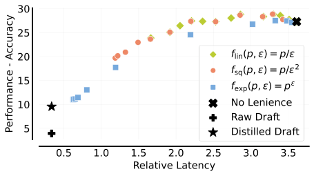

> 图解：横轴是相对延迟，越左越快；纵轴是 GSM8K Accuracy，越高越好。黑色叉号是无 lenience 的 SD，黑色加号和星号分别是单独使用 raw draft 与 distilled draft；彩色点对应不同 $\varepsilon$。只用 KD 或只用 SD 都无法同时达到最低延迟与最高质量，彩色曲线提供中间选择。$f_{\mathrm{lin}}$ 与 $f_{\mathrm{sq}}$ 能在保留较多准确率时降低部分延迟，$f_{\mathrm{exp}}$ 虽能插值到更低延迟，但整体权衡曲线更差。

GSM8K 上可以用很小的质量损失换明显加速，一个可能原因是推理文本中有不少 Token 并不影响最终答案。但这不再是标准 SD 的分布无损保证，宽松程度必须按业务可接受的质量下限选择。

### 2. Model garden：先蒸馏目标，再用 DistillSpec 蒸馏草稿

如果手里有 T5-Small（77M）、Base（250M）、Large（800M）、XL（3B）和 XXL（11B）一整组模型，应该如何组合？论文比较四种策略：

1. **Raw**：直接部署各尺寸的 SFT 模型。
2. **Distilled**：把更大的 T5 蒸馏到较小目标模型，以提升其单模型任务表现。
3. **Speculative**：使用未经任务蒸馏优化的模型组合做标准 SD。
4. **DistillSpec**：先用 KD 得到更强目标模型，再蒸馏与其对齐的更小草稿模型，最后执行 SD。

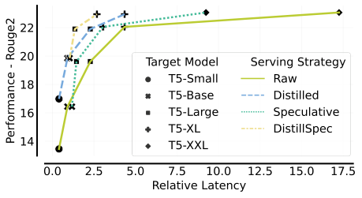

> 图解：横轴为相对延迟，纵轴为 ROUGE-2，越靠左上越优；点形表示目标模型尺寸，线型表示 serving 策略。Raw 的高质量点需要很大延迟，Distilled 在小模型区间更有优势，Speculative 随目标变大更能体现并行验收价值，而 DistillSpec 整体占据更靠左上的位置。

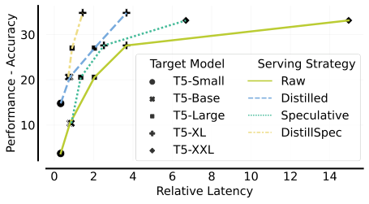

> 图解：横轴仍为相对延迟，纵轴改为 Accuracy。SD 在较大模型上明显把曲线左移，但当草稿与目标耗时接近时，小模型上的收益会收窄；DistillSpec 通过“先提升目标质量、再提高草稿兼容性”获得最佳综合曲线。

最硬的一组数字是：

- **XSum**：相对延迟从 17.3 降至 2.7，约为 **6.4× 延迟缩减**；ROUGE-2 仅从 23.1 变为 23.0。
- **GSM8K**：相对延迟从 15.0 降至 1.4，约为 **10.7× 延迟缩减**；Accuracy 反而从 33.1 提升到 34.8。

这里的收益来自两级蒸馏与 SD 的组合，而不是把一个普通小模型直接换成另一个小模型。它也说明 KD 与 SD 并非互斥：前者擅长压低单模型成本，后者擅长保住大模型分布，组合后才能同时利用两种优势。

### 3. 落地时不能忽略的三个边界

- **需要白盒权限**：教师 logits 是核心监督信号，只能调用黑盒 API 的场景无法直接复现完整方法。
- **收益不是固定常数**：实验基于 batch size 1、TPUv4 和特定 T5/GPT-like 配置；硬件、draft/target 延迟比、输出长度与解码策略变化后，最优 $\gamma$ 和实际加速都要重测。
- **无损与有损要分开报告**：标准 DistillSpec 保持目标分布；加入 lenience 后是在主动交换质量与延迟，不能继续声称完全无性能损失。

## 六、总结

- **核心问题**：SD 的速度不只取决于草稿模型有多小，更取决于它与目标模型有多对齐。
- **核心方法**：DistillSpec 用白盒 KD 在生成轨迹上缩小分布差异，TVD 给出理论指南针，实际散度仍需按任务与解码策略调节。
- **关键配方**：模型生成数据优于固定标准答案，学生 on-policy 数据以更低成本取得接近教师数据的收益，教师 logits 则不可替代。
- **实验结论**：相较标准 SD 再提速 10%–46%；迁移到 23 个 BBH 任务后，greedy 与 non-greedy 加速分别达到 2.21× 和 2.02×；跨到 T5-XXL 仍有 7%–37% 增益。
- **系统价值**：与模型级联结合可实现 6.4×–10.7× 延迟缩减；lossy SD 进一步提供可调节的质量—延迟曲线。

这项工作仍依赖白盒访问与逐任务配方选择，后续值得探索如何降低这两项成本，并在更大模型和更多 serving stack 上验证收益。

> 本文参考自 [DistillSpec: Improving Speculative Decoding via Knowledge Distillation](https://arxiv.org/abs/2310.08461)