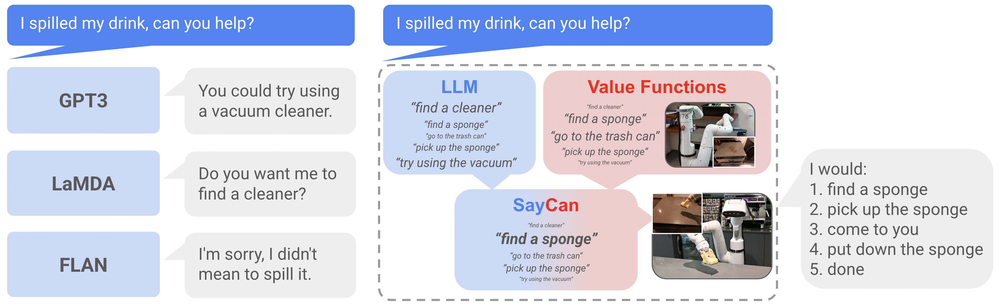

# SayCan：让大模型在机器人上「量力而行」

大语言模型（LLM）装满了世界知识，却没有身体、不懂物理——它会让厨房机器人「用吸尘器吸可乐」这种根本做不到的废话。Google Robotics 与 Everyday Robots 的 SayCan 解决了这个问题：在真实厨房 101 条指令评测中取得 **84% 规划成功率、74% 执行成功率**，执行表现相比未接地的基线近乎翻倍。

## 核心思想：Say × Can

- **Say（任务接地）**：LLM 打分 $p(\ell_\pi \mid i)$，判断哪个技能对完成指令有用；
- **Can（世界接地）**：预训练技能的价值函数给出 $p(c_\pi \mid s, \ell_\pi)$，判断该技能在当前状态下能否做成；
- 两者相乘取 argmax：$\pi = \arg\max p(c_\pi \mid s, \ell_\pi) \cdot p(\ell_\pi \mid i)$，选出「既有用又可行」的下一步，执行后把技能描述追加进 Prompt，循环直到输出「done」。

**理论支点很巧妙**：在稀疏 0/1 奖励（成功得 1、失败得 0）下，RL 训出的价值函数天然就是可供性函数——数值正好等于技能在当前状态的成功概率。

另一个关键设计：LLM 不做自由生成，改为对候选技能逐一 **打分（scoring）**，避免输出机器人不会的动作，还带来可解释性——能看到机器人在「考虑」什么。

## 系统实现

- 训练多任务、语言条件的 BC 策略（68000 条遥操作演示 + 成功过滤的自主回合）与 RL 价值函数（仿真训练 + RetinaGAN 迁移），语言描述经冻结的 Universal Sentence Encoder 编码；
- 可供性函数按技能族校准：Pick 用归一化 RL 价值，Go to 按距离衰减，Place 恒为 1，Terminate 固定 0.1；
- 技能库共 551 个技能、7 个技能族、17 个物体，跑在 Everyday Robots 移动操作平台上。

## 实验结论

- 101 条指令分 7 族（抽象名词/动词、众包表达、长程推理等），PaLM-SayCan 总规划 84%、执行 74%；错误中 **65% 来自 LLM，35% 来自可供性函数**；
- 消融证明 Say 与 Can 缺一不可：去掉价值函数规划率掉到 67%，传统语言条件策略直接执行成功率为 0%；
- **最激动人心的性质**：仅把 LLM 从 FLAN 137B 换成 PaLM 540B，执行成功率从 61% 升到 74%——机器人第一次搭上 LLM Scaling 的便车，模型变强，机器人一行代码不改就跟着变强；
- 即插即用的新能力：添加抽屉操作技能（21 条查询规划 100%）、Chain-of-Thought 处理否定推理、零成本支持多语言指令。

## 一句话总结

SayCan 把「语言理解」与「机器人控制」解耦又对接的因子化范式，为 Inner Monologue、RT-2 等后来的具身智能工作铺平了道路；留下的开放问题——机器人经验能否反哺 LLM、自然语言是否是编程机器人的正确「本体」——至今仍是领域最值得追的方向。

> 本文参考自 [Do As I Can, Not As I Say: Grounding Language in Robotic Affordances](https://arxiv.org/abs/2204.01691)