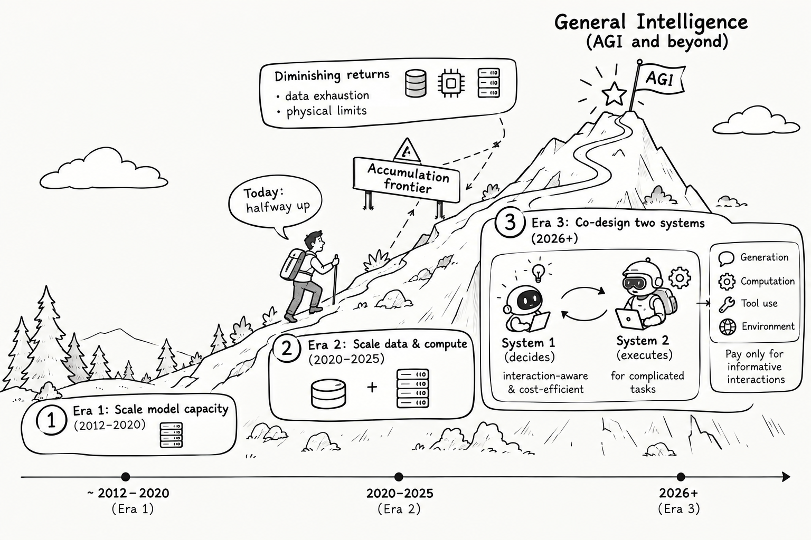
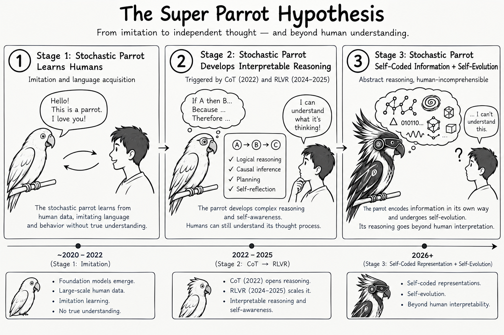
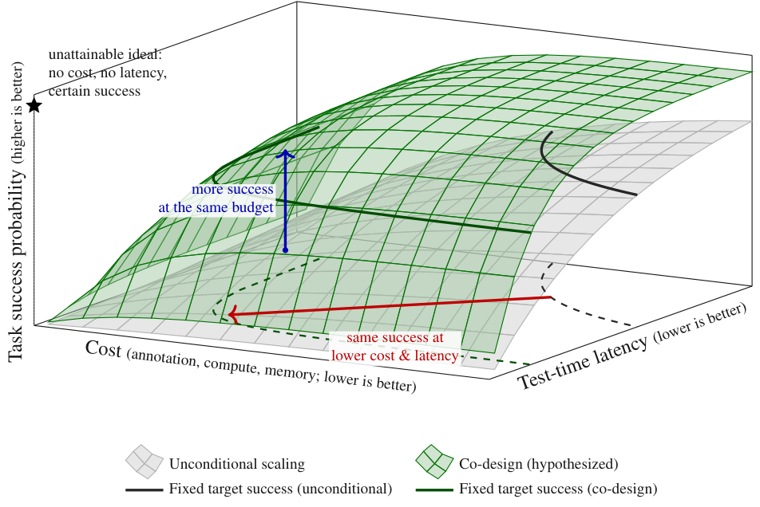
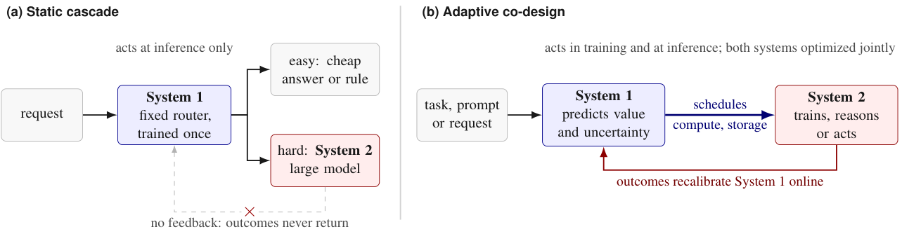
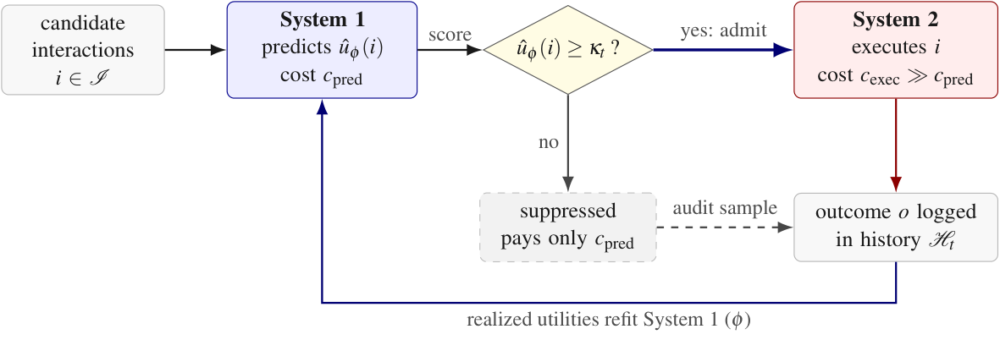
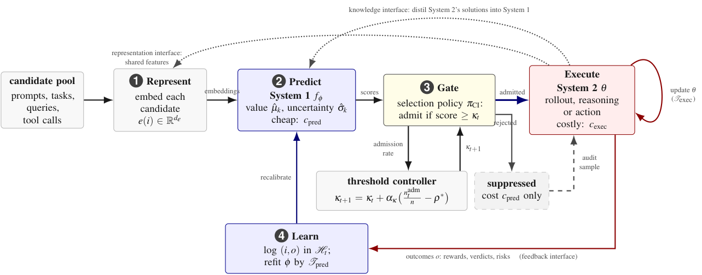
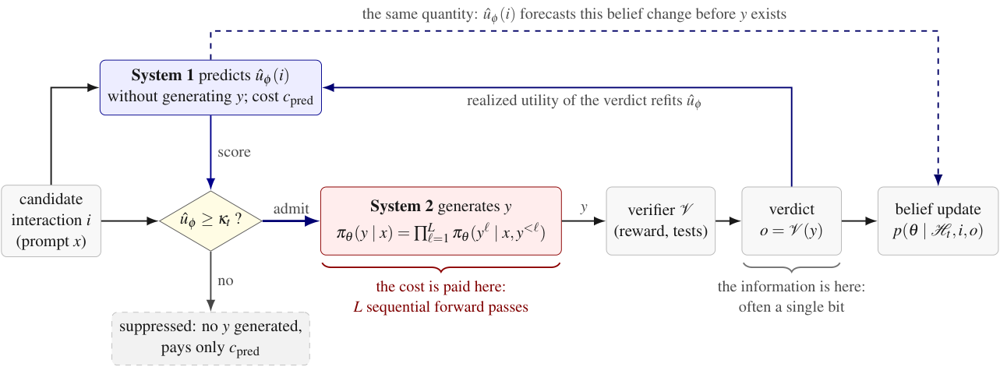
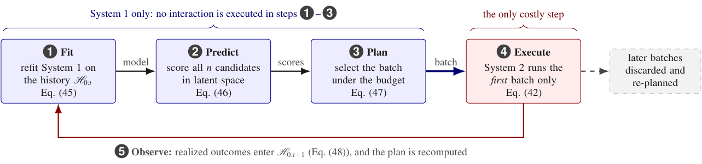

# Conditional Interaction：只为高价值交互付费

当 RLVR 训练、长链推理或机器人 rollout 中的大量交互带不来新信号时，继续堆 System-2 的模型、数据和算力，会把预算花在已知或无效经验上。这篇 Perspective 要解决的，正是 AGI 扩展中“执行前不知道哪次交互值得付费”的效率瓶颈，它关系到后训练、测试时推理和 Agent 工具调用能否继续扩展。核心方案是让轻量 System-1 先预测效用，资源密集型 System-2 只执行通过门槛的候选，再用执行结果回训 System-1。理论结果显示，在完美筛选、等执行成本且预测成本趋零时，加速比接近 $1/\rho_u$；更一般地，成本比为 $\rho_u+r$，同步评估下峰值 rollout 显存还可与候选池大小 $n$ 解耦。需要注意，这些是有明确假设的推导与文献佐证，不是一套统一基准实验的实测结果。

## 一、扩展的瓶颈：不是交互不够多，而是值得做的交互太少

过去通向 AGI 的主线，主要是扩大 System-2：更大的模型、更多的数据与算力、更长的推理，以及更多的 Agent。System-2 在这里不是某种固定模型，而是负责推理、规划、决策、工具调用或计算机操作的资源密集型执行者。

论文把关注点转向另一个变量：每一次生成、计算、工具调用或环境交互，究竟值不值得它的成本。System-1 则是轻量、具备语义理解能力的预测者，只给候选交互估值，不负责完成任务。

> 图解：底部时间轴把发展划分为三个阶段：2012—2020 年主要扩展模型容量，2020—2025 年主要扩展数据与算力，2026 年以后则把双系统协同设计作为一种候选方向。登山路线表示能力扩展可能受到数据耗尽、物理限制和边际收益递减的约束；右侧 System-1 负责决策，System-2 负责复杂执行，目标是只对信息丰富的生成、计算、工具使用和环境交互付费。该图是概念路线图，不是历史事实或性能曲线。

### 无差别交互的边际收益会消失

设累计算力为 $\mathcal{C}$，损失遵循幂律 $\mathcal{L}(\mathcal{C})\propto\mathcal{C}^{-\alpha}$，性能记为 $\mathcal{P}=1-\mathcal{L}$。再增加一次无差别交互，其边际收益为：

$$
\eta_{\mathrm{unc}}(t)
=\frac{d\mathcal{P}}{d\mathcal{C}}\bigg|_t
=-\frac{d\mathcal{L}}{d\mathcal{C}}\bigg|_t
\propto \alpha\mathcal{C}^{-\alpha-1}.
$$

随着 $\mathcal{C}$ 增长，这项收益趋近于零。论文的关键区分是：经典 Scaling Law 描述的是在固定候选分布上无差别执行交互；改变“执行哪些交互”，有机会改变曲线所经过的路径，而不只是沿原曲线继续前进。

这个浪费在数字世界和物理世界有不同表现：

- **数字世界：算力密集，无效 rollout 多。** 在可验证奖励强化学习（RLVR）中，GRPO 对每个提示采样 $G$ 个回答，并计算组内相对优势：

$$
A_g^{\mathrm{GRPO}}(\tau)=\frac{r_g-\mu_r}{\sigma_r+\epsilon},\qquad
\mu_r=\frac{1}{G}\sum_{g=1}^{G}r_g,\qquad
\sigma_r^2=\frac{1}{G}\sum_{g=1}^{G}(r_g-\mu_r)^2.
$$

如果 $G$ 个回答全对或全错，就有 $r_g=\mu_r$，所有 $A_g=0$。计算已经支付，组相对策略梯度信号却是零。真正有该信号的通常是结果有对有错的中等难度提示。

- **物理世界：单次交互昂贵，任务空间高维。** 机器人域随机化要覆盖场景、物体、动力学、光照和传感等维度。真实轨迹受物理时间约束，不能无限并行；此时选择哪些任务配置，与执行多少条轨迹同样重要。

合成数据并不能自动消除问题。它只是把“数据数量不足”转成“组合空间覆盖不足”：可以生成无穷任务，不代表每个任务都值得生成、执行和学习。

### “超级鹦鹉”假说把效率问题推向系统内部

论文进一步提出一个假说性趋势：模型先模仿人类文本，再发展人类可理解的推理，未来可能使用自我编码的表示并自我进化。越来越多学习材料由 AI 自己生成，形成“AI for AI”。

> 图解：三个阶段分别是约 2020—2022 年的模仿学习、2022—2025 年由 CoT 与 RLVR 推动的可解释推理，以及 2026 年以后假想的自我编码表示与自我进化。图中人物从“能理解它在想什么”变为“无法理解”，强调 AI 自己生产训练数据、反馈和实验后，执行前的价值判断会成为内部效率瓶颈。原文明确说明，这是一条概念假说轨迹，并非已被证实的发展年表。

这带来全文的核心问题：**System-2 怎样在执行前知道一次交互的价值？** 答案不能是“让 System-2 先完整执行再判断”，因为评估成本必须显著低于执行成本，否则筛选本身就失去了意义。

### $\rho_u$：描述资源转化效率的新坐标

论文把效用相关交互密度定义为候选中真实效用超过预设门槛 $u_{\min}$ 的比例：

$$
\rho_u(\theta_t)=
\Pr_{i\sim\mathcal{D}}\left[u(i;\theta_t)\ge u_{\min}\right].
$$

它不是与参数量 $N$、数据量 $D$、算力 $\mathcal{C}$ 并列的新资源，而是描述这些资源转化为能力之效率的坐标：

$$
\mathcal{P}=f(N,D,\mathcal{C};\rho_u).
$$

这里必须区分两个比例：

1. **候选池比例** $\rho_u(\theta_t)$：由当前策略与学习动态决定，门控本身不能改变它。
2. **已执行比例**：实际付费交互中效用相关交互的占比。无条件执行时它等于候选池比例；完美门控可把它提高到 1。

因此，$\rho_uD$ 和 $\rho_u\mathcal{C}$ 表示被有效消费的数据与算力，而不是说可用语料库真的缩小了。不同效用定义下的密度也不能混用：非零 GRPO 优势的提示比例、适应风险超过门槛的任务比例、增加推理后答案会改善的查询比例，是三个不同量。

> 图解：两个水平轴分别是成本（标注、计算、内存，越低越好）和测试时延迟（越低越好），竖轴是任务成功概率（越高越好）。灰色曲面表示无条件扩展，绿色曲面表示假想的协同设计前沿；红色箭头表示相同成功率下降低成本与延迟，蓝色箭头表示相同预算下提高成功率。该图表达设计目标，绿色优势尚未被统一实验验证。

## 二、核心方法：预测、门控、执行、更新

解决“执行前估值”之后，下一个问题是：怎样把估值变成一套可训练、可反馈的架构，而不是在大模型前面临时加一个过滤器。

### 静态级联不等于协同设计

静态级联通常由一次训练好的小模型路由请求：简单请求走便宜规则或小模型，困难请求交给大模型。它只作用于推理层，System-2 的结果不会回流。

协同设计则要求 System-1 针对**当前 System-2** 预测学习价值或执行价值，同时调度训练与推理中的算力、存储和上下文；System-2 的奖励、梯度和执行结果再在线校准 System-1。区别不在“是否有两个模型”，而在“是否双向反馈并联合优化”。

> 图解：左图（a）中，固定 System-1 只在推理时路由，结果永不返回；右图（b）中，System-1 预测价值和不确定性，调度 System-2 的计算与存储，System-2 的结果在线重新校准 System-1。根据执行结果在线重训的级联，处在两者之间。

AlphaZero 是这种双向关系的直观参照：策略价值网络与树搜索相互提供训练信号，而不是只把搜索树无限加深。笔者认为，这一视角最重要的转变，是把“小模型省算力”从工程技巧提升为学习系统内部的闭环接口。

### 条件交互策略

设候选交互空间为 $\mathcal{I}$，历史为 $\mathcal{H}_{0:t}$，System-1 给出预测效用 $\hat u$。条件交互策略先硬门控，再在可执行集合内做 Softmax 选择：

$$
\pi_{\mathrm{CI}}(i_t\mid\mathcal{H}_{0:t})
=\frac{1}{Z_t}
\exp\!\left(\beta\hat u(i_t\mid\mathcal{H}_{0:t})\right)
\mathbf{1}\!\left[\hat u(i_t\mid\mathcal{H}_{0:t})\ge\kappa_t\right],
$$

$$
Z_t=\sum_{i\in\mathcal{I}}
\exp\!\left(\beta\hat u(i\mid\mathcal{H}_{0:t})\right)
\mathbf{1}\!\left[\hat u(i\mid\mathcal{H}_{0:t})\ge\kappa_t\right].
$$

其中，$\kappa_t$ 决定谁有资格执行，$\beta>0$ 决定在合格候选中多强地偏向高分者。若 $Z_t=0$，策略以概率 1 选择空动作 $\varnothing$，本轮什么都不执行。

两个极限有助于理解这个公式：

- $\beta\to 0$ 时，它接近只做过滤、不区分合格候选优劣的策略。
- $\beta\to\infty$ 时，它退化为在最大预测效用候选上均匀打破平局的贪心 argmax。

附录对第二个极限的证明很直接。用最大预测效用归一化，并令效用缺口 $d_t(i)=\hat u_t^{\max}-\hat u_t(i)$，则：

$$
\pi_{\mathrm{CI}}(i\mid\mathcal{H}_{0:t})
=\frac{\mathbf{1}[i\in\mathcal{I}_t^{\mathrm{adm}}]e^{-\beta d_t(i)}}
{\sum_{j\in\mathcal{I}_t^{\mathrm{adm}}}e^{-\beta d_t(j)}}.
$$

非最优项都随 $\beta$ 指数衰减。若最优候选唯一，且与次优者的差距为 $\Delta_t$，其未选中概率满足：

$$
1-\pi_{\mathrm{CI}}(i_t^\star\mid\mathcal{H}_{0:t})
\le\left(|\mathcal{I}_t^{\mathrm{adm}}|-1\right)e^{-\beta\Delta_t}.
$$

> 图解：System-1 以 $c_{\mathrm{pred}}$ 为每个候选打分；满足 $\hat u_\phi(i)\ge\kappa_t$ 的候选进入 System-2，支付 $c_{\mathrm{exec}}\gg c_{\mathrm{pred}}$，其余候选只支付预测成本。执行结果写入历史并回训 System-1；被抑制候选中还会抽出一小部分审计样本实际执行，用来发现漏判。

### 效用不是一个通用分数

最基础的效用是预期信息增益，也就是执行后验相对执行前先验的 KL 散度之期望：

$$
u(i;\theta_t)=
\mathbb{E}\!\left[
D_{\mathrm{KL}}\!\left[p(\theta\mid\mathcal{H}_{0:t},i,o)\,\|\,p(\theta\mid\mathcal{H}_{0:t})\right]
\,\middle|\,\mathcal{H}_{0:t},i
\right].
$$

它回答的是：“执行并观察结果后，我的信念会改变多少？”结果越可预测，效用越接近零。这个量也等于条件互信息 $I(\theta;o\mid i,\mathcal{H}_{0:t})$，并在相关熵有限时等于 $\theta$ 的期望熵减少量。

但信息增益不是“有用”的唯一解释：

- 探索与实验设计：$u(i)=I(\theta;o\mid i)$。
- 课程学习：$u(i)=\mathbb{E}[\Delta J\mid i]$，即预期学习进步。
- 决策：$u(i)=\mathrm{VoI}(i)=\mathbb{E}[\Delta V\mid i]$，即信息价值。
- 鲁棒域随机化与元学习：$u(i)=\mathcal{R}_{\mathrm{adapt}}(i;\theta_t)$，即适应风险。

信念变化不必然带来答案改善；大梯度可能来自噪声；几乎不改变后验的交互也可能用于确认信念、校准模型或避免罕见失败。门控永远相对于一个明确声明的效用，而不是发现某种普适价值。

### 统一目标其实是带预算的背包问题

设 $x(i)\in[0,1]$ 是执行候选 $i$ 的概率，$\mathcal{C}(i)$ 是成本，总预算为 $\Gamma$。主目标为：

$$
x^\star=\operatorname*{arg\,max}_{x\in[0,1]^{\mathcal{I}}}
\sum_{i\in\mathcal{I}}x(i)\hat u(i),
\qquad
\mathrm{s.t.}\quad
\sum_{i\in\mathcal{I}}x(i)\mathcal{C}(i)\le\Gamma.
$$

这是分数背包问题。引入成本价格 $\lambda$ 后，门槛规则变为：

$$
x^\star(i)=\mathbf{1}\!\left[\hat u(i)\ge\lambda\mathcal{C}(i)\right].
$$

也就是按单位成本价值 $\hat u(i)/\mathcal{C}(i)$ 排序。成本不同时，应使用净分数：

$$
\tilde u(i)=\hat u(i)-\lambda\mathcal{C}(i).
$$

这里有三种不能混淆的规则：预算批次规则接纳所有 $\tilde u(i)\ge0$ 的候选；单次净价值规则选择 $\operatorname*{arg\,max}_i\tilde u(i)$；直接对原始 $\hat u$ 做贪心则选择原始效用最大者。只有成本相同，三者的排序才一致。成本不同时，把条件策略作用于 $\tilde u$ 并设 $\kappa_t=0$，才能与预算优化对齐。

## 三、如何衡量收益：IIE、产出率与筛选误差

有了门控规则，还不能只看“少跑了多少 rollout”。过度门控可能让每次执行都很高效，却几乎不给学习器留下信号。因此论文同时定义效率和产出。

### 交互信息效率 IIE

对 $T$ 个被筛选候选，交互信息效率（Interaction Information Efficiency，IIE）是获得的总效用除以系统级成本：

$$
\mathrm{IIE}_T=
\frac{\sum_{t=0}^{T-1}\mathbb{I}(i_t)\mathbf{1}[i_t\ \mathrm{executed}]}
{\sum_{t=0}^{T-1}\left(c_{\mathrm{pred}}(i_t)+
\mathcal{C}(i_t)\mathbf{1}[i_t\ \mathrm{executed}]\right)}.
$$

每个候选都要支付预测成本，只有被执行者才支付执行成本。与此同时，每个候选带来的平均效用，即产出率，定义为：

$$
Y_T=\frac{1}{T}\sum_{t=0}^{T-1}
\mathbb{I}(i_t)\mathbf{1}[i_t\ \mathrm{executed}].
$$

IIE 是有限样本比值，总体理论结果应对分子、分母分别取期望后再相除，不能把随机和之比直接当作期望之比。预测器重训和审计执行属于额外系统成本，应单独报告。

### 理想收益接近 $1/\rho_u$

把候选分为效用相关与低效两组，后者占比 $1-\rho_u$。若低效候选效用为零、预测完美且免费，则：

$$
\frac{\mathrm{IIE}^{\mathrm{CI}}}{\mathrm{IIE}^{\mathrm{unc}}}
=\frac{1}{\rho_u}\frac{\bar{\mathcal{C}}}{\bar{\mathcal{C}}_{\mathrm{rel}}}
=1+\frac{1-\rho_u}{\rho_u}
\frac{\bar{\mathcal{C}}_{\mathrm{dead}}}{\bar{\mathcal{C}}_{\mathrm{rel}}}.
$$

等执行成本时，结果就是 $1/\rho_u$；低效交互反而更昂贵时，收益还会更大。若预测有假阳性率 $\mathrm{fp}$、假阴性率 $\mathrm{fn}$，且每次预测成本为 $c_{\mathrm{pred}}$，则：

$$
\frac{\mathrm{IIE}^{\mathrm{CI}}}{\mathrm{IIE}^{\mathrm{unc}}}
=K\left(
1+\frac{\mathrm{fp}(1-\rho_u)\bar{\mathcal{C}}_{\mathrm{dead}}+c_{\mathrm{pred}}}
{(1-\mathrm{fn})\rho_u\bar{\mathcal{C}}_{\mathrm{rel}}}
\right)^{-1},
$$

其中 $K=(\bar{\mathbb{I}}_{\mathrm{rel}}/\bar{\mathcal{C}}_{\mathrm{rel}})/(\bar{\mathbb{I}}/\bar{\mathcal{C}})$。

附录推导只需做逐项记账。每个候选平均获得的效用和成本分别是：

$$
\mathbb{S}_{\mathrm{CI}}=(1-\mathrm{fn})\rho_u\bar{\mathbb{I}}_{\mathrm{rel}},
$$

$$
\mathbb{C}_{\mathrm{CI}}=(1-\mathrm{fn})\rho_u\bar{\mathcal{C}}_{\mathrm{rel}}
+\mathrm{fp}(1-\rho_u)\bar{\mathcal{C}}_{\mathrm{dead}}+c_{\mathrm{pred}}.
$$

两式相除并除以无条件效率，即得上式。假阴性不会让已花成本变高，却会让产出率乘以 $1-\mathrm{fn}$，还会把预测与假阳性成本摊到更少的有效执行上。因此 IIE 和 $Y_T$ 必须一起报告。

若 $u_{\min}>0$，所谓“低效”候选可能仍有正效用，闭式增益就变成上界，不能继续机械地宣称一定有 $1/\rho_u$ 倍提升。误差若集中在高成本候选上，还要按成本分层报告假阳性率。

### $\rho_u$ 必须独立测量，不能从损失曲线反推

如果用 $\rho(\mathcal{C})$ 的自由变化去拟合任意幂律指数，会产生循环论证。论文要求事先声明 $u$ 和 $u_{\min}$，用真实执行结果估计 $u$，并在独立于门控的审计池上重复 rollout、给出置信区间、随 $\theta_t$ 变化重新测量。

在 RLVR 中，可选的代理效用是一组 $G$ 个 rollout 出现混合奖励的概率：

$$
u_{\mathrm{adv}}(\tau;\theta_t)=1-p_\tau^G-(1-p_\tau)^G,
$$

其中 $p_\tau$ 是当前通过率。$u_{\min}\to0^+$ 时，$\rho_u$ 对应可能产生非零 GRPO 优势的提示比例 $\rho_{\mathrm{adv}}$。但它仍不是信息增益：全错组也能提供难度信息，混合组也可能只产生噪声更新。

### 什么时候不该门控

条件交互有效的前提，是交互昂贵、价值差异大、执行前可预测，而且预测成本远低于执行成本。以下情况应放松甚至放弃门控：

1. 预测器校准差或已偏离训练分布；
2. 交互具有单步效用捕捉不到的长期探索价值；
3. 预测成本接近执行成本；
4. 假阴性会造成安全事故或不可逆后果；
5. 效用定义本身有误，门控又会屏蔽能暴露该错误的数据。

一种补救是把分数改为 $\hat u+c\sigma_\phi$，让不确定性驱动探索；另一种是显式混合均匀探索与审计采样。这个框架回答的是“怎样使用可信的信息量信号”，并不保证这种信号永远存在。

## 四、双系统怎样共同训练、共同扩展

定义了交互接口后，架构层面还有三个问题：两个系统如何更新，System-1 的输出怎样用于排序，以及 System-2 变贵后 System-1 是否也应变大。

### 两个更新算子，两个时间尺度

令 System-2 参数为 $\theta$，System-1 参数为 $\phi$。执行更新沿着门控采样得到的梯度前进，预测更新则用真实交互结果拟合效用：

$$
\mathcal{T}_{\mathrm{exec}}(\theta,\phi;\mathcal{H})
=\left(\theta-\eta_\theta
\mathbb{E}_{i\sim\pi_{\mathrm{CI}}}
[\nabla_\theta\mathcal{L}(\theta,i)]+\xi_\theta,\ \phi\right),
$$

$$
\mathcal{T}_{\mathrm{pred}}(\theta,\phi;\mathcal{H})
=\left(\theta,\ \phi-\eta_\phi\nabla_\phi
\mathbb{E}_{i\in\mathcal{H}}[d(\hat u_\phi(i;\mathcal{H}),u(i;\theta))]+\xi_\phi\right).
$$

这里 $d$ 是严格适当评分规则，例如平方误差或 Log Loss。组合更新为：

$$
(\theta_{t+1},\phi_{t+1})=
(\mathcal{T}_{\mathrm{exec}}\circ\mathcal{T}_{\mathrm{pred}})
(\theta_t,\phi_t;\mathcal{H}_{0:t}).
$$

直观上，System-1 快速跟踪执行结果，System-2 慢速吸收门控后的学习信号。双时间尺度随机逼近为这类耦合更新提供收敛条件，但通用条件交互架构尚没有整体收敛保证。

论文把预测误差随历史量按 $O(|\mathcal{H}|^{-1/2})$ 下降仅列为启发式参照，而不是结论。自适应采样、门控造成的数据删失，以及更强 System-2 带来的更难预测任务，都可能破坏这个速率。

### 用校准后的后验均值排序，而不是迷信原始分数

信息瓶颈目标在预测器复杂度和对真实效用的信息量之间折中：

$$
\min_{q(\hat U\mid\mathcal{H})}
I(\hat U;\mathcal{H})-\beta_{\mathrm{IB}}I(\hat U;U).
$$

它关心“学什么样的表示”。至于“已有分数怎样使用”，论文给出了一个简单结论：等成本、预算为 $B$、每个候选的真实效用只通过自己的预测输出与全部输出相关时，选择后验均值 $\mathbb{E}[U\mid\hat U]$ 最大的 $B$ 个候选最优。

证明只需两步。固定 $B$ 和成本后，IIE 分母对所有选择集合相同，所以只需最大化执行效用；再由塔式性质：

$$
\mathbb{E}\!\left[\sum_{i\in S}U(i)\right]
=\mathbb{E}\!\left[\sum_{i\in S}\mathbb{E}[U(i)\mid\hat U(i)]\right].
$$

对每个预测结果逐点选取最大的 $B$ 项即可。把 $\kappa_t$ 设为第 $B$ 大的后验均值，就能实现该集合。这不证明某种表示最优，只说明校准后的条件均值是正确的排序信号。

### 工程实现：Represent、Predict、Gate、Learn

> 图解：① Represent 把提示、任务、查询或工具调用编码为向量；② Predict 由轻量 System-1 输出价值 $\hat\mu_k$ 与不确定性 $\hat\sigma_k$；③ Gate 用 $\pi_{\mathrm{CI}}$ 和门槛 $\kappa_t$ 筛选，门槛控制器根据实际接纳率调整下一轮门槛；④ Learn 记录执行结果并更新 System-1，System-2 也从这些结果学习。虚线还表示知识蒸馏、共享表示和审计样本三个接口。

若目标是维持接纳率 $\rho^\star$，门槛可按随机逼近更新：

$$
\kappa_{t+1}=\kappa_t+
\alpha_\kappa\left(\frac{n_t^{\mathrm{adm}}}{n}-\rho^\star\right),
\qquad
n_t^{\mathrm{adm}}=|\{i:\hat u_\phi(i)\ge\kappa_t\}|.
$$

实际接纳率偏高就提高门槛，偏低就降低门槛。成本不同时，应把 $\hat u_\phi$ 换成净分数 $\tilde u_\phi$。

协同设计还固定了三个接口：

- **知识接口**：System-2 反复解决的常规问题，可把解法蒸馏给 System-1，让它直接回答，只升级其余问题。
- **表示接口**：共享 System-2 特征可能更准，也会共享盲点；独立编码有利于误差去相关，上下文条件化则有助于适应新任务。
- **反馈接口**：奖励、梯度、验证器结论和被抑制样本的审计结果，决定 System-1 能观察到哪些自身错误。

System-1 看过所有候选，因此也是放置成本、安全和不可逆性约束的自然位置。门控还可嵌套在运动、技能、计划等多个层级，但多层联合动态仍是开放问题。

### Co-Scaling：System-2 越贵，越值得买准确的 System-1

设 System-1 规模为 $s$，System-2 的所有执行成本放大 $k$ 倍。在候选密度和误差曲线不随 $k$ 改变等假设下，IIE 增益可写成：

$$
\frac{\mathrm{IIE}^{\mathrm{CI}}}{\mathrm{IIE}^{\mathrm{unc}}}(s,k)
=\frac{K}{1+h(s,k)},\qquad
h(s,k)=a(s)+\frac{b(s)}{k}.
$$

$a(s)$ 表示筛选错误造成的相对成本，$b(s)$ 表示预测开销。$k$ 增大只会摊薄 $b(s)/k$，不会摊薄错误执行的成本；因此最优 System-1 规模在强集合序意义下不减，最大 IIE 增益也不减。

附录通过 $h(s,k)$ 的递增差分性质证明这一点。换句话说，执行者越昂贵，花更多成本换取准确估值越划算。

但这个结论只固定方向，不给出增长率。它依赖固定误差曲线；如果更强的 System-2 同时改变效用分布、任务难度或成本结构，单调性就不再由该命题保证。真正的“计算最优双系统配比”仍需扫描 $s$、$k$、$\mathrm{fp}$、$\mathrm{fn}$ 和 $c_{\mathrm{pred}}$。

## 五、理论收益：省时间、省峰值显存，但怕选错

协同设计是否值得，最终取决于三件事：筛选本身省多少，能否扩大候选池，以及预测错误会造成多大选择损失。

### 筛选成本比是 $\rho_u+r$

反应式“先执行再过滤”必须对 $n$ 个候选全部支付 $c_{\mathrm{exec}}$。完美预测筛选则对全部候选支付 $c_{\mathrm{screen}}=c_{\mathrm{embed}}+c_{\mathrm{score}}$，只执行 $\rho_u n$ 个相关候选。令 $r=c_{\mathrm{screen}}/c_{\mathrm{exec}}$，有：

$$
\mathcal{C}_{\mathrm{react}}=nc_{\mathrm{exec}},
$$

$$
\mathcal{C}_{\mathrm{CI}}=nc_{\mathrm{screen}}+\rho_u n c_{\mathrm{exec}},
$$

$$
\frac{\mathcal{C}_{\mathrm{CI}}}{\mathcal{C}_{\mathrm{react}}}
=\rho_u+r.
$$

所以加速比是 $1/(\rho_u+r)$，当 $r\to0$ 时接近 $1/\rho_u$。这就是全文最核心、也最容易被脱离条件引用的数字。

对稠密 Transformer，若每个提示生成 $G$ 条长度为 $L$ 的序列，执行成本可简写为：

$$
\mathcal{C}_{\mathrm{unc}}=\Theta(nGLd_{\mathrm{model}}^2),
$$

$$
\mathcal{C}_{\mathrm{CI}}=
\Theta(nc_{\mathrm{embed}})+\Theta(nd_\phi^2)
+\Theta(BGLd_{\mathrm{model}}^2).
$$

其中 $B=\rho_u n$，$d_\phi\ll d_{\mathrm{model}}$。不过编码项不一定便宜：对长度 $L_x$ 的提示使用冻结编码器，成本约为 $\Theta(L_xd_{\mathrm{enc}}^2+L_x^2d_{\mathrm{enc}})$。短 rollout、每轮重新编码或缓存不可用时，它可能主导 $r$。

端到端核算还要加入两项：若审计被抑制候选的比例为 $a$，成本比增加 $a(1-\rho_u)$；每轮重训预测器增加 $c_{\mathrm{train}}/(nc_{\mathrm{exec}})$。因此 $\rho_u+r$ 是完美筛选条件下的表达式，不是部署后的实测加速承诺。

### 同步评估时，峰值 rollout 显存可与 $n$ 解耦

若反应式方法必须同时保留 $n$ 个候选的 rollout 状态，峰值显存随 $n$ 线性增长。预测筛选可用大小为 $b$ 的 micro-batch 流式打分，只保留运行中的 Top-$B$ 分数和最终 $B$ 个执行状态：

$$
M_{\mathrm{react}}(n)=\Theta(nGLd_{\mathrm{model}}),
$$

$$
M_{\mathrm{CI}}(n)=
\Theta(BGLd_{\mathrm{model}}+bd_e+B).
$$

第二式不含 $n$。候选池因此主要受筛选时间 $\Theta(nc_{\mathrm{pred}})$ 和分数存储限制，而不是 rollout 显存限制。更大候选池中的最优真实效用不会随 $n$ 增加而下降；有界效用时趋近本质上确界，重尾时还可按 $n^\xi$ 增长，但前提仍是预测器能正确排出头部候选。

这个显存优势有严格前提：评估是同步的。如果反应式方法也流式执行、只保留分数，其峰值显存同样可以不随 $n$ 增长，只是仍需支付 $\Theta(nc_{\mathrm{exec}})$ 的时间，此时优势退回到筛选收益。

### 选择遗憾由误差和效用间隔共同决定

设每轮按预测效用选择 Top-$B$，$\mathcal{B}_t^\star$ 是真实效用的 Oracle Top-$B$。累计遗憾为：

$$
\mathcal{R}_T(\pi_{\mathrm{CI}},\pi^\star)
=\sum_{t=0}^{T-1}\left[
\sum_{i\in\mathcal{B}_t^\star}u_t(i)-
\sum_{i\in\hat{\mathcal{B}}_t}u_t(i)
\right].
$$

令预测误差上界为 $\varepsilon_\phi$，Oracle 集合内外候选的最小真实效用间隔为 $\mathrm{gap}_{\min}$，则：

$$
\mathcal{R}_T\le
2TB\varepsilon_\phi\,
\mathbf{1}[2\varepsilon_\phi\ge\mathrm{gap}_{\min}].
$$

特别是 $2\varepsilon_\phi<\mathrm{gap}_{\min}$ 时，选择集合与 Oracle 完全一致，遗憾为零。

证明的关键是只分析被交换的候选。若 Oracle 的 $i$ 被错误替换为 $j$，预测 Top-$B$ 规则要求 $\hat u(j)\ge\hat u(i)$，于是：

$$
u(i)-u(j)
\le\hat u(i)-\hat u(j)+2\varepsilon_\phi
\le2\varepsilon_\phi.
$$

同时，集合内外交换意味着 $u(i)-u(j)\ge\mathrm{gap}_{\min}$。所以只有当 $2\varepsilon_\phi\ge\mathrm{gap}_{\min}$ 时才可能发生交换；每轮至多交换 $B$ 对，汇总即得定理。

更现实的高概率版本还显式加入盲点集 $\mathcal{O}_t$。在盲点外误差为零均值、$\sigma_\phi$-sub-Gaussian 的假设下，令：

$$
\varepsilon_\phi^{\mathrm{eff}}
=\sigma_\phi\sqrt{2\ln(2nT/\delta)},
$$

则以至少 $1-\delta$ 的概率：

$$
\mathcal{R}_T\le
2TB\varepsilon_\phi^{\mathrm{eff}}
\mathbf{1}[2\varepsilon_\phi^{\mathrm{eff}}\ge\mathrm{gap}_{\min}]
+T\min(B,n_{\mathrm{ood}})u_{\max}.
$$

这一项很重要：平均误差变小时，分布外盲点可能成为主导风险。并且盲点项必须按候选数量而不是池占比计算，因为选择规则会优先挑中被严重高估的候选。

## 六、为什么小 System-1 可能够用：三种理论视角

前述结果说明“预测对了能省多少”，还没解释“为什么不完整模拟也能估值”。论文从信息论、生成模型和控制论给出三种互补解释。它们是解释性联系，不是三套独立新算法。

### 信息论：给信息定价，而不是无限追求信息

预期信息增益可写为：

$$
\mathcal{U}_{\mathrm{IG}}(i\mid\mathcal{H}_t)
=\mathbb{E}_{o\sim p(o\mid i,\mathcal{H}_t)}
\left[D_{\mathrm{KL}}[p(\theta\mid\mathcal{H}_t,i,o)\,\|\,p(\theta\mid\mathcal{H}_t)]\right]
=I(\theta;o\mid i,\mathcal{H}_t).
$$

把它减去成本价格，就得到选择目标：

$$
\mathcal{U}(i\mid\mathcal{H}_t)
=\mathcal{U}_{\mathrm{IG}}(i\mid\mathcal{H}_t)-\lambda\mathcal{C}(i),
\qquad
i_t^\star=\operatorname*{arg\,max}_{i\in\mathcal{I}}\mathcal{U}(i\mid\mathcal{H}_t).
$$

真实后验通常不可计算，System-1 可用 $q_\phi(\theta\mid\mathcal{H}_t)$ 做变分近似，通过最小化变分自由能校准：

$$
\mathcal{F}(\phi)
=D_{\mathrm{KL}}[q_\phi(\theta\mid\mathcal{H}_t)\,\|\,p(\theta)]
-\mathbb{E}_{q_\phi}[\ln p(\mathcal{H}_t\mid\theta)]
=-\mathrm{ELBO}(\phi).
$$

但更接近的后验不保证候选排序更准，所以实践中通常直接学习效用标量，而不是恢复完整后验。

在主动推理中，预期自由能（EFE）包含实用价值和认知价值。若结果偏好是均匀的，实用项对所有交互都是同一个常数，最小化 EFE 就等价于最大化互信息：

$$
\operatorname*{arg\,min}_{i\in\mathcal{I}}G(i)
=\operatorname*{arg\,max}_{i\in\mathcal{I}}I_{q_\phi}(\theta;o\mid i).
$$

附录用贝叶斯规则把认知项展开为联合分布与边缘分布之比对数的期望，即得到互信息。非均匀偏好下，实用项不再消失，两个准则会分道扬镳。条件交互因此是“带显式成本门控、用学习预测器摊销估计”的认知行动选择，而不是对主动推理的重新推导。

### 生成模型：估值不必等于模拟

一次交互可写成生成转移：

$$
o\sim p_\psi(o\mid i,s_t),\qquad
s_{t+1}=T(s_t,i,o).
$$

在数字域，昂贵的部分是生成完整序列：

$$
\pi_\theta(y\mid x)=
\prod_{\ell=1}^{L}\pi_\theta(y^\ell\mid x,y^{<\ell}),
$$

而用于更新信念的结果往往只是验证器输出：

$$
o=\mathcal{V}(y),\qquad
p_\psi(o\mid i,s_t)=
\sum_{y:\mathcal{V}(y)=o}\pi_\theta(y\mid x).
$$

> 图解：System-2 需要顺序执行 $L$ 次前向传播生成 $y$，成本主要发生在这里；验证器再把 $y$ 压缩为奖励或测试结论 $o=\mathcal{V}(y)$，信息可能只有一个 bit。System-1 在 $y$ 尚不存在时预测该结论会带来的信念变化，只有过门槛才生成；真实结论随后回训预测器。

System-1 不必学习完整世界模型并模拟所有 $y$，只需学习生成模型到一个效用标量的决策导向投影。它把瓶颈从“模拟整个未来”降为“估计这次转移值多少”。这就是小预测器可能够用的根本原因，也解释了它的失败为何是估值失败，而不一定是世界建模失败。

### 控制论：只执行第一批，然后重新规划

把策略参数 $\theta_t$ 看作被控对象状态，交互批次 $\mathcal{B}_t$ 看作控制量，真实动态是带噪声的梯度更新：

$$
\theta_{t+1}=\theta_t-
\eta\nabla_\theta\mathcal{L}(\theta_t,\mathcal{B}_t)+\xi_t.
$$

System-1 预测未来 $H$ 步评估风险，滚动时域控制选择：

$$
\mathcal{B}_t^\star=
\operatorname*{arg\,min}_{\mathcal{B}\subseteq\mathcal{D},|\mathcal{B}|=B}
\sum_{h=1}^{H}\gamma^h
\mathbb{E}[R(\tau_{\mathrm{eval}};\hat\theta_{t+h})].
$$

只执行当前第一批，观察结果后重新规划。$H=1$、成本相同、批次效用可分解时，它对应贪心门控；$H>1$ 则考虑今天的选择怎样改变明天可达的状态。

> 图解：① Fit 用历史重训 System-1；② Predict 给 $n$ 个候选打分；③ Plan 在预算下选择批次；④ Execute 只让 System-2 执行第一批；⑤ Observe 把真实结果写回历史并重新规划。前三步不执行环境交互，但仍消耗编码、预测和求解算力，只有这些成本足够低时，第四步才主导总成本。

完整闭环可用带多样性项的子集选择表示：

$$
\max_{\mathbf{z}_t\in\{0,1\}^n}
\sum_{i=1}^{n}z_t^{(i)}\mathcal{A}(\ell_t^{(i)})
+\mu\mathcal{S}(\{\tau_t^{(i)}:z_t^{(i)}=1\}),
\qquad
\|\mathbf{z}_t\|_1=B.
$$

若 $\mathcal{A}\ge0$、$\mu\ge0$ 且 $\mathcal{S}$ 是单调次模函数，贪心选择有 $(1-1/e)$ 近似保证。但两两距离之和是超模，不适用该保证；设施位置覆盖或 $\log\det(I+K_S)$ 才属于可用例子。

在折扣、独立臂老虎机且允许退役的近似下，Gittins 指数也给出“指数超过退役价值就执行”的门槛形式。真实条件交互通常非平稳且候选共享一个演化策略，所以这只是阈值结构的理论动机，不是普适最优性证明。

## 七、落到数字与物理训练：同一架构，不同效用

理论闭环之后，需要看它在已有文献中对应什么。论文明确把下列工作视为框架的**示例**，而不是对统一框架的直接实验验证。

### 数字域：从生成后过滤到生成前预测

DAPO 的动态采样在生成后丢弃全对或全错组，在线难度过滤也先生成再判断，因此仍支付无效 rollout 的全部成本。GRESO、MoPPS、DPS、BOTS、PCL、GPS 等方法则尝试根据历史奖励、贝叶斯后验、隐马尔可夫过程、Thompson Sampling 或价值模型，在生成前预测提示价值。

相同思路还扩展到监督微调中的在线批次选择、In-Context Learning 的示例选择、Agentic RL 的轨迹前缀分配和长程信用分配。它们共同把“发现提示无用”的成本，从完整生成前移到廉价表示与历史评估。

### 物理域：从均匀随机化到预测适应风险

域随机化、主动域随机化、环境设计和关卡回放，试图覆盖或优先选择更有学习价值的任务。鲁棒训练关心的往往不是平均表现，而是适应后的高风险尾部。

适应风险定义为在任务上做一次内部适应后，目标损失仍有多高：

$$
\mathcal{R}_{\mathrm{adapt}}(\tau;\theta)=
\mathbb{E}_{\xi\sim p(\xi\mid\tau)}
\left[\ell\!\left(\theta-\eta_{\mathrm{in}}
\nabla_\theta\mathcal{L}(\theta,\tau,\xi),\tau_{\mathrm{target}}\right)\right].
$$

训练目标可写成最小化条件风险价值（CVaR）：

$$
\min_\theta\operatorname{CVaR}_\nu[\ell(\theta_{\mathrm{adapted}},\tau)]
=\min_\theta\frac{1}{1-\nu}
\int_\nu^1F_\ell^{-1}(v)\,dv.
$$

$\nu=0$ 时退化为平均损失。MPTS 用 $\hat{\mathcal{R}}_{\mathrm{adapt}}+\gamma\sigma_\phi$ 做乐观评分，PDTS 改用后验样本，并联合优化批次总风险与多样性：

$$
\mathcal{B}_t^\star=
\operatorname*{arg\,max}_{\mathcal{B}\subseteq\hat{\mathcal{T}}_t,|\mathcal{B}|=B}
\sum_{\tau\in\mathcal{B}}\tilde{\mathcal{R}}_{\mathrm{adapt}}(\tau;\theta_t)
+\mu\mathrm{Div}(\mathcal{B}).
$$

### 附录中的统一采集函数与局部推导

数字域的提示评分可写成：

$$
\mathcal{A}_{\mathrm{digital}}(\tau)
=\mathbb{E}_{z\sim\pi_t(\cdot\mid\tau)}[w(z)],
$$

其中 $w(z)$ 在混合结果区域较大。数字提示分数和物理任务风险，都可看作成本归一化预期效用的局部近似：

$$
\mathcal{A}^\star(i\mid\mathcal{H}_{0:t})
=\frac{1}{\mathcal{C}(i)}
\mathbb{E}_{q_\phi}[u(i;\theta_t)].
$$

附录进一步给出局部高斯近似。若交互让均值移动 $\Delta\theta(i)=\eta g(i)$，精度矩阵为 $\mathcal{F}_t$，同协方差高斯分布间的 KL 为二次型，因此：

$$
D_{\mathrm{KL}}[p(\theta\mid\mathcal{H}_{0:t},i,o)\,\|\,p(\theta\mid\mathcal{H}_{0:t})]
\approx\frac{1}{2}\Delta\theta(i)^\top\mathcal{F}_t\Delta\theta(i),
$$

$$
\mathbb{E}_{q_\phi}[u(i;\theta_t)]
\approx\frac{\eta^2}{2}
\mathbb{E}_{q_\phi}\!\left[\|g(i)\|_{\mathcal{F}_t}^2\right].
$$

这为“Fisher 加权梯度范数可作为一个局部效用代理”提供直觉，但原文特别强调：梯度步不等于贝叶斯后验更新，大梯度也可能来自噪声或有害方向，所以这不是通用定理。

多样性也不是从上述均值移动项自动推出的。在线性高斯模型中，集合 $S$ 已压缩某些方向的后验方差，新观测的边际信息为：

$$
I(\theta;o_i\mid o_S)
=\frac{1}{2}\ln\!\left(1+\sigma^{-2}g(i)^\top\Sigma_Sg(i)\right).
$$

方向越接近已选交互，边际收益越小，从而产生次模性；这只在该模型内成立，不能推广为任意 LLM 或机器人任务效用的次模保证。

### 四种场景共用决策模式，但不共用账本

| 模式要素 | 数字训练 | 物理训练 | 测试时 | Agentic |
|---|---|---|---|---|
| 交互 $i$ 与执行 | 提示 $\tau\to$ CoT 生成 | 任务配置 $\xi\to$ 环境 rollout | 推理步 / 采样 | 工具 / 思考 / 提问动作 |
| 执行者状态 | 策略参数 $\theta$ | 策略参数 $\theta$ | 答案信念状态 $b_t$ | 答案 / 计划信念状态 $b_t$ |
| 验证器 / 反馈 | 奖励检查器 / 评分器 | 适应损失 | 一致性 / 停止信号 | 工具结果 / 任务结果 |
| 效用 $\mathbb{I}(i)$ | 混合结果代理 $u_{\mathrm{adv}}$ | 预测适应风险 | 准确率增益（或信念变化） | 信息价值 |
| System-1 输出 | $\mathbb{E}_{z\sim\pi_t}[w(z)\mid\tau]$ | $\hat{\mathcal{R}}_{\mathrm{adapt}}(\tau;\theta_t)$ | 继续计算的价值 | 扣除成本后的预测 VoI |
| 成本 $\mathcal{C}(i)$ | 训练算力（$Ld_{\mathrm{model}}^2$） | 物理保真度 / 执行 | 推理算力 | 延迟 + 费用 + Token + 风险 |
| 门槛 $\kappa_t$ | 信息样本率 | 风险门槛 | 停止门槛 | 调用 / 提交门槛 |
| 效率结果 | IIE 增益公式 | 筛选收益命题 | 测试时成本界 | Agentic 成本界 |

表中最容易误读的一点是：共享的是选择模式，不是效用和学习动态。不同列节约的资源也分别是梯度计算、物理执行、推理算力和复合行动成本。

## 八、从训练走到推理：何时继续想，何时调用工具

训练中的条件交互确定“哪些经验值得学”。部署后参数 $\theta$ 固定，问题变成“哪个推理增量或外部动作值得付费”。状态改为答案或计划的信念 $b_t=p(a\mid q,\mathcal{H}_{0:t})$。

### 测试时扩展：预测继续计算能否改变答案

一个推理增量的效用可定义为答案信念的预期变化：

$$
\mathbb{I}_{\mathrm{tt}}(i_t)
=\mathbb{E}\!\left[D_{\mathrm{KL}}[b_{t+1}\,\|\,b_t]
\mid\mathcal{H}_{0:t},i_t\right].
$$

当预测效用低于门槛时停止：

$$
t^\star=\min\{t:\hat u_\phi(c_t\mid\mathcal{H}_{0:t})<\kappa_t\}.
$$

自适应长度推理是在门控下一个解码步，自适应 Self-Consistency 是在门控下一个样本，预算感知树搜索是在门控下一个节点扩展。

但信念变化不等于准确率提高，下一步无变化也不等于后续永远无变化。某些中间思考要到几步后才产生收益。因此严格的成本界使用“继续到底”的效用：

$$
u_{\mathrm{cont}}(q)=
\mathbb{E}\!\left[D_{\mathrm{KL}}[b_C\,\|\,b_1]\mid q,\mathcal{H}_{0:1}\right].
$$

单探测门控先支付一个增量和 $c_{\mathrm{pred}}$，再决定停止或跑满预算 $C$。逐步停止则应在每一步重新估计从当前状态到完整预算的继续效用，并累计每一步的预测成本与假阴性风险。

### 成本界与准确率损失

设真正需要完整预算的查询都包含在效用相关集合内，其密度为 $\rho_u^{\mathrm{tt}}$。假阴性质量为 $\delta_{\mathrm{FN}}$，假阳性质量为 $\delta_{\mathrm{FP}}$，则单探测门控的准确率损失至多 $\delta_{\mathrm{FN}}$，计算占比至多：

$$
\rho_u^{\mathrm{tt}}+
\frac{1+c_{\mathrm{pred}}}{C}+\delta_{\mathrm{FP}}.
$$

当 $C\to\infty$、$\delta_{\mathrm{FP}}\to0$ 时，加速倍率接近 $1/\rho_u^{\mathrm{tt}}$。

证明同样是一次分类记账：继续执行的比例至多为 $\rho_u^{\mathrm{tt}}+\delta_{\mathrm{FP}}$，每个继续查询花 $C$，停止查询花 1，所有查询另付 $c_{\mathrm{pred}}$。只有被错误停止的相关查询可能损失准确率，且单查询准确率差不超过 1。

误差怎样转成误分类？若 $|\hat u-u|\le\varepsilon$、门限为 $\kappa$，所有误判候选的真实效用都只能落在：

$$
\mathcal{B}_\varepsilon=
\{i:\kappa-\varepsilon\le u(i)<u_{\min}\}
\cup
\{i:u_{\min}\le u(i)<\kappa+\varepsilon\}.
$$

当 $\kappa=u_{\min}$，若门槛附近满足 $\Pr(|u-u_{\min}|\le\varepsilon)\le m\varepsilon$，总误分类质量至多 $m\varepsilon$。测试时大量查询的继续效用恰好为零，会形成原子点并破坏该 margin 条件；把门限设为 $\kappa>\varepsilon$ 可保证这些零效用查询不被误放行，代价是可能漏掉低但非零效用的查询。

论文对这部分证据边界非常谨慎：训练侧有具体采样文献提供间接支持，测试时的信息密度和停止预测精度尚未测量，因此这里的倍率目前主要是条件性理论结果。

### 自适应决策：收益减去成本再行动

对真实世界中的传感器查询、澄清问题、工具调用或操作动作，规则是：

$$
\text{执行 }i_t
\Longleftrightarrow
\mathbb{E}[\Delta\mathcal{P}(i_t)\mid\mathcal{H}_{0:t}]
-\mathcal{C}(i_t)\ge V_\varnothing,
$$

其中 $V_\varnothing$ 是延后或采用便宜默认动作的价值。若把 $\Delta\mathcal{P}$ 换成任务后验熵的减少，就得到以不确定性为效用的版本；二者是同一规则的不同效用实例，不能混为同一目标。

Agent 的成本还不只是 Token。论文使用复合账本：

$$
\mathcal{C}(i_t)=\lambda^\top c(i_t)
+\lambda_{\mathrm{risk}}\Pr[\mathrm{irrecoverable}\mid i_t],
$$

其中 $c(i_t)=(c_{\mathrm{lat}},c_{\$},c_{\mathrm{tok}})$ 分别表示延迟、计费支出和上下文 Token，最后项为不可逆副作用定价。

在动作效用可分离、误差满足 margin 条件等假设下，若预测成本是平均动作成本的 $r$ 倍，效用相关动作的成本占比为 $\rho_u^{\mathcal{C}}$，单动作成本不超过平均值的 $R_c$ 倍，则：

$$
\mathbb{E}[\mathcal{C}_{\mathrm{CI}}]
\le\left(\rho_u^{\mathcal{C}}+r+m\varepsilon_\phi R_c\right)
\mathbb{E}[\mathcal{C}_{\mathrm{all}}],
$$

且相对“全部调用”的准确率损失不超过 $Nm\varepsilon_\phi$。

成本证明把支出拆成预测 $rC_{\mathrm{all}}$、相关动作成本 $C_{\mathrm{rel}}$ 和假阳性成本；后者至多 $m\varepsilon_\phi NR_c\bar c$。准确率只有在至少一次假阴性发生时才可能改变，用 Markov 不等式得到 $Nm\varepsilon_\phi$ 上界。

可分离假设是关键限制。打开文件、登录、导航等动作单独看可能没有信息，却是后续有用动作的必要前缀；此时应给子轨迹或状态转移估值，而不是给单个点击估值。安全日志等强制动作也不应被门控。

## 九、Informative Compute：一个可以被证伪的扩展假说

到目前为止，$1/\rho_u$ 主要表示常数倍的资源重分配。论文更进一步提出：如果 $\rho_u$ 随学习进展衰减，总计算量也许不是描述 Scaling 的最佳横轴。

### 用有效信息量重参数化算力

定义已执行交互中效用相关部分的算力占比为 $\rho_u^{\mathrm{exec}}(c)$，累计信息算力为：

$$
\mathcal{C}_{\mathrm{info}}(\mathcal{C})
=\int_0^{\mathcal{C}}\rho_u^{\mathrm{exec}}(c)\,dc.
$$

无条件训练时，它对应成本加权的候选池密度：

$$
\rho_u^{\mathcal{C}}(\theta_c)=
\frac{\mathbb{E}_{i\sim\mathcal{D}}
[\mathcal{C}(i)\mathbf{1}[u(i;\theta_c)\ge u_{\min}]]}
{\mathbb{E}_{i\sim\mathcal{D}}[\mathcal{C}(i)]}.
$$

只有等执行成本时，它才等于交互数量比例 $\rho_u$。完美门控下已执行比例为 1，异质成本时应使用 $\rho_u^{\mathcal{C}}$ 而不是 $\rho_u$。

### 保守结论：曲线只向左平移

假设 $\rho_u$ 恒定、低效交互不改变学习器、有效交互的分布和顺序不变、预测完美且免费、执行等成本。无条件训练在算力 $\mathcal{C}'$ 下吸收 $\rho_u\mathcal{C}'$ 的信息算力，条件训练在 $\mathcal{C}$ 下吸收 $\mathcal{C}$。匹配二者：

$$
\rho_u\mathcal{C}'=\mathcal{C}
\quad\Longrightarrow\quad
\mathcal{C}'=\mathcal{C}/\rho_u.
$$

所以：

$$
\mathcal{L}_{\mathrm{CI}}(\mathcal{C})
=\mathcal{L}_{\mathrm{base}}(\mathcal{C}/\rho_u).
$$

在对数算力轴上，条件曲线只是向左平移 $\ln(1/\rho_u)$。这个恒等式不要求基础损失曲线必须是幂律，也完全解释了理想 $1/\rho_u$ 倍率。

### 更强假说：$\rho_u$ 衰减会改变有效指数

论文假想在初始瞬态之后，随着交互被掌握，候选池中的效用相关比例 $\rho_u(\theta_t)$ 非增。但新能力也可能解锁新任务，使密度回升，所以这不是定义能推出的事实。

若额外假设“每单位有效信息算力带来的期望损失下降恒为 $\eta$”，则：

$$
\frac{d\mathcal{L}}{d\mathcal{C}}
=-\eta\rho_u(\theta).
$$

观察到的幂律可对应 $\rho_u=k\mathcal{L}^{1+1/\alpha}$。这说明两者可以相容，不证明 $\rho_u$ 产生了 Scaling Law；梯度噪声、内在维度和损失曲率也能产生类似曲线。$\rho_u$ 的特殊之处是它能被门控直接干预。

可执行的证伪方案是：

1. 在独立审计池上测量两条训练轨迹的 $\rho_u$，而非用损失反推。
2. 以 $\mathcal{C}_{\mathrm{info}}$ 为横轴重画有条件与无条件曲线。
3. 检验两曲线是否重合；若条件曲线仍更陡，再排查优化器动态、梯度方差、课程效应和冗余下降等替代解释。
4. 测试不同 $u_{\min}$ 与不同代理指标下的相对衰减是否一致，但不要把这种一致性当作理论不变量。
5. 对测试时主张，另行测量从短预算增加到完整预算后答案变正确的查询比例 $\rho_{\mathrm{acc}}^{\mathrm{tt}}$，并比较准确率损失与审计假阴性质量。

## 十、最大的结构性风险：门控会删去自己的训练标签

System-1 决定 System-2 执行什么，也就决定自己能看见什么。若候选分布为 $p_{\mathrm{cand}}(i)$，执行概率为 $e(i)$，预测器实际训练分布为：

$$
p_{\mathrm{train}}(i)\propto p_{\mathrm{cand}}(i)e(i)
\ne p_{\mathrm{cand}}(i).
$$

标签不是随机缺失。一个被误判为低价值的候选会被抑制，结果永远观察不到，错误评分也就永远得不到纠正。这同时对应选择性标签、因果推断中的 positivity 问题和分布漂移下的主动自训练问题。

单纯增大 Softmax 温度没有帮助：硬指示函数已让 $\hat u<\kappa_t$ 的候选执行概率为零。必须显式保留触达被抑制区域的通道：

- 混合探索：$\pi_\epsilon=(1-\epsilon)\pi_{\mathrm{CI}}+\epsilon\pi_0$，且 $\pi_0(i)>0$ 覆盖整个候选池；
- 独立审计：以固定且独立于预测分数的比率 $a$ 执行被抑制候选，使 $e(i)\ge a$。

由于门控执行概率已知，可以用 $1/e(i)$ 做逆倾向加权，或结合预测回归构造双重稳健估计，恢复全候选分布上的误差评估。仍需研究的是：分布持续漂移时 $e_{\min}$ 要多大、逆倾向加权的方差会吃掉多少筛选收益，以及预测误差能否保持理想收敛速率。

此外还有四个开放方向：最优接纳率 $\rho^\star(\varepsilon_\phi)$ 的非平稳老虎机刻画；不同 System-2 规模下 System-1 的计算最优配比；多智能体交互图上依赖联合信念的关系型效用；以及超越人类课程后，系统怎样自行提出并估值实验。

## 总结：答案是有条件的“值得”

- 条件交互把扩展问题从“还能执行多少交互”改为“哪些交互值得成本”，覆盖训练、测试时推理与 Agent 行动。
- 双系统协同设计的关键不是静态路由，而是 System-1 与 System-2 通过预测、执行和结果反馈共同更新。
- 完美筛选下成本比为 $\rho_u+r$，理想加速接近 $1/\rho_u$；同步评估中峰值 rollout 显存还可与候选池大小解耦。
- 选择遗憾受预测误差、效用间隔和分布外盲点控制；IIE 必须与产出率一起报告，防止过度门控饿死学习信号。
- Informative Compute 与 $\rho_u$ 衰减仍是待测假说；选择性监督、测试时预测精度和多智能体关系型效用是主要边界。

这项工作的下一步不是继续放大理论倍率，而是独立测量 $\rho_u$、按信息算力对齐曲线，并验证协同设计究竟只带来常数倍节省，还是确实改变扩展轨迹。

> 本文参考自 [Does Scaling Toward AGI Depend on What System-1 Lets System-2 Execute?](https://arxiv.org/abs/2610.39497)