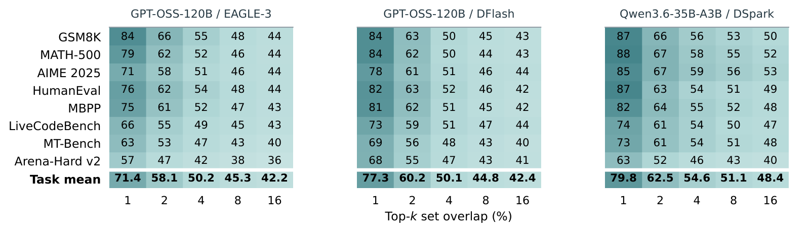
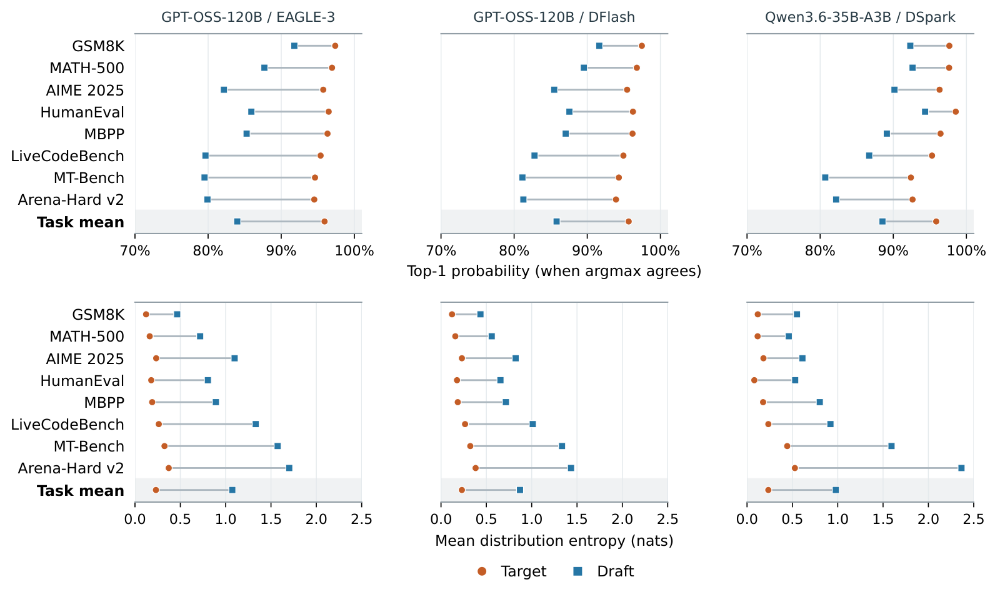
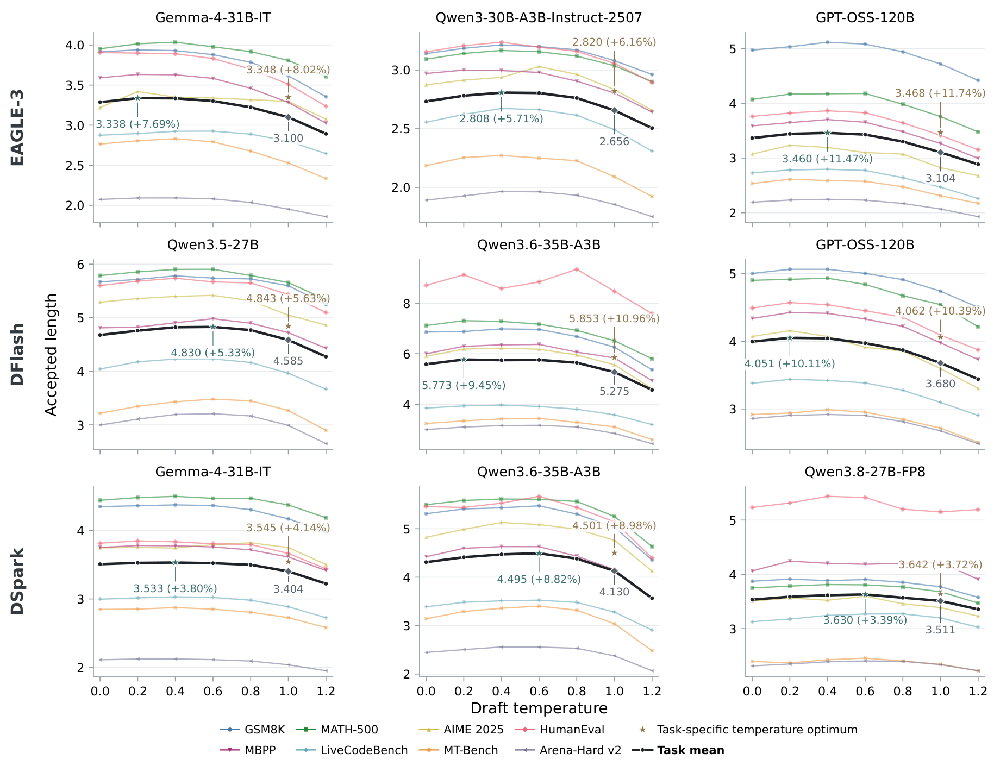
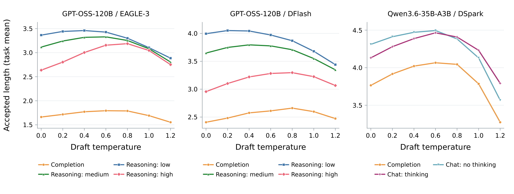
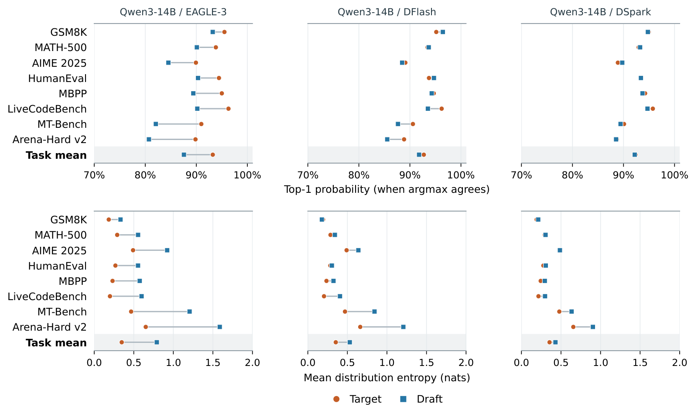
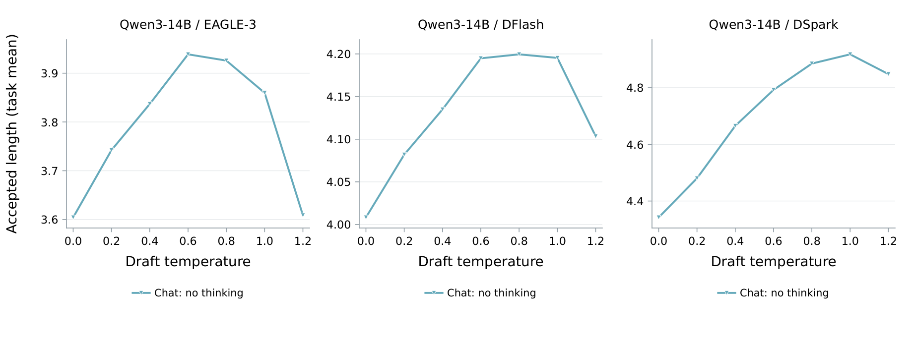
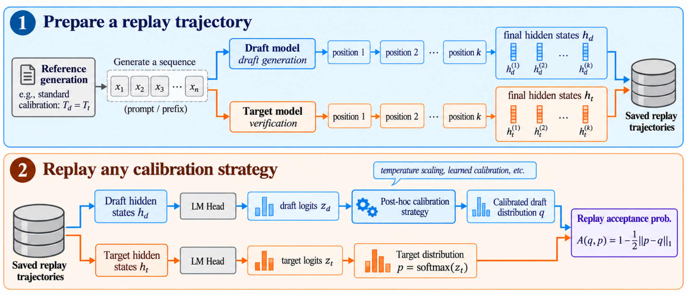
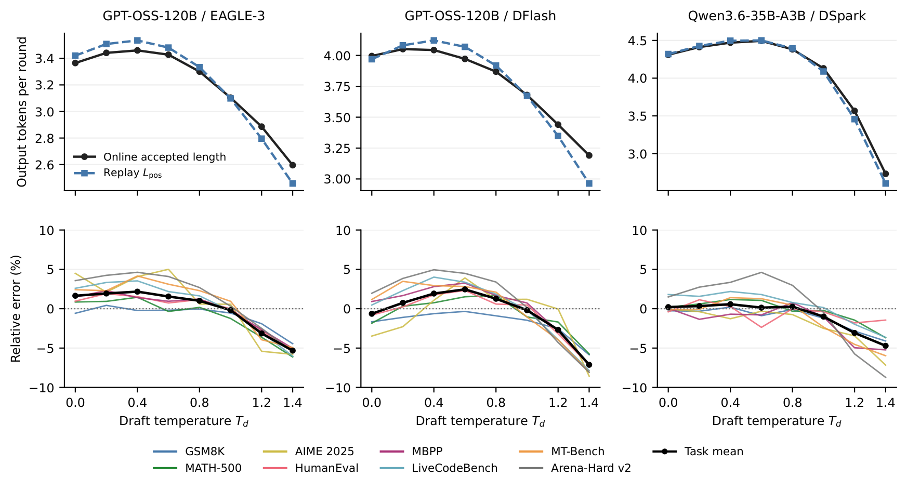

# Draft Calibration：校准草稿分布，吞吐提升22.08%

投机解码能否加速，关键不只是草稿模型能否猜中下一个 token，还在于它的整个概率分布与目标模型有多接近。这篇工作发现，多个开源草稿模型虽然经常猜对最高概率候选，却比目标模型更“不自信”，分布偏平，因而拉低了 token 接受率。作者把目标分布视为校准参照，只在推理阶段调整草稿分布，其中最简单的做法就是独立调低草稿温度。在三种模型组合、总并发数 16–128 的在线服务实验中，校准使平均接受长度提升 8.82%–10.89%，输出吞吐提升 5.13%–22.08%，而且几乎不增加计算开销。

## 为什么“猜对”还不够：投机解码真正优化的是分布重合度

大语言模型通常逐 token 自回归生成，每生成一个 token 都要执行一次前向计算，现代 GPU 的并行能力因此难以充分利用。投机解码的思路很像“小模型先起草，大模型批量批改”：轻量草稿模型连续提出 $K$ 个候选 token，目标模型再通过一次前向计算并行验证它们。

验证会按顺序进行。一旦某个候选被拒绝，它后面的候选也全部丢弃。对位置 $t$ 的候选 $x_t$，记目标分布为 $p$、草稿分布为 $q$：若 $p(x_t)\geq q(x_t)$，直接接受；否则以 $1-p(x_t)/q(x_t)$ 的概率拒绝，并从修正分布中重新采样：

$$
p'(x)=\operatorname{normalize}\left(\max(0,p(x)-q(x))\right).
$$

这套拒绝采样机制保证了最终输出仍服从目标模型的分布。单个草稿 token 的期望接受率有一个非常直观的闭式表达：

$$
\mathbb{P}(x_t\ \text{被接受})
=\sum_{x\in\mathcal{V}}\min(p(x),q(x))
=1-\frac{1}{2}\lVert p-q\rVert_1.
$$

这里 $\mathcal{V}$ 是词表，$\lVert p-q\rVert_1$ 衡量两个完整分布的差异。**只把 top-1 候选预测正确还不够**：如果草稿模型给正确候选的概率过低，接受率仍然会受到分布差距的限制。

### 从置信度校准到草稿校准

经典置信度校准要求预测概率与经验正确率一致。例如，模型对类别 $i$ 给出置信度 $q_i$ 时，理想情况应满足 $\mathbb{P}(y=y_i\mid q(y_i)=q_i)=q_i$。草稿校准更直接：目标模型验证时已经给出了当前上下文下的目标分布 $p$，因此可以把 $p$ 当作参照，直接调整 $q$，并用接受表现评估校准效果。

这篇论文专注于 **post-hoc（训练后）校准**，不修改已发布的模型权重，也不要求重新训练草稿骨干。只要在生成候选和拒绝采样两个阶段一致地使用校准后的 $q$，投机解码的无损性质就仍然成立，目标分布不会因校准而改变。

### 为什么聚焦链式草稿，而不是草稿树

草稿树会在每个位置提出多个分支，扩大候选覆盖范围，却也增加目标模型的验证成本。在大规模并发服务中，大量请求本来就竞争验证算力，这种额外开销更加敏感。

论文引用已有结果说明这一边界：在某些工作负载上，21-token 草稿树在 batch size 为 64 时已经慢于普通自回归解码，而 3-token 链式草稿仍有加速；另一项并发服务研究也在 batch size 为 32 时大幅缩减树节点预算。因此，作者选择先回答一个更基础的问题：不增加分支，只靠分布校准，能把链式草稿的接受率提高多少？

### 与既有工作的差别

既有投机解码研究主要通过新骨干、蒸馏、草稿头、树验证和并行草稿提升效率，例如 Medusa、EAGLE、EAGLE-3、DFlash 与 DSpark。经典置信度校准则已经发展了分箱、参数缩放和 token 自适应温度等方法，但“系统校准投机解码中的草稿分布”仍较少被研究。

一些相近工作也调整过概率，却服务于不同目标：SubSpec 面向卸载推理中的深层草稿树，锐化概率以改善累计概率排序；已有温度研究关注草稿训练数据与解码温度的关系，没有独立调节草稿温度；SpecBound 和 DSpark 则分别校准早退决策与前缀接受预测。本文的差异在于，直接以 $\lVert p-q\rVert_1$ 和接受表现为核心，系统比较多种草稿分布校准方法。

## 关键观察：候选排序学会了，置信度却没有对齐

作者先检查开源草稿模型与目标模型之间的系统性差异。实验覆盖 EAGLE-3、DFlash、DSpark 三类方法，共九组 target–draft 模型组合，链长 $K$ 表示草稿位置数，不包括额外的 correction/bonus token；若一个块全部接受，实际提交 $K+1$ 个 token。

| 目标模型 | 草稿方法 | $K$ | 草稿 checkpoint |
|---|---:|---:|---|
| Gemma-4-31B-IT | EAGLE-3 | 5 | RedHatAI/gemma-4-31B-it-speculator.eagle3 |
| Qwen3-30B-A3B-Instruct-2507 | EAGLE-3 | 3 | lmsys/SGLang-EAGLE3-Qwen3-30B-A3B-Instruct-2507-SpecForge-Nex |
| GPT-OSS-120B | EAGLE-3 | 9 | lmsys/EAGLE3-gpt-oss-120b-bf16 |
| Qwen3.5-27B | DFlash | 7 | z-lab/Qwen3.5-27B-DFlash |
| Qwen3.6-35B-A3B | DFlash | 15 | z-lab/Qwen3.6-35B-A3B-DFlash |
| GPT-OSS-120B | DFlash | 9 | z-lab/gpt-oss-120b-DFlash |
| Gemma-4-31B-IT | DSpark | 7 | RedHatAI/gemma-4-31B-it-speculator.dspark |
| Qwen3.6-35B-A3B | DSpark | 8 | RedHatAI/Qwen3.6-35B-A3B-speculator.dspark |
| Qwen3.8-27B-FP8 | DSpark | 7 | RadixArk/Qwen3.8-27B-DSpark |

评测使用数学、代码和聊天三类共八个基准，总计 4,155 条 prompt：

| 领域 | 基准 | Prompt 数 |
|---|---|---:|
| 数学 | GSM8K | 1,319 |
| 数学 | MATH-500 | 500 |
| 数学 | AIME 2025 | 30 |
| 代码 | HumanEval | 164 |
| 代码 | MBPP | 257 |
| 代码 | LiveCodeBench | 1,055 |
| 聊天 | MT-Bench | 80 |
| 聊天 | Arena-Hard v2 | 750 |
|  | **总计** | **4,155** |

实验基于 SpecForge/SGLang，支持独立草稿温度控制，并使用校准后的草稿概率执行拒绝采样。目标温度固定为 $T_t=1$，最多生成 2,048 token，默认采用 low-reasoning/no-thinking 模板。核心指标 **接受长度（accepted length）** 是每轮验证最终提交的输出 token 数，包含 bonus token；先在任务内聚合，再对八个任务等权平均。分布诊断只统计“此前所有草稿候选均已接受”的有效位置。

### top-k 候选重合度并不低

> 图解：横轴为 $k=1,2,4,8,16$，纵轴为草稿分布与目标分布 top-k 候选集合的重合百分比，不考虑集合内部顺序，三列对应三类草稿模型。top-1 候选的一致率大致都在 70% 以上；随着 $k$ 增大，重合度有所下降，但到 top-16 仍超过 40%。这说明草稿模型总体已经学到了目标模型偏好的候选集合。

### 同一个 top-1，草稿模型给出的概率却更低

> 图解：第一行只统计草稿与目标模型 top-1 一致的位置，比较双方给这个共同候选的概率；第二行比较完整分布的熵。不同任务和算法下，草稿模型的 top-1 概率普遍更低，而熵普遍更高，说明其分布更平坦。问题不是“完全不知道选谁”，而是“知道选谁，却没有目标模型那么确定”。

这与经典神经网络常见的过度自信现象方向相反。作者推测，有限模型容量可能使小模型难以学到目标模型那样尖锐的分布，训练 recipe 也可能有影响；标准草稿训练中的 KL Loss 与直接优化 $\ell_1$ 分布差距并不完全等价。这里的因果解释仍是假设，但后文 DeepSeek 训练的草稿模型提供了重要对照：训练方案不同，分布差距也会明显变化。

## 最有效的办法：把草稿温度从目标温度中解耦

观察到草稿分布偏平后，最直接的修正就是温度缩放。给定 logits $z\in\mathbb{R}^V$ 和温度 $T$：

$$
p_{\mathrm{cal}}=\mathrm{softmax}\left(\frac{z}{T}\right),
\qquad
[p_T]_i=\frac{e^{z_i/T}}{\sum_{j=1}^{V}e^{z_j/T}}.
$$

降低 $T$ 会提高高概率候选的相对权重，使分布更尖锐，同时不改变候选排序。这里必须区分两个温度：

- **目标温度 $T_t$**：影响最终生成文本的采样分布，在本文中固定为 1。
- **草稿温度 $T_d$**：只改变候选分布 $q$，可以独立校准，不必等于 $T_t$。

作者扫描 $T_d\in\{0,0.2,0.4,0.6,0.8,1,1.2\}$，其中 $T_d=0$ 表示在草稿 argmax 上形成点质量，即 greedy drafting。采样截断被关闭，设置为 top-$p=1$、top-$k=-1$。

> 图解：每个子图横轴是草稿温度 $T_d$，纵轴是接受长度；彩色曲线对应不同任务，黑线是八任务等权平均，铜色星号表示逐任务选择最优温度后的结果，并标出 $T_d=1$ 基线。各设置都在 $T_d\in[0,0.8]$ 内出现清晰峰值，整体近似单峰，而且最优点附近曲线较平，说明这个旋钮容易调，也不需要极端精细的搜索。

主要结果可以归纳为四点：

- 使用每组模型跨任务共享的草稿温度时，平均接受长度通常提升约 5%–10%。例如 Qwen3.6-35B-A3B/DFlash 从 5.275 提升到 5.773；DSpark 的平均提升为 3%–9%，最适温度通常更大。
- $T_d\in[0.4,0.6]$ 在所有模型和任务上都相对 $T_d=1$ 带来一致收益，并且通常已接近最优表现。
- 逐任务选择温度只比共享温度多出很小收益，说明一个全局温度就能跨领域工作。
- 调整 softmax 温度不增加模型前向计算。在每轮 draft–verify 耗时不变时，接受长度增长可以转化为近乎同比的解码吞吐增长。

这个设计的价值在于，它没有把问题复杂化：既然观察到的是跨任务一致的“整体不自信”，一个全局锐化参数就已经击中了主要矛盾。

### 在线服务：吞吐提升并不只停留在代理指标上

作者进一步用新生成的请求验证真实服务收益。每组模型先在验证 replay 上选一个跨任务共享温度并冻结：GPT-OSS/EAGLE-3、GPT-OSS/DFlash、Qwen3.6/DSpark 分别使用 0.4、0.4、0.6，然后在 2,082 条 held-out 请求上测试，结果跨三个随机种子平均。

| 目标模型 / 草稿方法 | 总并发 $C$ | 原始接受长度 | 校准后接受长度（增益） | 原始吞吐（output tok/s） | 校准后吞吐（增益） |
|---|---:|---:|---:|---:|---:|
| GPT-OSS-120B / EAGLE-3 | 16 | 3.102 | 3.432（10.64%） | 760.9 | 836.2（9.92%） |
| GPT-OSS-120B / EAGLE-3 | 64 | 3.104 | 3.436（10.71%） | 1582.6 | 1756.3（11.01%） |
| GPT-OSS-120B / EAGLE-3 | 128 | 3.103 | 3.441（10.89%） | 2141.6 | 2249.7（5.13%） |
| GPT-OSS-120B / DFlash | 16 | 3.657 | 3.996（9.27%） | 1449.5 | 1592.5（9.87%） |
| GPT-OSS-120B / DFlash | 64 | 3.656 | 3.994（9.25%） | 2765.9 | 3034.3（9.68%） |
| GPT-OSS-120B / DFlash | 128 | 3.660 | 3.998（9.26%） | 3548.1 | 3866.0（8.98%） |
| Qwen3.6-35B-A3B / DSpark | 16 | 4.049 | 4.434（9.51%） | 1174.9 | 1313.9（12.04%） |
| Qwen3.6-35B-A3B / DSpark | 64 | 4.066 | 4.425（8.82%） | 1858.6 | 2265.8（22.08%） |
| Qwen3.6-35B-A3B / DSpark | 128 | 4.070 | 4.430（8.84%） | 1782.9 | 2130.7（19.53%） |

九种聚合条件下，接受长度与吞吐都提升。逐任务的 72 组比较中，70 组平均吞吐改善；少数例外包括 EAGLE-3 在 AIME25 上的两组吞吐结果。按单个随机种子拆看，27 组聚合比较中有 26 组改善，唯一例外是 EAGLE-3 在并发 128 下的一个种子下降 0.56%。九种条件下，平均 p50 与 p95 请求延迟也都下降，降幅范围分别约为 5.60%–12.43% 和 5.84%–16.11%。

服务测试使用两张 NVIDIA GH200，每张 GPU 运行一个 tensor-parallel-size-one 服务实例，$C$ 是两个实例的总客户端并发。三组模型的单实例活跃请求上限依次为 64/64/20，KV-token 预算为 131,072/131,072/65,536，静态显存比例为 0.85/0.85/0.94；校准前后保持相同容量配置。

对任务 $j$，令输出 token 数为 $N_j$、请求级验证次数之和为 $V_j$、耗时为 $t_j$，则：

$$
L_j=\frac{N_j}{V_j},\qquad Q_j=\frac{N_j}{t_j},\qquad Q_j=L_j\frac{V_j}{t_j}.
$$

最后一个恒等式解释了为什么接受长度与吞吐的涨幅不完全相同：continuous batching 会让同时处理的请求数量和上下文长度随请求进入、结束而变化，不同采样输出也可能改变有效验证速率 $V_j/t_j$。两项增益之差的绝对值中位数只有 0.72 个百分点，但最大达到 13.26 个百分点，出现在 DSpark、并发 64 的条件下，因此不能把接受长度提升机械地当成固定吞吐倍数。

### 推理强度会改变最适温度，但不会改变收益方向

> 图解：横轴为草稿温度，纵轴为八个基准等权平均的接受长度，不同曲线对应不同 reasoning effort 或 completion 模板。接受表现对模板和推理强度很敏感，但所有设置的最优草稿温度仍偏离 $T_d=1$。推理强度升高时，最适温度通常略微升高，可能与目标分布本身变得更平坦有关；整体而言，温度缩放在各设置下都有收益，低推理强度下通常更明显。

### 重要反例：DeepSeek 训练的草稿模型已经校准得更好

温度缩放并非对所有 checkpoint 都有同样大的收益。作者用相同 Qwen3-14B 底座对应的 DeepSeek 训练版 EAGLE-3、DFlash、DSpark 草稿模型做对照，均使用七个草稿位置、关闭 thinking，并扫描相同八任务。

> 图解：这张图沿用前面的两行诊断方式，上排是 top-1 一致时双方赋予该候选的概率，下排是分布熵。三种 DeepSeek 训练版草稿模型的概率差和熵差都小于前面对应模型，说明它们本来就更接近目标分布，留给全局锐化修正的空间更小。

具体差距如下。EAGLE-3、DFlash、DSpark 的匹配 top-1 概率差分别为 5.65、0.93、0.18 个百分点，而前面对应草稿模型为 11.94、9.86、7.35 个百分点；草稿减目标的熵差分别为 0.443、0.177、0.075 nats，前面对应值为 0.842、0.641、0.744。它们的完整分布 $\ell_1$ 差距也更小，分别为 0.470、0.422、0.316，对照值为 0.664、0.539、0.474。

| Drafter | 最佳共享 $T_d$ | 接受长度增益 | top-1 概率差（百分点） |
|---|---:|---:|---:|
| EAGLE-3 | 0.6 | 2.05% | 5.65 |
| DFlash | 0.8 | 0.10% | 0.93 |
| DSpark | 1.0 | 0% | 0.18 |

> 图解：横轴是 $T_d$，纵轴是八任务等权平均接受长度。EAGLE-3 从 $T_d=1$ 时的 3.860 提升到 $T_d=0.6$ 时的 3.939，增益 2.05%；DFlash 仅从 4.195 变为 $T_d=0.8$ 时的 4.200，增益 0.10%；DSpark 的最佳值 4.918 就出现在 $T_d=1$。这些最优点均为图中网格上的事后最优，因此更准确的结论是：校准收益取决于原始草稿模型是否已经对齐，而不是温度越低越好。

## 更复杂的校准方法：为什么更强参数化没有带来更多收益

全局温度只控制整体尖锐程度。下一步自然要问：如果给不同候选、不同 token 更精细的调整，能否进一步缩小完整分布的差距？为了低成本回答这个问题，作者先设计了轨迹回放框架。

### 轨迹回放：缓存 hidden states，快速筛选校准候选

真实在线评测若要为每个候选策略重新生成轨迹，成本极高，而且策略改变后轨迹本身也会变化。轨迹回放固定一组参考上下文，缓存有效位置上的目标与草稿最终 hidden states；回放时通过各自 LM Head 恢复 logits，对草稿 logits 应用不同校准策略，再直接由 $p$ 和校准后的 $q$ 计算期望接受率。

> 图解：先用参考策略生成轨迹，保存符合条件的草稿与目标最终 hidden states；回放时经 LM Head 恢复两侧 logits，校准草稿分布 $q$，再利用 $1-\frac12\lVert p-q\rVert_1$ 计算接受概率。直接保存全词表 logits 太占空间，保存 hidden states 是存储与重算之间的折中。作者借此在数分钟 GPU 时间内完成超过一百万次回放进评估，而对应真实评测可能需要数百万 GPU 小时。

回放采用一种位置平均接受长度：

$$
L_{\mathrm{pos}}=1+\sum_{i=1}^{k}\prod_{j=1}^{i}A_j,
$$

其中 $A_j$ 是有效参考上下文上第 $j$ 个草稿位置的平均接受概率。它适合筛选候选，但不是在线接受长度或吞吐的精确替身。

> 图解：上排比较在线接受长度与回放 $L_{\mathrm{pos}}$，横轴为草稿温度；下排为有符号相对误差 $100(L_{\mathrm{pos}}-L_{\mathrm{online}})/L_{\mathrm{online}}$，彩色线表示各任务，黑线由任务均值计算。每组模型 64 个任务—温度组合的平均绝对相对误差分别为 2.42%、2.64%、1.83%，最大误差为 6.13%、8.56%、8.72%。EAGLE-3 与 DSpark 的回放和在线任务均值最适温度一致；DFlash 分别选择 0.4 与 0.2，但在线平均接受长度只差 0.008 token/验证轮。回放能捕捉“锐化有益”的大趋势，却不能保证复现每个温度排序和精确收益。

### Dirichlet Scaling：给 top-k 候选分别调温，收益仍接近零

Dirichlet Scaling 是温度缩放的推广。给定原分布 $p$，其形式为：

$$
p_{\mathrm{cal}}=\mathrm{softmax}\left(W\log p+b\right).
$$

本文令 $b=0$。当 $W=(1/T)I$ 时，它就退化为温度缩放；一般矩阵 $W$ 则允许不同候选采用不同缩放，并通过非对角元素引入候选间交互。

完整词表 $V$ 很大，直接学习 $V\times V$ 矩阵不可行。作者只变换概率最大的 $K$ 个候选，其余候选使用统一的尾部温度 $T_{\mathrm{res}}$：

$$
W=
\begin{bmatrix}
W^{(K)} & 0\\
0 & (1/T_{\mathrm{res}})I
\end{bmatrix}.
$$

实验比较两类方案：

- **对角穷举**：取 $K=7$，为 top-7 的每个 rank 和尾部分别指定温度，八个温度独立取自 $\{0.2,0.4,0.6,0.8,1,1.2\}$，共 $6^8=1,679,616$ 个候选。参数按任务在验证集选择，测试集最优值仅作为 oracle 单独报告。
- **完整矩阵训练**：$K\in\{1,2,3,7\}$，联合优化无约束 $W^{(K)}$ 和 $T_{\mathrm{res}}>0$，使用 Adam 最小化 top-$K$ 加尾部的 total-variation 代理损失。这里的 $K$ 是校准的 vocabulary rank 数，与草稿链长无关。

| 方法 | GPT-OSS-120B / EAGLE-3 | GPT-OSS-120B / DFlash | Qwen3.6-35B-A3B / DSpark |
|---|---:|---:|---:|
| $T_d=1$ | 3.0739 | 3.6345 | 4.0731 |
| Temperature（验证集选择） | 3.5085 | 4.0751 | 4.4825 |
| Diagonal Dirichlet（验证集选择） | 3.5084 | 4.0752 | 4.4815 |
| Full-matrix Dirichlet | 3.4824 | 4.0563 | 4.4192 |
| Optimal temperature（test oracle） | 3.5085 | 4.0751 | 4.4847 |
| Optimal diagonal Dirichlet（test oracle） | 3.5085 | 4.0753 | 4.4850 |

表中是测试 replay 上跨任务等权平均的 $L_{\mathrm{pos}}$。对角 Dirichlet 相比标量温度几乎没有提升，完整矩阵反而略差；验证集选出的标量温度也几乎达到测试最优。这说明，**任务内所有 token 共享的校准参数中，主要可修复误差已经被一个全局温度捕获**，更灵活的逐 rank 参数并不会自动带来收益。

### Token-Adaptive Calibration：理论上空间很大，学习头却没抓住

另一条路径是让每个草稿位置使用不同温度。下表同时给出可部署方法、验证集选择结果与使用当前目标分布的测试 oracle：

| 方法 | GPT-OSS-120B / EAGLE-3 | GPT-OSS-120B / DFlash | Qwen3.6-35B-A3B / DSpark |
|---|---:|---:|---:|
| $T_d=1$ | 3.0739 | 3.6345 | 4.0731 |
| Temperature（验证集逐任务选择） | 3.5085 | 4.0751 | 4.4825 |
| Temperature head（$h_d$） | 3.5111 | 4.1091 | 4.4765 |
| Temperature head（$h_d,h_{t,\mathrm{prev}}$） | 3.5170 | 4.1091 | 4.4726 |
| Binary head（$h_d$） | 3.4031 | 4.0045 | 4.3281 |
| Binary head（$h_d,h_{t,\mathrm{prev}}$） | 3.4002 | 3.9998 | 4.3234 |
| Optimal $T_d$（test oracle，逐任务） | 3.5085 | 4.0751 | 4.4847 |
| Token oracle（完整网格 $\mathcal{G}$） | 4.0598 | 4.7628 | 4.9247 |
| Token oracle（$\{0,1\}$） | 3.9263 | 4.5943 | 4.7941 |

Token oracle 在每个回放位置独立选择最大化 $A(T)=1-\frac12\lVert p-q_T\rVert_1$ 的温度，完整网格为 $\mathcal{G}=\{0,0.2,0.4,0.6,0.8,1,1.2,1.4,2\}$。它显著超过逐任务标量最优点，而且 oracle 带来的增量甚至大于全局温度相对 $T_d=1$ 的增量，说明 token 级自适应确实还有空间。

更值得注意的是，只允许 $\{0,1\}$ 两种选择，就能恢复完整温度搜索约 70%–76% 的 oracle 增益。这意味着理想策略可能并不复杂：很多位置只需要在“greedy 草稿”和“原分布采样”之间切换。

但可学习校准头没有兑现这个空间。作者为每个任务单独训练轻量 head，输入可以是草稿状态 $h_d$，也可以拼接上一轮验证块缓存的最后有效目标状态 $h_{t,\mathrm{prev}}$；输出可以是正温度，也可以是 $T_d\in\{0,1\}$ 的二分类。无论输入和输出形式如何，结果都接近甚至略差于全局温度。

这里要避免把 oracle 当成可部署结果：它直接读取当前目标分布，而真实生成候选时并不知道这个分布。它给出的是固定参考上下文和指定温度网格内的诊断上界。校准头的失败说明，目标分布中可被当前草稿状态或上一块目标状态预测的校准信息有限，或者需要超越纯 post-hoc 方法的训练与结构改动。

## 复现细节：回放训练、参数选择与评测口径

为了区分“可部署选择”和“诊断上界”，回放实验把完整请求按 40%/10%/50% 划分为 train/validation/test，同一请求的所有块不会跨集合。每组模型得到 1,660/413/2,082 条请求；所有校准表使用同一测试划分，并对任务等权平均。参考轨迹采用 $T_d=T_t=1$，GPT-OSS 使用低推理强度、$K=9$，Qwen3.6/DSpark 关闭 thinking、$K=8$。缓存为 BF16，恢复分布时保留模型对应的归一化与词表映射。

完整 Dirichlet 矩阵使用按原草稿概率排序的 top-$K$ token。令这些 token 为 $v_1,\ldots,v_K$，定义：

$$
g_K(r)=\left(r(v_1),\ldots,r(v_K),1-\sum_{j=1}^{K}r(v_j)\right),
$$

训练最小化粗粒度 total-variation 代理损失：

$$
\ell_{\mathrm{TV}}
=\frac{1}{2}\left\lVert g_K(q_{\mathrm{cal}})-g_K(p)\right\rVert_1.
$$

尾部分组只用于 Loss，目标残差包含草稿词表之外的概率质量；验证和测试仍使用完整词表重合度。矩阵跨任务联合训练、任务等权，但每个任务根据验证 $L_{\mathrm{pos}}$ 选择 $K$、学习率、初始化与 checkpoint。对角方案保留标量回退：若标量在验证集不差于选中的对角候选，就继续使用标量。

校准头输入先做 RMS 归一化，缺失的上一块目标状态用零向量替代。GPT-OSS 的输入维度为 2,880 或 5,760，DSpark 为 2,048 或 4,096。Head 可以是线性层，也可以是 $V\,\mathrm{SiLU}(Ux)+c$，瓶颈宽度为 8 或 32。标量头通过 $T=\exp(\operatorname{clamp}(z,-7,4))$ 输出正温度，并使用 $K=7$ 的 $\ell_{\mathrm{TV}}$ 训练。

二分类头的标签为 $\mathbf{1}[A_i(1)>A_i(0)]$，位置 $i$ 的交叉熵权重为 $0.8^{i-1}|A_i(1)-A_i(0)|$，再按训练集平均权重归一化。输出为 $T=1$ 的预测概率，在验证集上从 $\{0,0.025,\ldots,1\}\cup\{1.001\}$ 中选择阈值。当前目标分布只用于监督和评估，不作为部署输入。

矩阵和 head 都使用 Adam，学习率从 $\{10^{-3},10^{-2},5\times10^{-2}\}$ 中选择，$(\beta_1,\beta_2)=(0.9,0.999)$，$\epsilon=10^{-8}$，batch size 为 8,192，共训练 32 epochs，不使用 weight decay 或学习率调度。候选 checkpoint 取自第 1、2、4、8、16、24、32 epoch，所有学习到的选择在测试前冻结。

在线服务与回放表的温度选择口径也不同：在线服务每组模型使用一个跨任务共享温度，而 Dirichlet 与 token-adaptive 对比表按任务选择标量温度。在线结果使用新轨迹，关闭分布插桩与轨迹缓存；warm-up 和启动不计时，warm-up 后清空缓存。延迟从 HTTP 请求发出计到响应完成，包含排队、prefill 和生成，不包含客户端 worker 等待时间。理解这些差异，才能避免把固定上下文上的 replay 分数直接解释成新请求上的吞吐承诺。

## 总结：一个几乎免费的旋钮，与尚未兑现的 token 级空间

- **核心问题**：投机解码的接受率由 $1-\frac12\lVert p-q\rVert_1$ 决定，草稿模型猜对 top-1 并不代表完整分布已经对齐。
- **关键观察**：多个开源草稿模型相对目标模型持续表现出低 top-1 概率和高熵，即分布偏平、置信度不足。
- **最实用结论**：独立调低草稿温度即可显著改善接受长度；$T_d\in[0.4,0.6]$ 在主要实验中普遍有效，在线输出吞吐提升 5.13%–22.08%，但 DeepSeek 训练版草稿模型说明收益依赖原始校准程度。
- **方法边界**：逐 rank 的 Dirichlet Scaling 几乎没有超过标量温度；token oracle 显示了更大的自适应空间，但简单学习头尚无法捕获。
- **评测原则**：轨迹回放适合低成本筛选，不是在线吞吐的精确替代；oracle 是诊断上界，也不是可直接部署的算法。

这项工作目前只研究了 post-hoc 校准，下一步值得把 token 自适应信号引入训练过程，并进一步定位不同训练 recipe 造成分布差距的原因，从而把 oracle 揭示的空间转化为真实、稳定的服务收益。

> 本文参考自 [Draft Calibration for Speculative Decoding: Accelerating LLM Serving by Matching Draft and Target Distributions](https://arxiv.org/abs/2611.33111v1)