# Draft & Verify：自推测解码实现无损加速

大模型生成文本时，真正昂贵的往往不是一次并行前向计算，而是逐个 Token 等待的自回归解码。这个瓶颈直接推高聊天、摘要和代码生成的延迟，也限制了大模型在对实时性要求更高的场景中落地。Draft & Verify 提出的 Self-Speculative Decoding（自推测解码）让同一个 LLM 在 Drafting 阶段跳过部分中间层、快速生成草稿，再由完整模型一次前向验证，不需要额外草稿模型，也不需要神经网络训练。它在 LLaMA-2 及其变体上取得最高 **1.992×** 端到端加速，在 CodeLLaMA-13B 上也达到 **1.456×**，同时保持 Greedy Decoding 输出一致、Sampling Decoding 输出分布一致。

## 一、问题：为什么自回归解码这么慢？

给定 Prompt $x_1,\ldots,x_t$，自回归模型每次只预测下一个 Token：

$$
x_{i+1}=\arg\max_x p(x\mid x_1,\ldots,x_i)
$$

预测出的 Token 再拼回上下文，进入下一轮计算。理论上，逐个解码与对同长度序列做一次前向计算的计算量相近；但在实际硬件上，两者效率差异巨大。

原因在于，单 Token 解码通常受 **Memory Bandwidth（显存带宽）** 限制。每生成一个 Token，模型参数都要经过加速器，计算单元却得不到充分利用。模型大小除以显存带宽，几乎给解码速度划出了一道硬上限。论文给出的直观例子是：在 A100 GPU 上，用 LLaMA-2-13B 自回归生成 128 个 Token，耗时可达对同样 128 个 Token 做一次序列级前向计算的 100 倍。

### 现有加速路线还差什么？

围绕这个瓶颈，已有工作大致走了四条路：

- **推理系统优化**：FasterTransformer、Orca、LightSeq、DeepSpeed Inference、FlexGen、vLLM 等系统提升 Kernel、显存或调度效率，但算法与硬件仍有进一步协同设计的空间。
- **模型压缩**：量化、剪枝和蒸馏能降低单次计算成本，却往往需要修改架构、重训或微调，而且通常不保证输出与原模型一致。
- **Speculative Decoding（推测解码）**：先用小型 Draft Model 生成多个候选 Token，再由原始 LLM 并行验证。它能保持原模型的输出特性，但必须寻找或训练合适的草稿模型，还要额外放入一份模型参数。
- **Early Exit（提前退出）**：让输入在中间层提前结束计算，证明并非每个 Token 都必须走完整网络。不过，已有研究主要集中在 Encoder-only 或 Encoder-Decoder 模型。

对 LLaMA-2-Chat、CodeLLaMA 这类微调模型而言，“再找一个行为一致的小模型”尤其困难。即便找到了，额外显存也会削弱部署价值。另一类直接复制参考文本再验证的方法，则依赖文本重复假设，无法覆盖一般生成场景。

**Self-Speculative Decoding 的切入点因此很自然：不再寻找另一个草稿模型，而是从原模型内部构造一个临时、快速、可验证的草稿路径。**

## 二、核心机制：同一个模型，既打草稿又验收

自推测解码仍由 Drafting 和 Verification 两步组成，但两个阶段共享同一份 LLM 参数。

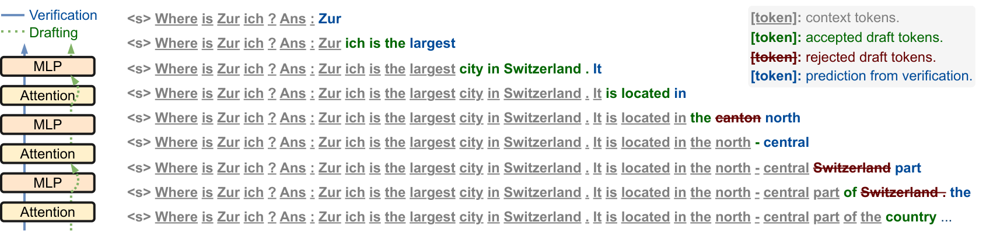

> 图解：左侧蓝色实线表示完整模型的 Verification 路径，绿色虚线表示跳过部分中间层的 Drafting 路径。右侧灰色 Token 是已有上下文，绿色是验证接受的草稿 Token，红色是被拒绝的草稿 Token，蓝色则是验证阶段额外预测的新 Token。草稿被拒绝后，其后的候选也会丢弃，再由完整模型的预测修正。

### Drafting：跳层生成候选 Token

设 $\mathbf z^*$ 是需要跳过的层组合。草稿阶段使用 $p(x\mid\mathbf z^*,x_1,\ldots,x_i)$，而不是完整模型 $p(x\mid\mathbf 0,x_1,\ldots,x_i)$。

跳层会让草稿质量略有下降，却能减少每次 Draft Forward 的耗时。这里利用的关键观察是：LLM 的部分中间层存在冗余，跳过其中一些层，不一定显著破坏下一步预测。

### Verification：一次前向检查整段草稿

草稿阶段最多产生 $K$ 个 Token，完整模型随后对这些位置做一次并行前向计算，得到每个位置的概率分布。

以 Greedy Decoding 为例，一轮流程是：

1. 从当前位置开始，用跳层模型逐个生成最多 $K$ 个草稿 Token。
2. 用完整模型一次前向计算所有草稿位置的预测。
3. 从前往后比较草稿 Token 与完整模型的 $\arg\max$ 结果。
4. 遇到第一个不一致的位置，就用完整模型的预测覆盖它，并丢弃后续草稿。
5. 如果所有草稿都被接受，验证阶段还会额外产生一个新 Token，再进入下一轮。

这一方法有效的硬件前提是：**对一小段 Token 做一次并行前向，并不会比单 Token 前向慢太多。**只要一轮能接受多个草稿 Token，就能摊薄完整模型的调用次数。

### “无损”究竟无损在哪里？

这里的“无损”不是指跳层草稿本身与完整模型一样，而是指 **最终输出仍由原始 LLM 决定**：

- Greedy Decoding 下，只有与完整模型 $\arg\max$ 一致的草稿才被保留，因此最终序列应与标准自回归解码一致。论文将实验中极小的分数差异归因于数值舍入误差。
- Sampling Decoding 下，目标不是每次生成同一串随机文本，而是保证最终 Token 来自与原始 LLM 相同的概率分布。

采样版本使用标准推测解码的接受—修正机制。记草稿分布为 $q$，完整模型分布为 $p$，对草稿 Token $x$ 的接受概率为：

$$
a(x)=\min\left(1,\frac{p(x)}{q(x)}\right)
$$

若拒绝，则从两个分布的正差部分重新采样：

$$
r(x)=\frac{\max(0,p(x)-q(x))}{\sum_y\max(0,p(y)-q(y))}
$$

已有推测解码工作证明了这一机制的分布一致性。笔者认为，这个设计最聪明的地方在于：**跳层只影响“猜得快不快、猜中多少”，不改变“最终听谁的”。**同时，两个阶段共享原模型参数，不需要为独立草稿模型增加一份显存占用。

有了基本框架，接下来只剩两个决定实际速度的问题：跳过哪些层，以及每轮生成多少草稿。

## 三、关键设计一：用贝叶斯优化选择跳层组合

### 为什么不能只追求接受率？

草稿模型的效果可以用 Acceptance Rate（接受率，$AR$）衡量，但单独优化 $AR$ 会走向一个平凡解：一层都不跳，接受率自然最高，却没有任何加速。

反过来，如果一味减少 Draft Model 的层数，草稿虽然更快，质量却会下降。大量 Token 在验证时被拒绝，反而增加总耗时。

因此，作者直接优化 **每个被验证 Token 的平均推理时间** $f(\mathbf z)$。这个目标同时包含草稿成本、验证成本和实际接受的 Token 数，天然平衡“草稿够快”与“草稿够准”。

设 Attention 与 MLP 子层总数为 $L$，$\mathbf z\in\{0,1\}^{L}$ 表示每个子层是否跳过，优化问题为：

$$
\mathbf z^*=\arg\min_{\mathbf z}f(\mathbf z),\quad \text{s.t.}\quad \mathbf z\in\{0,1\}^{L}
$$

小模型可以穷举，大模型却不行。例如 LLaMA-2-70B 的搜索维度达到 $L=160$，所有组合构成指数级空间。

### 贝叶斯优化如何搜索？

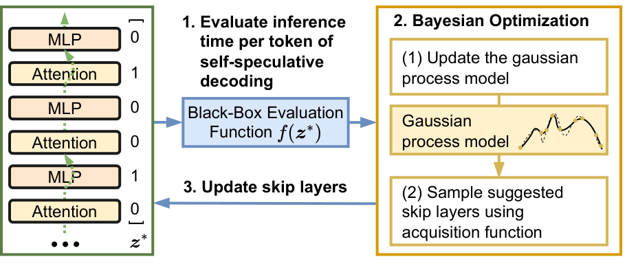

> 图解：左侧用 0/1 向量表示每个 Attention 或 MLP 子层是否保留。每一步先在开发集上实际测量自推测解码的平均 Token 推理时间，再更新 Gaussian Process（高斯过程）代理模型；Acquisition Function（采集函数）据此推荐下一组跳层配置，形成“评估—建模—更新”的闭环。

高斯过程估计不同配置的目标值及不确定性，采集函数在两者之间做权衡：

- **Exploitation（利用）**：优先测试当前预测耗时较低的组合。
- **Exploration（探索）**：测试尚不确定的区域，避免过早陷入局部解。

搜索在离线阶段完成，得到的 $\mathbf z^*$ 随后固定使用，不在每次请求中更新。默认按模型级别搜索；如果目标任务差异很大，作者建议改为任务级别优化，并尽量用单一数据源构建开发集，减少任务间干扰。

这也解释了为什么作者首选跳层，而不是直接放入一个量化或剪枝后的独立草稿模型：后者通常还要保存一份修改后的参数，破坏“无额外模型显存”的优势。不过，自推测解码并不排斥压缩技术，后文会看到它与量化、稀疏化的组合结果。

## 四、关键设计二：让草稿在该停的时候停下

### 固定 $K$ 为什么不可靠？

草稿长度 $K$ 同时影响两项成本：$K$ 太小，每轮接受的 Token 少，完整模型调用仍然频繁；$K$ 太大，第一个被拒绝 Token 后面的草稿全部作废，浪费计算。

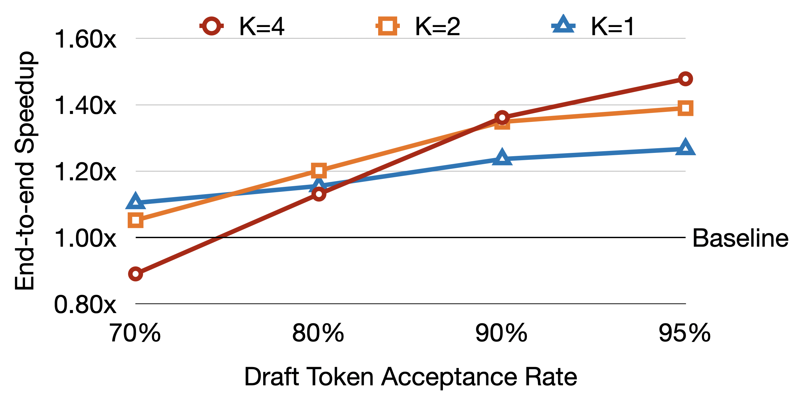

> 图解：横轴是 Draft Token Acceptance Rate，纵轴是 End-to-End Speedup，黑色 Baseline 为 1.0；图中假设草稿模型比验证模型快 2 倍。接受率低于约 80% 时，$K=1$ 更稳健；接受率继续升高后，$K=2$ 或 $K=4$ 才能充分利用高接受率。可见，不存在适合所有样本的固定 $K$。

更麻烦的是，不同样本、甚至同一样本的不同位置，难度都在变化。简单段落可以多猜几步，困难位置则应尽早交给完整模型验证。

### 置信度退出：低把握时不再硬猜

作者先给每步草稿预测设置置信度阈值 $\gamma$。若下一个草稿 Token 的预测概率低于阈值，就立即停止 Drafting：

$$
p(x_{t+1}\mid x_1,\ldots,x_t)<\gamma
$$

这样可以把计算集中在更可能被接受的草稿上，减少“生成后再整段丢弃”的浪费。

### 自适应阈值：让实际接受率跟踪目标接受率

静态 $\gamma$ 仍然无法适应不同模型与数据。作者因此引入目标接受率 $\alpha$，并在每轮 Verification 后更新阈值。

首先，用第 $e$ 轮的实际接受率 $AR_e$ 更新滑动平均：

$$
AR\leftarrow\beta_1AR+(1-\beta_1)AR_e
$$

然后，根据当前接受率与目标的关系，构造候选阈值 $\tilde\gamma$：

$$
\tilde\gamma=
\begin{cases}
\gamma+\epsilon, & AR\leq\alpha\\
\gamma-\epsilon, & \text{otherwise}
\end{cases}
$$

最后平滑更新实际阈值：

$$
\gamma\leftarrow\beta_2\gamma+(1-\beta_2)\tilde\gamma
$$

其中，$\epsilon$ 是更新步长，$\beta_1$ 与 $\beta_2$ 分别平滑接受率和阈值；第一轮令 $\beta_1=0$。接受率低于目标时提高 $\gamma$，让草稿更保守；接受率高于目标时降低 $\gamma$，允许模型多尝试几个 Token。

至此，方法的两块拼图已经齐备：离线搜索决定“走哪条快速路径”，在线自适应退出决定“这条路径每轮走多远”。下面看它们是否真正转化为端到端收益。

## 五、实验：从 13B 到 70B，从摘要到代码

### 实验设置与复现参数

论文评估了 LLaMA-2-13B、LLaMA-2-13B-Chat、CodeLLaMA-13B 和 LLaMA-2-70B：

- CNN/Daily Mail（CNN/DM）与 XSum 用于新闻摘要，采用 1-shot 设置并报告 ROUGE-2；效率实验各随机抽取 1000 个测试样本。
- HumanEval 用于 Python 代码生成，报告 pass@1 与 pass@10。
- 跳层搜索默认运行 1000 轮贝叶斯优化，开发集为从训练集随机选取的 8 个样本。
- 13B 系列模型使用一张 A100-40GB；70B 使用两张 A100-80GB 和 Hugging Face Accelerate。

自适应退出的公共参数为 $T=512$、最大 $K=12$、$\epsilon=0.01$、$\beta_1=0.50$、$\beta_2=0.90$、初始 $\gamma_0=0.60$。其余设置如下：

| 数据 | 模型 | 目标接受率 $\alpha$ | $top\_p$ | 采样温度 |
|---|---|---:|---:|---:|
| CNN/DM | LLaMA-2-13B | 0.90 | 0.85 | 0.20 |
| CNN/DM | LLaMA-2-13B-Chat | 0.85 | 0.85 | 0.20 |
| CNN/DM | LLaMA-2-70B | 0.85 | 0.85 | 0.20 |
| XSum | LLaMA-2-13B | 0.85 | 0.85 | 0.20 |
| XSum | LLaMA-2-13B-Chat | 0.70 | 0.85 | 0.20 |
| XSum | LLaMA-2-70B | 0.85 | 0.85 | 0.20 |
| HumanEval | CodeLLaMA-13B | 0.90 | 0.95 | 0.60 |
| GSM8K | CodeLLaMA-13B | 0.90 | 0.95 | 0.60 |
| GSM8K | CodeLLaMA-13B-Instruct | 0.80 | 0.95 | 0.60 |
| MT-bench | LLaMA-2-13B-Chat | 0.85 | 0.85 | 0.20 |

软件环境也有两组：A100-40GB 上使用 CUDA 11.6、PyTorch 1.13.1、Transformers 4.33.1；A100-80GB 上使用 CUDA 11.8、PyTorch 2.0.1、Transformers 4.33.1。

### 文本生成：最高接近 2 倍加速

下表中的 Speedup 均相对于相同模型、相同温度下的标准 Autoregressive Decoding。

| 模型 | 方法 | 温度 | CNN/DM ROUGE-2 | CNN/DM Speedup | XSum ROUGE-2 | XSum Speedup |
|---|---|---:|---:|---:|---:|---:|
| LLaMA-2-13B | Autoregressive | 0.0 | 0.106 | 1.000× | 0.124 | 1.000× |
| LLaMA-2-13B | Self-Speculative | 0.0 | 0.108 | 1.572× | 0.125 | 1.429× |
| LLaMA-2-13B | Autoregressive | 0.2 | 0.111 | 1.000× | 0.117 | 1.000× |
| LLaMA-2-13B | Self-Speculative | 0.2 | 0.111 | 1.529× | 0.117 | 1.377× |
| LLaMA-2-13B-Chat | Autoregressive | 0.0 | 0.144 | 1.000× | 0.109 | 1.000× |
| LLaMA-2-13B-Chat | Self-Speculative | 0.0 | 0.143 | 1.409× | 0.109 | 1.224× |
| LLaMA-2-13B-Chat | Autoregressive | 0.2 | 0.143 | 1.000× | 0.106 | 1.000× |
| LLaMA-2-13B-Chat | Self-Speculative | 0.2 | 0.145 | 1.383× | 0.108 | 1.210× |
| LLaMA-2-70B | Autoregressive | 0.0 | 0.130 | 1.000× | 0.118 | 1.000× |
| LLaMA-2-70B | Self-Speculative | 0.0 | 0.130 | **1.992×** | 0.118 | 1.598× |
| LLaMA-2-70B | Autoregressive | 0.2 | 0.131 | 1.000× | 0.108 | 1.000× |
| LLaMA-2-70B | Self-Speculative | 0.2 | 0.131 | 1.964× | 0.110 | 1.560× |

文本任务上的加速范围为 **1.210×—1.992×**，ROUGE-2 基本没有变化。LLaMA-2-13B-Chat 的结果说明，无需再为微调模型单独寻找 Draft Model；70B 的更高加速则让作者推测，更大的模型可能具有更多可跳过的冗余层。

### 代码生成：微调模型同样适用

| 模型 | 方法 | HumanEval 指标 | 分数 | Speedup |
|---|---|---|---:|---:|
| CodeLLaMA-13B | Autoregressive | pass@1 | 0.311 | 1.000× |
| CodeLLaMA-13B | Self-Speculative | pass@1 | 0.317 | **1.456×** |
| CodeLLaMA-13B | Autoregressive | pass@10 | 0.659 | 1.000× |
| CodeLLaMA-13B | Self-Speculative | pass@10 | 0.659 | **1.345×** |

pass@1 使用 Greedy Decoding，pass@10 使用温度 0.6 的随机采样。两项结果的任务分数基本持平，说明方法并不只适用于自然语言摘要。

主结果证明了“能加速”，但还不能回答“收益来自哪里”。接下来的消融实验，正是方法部分两个设计决策的逐项验证。

## 六、消融：加速不是简单地“跳得越多越好”

### 跳层数量与具体组合同样重要

LLaMA-2-13B 一共有 80 个 Attention/MLP 子层。作者记录贝叶斯优化过程中每个候选配置的跳层数量及其实际 Speedup。

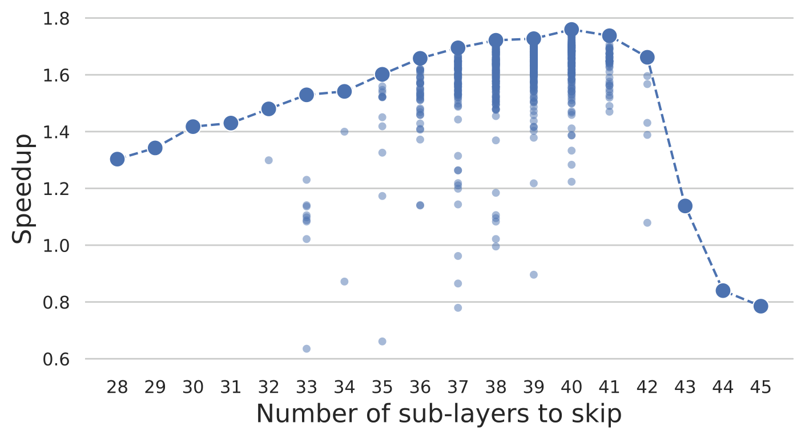

> 图解：横轴是跳过的子层数量，纵轴是 Speedup；每个点对应一次候选配置，虚线连接相同跳层数量下的最大加速。最佳区域大约跳过 40 个子层，即总子层数的一半；超过 42 个子层后最佳加速迅速下降，而同一跳层数量下不同组合的 Speedup 也能相差很大，部分配置甚至低于 1.0。

这带来三个结论：

1. 草稿太“厚”，Drafting 本身太贵；草稿太“薄”，验证拒绝太多。
2. 层数相同不代表效果相同，具体跳过哪些层非常关键。
3. 最优目标应是端到端时间，而不是单独的接受率或草稿延迟。

### 固定草稿长度：接受率最高不等于速度最快

以下实验使用 LLaMA-2-13B、CNN/DM 和 Greedy Decoding。

| $K$ | 2 | 4 | 6 | 8 | Adaptive |
|---|---:|---:|---:|---:|---:|
| ROUGE-2 | 0.107 | 0.107 | 0.107 | 0.107 | **0.108** |
| $AR$ | **0.924** | 0.865 | 0.807 | 0.748 | 0.919 |
| Speedup | 1.37× | 1.44× | 1.42× | 1.36× | **1.57×** |

固定 $K$ 的 Speedup 先升后降：$K=8$ 时，大量草稿在验证后被丢弃。$K=2$ 则展示了另一种浪费——接受率高达 0.924，却因为每轮猜得太少，只得到 1.37× 加速。

### 静态阈值：不同 $\gamma$ 的差异不可忽略

下表固定最大 $K=12$，比较低置信度时提前退出的不同静态阈值。

| $\gamma$ | 0.2 | 0.4 | 0.6 | 0.8 | Adaptive |
|---|---:|---:|---:|---:|---:|
| ROUGE-2 | 0.107 | 0.107 | 0.107 | 0.107 | **0.108** |
| $AR$ | 0.749 | 0.852 | 0.909 | **0.935** | 0.919 |
| Speedup | 1.38× | 1.52× | **1.58×** | 1.55× | 1.57× |

$\gamma=0.2$ 过于激进，接受率只有 0.749；$\gamma=0.8$ 又过于保守，虽然接受率最高，草稿数量却不足。自适应阈值的 1.57× 与精心调出的最佳静态值 1.58× 基本相当，但省去了逐模型、逐数据集调参。

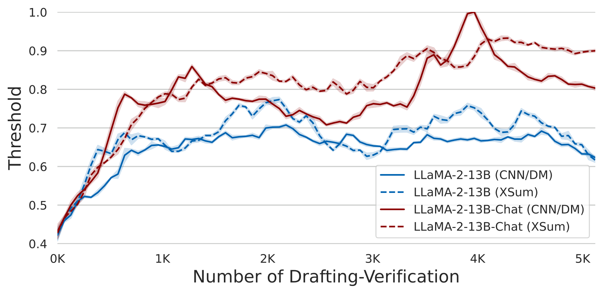

> 图解：横轴是 Drafting-Verification 循环次数，纵轴是阈值 $\gamma$；蓝、红分别对应 LLaMA-2-13B 与 LLaMA-2-13B-Chat，实线、虚线分别对应 CNN/DM 与 XSum。曲线每 64 轮计算移动平均，阴影表示标准差。约 5000 轮内，四种设置走出了明显不同的阈值轨迹；此图初始 $\gamma=0.4$，进一步说明静态阈值难以通吃。

### 计算拆解：时间到底省在哪里？

下表是在 LLaMA-2-13B、CNN/DM 测试集 10 个样本上的平均单 Token 延迟。

| 操作 | Autoregressive | Self-Speculative |
|---|---:|---:|
| Drafting | — | **25.5 ± 1.14 ms** |
| └ Attention | — | 14.6 ± 0.65 ms |
| └ MLP | — | 9.46 ± 0.42 ms |
| Verification | — | 10.7 ± 2.81 ms |
| └ Attention | — | 7.55 ± 1.91 ms |
| └ MLP | — | 2.73 ± 0.80 ms |
| $\gamma$ 更新 | — | 0.61 ± 0.14 μs |
| 平均单 Token 延迟 | **56.3 ± 1.23 ms** | **36.8 ± 3.23 ms** |
| └ Attention | 39.7 ± 0.91 ms | 22.2 ± 2.33 ms |
| └ MLP | 14.3 ± 0.29 ms | 12.2 ± 1.22 ms |

平均延迟从 56.3 ms 降到 36.8 ms。阈值更新只有微秒级，几乎可以忽略；Drafting 则占了自推测路径的大部分时间，说明后续若继续优化，重点仍在草稿路径，而不是阈值控制器。

## 七、跳层策略深挖：搜到什么，为什么有效？

正文消融说明“组合很重要”，附录进一步把不同模型和不同搜索策略的跳层位置展开。以下各图统一用灰色表示保留层、红色表示跳过的 Attention 层、蓝色表示跳过的 MLP 层；横向数字是子层编号，Attention 为奇数行，MLP 为偶数行。

### 不同模型会搜到不同的冗余位置

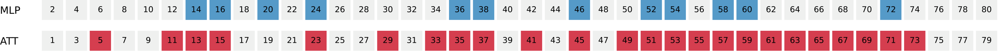

> 图解：LLaMA-2-13B 的默认搜索结果跳过 24 个 Attention 子层和 12 个 MLP 子层。Attention 的跳过明显多于 MLP，并且在模型后半段更密集。

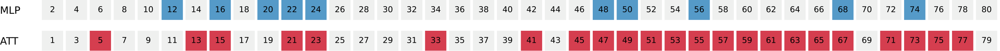

> 图解：Chat 模型的跳层组合与基础模型并不相同，但总体仍呈现“Attention 跳得更多、后半段更集中”的趋势，说明微调后需要重新搜索，而不是直接复制基础模型配置。

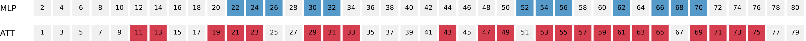

> 图解：CodeLLaMA-13B 的蓝色 MLP 跳过块更多分布在中段及后段，红色 Attention 跳过块则在后半段形成连续区域，再次体现任务与模型对最优组合的依赖。

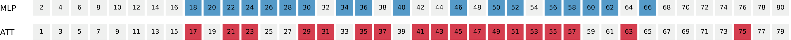

> 图解：70B 模型的第 1—80 个子层中，前部保留较多，跳层从约第 17 层后逐渐增多；这为“冗余更偏后半段”的观察提供了细粒度证据。

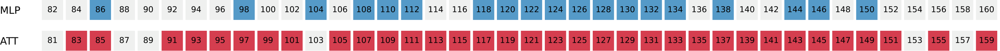

> 图解：第 81—160 个子层中，红色 Attention 跳过块高度密集，MLP 也有大量蓝色跳过块。相比 13B，70B 可跳过的比例更高，与其更大的主实验加速相呼应。

作者据此总结两点：Attention 比 MLP 更适合作为跳层加速对象；无论哪类子层，跳过位置都更倾向于后半段，说明不少 Token 在前半网络已经形成较充分表示。

### 固定位置或随机跳层，为什么不如贝叶斯优化？

为了排除“只要跳够数量就行”的解释，作者保持与 BO 相同的跳层数量，分别跳过前部、中部、后部或随机位置。BO 的组合即上一小节的 LLaMA-2-13B 图，四种对照布局如下。

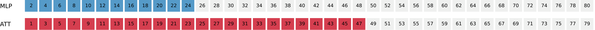

> 图解：First 策略集中跳过最前面的 Attention 与 MLP 子层，破坏了早期表示构建，后表中的接受率仅 0.091，Speedup 更降至 0.696×。

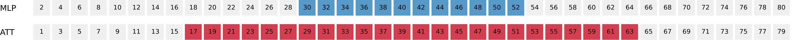

> 图解：Mid. 策略把跳过块整体移到网络中段。相比 First 有所改善，但连续跳过仍造成较低的草稿接受率。

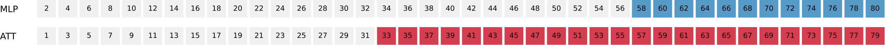

> 图解：Last 策略集中跳过后部子层，在对照策略中表现相对更好，符合后部冗余更多的观察；但固定连续组合仍不如 BO 的离散选择。

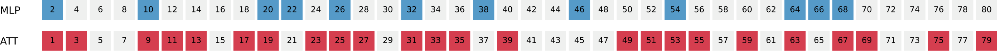

> 图解：Rand. 策略随机散布相同数量的跳层，Speedup 约为 1.01×，几乎没有实际收益。这直接说明“跳层位置”不是无关变量。

| 策略 | First | Mid. | Last | Rand. | BO |
|---|---:|---:|---:|---:|---:|
| ROUGE-2 | **0.108** | **0.108** | 0.107 | 0.107 | **0.108** |
| $AR$ | 0.091 | 0.393 | 0.508 | 0.592 | **0.919** |
| Speedup | 0.696× | 0.887× | 0.951× | 1.01× | **1.57×** |

BO 的优势并不神秘：它用真实端到端耗时筛选组合，而不是依赖“前、中、后哪段更冗余”的粗略先验。

### 贝叶斯优化需要多少轮？

| BO 迭代次数 | 200 | 400 | 600 | 800 | 1000 |
|---|---:|---:|---:|---:|---:|
| ROUGE-2 | **0.108** | 0.107 | **0.108** | **0.108** | **0.108** |
| $AR$ | 0.903 | **0.938** | 0.920 | 0.919 | 0.919 |
| Speedup | 1.35× | 1.52× | **1.58×** | 1.57× | 1.57× |

200 轮已经能得到 1.35×，600 轮达到表中最高的 1.58×。800 与 1000 轮得到相同跳层组合，因此两项指标一致。对应布局如下：

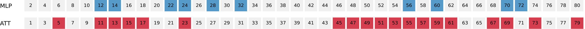

> 图解：200 轮搜索已经形成较分散的跳层组合，但接受率和 Speedup 仍低于后续迭代，说明早期解尚未充分平衡草稿质量与成本。

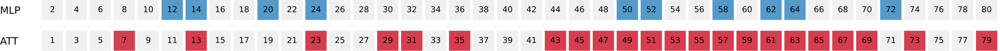

> 图解：400 轮的布局发生明显调整，接受率升到 0.938，Speedup 提升到 1.52×；再次说明最高接受率并不自动对应最高速度。

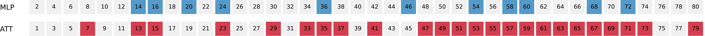

> 图解：600 轮对应表中 1.58× 的最佳 Speedup，跳层同时分布于中部和后部，而不是简单集中删除某一段。

> 图解：800 轮的 Attention 与 MLP 选择已趋于稳定，Speedup 为 1.57×，与 600 轮相比没有继续提升。

> 图解：1000 轮图与 800 轮的跳层位置一致，因此接受率、ROUGE-2 和 Speedup 也完全相同，显示搜索已经收敛到同一配置。

这份离线成本不能忽略：1000 轮 BO 在 13B 系列模型上约需 2.5 小时，70B 约需 6 小时。好在它是一次性离线过程，部署后不再重复。

### 如果允许训练，能不能跳得更多？

作者还尝试了 Aggressive Skip：按 BO 概率选择 Top-K 子层，在 LLaMA-2-13B 上跳过 75% 的 Attention 层，即 30 层，以及 32.5% 的 MLP 层，即 13 层。

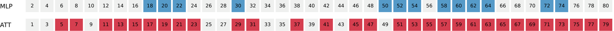

> 图解：与默认 BO 布局相比，红色 Attention 跳过块和蓝色 MLP 跳过块都明显增多。更薄的草稿降低了单次 Drafting 成本，但不训练时接受率只有 0.695。

为了补偿质量下降，作者从 Pile 数据集中取 50,000 个样本，每个截断为 512 Token，总计约 25M Token，训练 3 个 Epoch，累计 75M Token。

| 训练 Token 数 | 0 | 20M | 40M | 60M | 75M |
|---|---:|---:|---:|---:|---:|
| ROUGE-2 | **0.106** | **0.106** | **0.106** | **0.106** | **0.106** |
| $AR$ | 0.695 | 0.902 | 0.901 | 0.900 | 0.893 |
| Speedup | 1.15× | 1.91× | 1.94× | **1.96×** | 1.85× |

训练 20M Token 后，Speedup 就从 1.15× 提升到 1.91×；60M 时达到 1.96×，75M 反而下降，作者认为可能存在过拟合。这个方向资源充足时很诱人，但训练后的 Draft Model 不再与原模型共享完全相同参数，需要额外存储和训练成本，已不再具备原方案“零训练、零额外模型显存”的优势。

### 自适应退出让最大 $K$ 不再敏感

| 最大 $K$ | 10 | 12 | 14 | 16 | 18 |
|---|---:|---:|---:|---:|---:|
| ROUGE-2 | 0.107 | **0.108** | **0.108** | **0.108** | 0.107 |
| $AR$ | **0.924** | 0.919 | 0.916 | 0.913 | 0.911 |
| Speedup | 1.57× | 1.57× | **1.58×** | **1.58×** | **1.58×** |

开启自适应退出后，增大最大 $K$ 几乎不再改变 Speedup。原因是最多允许生成多少，并不等于实际一定生成多少；多数位置会在合适的时候提前退出。因此，默认设一个相对较大的 $K=12$，可以给机制留下发挥空间。

## 八、组合与泛化：资源受限和更多任务上表现如何？

跳层解决了“无需额外模型”的通用加速问题，附录继续追问两个更实际的问题：能否与模型压缩一起用，以及能否走出摘要和代码基准。

### 与量化、稀疏化组合

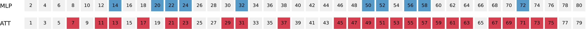

> 图解：这是 CNN/DM、LLaMA-2-13B 组合实验中使用的跳层分布，仍遵循灰色保留、红色跳过 Attention、蓝色跳过 MLP 的编码。压缩改变的是模型计算与存储方式，跳层搜索决定 Drafting 的计算路径，两者可以叠加。

量化实验采用 LLM.int8()，比较 bf16、fp8、fp4 和 nf4；所有设置都跳过 `lm head`，且不采用双重量化。

| 量化方式 | bf16 | fp8 | fp4 | nf4 |
|---|---:|---:|---:|---:|
| ROUGE-2 ↑ | 0.107 | 0.105 | 0.101 | **0.114** |
| $AR$ ↑ | 0.910 | 0.911 | **0.913** | 0.910 |
| VRAM（GB）↓ | 37.2 | 27.5 | **19.6** | 19.7 |
| Latency（ms）↓ | **32.4** | 113 | 152 | 126 |
| Speedup ↑ | 1.53× | **1.61×** | 1.36× | 1.35× |

fp4 将显存从 37.2 GB 降到 19.6 GB，接近减半，适合显存受限设备。不过，反量化会增加平均 Token 延迟，因此“显存更省”不等于“绝对延迟更低”。

稀疏化实验采用 Wanda，比较 Dense、非结构稀疏，以及稀疏度 0.5 的 4:8、2:4 结构化 N:M 稀疏。N:M 约束表示每 $M$ 个连续权重中至多 $N$ 个非零。

| 稀疏方式 | Dense | Unstructured | 4:8 | 2:4 |
|---|---:|---:|---:|---:|
| ROUGE-2 ↑ | 0.107 | 0.114 | **0.115** | 0.110 |
| $AR$ ↑ | 0.910 | **0.918** | 0.912 | 0.911 |
| VRAM（GB）↓ | 37.2 | **35.9** | **35.9** | **35.9** |
| Latency（ms）↓ | 32.4 | 30.4 | **29.2** | 30.9 |
| Speedup ↑ | **1.57×** | 1.50× | 1.47× | 1.48× |

稀疏化对显存的削减有限，但不同程度降低了绝对延迟。相对 Speedup 略降，是因为基线自回归模型本身也被加速了。

### 数学推理与开放域对话

GSM8K 使用 1318 道测试题并报告准确率；MT-bench 包含 80 个多轮问题，共两轮 160 个回答，由 GPT-4 按 10 分制评分后取平均。GSM8K 的 BO 开发集为训练集随机抽取的 4 个样本，MT-bench 则让 GPT-3.5 围绕 8 类主题生成 8 个样本。

| 数据 | 模型 | 方法 | 任务分数 | Speedup |
|---|---|---|---:|---:|
| GSM8K | CodeLLaMA-13B | Autoregressive | 0.104 | 1.000× |
| GSM8K | CodeLLaMA-13B | Self-Speculative | 0.101 | 1.351× |
| GSM8K | CodeLLaMA-13B-Instruct | Autoregressive | 0.223 | 1.000× |
| GSM8K | CodeLLaMA-13B-Instruct | Self-Speculative | 0.213 | 1.263× |
| MT-bench | LLaMA-2-13B-Chat | Autoregressive | 6.940 | 1.000× |
| MT-bench | LLaMA-2-13B-Chat | Self-Speculative | 6.930 | 1.269× |

三组结果分别获得约 1.35×、1.26× 和 1.27× 加速，任务分数保持接近。MT-bench 覆盖写作、角色扮演、信息抽取、推理、数学、代码、STEM 与人文社科，说明方法并不只依赖某一种文本重复模式。

### 输出质量的补充证据

在相同的非微调、1-shot 摘要设置下，作者还引用 HELM Leaderboard 的数据，与其他主流 LLM 做参考比较。这里比较的是任务能力基线，而不是说这些模型都使用了自推测解码。

| 模型 | CNN/DM ROUGE-2 | XSum ROUGE-2 |
|---|---:|---:|
| LLaMA-2-13B（论文） | 0.106 | 0.124 |
| LLaMA-2-13B-Chat（论文） | 0.144 | 0.109 |
| LLaMA-2-70B（论文） | 0.130 | 0.118 |
| OPT-66B | 0.136 | 0.126 |
| Davinci-175B | 0.127 | 0.126 |
| Palmyra X-43B | 0.049 | 0.149 |
| GPT-NeoX-20B | 0.123 | 0.102 |
| Luminous Base-13B | 0.110 | 0.105 |
| BLOOM-176B | 0.080 | 0.030 |
| YaLM-100B | 0.017 | 0.021 |

附录的多指标结果进一步覆盖 ROUGE-1、ROUGE-2 和 ROUGE-L：

| 数据 | 方法 | ROUGE-1 | ROUGE-2 | ROUGE-L | Speedup |
|---|---|---:|---:|---:|---:|
| CNN/DM | Autoregressive | 0.263 | 0.106 | 0.181 | 1.000× |
| CNN/DM | Self-Speculative | 0.266 | 0.108 | 0.183 | 1.429× |
| XSum | Autoregressive | 0.327 | 0.124 | 0.260 | 1.000× |
| XSum | Self-Speculative | 0.328 | 0.125 | 0.261 | 1.377× |

需要留意，这张附录表的 Speedup 与正文主表对应项并不完全一致，这里按原表列示，不将两组数值混合计算。质量结论则一致：各项指标基本持平。

定性案例也呼应了“无损”的边界：CNN/DM 与 XSum 的 Greedy 示例中，Autoregressive 与 Self-Speculative 输出逐字一致；温度 0.2 的采样示例可以生成不同文本，但二者仍遵循相同的原始模型分布。也就是说，**同分布不等于每次随机采样得到同一句子。**

论文最后声明，研究使用开放数据集、模型和工具，目标集中在推理效率，不涉及商业使用。这些实验为方法的有效性与复现提供了较完整的证据链。

## 九、结论与局限

这项工作的限制也很清楚：离线 BO 可能需要数小时；不训练时，可跳层数受到草稿接受率约束；激进跳层再训练虽然能达到 1.96×，却引入额外训练与模型存储。对于 Batched Decoding，作者还提出可结合 FlashAttention、vLLM 等系统工作继续适配。

- **核心思路**：同一个 LLM 通过跳层生成草稿，再由完整模型一次前向验证，不需要独立 Draft Model。
- **无损边界**：Greedy 输出与原模型一致，Sampling 保持原模型分布；草稿误差不会直接成为最终输出误差。
- **跳层搜索**：以每个验证 Token 的平均耗时为目标，用贝叶斯优化同时平衡草稿速度与接受率。
- **自适应退出**：根据实际接受率动态调整置信度阈值，避免固定 $K$ 和静态阈值在不同样本上失效。
- **实验结果**：文本任务最高 1.992×，HumanEval 最高 1.456×，并展示了对微调模型、数学、对话及压缩组合的适配能力。

未来更有价值的方向，是继续降低 Drafting 成本，并在批量推理、低资源部署与更复杂压缩策略之间找到不牺牲“共享参数、无需训练”优势的平衡。

> 本文参考自 [Draft & Verify: Lossless Large Language Model Acceleration via Self-Speculative Decoding](https://arxiv.org/abs/2309.08168)