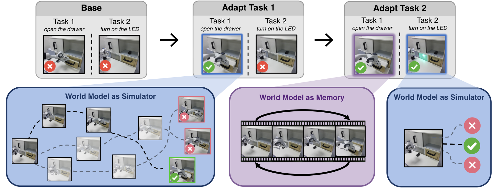
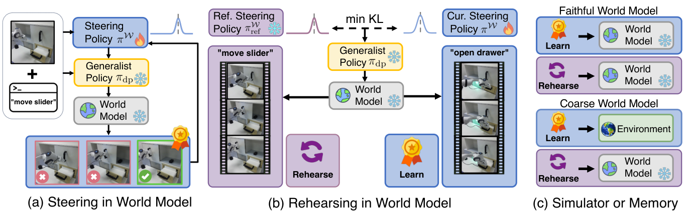
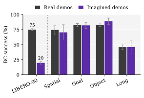
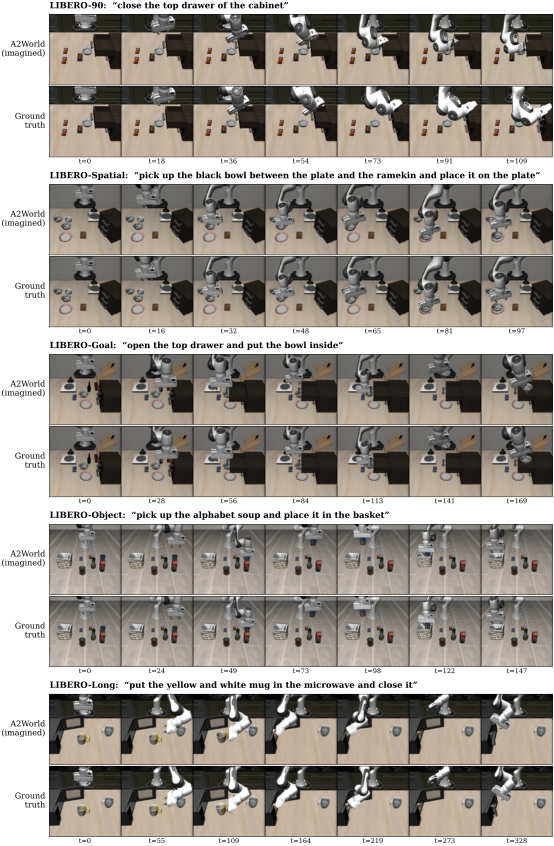
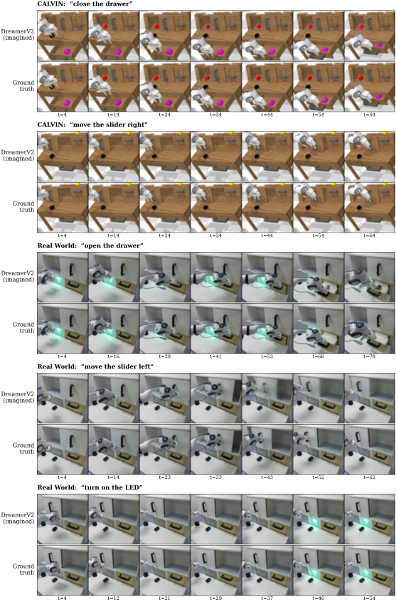
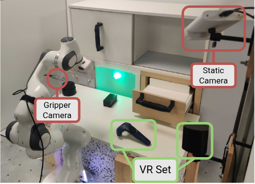
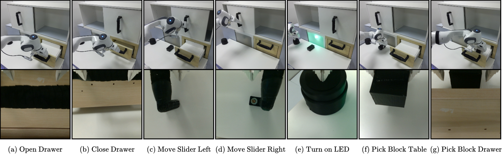
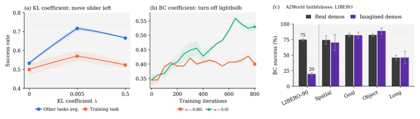

# Dream to Remember：冻结大模型策略，用世界模型"做梦"防遗忘

通用机器人策略（Generalist Policy）靠模仿学习训出来，能力上限被演示数据锁死；想靠强化学习继续提升，一旦任务一个接一个地来，就会撞上 **灾难性遗忘** ——学了新任务，旧技能就丢了。这篇文章提出的 **Dream to Remember（D2R）** 给出了一个漂亮的解法：策略本体完全冻结，只训练一个很小的"转向模块"去操控扩散策略的输入噪声；与此同时，用一个同样冻结的世界模型在"想象"中反复排练旧任务，把转向模块锚定在历史行为上。最硬的结果：在 CALVIN 上连续提升 8 个任务，全程不碰真实环境，平均成功率从 63.7% 提升到 74.8%，而同样的任务序列用 LoRA 微调会暴跌到 11.7%；在真实 Franka 机械臂上，三个任务全部在"梦境"中学会，且提升被完整保留。

> 图解：D2R 的核心循环。一个小型转向模块（steering module）在冻结的世界模型内部通过强化学习学会"给冻结策略喂什么噪声"；学新任务的同时，同一个世界模型从留存的初始帧出发重新生成旧任务的想象轨迹，并用 KL 惩罚把模块拉向它之前在这些状态上的行为。技能因此可以不断累积，全程不需要在机器人上重跑旧任务，也不需要存储历史轨迹。关键洞察是：排练（rehearsal）对世界模型精度的要求，远低于在它里面学新任务的要求。

## 遗忘到底发生在哪里？

要理解 D2R 的动机，先看清楚"适配一个预训练策略"这件事可以在三个不同的空间里做，而遗忘的病灶各不相同：

- **权重空间**：直接微调策略权重（全量或 LoRA adapter）。学一个任务就改变了所有任务共享的权重，遗忘直接埋在策略本体里。
- **输出空间**：测试时从冻结策略采样多个动作候选，用世界模型或打分器挑最好的执行（如 DreamSteer、RoboMonkey 一类）。它不留下任何持久化改动，自然不遗忘，但代价是每一步决策都要付出昂贵的搜索成本。
- **输入空间**：扩散 / Flow 策略本质上是一个"噪声 → 动作"的映射，那就训练一个小模块学会"喂什么噪声"，把搜索成本摊销进一个学到的网络里（DSRL 的思路）。策略冻结了，但遗忘只是被下移了一层——转向模块是所有任务共享的，学新任务照样会改变它在旧任务上采的噪声。

传统的防遗忘手段是 rehearsal（排练 / 回放）：学新任务时重温旧任务。但重温要么靠机器人重新交互（每轮适配都要把旧任务全跑一遍），要么靠经验回放池（存储随任务数不断增长的历史轨迹）。两条路都很贵。

D2R 的洞察是：**既然已经有一个冻结的世界模型能生成以假乱真的轨迹，为什么不让它来当"记忆"？** 旧任务的排练完全在想象中重新生成，机器人不用动，轨迹不用存，每个任务只留下几个初始观测帧作为"梦境的种子"。

## D2R：在噪声空间里转向，在世界模型里排练

> 图解：(a) **想象中的转向** ——小型转向模块通过 RL 在冻结世界模型里学习如何塑造喂给冻结策略的噪声；(b) **世界模型中的排练** ——世界模型想象出旧任务的 rollout，KL 惩罚把模块锚定在旧行为上；(c) **模拟器还是记忆** ——足够精确的世界模型身兼学习与排练两职；不够精确的也可以只当记忆用，学习挪回真实环境。

### 问题建模：带约束的持续适配

设定是这样的：机器人手里有一个预训练好的通用策略，任务 $\ell_1, \dots, \ell_N$ 一个接一个到来。第 $k$ 阶段只允许在当前任务 $\ell_k$ 上收集经验，目标是提升 $\ell_k$ 的成功率，同时保住"保留集" $\mathcal{R}_k$ 里的全部旧技能——既不能重新在机器人上跑旧任务，也不能存它们的轨迹，只允许每个任务留一小撮初始观测。

基础策略 $\pi_{\mathrm{dp}}$ 是一个冻结的生成式策略（扩散或 Flow Matching），在确定性采样（DDIM 或 ODE 积分）下，动作块是初始噪声的确定性函数：

$$
\bm{a} = \pi_{\mathrm{dp}}^{\mathcal{W}}(s, \ell, \bm{w}), \quad \bm{w} \sim \mathcal{N}(0, I), \ \bm{w} \in \mathcal{W} = \mathbb{R}^{H \cdot d}
$$

这里只需要对策略的 **前向访问** ——不需要权重、不需要梯度，所以任何现成的黑盒策略都能用。世界模型同样冻结：编码器 $E_\phi$ 把观测历史压成状态 $s_t = E_\phi(o_{\le t})$，转移模型 $P_\phi(s' \mid s, \bm{a})$ 预测下一个隐状态，想象 rollout 里的奖励由一个隐空间成功分类器给出。

总目标写成一个带约束的优化问题：

$$
\max_{\pi^{\mathcal{W}}}\ J_k(\pi^{\mathcal{W}}) \quad \text{s.t.} \quad \mathrm{KL}\big(\pi^{\mathcal{W}}(\cdot \mid s, \ell_j)\,\big\|\,\pi^{\mathcal{W}}_{\mathrm{ref}(j)}(\cdot \mid s, \ell_j)\big) \le \epsilon, \quad \forall\, \ell_j \in \mathcal{R}_k
$$

即在当前任务上最大化回报，同时把每个旧任务上的转向行为约束在其参考行为附近。注意 **适配只更新转向模块** $\pi^{\mathcal{W}}$，策略和世界模型从头到尾都是冻结的。

### 想象中的转向：把噪声空间变成动作空间

第一个关键技巧：既然冻结策略把噪声 $\bm{w}$ 确定性地映射成动作，那"选噪声"就等价于"选动作"。把策略本体吸收进环境里，就得到一个 **latent-noise MDP** ——动作空间变成了噪声空间 $\mathcal{W}$，RL 可以直接在上面优化。

更进一步，把这个 MDP 的真实动力学换成世界模型，就得到 **想象中的 latent-noise MDP**：

$$
\mathcal{M}_{\mathrm{wm}}^{\mathcal{W}} = \big(\mathcal{S}, \mathcal{W}, P_\phi^{\mathcal{W}}, R_k^{\mathcal{W}}, \gamma\big), \qquad P_\phi^{\mathcal{W}}(s' \mid s, \ell, \bm{w}) = P_\phi\big(s' \mid s, \pi_{\mathrm{dp}}^{\mathcal{W}}(s, \ell, \bm{w})\big)
$$

世界模型足够准时，转向模块可以完全在想象里训练，零环境交互。DSRL 是在真实环境里学这个噪声策略的，D2R 把它搬进了梦里。

转向模块本身是一个比策略小几个数量级的小网络，输出噪声空间上的对角高斯：

$$
\pi^{\mathcal{W}}(\bm{w} \mid s, \ell) = \mathcal{N}\big(\bm{w};\ \mu(s, \ell),\ \mathrm{diag}\,\sigma^2(s, \ell)\big), \qquad \sigma \in [\sigma_{\min}, \sigma_{\max}]
$$

这个设计有个很妙的性质：令 $\mu = 0, \sigma = 1$ 就退化成原始先验噪声分布，等于"关闭转向"，随时可以把原策略原样还回来。笔者认为这个"可关闭性"是被低估的工程优点——适配失败时可以无损回滚。

另外，在想象里训练有个经典陷阱：模块会钻世界模型预测误差的空子（reward hacking）。D2R 沿用 DiWA 的做法，加一项行为克隆损失 $\mathcal{L}_{\mathrm{BC}}$，让转向后解码出的动作别偏离先验噪声下策略自己的输出太远。这个锚点是零成本的——从先验采噪声就等价于未转向的策略，不需要额外存教师网络。

### 世界模型排练：不存轨迹的"记忆"

单学当前任务，转向模块在旧任务上的输出会漂移，这就是遗忘。D2R 把上面的硬约束软化成 KL 惩罚。每个保留任务 $\ell_j$ 的参考分布选得很讲究：如果它之前被转向过，参考就是上一阶段的模块 $\pi^{\mathcal{W}}_{k-1}$；如果是从未适配过的预训练技能，参考就是先验 $\mathcal{N}(0, I)$。两边都是对角高斯，KL 有闭式解，计算几乎免费：

$$
\mathcal{L}_{\mathrm{KL}}(\pi^{\mathcal{W}}_k) = \frac{1}{|\mathcal{R}_k|} \sum_{\ell_j \in \mathcal{R}_k} \mathbb{E}_{s \sim \mathcal{D}^{j}_{\mathrm{reh}}}\Big[\mathrm{KL}\big(\pi^{\mathcal{W}}_k(\cdot \mid s, \ell_j)\,\big\|\,\pi^{\mathcal{W}}_{\mathrm{ref}(j)}(\cdot \mid s, \ell_j)\big)\Big]
$$

关键在状态分布 $\mathcal{D}^{j}_{\mathrm{reh}}$ 从哪来：从该任务存下的初始观测出发，由世界模型编码后用 $P_\phi^{\mathcal{W}}$ 向前展开，**由参考策略自己选噪声**。也就是说，排练轨迹走的是"要被保留的行为"所经过的状态。排练不需要奖励，每次更新都重新生成而不是存起来，所以没有轨迹 buffer；世界模型是冻结的，排练分布也不会随任务数增长而漂移。

笔者认为这是全文最聪明的一处设计：**KL 惩罚只负责"在相关状态上对齐分布"，它对状态的要求是"有代表性"，而不是"动力学精确"** ——这就引出了下面的核心论点。

### 模拟器还是记忆：两种角色，两种精度要求

D2R 让世界模型扮演两种角色，而它们对保真度的要求完全不同：

- **当模拟器**：策略在它里面被优化，模块会主动寻找奖励高的区域，任何预测误差都会被利用，所以模型必须足够准。此时当前任务在 $\mathcal{M}_{\mathrm{wm}}^{\mathcal{W}}$ 里用 on-policy PPO 学（想象 rollout 便宜且可并行）。
- **当记忆**：只需要生成保留任务的代表性状态，KL 惩罚是在这些状态上对齐参考行为，并不通过模型动力学反向优化策略。模型糙一点也能用。此时当前任务挪到真实环境 $\mathcal{M}_{\mathrm{env}}^{\mathcal{W}}$ 里学，每步交互都是真实 episode，所以用 off-policy SAC 反复利用经验。

两种方式下排练完全相同——保留任务永远在世界模型里想象，KL 项永远不需要真实交互。每个阶段都从头训练一个新模块 $\pi^{\mathcal{W}}_k$，旧模块冻成参考，阶段结束后旧模块即被丢弃，全程只保留 **一个** 转向模块，不需要任务 ID。总损失为：

$$
\mathcal{L}(\pi^{\mathcal{W}}_k) = \mathcal{L}_{\mathrm{RL}} + \alpha\, \mathcal{L}_{\mathrm{BC}} + \lambda\, \mathcal{L}_{\mathrm{KL}}
$$

其中 $\alpha$ 只在想象中训练时非零（真实环境里奖励是真的，没空子可钻），$\lambda$ 是所有保留任务共享的保留系数。

## 实验：两个仿真基准 + 真机

实验回答三个问题：想象中的转向能否在不遗忘的前提下提升单任务？连续转向能否跨任务积累技能？粗糙的世界模型还能不能当记忆用？

**设置一：CALVIN。** 世界模型是在 play data 上训练的 RSSM，足够精确，适配完全在想象中用 PPO 进行；基础策略是语言条件的多任务扩散策略（每任务 150 条演示）。8 个任务先独立适配、再顺序适配。

**设置二：LIBERO。** 全部用现成货：策略是公开的 $\pi_0$ checkpoint（在 Spatial / Object / Goal / Long 四个套件上微调过），世界模型是 A2World（2.1M 真实机器人轨迹上预训练，同样只见过四个套件）。两者都没见过 LIBERO-90 的目标任务。由于 A2World 在这些任务上不够准（下文有专门验证），每个任务在真实环境里用 SAC 学，A2World 只做排练。

**指标** 有三个：**Success**（序列结束后所有任务的平均成功率）、**Retention**（相对冻结基础策略的成功率变化，正值为增益）、**Forgetting**（任务学会之后到序列末掉的点数，越小越好）。

### 单任务适配：唯一"双赢"的方法

下表是 CALVIN 单任务适配的结果（所有方法都完全在世界模型里训练，零环境交互），Retention 列为相对基础策略的平均变化（百分点）：

| 方法 | 适配任务成功率 (%) | Retention (pts) |
| --- | --- | --- |
| Base DP | 63.7 ± 6.5 | 0.0 |
| DP-TTC（测试时选择） | 65.1 ± 1.9 | 0.0 |
| DiWA（想象微调全权重） | 79.2 ± 3.7 | **−43.9** |
| DiWA + rehearsal | 78.0 ± 3.1 | −12.7 |
| DSRL（无排练转向） | **81.8 ± 2.9** | −5.3 |
| **D2R（本文）** | 79.8 ± 3.8 | **+1.6** |

D2R 把平均成功率从 63.7% 拉到 79.8%，与直接微调权重的 DiWA 打平——证明了 **在噪声空间转向可以达到与权重微调相同的提升，而完全不动策略**。同时它是唯一 Retention 为正的方法。DiWA 无论适配哪个任务都会重创其他任务；给 DiWA 加上同样的排练能挽回大部分损失，但权重变了，在参考轨迹没走到的地方行为照样会漂移，所以救不全。DSRL 在目标任务上高 2 个点，D2R 用这 2 个点换来了旧技能的完整保留。DP-TTC 不改任何东西自然不遗忘，但它只能在冻结策略提出的候选里挑，天花板明显更低。

### 连续适配：技能真的能累积

接下来是真考验：8 个任务一个接一个学，一个模块扛到底。

| 方法 | CALVIN Success ↑ | Retention ↑ | Forgetting ↓ | LIBERO Success ↑ | Retention ↑ | Forgetting ↓ | 存储 |
| --- | --- | --- | --- | --- | --- | --- | --- |
| Base | 63.7 ± 6.5 | 0.0 | 0.0 | 10.4 ± 2.7 | 0.0 | 0.0 | — |
| LoRA 微调 | 11.7 ± 1.9 | −52.0 | 53.2 | 1.0 ± 1.6 | −41.6 | 61.4 | — |
| DSRL | 63.6 ± 4.8 | −0.1 | **1.6** | 16.9 ± 5.2 | −30.8 | 78.3 | — |
| + instruction KL | 70.9 ± 8.1 | +7.2 | 3.6 | 24.9 ± 2.6 | −23.3 | 61.4 | — |
| + first-obs KL | 65.1 ± 3.6 | +1.4 | 12.9 | 36.4 ± 0.6 | −20.9 | 52.5 | ~400 帧 |
| + replay KL | 74.0 ± 3.5 | +10.3 | 5.8 | 73.9 ± 6.3 | **+2.0** | 11.6 | ~59k 帧 |
| **D2R** | **74.8 ± 3.7** | **+11.1** | 5.7 | **74.9 ± 2.6** | +1.6 | **8.3** | ~400 帧 |
| *每任务一模块（上限）* | 81.8 ± 2.9 | +18.1 | 0.0 | 91.3 ± 1.0 | +80.9 | 0.0 | 8 个模块 |
| *单模块联合训练* | 67.3 ± 3.9 | × | × | 54.6 ± 8.5 | × | × | 1 个模块 |

几个值得细读的点：

- **LoRA 微调是灾难**：两个基准上分别遗忘 53.2 和 61.4 个点，学完序列后还不如不学。
- **DSRL 的两种死法**：在 LIBERO 上遗忘 78.3 个点，还把 $\pi_0$ 在四个预训练套件上的表现拉低 30.8 个点；在 CALVIN 上倒是"几乎不忘"（1.6），但那是因为它压根没比基础策略好多少——不积累，自然无可遗忘。没有排练，适配要么覆盖旧技能，要么攒不下新本事。
- **三个消融暴露了"记忆"需要提供什么**：instruction KL（只在当前任务观测上配旧指令施罚）在同场景的 CALVIN 上有效（70.9%），但 LIBERO 场景会切换，当前任务的观测覆盖不到旧任务的状态，只剩 24.9%；first-obs KL（只在存下的初始帧上施罚，不向前 rollout）也不够，因为技能执行中经过的状态没锚住；replay KL（存真实 / 想象的完整轨迹）最接近 D2R，但要存约 5.9 万帧——D2R 整个序列只留约 400 帧种子，**存储少约 150 倍**，性能还略好。
- **和两个参照系的距离**：每任务一个独立模块是转向的天花板（81.8% / 91.3%），代价是模块随任务数增长且需要任务 ID；D2R 用单个模块追到 7 和 16 个点以内。而把所有任务混在一起联合训练的单模块只有 67.3% / 54.6%——同时优化 8 个稀疏奖励远比"逐个学 + 锚定旧行为"难。在"不随序列增长、不存轨迹"的所有方法里，D2R 是唯一既学得会又记得住的。

### 粗糙的世界模型为什么还能当记忆？

LIBERO 设置里有个前置问题：凭什么相信没见过 LIBERO-90 的 A2World 能帮忙？作者做了一个干净利落的保真度检验——用完全相同的 BC 配方，分别克隆"真实演示"和"A2World 用相同初始场景 + 专家动作序列想象重放的演示"，比较两份数据训出的策略：

> 图解：柱状图对比"真实演示克隆"与"想象重放克隆"两种策略在各 LIBERO 套件上的成功率。在 A2World 微调过的四个套件上两者几乎持平（如 Spatial 74.5% vs 70.3%，Object 82.4% vs 88.9%，Goal 82.5% vs 82.0%，Long 45.8% vs 46.0%）；但在序列用的 8 个 LIBERO-90 任务上差距悬殊——真实演示克隆 74.9%，想象重放克隆仅 19.6%。说明 A2World 能复现训练分布内的动力学，但复现不了目标任务的。

按常理，这样的模型该扔掉。但 D2R 的实验表明它仍然能当好"记忆"：从留存的初始帧出发展开的想象轨迹虽然不准到不能拿来学习，其状态分布却足以锚定转向模块——在这些想象状态上做排练，效果追平了在真实存储轨迹上做排练。定性对比也支持这一点：

> 图解：每两行是一对时间对齐的帧序列，上面是 A2World 的想象 rollout，下面是对应的真实演示。A2World 在 LIBERO-90 上虽然经常生成不出完整成功的任务轨迹，但它抓住了环境动力学，产生的状态转移是合理的——对排练来说，这就够了。

> 图解：同样的对比用在 CALVIN 和真机实验的 DreamerV2 世界模型上。它的想象轨迹明显更贴合真实任务进程，保真度更高——这正是它能身兼"模拟器"（在里面学新任务）与"记忆"（排练旧任务）两职的原因。

**"够格被优化"是比"够格被排练"强得多的要求** ——这是本文概念上最有分量的结论。一个现成的、从未在目标任务上微调过的世界模型，开箱就能当记忆用。

### 真机验证：梦里学成，现实不忘

最后是 Franka Emika Panda 真机。桌面场景含柜子、抽屉、滑块和 LED 按钮，由肩外静态相机和夹爪相机观察；世界模型是在 6 小时遥操作 play data 上训的 RSSM，基础策略是每个任务 100 条演示训出的语言条件扩散策略，全部冻结。三个任务——开抽屉、左移滑块、开 LED——依次适配，全程在想象中用 PPO 学，机器人只用于最终评估（每阶段每任务 20 个 episode）。

> 图解：真机桌面环境，复刻了 CALVIN 场景的柜子、抽屉、滑门与 LED 按钮。全部 play 数据与演示通过 VR 手柄遥操作采集。

> 图解：七个真机任务的双视角展示（上：静态相机，下：夹爪相机）。按顺序适配的三个任务是：开抽屉（第 1 阶段）、左移滑块（第 2 阶段）、开 LED（第 3 阶段）。

结果：基础策略本身成功率约 50–55%，想象中的转向给三个任务分别带来 +40、+20、+30 个点的提升。差异出现在后续任务学完之后——**D2R 把全部增益保留到了序列末尾（平均 +30），而无排练的 DSRL 丢掉了约一半（平均只剩 +15）**。也就是说，世界模型排练在真机上同样成立，而且整个学习过程没花一秒机器人时间。

## 消融与实现细节（附录精读）

详细模式下，附录里的几个设计决策值得单独拿出来说，因为它们对复现至关重要。

### 每阶段从头训练模块，而不是接着上一阶段

直觉上该沿用 $\pi^{\mathcal{W}}_{k-1}$ 的权重继续训，但实验恰恰相反：

| 初始化方式 | CALVIN Success | CALVIN Retention | LIBERO Success | LIBERO Forgetting |
| --- | --- | --- | --- | --- |
| 沿用上一阶段 | 66.9 ± 3.0 | +3.2 | 66.8 ± 5.9 | 18.6 |
| **从头训练** | **74.8 ± 3.7** | **+11.1** | **74.9 ± 2.6** | **8.3** |

原因是一个网络被连续微调过多个阶段会损失可塑性（plasticity loss），越学越学不动。从头初始化并没有丢掉历史——旧行为是靠 KL 排练项锚住 $\pi^{\mathcal{W}}_{k-1}$ 来传承的，**记忆活在损失函数里，而不是权重里**。笔者认为这个反直觉结论是附录里最有价值的发现之一。

### 任务顺序不敏感，且主文没挑好顺序

作者在 CALVIN 上测了 4 种任务顺序：最终成功率 74.6%–78.9%，Retention +10.9 到 +15.2，Forgetting 1.0–5.7。主文用的默认顺序在四项指标里排名靠后（成功率第三、遗忘最差），所以主结果并没有占顺序的便宜。

### 两个关键系数的取值

> 图解：(a) 保留系数 $\lambda$ 的权衡：$\lambda = 0$ 时旧任务保留差，过大会压制当前任务的学习，$\lambda = 0.005$ 是最佳平衡点；(b) 行为克隆系数 $\alpha$：太小（0.005）会出现捷径学习 / 世界模型钻空子，真实环境测试崩盘；$\alpha = 0.05$ 学得更快、终值更高；再大则会束缚探索、局限在基础策略附近。

### 排练的种子帧与存储账

每个任务只存演示的第一帧（CALVIN 150 帧 / 任务，LIBERO 50 帧 / 任务），序列开始前抽取一次，永不更新。8 个任务学完后：CALVIN 存 1200 帧 vs 回放池 72240 帧；LIBERO 存 400 帧 vs 59480 帧。差距恰好等于平均轨迹长度（60 / 149 帧），而且任务越长，差距越大——D2R 的存储只随任务数线性增长，回放池还要乘上每条轨迹的长度。

### 超参与算力一览

| 项目 | CALVIN（想象中 PPO） | LIBERO（环境中 SAC） |
| --- | --- | --- |
| 动作块长度 $H$ / 执行步数 | 4 / 4 | 50 / 20 |
| 噪声维度 $\vert\mathcal{W}\vert$ | 28 | 32 |
| 采样器 | DDIM（20 步取 10） | flow ODE（10 步） |
| 模块状态输入 | 世界模型特征（2048 维） | 原始图像（64×64，自带编码器） |
| 指令输入 | CLIP embedding（512） | PaliGemma embedding（2048） |
| 模块结构 | [512,512,512] MLP + LayerNorm | [512,512,512] MLP |
| 训练量 | 800 次迭代，50 并行 rollout | 250k 梯度步，update-to-data 比 20 |
| 排练 rollout | 每任务 10 并行、36 块、分类器 ≥0.9 提前停 | 每任务 50 条、固定 200 块 |
| 损失权重 | $\alpha = 5\times10^{-2}$，$\lambda = 5\times10^{-3}$ | $\alpha = 0$，$\lambda = 5\times10^{-3}$ |
| 单阶段耗时（单卡 A100） | 约 1 小时 | 约 8 小时（真机仅 30 分钟） |

排练是 D2R 相对 DSRL 唯一的额外开销：CALVIN 上每阶段延长约 25%；LIBERO 上因为每步想象都要过一遍 A2World + $\pi_0$，排练轨迹改为每阶段开始前一次性生成（约 30 分钟），摊销到后续梯度步里。

## 总结

- **输入空间转向 + 世界模型排练**：冻结策略与冻结世界模型，只训练一个小型转向模块，即实现了可与权重微调比肩的适配能力。
- **CALVIN 全程零真实交互**：8 任务连续适配，63.7% → 74.8%，而 LoRA 微调崩到 11.7%；Retention 为正（+11.1），是所有不增模块、不存轨迹方法中的唯一。
- **世界模型可以"只当记忆"**：排练所需的保真度远低于策略优化——A2World 在 LIBERO-90 上想象克隆只有 19.6%，但用它排练照样把遗忘压到 8.3 个点。
- **存储极省**：每个任务只留初始帧，整个序列约 400 帧，比轨迹回放池少约 150 倍，且只随任务数增长。
- **真机成立**：Franka 上三任务全程梦中学习，+30 点的平均增益被完整保留到序列结束。

局限也很明确：D2R 仍需为每个任务存少量初始帧来"叫醒"世界模型，未来或许可以连种子帧也由模型按需生成。更宏观地看，"学习需要精确的模型，记忆只需要熟悉的模型"这一观察，为大量现成但不够准的通用世界模型指了一条即刻可用的落地路径。

> 本文参考自 [Dream to Remember: Continual Steering of Generalist Robot Policies with World Models](http://arxiv.org/abs/2610.13816v1)