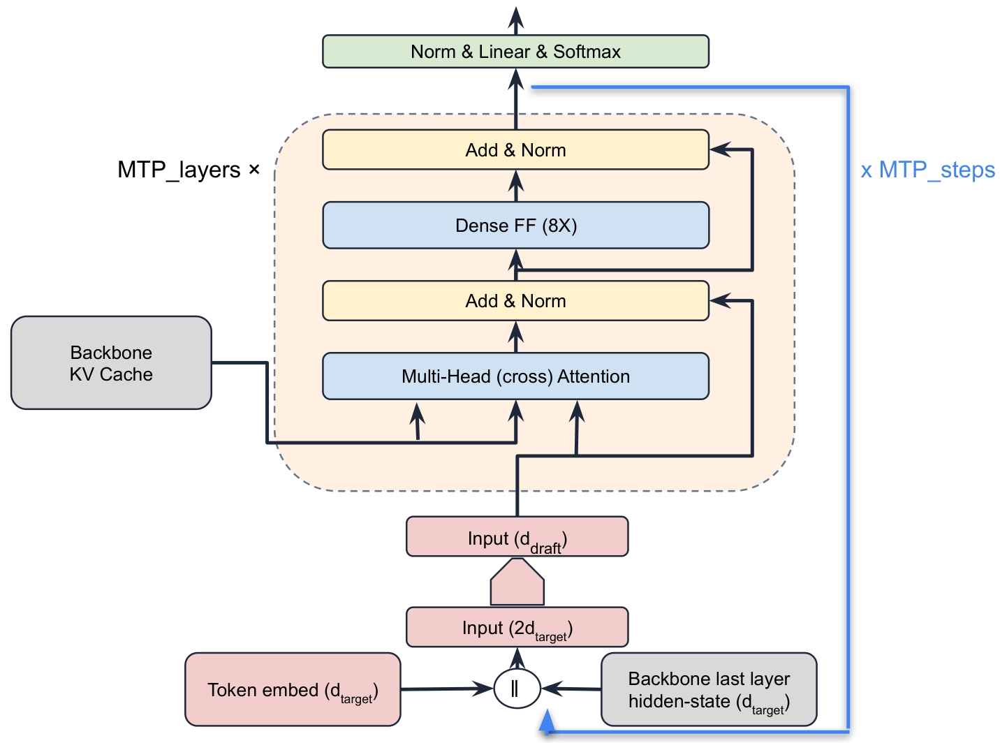
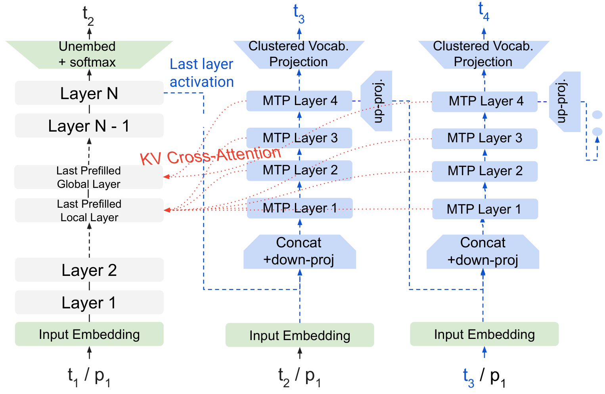
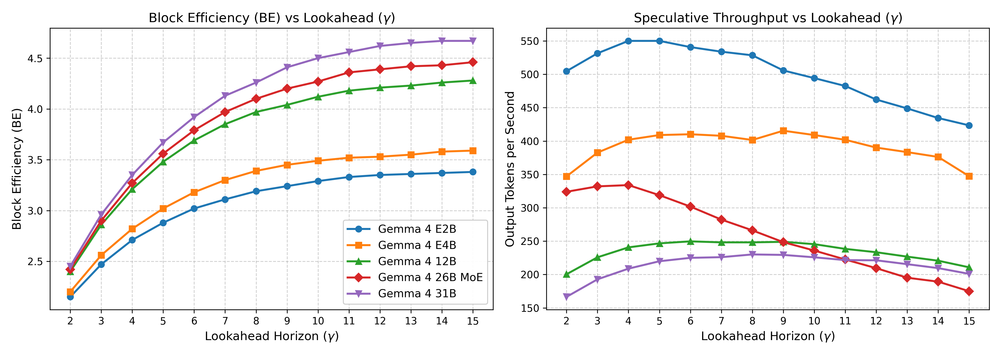

# G-MTP：共享草稿头复用 KV，31B 提速 3.14 倍

投机解码能加速大模型生成，但独立草稿模型往往要重复处理上下文、单独保存 KV Cache，既增加 prefill 延迟，也抬高端侧内存门槛。Google 提出的 G-MTP 将轻量多 token 预测头直接接入目标模型，用目标激活注入、零拷贝 KV Cache 交叉注意力和聚类词表投影降低草稿成本。在统一的 H100 测试中，Gemma 4 31B 的端到端吞吐从 73.2 tokens/s 提升至 230.1 tokens/s，加速 **3.14 倍**；在 Samsung Galaxy S26 Ultra GPU 上，Gemma 4 E4B 也获得 **2.18 倍**加速。更进一步，论文还解决了骨干模型微调后草稿器“失配”的问题：联合微调在 SciQA 上将目标模型前向次数从单独微调骨干时的 19,423 次降至 10,595 次，减少约 **1.83 倍**。

## 为什么投机解码还需要重新设计草稿器？

标准自回归 Transformer 每生成一个 token，都要完整执行一次前向传播。解码阶段通常难以充分利用现代硬件的并行计算能力，并持续受到显存带宽限制；模型越大、部署环境越受限，这个问题越突出。

投机解码把生成拆成两步：

1. **起草（Drafting）**：轻量模型一次连续预测多个候选 token。
2. **验证（Verification）**：目标模型并行检查整段候选，只接受符合其预测的前缀。

真正的收益不取决于“草稿模型有多小”这一个因素，而取决于两项成本的平衡：草稿是否足够便宜，以及草稿是否足够容易被目标模型接受。一个独立的小模型虽然参数少，却仍要自行读取全部上下文、执行 prefill，并维护自己的 KV Cache。这些固定开销会侵蚀服务器吞吐收益，在手机上甚至可能让方案无法部署。

已有工作大致沿两条路线演进。Medusa、早期 MTP 和 DFlash 使用多个并行预测头，起草速度快，但并行预测未必能维持较高的整块接受效率；EAGLE 等方法则按自回归方式依次生成候选，并把目标模型隐状态与已采样 token 注入草稿过程，以提高预测一致性。G-MTP 选择后者，同时借鉴 FastMTP 的参数共享思路：**只复用一个 4 层 Transformer 堆栈，不为每个预测位置配置独立模块**。

这篇工作的关键不只是把草稿头接到主模型上，而是把草稿器的三类开销分别拆开处理：语义信息不足导致接受率低，独立 KV Cache 导致 prefill 与显存开销，大词表投影导致每一步矩阵乘法过贵。

## G-MTP：一个共享草稿头完成多步预测

G-MTP 的核心是一个与目标骨干集成的 4 层 Transformer。E2B、E4B 的草稿维度为 256，12B、26B MoE 和 31B 的草稿维度为 1024；所有版本都采用三个局部注意力层、一个全局注意力层，前馈网络扩展比为 8。

它先用目标模型最后一层隐状态和当前 token embedding 构造输入，再递归调用同一个草稿块。每得到一个草稿 token，就把新的草稿隐状态与该 token 的 embedding 组合成下一步输入。训练时只看未来 3 步，推理时却能继续递归，因此可以支持更长的草稿序列；最终仍由目标模型一次性并行验证整段候选。

> 图解：草稿器首先拼接 token embedding $e(x)$ 与骨干隐状态 $h^{(L)}$，再降维到草稿器内部维度。草稿 token 经过共享 MTP 层时，直接对骨干已经冻结的 KV Cache 做交叉注意力。后续步骤将上一步输出经 $W_{\mathrm{up}}$ 上投影，与新采样草稿 token 的 embedding 拼接，再通过 $W_{\mathrm{down}}$ 降维，形成下一步输入。

> 图解：灰色主模型提供初始激活和预计算 KV Cache，蓝色自回归草稿块据此连续提出候选。不同草稿步骤始终使用常量位置编码 $p_1$，因为查询的是同一份静态 KV 快照；预测位置的变化不靠更新绝对位置 ID，而由递归传入的隐状态表达。

### 目标激活注入：让草稿器看到主模型的“思考结果”

独立草稿模型只能根据文本历史预测，看不到目标模型内部已经计算出的丰富语义。G-MTP 因而把目标模型的最终隐状态直接注入草稿过程，相当于不只告诉助手“题目是什么”，还把它当前的解题思路一并交给助手。

设刚采样 token 的骨干 embedding 为 $e(x_{t+1}) \in \mathbb{R}^{d_{\mathrm{target}}}$，目标骨干最后一层 RMSNorm 之后的隐状态为 $h_t^{(L)} \in \mathbb{R}^{d_{\mathrm{target}}}$。二者拼接后，被投影到较小的草稿维度：

$$
z_1 = W_{\mathrm{down}}\left[e(x_{t+1}) \parallel h_t^{(L)}\right]
$$

其中 $W_{\mathrm{down}} \in \mathbb{R}^{d_{\mathrm{draft}} \times 2d_{\mathrm{target}}}$。在第 $k$ 个前瞻步骤，共享草稿块处理 $z_k$，同时读取骨干的 Key、Value Cache：

$$
h_{t+k}^{(\mathrm{draft})} = \mathrm{Transformer}_{\mathrm{draft}}\left(z_k, K_{\mathrm{backbone}}, V_{\mathrm{backbone}}\right)
$$

由于目标模型尚未验证这些候选，后续草稿步骤不能反过来依赖新的骨干前向结果。G-MTP 于是像 RNN 一样沿草稿轨迹传递自己的状态，而不另外维护一条不断增长的草稿 KV Cache：

$$
z_k = W_{\mathrm{down}}\left[e(\tilde{x}_{t+k}) \parallel W_{\mathrm{up}}h_{t+k-1}^{(\mathrm{draft})}\right]
$$

这里 $W_{\mathrm{up}} \in \mathbb{R}^{d_{\mathrm{target}} \times d_{\mathrm{draft}}}$，$\tilde{x}_{t+k}$ 是草稿器自己刚预测的 token。这个设计同时保留了两条信息：目标模型提供的深层语义，以及当前草稿分支已经做出的实际选择。后者尤其重要，因为同一个隐状态之后可能存在多个合理续写分支；把新采样 token 注入下一步，可以显式消除这类分支不确定性。

### 零拷贝 KV Cache：不再为草稿器单独 prefill

G-MTP 的第二个优化，是让草稿层直接交叉注意力访问目标模型已经算好的 KV Cache，不复制数据，也不为草稿器重新处理上下文。

其局部—局部—局部—全局结构与骨干的交错注意力对应：三个草稿局部层都访问骨干最后一个已 prefill 的局部层 Cache，一个草稿全局层访问最后一个已 prefill 的全局层 Cache。对于采用跨层 KV 共享的 E2B、E4B，“最后一个已 prefill 层”不一定就是骨干的绝对最后一层。

所有草稿查询使用常量基础位置编码 $p_1$。静态 KV 快照不会在草稿过程中追加新 token，时间推进完全编码在递归隐状态里。多个草稿层虽然访问同一组 Key 和 Value，却并不冗余：每一层都会更新 Query，从相同上下文中提取逐步细化的语义关系。

这个机制的聪明之处在于，它同时作用于准确率与系统成本：草稿器获得完整上下文语义，有助于提高接受率；省掉独立 prefill 和 Cache 副本，则直接降低延迟与内存占用。对端侧设备而言，后者往往和速度同样关键。

### 聚类词表投影：把 26 万词表计算压缩约 43 倍

草稿器很小，不代表它的每一步都便宜。Gemma 4 的词表大小为 $|V|=262{,}144$，将草稿隐状态映射为全词表 logits 需要 $\mathcal{O}(|V|d_{\mathrm{draft}})$ 次运算。草稿维度越小，最后这层大矩阵投影在总延迟中的占比反而越明显。

G-MTP 为 E2B、E4B 引入两阶段聚类词表投影：

- 离线阶段：对草稿器自己的 un-embedding 矩阵做平衡 K-means，将词表分成 $K=2048$ 个簇，每簇 128 个 token，并保留每簇质心。
- 第一阶段：只计算 2048 个簇的 logits。
- 第二阶段：选出概率最高的 32 个簇，只对其中 $32\times128=4096$ 个 token 计算精确 logits。

以 $d_{\mathrm{draft}}=256$ 为例，每步乘加运算对应的投影宽度从 262,144 降为 $2048+4096=6144$，约减少 **43 倍**，同时保持超过 **97%** 的 token 命中率。在 Google Pixel 11 Edge TPU 上，这一设计把 E2B、E4B 的纯草稿时间分别降至全词表版本的 0.81 倍和 0.79 倍，即约减少 19% 和 21%。

不过，草稿时间下降并不自动等于端到端收益同比例增长。聚类筛选会略微降低接受率，后文的真实设备数据说明，系统优化必须同时考察草稿成本和验证收益。

## 服务器端实验：最高 3.14 倍，且优于同条件 DFlash、EAGLE-3

论文为 Gemma 4 全系列训练并开源 G-MTP 草稿器。服务器测试采用 bfloat16、vLLM v0.26、batch size 1 和 NVIDIA SPEED-Bench quality 数据集的 880 条 prompt；E2B、E4B、12B 使用单张 H100，26B MoE、31B 使用两张 H100。

下表中的 $\gamma$ 是每次起草的候选长度，Avg BE 是平均 Block Efficiency，即每次目标模型前向平均产出的 token 数，包含验证步骤自身产生的一个 token。基线 BE 因而是 1。

| 模型 | 草稿维度 | 草稿参数量 | 最优 $\gamma$ | Avg BE | 基线吞吐（tokens/s） | G-MTP 吞吐（tokens/s） | 加速比 |
|---|---:|---:|---:|---:|---:|---:|---:|
| Gemma 4 E2B | 256 | 76M | 4 | 2.71 | 278.8 | 550.1 | **1.97×** |
| Gemma 4 E4B | 256 | 77M | 9 | 3.45 | 178.0 | 415.5 | **2.33×** |
| Gemma 4 12B | 1024 | 400M | 6 | 3.69 | 93.5 | 249.7 | **2.67×** |
| Gemma 4 26B MoE | 1024 | 430M | 4 | 3.27 | 248.9 | 334.0 | **1.34×** |
| Gemma 4 31B | 1024 | 500M | 8 | 4.26 | 73.2 | 230.1 | **3.14×** |

结果呈现出清晰的结构差异。12B 和 31B 的验证前向本身较贵，一次验证多个高质量候选更容易摊薄成本，因此分别获得 2.67 倍和 3.14 倍加速。E4B 原本就有 178 tokens/s，加入仅 77M 参数的草稿器后仍能达到 415.5 tokens/s，说明轻量草稿并没有被自身开销吞掉。

26B MoE 是例外。小 batch 下，不同草稿 token 可能激活不同专家，验证成本随候选长度上升；即使 BE 达到 3.27，端到端也只有 1.34 倍加速。这提醒我们：**BE 是模型行为指标，不是实际速度；只有把它与硬件执行成本结合，才能判断投机解码是否划算。**

### 与 DFlash、EAGLE-3 的同条件比较

为避免软件栈差异干扰，三种草稿方案都在 Gemma 4 31B、两张 H100、FlashAttention 4、bfloat16、vLLM、batch size 1 和 SPEED-Bench quality 数据集上测试。

| 模型 | 模式 | $\gamma$ | Block Efficiency | 输出 TPS | 加速比 |
|---|---|---:|---:|---:|---:|
| Gemma 4 31B | Baseline | N/A | 1.00 | 73.2 | 1.00× |
| Gemma 4 31B | DFlash | 2 | 2.21 | 142.2 | 1.94× |
| Gemma 4 31B | DFlash | 4 | 2.76 | 173.6 | 2.37× |
| Gemma 4 31B | DFlash | 8 | 3.15 | 190.5 | 2.60× |
| Gemma 4 31B | EAGLE-3 | 2 | 2.08 | 136.4 | 1.86× |
| Gemma 4 31B | EAGLE-3 | 4 | 2.52 | 153.8 | 2.10× |
| Gemma 4 31B | EAGLE-3 | 8 | 2.80 | 151.5 | 2.07× |
| Gemma 4 31B | G-MTP | 2 | 2.45 | 166.5 | 2.27× |
| Gemma 4 31B | G-MTP | 4 | 3.35 | 208.8 | 2.85× |
| Gemma 4 31B | G-MTP | 8 | **4.26** | **230.1** | **3.14×** |

G-MTP 在所有受测前瞻长度上都取得更高 BE 和输出 TPS。DFlash 的并行设计可以更快地产出候选，但较低的块效率意味着目标模型要更频繁地验证，最终速度反而落后。EAGLE-3 在 $\gamma=8$ 时吞吐也低于其 $\gamma=4$，同样体现了“草稿更长”与“端到端更快”之间的非单调关系。

## 端侧实验：手机 GPU 与 NPU 都能加速，但聚类收益会被接受率抵消

服务器结果证明架构有效，接下来的问题是：省去独立 Cache、压缩词表投影，是否真的能让受限设备受益？论文分别在手机 GPU 和移动 NPU 上进行了测量。

### Samsung Galaxy S26 Ultra GPU

测试使用 LiteRT-LM 运行时和量化版 Gemma 4 E2B、E4B，采用 greedy decoding、$\gamma=3$、全词表投影，不启用聚类投影。76 条短 prompt 的中位输入长度为 29 token，覆盖自由生成、语气改写、摘要和代码生成，最多输出 512 token。表中接受率和吞吐均为各 prompt 的中位数。

| 模型 | 接受率 | 基线（tokens/s） | G-MTP（tokens/s） | 全部 prompt 加速 | 自由生成 | 改写 | 摘要 | 代码 |
|---|---:|---:|---:|---:|---:|---:|---:|---:|
| Gemma 4 E2B | 0.54 | 50.5 | 85.4 | **1.69×** | 1.36× | 1.73× | 1.78× | 1.67× |
| Gemma 4 E4B | 0.59 | 21.6 | 47.1 | **2.18×** | 1.71× | 2.22× | 2.07× | 2.25× |

E2B、E4B 分别加速 1.69 倍和 2.18 倍，与相同 $\gamma=3$ 下 H100 上的 1.91 倍和 2.15 倍处于相近范围，尽管两组 prompt 不同。两种模型都是自由生成的接受率最低、加速最小，说明内容越开放、合理分支越多，准确预测未来候选就越困难。

### Google Pixel 11 Edge TPU：聚类投影的完整账单

NPU 测试使用 4-bit 量化模型、greedy decoding、$\gamma=3$、最多 600 个输出 token，以及 SPEED-Bench qualitative 数据集的 456 条单轮 prompt。no-CE 表示全词表投影，CE 表示聚类投影；各项取 prompt 中位数，加速比由中位解码吞吐计算。

| 模型 | no-CE 相对基线加速 | CE 相对基线加速 | CE / no-CE 加速比 | CE / no-CE 草稿时间 |
|---|---:|---:|---:|---:|
| Gemma 4 E2B | 1.89× | 1.92× | 1.01× | 0.81× |
| Gemma 4 E4B | 1.96× | 1.98× | 1.01× | 0.79× |

聚类投影确实把草稿时间降低了约 20%，但 E2B 的中位接受率从 0.49 降至 0.48，E4B 从 0.52 降至 0.50。更少的接受 token 抵消了大部分单步节省，所以两种模型的净端到端增益都只有 1.01 倍。这个结果并没有否定聚类投影，而是准确界定了它的价值：它显著压缩局部计算，却需要在命中率、接受率和硬件收益之间继续权衡。

## 前瞻长度与 Batch Size：为什么不能无限增加草稿 token？

提高 $\gamma$ 会让更长的候选序列有机会被接受，因此理论 BE 可以单调上升。但候选越靠后，被接受的概率通常越低；同时，起草和验证整段序列的成本持续增加。最终吞吐会在某个 $\gamma$ 附近见顶，随后持平或下降。

> 图解：横轴为前瞻长度 $\gamma$，图中比较各 Gemma 4 模型的理论 Block Efficiency 与投机解码实际吞吐随草稿变长的变化。BE 可以持续增长，但实际吞吐并不会同步增长；26B MoE 尤为明显，过长的草稿会让验证成本超过多接受 token 带来的收益。

下表给出 $\gamma=2$ 到 $12$ 的完整测量；图进一步展示到 $\gamma=15$。粗体表示各模型在表中的最高吞吐。

| 模型 | $\gamma$ | Avg BE | 基线（tokens/s） | G-MTP（tokens/s） | 加速比 |
|---|---:|---:|---:|---:|---:|
| Gemma 4 E2B | 2 | 2.15 | 278.8 | 504.7 | 1.81× |
| Gemma 4 E2B | 3 | 2.47 | 278.8 | 531.5 | 1.91× |
| Gemma 4 E2B | 4 | 2.71 | 278.8 | **550.1** | **1.97×** |
| Gemma 4 E2B | 5 | 2.88 | 278.8 | **550.1** | **1.97×** |
| Gemma 4 E2B | 6 | 3.02 | 278.8 | 540.8 | 1.94× |
| Gemma 4 E2B | 7 | 3.11 | 278.8 | 533.9 | 1.92× |
| Gemma 4 E2B | 8 | 3.19 | 278.8 | 528.5 | 1.90× |
| Gemma 4 E2B | 9 | 3.24 | 278.8 | 505.8 | 1.81× |
| Gemma 4 E2B | 10 | 3.29 | 278.8 | 494.3 | 1.77× |
| Gemma 4 E2B | 11 | 3.33 | 278.8 | 482.5 | 1.73× |
| Gemma 4 E2B | 12 | 3.35 | 278.8 | 462.2 | 1.66× |
| Gemma 4 E4B | 2 | 2.20 | 178.0 | 347.0 | 1.95× |
| Gemma 4 E4B | 3 | 2.56 | 178.0 | 382.7 | 2.15× |
| Gemma 4 E4B | 4 | 2.82 | 178.0 | 402.0 | 2.26× |
| Gemma 4 E4B | 5 | 3.02 | 178.0 | 409.0 | 2.30× |
| Gemma 4 E4B | 6 | 3.18 | 178.0 | 410.2 | 2.30× |
| Gemma 4 E4B | 7 | 3.30 | 178.0 | 407.9 | 2.29× |
| Gemma 4 E4B | 8 | 3.39 | 178.0 | 401.6 | 2.26× |
| Gemma 4 E4B | 9 | 3.45 | 178.0 | **415.5** | **2.33×** |
| Gemma 4 E4B | 10 | 3.49 | 178.0 | 409.0 | 2.30× |
| Gemma 4 E4B | 11 | 3.52 | 178.0 | 401.9 | 2.26× |
| Gemma 4 E4B | 12 | 3.53 | 178.0 | 390.2 | 2.19× |
| Gemma 4 12B | 2 | 2.40 | 93.5 | 200.4 | 2.14× |
| Gemma 4 12B | 3 | 2.86 | 93.5 | 225.8 | 2.41× |
| Gemma 4 12B | 4 | 3.21 | 93.5 | 240.7 | 2.57× |
| Gemma 4 12B | 5 | 3.48 | 93.5 | 246.7 | 2.64× |
| Gemma 4 12B | 6 | 3.69 | 93.5 | **249.7** | **2.67×** |
| Gemma 4 12B | 7 | 3.85 | 93.5 | 248.2 | 2.65× |
| Gemma 4 12B | 8 | 3.97 | 93.5 | 248.2 | 2.65× |
| Gemma 4 12B | 9 | 4.04 | 93.5 | 249.0 | 2.66× |
| Gemma 4 12B | 10 | 4.12 | 93.5 | 245.5 | 2.63× |
| Gemma 4 12B | 11 | 4.18 | 93.5 | 238.4 | 2.55× |
| Gemma 4 12B | 12 | 4.21 | 93.5 | 233.4 | 2.50× |
| Gemma 4 26B MoE | 2 | 2.42 | 248.9 | 324.0 | 1.30× |
| Gemma 4 26B MoE | 3 | 2.90 | 248.9 | 332.1 | 1.33× |
| Gemma 4 26B MoE | 4 | 3.27 | 248.9 | **334.0** | **1.34×** |
| Gemma 4 26B MoE | 5 | 3.56 | 248.9 | 318.9 | 1.28× |
| Gemma 4 26B MoE | 6 | 3.79 | 248.9 | 301.8 | 1.21× |
| Gemma 4 26B MoE | 7 | 3.97 | 248.9 | 282.3 | 1.13× |
| Gemma 4 26B MoE | 8 | 4.10 | 248.9 | 266.2 | 1.07× |
| Gemma 4 26B MoE | 9 | 4.20 | 248.9 | 248.5 | 1.00× |
| Gemma 4 26B MoE | 10 | 4.27 | 248.9 | 235.9 | 0.95× |
| Gemma 4 26B MoE | 11 | 4.36 | 248.9 | 222.5 | 0.89× |
| Gemma 4 26B MoE | 12 | 4.39 | 248.9 | 209.5 | 0.84× |
| Gemma 4 31B | 2 | 2.45 | 73.2 | 166.5 | 2.27× |
| Gemma 4 31B | 3 | 2.96 | 73.2 | 192.8 | 2.63× |
| Gemma 4 31B | 4 | 3.35 | 73.2 | 208.8 | 2.85× |
| Gemma 4 31B | 5 | 3.67 | 73.2 | 219.9 | 3.00× |
| Gemma 4 31B | 6 | 3.92 | 73.2 | 225.0 | 3.07× |
| Gemma 4 31B | 7 | 4.13 | 73.2 | 226.0 | 3.09× |
| Gemma 4 31B | 8 | 4.26 | 73.2 | **230.1** | **3.14×** |
| Gemma 4 31B | 9 | 4.41 | 73.2 | 229.4 | 3.13× |
| Gemma 4 31B | 10 | 4.50 | 73.2 | 225.8 | 3.08× |
| Gemma 4 31B | 11 | 4.56 | 73.2 | 221.6 | 3.03× |
| Gemma 4 31B | 12 | 4.62 | 73.2 | 221.3 | 3.02× |

最优 $\gamma$ 随模型而变：E2B 为 4，E4B 为 9，12B 为 6，26B MoE 为 4，31B 为 8。26B MoE 在 $\gamma\geq10$ 时甚至比基线更慢，直接展示了过长草稿的惩罚。

### MoE 的验证成本可以靠并发摊薄

固定 $\gamma=4$，在两张 H100 上测试 Gemma 4 26B MoE，可以看到另一条规律：batch size 增大后，不同请求可以摊薄专家激活与验证成本。

| 模型 | Batch Size | $\gamma$ | Avg BE | 基线吞吐 | G-MTP 吞吐 | 加速比 |
|---|---:|---:|---:|---:|---:|---:|
| Gemma 4 26B MoE | 1 | 4 | 3.27 | 248.9 | 334.0 | 1.34× |
| Gemma 4 26B MoE | 2 | 4 | 3.27 | 442.8 | 625.9 | 1.41× |
| Gemma 4 26B MoE | 3 | 4 | 3.27 | 590.0 | 923.7 | 1.57× |
| Gemma 4 26B MoE | 4 | 4 | 3.27 | 747.9 | 1180.1 | 1.58× |
| Gemma 4 26B MoE | 5 | 4 | 3.27 | 849.9 | 1409.0 | 1.66× |
| Gemma 4 26B MoE | 6 | 4 | 3.28 | 982.2 | 1524.6 | 1.55× |
| Gemma 4 26B MoE | 7 | 4 | 3.27 | 1053.3 | 1797.4 | **1.71×** |
| Gemma 4 26B MoE | 8 | 4 | 3.28 | 1183.0 | 1965.7 | 1.66× |
| Gemma 4 26B MoE | 9 | 4 | 3.27 | 1244.2 | 2023.4 | 1.63× |
| Gemma 4 26B MoE | 10 | 4 | 3.27 | 1366.1 | 2259.3 | 1.65× |
| Gemma 4 26B MoE | 11 | 4 | 3.27 | 1419.7 | 2297.0 | 1.62× |
| Gemma 4 26B MoE | 12 | 4 | 3.27 | 1527.2 | 2518.0 | 1.65× |
| Gemma 4 26B MoE | 13 | 4 | 3.27 | 1571.0 | 2601.7 | 1.66× |
| Gemma 4 26B MoE | 14 | 4 | 3.27 | 1635.3 | 2622.1 | 1.60× |
| Gemma 4 26B MoE | 15 | 4 | 3.27 | 1720.8 | 2818.5 | 1.64× |

BE 几乎不变，说明草稿和接受行为基本稳定；加速比却从 1.34 倍上升到 1.55–1.71 倍的平台区间。变化主要来自硬件对验证成本的摊薄，而不是草稿器突然变得更准。

## 领域微调后的隐患：目标模型变准，草稿器却可能失效

架构解决初始部署效率之后，下一个问题是模型更新。下游微调会改变目标模型的输出分布，如果草稿器仍停留在预训练状态，二者就会逐渐“说不同的语言”。目标模型本身的 NTP Accuracy 可能大幅提高，投机解码却反而变慢。

论文以 Gemma 4 E4B 为目标骨干和开源 G-MTP 草稿器，在两个结构差异明显的领域测试：

- **SciQA**：把自然语言问题转成 Open Research Knowledge Graph 上的复杂 SPARQL 查询，属于语义解析任务。
- **GSM8K**：小学数学推理基准，输出涉及多步数学推理。

作者比较四种配置：

1. **No SFT reference**：目标模型与草稿器都不微调，作为原始参考。
2. **Target Fine-Tuned Only**：只用标准自回归交叉熵微调目标骨干，冻结草稿器。
3. **Joint Fine-Tuning**：从基础 checkpoint 同时更新目标和草稿器，组合 SFT 与 MTP 蒸馏目标。
4. **Two-Stage Distillation**：冻结第 3 种配置得到的领域目标模型，再通过概率蒸馏单独对齐草稿器。

训练前瞻长度为 $\gamma_{\mathrm{train}}=3$，评估时使用更长的 $\gamma=7$。每个领域取 500 个测试样本，记录每次验证，统计 NTP Accuracy、接受率、Block Efficiency 和总 Target Steps。所有更新均使用 LoRA。

| 数据集 | 配置 | NTP Accuracy | 接受率 | $\beta$ | Target Steps |
|---|---|---:|---:|---:|---:|
| SciQA | 1. No SFT reference | 68.40% | 22.36% | 2.51 | 12,334 |
| SciQA | 2. Target Fine-Tuned Only | 99.23% | 8.96% | 1.60 | 19,423 |
| SciQA | 3. Joint Fine-Tuning | **99.37%** | **28.64%** | **2.96** | **10,595** |
| SciQA | 4. Two-Stage Distillation | 99.23% | 26.48% | 2.80 | 11,155 |
| GSM8K | 1. No SFT reference | 74.83% | 40.17% | 3.73 | 8,414 |
| GSM8K | 2. Target Fine-Tuned Only | 88.01% | 28.67% | 2.95 | 10,435 |
| GSM8K | 3. Joint Fine-Tuning | 88.00% | **40.66%** | **3.77** | **8,143** |
| GSM8K | 4. Two-Stage Distillation | 88.01% | 37.90% | 3.58 | 8,591 |

只微调目标骨干时，SciQA 的 NTP Accuracy 增加 30.83 个百分点，GSM8K 增加 13.18 个百分点，但 BE 分别下降 36.3% 和 20.9%。SciQA 尤其严重：接受率只剩 8.96%，总目标前向次数从 12,334 增至 19,423。也就是说，**任务准确率提升与生成系统效率下降可以同时发生**。

两种草稿器适配都能重新对齐分布。联合微调在 SciQA、GSM8K 上分别把 BE 提到 2.96 和 3.77，达到或超过未微调参考；两阶段蒸馏则取得 2.80 和 3.58，其中 GSM8K 恢复约 96% 的原始 BE。与只微调骨干相比，联合微调在 SciQA 上把目标前向次数减少约 1.83 倍，两阶段方案也降到 11,155 次。

另一个值得注意的结果是：草稿器只训练预测未来 3 步，评估时却能递归外推到 7 步，同时维持较高接受率。这支持共享递归结构作为可变长度草稿器的可行性。

## 如何蒸馏：LoRA 更新与全词表 TVD 对齐

### 参数高效微调配置

所有适配都使用秩 $r=8$ 的 LoRA，设置 $\alpha=16$、dropout 为 0.05、不训练 bias：

- **目标骨干**：在 `q_proj`、`k_proj`、`v_proj`、`o_proj` 中注入 adapter，共 5,914,624 个可训练参数，约占目标骨干的 0.07%。
- **G-MTP 草稿器**：在 `q_proj`、`o_proj`、`gate_proj`、`up_proj`、`down_proj`，以及对应 $W_{\mathrm{down}}$、$W_{\mathrm{up}}$ 的 `pre_projection`、`post_projection` 中注入 adapter，共 385,024 个可训练参数，约占草稿头的 0.5%。

联合微调的总可训练参数因此为 6,299,648。训练 3 个 epoch，使用 AdamW，$\beta_1=0.9$、$\beta_2=0.999$、weight decay 为 0.01；SciQA 峰值学习率为 $2\times10^{-4}$，GSM8K 为 $1\times10^{-4}$。其余设置包括 bfloat16 混合精度、有效 batch size 16、线性 warmup 加 cosine decay，以及梯度范数裁剪到 0.3。

草稿器微调时仍保留原始聚类质心，只对 top-32 簇内 token 计算 logits，其余 token 赋予常量最小 logit；TVD 损失仍在由此得到的完整 262K 词表分布上计算。由于输出投影本身不更新，离线聚类在微调后依然有效。

### 联合目标与纯概率蒸馏

对于训练前瞻长度 $\gamma_{\mathrm{train}}$，总目标由骨干语言建模损失和各递归步骤的草稿头损失组成：

$$
\mathcal{L}_{\mathrm{total}} = \mathcal{L}_{\mathrm{backbone\_LM}} + \lambda_{\mathrm{MTP}}\sum_{k=1}^{\gamma_{\mathrm{train}}}\mathcal{L}_{\mathrm{head\_}k}
$$

其中 $\lambda_{\mathrm{MTP}}=0.4$。每一步的草稿损失在真实 token 交叉熵与概率蒸馏之间插值：

$$
\mathcal{L}_{\mathrm{head\_}k} = (1-w_{\mathrm{distill}})\mathcal{L}_{\mathrm{NTP\_}k} + w_{\mathrm{distill}}\mathcal{L}_{\mathrm{TVD\_}k}
$$

标准下一 token 损失为：

$$
\mathcal{L}_{\mathrm{NTP\_}k} = -\log P_{\mathrm{drafter\_}k}(x_{t+k+1}\mid h_t^{(L)},x_{\leq t},x_{t+1:t+k})
$$

论文所有投机适配实验都设 $w_{\mathrm{distill}}=1.0$，即草稿器完全模仿目标模型的输出分布，而不是只学习唯一真实 token。蒸馏使用 Total Variation Distance（TVD，总变差距离）：

$$
\mathcal{L}_{\mathrm{TVD\_}k} = \frac{1}{2}\sum_{v\in\mathcal{V}}\left|P_{\mathrm{drafter\_}k}(v\mid h_t^{(L)},x_{\leq t},x_{t+1:t+k})-P_{\mathrm{target}}(v\mid x_{<t+k+1})\right|
$$

训练采用 teacher forcing：回喂给草稿器的是真实 token $x_{t+1:t+k}$；推理时则回喂自己的预测 $\tilde{x}_{t+k}$。联合微调时，作者还在目标初始隐状态 $h_t^{(L)}$ 和共享 KV Cache 的连接上使用 stop-gradient，避免 G-MTP 的更新反向扭曲目标骨干表示。

这里的核心思路是让草稿器学习目标模型的**整个概率分布**，而非只追逐一个标准答案。投机验证关心的是两个模型是否一致，分布蒸馏比单纯提高草稿器自身 NTP Accuracy 更贴合最终系统目标。

### 指标如何计算

在第 $s$ 次前向中，设接受的 token 数为 $M_s$，提出的 token 数为 $P_s$，总目标前向次数为 $S_{\mathrm{total}}$：

- **NTP Accuracy**：teacher-forced 条件下，目标模型 top-1 预测与真实 token 一致的频率。
- **接受率**：

  $$
  \alpha = \frac{\sum_s M_s}{\sum_s P_s}
  $$

- **Block Efficiency**：

  $$
  \beta = 1 + \frac{\sum_s M_s}{S_{\mathrm{total}}}
  $$

- **Target Steps**：解码完整测试集所需的目标模型前向总次数 $S_{\mathrm{total}}$，越低表示需要的目标计算越少。

接受率描述每个候选被接受的比例，BE 则描述每次目标前向最终产出多少 token；二者相关，但不能互相替代。实际部署还要像前面的 H100、MoE 和 NPU 实验一样，把吞吐与草稿成本一起纳入判断。

## 总结与展望

- G-MTP 用单个共享 4 层草稿头递归生成多步候选，训练只看 3 步，推理可扩展到更长草稿序列。
- 目标激活注入提高语义对齐，零拷贝 KV Cache 交叉注意力消除独立草稿 prefill 和 Cache 副本，聚类词表投影将词表计算压缩约 43 倍。
- 在统一 H100 测试中，Gemma 4 系列最高获得 3.14 倍吞吐加速；31B 上，G-MTP 在所有受测 $\gamma$ 下都优于 DFlash 和 EAGLE-3。
- 端侧收益真实但依赖系统条件：E4B 在 Samsung 手机 GPU 上加速 2.18 倍；Pixel NPU 上聚类投影虽减少约 20% 草稿时间，却因接受率下降只带来约 1% 额外端到端收益。
- 领域适配不能只顾目标骨干；联合微调和两阶段蒸馏都能恢复草稿效率，其中联合微调在 SciQA 上较只调骨干减少约 1.83 倍目标前向次数。

当前端侧测量仍只覆盖 E2B、E4B 和两台设备，未来需要在更多设备、后端与 batch size 下量化内存和能耗收益；论文也未公开讨论已发布草稿器的预训练配方，但领域适配实验均从公开 checkpoint 出发，并开放了对应训练流程。

> 本文参考自 [Efficient and Robust Drafting with Multi-Token Prediction](http://arxiv.org/abs/2611.25813v1)