# EmbodiedGPT：用思维链规划闭环驱动机器人控制

这篇工作解决的是多模态大模型“会描述、会规划，却难以直接驱动机器人”的问题，同时希望降低具身数据标注与大模型训练的成本。其核心思路是：先用带 Chain of Thought（CoT，思维链）的第一人称视频数据训练模型生成分步子目标，再用这些规划反向查询任务相关的视觉特征，交给策略网络输出低层动作。在 25 条专家演示的设置下，EmbodiedGPT 在 Franka Kitchen 和 Meta-World 上的平均成功率分别达到 **58.5%** 和 **81.2%**；相较在 Ego4D 上微调的 BLIP-2，成功率分别提升至其 **1.6 倍**和 **1.3 倍**。

## 为什么具身智能不能只靠通用视觉语言模型

具身 AI 要求智能体根据实时观察完成感知、推理、规划和动作执行。通用视觉语言模型擅长识别物体、描述图像和回答问题，但机器人控制还需要抓住门把手、夹爪、按钮等局部对象及其空间关系。对视觉问答有帮助的背景信息，反而可能干扰控制策略学习。

数据也是一道门槛。互联网上有海量弱标注图文对，具身任务却更需要第一人称的人机交互视频和结构化步骤说明。仿真数据虽然容易批量生成，仍存在仿真到真实世界的差距；完全依靠人工标注规划，则成本很高。

已有工作分别解决了其中一部分问题：

- **模块化视觉语言预训练**：Flamingo、BLIP-2 等冻结视觉编码器或语言模型，降低训练开销，但缺乏面向具身规划的细粒度数据。
- **从第一人称视频学习控制表示**：R3M 通过时间对比学习和视频语言对齐获得紧凑表示，VIP 则从 Ego4D 学习目标条件下的奖励函数；它们并不统一处理描述、问答、规划与控制。
- **多模型协作系统**：Visual ChatGPT、MM-REACT、HuggingGPT 等把语言模型与视觉工具串联起来，但上游描述或工具调用的错误可能逐级累积。
- **具身多模态基础模型**：PaLM-E 直接融合传感器特征并依赖大规模机器人数据。相比之下，EmbodiedGPT 的整体规模约 10B，使用开放的 Ego4D 作为数据来源，并额外支持视频描述、视频问答、从示范视频生成规划，以及规划到控制的闭环。

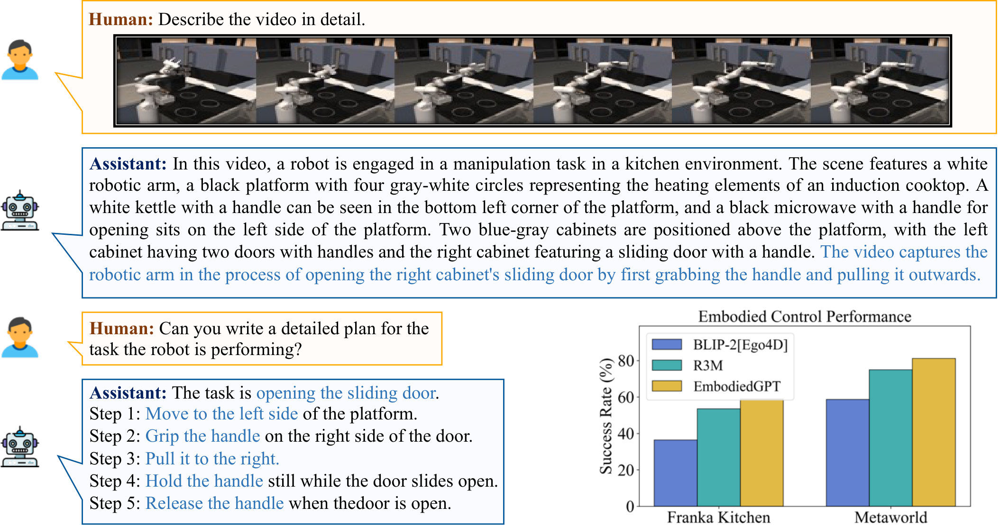

> 图解：EmbodiedGPT 将视频描述、多轮问答、具身规划和低层控制放进同一框架。上半部分体现视觉与语言理解，下半部分体现从规划到机器人动作的执行链路；作者同时给出其在 Franka Kitchen 与 Meta-World 上优于 R3M 和 BLIP-2 基线的结果。

由此，论文真正要打通的是三个环节：**如何低成本获得结构化具身数据，如何高效适配冻结的大模型，以及如何把语言规划变成可执行动作**。

## EgoCOT 与 EgoVQA：把视频旁白扩写成分步规划

### 先清洗第一人称视频，再切分动作片段

EgoCOT 的原始数据来自 Ego4D。原始集合包含 9,645 个未裁剪视频，单个视频长度从 5 秒到 7 小时不等；Ego4D 整体由 931 人在 9 个国家、74 个地点采集，共 3,670 小时。

作者首先执行第一轮清洗：

1. 删除缺失旁白的视频，这部分占总视频时长的 7.4%。
2. 删除过短旁白，占文本的 0.9%。
3. 删除带不确定标记的旁白，占文本的 4.0%。
4. 排除没有人与物体交互的内容，例如看电视或走路。

清洗后保留约 2.9 千小时视频、385 万条旁白，覆盖 129 种场景。接下来沿用 EgoVLP 的切分思路，把带时间戳的旁白与视频片段对齐。设第 $i$ 条旁白 $\mathcal{T}_i$ 的时间戳为 $t_i$，对应片段 $\mathcal{V}_i$ 的起止时间为：

$$
[t_i^{start},t_i^{end}]=\left[t_i-\frac{\beta_i}{2\alpha},t_i+\frac{\beta_i}{2\alpha}\right]
$$

其中，$\beta_i$ 是当前视频内相邻旁白时间间隔的均值：

$$
\beta_i=\frac{1}{n}\sum_{j=0}^{n-1}(t_{j+1}-t_j)
$$

$\alpha$ 是全部视频上 $\beta_i$ 的均值，论文给出的数值为 4.9 秒。这样得到的不是任意长度的视频窗口，而是以动作叙述时刻为中心、长度随旁白密度变化的片段。

### 用 ChatGPT 生成 CoT，再用 CLIP 做语义筛选

对于“打开抽屉”这样的简短旁白，作者让 ChatGPT 扩写为可执行步骤，并进一步整理成动词—名词对。例如：

```text
Task: pick up a cup on the table
Plans: grasp the handle of the cup with the gripper and lift it up
Actions:
1. grasp(handle of the cup, gripper)
2. lift up(cup)
```

生成时采用 temperature 0.9、top-p 0.95，并对每个提示采样 5 次，以增加候选规划的多样性。随后用 CLIP 分别编码文本 $T$ 和关键帧图像 $I$，计算余弦相似度：

$$
S(y_T,y_I)=\frac{y_T\cdot y_I}{\|y_T\|\|y_I\|}
$$

对包含 $n$ 个关键帧的视频 $V$，将各帧得分取平均，得到更稳定的视频—文本相似度：

$$
E(V,T)=\frac{1}{n}\sum_{i=1}^{n}S(y_{T_i},y_{I_i})
$$

每个视频从 5 个候选规划中选择相似度最高者，再过滤视频—旁白或视频—规划相似度低于阈值的样本。结合论文前述的人工核验，这套流程形成“机器生成—语义筛选—人工确认”的质量控制链。

**这个设计的关键不只是用 LLM 扩写文本，而是把扩写结果重新约束到视觉内容上。** 否则，语言模型很容易给出语法通顺、却与当前视频无关的常识性步骤。

作者还构建了 EgoVQA：针对每条 Ego4D 旁白，引导 ChatGPT 围绕核心动词和名词生成 5 组问答。例如，从“一个人正在拿起杯子”可以产生“这个人拿起的物体是什么？”和“对杯子执行了什么操作？”等问题。其采样设置与 EgoCOT 相同，用于补充第一人称人机交互视频问答数据。

## EmbodiedGPT：让规划同时服务语言理解与动作控制

### 四个模块组成两条通路

EmbodiedGPT 由四个核心模块组成：

- **冻结的视觉模型**：编码当前图像或视频观察。
- **冻结的语言模型**：完成描述、问答和具身规划。
- **Embodied-former 与语言映射层**：对齐视觉和文本，提取紧凑的任务相关特征。
- **策略网络**：把任务相关的实例特征和全局上下文映射为低层动作。

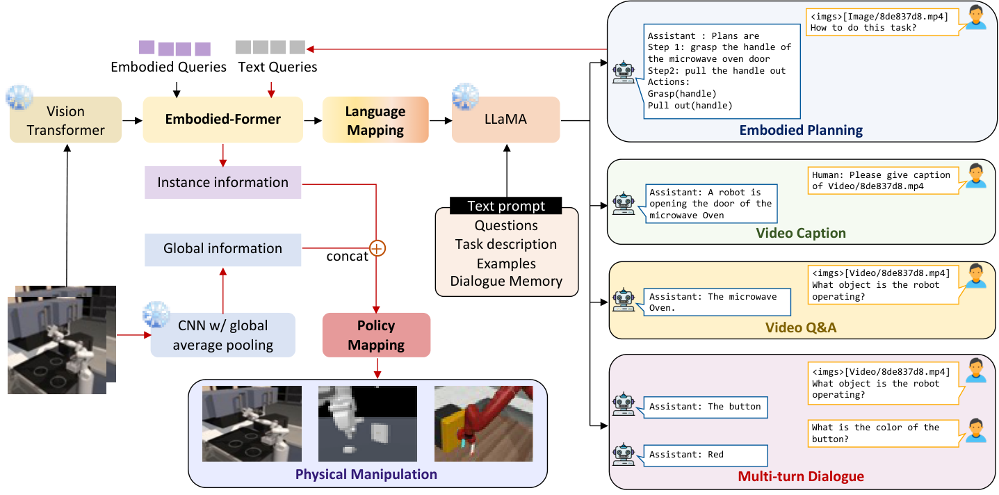

> 图解：黑色通路表示视觉信息经 Embodied-former 和语言映射层进入 LLM，生成描述、问答或具身规划；红色通路表示生成规划再次作为查询条件，从通用视觉特征中提取控制所需的实例级信息，最后由策略网络输出动作。两条通路共享视觉与中间特征提取模块，而不是为每个任务另起一套大模型。

视觉编码器采用 EVA-CLIP 的 ViT-G/14，去掉最后一层并使用倒数第二层特征。语言模型采用 LLaMA-7B，先使用 ShareGPT 和 GPT-4 生成的 52K 英文指令跟随数据进行微调，再在视觉语言预训练期间冻结。冻结的 ViT 与语言模型参数均转换为 FP16，以提高训练效率。

### Embodied-former 是一个可学习的信息瓶颈

Embodied-former 记为 $\mathcal{E}(\cdot)$，包含视觉特征提取与文本特征提取两个子模块。模型使用 $N$ 个可学习的 embodied query：它们通过 Cross-Attention 与视觉 token 交互，通过 Self-Attention 与文本 token 交互，输出紧凑表示 $z$。随后，全连接层 $M$ 将其投影到 LLM 的文本嵌入维度：

$$
z\in\mathbb{R}^{N\times D},\qquad z'=M(z)\in\mathbb{R}^{N\times D'}
$$

由于 $z$ 的规模显著小于原始视觉特征，它相当于一个信息瓶颈：只把与当前任务最相关的视觉内容传给语言模型。投影后的 $z'$ 充当“软视觉提示”，使冻结的 LLaMA 能根据视觉内容生成文本，同时避免直接更新整套视觉、语言参数。

这里与 BLIP-2 的 Q-Former 思路相近，但 EmbodiedGPT 多走了一步：**语言模型生成的规划不只是最终答案，还会成为下一轮视觉查询的条件。**

### 规划如何闭环到低层控制

对于控制任务，设视觉输入为 $x_{\mathrm{vis}}$，生成的规划为 $x_{\mathrm{plan}}$，可学习查询为 $y_{\mathrm{query}}$。模型用规划查询任务相关的实例级特征：

$$
z_{\mathrm{instance}}=\mathcal{E}(x_{\mathrm{vis}},x_{\mathrm{plan}},y_{\mathrm{query}})
$$

与此同时，ImageNet 预训练的 ResNet50 经全局平均池化提供全局上下文 $z_{\mathrm{global}}$。策略网络 $g$ 是一个 MLP，将两类信息合并为动作：

$$
a=g(z_{\mathrm{instance}},z_{\mathrm{global}})
$$

输出可以是舵机转角，也可以是笛卡尔坐标系中的位置和速度等连续控制量。引入全局上下文，是为了避免实例级查询过度聚焦局部而丢失整体场景信息。

从博主视角看，这个闭环最值得借鉴的地方是：**它把“抓住门把手”这样的子目标转化为特征选择依据**。相比只把整幅图像编码后交给策略网络，规划明确告诉了模型当前应该关注什么。

### 三阶段训练逐步获得规划能力

| 阶段 | 训练数据与输入 | 主要更新模块 | 目标 |
| --- | --- | --- | --- |
| 图像—文本对齐 | COCO Caption、59.5 万条筛选后的 CC3M 图文对、49.1 万条由 BLIP-2 重标注的 LAION-400M 图文对 | Embodied-former、语言投影层；视觉与语言模型冻结 | 建立基础视觉语言对齐 |
| 复杂推理与多轮对话 | Complex_Reasoning_77K、LLaVA_Instruct_150K 中的多轮对话数据 | 语言投影层、prefix language adapter | 提升复杂句子理解与推理能力 |
| 具身 CoT 视频训练 | EgoCOT；每个视频取 8 个关键帧 | patch embedding、语言投影层、prefix language adapter | 学习时序信息、分步规划与结构化动作 |

第三阶段先用 Conv3D 将第二阶段视觉模型的 patch embedding 转换为视频编码器，时间偏移为 2，总帧数为 8。训练提示要求模型同时给出任务、CoT 规划和结构化动作：

```text
Watch this video, identify the actions and devise a plan using chain-of-thought.
Task: {"task description"}
Plan: {"plan with chain-of-thought"}
Actions: {{"number"}: {'verb'}({'noun'})}
```

作者还准备了一组语义相同但措辞不同的提示，降低模型对固定句式的过拟合。规划也可以被表述为一种特殊 VQA：问题是“how to do the task that + original caption”，答案则是对应的具身规划。

在冻结 LLaMA 的基础上，作者采用 prefix tuning，而不是只修改输入嵌入的 soft prompt。前者向各 Transformer block 引入可训练张量，以较低成本引导模型生成更结构化、可执行且不过度发散的子目标序列。

附录给出的统一训练配置为：AdamW 优化器，$\beta_1=0.9$、$\beta_2=0.98$，weight decay 为 0.05；峰值学习率 $2\times10^{-5}$，采用 cosine 衰减和线性 warm-up，warm-up ratio 为 $5\times10^{-2}$。输入图像大小为 $224\times224$，使用随机缩放裁剪与水平翻转，最大序列长度为 256。

## 实验：规划质量提升能否转化为控制成功率

### 图像理解与人评规划质量

作者邀请 30 名参与者进行用户研究，样本包括 10 个 MS-COCO 图像描述案例、5 个具身仿真器规划场景和 5 个真实场景规划任务。评分范围为 1—10 分，其中冗余度越低越好，其余指标越高越好。

| 模型 | 物体识别 ↑ | 空间关系 ↑ | 冗余度 ↓ | 规划合理性 ↑ | 规划可执行性 ↑ |
| --- | ---: | ---: | ---: | ---: | ---: |
| MiniGPT-4 | 5.6 | 4.8 | 4.4 | 4.5 | 4.8 |
| LLaVA-7B | 7.3 | 7.4 | 3.9 | 7.5 | 6.6 |
| LLaVA-13B | **8.5** | 8.6 | 3.4 | 8.4 | 7.6 |
| EmbodiedGPT | 8.4 | **8.8** | **2.6** | **8.8** | **8.4** |

EmbodiedGPT 的语言模型只有 7B 参数，物体识别得分与 LLaVA-13B 接近，空间关系理解则达到最高的 8.8 分。更明显的差异出现在输出质量上：冗余度降至 2.6，规划合理性和可执行性分别为 8.8 和 8.4，说明 EgoCOT 带来的收益主要体现在结构化规划，而不只是一般物体识别。

作者还与分层式 Visual ChatGPT 做了定性比较。后者先生成密集图像描述，再把文本交给 ChatGPT 推导方案；在 Virtual-Home 案例中，它因描述模型未提供足够信息而没有找到衣架，EmbodiedGPT 则完成了任务。

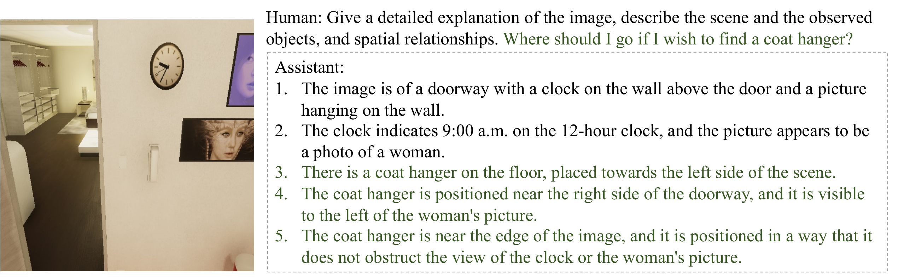

> 图解：该案例展示 EmbodiedGPT 直接结合视觉观察与任务要求生成规划，图中案例被标记为任务成功。它说明端到端视觉语言通路能够保留下游规划所需的信息。

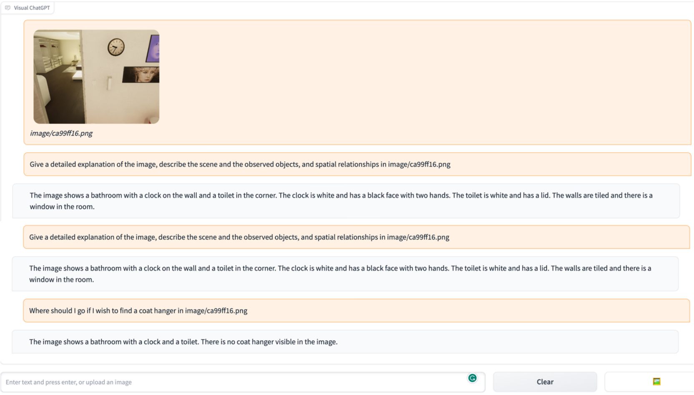

> 图解：同一类任务中，Visual ChatGPT 依赖“视觉描述模型到 ChatGPT”的串联流程，图中案例被标记为任务失败。这里的证据是案例级定性比较，论文未给出 Virtual-Home 的整体数值提升。

### 从示范视频到可执行步骤

视频输入实验覆盖 Franka Kitchen 和 Meta-World。Meta-World 包含套环、搬运方块、按按钮、开抽屉和钉钉子等操作；Franka Kitchen 包含滑动右侧门、打开橱柜、开灯、旋转炉灶旋钮和打开微波炉等任务。

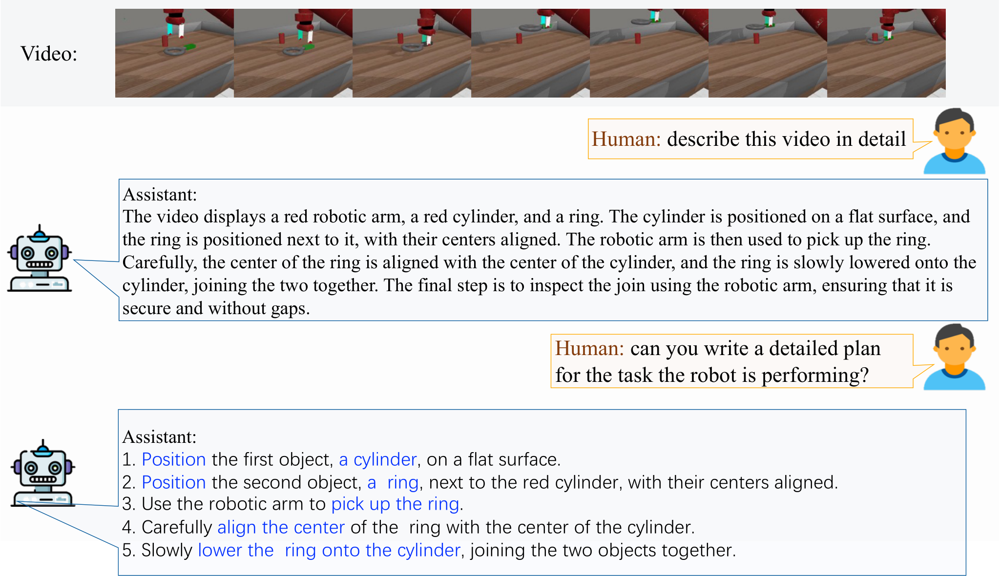

> 图解：模型读取 Meta-World 的示范视频后，先识别控制任务，再输出逐步规划。该规划随后进入 Embodied-former 查询控制相关特征，而不是停留在文本展示层面。

### 少样本低层控制结果

控制实验比较两个基线：面向操作任务的 R3M，以及结构与参数量相同、仅在 Ego4D 视频描述任务上微调的 BLIP-2[Ego4D]。策略网络分别使用 10 条和 25 条专家演示进行少样本学习。每个基准测试 5 个任务、2 种相机视角；论文报告 100 次随机视觉观察评估，并使用 5 个随机种子。

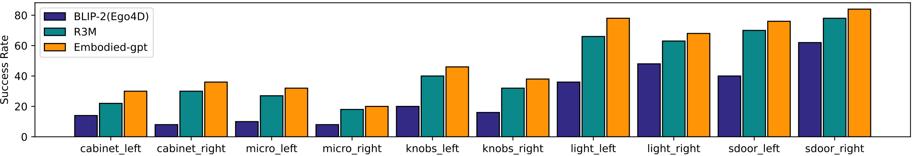

> 图解：图中比较 Franka Kitchen 在仅 10 条专家演示下的任务成功率。EmbodiedGPT 在完整模型与消融表中的平均成功率为 50.8%，高于移除闭环或移除 CoT 训练的版本。

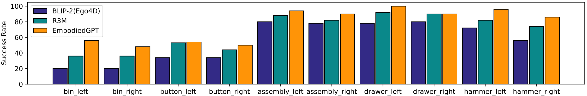

> 图解：图中比较 Meta-World 在 10 条演示下的任务成功率。EmbodiedGPT 的平均成功率为 76.4%，说明较少演示下，规划引导的特征仍能为策略学习提供帮助。

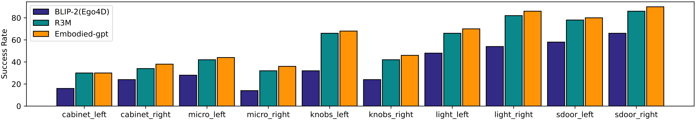

> 图解：当演示增加到 25 条时，EmbodiedGPT 在 Franka Kitchen 上达到 58.5%。相比 BLIP-2[Ego4D] 和 R3M，正文报告的成功率优势分别为 22.1 和 5.5 个百分点。

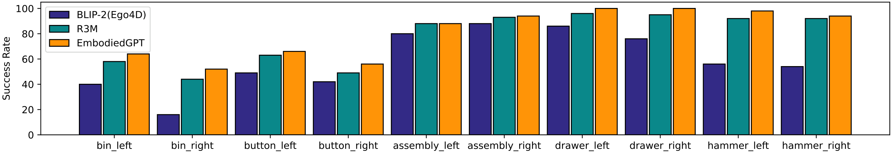

> 图解：在 25 条演示的 Meta-World 设置中，EmbodiedGPT 达到 81.2%。相比 BLIP-2[Ego4D] 和 R3M，正文报告的优势分别为 22.5 和 4.2 个百分点。

### 消融实验：CoT 与闭环缺一不可

下表报告每个基准上 5 个任务、2 种相机视角的平均成功率。“− Closed-loop”表示移除规划到控制的闭环，“− CoT”表示移除 EgoCOT 思维链训练。

| 模型 | Franka，10 条演示 | Franka，25 条演示 | Meta-World，10 条演示 | Meta-World，25 条演示 |
| --- | ---: | ---: | ---: | ---: |
| EmbodiedGPT | **50.8% ± 2.8** | **58.5% ± 2.7** | **76.4% ± 2.2** | **81.2% ± 2.0** |
| − Closed-loop | 38.6% ± 2.9 | 47.3% ± 2.5 | 62.7% ± 2.2 | 64.9% ± 2.0 |
| − CoT | 26.2% ± 3.2 | 36.4% ± 2.7 | 55.2% ± 2.4 | 58.7% ± 2.0 |

两组消融回答的是不同问题。移除闭环后，模型仍可利用 CoT 预训练获得的表示，但规划不再直接引导任务特征查询，25 条演示下两个基准分别下降 11.2 和 16.3 个百分点。移除 CoT 后下降更明显，分别为 22.1 和 22.5 个百分点，说明收益不仅来自架构连接方式，也来自 EgoCOT 所教会的任务分解与结构化规划。

## 附录细节：策略学习、定性案例与提示设计

### 下游策略采用行为克隆

低层控制使用模仿学习，具体为 Behavioral Cloning（行为克隆）：给定专家演示中的状态—动作轨迹，监督策略 $\pi_\theta$ 模仿专家动作分布 $P^*$。论文附录将训练目标写为：

$$
L(\theta)=\sum\left[\pi_\theta(a\mid s)\log P^*(a\mid s)\right]
$$

其中，$s$ 为状态，$a$ 为动作，$\theta$ 为策略参数。实验分别测试 25 条和 10 条演示；Franka Kitchen 每条演示包含 50 个状态—动作对，Meta-World 每条包含 500 个状态—动作对。这也解释了为什么特征质量很关键：策略网络本身较轻量，大量具身先验需要来自前面的视觉语言预训练。

### 图像描述与零样本迁移

作者在 COCO、Franka Kitchen 和 Habitat2.0 上展示图像描述结果，强调模型无需针对每个基准单独微调，也能描述与具身任务相关的物体、人物及空间关系。

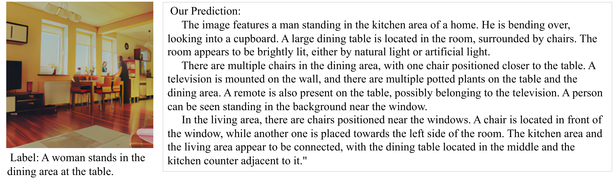

> 图解：COCO 案例用于展示通用图像描述能力，包括物体与人物识别，以及场景关系组织。

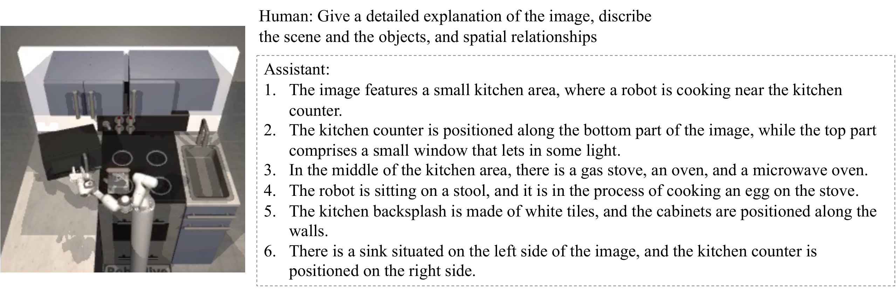

> 图解：Franka Kitchen 案例将描述对象转向机器人操作环境，重点观察模型能否识别场景中的可操作物体和任务相关关系。

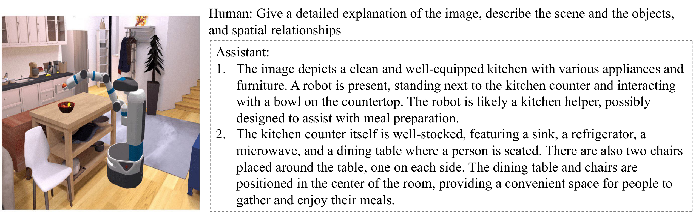

> 图解：Habitat2.0 案例进一步展示模型在另一具身基准上的零样本描述表现，体现同一视觉语言模型的跨场景迁移能力。

### 具体任务与抽象任务规划

对于“制作一杯咖啡”这类具体任务，模型需要定位必要物体及其位置关系，再生成满足环境约束的多步计划。

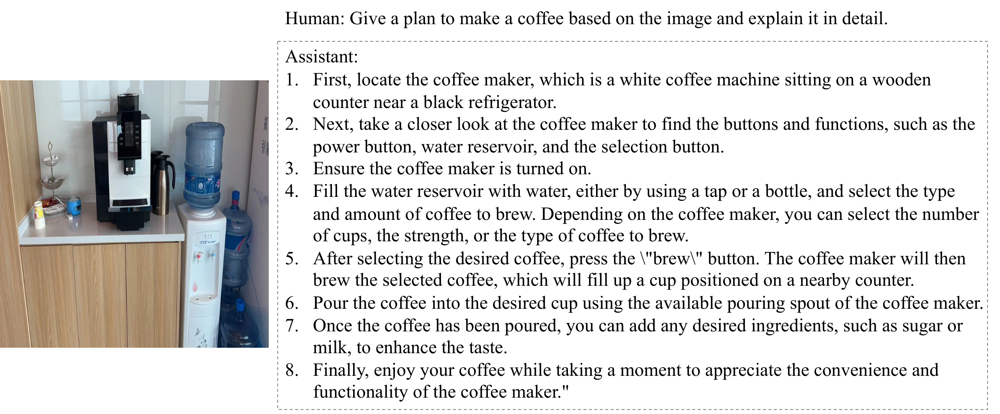

> 图解：该案例从真实视觉场景出发，将任务目标拆解为连续步骤，展示模型把物体识别、空间关系与动作顺序结合起来的过程。

抽象任务则多了一步“把需求翻译成子任务”。例如，“感觉热”并不直接指定动作，模型需要先找到风扇，确定“打开风扇”这一子目标，再生成执行计划。

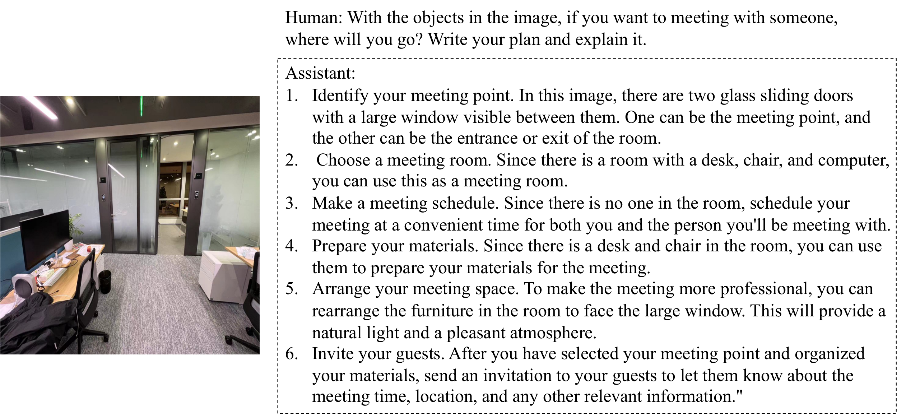

> 图解：会议场景展示模型如何从抽象需求出发，结合环境内容组织较具体的子任务与执行步骤。

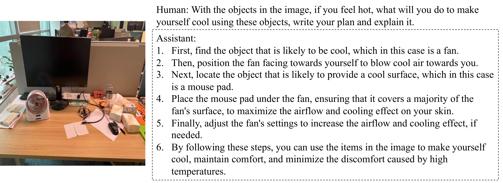

> 图解：模型将“感觉热”与场景中的风扇关联起来，再规划打开风扇的操作。这一案例体现的是从需求理解到动作规划的转换，而非简单的图像标注。

### 五项人评指标的具体含义

| 评价指标 | 含义 |
| --- | --- |
| 物体识别准确性 | 是否正确识别图像或视频中的物体，准确性越高越好。 |
| 空间关系理解 | 是否准确判断物体的相对位置、朝向、距离及其他空间属性。 |
| 回答冗余度 | 回答中不必要或重复信息的程度，越低通常越清晰。 |
| 规划合理性 | 规划是否逻辑连贯，是否与给定目标相符。 |
| 规划可执行性 | 计划在现实环境中是否可行，能否被成功执行。 |

这张评分表也帮助解释前面的实验结论：EmbodiedGPT 的突出优势集中在“合理且可执行”，不是单纯追求更长的描述。

### 提示词会改变模型是否真正看图

作者观察到，多模态大模型在问答中可能过度依赖文本先验，没有充分利用视觉线索。为此，他们测试两种简单策略：在问题中加入“in the scene shown in this image/video”等显式场景提示，或先让模型描述图像、视频，再开展多轮对话。

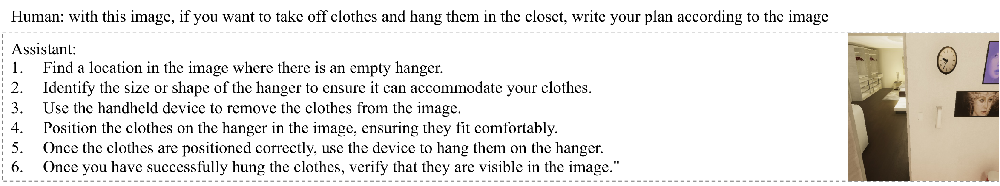

> 图解：直接要求模型写规划时，模型更容易依赖语言先验，视觉信息利用不足，生成的步骤可能缺少与当前场景的明确联系。

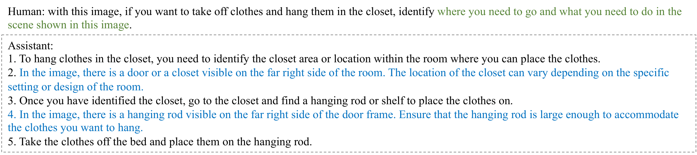

> 图解：加入图像相关提示后，模型被显式引导到当前视觉内容，回答与场景的结合更充分。论文将此作为定性观察，没有报告该对比的独立数值指标。

这个附录结论与主方法是一致的：无论通过提示词还是通过规划查询特征，核心都是迫使模型把语言推理落回具体视觉证据。

## 总结：具身 CoT 的价值在“规划—特征—动作”链路

- **数据层面**：EgoCOT 将 Ego4D 第一人称视频旁白扩展为分步规划和动词—名词动作序列，并通过 CLIP 筛选与人工核验控制质量；EgoVQA 补充交互视频问答。
- **训练层面**：三阶段训练逐步完成视觉语言对齐、复杂推理和具身视频规划；冻结 ViT 与 LLaMA-7B，配合 Embodied-former、线性映射和 prefix tuning 降低成本。
- **控制层面**：生成规划被再次用于查询实例级视觉特征，与全局上下文共同输入轻量 MLP，从而连接高层子目标和低层连续动作。
- **实验层面**：25 条演示下，Franka Kitchen 与 Meta-World 平均成功率分别为 58.5% 和 81.2%；消融结果同时验证了 CoT 训练和规划—控制闭环的贡献。
- **能力边界**：模型统一支持描述、问答、规划与控制，但部分能力仍以定性案例展示，Virtual-Home 和提示词对比没有给出整体量化结果。

论文的局限在于视觉与语言主干因计算资源限制而被冻结；未来可探索全模块联合训练，并引入语音等更多模态，进一步检验这条规划到控制的链路在真实机器人和更多任务上的泛化能力。

> 本文参考自 [EmbodiedGPT: Vision-Language Pre-Training via Embodied Chain of Thought](https://arxiv.org/abs/2305.15021)