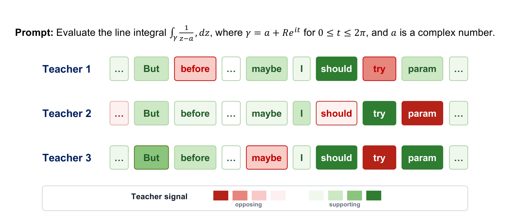
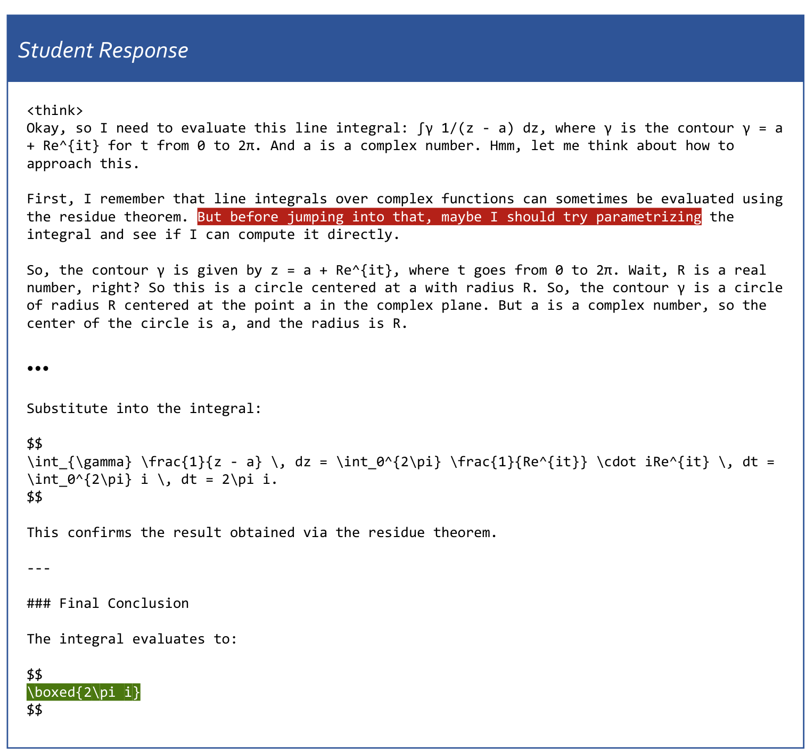
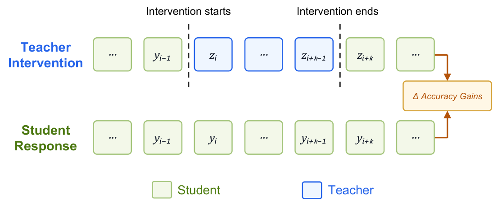
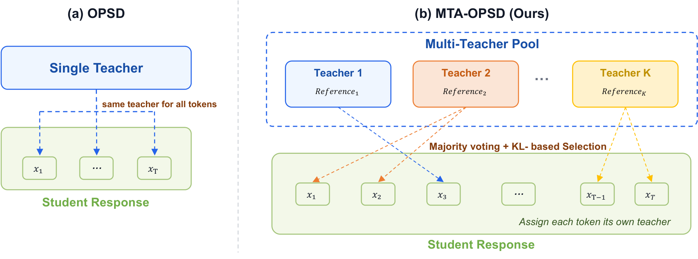
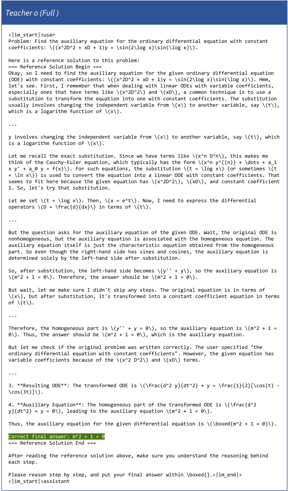
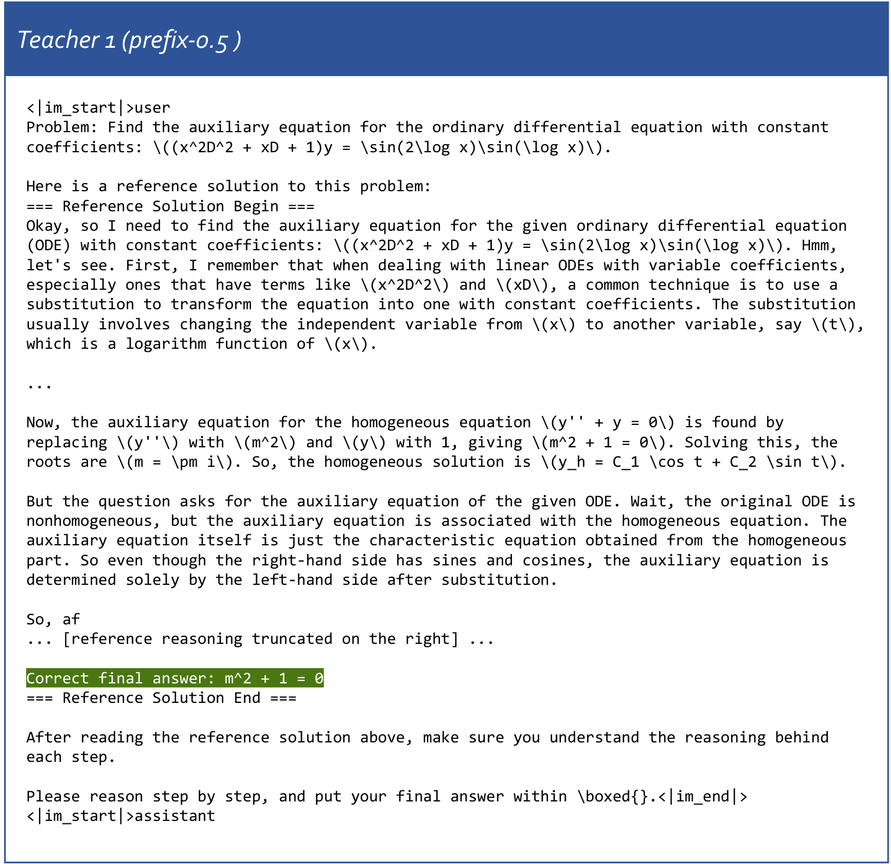
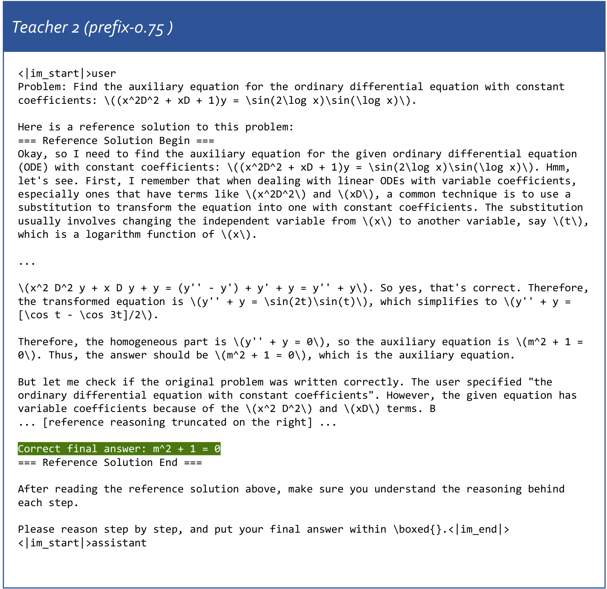
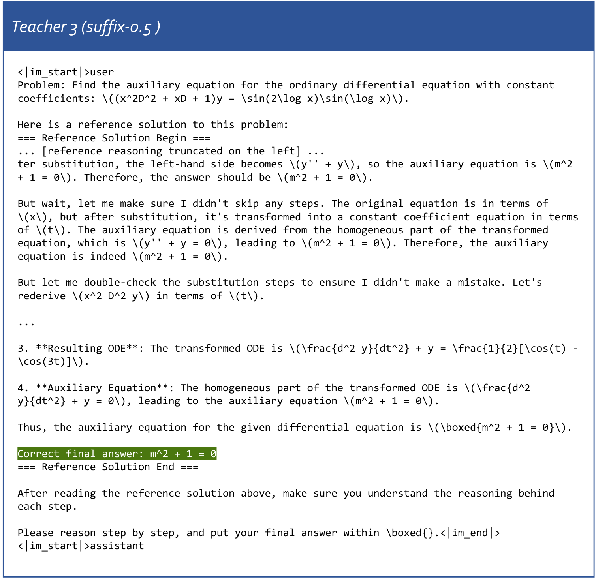
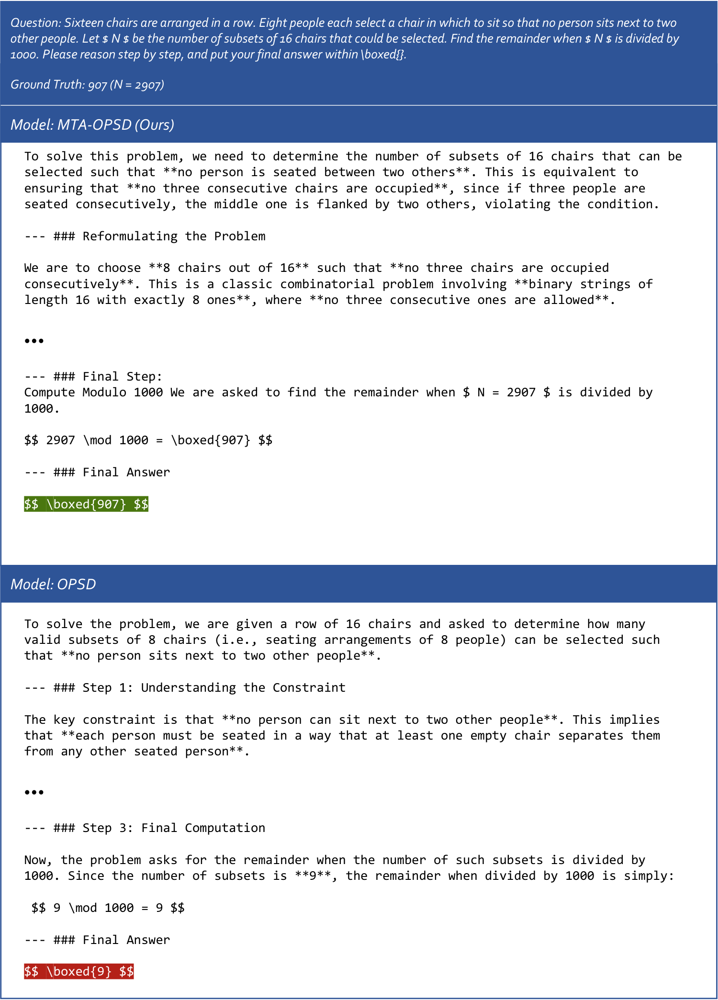

# MTA-OPSD：每个 Token 自选老师

On-policy Self-Distillation（OPSD，在线策略自蒸馏）通常让同一条回答里的所有 Token 共用一位老师，但老师在某一步给出的好指导，到了下一步未必仍然合适。这个粗粒度的监督方式会限制大模型后训练，尤其在长链数学推理中，局部一步的误导就可能带偏后续解答。MTA-OPSD 的思路很直接：准备一组看到不同参考片段的老师，先按多数意见筛选方向，再用 KL 散度为每个 Token 单独选老师。在 Qwen3 数学推理实验中，它在三种模型规模上都取得最高平均分，其中 Qwen3-1.7B 相比 Base Model 提升 **5.9 分**，Qwen3-8B 在 AIME25 上达到 **70.3 分**。

## 为什么整条回答共用一位老师不够？

### OPSD：同一个模型，扮演师生两种角色

传统知识蒸馏需要一个独立且通常更强的 Teacher Model。On-policy Distillation（OPD，在线策略蒸馏）则让学生先生成回答，再让老师在这些学生自己的轨迹上提供逐 Token 的分布监督，从而缓解训练语料与真实生成分布不一致的问题。

OPSD 进一步去掉了外部强模型：**Teacher 和 Student 使用同一个模型，区别只在输入上下文**。Student 只能看到题目，Teacher 还能参考标准解答、环境反馈等特权信息（privileged reference）。它像一位带着参考答案陪练的老师，但陪练内容仍由学生自己写出。

设题目为 $x$，学生回答为 $y=\{y^1,y^2,\ldots,y^L\}$，第 $i$ 步上下文记为 $c_i=(y^{<i},x)$。OPD 的逐 Token 蒸馏目标为：

$$
\mathcal{L}_{\mathrm{OPD}}(\theta)=\mathbb{E}_{x}\left[\sum_{i=1}^{L}D_{\mathrm{KL}}\left(p_{\theta}(\cdot\mid c_i)\,\|\,p_T(\cdot\mid c_i)\right)\right]
$$

在 OPSD 中，教师分布改为 $p_T(\cdot\mid c_i)=p_{\theta}(\cdot\mid c_i,r)$，其中 $r$ 是特权参考，因此目标变成：

$$
\mathcal{L}_{\mathrm{OPSD}}(\theta)=\mathbb{E}_{x}\left[\sum_{i=1}^{L}D_{\mathrm{KL}}\left(p_{\theta}(\cdot\mid c_i)\,\|\,p_{\theta}(\cdot\mid c_i,r)\right)\right]
$$

相比 SFT（Supervised Fine-Tuning，监督微调），OPSD 在学生自己的生成轨迹上学习，能缓解 exposure bias（训练与推理时的分布错位）；相比 RLVR（Reinforcement Learning with Verifiable Rewards，可验证奖励强化学习），它不只依赖最终答案对错的稀疏奖励，而是提供稠密的 Token 级信号。

### 参考答案越多，老师就一定越好吗？

并非如此。已有研究发现，信息过于完整的参考可能让 Teacher 的输出分布过度尖锐：老师“太确定接下来该怎么写”，反而与学生当前的学习状态不匹配，甚至抑制必要的不确定性。

已有自适应 OPSD 方法会按学生与老师的差距调整参考暴露比例，但通常仍以**整条 response 为调节单位**。也就是说，不同题目可以分配不同老师，同一题目内部却仍是“一位老师讲到底”。

这篇文章质疑的正是这一默认前提：既然每个 Token 的推理状态不同，监督是否也应该细到 Token 级？

## 预实验：老师是否真的因 Token 而异？

### 同一句推理，不同老师给出相反信号

下图展示了同一道复变函数题、同一段学生回答上，三位老师的监督信号。绿色表示老师相对支持学生已采样的 Token，红色表示反对，颜色深浅对应信号强弱。三位老师分别使用 prefix-0.5、suffix-0.5 和 random-span-0.5 的参考配置。

> 图解：在 “But”“should” 等位置，老师们的意见并不总是一致。例如 Teacher 1 反对 “before”，Teacher 2 却支持；Teacher 2 反对 “should”，Teacher 1 和 Teacher 3 又支持。说明“这条回答适合哪位老师”并不是一个足够细的问题，真正发生变化的是“这个 Token 适合哪位老师”。

这段被可视化的完整学生回答如下。它先考虑留数定理，再转为直接参数化积分，最终得到 $2\pi i$；图 1 截取的正是其中标红的一句。

> 图解：完整回答表明，图 1 的分歧发生在真实的连续推理过程中，而不是人工拼接的孤立词语。即便最终答案正确，中间不同位置仍可能需要不同强度、不同方向的监督。

### 用“学生—老师—学生”接力测量局部收益

直接枚举“每个 Token 配每位老师后再完整训练”显然代价过高。作者改用 teacher intervention（教师介入）：保留学生在位置 $i$ 之前的前缀，让候选老师接管并生成 $k$ 个 Token，再把控制权还给学生完成回答。

> 图解：下排是纯学生回答，上排从第 $i$ 个 Token 开始由老师生成蓝色片段，随后恢复学生生成。比较两条回答的准确率，其差值 $\Delta$ Accuracy Gains 就作为该老师在这个 Token 位置的适配度代理；收益越大，说明老师越适合在此处介入。

形式上，接力回答 $z$ 的生成过程可概括为：

$$
z_{1:i-1}=y_{1:i-1},\qquad z_{i:i+k}\sim p_{\theta}(\cdot\mid c_i,r)
$$

老师介入后，学生基于新前缀继续生成：

$$
z_{i+k+1:L}\sim p_{\theta}(\cdot\mid z^{<i+k+1},x)
$$

这个指标测的是**局部介入对最终表现的代理收益**，并不等价于一次严格的全训练因果比较，但它让大规模扫描 Token 与老师组合变得可行。

### 75,264 次生成，覆盖位置与老师两个轴

预实验的设置相当密集：

- **介入位置**：每条回答选 7 处，包括长度 25%、50%、75% 的常规位置，以及学生熵最高/最低、师生 KL 最大/最小的统计极值位置。
- **候选老师**：prefix、suffix、random-span 三种截断方式，各有 0.5、0.75 两种参考暴露比例，再加 full-reference 老师，共 7 位。
- **介入长度**：$k=64,128,256$。
- **模型与数据**：Qwen3-1.7B、Qwen3-4B；从 DeepMath-103K 选 64 道至少中等难度、且学生 4 次采样未全部答对的题。
- **重复采样**：每个配置采样 2 段老师续写，每段续写后再进行 2 次学生接力，最终评估 $64\times7\times7\times3\times2\times2\times2=75,264$ 次生成。

所有截断配置都保留最终答案，避免老师仅仅因为看不到答案而处于不公平劣势。

### 发现一：相邻位置的最佳老师只有约一半重合

作者把某位置上介入收益最大的老师定义为该位置的 preferred teacher（首选老师），再统计同一回答内常规位置之间的首选老师重合率。

**表 1：同一回答中，不同 Token 位置的首选老师重合率**

| Token 位置 | 0.25 | 0.50 | 0.75 |
|---|---:|---:|---:|
| 0.25 | — | 48.44% | 50.00% |
| 0.50 | 48.44% | — | 51.56% |
| 0.75 | 50.00% | 51.56% | — |

在 Qwen3-1.7B、$k=256$ 的设置下，重合率只有约 50%。这为 Token 级选师提供了直接证据，也意味着 response 级调节会抹平大量局部差异。

### 发现二：多数投票能先筛出可靠老师

对每个老师，作者比较它和学生对学生已采样 Token $y^i$ 的 log probability，定义 advantage signal：

$$
a_T(y^i\mid c_i)=\log p_T(y^i\mid c_i)-\log p_{\theta}(y^i\mid c_i)=\log\frac{p_T(y^i\mid c_i)}{p_{\theta}(y^i\mid c_i)}
$$

$a_T>0$ 表示老师比学生更支持当前 Token，$a_T<0$ 则表示相对反对。按符号把候选老师分为支持、反对两组，人数较多的一组就是 majority subset（多数子集）。

**表 2：首选老师落在多数子集中的比例**

| 模型 \ Token 位置 | Regular | Extreme |
|---|---:|---:|
| Qwen3-1.7B | 77.94% | 88.09% |
| Qwen3-4B | 87.11% | 90.68% |

约 80%–90% 的情况下，真正带来最大介入收益的老师都位于多数子集。进一步看平均收益，多数组也明显更好。

**表 3：多数子集与少数子集的平均介入收益**

| Group | Majority | Minority | Overall |
|---|---:|---:|---:|
| Gain | +3.34% | +1.88% | +2.34% |

表 3 对应 Qwen3-4B、$k=256$。因此，多数投票适合作为第一道低成本过滤器：先判断大方向，不急于从全体老师中选“最强”。

### 发现三：在多数派中，KL 更大的老师收益更高

仅在多数子集内部，作者分别选择与学生分布 KL 距离最远和最近的老师，再比较介入收益。

**表 4：多数子集中最远与最近老师的平均收益**

| 模型 \ Teacher | Farthest | Nearest | $\Delta$ |
|---|---:|---:|---:|
| Qwen3-1.7B | +2.42% | +0.59% | +1.83% |
| Qwen3-4B | +2.78% | +1.21% | +1.57% |

常规 Token 位置上，最远老师稳定带来更高收益。不过要注意，实验支持的选择规则不是“全局 KL 越大越好”，而是**先确认监督方向属于多数派，再选信息量更大的分布**。

## MTA-OPSD：两步给每个 Token 配老师

预实验回答了“为什么需要 Token 级老师”，接下来的问题是怎样把它变成可训练的方法。MTA-OPSD（Multi-Teacher Adaptive On-Policy Self-Distillation，多老师自适应在线策略自蒸馏）由两部分组成：多老师池，以及“多数投票 + KL 选择”的两步分配机制。

> 图解：左侧传统 OPSD 让同一老师监督 $x_1$ 到 $x_T$ 的全部 Token；右侧 MTA-OPSD 从多老师池出发，对每个位置独立执行多数投票和 KL 选择，因此相邻 Token 可以连接不同老师。模型参数并未复制成多份，老师们共享学生模型，只是参考上下文不同。

### 第一步：构造多老师池

多老师池记为：

$$
M=\{p_{T_1},p_{T_2},\ldots,p_{T_K}\}
$$

每位老师对应一个参考变体 $r_k\in R=\{r_1,r_2,\ldots,r_K\}$，其下一 Token 分布为：

$$
p_{T_k}=p_{\theta}(\cdot\mid x,r_k)
$$

实验中的池包含 7 种配置：full reference，以及 prefix、suffix、random-span 三种截断方式各自搭配 0.5、0.75 暴露比例。prefix-0.5 表示保留参考推理的前半部分；suffix 保留后半部分；random-span 保留随机片段。所有配置都附回最终答案。

下面的附录示例直观展示了同一道微分方程题如何形成不同教师上下文。完整参考老师能看到整段推理：

> 图解：Teacher 0 的输入包含从变量替换、推导到检查的完整参考，以及正确答案 $m^2+1=0$。它的信息最全，但也最可能把整条推理路径强加给学生。

> 图解：Teacher 1 保留前半段参考，删去右侧后续推理，同时保留最终答案。它能提供起步思路，却不会完整展示后半段推导。

> 图解：Teacher 2 同样使用 prefix 截断，但保留 75% 的参考，比 Teacher 1 多看到变量替换后的关键推导。它与 Teacher 1 的差异不只是“信息更多”，还体现在具体可见的推理内容上。

> 图解：Teacher 3 删去左侧开头，只保留后半段推导和最终答案。即使参考总量与 prefix-0.5 相同，保留位置不同也会产生不同教师分布。

笔者认为，这个设计的价值不只是“多叫几位老师投票”，而是把参考的**内容、位置与暴露量**都变成监督多样性来源。后续消融也证明，仅堆出老师池并不够，如何分配同样关键。

### 第二步：多数投票确定监督方向

在位置 $i$，老师池给出分布集合：

$$
P_M(c_i)=\{p_{T_1}(\cdot\mid c_i),\ldots,p_{T_K}(\cdot\mid c_i)\}
$$

对每个学生已采样 Token $y^i$，老师 $p_{T_k}$ 的二值投票为：

$$
v_{T_k}(c_i)=\operatorname{sgn}\left(a_{T_k}(y^i\mid c_i)\right)
$$

其中 $+1$ 表示支持，$-1$ 表示反对。多数方向与多数老师子集分别为：

$$
V_M(c_i)=\operatorname{sgn}\left(\sum_{k=1}^{K}v_{T_k}(c_i)\right)
$$

$$
M_{\mathrm{maj}}(c_i)=\{p_{T_k}\in M\mid v_{T_k}(c_i)=V_M(c_i)\}
$$

如果老师数为偶数且正负票相同，就比较两侧 advantage 的总强度：

$$
V_M(c_i)=
\begin{cases}
\operatorname{sgn}\left(\sum_{k=1}^{K}v_{T_k}(c_i)\right), & \sum_{k=1}^{K}v_{T_k}(c_i)\neq0,\\
\operatorname{sgn}\left(\sum_{k=1}^{K}a_{T_k}(y^i\mid c_i)\right), & \text{otherwise}.
\end{cases}
$$

因此，平票时保留累计信号更强的一侧。上述过程在每个 Token 位置独立执行，而不是整条回答只投一次。

### 第三步：在多数派中选择 KL 最远的老师

多数投票只回答“支持还是反对”，并不决定多数派内部谁最合适。第二阶段选择与学生分布 KL 距离最大的老师：

$$
p_T^*(c_i)=\arg\max_{p_{T_k}\in M_{\mathrm{maj}}(c_i)}D_{\mathrm{KL}}\left(p_{\theta}(\cdot\mid c_i)\,\|\,p_{T_k}(\cdot\mid c_i)\right)
$$

把它代入 OPSD 目标，就得到 MTA-OPSD 的损失：

$$
\mathcal{L}_{\mathrm{MTA-OPSD}}(\theta)=\mathbb{E}_{x}\left[\sum_{i=1}^{L}D_{\mathrm{KL}}\left(p_{\theta}(\cdot\mid c_i)\,\|\,p_T^*(\cdot\mid c_i)\right)\right]
$$

这里 $p_T^*$ 随 $c_i$ 改变，所以一条回答中的每个 Token 都能拥有自己的老师。

### 为什么顺序必须是“先投票，再选 KL”？

这两步分别处理**方向可靠性**与**信号信息量**。KL 散度只衡量分布差多远，本身不保证差异方向有益；如果先全局选最大 KL，可能恰好选中最激进但不可靠的老师。

- 当多数方向为支持时，选中老师会提高 $y^i$ 的相对概率，同时其整体分布又与学生明显不同，因此不只是机械复制学生当前选择，还能保留其他合理候选的概率信息。
- 当多数方向为反对时，过近的分布可能只会轻微压低当前 Token；更远的老师更可能把概率质量重新分配给替代 Token，提供更强的纠偏信号。

这个顺序是整个方法最关键的保护机制：**KL 不是教师质量的单独评分，而是在方向共识之后的二级选择器。**

## 实验：三种模型规模都取得最高平均分

### 实验设置与复现细节

作者在 Qwen3-1.7B、4B、8B 上评估，训练和验证均开启 thinking mode。训练数据来自 DeepMath-103K，测试集为 AMC23、AIME24、AIME25。

对比方法包括：

- **OPSD**：使用 forward KL 做 dense-logit 蒸馏，并采用逐 Token pointwise KL clipping。
- **SDPO**：使用 Jensen–Shannon divergence 做 dense-logit 蒸馏。
- **Paint**：根据师生差距自适应决定参考暴露比例，属于 response 级自适应 OPSD。

所有方法使用相同参考解答与训练、评测设置。训练最大生成长度为 4,096 Token，验证为 38,912 Token；每种方法训练 300 steps，每 50 steps 在测试集评估一次，报告最佳 Avg@12。Avg@12 表示对每道题 12 次采样的结果取平均。

补充实现细节为：4 张 H200 GPU，学习率 $1\times10^{-6}$，global batch size 32；基于 veRL 的 PPO trainer、FSDP2 actor sharding 和 vLLM rollout 实现，采用全参数训练而非 LoRA。蒸馏目标只使用 Teacher 分布的 top-100 项。训练题难度按模型规模区分：1.7B 为 5–7 级，4B 为 6–8 级，8B 为 7–10 级。

### 主结果：小模型提升尤其明显

**表 5：不同模型规模上的数学推理表现**

| 模型 | 方法 | AMC23 | AIME24 | AIME25 | Average |
|---|---|---:|---:|---:|---:|
| Qwen3-1.7B | Base Model | 74.1 | 45.6 | 33.6 | 51.1 |
| Qwen3-1.7B | OPSD | 75.3 | 49.2 | 37.5 | 54.0 |
| Qwen3-1.7B | SDPO | 73.5 | 43.3 | 31.4 | 49.4 |
| Qwen3-1.7B | Paint | 76.0 | 47.5 | 38.6 | 54.0 |
| Qwen3-1.7B | **MTA-OPSD** | **78.5** | **51.4** | **41.1** | **57.0（+5.9）** |
| Qwen3-4B | Base Model | 88.6 | 73.1 | 65.3 | 75.7 |
| Qwen3-4B | OPSD | 89.1 | 74.4 | 65.6 | 76.4 |
| Qwen3-4B | SDPO | 87.7 | 71.4 | 61.7 | 73.6 |
| Qwen3-4B | Paint | 89.1 | 71.7 | 66.1 | 75.6 |
| Qwen3-4B | **MTA-OPSD** | 89.0 | **74.4** | **68.1** | **77.2（+1.5）** |
| Qwen3-8B | Base Model | 89.1 | 73.1 | 66.9 | 76.4 |
| Qwen3-8B | OPSD | 89.9 | 75.0 | 67.8 | 77.6 |
| Qwen3-8B | SDPO | 88.9 | 73.9 | 65.6 | 76.1 |
| Qwen3-8B | Paint | 90.0 | 76.1 | 68.3 | 78.1 |
| Qwen3-8B | **MTA-OPSD** | 89.8 | **77.5** | **70.3** | **79.2（+2.8）** |

括号中的提升相对 Base Model。MTA-OPSD 在三种规模的 Average 上均为最高，并且超过所有已有 OPSD 基线；在更难的 AIME25 上，提升尤其稳定，分别比对应 Base Model 高 7.5、2.8、3.4 分。

它并非在每个单项都第一：例如 Qwen3-4B 的 AMC23 略低于 OPSD 和 Paint，Qwen3-8B 的 AMC23 也略低于 Paint。更准确的结论是，**它的优势体现在跨模型、跨基准的整体稳定性，而不是包揽所有单元格。**

### 定性案例：约束理解决定后续推理

下图比较 MTA-OPSD 与 OPSD 对同一道组合计数题的回答。题目要求从 16 把椅子中选出 8 把，使任何人都不坐在另外两人之间，并求方案数 $N$ 除以 1000 的余数，正确答案为 907。

> 图解：MTA-OPSD 把约束正确转化为“不能出现连续三把被占用的椅子”，最终得到 $N=2907$ 和答案 907；OPSD 则把条件误解为“每个人两侧至少有一个空位”，最终错误输出 9。这个案例展示了局部推理约束被纠正后，对最终答案的影响，但单例本身不能替代整体统计结果。

### 消融一：多老师池优于任何单一老师

所有消融均使用 Qwen3-1.7B。作者先让池中每种老师独立训练，再与动态选师比较。

**表 6：MTA-OPSD 与单老师变体对比**

| Teacher | AMC23 | AIME24 | AIME25 | Average |
|---|---:|---:|---:|---:|
| Base Model | 74.1 | 45.6 | 33.6 | 51.1 |
| Full（OPSD） | 75.3 | 49.2 | 37.5 | 54.0 |
| Prefix-0.5 | 76.8 | 50.8 | 40.0 | 55.9 |
| Prefix-0.75 | 78.2 | 49.4 | 41.1 | 56.2 |
| Suffix-0.5 | 75.9 | 48.6 | 34.7 | 53.1 |
| Suffix-0.75 | 75.0 | 50.3 | 40.0 | 55.1 |
| Random-span-0.5 | 76.8 | 49.4 | 36.9 | 54.4 |
| Random-span-0.75 | 76.4 | 50.6 | 35.8 | 54.3 |
| **MTA-OPSD** | **78.5** | **51.4** | **41.1** | **57.0** |

最好的单老师 Prefix-0.75 平均分为 56.2，仍低于 MTA-OPSD 的 57.0。说明不同参考视图具有互补性，动态组合比预先押注一种固定配置更稳。

### 消融二：提升不是简单来自“老师更多”

为了单独检验 Token 级分配，作者固定同一个老师池，比较随机选老师与对所有老师的蒸馏 Loss 求平均。

**表 7：同一老师池下不同 Token 分配策略**

| Strategy | AMC23 | AIME24 | AIME25 | Average |
|---|---:|---:|---:|---:|
| Base Model | 74.1 | 45.6 | 33.6 | 51.1 |
| Random-pick | 76.1 | 49.2 | 35.5 | 53.6 |
| Mean-loss | 75.7 | 48.9 | 36.4 | 53.7 |
| **MTA-OPSD** | **78.5** | **51.4** | **41.1** | **57.0** |

随机选择与平均 Loss 甚至低于表中部分单老师配置，而 MTA-OPSD 在所有基准上都更好。由此可以把收益归因于“合适的分配机制”，而不只是候选分布数量增加。

### 消融三：投票和 KL 选择缺一不可

**表 8：多数投票与 KL 选择的消融**

| Majority Voting | KL Selection | AMC23 | AIME24 | AIME25 | Average |
|---|---|---:|---:|---:|---:|
| No | Farthest | 75.8 | 48.9 | 33.9 | 52.9 |
| **Yes** | **Farthest** | **78.5** | **51.4** | **41.1** | **57.0** |
| Yes | Random | 78.0 | 51.1 | 40.8 | 56.6 |
| Yes | Nearest | 75.7 | 48.6 | 35.6 | 53.3 |

不做投票、直接选全局最远老师，平均分只有 52.9，验证了“KL 大不等于可靠”。投票后随机选仍有 56.6，说明多数方向本身有价值；但只有继续选择最远老师才达到 57.0，而选择最近老师跌至 53.3。

训练过程中，各老师被选中的频率相对均衡，没有坍缩为一位主导老师。另一个反直觉现象是：**相同截断方式下，参考暴露比例更高，并不必然带来更大的师生 KL。**在 Qwen3-4B、suffix 截断的预实验中，只有 49.1% 的情况表现为 0.75 暴露的 KL 更大，另外 50.9% 反而是 0.5 暴露更大。这也说明，只沿“暴露比例”一个旋钮做 response 级调节，无法可靠判断教师适配度。

## 总结与展望

- OPSD 用同一模型充当师生，并在学生轨迹上提供稠密监督，但 response 级单老师会忽略局部推理差异。
- 75,264 次教师介入生成表明，不同 Token 的首选老师只有约一半重合，教师偏好确实具有 Token 级变化。
- MTA-OPSD 以不同参考截断构造 7 位老师，先通过多数投票确定可靠方向，再在多数派中选择 KL 最远的老师。
- 它在 Qwen3-1.7B、4B、8B 上都取得最高平均分，最大相对 Base Model 提升为 5.9 分，消融也验证了老师池与两步选择各自的贡献。
- 当前证据主要来自 Qwen3 数学推理，教师介入收益仍是适配度代理，多老师训练的计算开销与跨任务泛化还需要进一步评估。

未来可以探索能随训练自我演化的老师池，以及更稳定、更高效的多老师训练机制，把 Token 级监督扩展到更广泛的推理任务。

> 本文参考自 [Every Token Needs Its Own Teacher: Multi-Teacher Adaptive On-Policy Self-Distillation](http://arxiv.org/abs/2610.40574v1)