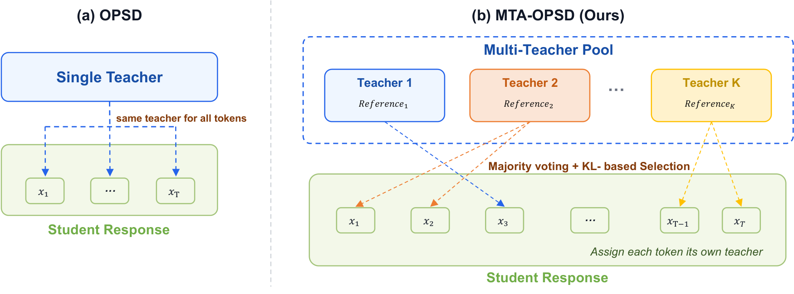

# MTA-OPSD：每个 Token 自选老师

在线策略自蒸馏（OPSD）让整条回答共用一位老师，容易在长链数学推理中用局部误导带偏后续解答。MTA-OPSD 将监督细化到每个 Token：先用多数意见确定方向，再用 KL 散度选择老师。在 Qwen3 数学推理实验中，三种模型规模均取得最高平均分；Qwen3-1.7B 相比 Base Model 提升 **5.9 分**，Qwen3-8B 在 AIME25 上达到 **70.3 分**。

## 为什么需要 Token 级选师？

OPSD 用同一个模型扮演师生：学生只看题目，老师还能看到参考解答等特权信息，并在学生自己的生成轨迹上提供逐 Token 稠密监督。但已有方法通常按整条 response 调整参考暴露，忽略了同一段推理中不同位置的监督需求。

作者通过“学生—老师—学生”接力生成测量教师介入收益，完成 **75,264 次生成**，得到三点证据：

- 相邻位置的首选老师重合率仅约 **50%**，response 级选师会抹平局部差异。
- 约 **80%–90%** 的情况下，首选老师位于多数投票子集；多数组平均收益为 **+3.34%**，少数组仅为 **+1.88%**。
- 在多数派内部，与学生分布 KL 距离最远的老师收益稳定高于最近者；但全局直接选最大 KL 并不够可靠。

## MTA-OPSD 如何分配老师？

方法由共享同一模型参数的多老师池和两步选择机制组成：

- **构造老师池**：使用 full reference，以及 prefix、suffix、random-span 三种截断方式各自搭配 0.5、0.75 暴露比例，共 **7 位老师**；所有配置都保留最终答案。
- **多数投票定方向**：比较老师与学生对已采样 Token 的 log probability，按优势信号正负分成支持、反对两组，保留多数子集；平票时比较累计信号强度。
- **KL 选择定老师**：在多数子集中选择与学生分布 KL 距离最大的老师，再用其分布进行逐 Token 蒸馏。

> 图解：传统 OPSD 由同一老师监督全部 Token；MTA-OPSD 在每个位置独立投票和选师，相邻 Token 可以连接不同老师。

这个顺序至关重要：投票先保证监督方向可靠，KL 再放大有效信号。若先全局选择最大 KL，可能选中差异很大却方向错误的老师。

## 实验与消融验证

在 AMC23、AIME24、AIME25 上，MTA-OPSD 的平均分全面领先：

| 模型 | Base Model | MTA-OPSD | 提升 |
|---|---:|---:|---:|
| Qwen3-1.7B | 51.1 | **57.0** | **+5.9** |
| Qwen3-4B | 75.7 | **77.2** | **+1.5** |
| Qwen3-8B | 76.4 | **79.2** | **+2.8** |

它在三种规模的 AIME25 上分别比 Base Model 高 **7.5、2.8、3.4 分**，优势体现为跨模型、跨基准的整体稳定性，而非包揽每个单项。

Qwen3-1.7B 消融进一步表明，提升并非简单来自“老师更多”：最佳单老师平均分为 56.2，随机选师和平均 Loss 分别只有 53.6、53.7；不做投票直接选最远老师仅得 52.9，而完整方法达到 57.0。

## 总结与展望

- 核心创新是把自适应监督从 response 级推进到 Token 级。
- “多数投票 + KL 选择”分别保障方向可靠性与信号强度，二者缺一不可。
- 动态组合不同参考视图，比固定单老师、随机选师或平均蒸馏更有效。

当前证据主要来自 Qwen3 数学推理，教师介入收益仍是适配度代理；多老师训练开销与跨任务泛化仍待评估。

> 本文参考自 [Every Token Needs Its Own Teacher: Multi-Teacher Adaptive On-Policy Self-Distillation](http://arxiv.org/abs/2610.40574v1)