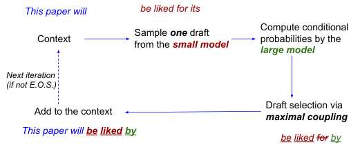
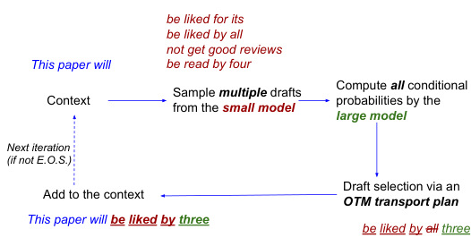
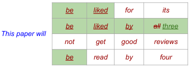
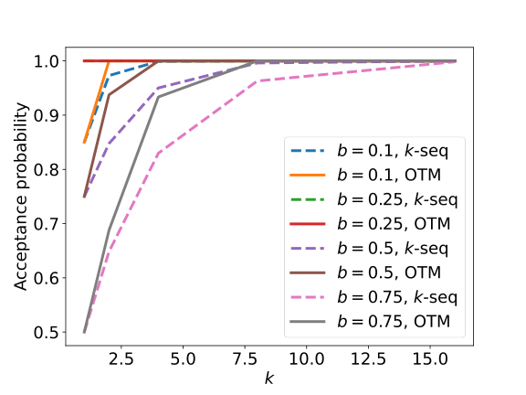
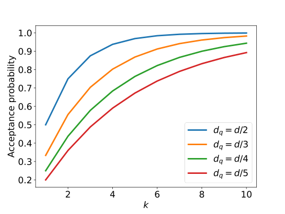
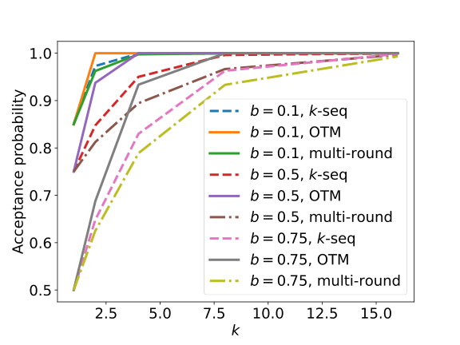

# SpecTr：最优传输让多草稿解码提速 2.13 倍

大模型逐 Token 自回归采样，把本来擅长并行的硬件拖成了串行等待，长文本生成的延迟因此居高不下。SpecTr 要解决的是：如何在不改变大模型输出分布的前提下，进一步减少大模型的串行调用。它的核心思路是把草稿选择写成带 membership cost 的最优传输问题，让小模型一次给出多条草稿，再用有理论保证的传输计划挑选 Token。基于 PaLM-2-Gecko/Bison 和 LM1B 的实验中，SpecTr 在 $K=L=8$ 时取得 **2.13× 实际墙钟加速**，是同长度 Speculative Decoding 的约 **1.37 倍**。

## 从 Speculative Decoding 说起：单草稿还差什么

自回归采样的过程很直接：给定已生成的前缀 $x^t=x(1),\ldots,x(t)$，大模型 $\mathcal{M}_b$ 给出下一个 Token 的条件分布，再从中采样 $x(t+1)$。问题在于，每一步都依赖上一步，大模型只能被串行调用。

Speculative Decoding（推测解码）引入一个便宜的小模型 $\mathcal{M}_s$，把一轮解码拆成三步：

1. **构造草稿**：小模型连续采样长度为 $L$ 的候选序列，并保留沿途的条件概率。
2. **并行验算**：大模型沿时间轴并行计算草稿各个前缀下的条件分布。
3. **选择草稿**：逐 Token 接受或拒绝；遇到第一个拒绝位置，就从 residual distribution（残差分布）采样一个修正 Token。若全部接受，还能利用已经算好的大模型分布多生成一个 Token。

> 图解：蓝色 Token 是已有上下文，红色 Token 是小模型生成的一条草稿。大模型并行验算后，通过 maximal coupling 选择草稿；下划线红色 Token 被接受，绿色 Token 来自修正分布。随后把新 Token 加入上下文，进入下一轮。

这套机制依赖一个理想化的计算模型：沿时间轴或 batch 轴并行计算多个条件分布时，大模型单次调用的墙钟时间近似不变。它并不表示总 FLOPs 不增加，而是说硬件并行能力可能消化这些额外计算。

在单草稿、单 Token 的情况下，设小模型分布为 $p$，大模型分布为 $q$，草稿 $X\sim p$。经典接受规则是以如下概率接受 $X$：

$$
\min\left(1,\frac{q(X)}{p(X)}\right)
$$

若拒绝，则从下面的残差分布修正：

$$
p^{\mathrm{res}}(x)=
\frac{q(x)-\min\{p(x),q(x)\}}
{1-\sum_{x'}\min\{p(x'),q(x')\}}
$$

这样得到的输出 $Y$ 严格满足 $Y\sim q$，而接受概率为：

$$
\Pr(Y=X)=\sum_{x\in\Omega}\min\{p(x),q(x)\}
=1-d_{\mathrm{TV}}(p,q)
$$

这里 $\Omega$ 是词表，$d_{\mathrm{TV}}$ 是 total variation distance（总变差距离）。**两个模型越接近，草稿越容易被接受，大模型串行调用就越少。**理想情况下 $p=q$，长度为 $L$ 的草稿会全部接受，再补上一个大模型 Token，一轮可得到 $L+1$ 个 Token。

单草稿已经沿时间轴做了并行，但每步只有一次猜测机会。SpecTr 的追问很自然：既然硬件还能沿 batch 轴并行，为什么不同时猜多份？

## 核心建模：草稿选择就是最优传输

多猜几个 Token 并不等于把旧接受规则多跑几遍。新的困难是：既要最大化“命中任一草稿”的概率，又必须保证最终输出仍服从大模型分布。

### 为什么不能简单重复接受规则

考虑 $p=\mathrm{Ber}(1)$、$q=\mathrm{Ber}(1/2)$。小模型永远给出 Token 1，而大模型只应以 $1/2$ 的概率输出 1。若对 $k$ 个草稿分别执行单草稿接受规则，每个都有 $1/2$ 的概率被接受，那么最终输出 1 的概率至少为：

$$
1-\frac{1}{2^k}
$$

当 $k>1$ 时，它显然不等于 $1/2$。**速度优化一旦破坏输出分布，就不能再声称“无损加速”。**这也是多草稿选择需要新统计工具的原因。

### 用 coupling 保证输出分布

最优传输（Optimal Transport，OT）可以直观理解为：在保持进货量和出货量不变的前提下，设计一套成本最低的搬运方案。这里的“搬运”不是移动模型参数，而是把草稿样本映射成目标 Token。

对于分布 $P$ 和 $Q$，联合分布 $\pi(x,y)$ 是一个 coupling（耦合），当且仅当它满足两个边缘约束：

$$
\sum_{x\in\mathcal{X}}\pi(x,y)=Q(y),\qquad
\sum_{y\in\mathcal{Y}}\pi(x,y)=P(x)
$$

给定 $X\sim P$，再按 $\pi(y\mid X)=\pi(X,y)/P(X)$ 随机选择 $Y$，就有 $Y\sim Q$。因此，**每一个合法 coupling 都对应一个无损的草稿选择器**；剩下的任务只是定义什么叫“成本低”。

单草稿使用 indicator cost：$Y\neq X$ 时成本为 1，否则为 0。最小拒绝概率是 $d_{\mathrm{TV}}(p,q)$，最大接受概率就是 $1-d_{\mathrm{TV}}(p,q)$。由此看，经典 Speculative Decoding 已经是单草稿情形下的最优 maximal coupling。

### 多草稿需要 membership cost

现在一次给出 $k$ 个独立同分布草稿 $X^k=(X_1,\ldots,X_k)\sim p^{\otimes k}$。令 $S(X^k)$ 表示其中出现过的不同 Token 集合，只要最终 $Y$ 属于这个集合，就算接受成功。于是定义 membership cost（成员成本）：

$$
c(X^k,Y)=\mathbf{1}\{Y\notin S(X^k)\}
$$

对应的最优传输问题就是 OTM（Optimal Transport with Membership cost）：

$$
\alpha_k(p,q)=
\max_{\pi\in\Pi(p^{\otimes k},q)}
\Pr_{X^k,Y\sim\pi}\{Y\in S(X^k)\}
$$

其中 $\alpha_k$ 是最优接受概率。这个目标同时照顾了两件事：边缘约束保证无损，membership cost 鼓励命中任一草稿。

它还有两个符合直觉的性质：

- **单调性**：$\alpha_k(p,q)\leq\alpha_{k+1}(p,q)$，多一个候选不会损害最优接受率；证明只需把新增样本附在原有传输计划后面。
- **一致性**：若所有 $q(x)/p(x)$ 有界，则 $\lim_{k\to\infty}\alpha_k(p,q)=1$；若小模型完全覆盖不了某些大模型支持的 Token，则极限为 $\sum_x\mathbf{1}\{p(x)>0\}q(x)$。

### 精确求解：线性规划最优，但规模爆炸

OTM 可以写成线性规划：

$$
\min_{\pi}\sum_{x^k\in\Omega^k}\sum_{y\in\Omega}
\pi(x^k,y)\mathbf{1}\{y\notin S(x^k)\},
\qquad \pi\in\Pi(p^{\otimes k},q)
$$

它有 $|\Omega|^{k+1}$ 个变量、$|\Omega|^k+|\Omega|$ 个等式约束，求解时间为 $O(|\Omega|^{O(k)})$。也就是说，OTM-$k$ 给出了理论最优解，却无法直接承担大词表、多候选下的在线选择开销。即使采用熵正则化和 Sinkhorn 算法，计算量仍带有对 $|\Omega|^k$ 的依赖。

**笔者认为，这一步建模是全文最关键的贡献：它先把“无损”和“高接受率”从工程技巧变成明确约束，再让近似算法有可比的最优目标。**接下来的问题就变成：能否用接近词表线性的成本，得到一个仍然合法、接受率又不差的传输计划？

## k-Seq：用一个参数换接近线性的选择成本

k-Seq（$k$-sequential selection）的思路很克制：不再搜索整个指数级 coupling 空间，只搜索由单个除法因子 $\gamma$ 控制的一族传输计划。

### 算法怎样选择 Token

先定义：

$$
\beta_{p,q}(\gamma)=
\sum_{x\in\Omega}\min\left\{p(x),\frac{q(x)}{\gamma}\right\},
\qquad
p_{\mathrm{acc}}=1-(1-\beta_{p,q}(\gamma))^k
$$

然后为所有候选都被拒绝的情况准备残差分布：

$$
p^{\mathrm{res}}(x)=
\frac{
q(x)-\min\left\{p(x),q(x)/\gamma\right\}
\frac{p_{\mathrm{acc}}}{\beta_{p,q}(\gamma)}
}{
1-p_{\mathrm{acc}}
}
$$

实际选择只需三步：

1. 依次查看 $X_1,\ldots,X_k$。
2. 以 $\min\{1,q(X_i)/(\gamma p(X_i))\}$ 的概率接受当前候选，一旦接受就返回。
3. 若全部拒绝，从 $p^{\mathrm{res}}$ 采样修正 Token。

相比单草稿规则，分母多了 $\gamma$。它像一个“限流阀”：候选有多次被接受的机会，所以每次必须更谨慎，否则高 $q/p$ 比值的 Token 会被过度输出。残差分布则精确补齐尚未输出的那部分概率质量。

### $\gamma$ 不能任意选

令 $\gamma^*$ 满足：

$$
1-(1-\beta_{p,q}(\gamma^*))^k
=\gamma^*\beta_{p,q}(\gamma^*)
$$

当 $\gamma\geq\gamma^*$ 时，k-Seq 是合法传输计划；当 $\gamma=\gamma^*$ 时，有：

$$
\alpha(\pi^{\mathrm{k\text{-}Seq}}_{\gamma^*})
\geq
\left(1-\left(1-\frac1k\right)^k\right)\alpha_k(p,q)
\geq
\left(1-\frac1e\right)\alpha_k(p,q)
$$

注意，“近似”只表示接受率不一定达到 OTM-$k$ 的最优值，**并不表示输出分布是近似的**。合法 coupling 仍然保证输出严格服从 $q$。

在非退化情形下，$\gamma^*$ 位于 $[1,\min\{k,\max_x q(x)/p(x)\}]$，相关函数单调，因此可二分搜索。达到精度 $\delta$ 的时间复杂度为：

$$
O\left(|\Omega|\log\frac{k-1}{\delta}\right)
$$

这把指数级的精确 LP，换成了对词表近线性、对 $k$ 对数级的计算。

### 证明骨架：接受部分加残差部分恰好等于 $q$

附录的证明可以压缩成一条清晰的账务关系。对任意 Token $x$，第 $i$ 个候选首次被接受且输出 $x$ 的概率，要乘上此前 $i-1$ 次拒绝。把 $k$ 次机会求和，得到“通过接受草稿输出 $x$”的总概率：

$$
\Pr(Y=x,\text{接受某个草稿})
=
\min\left\{p(x),\frac{q(x)}{\gamma}\right\}
\frac{1-(1-\beta_{p,q}(\gamma))^k}{\beta_{p,q}(\gamma)}
$$

对所有 $x$ 求和，至少接受一个草稿的概率就是 $p_{\mathrm{acc}}$。其余 $1-p_{\mathrm{acc}}$ 的概率从残差分布输出；代入上式，接受部分与残差部分相加恰好是 $q(x)$。

条件 $\gamma\geq\gamma^*$ 还保证残差概率非负。接受率下界则通过不等式 $kx\geq1-(1-x)^k$ 与 OTM 的信息论上界连接，最终得到 $1-1/e$ 的乘法近似保证。

更一般地，论文给出的最优接受率上下界为：

$$
\left(1-\left(1-\frac1k\right)^k\right)\bar{\alpha}_k(p,q)
\leq\alpha_k(p,q)\leq\bar{\alpha}_k(p,q)
$$

其中上界在所有词表子集 $\Omega_0$ 上取最小值：

$$
\bar{\alpha}_k(p,q)=
\min_{\Omega_0\subseteq\Omega}
\left\{
\sum_{y\in\Omega_0}\min\{q(y),1-(1-p(y))^k\}
+
\sum_{x^k\in\Omega^k}
\min\left\{\prod_{i=1}^kp(x_i),
\sum_{y\in S(x^k)\cap\Omega_0^c}q(y)\right\}
\right\}
$$

直观上，$1-(1-p(y))^k$ 是至少一个草稿命中 $y$ 的概率；上式再用目标边缘概率限制真正可接受的质量。$k=1$ 时，这个上界正好等于最优接受概率。

## SpecTr：把 Token 级选择递归成序列级解码

解决了单个位置的多候选选择，还要把它装回自回归解码。SpecTr 的每轮仍有三步，但草稿从“一条”变成“一组”：

1. **草稿集构造**：给定上下文 $x^t$，从小模型独立采样 $K$ 条长度为 $L$ 的序列。
2. **条件概率计算**：大模型沿时间和 batch 两个维度，并行验算所有草稿前缀。
3. **递归选择**：先对所有序列的第一个 Token 做 OTM-$k$ 或 k-Seq；若输出 $Y$ 命中某些草稿，就只保留以 $Y$ 开头的序列，在下一位置重复选择。

> 图解：与单草稿 Speculative Decoding 相比，SpecTr 从小模型采样多条红色草稿，大模型并行计算全部条件概率，再通过 OTM 传输计划选择。下划线红色 Token 来自草稿，绿色 Token 来自残差分布；新结果被加入上下文后继续下一轮。

递归在两种情况下停止：候选集为空，或已经处理到草稿末尾。若最后位置仍命中草稿，由于对应的大模型条件分布已经算过，还能额外采样一个 Token。因此每轮新增长度 $\tau$ 满足 $1\leq\tau\leq L+1$。

> 图解：四行是四条长度为 4 的草稿。第一步 4 个首 Token 中有 3 个“be”，选择器输出“be”，保留对应 3 行；第二步选择“liked”，剩 2 条有效分支；第三步在“for”和“by”中选择“by”；最后未接受草稿中的“all”，而用绿色“three”修正。整轮生成“be liked by three”共 4 个 Token。

这个示例也说明，多序列并非简单“投票取多数”。每一步使用哪个候选，由当前位置的合法传输计划决定；公共前缀只是自然形成了可复用的草稿分支。

### 为什么序列输出仍然无损

论文用数学归纳法证明：只要每个草稿 Token 都来自小模型对应的条件分布，那么对任意输出长度 $\tau_0$ 和序列 $o^{\tau_0}$，都有：

$$
\Pr(Y^{\tau_0}=o^{\tau_0}\mid\tau=\tau_0)
=
\prod_{i=1}^{\tau_0}
\mathcal{M}_b(o(i)\mid x^t,o^{i-1})
$$

长度为 1 时，合法性直接来自 Token 级 coupling。更长序列中，第一步保证 $Y_1$ 服从大模型分布；保留下来的后续草稿仍是给定 $Y_1$ 时的小模型条件样本，于是可对剩余序列应用归纳假设。若接受最后一个草稿，额外 Token 也直接来自大模型条件分布。

因此，SpecTr 与标准 Speculative Decoding 一样，**不是用近似模型替代大模型，而是用小模型提出候选、用大模型分布决定最终输出。**

### 候选集还能怎样构造

正文默认独立采样 $K$ 条完整序列。附录还讨论了 prefix tree（前缀树）：给定扩展因子 $k_1,\ldots,k_L$ 且 $\prod_i k_i=K$，从根节点开始逐层扩展，每个子节点都从小模型的当前条件分布采样下一个 Token，最终得到 $K$ 条叶节点序列。

前缀树能更集中地利用 batch 配额，但论文报告它在实验中没有优于独立同分布草稿集，因此实际主结果仍采用后者。

## 简单分布上的验证：接受率确实随 $k$ 增长

理论给出的是上下界，附录又用 Bernoulli 和均匀分布把接受率算成闭式，便于直接比较 OTM-$k$ 与 k-Seq。

### Bernoulli 分布：k-Seq 接近但不总是最优

若 $p=\mathrm{Ber}(a)$、$q=\mathrm{Ber}(b)$，最优接受概率为：

$$
\alpha_k(\mathrm{Ber}(a),\mathrm{Ber}(b))
=
\min\{b,1-(1-a)^k\}
+
\min\{1-b,1-a^k\}
$$

> 图解：横轴是候选数 $k$，纵轴是接受概率；固定 $p=\mathrm{Ber}(0.25)$，不同曲线对应 $q=\mathrm{Ber}(b)$。当 $b=0.25$ 即 $p=q$ 时，两者接受率始终为 1；其他情况下接受率随 $k$ 增加并趋近 1。$b=0.1$、$0.5$、$0.75$ 的曲线显示 k-Seq 可能低于 OTM-$k$。

论文特别指出 $b=0.1$ 或 $0.75$ 时 k-Seq 严格劣于 OTM；而某些非平凡情形，两者也能达到相同接受率。这与“常数近似但非精确最优”的理论定位一致。

### 均匀分布：k-Seq 可以达到最优

令 $U(d)$ 表示 $[d]$ 上的均匀分布，取 $p=U(d)$、$q=U(d/r)$，则：

$$
\alpha_k(U(d),U(d/r))=1-\left(1-\frac1r\right)^k
$$

右侧就是 $k$ 个草稿至少一个落入目标支撑集的概率。此时可解得 $\gamma^*=r[1-(1-1/r)^k]$，k-Seq 恰好达到上述最优值。

> 图解：横轴为 $k$，纵轴为最优接受概率，$d=120$，四种曲线分别对应 $d_q=d/2,d/3,d/4,d/5$。所有曲线单调上升；目标支撑集越大，接受率增长越快，并逐步趋近 1。

### 与 multi-round rejection sampling 的比较

附录还加入 SpecInfer、EAGLE 相关工作中的 multi-round rejection sampling，在同一 Bernoulli 例子上比较三种方法。

> 图解：横轴仍为 $k$，纵轴为接受概率，比较 $b=0.1,0.5,0.75$ 三组分布。图示例子中，OTM-$k$ 最优，k-Seq 也高于 multi-round；$b=0.25$ 时三者接受率均为 1，因此未画出。论文只声称这些例子的经验优势，并把系统性比较留作未来工作。

## 实验：理论接受率如何变成真实速度

因为三种解码方法的输出分布相同，实验不需要再比较生成质量，重点只有两个指标：

- **Block efficiency**：大模型每次串行调用平均产出多少 Token，即“总生成 Token 数 / 大模型串行调用数”。
- **Wall clock speedup**：包含小模型解码、并行验算、选择算法和模型切换等开销后的实际墙钟加速。

Block efficiency 更像理论吞吐潜力，wall clock speedup 才是用户感受到的延迟收益。后者通常更低，因为小模型并非免费，batch 并行也并非完全无成本。

### PaLM-2 主实验：2.13× 墙钟加速

主实验使用 PaLM-2-Gecko 作为小模型、PaLM-2-Bison 作为大模型，在 LM1B 上平均 1000 条测试 prompt 和 3 个随机种子的结果。

| 算法 | 草稿数 $K$ | 草稿长度 $L$ | Block efficiency | 相对墙钟加速 |
|---|---:|---:|---:|---:|
| Baseline | — | — | 1.0 | 1.0 |
| Speculative | 1 | 4 | 2.4 | 1.67 |
| SpecTr | 8 | 4 | **3.1** | **2.08** |
| Speculative | 1 | 8 | 2.9 | 1.56 |
| SpecTr | 8 | 8 | **4.0** | **2.13** |

最值得注意的是 $K=L=8$：SpecTr 的 block efficiency 达到 4.0，实际加速为 2.13×；同长度单草稿方法虽然理论效率从 2.4 升到 2.9，实际加速却从 1.67× 降到 1.56×。这说明单纯拉长草稿会增加无效计算和验算负担，而多草稿提高接受率带来的收益，在这组配置中足以覆盖额外开销。

### 并行假设有多接近现实

附录用 97M Transformer 在 GPU 上测试 1000 次，报告均值和标准差。下表以 length = 4、batch = 1 的大模型延迟为 1。

| 97M 大模型相对延迟 | batch = 1 | batch = 2 | batch = 4 | batch = 8 |
|---|---:|---:|---:|---:|
| length = 4 | 1.00 ± 0.16 | 1.01 ± 0.15 | 1.06 ± 0.10 | 1.10 ± 0.16 |
| length = 8 | 1.01 ± 0.18 | 1.09 ± 0.25 | 1.10 ± 0.09 | 1.42 ± 0.40 |

多数配置的延迟接近常数，但 length = 8、batch = 8 已升至 1.42。这恰好解释了为什么 block efficiency 不能直接当作墙钟加速：论文的简化模型在小规模并行时较合理，却并非没有边界。

6M 小模型的下表则以“97M 大模型在 length = 4、batch = 1 时的延迟”为统一参照，用来衡量草稿成本。

| 6M 小模型相对延迟 | batch = 1 | batch = 2 | batch = 4 | batch = 8 |
|---|---:|---:|---:|---:|
| length = 4 | 0.18 ± 0.02 | 0.19 ± 0.04 | 0.18 ± 0.09 | 0.20 ± 0.13 |
| length = 8 | 0.17 ± 0.04 | 0.19 ± 0.05 | 0.16 ± 0.02 | 0.18 ± 0.04 |

小模型调用约为参照大模型延迟的 0.16–0.20，且增加 batch 后没有明显上升。这让“多采样几条草稿”在这套硬件与模型组合上足够便宜，但不能据此推断所有部署环境都如此。

### 草稿模型多大最合适

最后，附录固定 97M 大模型，比较 2M、6M、20M 三种小模型。实验仍在 LM1B 上使用 1000 条 prompt、3 个随机种子，大小模型采样温度均为 1.0。

| 草稿模型 | 算法 | $K$ | $L$ | Block efficiency |
|---|---|---:|---:|---:|
| 2M | Baseline | — | — | 1.00 |
| 2M | Speculative | 1 | 4 | 1.86 ± 0.02 |
| 2M | SpecTr | 2 | 4 | 2.07 ± 0.01 |
| 2M | SpecTr | 4 | 4 | 2.32 ± 0.00 |
| 2M | SpecTr | 8 | 4 | **2.56 ± 0.01** |
| 2M | Speculative | 1 | 8 | 1.91 ± 0.01 |
| 2M | SpecTr | 2 | 8 | 2.15 ± 0.01 |
| 2M | SpecTr | 4 | 8 | 2.41 ± 0.00 |
| 2M | SpecTr | 8 | 8 | **2.68 ± 0.01** |
| 6M | Baseline | — | — | 1.00 |
| 6M | Speculative | 1 | 4 | 2.21 ± 0.01 |
| 6M | SpecTr | 2 | 4 | 2.43 ± 0.01 |
| 6M | SpecTr | 4 | 4 | 2.74 ± 0.01 |
| 6M | SpecTr | 8 | 4 | **2.99 ± 0.02** |
| 6M | Speculative | 1 | 8 | 2.33 ± 0.01 |
| 6M | SpecTr | 2 | 8 | 2.61 ± 0.02 |
| 6M | SpecTr | 4 | 8 | 2.96 ± 0.03 |
| 6M | SpecTr | 8 | 8 | **3.27 ± 0.02** |
| 20M | Baseline | — | — | 1.00 |
| 20M | Speculative | 1 | 4 | 2.71 ± 0.01 |
| 20M | SpecTr | 2 | 4 | 2.96 ± 0.00 |
| 20M | SpecTr | 4 | 4 | 3.28 ± 0.02 |
| 20M | SpecTr | 8 | 4 | **3.49 ± 0.03** |
| 20M | Speculative | 1 | 8 | 3.12 ± 0.02 |
| 20M | SpecTr | 2 | 8 | 3.48 ± 0.04 |
| 20M | SpecTr | 4 | 8 | 3.85 ± 0.05 |
| 20M | SpecTr | 8 | 8 | **4.15 ± 0.04** |

两条趋势很清楚：更大的草稿模型与大模型分布更接近，所有推测方法的 block efficiency 都会提高；在每种模型大小和 $L$ 下，增加 $K$ 的 SpecTr 又始终优于 $K=1$ 的 Speculative Decoding。

不过，这张表只报告 block efficiency，没有给出三种小模型对应的完整墙钟成本。它证明的是接受与产出潜力，不等于“20M 草稿模型在所有部署中一定最划算”。

## 总结：SpecTr 真正推进了哪一步

- SpecTr 把无损草稿选择统一为最优传输问题，用边缘约束保证输出分布不变，用 membership cost 最大化多草稿命中率。
- 精确 OTM-$k$ 可由线性规划求得，但复杂度随 $k$ 指数增长；k-Seq 用单参数搜索把成本降到对词表近线性，并保留至少 $1-1/e$ 的最优接受率保证。
- 序列级递归把 Token 级 coupling 扩展成完整解码算法，理论上每轮可生成 1 到 $L+1$ 个 Token，且输出仍严格服从大模型。
- PaLM-2/LM1B 实验中，SpecTr 在 $K=L=8$ 时达到 4.0 block efficiency 和 2.13× 墙钟加速，验证了多草稿并行能转化为真实收益。

这项工作的下一步不只是继续增大 $K$ 或 $L$，而是让草稿数量、模型大小与硬件并行成本联合自适应，并在更广泛的模型和采样设置下系统比较多候选选择算法。

> 本文参考自 [Fast Speculative Decoding via Optimal Transport](https://arxiv.org/abs/2310.15141)