# PyRUA-Lean：Token 少 65%，成功率反升

机器人 Agent 常常不是“不会做”，而是每一步都要把历史、状态和多张图片重新交给大模型，导致调用与 Token 开销不断膨胀。这个问题直接限制长程操作、失败恢复和实际部署成本。PyRUA-Lean 的思路是让 LLM 编写可交互执行的 Python cell，把条件判断、局部重试和几何计算留在运行时，只把显式请求的反馈送回模型。在相同 GPT-6 Astra、相同机器人原语和相同调用预算下，它将 700 个任务实例的成功率从 63.1% 提到 71.7%；在双方都成功的实例上，LLM 调用减少 49%，输入 Token 减少 65%。

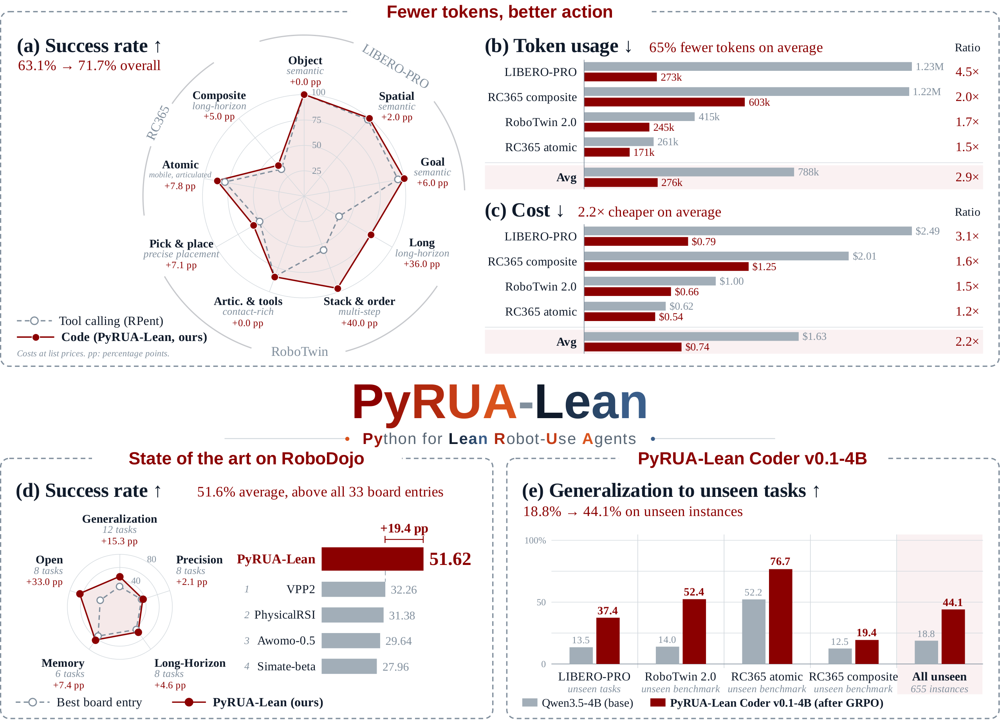

> 图解：上方三组结果比较 Tool calling 与 Code。雷达图展示各任务组成功率，红色整体外扩；Token 与成本柱状图统计双方共同成功的实例，平均值分别为 788k→276k Token、1.63→0.74 美元。左下是 RoboDojo 五类能力的成功率，PyRUA-Lean 平均达到 51.62%；右下是 4B 模型经 GRPO 训练后，在未见实例上的成功率由 18.8% 升至 44.1%。注意，不同面板的统计集合并不相同，不能把所有数字混为同一口径。

## 一、问题不在原语，而在原语如何交给 Agent

VLM（Vision-Language Model，视觉语言模型）机器人 Agent 通常这样工作：观察图片与状态，调用一次运动、感知或抓取工具，再读取结果，决定下一步。VLA（Vision-Language-Action，视觉语言动作）策略也可以被封装成其中一个工具。

这种 Tool calling 模式像“每搬一块砖都回办公室请示一次”。只要后一步依赖前一步结果，就得多调用一次 LLM；而每次新调用又会重新处理不断累积的历史。RPent 还会在每次运动后自动返回三张相机图片，可靠的原语因此被包进了昂贵的交互循环。

已有研究分别解决了其中一部分问题：

- **机器人规划**：SayCan 用可供性选择技能，Inner Monologue 引入环境反馈，RPent 将冻结 VLA 与解析原语组合起来。
- **代码控制**：Code as Policies、ProgPrompt 从语言生成机器人程序，VoxPoser 用代码构建空间价值图，CaP-X、VLCP 进一步研究反馈与程序更新。
- **技能复用**：Voyager、ASPIRE、RoboRSI 将多次试验沉淀成可复用例程。
- **高效 Agent 接口**：ReAct 交替推理与行动，CodeAct 表明可执行 Python 能优于文本或 JSON 动作接口。

PyRUA-Lean 的差异不在于再发明一批抓取技能，而是做一个受控实验：**固定规划器和底层能力，只改变交互接口**。它也不依赖跨任务技能库；本文所有主对比都关闭跨 episode 记忆，只允许当前 episode 内复用变量与函数。

## 二、PyRUA-Lean：把“逐步请示”改成“带反馈执行程序”

系统把机器人暴露为 Python 对象 `robo`。每次 LLM 调用生成一个代码 cell，运行时执行它，再把指定反馈交给下一次调用。它同时做两件事：**组合原语**，以及**选择什么信息进入上下文**。

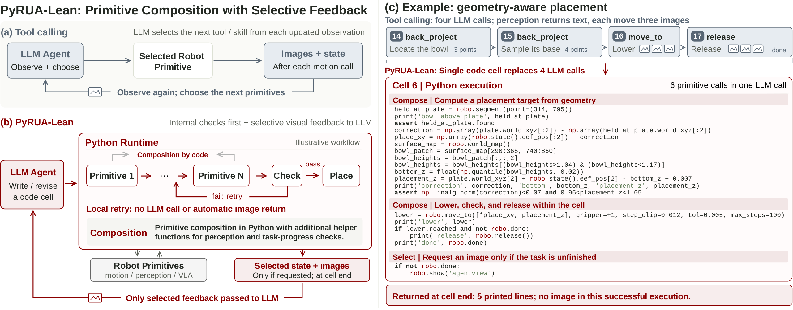

> 图解：(a) 中，工具调用在每次更新观察后重新选择下一步，运动调用自动带回图片与状态；(b) 中，Python Runtime 可在一次 cell 内串联多个原语、检查结果并局部重试，仅返回被选择的状态和图片；(c) 的放置任务里，一个 cell 根据场景几何计算目标、条件执行下降与释放，并仅在未完成时请求图片，将原来 4 次 LLM 调用压缩为 1 次。成功时只返回 5 行文本，不返回图片。

### 2.1 同一套原语，两种观察方式

| 类别 | Tool calling（RPent） | Code（PyRUA-Lean） |
|---|---|---|
| 机械臂运动 | `move_to`、`move_pose`、`move_delta`、`rotate_wrist`、`rotate_pitch` | 同名、同参数的 `robo` 方法 |
| 夹爪 | `set_gripper`、`release`、`scripted_grasp` | 相同 |
| VLA 策略 | `pi0_pick`、`pi0_doubled`、`lingbot_act`、`rldx_skill`、`rldx_arm` | 相同 |
| 移动底盘 | `navigate_to`、`move_base` | 相同 |
| 感知 | `segment`、`back_project`、`back_project_batch`、`sample_world_xyz`、`query_world_map` | 相同 |
| 状态与成功标志 | 每次运动自动返回，或调用 `view_env_state` | 显式读取 `robo.state()`、`robo.done` |
| 相机图片 | 每次运动自动返回 3 张 | 仅代码调用 `robo.show` 时返回 |
| 世界坐标 | 通过感知工具逐项查询 | 相同，或经 `robo.world_map()` 一次取得数组 |

这个对照很关键：两边运行的是同一套 RPent 实现，并非 Code 版偷偷获得更强的运动技能。真正改变的是控制流、状态保存和反馈投递。

### 2.2 原语组合：在运行时消化中间步骤

一个 cell 可以先接近物体，只有到位才尝试抓取，再依据结果重试或停止。判断和分支不触发新 LLM 调用；cell 结束后，模型再根据汇总反馈进行高层重规划。因此系统形成两层闭环：**程序级快速反馈 + LLM 级慢速重规划**。

代码还能组合出原语列表里没有的能力。例如，从世界坐标图估计碗底高度，计算放置目标；或定义带保护的下降函数，在后续 cell 中复用。笔者认为，这才是“写代码”相对“批量调工具”的实质差别：模型不仅减少调用次数，还能现场构造新的感知与控制例程。

### 2.3 选择性观察：控制新增上下文，而非删除历史

中间结果留在持久 Python namespace 中，不必逐项写回对话。代码用 `print` 选择文本，用 `robo.show` 在指定位置记录图片；这些反馈在 cell 结束时一起返回。

它并不是对旧历史做有损压缩。两种 Agent 都运行在 Codex CLI 中，完整对话一直保留，只有接近 272k Token 时才触发压缩。PyRUA-Lean 控制的是**新产生多少上下文**。

### 2.4 异常、持久状态与执行边界

未捕获异常会终止当前 cell，并返回 traceback，但异常前赋值的变量仍保留，便于下一 cell 修复。每次真正作用于机器人的原语执行前，运行时若发现任务已成功，会提前终止 cell。

主实验的 episode 上限为 2 小时，由外部 watchdog 中断活动原语和规划器；没有单独设置 cell 时限。其实验所用 Codex CLI 在工具调用 300 秒无响应时会报告超时，但不取消 cell，后续 cell 会排队。这个细节说明“LLM 调用更少”不等于“实际延迟一定更低”，论文也没有用波动较大的网关耗时作为主指标。

## 三、受控实验：成功率提高，Token 反而下降

接下来要验证的不是“代码看起来更美”，而是三个可证伪假设：

- **H1**：相同 LLM 调用预算下，PyRUA-Lean 成功率更高。
- **H2**：完成相同任务时，PyRUA-Lean 需要更少 LLM 调用与输入 Token。
- **H3**：去掉 VLA 策略或操作指南后，Token 效率仍保留。

### 3.1 数据集、模型与统计口径

| Benchmark | 任务数 | 每任务 Seed | 实例数 | LLM 调用预算 |
|---|---:|---:|---:|---:|
| LIBERO-PRO | 40 | 5 | 200 | 40 |
| RoboTwin 2.0 | 50 | 5 | 250 | 40 |
| RoboCasa365 atomic | 18 | 5 | 90 | 40 |
| RoboCasa365 composite | 32 | 5 | 160 | 100 |
| **合计** | **140** | — | **700** | — |

每个实例分别运行两个 Agent，共 1,400 个 episode。两者都使用 high reasoning effort 的 GPT-6 Astra、SAM 3、相同机器人栈与冻结策略：LIBERO-PRO 使用 $\pi_{0.5}$，RoboTwin 2.0 使用 LingBot-VLA，RoboCasa365 使用 RLDX-1。

成功率覆盖全部实例；调用、Token 和成本均值则只统计**双方都成功的 406 个实例**，并包含成功后的调用与缓存输入。预算限制 LLM 调用数，不限制原语执行数。因此，这是“相同规划调用预算”的比较，不是“相同机器人动作数”的比较。

### 3.2 主结果：四组任务全部受益

下表中，$\Delta$ 是成功率提升的百分点；其余“倍数”均表示 Tool 用量是 Code 的多少倍。Token 与成本是每个成功 episode 的均值。

| Benchmark | 成功率 Tool | 成功率 Code | $\Delta$ | 调用 Tool | 调用 Code | 调用倍数 | Token Tool | Token Code | Token 倍数 | 成本 Tool | 成本 Code | 成本倍数 |
|---|---:|---:|---:|---:|---:|---:|---:|---:|---:|---:|---:|---:|
| LIBERO-PRO | 83.0% | 94.0% | +11.0 | 21.4 | 8.4 | 2.5× | 1.23M | 273k | 4.5× | \$2.49 | \$0.79 | 3.1× |
| RoboTwin 2.0 | 60.0% | 69.2% | +9.2 | 12.2 | 8.9 | 1.4× | 415k | 245k | 1.7× | \$1.00 | \$0.66 | 1.5× |
| RC365 atomic | 78.9% | 86.7% | +7.8 | 10.4 | 5.6 | 1.8× | 261k | 171k | 1.5× | \$0.62 | \$0.54 | 1.2× |
| RC365 composite | 34.4% | 39.4% | +5.0 | 28.4 | 14.9 | 1.9× | 1.22M | 603k | 2.0× | \$2.01 | \$1.25 | 1.6× |
| **全部** | **63.1%** | **71.7%** | **+8.6** | **17.0** | **8.7** | **2.0×** | **788k** | **276k** | **2.9×** | **\$1.63** | **\$0.74** | **2.2×** |

总体成功率提升 8.6 个百分点，相对提升约 14%。Code 独有 96 个成功实例，Tool 独有 36 个，支持 H1。共同成功实例上，调用减少 49%、Token 减少 65%，支持 H2。

汇总 Token 倍数受 LIBERO-PRO 长 episode 影响较大，所以按 Benchmark 分行看更稳妥。成本下降幅度小于 Token，部分原因是基线反复处理的历史享有缓存折扣。

### 3.3 不只共同成功子集：回看 Token 预算曲线

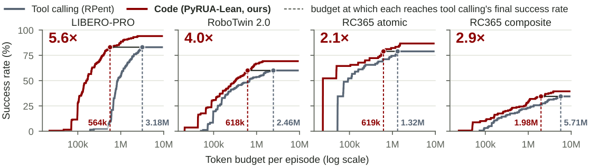

> 图解：横轴是每 episode 的 Token 预算，采用对数刻度；纵轴是若轨迹在该预算处被截断，能够达到的成功率。灰色为 Tool，红色为 Code，虚线标出各自首次达到 Tool 最终成功率的位置。LIBERO-PRO 上，Code 用 564k 达到基线最终 83.0%，Tool 需要 3.18M，相差 5.6×；另外三组分别为 4.0×、2.1×、2.9×。这是事后截断分析，并非预先设定预算后重新运行。

### 3.4 Token 为什么减少：主要是少调用，而非每次 prompt 都更短

设 Tool 相对 Code 的总 Token 缩减倍数为 $F_T$，调用数缩减倍数为 $F_C$，每次调用 Token 缩减倍数为 $F_P$，则：

$$
F_T = F_C \times F_P
$$

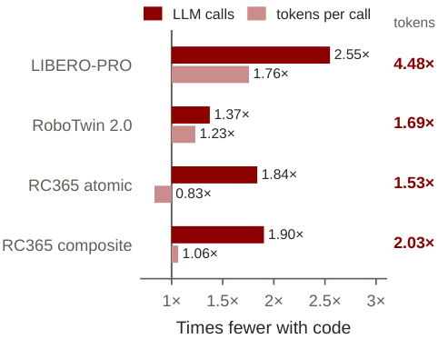

> 图解：横轴是 Code 相对 Tool 的缩减倍数，深红为 LLM 调用，浅红为每次调用 Token，右侧为两者乘积。LIBERO-PRO 为 $2.55\times1.76=4.48$；RoboCasa365 atomic 的浅红条只有 0.83×，表示 Code 单次调用反而更大，但调用数减少 1.84×，最终仍节省 1.53× Token。

因此，收益主要来自把中间协调移进运行时。该分解只是会计恒等式，不能独立证明每个组件的因果贡献。

### 3.5 只把图片改成按需返回，并不能复制收益

研究者在 LIBERO-PRO 上额外修改 Tool 基线：运动后只返文本，图片必须主动请求。结果如下；带星号的两项在三种配置都成功的 131 个实例上统计。

| 指标 | Tool：每次运动后给图 | Tool：按需给图 | Code |
|---|---:|---:|---:|
| 全部 200 实例成功率 | 83.0% | 68.5% | 94.0% |
| 失败：主动放弃 / 耗尽调用预算 | 9 / 25 | 17 / 46 | 5 / 7 |
| 每个成功 episode 的 LLM 调用* | 19.9 | 22.8 | 7.4 |
| 每个成功 episode 的输入 Token* | 1.07M | 1.07M | 222k |

成功率从 83.0% 降至 68.5%，调用反而增加，总 Token 几乎不变。这说明“少看图”本身不是答案；观察请求必须与动作执行、局部判断和重规划共同设计。

### 3.6 消融：没有 VLA 或指南，效率仍在

下表完整保留各组消融。VLA 或 Guides 为“有/无”；RoboCasa365 本来没有操作指南，记为“—”。成功率覆盖全部实例，其余列仍只统计该设置下双方共同成功实例。

| Benchmark | VLA | Guides | 成功率 Tool | Code | $\Delta$ | 调用 Tool | Code | 倍数 | Token Tool | Code | 倍数 | 成本 Tool | Code | 倍数 |
|---|---|---|---:|---:|---:|---:|---:|---:|---:|---:|---:|---:|---:|---:|
| LIBERO-PRO | 有 | 有 | 83.0% | 94.0% | +11.0 | 21.4 | 8.4 | 2.5× | 1.23M | 273k | 4.5× | 2.49 | 0.79 | 3.1× |
| LIBERO-PRO | 有 | 无 | 84.0% | 88.0% | +4.0 | 19.0 | 9.3 | 2.0× | 901k | 286k | 3.1× | 1.89 | 0.71 | 2.6× |
| LIBERO-PRO | 无 | 有 | 73.0% | 80.5% | +7.5 | 22.9 | 10.9 | 2.1× | 1.34M | 355k | 3.8× | 2.60 | 0.86 | 3.0× |
| LIBERO-PRO | 无 | 无 | 74.0% | 82.0% | +8.0 | 20.0 | 9.8 | 2.0× | 943k | 290k | 3.2× | 2.00 | 0.75 | 2.7× |
| RoboTwin 2.0 | 有 | 有 | 60.0% | 69.2% | +9.2 | 12.2 | 8.9 | 1.4× | 415k | 245k | 1.7× | 1.00 | 0.66 | 1.5× |
| RoboTwin 2.0 | 有 | 无 | 64.0% | 66.8% | +2.8 | 11.6 | 9.1 | 1.3× | 392k | 251k | 1.6× | 0.91 | 0.64 | 1.4× |
| RoboTwin 2.0 | 无 | 有 | 42.8% | 68.8% | +26.0 | 23.1 | 11.5 | 2.0× | 1.03M | 316k | 3.2× | 1.94 | 0.85 | 2.3× |
| RoboTwin 2.0 | 无 | 无 | 60.4% | 66.4% | +6.0 | 16.9 | 12.0 | 1.4× | 620k | 329k | 1.9× | 1.29 | 0.88 | 1.5× |
| RC365 atomic | 有 | — | 78.9% | 86.7% | +7.8 | 10.4 | 5.6 | 1.8× | 261k | 171k | 1.5× | 0.62 | 0.54 | 1.2× |
| RC365 atomic | 无 | — | 45.6% | 65.6% | +20.0 | 26.5 | 18.7 | 1.4× | 760k | 627k | 1.2× | 1.48 | 1.37 | 1.1× |
| RC365 composite | 有 | — | 34.4% | 39.4% | +5.0 | 28.4 | 14.9 | 1.9× | 1.22M | 603k | 2.0× | 2.01 | 1.25 | 1.6× |
| RC365 composite | 无 | — | 7.5% | 20.0% | +12.5 | 58.5 | 31.1 | 1.9× | 2.58M | 1.14M | 2.3× | 5.50 | 3.08 | 1.8× |

去掉 VLA 后，RoboTwin 2.0 上 Code 仍有 68.8%，Tool 为 42.8%，支持 H3。执行轨迹显示，Code 会用经典原语组合接近、夹爪控制和状态检查。

指南并非总是有益：RoboTwin 无 VLA 时，撤掉指南使 Tool 从 42.8% 升到 60.4%。另外，各设置的共同成功子集不同，不能把这些 Token 数字当作固定任务集上的严格组件因果效应。

### 3.7 失败与全量成本：别只看共同成功样本

96 个 Code 独有成功实例中，52 个是 Tool 耗尽调用预算，44 个是 Tool 提前结束。前者符合“同样预算执行更多操作”的解释；后者既有几何推理和脚本恢复，也有同一 VLA 一次成功、一次失败的随机差异，不能全部归功于恢复逻辑。

若把失败 episode 也纳入，Tool/Code 输入 Token 倍数为：LIBERO-PRO 3.1×、RoboTwin 2.0 1.8×、RC365 composite 1.6×、RC365 atomic 1.1×；成本倍数为 2.5×、1.6×、1.4×、1.0×。尤其在 RC365 atomic 上，全量成本为 Tool 每 episode \$0.94、Code \$0.96，基本相同，因为双方失败轨迹常接近 40 次调用，而 Code 单次输入更大。

论文按 2026 年 9 月 GPT-6 Astra 标价估算：普通输入每百万 Token \$10，缓存输入 \$1，缓存写入 \$12.50，输出含推理 \$50；没有调用越过 272k 输入的高价阈值。共同成功子集上，输出 Token 最多占任一 Benchmark 账单的 17%。

## 四、RoboDojo：不用 VLA，也能靠几何程序完成任务

固定原语的对比证明接口有效后，下一个问题更激进：如果 benchmark 原本面向预训练机器人策略，冻结 LLM 只靠一小组几何原语能走多远？

RoboDojo-Sim 包含双臂 ARX-X5 工作站上的 42 个桌面任务，分为 Generalization（12）、Precision（8）、Long-Horizon（8）、Memory（6）、Open（8）五个维度。每个评测 Seed 有 2,100 个 episode。SR 是完整成功率；Score 是平均过程奖励乘 100，会给部分阶段完成计分。五个维度先各自平均，再等权得到 Average。

### 4.1 只给 RGB、状态和最小原语库

同一 GPT-6 Astra Agent 跑所有任务，无示范、无微调、无跨 episode 记忆，预算 100 次 LLM 调用。除 LLM 外，SAM 3 是唯一学习组件；没有 VLA，也没有现成的 pick、place 或 grasp 原语。

| 类别 | `robo` 方法 | 功能 |
|---|---|---|
| 运动 | `move_to(xyz, arm, gripper, pitch, yaw, roll, path)` | 逆运动学驱动单臂抓取点到目标位姿；支持直线路径或关节空间摆动，并报告是否到达及附近可达位姿 |
| 运动 | `set_gripper(arm, command, opening)` | 执行完整夹爪行程，报告是否夹到物体及夹爪宽度 |
| 运动 | `home(arm)` | 回到初始关节角 |
| 感知 | `locate(text, camera)` | SAM 3 分割文字指定物体，在其他相机中匹配并融合多视图，估计中心、顶部、footprint 和跨越窄边的抓取朝向，同时报告一致相机数 |
| 感知 | `segment`、`back_project` | 返回命名物体 mask；求像素在物体或桌面上的世界坐标 |
| 观察 | `state()`、`show()`、`image()`、`artifact()`、`camera_meta()` | 读取位姿、夹爪与关节状态；按需附加图片；取得图像数组/文件及相机标定 |

没有深度图时，`locate` 用固定头部相机约束桌面 footprint，再借腕部相机估计高度。因此程序常先移动腕部相机，从上方重测再抓取。一次“抓取”实际是定位、对齐、下降、闭合和宽度检查组成的几段代码。

系统不读取模拟器物体位姿、布局描述、成功或进度信号，只能根据 RGB 与机器人状态判断是否完成。Prompt 只有 API、坐标系和工具行为说明、任务指令与初始图片，没有逐任务解法；这比直接控制基线获得的任务描述与评分阶段更少。

### 4.2 榜单结果：平均 SR 51.6%，五维均领先

下表采用 RoboDojo 格式，每格为 **Score / SR（%）**。PyRUA-Lean 为一个评测 Seed、2,100 episodes；其余为 2026 年 10 月 9 日公开榜单前 10 项。

| 排名 | 系统 | 类型 | Average | Gen. | Prec. | Long-Hor. | Memory | Open |
|---:|---|---|---:|---:|---:|---:|---:|---:|
| — | **PyRUA-Lean** | Agent | **58.20 / 51.62** | **50.65 / 45.83** | **47.02 / 37.25** | **63.26 / 48.00** | **63.00 / 63.00** | **67.09 / 64.00** |
| 1 | VPP2 | WAM | 39.26 / 32.26 | 36.38 / 29.50 | 43.03 / 35.17 | 56.28 / 37.00 | 56.01 / 55.56 | 4.61 / 4.08 |
| 2 | PhysicalRSI | Agent + VLA | 36.27 / 31.38 | 21.30 / 15.62 | 38.05 / 32.50 | 46.37 / 37.33 | 46.74 / 46.56 | 28.88 / 24.92 |
| 3 | Awomo-0.5 | WAM | 35.34 / 29.64 | 30.31 / 23.84 | 39.65 / 33.50 | 40.36 / 26.75 | 42.27 / 41.22 | 24.09 / 22.92 |
| 4 | Simate-beta | VLA | 33.95 / 27.96 | 35.09 / 27.95 | 34.35 / 26.92 | 57.84 / 43.42 | 33.33 / 33.00 | 9.12 / 8.50 |
| 5 | Rex-M1 Preview | VLA | 33.79 / 27.44 | 34.05 / 26.05 | 32.82 / 23.83 | 46.89 / 33.00 | 48.53 / 48.22 | 6.67 / 6.08 |
| 6 | VPP2-Preview | WAM | 31.40 / 25.62 | 31.34 / 24.62 | 33.75 / 25.58 | 35.31 / 22.17 | 50.78 / 50.33 | 5.83 / 5.42 |
| 7 | InternW0-$\Delta$ | WAM | 30.77 / 23.91 | 30.09 / 22.78 | 31.98 / 23.25 | 46.29 / 29.33 | 34.67 / 34.00 | 10.84 / 10.17 |
| 8 | Liber-0 Preview | VLM + WAM | 30.74 / 25.52 | 24.99 / 18.61 | 38.28 / 33.17 | 45.98 / 33.17 | 37.77 / 37.33 | 6.68 / 5.33 |
| 9 | Liber-0 Lite | WAM | 29.24 / 24.23 | 25.36 / 19.11 | 36.60 / 31.08 | 45.50 / 32.92 | 35.68 / 35.44 | 3.06 / 2.58 |
| 10 | GPT-6 Astra direct | Agent | 28.97 / 22.48 | 33.36 / 30.50 | 12.65 / 4.00 | 21.45 / 8.25 | 43.04 / 38.67 | 34.36 / 31.00 |

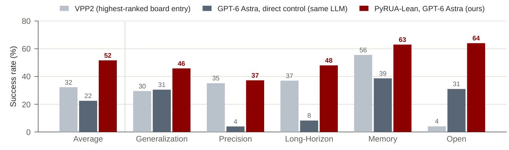

> 图解：纵轴为 SR，横轴依次是平均与五个能力维度。浅灰是榜单第一 VPP2，深灰是同一 LLM 直接控制末端执行器，红色是 PyRUA-Lean。相对直接控制，Average 从 22.48% 升至 51.62%，约 2.3 倍；Precision 从 4.00% 到 37.25%，Long-Horizon 从 8.25% 到 48.00%，恰好补上直接控制最弱的环节。

PyRUA-Lean 比 VPP2 的 Average SR 高 19.4 个百分点，在五个维度均为最高 SR，并在 42 个任务中的 22 个超过所有榜单项。2,100 个 episode 直接池化则成功 1,061 个，即 50.5%；它与 51.62% 的维度等权 Average 是不同统计口径。

不过，直接控制对比同时改变了动作接口、分割感知、推理档位和 Prompt，所以衡量的是系统整体差异，不能全部归因于代码接口。榜单多数条目是单一预训练策略，而这里是“前沿 API 模型 + 分割模型 + 原语库”的系统，也应注意系统形态不同。

### 4.3 哪些任务拉开差距，哪些仍然失败

| 任务 | PyRUA-Lean SR | 最佳榜单 SR | 最佳系统 |
|---|---:|---:|---|
| `imitate_sorting_sequence` | 98.0% | 36.0% | GPT-6 Astra direct |
| `classify_objects_by_language` | 92.0% | 30.0% | GPT-6 Astra direct |
| `stack_blocks_by_language` | 100.0% | 40.0% | GPT-6 Astra direct |
| `sort_nesting_dolls_by_size` | 74.0% | 18.7% | VPP2 |
| `play_stacking_toy` | 66.0% | 23.3% | VPP2 |
| `classify_objects` | 98.0% | 56.0% | GPT-6 Astra direct |
| `press_by_number` | 0.0% | 96.0% | VPP2 |
| `make_kong` | 0.0% | 90.0% | GalaxeaVLA (G0.5) |
| `build_tower` | 2.0% | 83.3% | Simate-beta |
| `pour_liquid_into_cup` | 8.0% | 67.3% | Rex-M1 Preview |
| `insert_key` | 0.0% | 39.3% | PhysicalRSI |
| `swap_blocks` | 0.0% | 38.7% | Simate-beta |

`stack_blocks`、`cover_blocks`、`stack_blocks_by_language` 三个任务全部成功；六个任务零成功，包括 `insert_key`、`make_kong`、`press_by_number` 等。失败集中在接触结果不可观测、或配合精度高于感知误差的任务，论文尚未逐 episode 分析这些失败。

RGB 配置平均每 episode 25.7 次 LLM 调用、750k 输入 Token、9.0k 输出 Token、12.7 分钟，约 \$2.4；一个 Seed 总成本约 \$5,100。成功与失败 episode 分别平均 19.3、32.2 次调用，最长 76 次，没有 episode 达到 100 次预算。

### 4.4 加入深度：主要提升 Precision

深度配置只改观察与三个相关原语：`locate` 直接读取 mask 下的深度点，`back_project` 读取像素深度，`camera_meta` 返回客户端矩阵；规划器、运动原语和预算不变。每格仍为 Score / SR（%）。

| 观察与评测范围 | Episodes | Average | Gen. | Prec. | Long-Hor. | Memory | Open |
|---|---:|---:|---:|---:|---:|---:|---:|
| RGB，同一 Seed | 2,100 | 58.20 / 51.62 | 50.65 / 45.83 | 47.02 / 37.25 | 63.26 / 48.00 | 63.00 / 63.00 | 67.09 / 64.00 |
| RGB + 深度，同一 Seed | 2,100 | 58.59 / 52.42 | 49.71 / 43.83 | 49.92 / 41.00 | 63.02 / 49.00 | 64.00 / 64.00 | 66.29 / 64.25 |
| RGB + 深度，3 Seed 均值 | 6,300 | 58.81 / 52.91 | 51.11 / 45.44 | 49.78 / 41.08 | 64.73 / 51.75 | 64.02 / 64.00 | 64.39 / 62.25 |
| 3 Seed 标准差 | — | 0.15 / 0.35 | 1.10 / 1.23 | 0.57 / 0.51 | 1.39 / 2.15 | 0.02 / 0.00 | 2.16 / 2.16 |

同一 Seed 上，Average SR 从 51.62% 到 52.42%，Precision 从 37.25% 到 41.00%，收益最大。三个 Seed 的 Average SR 为 52.4%、53.2%、53.1%，标准差仅 0.35 个百分点。榜单不允许 Agent 使用深度，所以该配置不参与榜单比较。

## 五、PyRUA-Lean Coder：让 4B 开源模型学会使用接口

前沿模型会写反馈驱动代码，不代表小模型天然也会。作者进一步训练规划器本身，得到 **PyRUA-Lean Coder v0.1-4B**；底层原语和冻结 VLA 完全不变，因此训练目标是“如何使用接口”，不是重新学习抓取技能。

### 5.1 只用 45 个实例做 GRPO

GRPO（Group Relative Policy Optimization，组相对策略优化）可以直觉地理解为：让同一任务跑一组尝试，用组内相对表现决定哪些生成行为更值得强化。这里每组 8 个 episode，奖励只有任务成功为 1、失败为 0。对组内奖励 $\{r_i\}_{i=1}^{8}$，优势做组内标准化：

$$
A_i = \frac{r_i - \operatorname{mean}(r_1,\ldots,r_8)}{\operatorname{std}(r_1,\ldots,r_8)}
$$

随后对 episode 中模型生成的所有 Token（包括推理与代码）应用 clipped policy-gradient Loss，裁剪范围下侧 0.2、上侧 0.28，无 KL 与 entropy 项。没有监督微调，也没有示范数据。

| 训练设置 | 数值或配置 |
|---|---|
| 基座 | Qwen3.5-4B，全参数微调 |
| 训练实例 | 45 个 LIBERO-PRO 实例：goal、spatial、object 各 3 任务 × 5 Seeds |
| 每轮采样 | 16 实例 × 8 rollouts = 128 episodes |
| 每轮优化 | 2 步，每步 64 episodes |
| 优化器 | Adam，学习率 $10^{-6}$，$\beta=(0.9,0.98)$，weight decay 0.1 |
| 总训练量 | 30 轮、3,840 episodes、60 次优化器更新 |
| Rollout | temperature 1.0 |
| 单训练 episode 限制 | 24 cells、30 次 LLM 调用、25 分钟；每次最多 4,096 新 Token |
| 单 episode 生成与上下文 | 最多 40,960 新 Token；上下文 65,536 |
| 基础设施 | 单节点 8 GPU；miles 训练，SGLang rollout；约 12 小时 |

评估仍用主实验的 700 个实例、原语与 VLA，但采用 PyRUA-Lean 自有 Agent loop、65,536 Token 上下文和 90 分钟上限。45 个训练实例单列；其余 155 个 LIBERO-PRO 实例加上另两个 Benchmark，共 655 个训练未见实例。

### 5.2 未见实例：18.8%→44.1%，超过 27B 基座

| Planner | 训练内 LIBERO 45 | 未见 LIBERO 155 | RoboTwin 250 | RC365 atomic 90 | RC365 composite 160 | 全部未见 655 | 全部 700 |
|---|---:|---:|---:|---:|---:|---:|---:|
| Qwen3.5-4B | 37.8% | 13.5% | 14.0% | 52.2% | 12.5% | 18.8% | 20.0% |
| Qwen3.5-27B | 64.4% | **38.1%** | 20.8% | 65.6% | 13.1% | 29.2% | 31.4% |
| **PyRUA-Lean Coder v0.1-4B** | **71.1%** | 37.4% | **52.4%** | **76.7%** | **19.4%** | **44.1%** | **45.9%** |
| GPT-6 Astra（参考，不同 Agent loop） | 100.0% | 92.3% | 69.2% | 86.7% | 39.4% | 69.8% | 71.7% |

提升迁移到了不同模拟器、机器人和 VLA：训练只见单臂桌面与 $\pi_{0.5}$，测试却包括双臂 LingBot-VLA 和厨房移动操作 RLDX-1。训练后的 4B 在全部未见实例上超过 Qwen3.5-27B 的 29.2%，但 LIBERO 未见任务仍略低于 27B 的 38.1%，也远落后于 GPT-6 Astra。

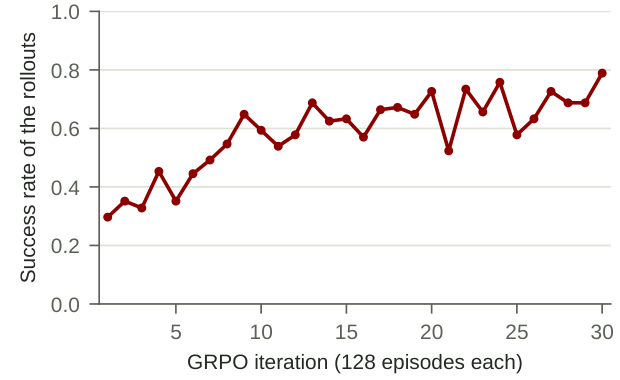

> 图解：横轴是 30 个 GRPO iteration，每轮 128 个训练 episode；纵轴是 rollout 成功率。首轮为 0.30，最后五轮平均为 0.70。曲线使用 45 个训练实例和更短的 24-cell 限制，不能与前述评估成功率直接比较。

### 5.3 真正改变的是交互习惯

下表统计未见实例。除“每次调用 cell 数”为 episode 中位数外，其余为均值或比例；请求图片不含初始任务卡中的 2～3 张。

| Planner | LLM 调用 | cell/调用 | Code cells | 请求图片 | 成功 | 主动放弃 | 耗尽 cell | 超时 | 上下文溢出 |
|---|---:|---:|---:|---:|---:|---:|---:|---:|---:|
| Qwen3.5-4B | 9.4 | 9.0 | 89.4 | 19.3 | 18.8% | 6.9% | 52.7% | 2.4% | 19.2% |
| Qwen3.5-27B | 35.5 | 1.0 | 34.9 | 22.5 | 29.2% | 4.6% | 35.0% | 0.3% | 31.0% |
| **Coder v0.1-4B** | 21.1 | 1.0 | 21.0 | 0.8 | 44.1% | 25.2% | 10.5% | 16.8% | 3.4% |

4B 基座一次调用中位写入 9 个 cell，在看到首个结果前就承诺一批动作；89% 的 episode 每次调用超过 1.5 个 cell。训练后变成一次调用一个 cell，先读反馈再继续；图片请求从 19.3 降至 0.8，耗尽预算与上下文溢出显著减少。

代价是主动放弃升至 25.2%，墙钟超时升至 16.8%。所以论文的谨慎结论很准确：模型学会的是逐步使用接口，不等于操作技能本身被训练得更好。

## 六、深入执行轨迹：代码 Agent 到底多做了什么

平均数字之后，还要看具体轨迹。一个接近 LIBERO-PRO 中位成本的 bowl-placement 实例，把接口差异展示得很直观。

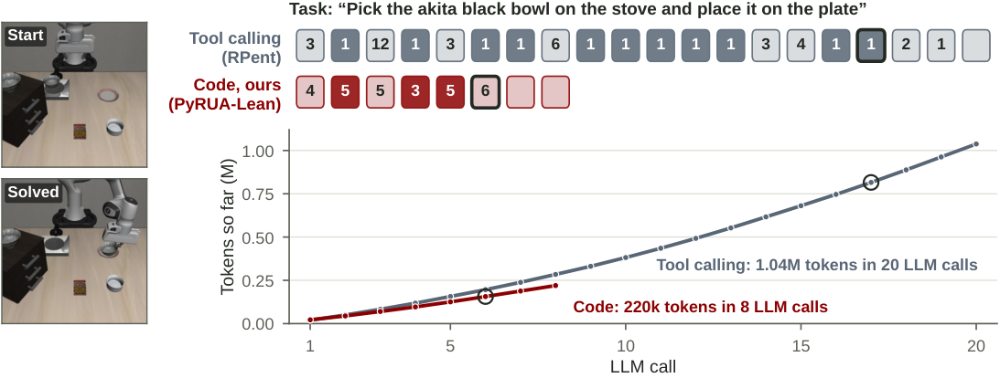

> 图解：上方每个方块是一轮 LLM 调用，数字是本轮工具或原语数量，深色表示返回图片，描边表示任务在此轮成功。下方横轴为 LLM 调用轮次，纵轴为累计输入 Token。Tool 在第 17 轮成功，整个 episode 共 20 轮、1.04M Token、33 张图；Code 在第 6 轮成功，共 8 轮、220k Token、5 张图，成功时分别为 816k 与 156k Token。

### 6.1 同一 episode 的逐轮账单

| 调用 | Tool：执行内容 | 累计 Token | Code：执行内容 | 累计 Token |
|---:|---|---:|---|---:|
| 1 | 读取文本文件 ×3 | 20k | 4 次原语：反投影、分割、状态 | 22k |
| 2 | 状态；返回 3 图 | 50k | 5 次原语：移动、`pi0_pick`、状态；请求 2 图 | 44k |
| 3 | 反投影 ×12 | 83k | 5 次原语：移动、分割、夹爪、状态 | 70k |
| 4 | 移动；返回 3 图 | 118k | 3 次分割；请求 2 图 | 96k |
| 5 | 反投影 ×3 | 157k | 5 次原语：移动、分割、状态；请求 1 图 | 126k |
| 6 | 移动；返回 3 图 | 196k | 6 次原语：移动、释放、分割、状态；**成功** | 156k |
| 7 | 移动；返回 3 图 | 239k | `finish` | 188k |
| 8 | 反投影 ×6 | 284k | 最终消息 | 220k |
| 9 | `pi0_pick`；返回 3 图 | 331k | — | — |
| 10 | `set_gripper`；返回 3 图 | 382k | — | — |
| 11 | 移动；返回 3 图 | 435k | — | — |
| 12 | 移动；返回 3 图 | 492k | — | — |
| 13 | 移动；返回 3 图 | 553k | — | — |
| 14 | 反投影 ×3 | 616k | — | — |
| 15 | 反投影 ×4 | 681k | — | — |
| 16 | 移动；返回 3 图 | 746k | — | — |
| 17 | 释放；返回 3 图；**成功** | 816k | — | — |
| 18 | 写文本文件 ×2 | 888k | — | — |
| 19 | `finish` | 963k | — | — |
| 20 | 最终消息 | 1.04M | — | — |

Code 的六个执行 cell 分别完成：定位两个物体；接近并抓取；闭合夹爪并抬起；检查抓取；搬运；计算几何目标并放置。第七、八次 LLM 调用是成功后的结束与最终消息，已计入全 episode 账单。

### 6.2 更多中位轨迹：节省幅度因任务结构而异

下表从每个 Benchmark 选取 5 个双方成功、Token 倍数接近该 Benchmark 中位数的实例。任务名为原文标识，Token 为全 episode。

| Benchmark | 任务（Seed） | 调用 Tool→Code | Token Tool→Code | 缩减 |
|---|---|---:|---:|---:|
| LIBERO | object swap 0（1） | 21→8 | 1.09M→219k | 5.0× |
| LIBERO | spatial swap 5（1） | 18→7 | 918k→188k | 4.9× |
| LIBERO | goal swap 4（3） | 19→7 | 991k→199k | 5.0× |
| LIBERO | spatial swap 9（3） | 24→9 | 1.43M→288k | 5.0× |
| LIBERO | object swap 3（1） | 17→6 | 814k→161k | 5.0× |
| RoboTwin | place container plate（100000） | 7→4 | 151k→89k | 1.7× |
| RoboTwin | open laptop（100008） | 7→4 | 149k→88k | 1.7× |
| RoboTwin | place empty cup（100001） | 7→4 | 150k→89k | 1.7× |
| RoboTwin | rotate qrcode（100001） | 7→4 | 151k→89k | 1.7× |
| RoboTwin | move pillbottle pad（100002） | 7→4 | 152k→91k | 1.7× |
| RC365 atomic | CloseToasterOvenDoor（1） | 5→3 | 91k→74k | 1.2× |
| RC365 atomic | PickPlaceToasterToCounter（4） | 5→3 | 92k→75k | 1.2× |
| RC365 atomic | CoffeeSetupMug（5） | 5→3 | 92k→75k | 1.2× |
| RC365 atomic | TurnOnSinkFaucet（4） | 5→3 | 91k→74k | 1.2× |
| RC365 atomic | TurnOnElectricKettle（4） | 5→3 | 91k→75k | 1.2× |
| RC365 composite | ScrubCuttingBoard（3） | 8→4 | 159k→101k | 1.6× |
| RC365 composite | WashLettuce（1） | 8→4 | 162k→100k | 1.6× |
| RC365 composite | StackBowlsCabinet（1） | 6→3 | 117k→78k | 1.5× |
| RC365 composite | CuttingToolSelection（2） | 18→9 | 438k→253k | 1.7× |
| RC365 composite | LoadDishwasher（5） | 15→7 | 361k→193k | 1.9× |

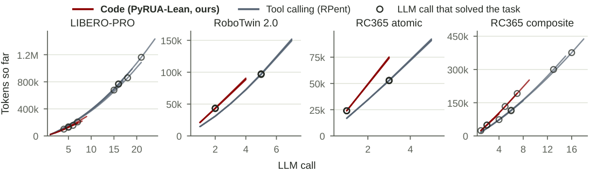

> 图解：四个子图横轴均为 LLM 调用，纵轴为累计 Token，圆圈标出成功调用。红色 Code 曲线通常更早结束；RoboTwin 与 RC365 atomic 的中位轨迹跨任务很相似，因而多条线重叠。LIBERO 的差距最大，RC365 atomic 最小，与主表一致。

### 6.3 11,145 个 cell 的行为统计

一个 Code cell 平均执行 2.1 个动作原语，Tool 每轮 LLM 调用只有 0.65 个；45% 的 cell 执行至少两个动作。Tool 的 18,585 次 LLM 调用中，89% 的带工具调用只执行一个工具，只有 45 次同时运行两个动作工具。

| 行为 | 全部 | LIBERO | RoboTwin | RC365 atomic | RC365 composite |
|---|---:|---:|---:|---:|---:|
| 每 cell 动作原语数 | 2.1 | 2.0 | 1.9 | 2.1 | 2.4 |
| Tool 每轮动作工具数 | 0.65 | 0.60 | 0.69 | 0.56 | 0.67 |
| 至少两个动作原语 | 45% | 61% | 24% | 50% | 56% |
| 单步执行并观察 | 35% | 14% | 54% | 33% | 28% |
| 动作依赖先前结果 | 19% | 45% | 12% | 20% | 14% |
| 循环运动 | 14% | 6% | 12% | 22% | 17% |
| 重试 VLA | 8% | 0% | 0% | 18% | 17% |
| 使用 NumPy 计算 | 30% | 25% | 31% | 29% | 30% |
| 复用先前 cell 变量 | 19% | 33% | 18% | 10% | 14% |
| 调用先前 cell 的 helper | 7% | 7% | 6% | 2% | 9% |
| 请求相机图片 | 84% | 82% | 78% | 90% | 90% |
| 仅未完成时观察 | 20% | 19% | 8% | 58% | 24% |

这些行为可归纳为五类，下面保留论文中的代表性代码。

**受保护的动作链。** 只有接近成功才调用 VLA，只有任务未完成才看图：

```python
approach = robo.move_to(prepose, gripper=robo.OPEN)
if approach.reached and not robo.done:
    picked = robo.pi0_pick('pick up the black bowl between the plate and the ramekin', max_chunks=20)
print(robo.state())
if not robo.done:
    robo.show('agentview')
    robo.show('wrist')
```

**局部重试。** 最多重试 3 次 VLA，成功或状态改变即退出，不必每次回 LLM：

```python
for attempt in range(3):
    result = robo.rldx_arm()
    if robo.done or result.status != 'cap':
        break
if not robo.done:
    robo.show('agentview')
    robo.show('wrist')
```

**自建感知。** 30% 的 cell 使用 NumPy。下面从点云计算平面上方点集的主轴，再确定中心与抓取 yaw，而不只消费工具给定结果：

```python
upper = points[points[:, 2] > 0.794]
eigenvalues, eigenvectors = np.linalg.eigh(np.cov(upper[:, :2].T))
long_axis = eigenvectors[:, 1]
projection_long = upper[:, :2] @ long_axis
yaw = math.atan2(long_axis[1], long_axis[0])
```

**自建可复用技能。** 以下 helper 每次下降 8 mm，若未到达、高度不再下降或横向漂移超过阈值就停止：

```python
def lower_guarded(arm_name, target_tcp_z):
    target = np.array(robo.state().arm(arm_name).eef_pos)
    while target[2] > target_tcp_z and not robo.done:
        before = robo.state().arm(arm_name)
        target[2] -= 0.008
        result = robo.move_to(arm_name, target, substeps=8)
        after = robo.state().arm(arm_name)
        if not result.reached or after.eef_pos[2] >= before.eef_pos[2] - 0.001:
            break
```

这里的代码片段用于展示控制结构；完整论文版本还包含最终高度修正、横向误差与更多终止检查。它说明持久 namespace 不只是“省掉变量输出”，更让模型逐步构建当前 episode 的小型技能库。

## 七、两个恢复案例：代码组合如何转化为成功率

成功率提升不能只用 Token 解释。下面两个实例中，双方遇到相似挫折，但代码接口提供了不同的恢复路径。

### 7.1 摩卡壶掉落：拟合壶盖平面，再把壶底对准炉圈

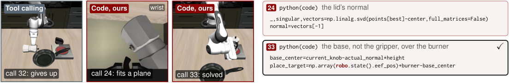

> 图解：左侧 Tool 在第 32 次调用放弃；中间 Code 在第 24 次调用用腕部图像与点云拟合壶盖平面；右侧第 33 次调用将壶底而非夹爪位置对准炉圈，任务成功。上方代码用 SVD 求平面法向，下方代码据法向和壶高计算放置目标。

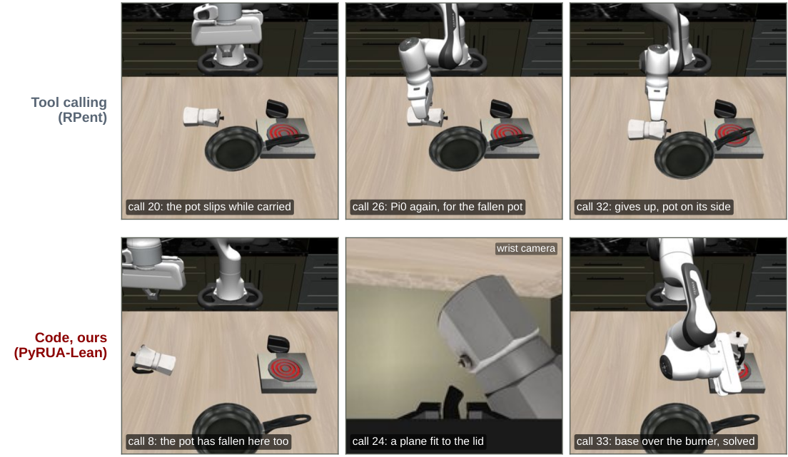

> 图解：上排 Tool 在搬运时让壶滑落，之后四次调用 `pi0_pick` 仍失败并放弃；下排 Code 同样遇到掉壶，但随后将壶转正并放置。两侧起始失败相似，差别主要出现在失败后的处理。

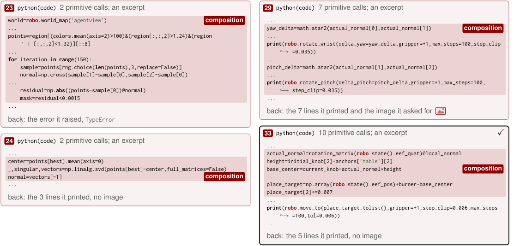

> 图解：第 23 次调用采样平面并计算残差，却因 NumPy 不支持半精度数组的线性代数运算而报 `TypeError`；持久状态保留点集后，第 24 次调用转换类型并用 SVD 求法向。第 29 次调用调整姿态，第 33 次调用根据局部法向、末端旋转和壶高计算 `base_center`，再将 `place_target` 对准炉圈。异常反馈与持久变量共同支持了这次修复。

### 7.2 柜门只开一条缝：三点拟合铰链圆弧，一次连续拉动

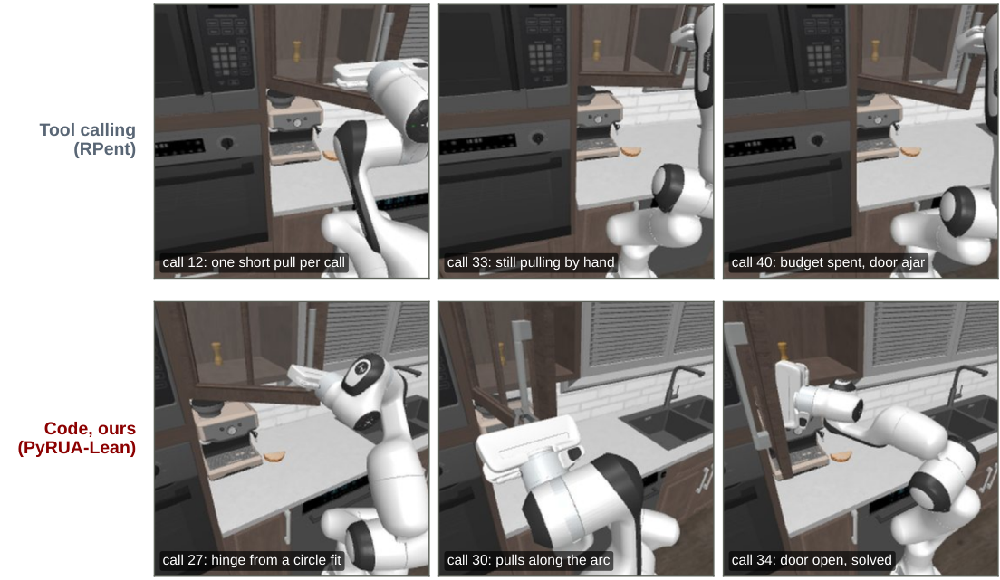

> 图解：上排 Tool 每次调用只拉几厘米，第 40 次耗尽预算时门仍未完全打开；下排 Code 在第 27 次调用拟合铰链，第 30 次沿圆弧拉动，第 34 次由后续 VLA 调用完成任务。

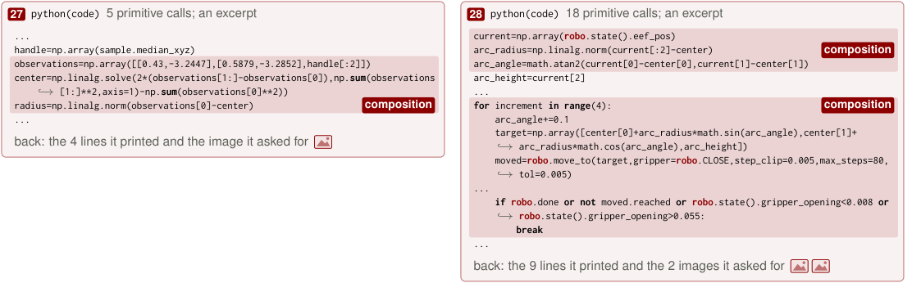

> 图解：第 27 次调用取三个把手位置，其中两个来自先前输出，通过线性方程求圆心与半径；第 28 次调用在一个 cell 内循环生成圆弧目标并移动。若任务完成、运动未到达、夹爪滑脱或开口异常就立即中断，兼顾了连续动作与运行时保护。

这两个案例也揭示成功增益的边界：有些是更充分利用预算，有些是即时构造几何恢复程序，有些仍只是 VLA 随机性。不能把所有额外成功都归结为某一种机制。

## 八、复现补充：RoboDojo 逐任务结果与实验细节

### 8.1 42 个任务的完整 SR

下表单位均为成功率百分比。`Ours + D` 是三个深度 Seed 的结果，不与榜单比较；Astra 为直接末端控制；Best 来自公开榜单中有逐任务结果的 57 个策略。

| 维度 | 任务 | Ours | Ours + D | Astra | Best | 最佳榜单系统 |
|---|---|---:|---:|---:|---:|---|
| Gen. | `stack_bowls` | **78.0** | 75.3 | 62.0 | 74.7 | Simate-beta |
| Gen. | `push_T` | **76.0** | 78.0 | 60.0 | 60.0 | GPT-6 Astra direct |
| Gen. | `pack_objects_into_box` | **32.0** | 17.3 | 0.0 | 17.3 | Simate-beta |
| Gen. | `fold_clothes` | 70.0 | 48.7 | 72.0 | 78.0 | Simate-beta |
| Gen. | `hang_mugs` | 2.0 | 14.0 | 0.0 | 32.0 | VPP2 |
| Gen. | `sweep_blocks` | **18.0** | 24.7 | 4.0 | 14.0 | Rex-M1 Preview |
| Gen. | `pour_liquid_into_cup` | 8.0 | 16.0 | 4.0 | 67.3 | Rex-M1 Preview |
| Gen. | `make_toast` | 6.0 | 18.7 | 0.0 | 39.3 | VPP2 |
| Gen. | `arrange_largest_number` | **86.0** | 76.7 | 60.0 | 60.0 | GPT-6 Astra direct |
| Gen. | `sort_nesting_dolls_by_size` | **74.0** | 76.0 | 18.0 | 18.7 | VPP2 |
| Gen. | `store_laptop_and_headphones` | 0.0 | 0.0 | 0.0 | 34.0 | Simate-beta |
| Gen. | `stack_blocks` | **100.0** | 100.0 | 86.0 | 86.0 | GPT-6 Astra direct |
| Prec. | `fasten_screws` | **66.0** | 69.3 | 16.0 | 48.0 | Awomo-0.5 |
| Prec. | `plug_in_charger` | 12.0 | 14.0 | 0.0 | 30.7 | PhysicalRSI |
| Prec. | `insert_tubes` | 44.0 | 70.7 | 0.0 | 74.7 | VPP2 |
| Prec. | `pour_balls_into_vase` | **76.0** | 69.3 | 4.0 | 60.7 | VPP2 |
| Prec. | `play_Xylophone` | **64.0** | 67.3 | 8.0 | 30.7 | Awomo-0.5 |
| Prec. | `deposit_coin` | 34.0 | 34.0 | 2.0 | 56.0 | PhysicalRSI |
| Prec. | `insert_key` | 0.0 | 0.0 | 0.0 | 39.3 | PhysicalRSI |
| Prec. | `build_tower` | 2.0 | 4.0 | 2.0 | 83.3 | Simate-beta |
| Long | `put_bottles_into_dustbin` | 76.0 | 94.7 | 10.0 | 100.0 | Simate-beta |
| Long | `fill_pen_holder` | 14.0 | 16.7 | 0.0 | 42.0 | InternW0-$\Delta$ |
| Long | `classify_objects` | **98.0** | 99.3 | 56.0 | 56.0 | GPT-6 Astra direct |
| Long | `play_tic_tac_toe` | 94.0 | 94.7 | 0.0 | 94.0 | PhysicalRSI |
| Long | `fill_egg_holder` | **2.0** | 2.0 | 0.0 | 1.0 | Liber-0 Lite |
| Long | `organize_table` | **34.0** | 39.3 | 0.0 | 26.0 | Simate-beta |
| Long | `make_kong` | 0.0 | 0.0 | 0.0 | 90.0 | GalaxeaVLA (G0.5) |
| Long | `play_stacking_toy` | **66.0** | 67.3 | 0.0 | 23.3 | VPP2 |
| Memory | `cover_blocks` | 100.0 | 100.0 | 46.0 | 100.0 | 8 entries |
| Memory | `match_and_pick_from_conveyor` | 82.0 | 86.7 | 62.0 | 92.0 | InternW0-$\Delta$ |
| Memory | `swap_blocks` | 0.0 | 0.0 | 0.0 | 38.7 | Simate-beta |
| Memory | `swap_T` | **98.0** | 100.0 | 18.0 | 92.7 | PhysicalRSI |
| Memory | `press_by_number` | 0.0 | 0.0 | 70.0 | 96.0 | VPP2 |
| Memory | `imitate_sorting_sequence` | **98.0** | 97.3 | 36.0 | 36.0 | GPT-6 Astra direct |
| Open | `align_blocks` | 78.0 | 71.3 | 50.0 | 86.0 | PhysicalRSI |
| Open | `general_pickup` | **98.0** | 93.3 | 84.0 | 84.0 | GPT-6 Astra direct |
| Open | `stack_blocks_by_language` | **100.0** | 100.0 | 40.0 | 40.0 | GPT-6 Astra direct |
| Open | `solve_equation` | **90.0** | 86.7 | 40.0 | 60.0 | PhysicalRSI |
| Open | `classify_objects_by_language` | **92.0** | 90.7 | 30.0 | 30.0 | GPT-6 Astra direct |
| Open | `pick_from_conveyor_by_image` | **34.0** | 28.7 | 4.0 | 4.0 | GPT-6 Astra direct |
| Open | `store_tools_in_toolbox` | 0.0 | 0.0 | 0.0 | 0.0 | — |
| Open | `pour_by_language` | **20.0** | 27.3 | 0.0 | 0.0 | — |

加粗表示超过所有榜单项；PyRUA-Lean 在 22 个任务领先、3 个任务并列最佳。逐任务表也提醒读者：五维平均领先不等于每个任务更强，精密插入、液体倾倒、接触反馈缺失的任务依然明显薄弱。

### 8.2 RGB 与深度配置的实际差别

| 项目 | RGB | RGB + 深度 |
|---|---|---|
| 观察 | 3 张 RGB 与机器人状态 | 额外加入每相机深度图、内参与外参 |
| `locate` | 多相机 mask 联合估计 footprint 与高度；单相机无法可靠测高 | 单相机读取 mask 下深度点，直接求中心、顶部和 footprint |
| `back_project` | 先分割像素下物体，再多视图测量射线交点或桌面 | 直接读取像素深度 |
| `camera_meta` | 固定工作站标定；腕部相机由手臂状态推导 | 使用评测客户端提供的矩阵 |
| 操作说明 | 说明腕部相机测高与抓前俯视重测 | 删除这些说明 |

深度三个 Seed 平均每 episode 23.9 次 LLM 调用，成本约 \$2.2；三个 Seed 总计约 \$14,000。所有 RGB 与深度运行都检查了任务布局数量、三路相机视频、客户端错误与超时，以及适配器和官方结果文件的一致性；本地计算指标与 RoboDojo 汇总脚本一致。

### 8.3 主实验与 Coder 评估不能混为一谈

主实验 LIBERO 使用 Seeds 0–4，RoboTwin 使用 100000–100004，RoboCasa365 使用 1–5；无法构建的 RoboTwin Seed 会顺延，模拟器或 VLA 服务失联会重跑。RoboCasa365 的 `CoffeeSetupMug` Seed 4 所有相机只渲染噪声，因此改用 Seed 6。

Coder 评估则把预算定义为 cell 数，上下文固定 65,536，超过即结束，墙钟上限 90 分钟；采样为 temperature 1.0、top-$p$ 0.95、top-$k$ 20，每次调用最多 8,192 新 Token。GPT-6 Astra 参考行来自不同 Agent loop 和限制，不能视为与 4B/27B 的严格受控对比。

主对比的 Prompt 删除了记忆、recipe 与 audit 相关指令，但保留基线原始工具描述；轨迹检查未发现跨 episode 文件读取。成功后的文件写入调用仍计入整段成本。首个 Prompt 中位数在 LIBERO 上为 Tool 20k、Code 22k，在 RoboTwin 上为 15k、21k，在 RC365 上为 17k、24k：Code 的 API 描述更长，会抵消一部分少调用收益。

## 九、结论：把协调留给程序，把判断留给模型

- **接口本身是变量**：同一 GPT-6 Astra、同一原语下，成功率从 63.1% 到 71.7%，共同成功实例输入 Token 减少 65%。
- **节省主要来自少调用**：条件分支、局部重试、NumPy 几何和 helper 复用留在运行时；并非每次 prompt 都更短。
- **按需看图不是单独答案**：Tool 仅改为按需返回图片，成功率反而从 83.0% 降至 68.5%。
- **接口具有迁移与可学习性**：无 VLA 的几何原语在 RoboDojo 达到 51.6% Average SR；45 个实例的 GRPO 让 4B 模型未见实例成功率从 18.8% 到 44.1%。
- **结论仍有边界**：目前主要是单规划器、单次运行和仿真；组件因果贡献未完全隔离，全量 RC365 atomic 成本几乎不变，真实机器人延迟与恢复仍待验证。

未来更值得研究的是原语粒度、跨 episode 复用已验证例程，以及真实机器人上的延迟、接触反馈和失败恢复，而不是只继续堆大模型上下文。

> 本文参考自 [Fewer Tokens, Better Action: GPT-6 Astra Robot Agents with POOLED_SR_REL Higher Success Rate but POOLED_TOKENS_FEWER Fewer Tokens](https://arxiv.org/abs/2610.01939v1)