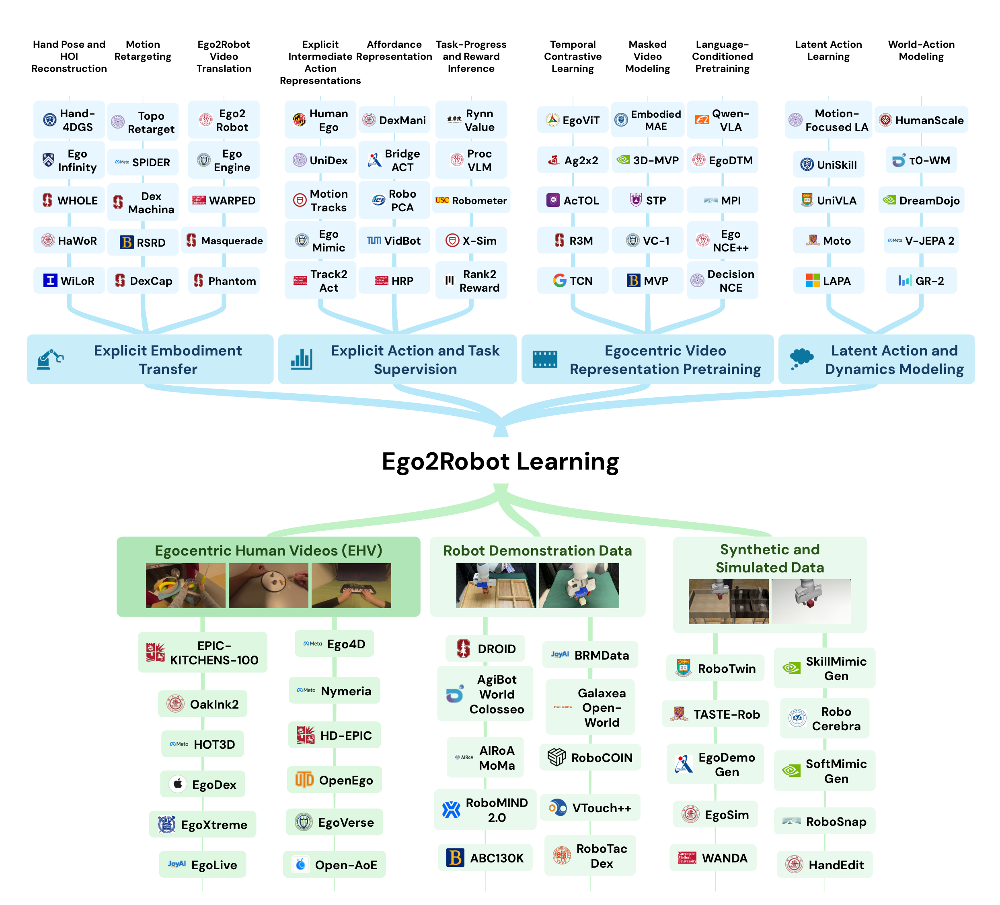
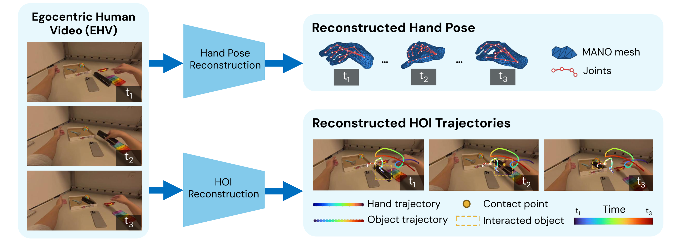
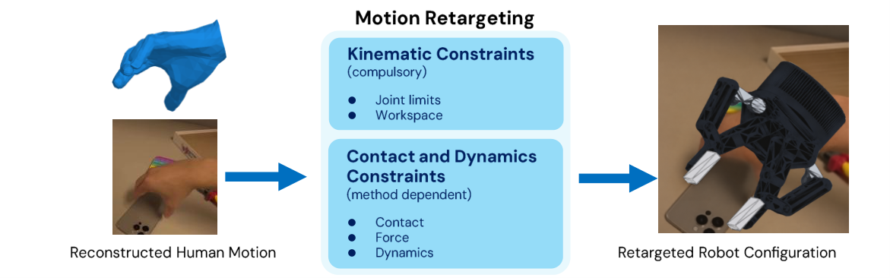
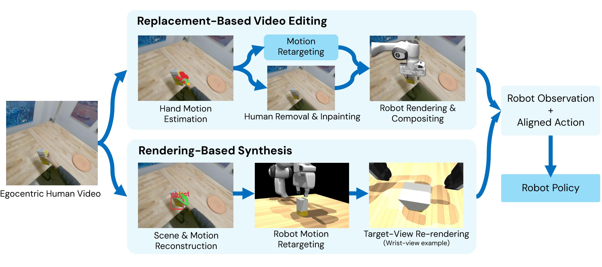
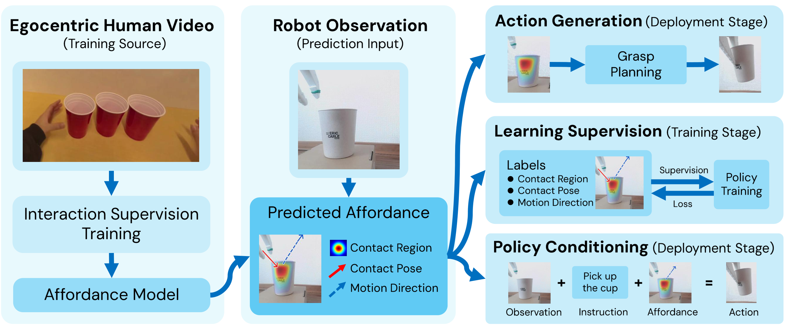
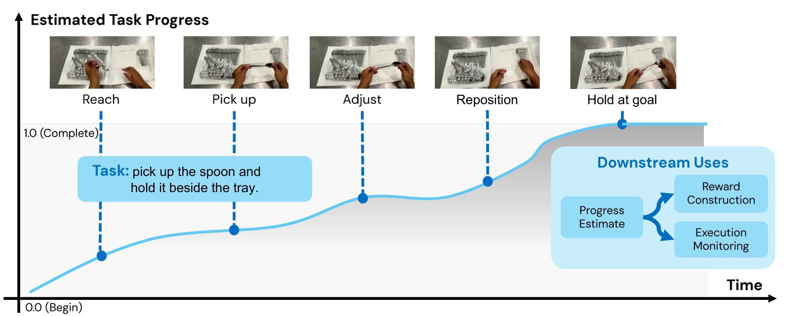
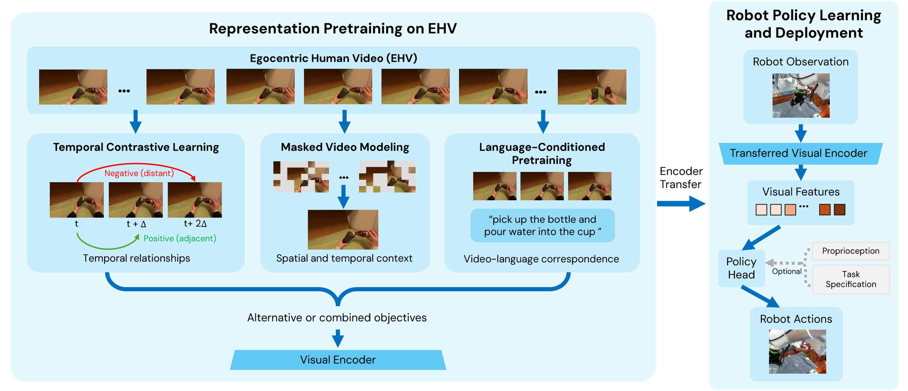
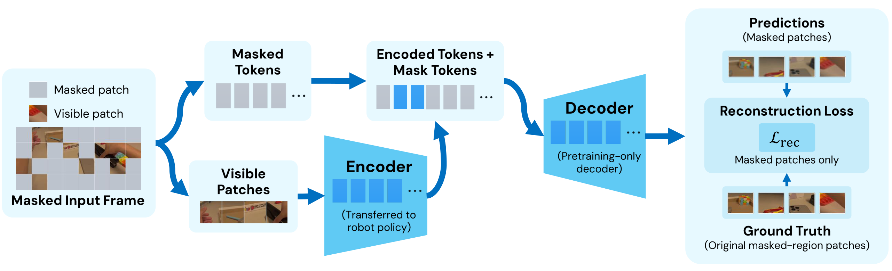
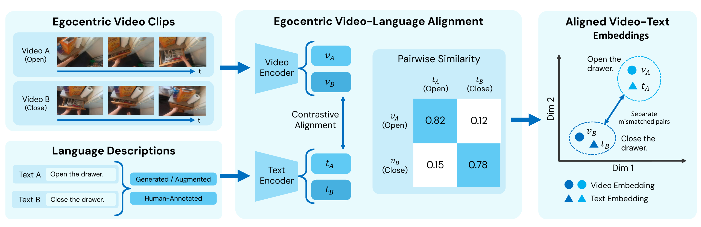
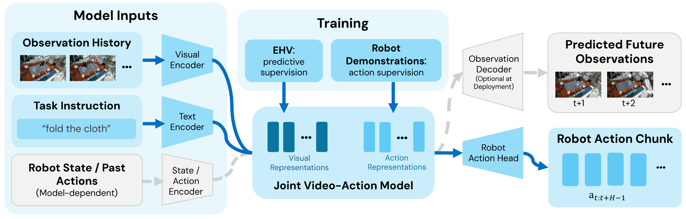

# Ego2Robot：四条路径迁移人类操作经验

这篇综述回答的问题是：没有机器人动作标签的第一人称人类视频，怎样真正转化为机器人可执行的 manipulation 能力。它的重要性在于，人类视频容易规模化，却始终隔着形态、视角、动作空间和接触动力学四道鸿沟。作者用“显式本体迁移、显式动作与任务监督、视频表征预训练、Latent Action 与动力学建模”四条路径统一梳理 Ego2Robot，并强调训练时迁移与部署时上下文适应是互补机制。论文并未提出一个刷新成功率的新模型，其最直观的量化结果是数据版图：Ego4D 达 3,700 小时，EgoDex 达 829 小时、9,000 万帧，而机器人侧的 YUBI 记录了 120 万条 episode、8,400 小时数据。

> 图解：全图上半部分给出四条学习路径，下半部分对应第一人称人类视频、机器人 demonstration、合成与仿真数据三类资源。四条路径的区别不在于模型名称，而在于从视频中保留什么信息、把它交给机器人做什么，以及还需要多少机器人侧的 grounding。

## 为什么“看懂人手”还远不等于“机器人会做”

Egocentric Human Video（EHV，第一人称人类视频）由头戴或身体佩戴相机拍摄。它近距离记录手、物体及其空间关系，也保留动作顺序、物体状态变化和任务进度。相比让机器人反复遥操作，EHV 更容易覆盖不同任务、物体与环境。

但这种数据天然缺少机器人控制所需的关键信息：

- **形态差异**：人手的关节、自由度和接触面不能直接映射到夹爪或灵巧手。
- **视角差异**：人头相机会随身体运动，机器人腕部或头部相机的观察条件不同。
- **动作标签缺失**：视频有视觉变化，却没有机器人关节命令、力矩或控制频率。
- **物理信息不完整**：单目 RGB 很难唯一确定力、摩擦、遮挡接触和深度。

因此，论文把 **Ego2Robot learning** 定义为：从 EHV 学习或适配机器人 manipulation policy，并把人类经验落到目标机器人的能力边界内。核心文献必须同时满足两个条件：使用 EHV 提供训练数据、监督或任务信息；通过 policy learning、planning 或 execution 与机器人操作建立联系。混合数据工作可以纳入，但不能把全部收益都归因于 EHV。

形式上，给定人类视频数据集 $\mathcal{D}_{\mathrm{h}}$，也可补充机器人数据 $\mathcal{D}_{\mathrm{r}}$，目标是学习策略：

$$
\pi_\theta(a_t \mid o_{\leq t}, g, c_t)
$$

其中，$o_{\leq t}$ 是视觉与本体感觉历史，$g$ 可以是语言指令或目标图像，$c_t$ 是部署时的可选上下文，例如 demonstration、检索经验或过去的机器人交互与反馈。EHV 既能在训练时塑造参数，也能在部署时作为上下文；两者都不能绕开机器人能力与物理执行约束。

### 这篇综述与相邻综述有什么不同

| 综述 | 年份 | 主要范围 | 组织与分析视角 |
|---|---:|---|---|
| Eze and Crick | 2025 | 基于视频的机器人操作 | 被动视频操作的感知基础与学习方法 |
| McCarthy et al. | 2025 | 从互联网视频学习通用机器人 | 知识提取、视频到机器人适配、视频辅助学习 |
| Zheng et al. | 2026 | 从无动作标签视频学习操作 | 视频到控制接口、闭环、验证与失败模式 |
| Ma et al. | 2026 | 从一般人类视频学习机器人 | 任务、观察、动作导向的迁移及数据耦合 |
| Feng et al. | 2026 | 基于人类视频的 VLA 学习 | Latent Action、World Model、显式 2D/3D 信号与 grounding |
| Ye et al. | 2026 | 具身操作的数据生态 | 五源数据金字塔、规模化、机器人对齐与数据混合 |
| **本文** | **2026** | **专注 EHV 的 Ego2Robot learning** | **EHV 提供什么、机器人怎样使用、还需什么数据或 grounding** |

接下来按四条路径展开。阅读时每条路径都可以问同三个问题：监督信号是什么？它在训练还是部署时生效？错误会不会在执行阶段被放大？

## 路径一：显式本体迁移，把视频改造成机器人数据

这条路径最直接：先从 EHV 恢复手和物体，再把运动映射到机器人，必要时连画面也转换成机器人视角，最终得到 robot-format 的 observation-action pair。它像一条“数据翻译流水线”，优点是输出可直接用于 imitation learning，缺点是每一级误差都会传给下一级。

### 第一步：Hand Pose 与 HOI Reconstruction

> 图解：输入是 EHV 帧，输出包括 hand mesh、关节、交互轨迹和接触位置。轨迹颜色表示时间推进，黄色框和标记对应被操作物体及接触点；这些信息随后用于 motion retargeting，而不是直接等同于机器人动作。

只重建手部的工作包括：FrankMocap 将独立回归的身体与手部姿态组合为全身重建；HaMeR 通过更大的 Transformer 和更多样的标注数据提升手部重建；WiLoR 结合手部定位与 mesh reconstruction，不显式使用 temporal module 也能进行平滑视频跟踪。

问题在于，相机坐标系里的准确姿态仍可能混入手部运动与 ego-motion。HaWoR 因此同时估计相机空间手部重建和世界空间相机轨迹，并在手离开视野时补全运动。EgoHandICL 用 VLM 引导 exemplar retrieval，进行 in-context hand reconstruction；Hand-4DGS 结合 mesh-guided Gaussian 表示与 temporal convolution；EventEgoHands 和 EgoEV-HandPose 利用事件流应对运动模糊与低光，但无法直接处理已有 RGB-only 视频库。

进一步地，Hand-Object Interaction（HOI）重建不仅追踪手，还恢复物体运动与接触关系：

- **WHOLE**：在已知物体模板时，借助生成式交互先验联合重建世界空间中的手和物体。
- **EgoGrasp**：面向 open-vocabulary 物体，以 body-guided diffusion 估计手部，再用 HOI prior 补全物体姿态。
- **EgoInfinity**：把重建、尺度标定和交互感知 refinement 接入 video-to-action pipeline，输出手轨迹、物体姿态和接触相关状态。

**这一步的关键不是“手看起来准不准”，而是轨迹是否在世界坐标系中一致、手物关系是否可信。** 遮挡、单目深度歧义和相机跟踪漂移都会污染后续动作标签；物体运动与接触估计还能提供单纯手轨迹无法给出的约束。

### 第二步：Motion Retargeting

> 图解：重建的人体运动被映射到目标机器人，同时受到关节极限和工作空间约束；不同方法还会加入接触或动力学约束。图中的机器人叠加层是示意，核心是把“人的运动”改成“机器人可执行且尽量保留交互结构的运动”。

运动学方法以几何对应为主。Bharadhwaj et al. 将预测的人手轨迹映射为机器人运动，探索不使用同域机器人轨迹的 zero-shot manipulation；DexCap 将可穿戴 motion capture 与 retargeting 结合，用于灵巧 imitation learning；Smooth Operator 通过无梯度采样降低实时重定向抖动。

但几何上跟得上，不代表抓得住。接触与物理感知方法进一步约束交互：

- **TopoRetarget** 用手和物体关键点的稀疏图保留交互拓扑。
- **ObjRetarget** 同时考虑手臂约束与 object-aware contact geometry。
- **C2Dex** 以稳定的物体侧接触为共同目标，再用 residual RL 在仿真中修正动作。
- **SPIDER** 使用 physics-based sampling 和接触引导，把纯运动学 demonstration 转为动力学可行轨迹。

输出可以用于多种下游方式。Do as I Do 直接生成灵巧机器人动作序列；VideoManip 结合接触优化和 demonstration synthesis；DexImit 将任务拆为子任务并调度双手；ViViDex 先用轨迹引导奖励训练 state-based policy，再学习 vision-based policy。Robot See Robot Do 与 DexMachina 更偏向 object-centric：前者复现关节物体部件轨迹，后者让不同机器人追踪物体状态，而不必复制人的关节运动。

这里存在一个不可消除的权衡：**越忠实于人体轨迹，越可能不适合机器人；越强调机器人可行性，越可能偏离原示范。** 即使满足关节极限，未知力与摩擦仍会导致滑移或失去接触。

### 第三步：Ego2Robot Video Translation

> 图解：左侧思路是 replacement-based editing，在保留原场景的同时替换人体；右侧是 rendering-based synthesis，重建交互后从目标机器人视角重新渲染。两条路线都试图生成与重定向动作对齐的机器人观察。

Replacement-based editing 的代表包括 Phantom、Masquerade 和 EgoEngine。Phantom 估计手姿、inpaint 掉人臂，再叠加渲染机器人；Masquerade 将这一思路用于野外 EHV 中的双臂机器人；EgoEngine 则在可行性约束下生成灵巧机器人视频及任务对齐的动作轨迹。

Rendering-based synthesis 先重建场景，再改变观察视角。WARPED 从单目 EHV 跟踪手物运动、重定向轨迹，并用 Gaussian Splatting 生成腕部观察；AgenticFocus 恢复遮挡物体几何，配对 mixed-reality humanoid 观察与同步机器人状态、动作；RoboPaint 能渲染带触觉感知的轨迹，但依赖多相机、手套和触觉采集，已不是单目 EHV 方案。

这些数据既可直接训练 policy，也可用于预训练后再适配。Phantom 和 EgoEngine 在其评估设置中报告了不使用机器人 demonstration 的部署；Masquerade 用未来机器人关键点预测预训练视觉编码器，并在机器人 demonstration 微调时保留辅助目标；Wang et al. 则把动作重定向、视觉合成与质量筛选结合，用于人机和机器人数据联合 VLA 预训练。

编辑画面必须与动作严格一致：inpainting 可能改掉被操作物体，渲染可能带来部署域差异，重建误差则可能让机器人与物体的相对位姿失真。“不需要机器人 demonstration”也不等于“不需要额外数据”，例如 WARPED 仍需要独立的工作空间扫描与几何对齐。

## 路径二：显式动作与任务监督，只提取机器人需要的信号

完整转换整段视频成本很高，也不一定必要。第二条路径只提取可解释的中间信号：动作应该怎么走、哪里可以交互、任务完成到什么程度。它把人体到机器人的差异留给下游控制器处理，监督更容易检查，但被丢弃的信息也可能正是执行所需的信息。

### 中间动作表示：轨迹、关键点与共享动作空间

轨迹和关键点方法把操作表示为选定点或手腕的运动。Motion Tracks 用短时 2D motion track 作为人机和机器人共享表示，再融合两个视角恢复末端运动；ATM 从无动作视频预测语言条件下的任意图像点轨迹，用少量带动作标签的机器人数据学习控制；Track2Act 结合初始深度，从预测点轨迹推断刚体变换与末端轨迹，并用机器人 residual policy 修正；Uni-Hand 预测 2D/3D 手部 waypoint 以及接触、分离状态，补充抓取时机；MotionTrans 使用 VR 手部运动并加权协同训练。

Object-centric 表示减少对演示者身体结构的依赖。FUNCTO 用功能关键点建立工具对应，Human2Any 学习物体间运动先验，再进行机器人可行性推理；两者是相关 RGB-D 背景方法。HumanEgo 从 EHV 提取实体相对空间观察，并结合手姿、抓取目标、未来物体运动和投影轨迹辅助监督，其 interaction-centric token 描述观察而非动作。

Human-centric 与 shared action space 试图统一异构监督：

- EgoVLA 预测人的手腕和手部动作，再通过逆运动学与 retargeting 映射到机器人。
- VITRA 为野外 EHV 的手部活动附加语言与 3D 运动标注；Being-H0 将局部手部轨迹 tokenize，作为 VLA 预训练目标。
- HAT、In-N-On 组织 human-centric state-action space；EgoMimic 在相机坐标系对齐手与末端轨迹；MiVLA 做双向人机动作对齐；Being-H0.5 将异构控制映射到语义对齐的 action slot。
- ACE-Ego-0 加入 morphology conditioning、时间对齐和伪动作可靠性加权；UniDex 将功能相似的灵巧执行器映射到共享坐标。
- Qwen-RobotManip 结合规范状态动作表示、相机系末端运动与合成机器人示范；Zeva-Ego 使用相机系动作目标和子任务监督进行 mid-training。

这些表示仍需处理坐标、时序与物理效果的不一致。共享空间让监督“可比较”，并不保证同一符号在不同本体上产生同样结果；EgoBridge 所处理的视觉与 policy feature 分布差异，也不会因共享动作空间自动消失。

### Affordance：告诉机器人“哪里能怎样交互”

> 图解：从人类交互中得到的 affordance 可以有三类用途：作为动作生成的几何目标，作为表征或策略学习监督，以及作为 policy conditioning 或探索引导。三者可以组合，并不互斥。

Affordance 指当前任务、场景和本体条件下可进行的交互，例如接触区域、交互姿态和接触后运动。FSAG 提取手指特异的接触区域并结合深度几何优化抓取；RoboPCA 联合预测任务条件下的接触区域和姿态，避免位置与末端方向分别估计造成冲突；VidBot 学习单目人类视频中的 3D 交互轨迹；BridgeACT 预测抓取区域和 3D motion affordance，再由抓取模块与闭环控制器执行。

Affordance 也可以只作为学习监督。HRP 用手、物体和接触线索适配预训练视觉编码器；DexMani 迁移 contact-conditioned manipulability evolution，即接触变化如何改变手部可实现的物体旋转方向，用这一先验引导不同灵巧手的 RL。

第三类工作让 affordance 直接条件化 policy 或探索。VRB 学习接触位置和接触后运动，用于 imitation、exploration、goal-conditioned learning 与 RL 动作参数化；Visual Affordance Prediction 从被动交互数据预测未来视觉状态，提供探索目标。VAPO、HULC++ 和 Affordance2Action 展示了相关条件化机制，但其监督并非都来自 EHV，不能混作第一人称迁移证据。

这个设计的价值在于，它不必穷举机器人所有合法动作，而是先聚焦“交互可能发生在哪里”。风险也很明确：定位正确不等于力与轨迹正确，人的接触区域也未必适合目标夹爪。

### Task Progress 与 Reward：评价做得怎样，而非直接告诉怎么做

> 图解：任务从拿起勺子开始，到把勺子持于托盘旁结束，进度从 0 走向 1。中间曲线可以上升、平台化或短暂回落；它适合构造奖励与监控执行，但不应当简单等同于经过的时间。

任务相似度和目标条件方法把人类视频作为评价参照。DVD 结合少量机器人数据判断两段视频是否执行同一任务，为 visual model predictive control 提供奖励；XIRL 学习跨本体时间对齐表示，用到目标 embedding 的距离作为奖励；Rank2Reward 通过 demonstration 帧的时间排序学习进度；VIP 从无动作 Ego4D 学习目标条件视觉表示，让 embedding 距离隐式定义 value；LIV 扩展到语言与图像目标，提供 dense feedback。

生成与运动一致性方法则从模型置信度或轨迹一致性构造反馈。Diffusion Reward 用专家视频训练条件 video diffusion，以负条件熵鼓励专家式行为；Verghese et al. 从 EHV 学习点运动预测，奖励预测与真实物体运动的一致，用于机器人 RL；RGB-D 背景的 X-Sim 从人类视频重建仿真，并用物体轨迹构造奖励后做 sim-to-real。

阶段与事件提取适合长任务。AVID 将人类示范转成机器人外观视频，支持 stage-wise reward learning 和 model-based control；SeeDo 用关键帧与 VLM 推理产生子任务计划；EgoLoc 定位接触和分离事件。但时间戳和计划本身既不代表任务完成，也不自动构成奖励。

通用奖励与价值模型进一步扩大监督来源。Robometer 联合帧级进度和轨迹级偏好，并纳入失败、次优行为；ProcVLM 结合程序阶段与阶段内视觉变化，推理剩余原子动作；RynnValue 从时间戳标签学习目标条件 temporal distance，再通过 potential-based shaping 转为 dense reward。Large Reward Models、PRTS、ValueFormer 分别展示在线策略 refinement、VLA 目标可达性预训练、样本加权与错误监控，但它们不能证明 EHV-only 反馈也具有同样收益。

这里最需要警惕 reward hacking：暂停会增加时间却不推进任务，恢复可能要求先撤销动作，视觉相似和模型自信也可能伴随失败。评估必须加入失败尝试与恢复过程，检查高分是否真的对应任务完成。

## 路径三：Egocentric Video Representation Pretraining，迁移“看法”而非动作

第三条路径不恢复人体动作，也不构造显式奖励，而是用大规模 EHV 训练视觉 encoder，再把特征交给机器人 policy。它最接近常规自监督学习：人类视频负责提供观察表征，机器人 demonstration 负责把表征接到可执行动作上。

> 图解：三类预训练信号分别是 temporal contrastive learning、masked modeling 和 language-conditioned objective。得到的 encoder 可冻结或微调，再为机器人 policy 提供视觉特征；它输出的是观察表示，不是显式动作目标。

作为相关背景，Theia 通过特征对齐融合多个视觉 teacher，X-Distill 将 DINOv2 特征蒸馏到可随 policy 微调的小 encoder；两者主要使用 ImageNet 预训练特征，不应被当成 EHV 本身的实验证据。

### Temporal Contrastive Learning：用时间关系组织交互状态

Time-Contrastive Networks 将同步多视角帧作为正样本、时间偏移帧作为负样本，学习对视角不敏感、对交互状态敏感的特征；Temporal Cycle-Consistency Learning 用 cycle-consistency loss 对齐不同视频中的对应时刻。

R3M 在 Ego4D 上结合 temporal contrastive、video-language alignment 和 sparsity regularization，冻结特征后用机器人 demonstration 训练下游 policy。AcTOL 在 EPIC-KITCHENS-100 上加入 order-aware vision-language contrastive objective 和局部 Brownian-bridge continuity constraint，避免假设“越晚的帧越符合指令”，并在仿真与真实机器人上评估。Ag2x2 从移除手部图像但保留 2D 手位置的 EPIC-KITCHENS 帧学习时间对比表征，其特征用于 goal-similarity reward。

时间距离不是可靠的操纵状态距离：相邻帧可能跨越接触突变，distant frames 也可能处于重复动作或暂停中的等价状态。过强平滑会抹掉短暂接触，过强分离又会让等价状态表示不一致，因此必须检查跨视角、跨执行速度的状态转移保持能力，而不只看表征探针分数。

### Masked Video Modeling：从缺失内容学习空间与时序上下文

> 图解：encoder 只处理可见 image patch，encoded feature 与 mask token 进入轻量 decoder 重建被遮挡内容，并与真实 patch 比较。预训练结束后丢弃 decoder，只把 encoder 迁移到 Ego2Robot policy。

Masked Autoencoders 奠定这一机制。MVP 在 Ego4D、EPIC-KITCHENS 等第一人称与其他视觉数据上应用 MAE，冻结 encoder 后用机器人 demonstration 训练 policy，并展示跨任务、跨本体迁移。VC-1 进一步研究规模化 MAE，发现更大、更多样的数据提高平均 embodied-task 表现，但不存在对所有任务都最优的通用 encoder，任务或域适配仍重要。

时序预测把帧间变化纳入目标。MotionMAE 同时重建遮挡视频内容并预测相邻帧时间差，是相关方法背景。STP 在 Ego4D 衍生的 EgoClip 上用独立 decoder 做当前帧重建和未来帧预测；未来分支只在预训练使用，部署时不需要未来信息。3D-MVP 和 EmbodiedMAE 分别扩展到合成 RGB-D、多视角与机器人 RGB/深度/点云，但它们属于 robot-centric 背景，不是 EHV 证据。

随机 mask 并不会优先关注手、物体和接触区，准确重建也可能只学会背景与相机运动。是否保留控制所需的细微手物关系，仍需下游控制实验回答。

### Language-Conditioned Pretraining：把任务语义接入视觉表征

> 图解：以 EPIC-KITCHENS 的“打开抽屉”和“关闭抽屉”片段为例，匹配的视频与文本被拉近，不匹配组合被推远。图中文字、相似度和 embedding 位置均为示意，重点是学习交互语义，而非只识别同一个物体。

EgoVLP 构建含 380 万 clip-text pair 的 EgoClip，并提出 EgoNCE；LaViLa 加入自动生成的 narration。这两项主要评估视频理解。面向机器人控制，LIV 联合视觉时间结构、语言和图像目标，DecisionNCE 将匹配的视频语言轨迹视为隐式优于错配轨迹；二者都把冻结的视觉与语言 embedding 交给语言条件 behavior cloning。

语言也能引导视觉预测。Voltron 结合语言条件视觉重建和视觉 grounding 的语言生成；MPI 在 Ego4D HOI 子集上根据首尾关键帧与语言预测中间交互帧并定位被操作物体，使用关键帧和物体框标注。

细粒度交互要求模型区分“对同一物体做什么”。EgoNCE++ 用替换动词、名词的 caption 构造负样本，并将共享名词的视频分组为正样本；EgoDTM 加入手物线索和 pseudo-depth supervision。不过，它们报告的收益主要落在第一人称感知与 grounding，能否提高机器人控制可靠性还需另行验证。

语言通常描述目标，却省略接触几何、力和详细运动。同一个杯子可以被抓起也可以被推开，粗糙或错误 narration 很容易让模型只记住“杯子”。因此，更有意义的测试是在相同场景中改变指令，观察机器人行为是否随之正确改变。

## 路径四：Latent Action 与 World-Action Modeling，从变化中学习控制先验

前三条路径分别转换数据、抽取显式监督、学习观察表征。第四条路径直接把帧间变化当作 action-level supervision：要么压缩成 Latent Action，要么学习预测未来的 World-Action Model。两者可以组合，例如用 Latent Action 条件化未来预测。

### Latent Action Learning：没有动作标签，也能学习“动作变量”

典型设计用 inverse model 从视觉转移推断 latent variable，再用 forward model 预测结果。LAPO 从无动作视频学习 latent action policy，并用少量动作标签完成控制 grounding；Genie 学习离散 Latent Action 和动作条件视频动力学，生成可交互环境；Moto 将视频运动 tokenize，联合微调运动预测与机器人动作生成；LAPA 用 VQ-VAE 学习离散转移码作为 VLA 预训练目标，适配机器人时替换动作头。

IGOR 从人机混合视频学习 image-goal 表示，用得到的 code 监督 policy 与 world model；UniSkill 在执行时仍保留 latent skill 接口，让人类视频 prompt 提取的技能条件化机器人 policy。MimicPlay 和 AMPLIFY 则保留更多显式运动结构，分别使用重建 3D 手轨迹的 goal-conditioned plan，以及由 tracked point velocity 压缩而来的 motion token。

纯视觉重建容易把相机运动和背景变化编码成“动作”。UniVLA 用语言抑制任务无关变化；MVP-LAM 要求一个视角推断的 Latent Action 能预测同步另一视角的未来特征；Motion-Focused Latent Action 用手部分割分离运动与背景 code；ConLA 加入动作类别对比与时间反转；UniLACT 探索 RGB-depth 联合建模，但主要证据来自机器人数据。这些约束分别需要同步多视角、mask、类别或深度等额外监督。

机器人监督也可以直接参与 latent 接口构建。GR00T N1 给 EHV 分配 Latent Action 标签，与真实、合成机器人数据共同预训练；villa-X 联合预测视觉、机器人状态和动作，让 latent plan 条件化机器人动作；CLAP 从机器人动作序列学习 token vocabulary，再将视觉转移对比对齐到该词表；HARP-VLA 结合不成对视频和成对人机 demonstration，用时间对齐及操作辅助线索塑形表示。

Latent Action 的核心歧义是：同一段视觉变化可能对应多个机器人动作，同一视觉结果在不同本体上也可能需要不同控制。评估不能只看 token 预测，应同时测试动作探针、视角鲁棒性、最终任务成功率与机器人数据效率，并通过消融隔离 EHV 的贡献。

### World-Action Modeling：预测动作之后会发生什么

> 图解：模型以视觉观察和任务指令为条件，可按方法加入机器人状态或历史动作。训练时 EHV 提供预测监督，机器人 demonstration 提供动作监督；部署时可省略未来观察生成，只保留动作输出。

在 predictive pretraining 方向，GR-1 先在 Ego4D 上做视频预测，再联合学习机器人动作与未来图像；GR-2 扩大互联网视频预训练，再在机器人轨迹上微调视频生成与动作预测。AffordanceWAM 加入未来 affordance field 和 heatmap 作为跨本体共享目标；Ego-PM 预测手轨迹并以其条件化未来帧；RynnVLA-001 结合 EHV 预训练与腕轨迹预测，再通过 ActionVAE 适配机器人动作，部署时只预测 action embedding；ViPRA 联合预测未来观察和 motion-centric Latent Action，再由机器人监督的 decoder 输出连续动作。

预测特征不必以在线视频 rollout 的形式使用。JoyAI-RA 0.5 冻结 latent-action-conditioned world model 特征，与视觉语言特征共同条件化 action expert；LaWAM 用预测的 latent visual subgoal 条件化动作，避免像素重建；World Tokens 在视频去噪与动作预测间共享 conditioning token，部署时移除视频分支；HumanScale 在固定协议下研究数据选择，报告经筛选 EHV 与手部伪动作标签的收益；WATCH 用一次 demonstration 的视频和动作预测另一次示范的未来，再在机器人后训练后支持有示范与无示范两类 policy。

预测也能服务 planning 和 evaluation。V-JEPA 2 结合无动作预测预训练与机器人动作条件适配，在 latent space 做目标导向规划；DreamDojo 用连续 Latent Action 在 EHV 上预训练 world model，再适配目标机器人动作，通过外部 value model 做 rollout 评估与动作选择；$\tau_0$-WM 用 re-denoising consistency 排序候选，低质量候选触发仿真 rollout 和 refinement。CAPE 并行预测动作条件 latent trajectory，NovaFlow 将生成任务视频转成 3D object flow，都试图减少完整视频评估成本。

第三类用途是 simulation 与数据生成。EgoHOI 以手部运动学和头部运动条件化第一人称视频合成，用几何先验稳定 HOI，但下游机器人收益仍待验证；EgoGenesis 结合持久 3D 场景记忆与几何运动条件，用生成轨迹扩充真实 demonstration。

**视觉上逼真不等于物理上可控。** 自回归 rollout 会累积误差，平行预测与候选修正也不会自动消除模型偏差。不同用途需要不同指标：预训练看任务成功和机器人数据效率，规划看动作敏感性与结果排序，合成数据看标签一致性和 policy 改善，同时报告推理成本。

## 数据版图：人类经验、机器人 grounding 与合成扩充

四条路径最终都受数据约束。EHV 提供真实交互结构，机器人 demonstration 提供本体真实的 observation-action supervision，合成与仿真数据补足场景、标签和受控评估。三者不是可随意互换的“数量”，而是承担不同角色。

### 第一人称人类视频资源

下表保留原文代表性资源。所有资源都含 RGB；“语言”区分人工文本、模型生成、混合、无和来源说明不足。标注缩写依次表示 **H** 手部几何、**O** 物体几何、**T** 任务结构、**C** 物理接触、**S** 交互语义；几何来源上标为 * 设备追踪、† 标记式动捕、‡ 重建或模型估计、§ 人工几何/CAD、M 混合或继承来源。模态缩写为 D 深度、M 单色、A 音频、I IMU、G 眼动；“—”表示原表未列出。

| 资源 | 语言 | 小时 | 帧/图像数 | 视角 | 额外模态 | 场景 | 选定标注 |
|---|---|---:|---:|---|---|---|---|
| ARCTIC | 无 | — | 2.1M | Ego+Exo | — | 灵巧双手操作 | H†、O†、C |
| Assembly101 | 无 | 513 | 111M | Ego+Exo | M | 玩具车装配与拆卸 | H‡、T、S |
| CaptainCook4D | 人工 | 94.5 | — | Ego | D/A/I | 正常与错误烹饪流程 | H*、T、S |
| Ego4D | 人工 | 3,700 | — | Ego | A/I/G | 日常活动 | O§、S |
| EgoDex | 混合 | 829 | 90M | Ego | — | 灵巧桌面操作 | H* |
| EgoLive | 模型 | 1,680 | — | Ego | I | 家庭服务、零售、药房 | H‡、T、S |
| EgoVerse | 说明不足 | 1,300 | — | Ego | — | 实验室与真实环境操作 | H^M |
| EgoXtreme | 无 | 12.9 | 1.3M | Ego | — | 极端视觉条件下的维护、运动、救援 | O† |
| Ego-Exo4D | 人工 | 1,286 | — | Ego+Exo | A/M/I/G | 技能活动 | H‡§、T、S |
| EgoExoLearn | 人工 | 120 | — | Ego+Exo | G | 日常与实验室示范跟随 | T、S |
| EPIC-KITCHENS | 人工 | 100 | 20M | Ego | A | 厨房活动 | S |
| H2O | 无 | — | 571K | Ego+Exo | D | 双手物体操作 | H‡、O‡ |
| HD-EPIC | 人工 | 41.3 | 4.46M | Ego | A/G | 无脚本烹饪 | O‡§、T、S |
| HO-Cap | 无 | — | 656K | Ego+Exo | D | 物体使用、取放、交接 | H‡、O‡ |
| HOI4D | 无 | — | 2.4M | Ego | D | 跨类别物体交互 | H‡§、O‡§ |
| HoloAssist | 人工 | 166 | 17.9M | Ego | D/A/I/G | 引导操作与程序任务 | H*、T、S |
| HOT3D | 无 | 13.9 | 3.7M | Ego | M/G | 家庭与办公室物体操作 | H†、O† |
| IndustReal | 无 | 5.8 | — | Ego | D/M/G | 含流程与执行错误的工业式装配 | H*、O§、T、S |
| Nymeria | 人工 | 300 | 201.2M | Ego+Exo | A/M/I/G | 无脚本日常活动 | 未列选定类型 |
| OakInk2 | 混合 | — | 4M | Ego+Exo | — | 复杂目标双手操作 | H†、O†、T、S |
| OpenEgo | 模型 | 1,100 | 119.6M | Ego | — | 来源依赖的活动 | H^M、S |
| Open-AoE | 混合 | 2,000 | — | Ego | — | 自然环境日常操作 | H‡、S |

这些数字不能机械横向相加。各源计数口径不同，多视角总量可能累加同步相机流，并不等于 EHV 时长；HOT3D 的 3.7M 是跨头戴相机的图像数，而非独立时间戳。OpenEgo 聚合六个公开数据集，与其他资源存在重叠，表中的模态和标注也可能只覆盖子集。

选数据时应先看监督是否匹配目标，再看规模。EPIC-KITCHENS、Ego4D、Assembly101 适合视觉、时间与任务结构学习；H2O、HOI4D、ARCTIC、EgoDex 提供更明确的手、物体或接触几何；Ego-Exo4D 增加多视角；语言资源则连接任务语义。多数 EHV 仍没有可执行机器人动作，重建误差还会继续向下游传播。

### 机器人 Demonstration 资源

机器人数据提供可执行动作、本体状态与任务结果。下表中 F/T 表示力/力矩，T 表示触觉，T* 表示仅子集有触觉，Mixed 表示覆盖异构，NR 表示未报告；H–R pair 只说明存在人机示范关联，不要求逐帧或一对一对应。

| 资源 | 本体/接口 | 规模 | 观察与动作 | 接触感知 | H–R pair |
|---|---|---|---|---|---|
| RT-1 | 单臂 | 130K episodes，>700 任务 | 观察：RGB、语言；动作：手臂、底座、夹爪 | NR | 无 |
| BridgeData V2 | 单臂 | 60K 轨迹，24 环境 | 观察：多视角 RGB/RGB-D；动作：Cartesian 末端、夹爪 | NR | 无 |
| DROID | 单臂 | 76K 成功+16K 失败轨迹 | 观察：多视角 RGB-D、本体感觉；动作：关节/末端、夹爪 | NR | 无 |
| AIRoA MoMa | 单臂 | 25K episodes，约 94 h | 观察：双视角 RGB、机器人状态；动作：手臂、底座、夹爪 | F/T | 无 |
| Open X-Embodiment | 多本体 | 1M+ 轨迹，160K 任务，527 技能 | 异构视觉/本体感觉与机器人动作 | Mixed | 无 |
| RoboCOIN | 多本体 | 180K episodes，421 任务 | 观察：多视角 RGB、运动学；动作：双臂 | NR | 无 |
| RoboMIND 2.0 | 多本体 | 310K 轨迹，739 任务 | 观察：多视角 RGB-D、本体感觉；动作：双臂/移动 | T* | 无 |
| VTouch++ | 多本体 | 120K+ episodes，380+ 任务，>1,000 h | 观察：多视角 RGB-D、本体感觉；动作：双臂 | T | 无 |
| RH20T | 多本体 | 110K+ 序列 | 观察：RGB-D、音频、本体感觉；动作：机器人动作 | F/T+T* | 有 |
| BRMData | 双臂 | 500 轨迹，10 任务 | 观察：多视角 RGB-D、机器人状态；动作：双臂/底座 | F/T | 无 |
| Galaxea Open-World | 双臂 | 100K 轨迹，150 任务类，>500 h | 观察：头部 RGB、腕部 RGB-D、本体感觉；动作：双臂/底座 | NR | 无 |
| YUBI | 双臂手持夹爪接口 | 1.2M episodes，119 任务，8.4K h | 观察：RGB、6-DoF 夹爪追踪；动作：姿态/夹口 | NR | 无 |
| ABC130K | 双臂 | 130K episodes，195 任务，3.5K h，另有 400+ h 仿真 | 观察：三视角 RGB、机器人状态；动作：双臂关节/夹爪 | NR | 无 |
| AgiBot World Colosseo | Humanoid | 1M 轨迹，217 任务，106 场景 | 观察：多视角 RGB-D、本体感觉；动作：全身/双臂 | T* | 无 |
| Humanoid Everyday | Humanoid | 10.3K 轨迹，260 任务，>3M 帧 | 观察：RGB-D、LiDAR、IMU、关节状态；动作：全身关节 | T | 无 |
| RoboTacDex | Humanoid | 6K 轨迹，19 任务 | 观察：多视角 RGB-D、机器人状态；动作：双臂/灵巧手 | T | 无 |
| HRDexDB | 多本体 | 3.2K trials；v3 含 541 人类与 2,674 机器人 trials | 观察：多视角/第一人称 RGB、运动学；动作：抓取轨迹 | T* | 有 |

RT-1 证明机器人 fleet 采集的可行性；Open X-Embodiment 和 RoboMIND 2.0 强调跨构型；DROID 与 AgiBot World Colosseo 扩大真实环境和任务覆盖。AIRoA MoMa、RoboTacDex、RoboMIND 2.0 等提供力或触觉，对接触丰富、精密插入和灵巧抓取尤其重要，但这些信号尚不是大规模数据集的标配。

YUBI 需要特别说明：采集接口是被追踪的手持夹爪，机器人平台用于下游评估，不能把全部数据直接理解为完整机器人执行。不同数据集的任务定义、成功失败口径和重叠情况也不同，不能仅凭总时长判断多样性。

### 合成与仿真资源

| 类别 | 资源 | 输入 | 输出 | 监督 | 用途 | 评估 |
|---|---|---|---|---|---|---|
| 仿真合成 | CALVIN | 机器人 demonstration | 任务+轨迹 | 状态+动作 | Train | Sim |
| 仿真合成 | GenSim | 任务规格 | 任务+轨迹 | 仿真标签 | Train | Sim+Real |
| 仿真合成 | RoboGen | 任务规格 | 任务+轨迹 | 仿真标签 | Train | Sim |
| 仿真合成 | RoboCerebra | 任务规格 | 任务+轨迹 | 状态+动作 | Train | Sim |
| 仿真合成 | Nimbus | 任务规格 | 任务+轨迹 | 仿真标签 | NR | NR |
| 示范扩充 | MimicGen | 机器人 demonstration | 增广轨迹 | 轨迹变换后重算动作 | Train | Sim+Real |
| 示范扩充 | SoftMimicGen | 机器人 demonstration | 增广轨迹 | 变换动作 | Train | Sim+Real |
| 示范扩充 | SkillMimicGen | 机器人 demonstration | 增广轨迹 | 适配技能动作+规划运动 | Train | Sim+Real |
| Real-to-sim | RoboTwin | 物体图像+空间标注+任务规格 | 仿真场景+轨迹 | 状态+动作 | Train | Sim+Real |
| Real-to-sim | RoboSnap | 真实观察 | 仿真场景 | 仿真标签 | Train | Sim+Real |
| Real-to-sim | WANDA | 机器人 demonstration | 增广轨迹 | 状态+动作 | Train | Sim+Real |
| 视频生成 | TASTE-Rob pipeline | 初始图像+指令 | 生成 HOI 视频 | 视觉监督 | Train | Sim |
| 视频生成 | EgoSim | 人类视频+轨迹 | 交互视频 | 状态+动作 | Plan | Real |
| 视频生成 | EgoDemoGen | 机器人 demonstration | 新视角视频+迁移轨迹 | 视角一致观察与变换动作 | Train | Sim+Real |
| 评估基准 | REALM | 真实场景+仿真对应物 | 扰动评估环境 | 任务定义与评估条件 | Benchmark | Sim+Real |
| 本体编辑 | HandEdit | EHV+机器人模型 | 编辑观察 | 配对编辑 | NR | NR |

CALVIN、GenSim、RoboGen、RoboCerebra 在仿真内生成任务或轨迹；MimicGen、SkillMimicGen、SoftMimicGen 通过示范片段迁移、技能拼接和可变形物体仿真扩充数据；RoboTwin、RoboSnap、WANDA 进行数字孪生或 real-to-sim；TASTE-Rob、EgoDemoGen、EgoSim、HandEdit 直接生成或编辑视觉观察。

LLM 能自动构造任务，却不会自动保证 demonstration 质量，采集与验证仍可能耗费大量人工。仿真虽能提供精确状态和动作，其价值仍受接触模型、资产质量与本体差距限制，最终必须回到真实机器人验证物理可行性。

## 五个开放问题：从“能迁移”走向“可验证地执行”

解决了信息提取与数据组织之后，论文把下一步聚焦到五个方向。它们共同指向一个原则：人类视频提供的是先验，机器人反馈负责确认先验是否在当前本体和场景中成立。

### 1. AI Agent：把视频知识接入技能调度与恢复

VoLo 将 VLA/WAM policy、感知模型和动作原语视为可中断工具，进行规划、监控与恢复；RoboClaw 统一数据采集、策略学习和执行，用 Entangled Action Pairs 连接操作与恢复行为。这些框架为 Ego2Robot 集成提供方法背景。

EHV 可以向 agent 提供子任务依赖、预期物体状态变化和交互约束，agent 再选择可用机器人技能，并用执行反馈检查结果。每一步都应验证前置条件、技能可达性和结果可验证性；memory 需要记录已达状态与失败尝试，以触发中断、恢复或定向采数。固定控制器和工具后，才能区分视频规划错误与底层技能失败；若技能库也被更新，新增机器人数据和训练成本必须单独报告。

### 2. In-Context Adaptation：部署时不改参数，也能利用示范与反馈

论文区分三类接口：GPT-Policy、WATCH 的 demonstration conditioning；Qwen-RobotManip、Zeva-Ego 的执行历史与动作效果条件化；Robota-Embed 的 retrieved context。部署权重固定，不代表完整系统从未训练，也不代表不需要机器人经验。

有效上下文必须保留动作顺序和物体状态变化，并适用于当前场景、本体和控制接口。实验应在同一 checkpoint 下比较匹配、错配和缺失上下文，明确上下文长度、检索设置、memory reset 规则，以及接口如何训练；重复尝试适应还应相对机器人交互预算报告性能，避免把更多真实尝试误认为模型本身更强。

### 3. Cross-Embodiment 与物理可行性：保留功能结果，而非复制姿态

机器人可能需要用不同动作实现同一个交互结果。C2Dex、SPIDER 等接触一致和物理感知方法解决部分问题，但仍依赖观察质量与物理假设。更合理的 alignment objective 应允许 robot-specific solution，并把 reconstruction uncertainty 保留下来，用于加权人类监督。

失败记录也应分段：重建失败、retargeting 失败、执行失败分别统计，才能定位误差来源。普通 EHV 无法确定的接触力、摩擦和遮挡接触，可由少量同步触觉或 F/T 数据补充，执行时传感则用于纠偏。评估需要覆盖 contact-rich 成功率、滑移、过大力和额外传感成本，并测试模态缺失时方法是否仍可用。

### 4. Evaluation、Attribution 与可解释性：收益究竟来自哪里

已有机器人实验证明 EHV 预训练可以带来收益，但更关键的是何时有效、由什么信息产生。核心问题不是“加视频后分数是否提高”，而是“达到同一成功率是否少用机器人 demonstration”，以及收益能否持续到未见物体和环境。

对照实验应固定 policy 架构、辅助监督和训练预算，并与等规模非第一人称视频比较，以判断收益来自第一人称交互内容还是一般视觉预训练。诊断测试可覆盖物体状态、接触估计、任务进度和程序推理，再控制观察、指令或检索上下文，验证 policy 是否真正使用这些信息；真实机器人试验还要检查诊断错误是否解释执行失败。

### 5. Reliable Prediction 与闭环控制：预测准，不等于能控制

Latent variable 可能编码相机运动，视觉上合理的 rollout 也可能错误描述接触和机器人响应。可靠测试应主动改变候选动作，检查结果预测是否随之合理变化，并评估不确定性是否能触发重新规划或补充观察。

闭环评估要加入扰动、接触失败恢复和长时误差累积。在线 rollout 还受 latency 限制；如果模型只在训练时使用，就应通过最终 policy 的行为评估，而不是把离线预测指标当成控制收益。

## 总结：EHV 的价值取决于保留下来的控制信息

- **四条路径对应四种信息形态**：robot-format 数据、可解释监督、视觉表征、Latent Action 与预测模型，没有一条能天然消除本体差距。
- **显式转换更直接，显式监督更易检查，表征预训练更易规模化，预测建模更接近动作后果**，但各自都会引入不同的误差与额外监督需求。
- **数据规模不能替代监督匹配**：EHV 提供交互经验，机器人数据提供可执行 grounding，合成数据提供扩充与受控条件。
- **训练时迁移和部署时上下文适应互补**：前者塑造模型参数，后者利用 demonstration、历史与检索经验改变行为。
- **评估必须回到真实执行**：统一报告任务成功、鲁棒性、机器人数据效率、上下文与传感成本、计算成本，并隔离 EHV 的实际贡献。

未来最值得推进的不是继续堆叠视频时长，而是让不确定性、接触反馈和闭环验证进入迁移过程，使人类经验真正转化为可检查、可恢复、可跨本体执行的机器人能力。

> 本文参考自 [From Egocentric Human Video to Robot Manipulation in the Era of Embodied Intelligence](https://arxiv.org/abs/2611.13610)