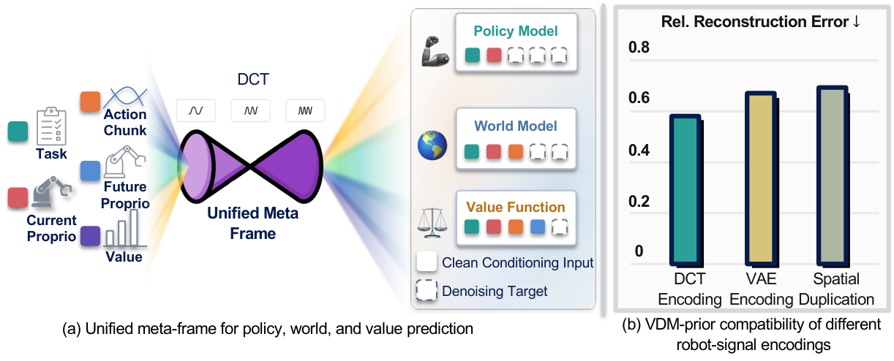
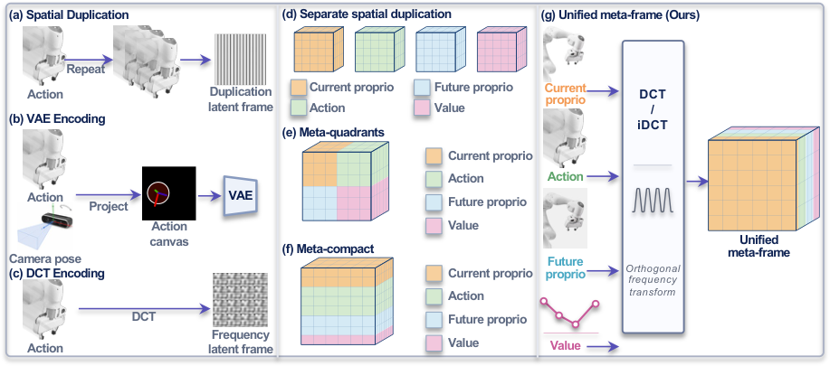
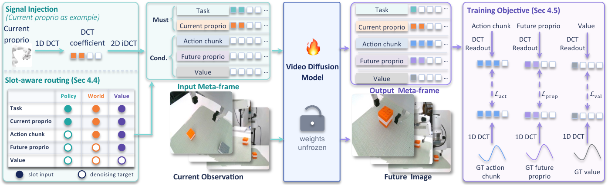
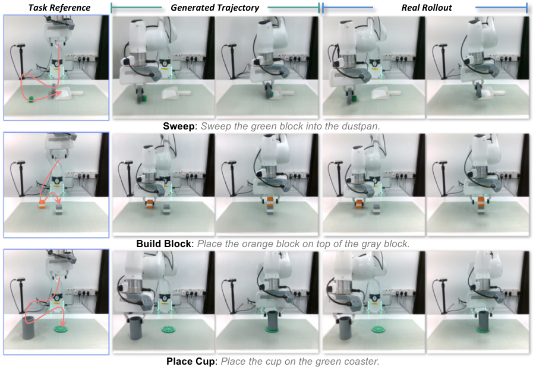
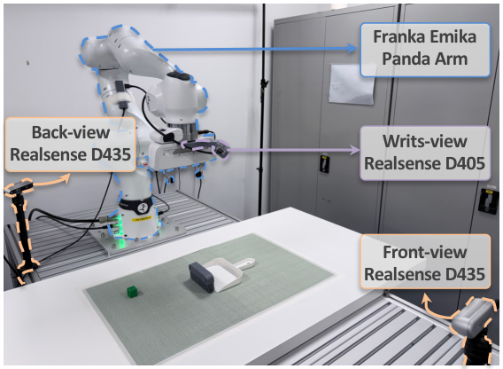
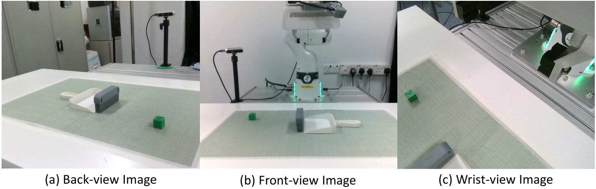
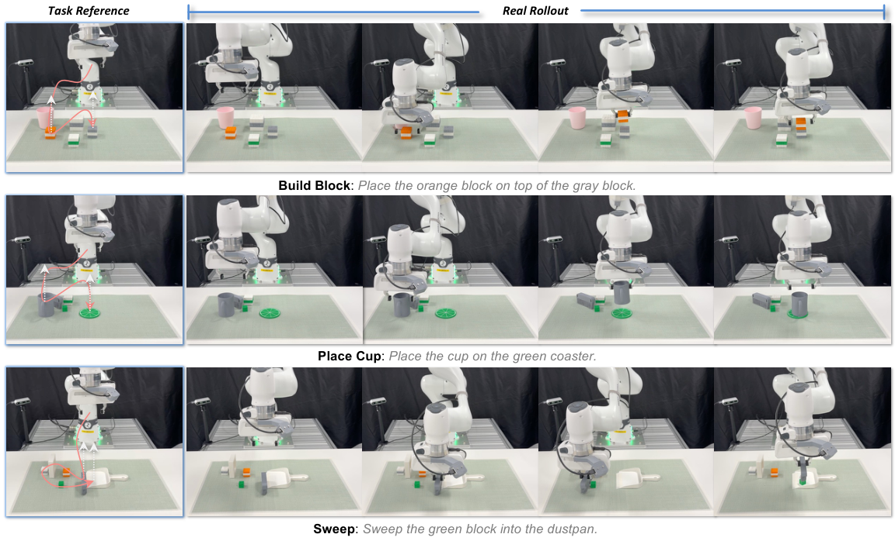
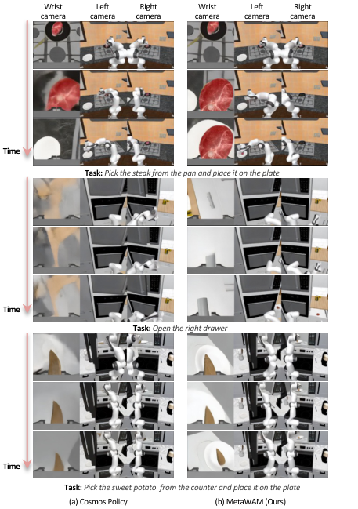
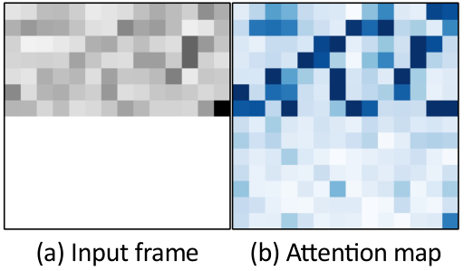
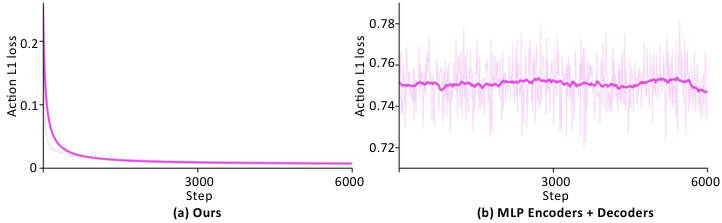

# MetaWAM：频域整合机器人信号，推理延迟降低39%

机器人要同时预测动作、未来状态和任务价值，就得把本体感知、动作等低维信号送进视频扩散模型，但传统做法常为每种信号单独占用一帧，既拉长序列，也未必符合预训练模型的数据分布。MetaWAM 将这件事重新定义为**分布对齐问题**：不是把信号“塞进”latent 就行，而是要让去噪器愿意接受它。其核心做法是把所有机器人信号写入互不重叠的频域通道带，再通过逆离散余弦变换合成统一的 meta-frame，无需新增编码器、解码器或修改骨干网络。最终，它在 RoboCasa 上取得**68.9%**平均成功率，同时将单次查询延迟从 0.479 秒降至 0.291 秒，即降低约**39%**。

## 1. 问题不在“能不能注入”，而在“注入后是否合分布”

Vision-Language-Action（VLA）模型擅长从当前观察直接映射到动作，却不显式描述动作如何改变世界。World Action Model（WAM，世界动作模型）因此引入预训练 Video Diffusion Model（VDM，视频扩散模型），利用其从自然视频中学到的时空先验，联合预测未来观察、机器人动作和价值。

现有 WAM 大致有两条路线：

- **Cascaded WAM**：先把视频模型当作模拟器生成未来，再用独立策略或逆动力学模型恢复动作。
- **Joint WAM**：在同一个去噪骨干中生成动作、未来观察和价值，MetaWAM 属于这一类。

Joint WAM 面临一个容易被忽视的接口问题：动作、本体感知、任务类型和价值都是低维结构化变量，而 VDM 的 latent 空间原本承载自然视频。Cosmos Policy 会把每种信号铺成一张独立的 video-like latent frame；AgiBot-World 则先把信号画到画布上，再经 VAE 编码。DreamZero 另配动作编码器和解码器，虽然增强了动作建模，却改变了预训练骨干周围的结构。

这些方案分别带来序列膨胀、二次增长的 Attention 开销或额外模块。更关键的是，它们默认“格式兼容”就等于“分布兼容”，但这一点并没有得到验证。

> 图解：左侧展示了 MetaWAM 如何用互不重叠的 DCT 频带承载不同机器人信号，并让同一接口服务策略、世界模型和价值预测。右侧比较冻结去噪器在噪声水平 $\sigma=1.0$ 下的相对重建误差，越低表示所需修正越小；Spatial Duplication 和 VAE Encoding 的误差明显更高，DCT Encoding 最低。这直接引出全文判断：频域表示比空间复制更接近预训练 VDM 的先验。

## 2. 用冻结去噪器做“分布探针”

作者没有直接从最终成功率倒推接口好坏，而是先设计了一个隔离实验：固定 Cosmos-Predict2 去噪器，不训练它，只观察不同注入表示会被修正多少。

评价量是**相对重建误差**，即去噪残差相对于干净 latent 幅值的归一化结果。参考 latent 来自真实 RoboCasa 观察，并覆盖多个噪声水平 $\sigma$。直觉上，若一种注入表示已经在分布内，冻结去噪器只需小幅修正；若它非常“不像视频”，去噪器就会大幅改写它。

> 图解：上方单信号实验比较空间复制、VAE 编码和 DCT 编码；下方多信号实验比较三个独立空间帧、等分空间区域、按维度分配空间区域，以及统一频域 meta-frame。前三种紧凑方案的区别主要在空间划分，MetaWAM 则按通道分配信号，并在固定 DCT 系数槽中写值，最后通过逐通道二维逆 DCT 形成一个空间 latent。

### 2.1 单信号：能通过 VAE，不等于符合去噪器先验

单信号实验从 RoboCasa 不同 episode 中随机选取 30 个 action chunk，比较三种编码。Spatial Duplication 将信号沿空间网格复制，形成逐行恒定图案；VAE Encoding 将信号渲染到画布后编码；DCT Encoding 则把信号展开到平滑的余弦基上。

下表列出冻结 Cosmos-Predict2 在五个噪声水平下的相对重建误差，数值越低越好：

| 方法 | $\sigma=0.01$ | 0.05 | 0.2 | 1.0 | 5.0 |
|---|---:|---:|---:|---:|---:|
| Spatial Duplication | 0.0141 | 0.0672 | 0.2335 | 0.6459 | 0.8953 |
| VAE Encoding | 0.0147 | 0.0699 | 0.2388 | 0.6379 | 0.8926 |
| **DCT Encoding** | **0.0133** | **0.0633** | **0.2199** | **0.5922** | **0.8646** |

DCT Encoding 在所有噪声水平上都取得最低误差。尤其值得注意的是，VAE Encoding 并没有优于空间复制：一个表示能顺利通过 VAE，并不意味着它也符合去噪器在训练中见过的自然视频统计。

### 2.2 多信号：压缩到一帧仍然不够

多信号实验使用相同样本对应的 action chunk、本体状态和价值标签，比较四种布局：

- **Separate Spatial Duplication**：每种信号独占一帧，共三帧，表中误差取三帧平均。
- **Meta-Quadrants**：所有信号进入一帧，每种信号占相同大小的空间区域，并沿通道复制。
- **Meta-Compact**：同样使用一帧，但按信号维度分配区域，动作占更大空间。
- **Unified Meta-Frame**：按通道带区分信号，在固定频域槽位写值，再做逐通道二维逆 DCT。

| 方法 | $\sigma=0.01$ | 0.05 | 0.2 | 1.0 | 5.0 |
|---|---:|---:|---:|---:|---:|
| Separate Spatial Duplication | 0.0142 | 0.0677 | 0.2336 | 0.6178 | 0.8677 |
| Meta-Quadrants | 0.0147 | 0.0705 | 0.2471 | 0.6730 | 0.9291 |
| Meta-Compact | 0.0132 | 0.0622 | 0.2160 | 0.6234 | 0.9392 |
| **Unified Meta-Frame** | **0.0126** | **0.0598** | **0.2061** | **0.5613** | **0.8159** |

在 $\sigma=1.0$ 时，Meta-Quadrants 和 Meta-Compact 的误差分别为 0.6730 和 0.6234，Unified Meta-Frame 则降至 0.5613。可见，**减少帧数只是效率优化，空间布局本身仍可能制造不连续、偏离先验的图案**；频域打包同时解决了紧凑性和分布兼容性。

每个噪声水平的去噪评估都用独立采样噪声重复五次并取平均。这个诊断随后成为 MetaWAM 的设计依据，但作者也明确提醒：它适合比较接口兼容性，不应被当作成功率的定量预测公式。

## 3. MetaWAM：一对 meta-frame 承载全部机器人变量

有了诊断结论，下一步是把它变成能训练、能路由、能解析读出的完整接口。MetaWAM 保留 Cosmos-Predict2 的去噪架构，只重构 latent 序列中的机器人信号表示。

> 图解：归一化后的机器人信号先被写入固定系数槽，再通过二维逆 DCT 抬升为空间 meta-frame。输入 meta-frame 负责状态条件，输出 meta-frame 统一承载动作、未来本体状态和价值。下方的 slot-aware mask 根据任务类型打开或关闭相应通道带，使同一套变量能分别充当干净条件或去噪目标。

### 3.1 从逐信号占帧到 8 帧 latent 序列

设预训练 VDM 处理 $\mathbf{z}\in\mathbb{R}^{C\times T\times H\times W}$，其中每个时间槽是一张空间 latent frame。传统 frame-injection 会让每个标量或向量信号都占据一张图像大小的帧，直接增大 $T$。

MetaWAM 使用如下 8 帧序列：

$$
\mathbf{z}=(z^{m}_{\mathrm{in}},z^{w}_{t},z^{p}_{t},z^{s}_{t},z^{m}_{\mathrm{out}},z^{w}_{t+H},z^{p}_{t+H},z^{s}_{t+H})
$$

其中 $w,p,s$ 分别表示腕部、主视角和次视角相机。输入 meta-frame $z^{m}_{\mathrm{in}}$ 携带 one-hot 任务类型和当前本体感知 $\rho_t$；输出 meta-frame $z^{m}_{\mathrm{out}}$ 是 action chunk、未来本体感知和价值的共享预测接口。

输入侧还复用了 tokenizer 本来就必须保留的空白槽，因此当前本体感知的条件注入几乎不增加额外帧。相比分别给输入本体感知、动作、未来本体感知和价值各分一帧的 11 帧基线，序列缩短为 8 帧。由于 Self-Attention 的两两交互量随 $T$ 二次增长，论文估算其减少约**47%**，而骨干结构完全不变。

### 3.2 频域打包与解析读出

空间复制产生恒定图案，区域拼接产生边界不连续，这正是诊断实验中两类高误差来源。MetaWAM 改为构造稀疏系数张量 $F\in\mathbb{R}^{C\times H\times W}$，把不同信号放入互不重叠的通道带：

$$
F=\left[F_{\text{task}},F_{\rho_t},F_{a},F_{\rho_{t+H}},F_{v}\right]
$$

记 one-hot 任务指示与归一化机器人信号的集合为 $q$，则 $F=\operatorname{Pack}(q)$。具体而言，每种信号被展平或分组后，直接写入所属通道带中 $k_H=0$ 行的固定系数槽，其余位置置零。这个分配在训练和推理间固定，不引入可学习参数，也不做时间维 DCT 或系数截断。

随后逐通道执行正交二维逆 DCT，得到空间 meta-frame：

$$
z^{m}=\mathcal{T}^{-1}_{\mathrm{2D}}(F)
$$

逆变换把少量系数扩散为整个 $H\times W$ 网格上的平滑余弦组合。模型输出经过去噪后，只需再做一次空间二维 DCT，并从固定槽位读取：

$$
\hat{F}=\mathcal{T}_{\mathrm{2D}}(\hat{z}^{m}),\qquad
(\hat{a},\hat{\rho}_{t+H},\hat{v})=\operatorname{Unpack}(\hat{F})
$$

读出的系数本身就是归一化信号，恢复原始形状即可，**不需要第二次逆 DCT，也不需要学习型解码头**。这个设计的价值不只是少一个模块：从训练第一步开始，编码映射和目标位置就固定存在，避免了可学习接口从零初始化时“训练初期无信号可读”的优化问题。

### 3.3 同一组变量，如何服务三种任务

策略、世界模型和价值估计共享相同变量，区别只在因果方向：

- **策略**：给定当前状态，预测动作。
- **世界模型**：给定当前状态和动作，预测未来状态。
- **价值估计**：给定完整状态转移，预测回报。

MetaWAM 不让变量在帧之间移动，而是通过 slot-aware mask 改变它们的角色。令 $m_{\pi},m_{w},m_{v}$ 表示三类样本，则 band-level mask 为：

$$
M_{\mathrm{slot}}=\Phi(m_{\pi},m_{w},m_{v})
$$

$\Phi$ 确定性地将每个通道带设为“打开”或“关闭”：打开表示作为干净条件，关闭表示作为去噪目标。策略样本只打开任务与当前本体感知带；世界模型额外打开动作带；价值样本再打开未来本体感知带，只留下价值作为目标。

这里必须使用**频带级**而非整帧级 mask。因为动作和价值共存于输出 meta-frame，整帧 mask 无法“显示动作、隐藏价值”。同时，系统还从细粒度 mask 推导一个单通道 coarse mask，供原始视频去噪路径使用。细 mask 携带全部任务语义，粗 mask 仅为保持骨干接口兼容，本身不携带任务信息。

### 3.4 训练目标：视频去噪与信号监督共同优化

给定干净序列 $\mathbf{z}_0$，采样噪声 $\epsilon$ 和噪声水平 $\sigma$，在语言与视频条件 $c$ 以及 mask $M$ 下训练去噪器 $D_{\theta}$：

$$
\mathcal{L}_{\mathrm{diff}}=\mathbb{E}_{\mathbf{z}_0,\epsilon,\sigma}\left[w(\sigma)\left\|D_{\theta}(\mathbf{z}_0+\sigma\epsilon,\sigma,c,M)-\mathbf{z}_0\right\|_2^2\right]
$$

在此基础上，对从输出 meta-frame 解析恢复的动作、未来本体感知和价值增加监督：

$$
\mathcal{L}=\mathcal{L}_{\mathrm{diff}}+\lambda_{\mathrm{act}}\mathcal{L}_{\mathrm{act}}+\lambda_{\mathrm{prop}}\mathcal{L}_{\mathrm{prop}}+\lambda_{\mathrm{val}}\mathcal{L}_{\mathrm{val}}+\lambda_{\mathrm{off}}\mathcal{L}_{\mathrm{off}}
$$

三个信号项均使用 $\delta=1$ 的 Huber Loss，并在信号元素和适用样本上取平均：动作监督用于策略样本，未来本体感知监督用于策略和世界模型样本，价值监督覆盖全部任务。

为避免模型把信息写到未分配槽位，还加入 off-slot 惩罚：

$$
\mathcal{L}_{\mathrm{off}}=\mathbb{E}\left[\operatorname{mean}_{C,H,W}\left|(1-S)\odot\hat{F}\right|\right]
$$

其中 $S$ 标记已分配的系数位置，$\lambda_{\mathrm{off}}=10^{-4}$。DCT 和槽位读出均可微，因此所有损失都能直接反传到去噪器，不经过学习型解码头。

## 4. 实验：更少 latent 帧，并未牺牲控制与世界预测

实验覆盖 RoboCasa、LIBERO、LIBERO-Plus 和三项真实 Franka 桌面任务，骨干统一初始化为 Cosmos-Predict2-2B-Video2World。RoboCasa 使用 AdamW，学习率 $10^{-6}$，每张 GPU 的 batch size 为 64，梯度累积 4 步，在 4 张 NVIDIA H200 上训练。

### 4.1 RoboCasa：每项任务仅 50 条示范

RoboCasa 包含 24 个静态厨房任务。每项任务使用 50 条人类示范，评测覆盖 5 种不同户型与视觉风格场景，每场景 10 次试验；最终对 24 项任务和 3 个随机种子取平均，共 3600 次试验。

| 方法 | 每项任务示范数 | 平均成功率（%） |
|---|---:|---:|
| UVA | 50 | 50.0 |
| DP-VLA | 3000 | 57.3 |
| UWM | 1000 | 60.8 |
| $\pi_0$ | 300 | 62.5 |
| GR00T-N1.5 | 300 | 64.1 |
| Video Policy | 300 | 66.0 |
| FLARE | 300 | 66.4 |
| Cosmos Policy | 50 | 67.1 |
| **MetaWAM** | **50** | **68.9** |

在相同 50 条示范设置下，MetaWAM 比逐信号占帧的 Cosmos Policy 高**1.8 个百分点**。它也高于使用更多示范训练的多个基线，说明统一接口不是靠压缩性能换效率。

### 4.2 LIBERO：标准套件保持高成功率

LIBERO 包含 Spatial、Object、Goal 和 Long 四个套件，每套有 10 项任务、每项 50 条训练示范。每套评测 500 次，三个随机种子合计 6000 次试验。MetaWAM 训练 12K 步，使用 4 张 H200、全局 batch size 1200，耗时 56 小时；策略一次预测 16 步动作并完整执行后再次查询。

| 方法 | Spatial | Object | Goal | Long | 平均 |
|---|---:|---:|---:|---:|---:|
| Diffusion Policy | 78.3 | 92.5 | 68.3 | 50.5 | 72.4 |
| Dita | 97.4 | 94.8 | 93.2 | 83.6 | 92.3 |
| $\pi_0$ | 96.8 | 98.8 | 95.8 | 85.2 | 94.2 |
| UniVLA | 96.5 | 96.8 | 95.6 | 92.0 | 95.2 |
| $\pi_{0.5}$ | 98.8 | 98.2 | 98.0 | 92.4 | 96.9 |
| OpenVLA-OFT | 97.6 | 98.4 | 97.9 | 94.5 | 97.1 |
| CogVLA | 98.6 | 98.8 | 96.6 | 95.4 | 97.4 |
| Cosmos Policy | 98.1 | **100.0** | **98.2** | **97.6** | **98.5** |
| MetaWAM | **99.0** | 99.8 | 97.4 | 96.0 | 98.1 |

MetaWAM 平均成功率为**98.1%**，与 Cosmos Policy 的 98.5% 接近；它在 Spatial 上更高，但 Goal 和 Long 略低。因此，标准 LIBERO 的结果更适合解读为“紧凑接口维持了高成功率”，而不是全面提升。

### 4.3 LIBERO-Plus：五类扰动领先，但鲁棒性并不均匀

LIBERO-Plus 进一步测试相机视角、机器人初始状态、语言指令、光照、背景、传感器噪声和物体布局七类扰动。下表数值均为成功率（%），Original 表示标准 LIBERO，BG 表示背景。

| 模型 | Original | Camera | Robot | Lang. | Light | BG | Noise | Layout | Total |
|---|---:|---:|---:|---:|---:|---:|---:|---:|---:|
| $\pi_0$ | 94.2 | 13.8 | 6.0 | 58.8 | 85.0 | 81.4 | 79.0 | 68.9 | 53.6 |
| $\pi_0$-FAST | 85.5 | 65.1 | 21.6 | 61.0 | 73.2 | 73.2 | 74.4 | 68.8 | 61.6 |
| OpenVLA-OFT | 97.6 | 55.6 | 21.7 | 81.0 | 92.7 | 91.0 | 78.6 | 68.7 | 67.9 |
| UniVLA | 95.2 | 1.8 | 46.2 | 69.6 | 69.0 | 81.0 | 21.2 | 31.9 | 42.9 |
| RIPT-VLA | 97.5 | 55.2 | 31.2 | 77.6 | 88.4 | 91.6 | 73.5 | 74.2 | 68.4 |
| X-VLA | 98.1 | 23.4 | **89.7** | 75.7 | 88.2 | **96.0** | 62.7 | 71.8 | 71.4 |
| HoloBrain0-GD | 96.7 | 65.5 | 58.2 | 78.7 | 88.1 | 90.3 | 66.9 | 79.5 | 74.0 |
| ABot-M0 | **98.6** | 60.4 | 67.9 | 86.4 | 96.2 | 91.6 | 86.4 | 82.6 | 80.5 |
| VLA-JEPA | 97.2 | 64.2 | 67.7 | 88.1 | 91.8 | 93.4 | 65.8 | 83.9 | 77.9 |
| GE-Act | 94.4 | 60.7 | 77.0 | 77.4 | 95.8 | 86.0 | 90.9 | 80.2 | 80.3 |
| Cosmos Policy | 98.5 | 75.8 | 63.3 | 81.7 | 96.5 | 88.9 | 92.7 | 82.2 | 82.2 |
| Fast-WAM | 97.6 | 16.4 | 44.5 | 68.9 | 78.2 | 53.7 | 37.7 | 60.7 | 51.5 |
| **MetaWAM** | 98.1 | **82.9** | 59.9 | **89.5** | **97.8** | 72.6 | **94.8** | **86.7** | **83.4** |

按正文更精确的统计口径，MetaWAM 总体成功率为**83.44%**，比 Cosmos Policy 的 82.2% 高**1.24 个百分点**。相机和语言扰动分别达到 82.93% 和 89.56%，提升 7.13 和 7.86 个百分点；光照、传感器噪声和布局也为表中最高。

不过，它在背景和机器人初始状态扰动上只有 72.68% 和 59.90%，均弱于 Cosmos Policy。也就是说，统一接口改善了多类扰动下的表现，却没有消除视觉上下文和初始构型变化带来的敏感性。

### 4.4 真实机器人：三项精细操作平均成功率 85.0%

真实实验使用 7 自由度 Franka Panda，包含三项任务：Sweep 将方块扫入簸箕，Place Cup 将杯子对准杯垫，Build Block 堆叠立方体。OOD 设置加入干扰物、未见过的物体位置和背景变化，每项任务在 ID 与 OOD 下各测试 20 次。

> 图解：每项任务依次给出任务参考、代表性生成轨迹和真实机器人 rollout。生成轨迹与实际执行并列，可以观察模型预测的未来观察如何对应机械臂在扫方块、放杯子和堆叠方块过程中的运动。

| 方法 | ID Sweep | ID Place Cup | ID Build Block | ID 平均 | OOD Sweep | OOD Place Cup | OOD Build Block | OOD 平均 |
|---|---:|---:|---:|---:|---:|---:|---:|---:|
| $\pi_0$ | 45.0 | 50.0 | 55.0 | 50.0 | 35.0 | 35.0 | 40.0 | 36.7 |
| $\pi_{0.5}$ | 70.0 | 70.0 | 75.0 | 71.7 | 45.0 | 45.0 | 50.0 | 46.7 |
| Cosmos Policy | 75.0 | 80.0 | 80.0 | 78.3 | 60.0 | 60.0 | 70.0 | 63.3 |
| **MetaWAM** | **80.0** | **85.0** | **90.0** | **85.0** | **65.0** | **65.0** | **75.0** | **68.3** |

MetaWAM 在三个 ID 任务和三个 OOD 任务上都超过表中基线。相比 Cosmos Policy，ID 平均成功率高 6.7 个百分点，OOD 高 5.0 个百分点；同时，OOD 相对 ID 的明显下降也说明分布外场景仍是难点。

### 4.5 消融：收益来自频域布局，而不只是序列变短

所有消融都在 RoboCasa 的相同 50 示范设置下训练和评测。除了成功率与延迟，作者还测量信号恢复、未来视图 PSNR、未来本体感知归一化误差（Prop. NEE）和价值 MAE。

| 编码方式 | 帧数 | SR（%）↑ | 延迟（s）↓ | Gain ↑ | Rel. $L_2$ ↓ | PSNR ↑ | Prop. NEE ↓ | Value MAE ↓ |
|---|---:|---:|---:|---:|---:|---:|---:|---:|
| Separate Spatial Dup. | 11 | 67.1 | 0.479 | 0.6361 | 0.3657 | 19.27 | 0.0250 | 0.072 |
| Meta-Quadrants | 8 | 65.9 | 0.291 | 0.6032 | 0.3988 | 18.86 | 0.0499 | 0.081 |
| Meta-Compact | 8 | 68.1 | 0.291 | 0.6563 | 0.3345 | 19.41 | 0.0193 | 0.065 |
| **Unified Meta-Frame** | **8** | **68.9** | **0.291** | **0.7146** | **0.2928** | **19.95** | **0.0143** | **0.046** |

三种紧凑接口延迟都为 0.291 秒，说明延迟下降主要来自 11 帧缩到 8 帧；但它们的成功率并不相同，Meta-Quadrants 甚至低于独立空间帧。因此，**68.9% 的成功率不能只归因于压缩，频域布局本身同样关键**。

信号恢复实验进一步从冻结去噪器输出中解析机器人信号。Gain 表示沿干净信号方向保留的幅度，Rel. $L_2$ 是归一化读出误差，两者都在五个噪声水平上取平均。Unified Meta-Frame 同时取得最高 Gain 和最低误差，且四项布局在这两个指标上的排序与成功率一致。

统一接口还取得最高未来视图 PSNR、最低未来本体感知 NEE 和最低价值 MAE。这排除了一个重要疑虑：策略性能的提升并没有以牺牲世界模型或价值预测为代价。

## 5. 补充证据与复现细节

主结果之外，附录回答了几个很关键的问题：频域优势是否只存在于 Cosmos、真实系统如何搭建、去噪器是否真的会关注信号，以及解析接口相较学习型接口有什么优化差异。

### 5.1 跨骨干验证：Wan2.1 与 Wan2.2 也呈现相同趋势

作者在 Wan2.1-I2V-14B 和 Wan2.2-TI2V-5B 上重复冻结去噪器诊断。下表均为相对重建误差，越低越好。

**Wan2.1-I2V-14B：**

| 设置 | 方法 | $\sigma=0.2$ | 0.4 | 0.6 | 0.8 | 0.9 |
|---|---|---:|---:|---:|---:|---:|
| 单信号 | Spatial Duplication | 0.8858 | 0.9883 | 1.0092 | 1.0434 | 1.0951 |
| 单信号 | VAE Encoding | **0.7534** | 0.8993 | 0.9891 | 1.0478 | 1.0989 |
| 单信号 | DCT Encoding | 0.7701 | **0.8258** | **0.9053** | **0.9943** | **1.0902** |
| 多信号 | Separate Spatial Dup. | 0.9029 | 0.9944 | 1.0194 | 1.0519 | 1.1004 |
| 多信号 | Meta-Quadrants | 0.9182 | 1.0005 | 1.0271 | 1.0580 | 1.1047 |
| 多信号 | Meta-Compact | 0.8467 | 0.9990 | 1.0226 | 1.0540 | 1.1024 |
| 多信号 | **Unified Meta-Frame** | **0.7144** | **0.8710** | **0.9505** | **1.0226** | **1.0988** |

Wan2.1 的单信号实验有一个需要保留的细节：在 $\sigma=0.2$ 时 VAE Encoding 更低，DCT 从 $\sigma=0.4$ 起领先；多信号的 Unified Meta-Frame 则在五个噪声水平上全部最低。

**Wan2.2-TI2V-5B：**

| 设置 | 方法 | $\sigma=0.2$ | 0.4 | 0.6 | 0.8 | 0.9 |
|---|---|---:|---:|---:|---:|---:|
| 单信号 | Spatial Duplication | 0.9777 | 1.0706 | 1.1058 | 1.1566 | 1.2187 |
| 单信号 | VAE Encoding | 0.7537 | 1.0241 | 1.0659 | 1.1025 | 1.1445 |
| 单信号 | **DCT Encoding** | **0.7059** | **0.8662** | **0.9572** | **1.0419** | **1.0992** |
| 多信号 | Separate Spatial Dup. | 0.9942 | 1.0768 | 1.1204 | 1.1748 | 1.2603 |
| 多信号 | Meta-Quadrants | 1.0030 | 1.0814 | 1.1188 | 1.1683 | 1.2482 |
| 多信号 | Meta-Compact | 1.0461 | 1.1625 | 1.2384 | 1.3167 | 1.4663 |
| 多信号 | **Unified Meta-Frame** | **0.7647** | **0.9213** | **1.0011** | **1.0683** | **1.1307** |

Wan 系列采用 flow matching，而 Cosmos-Predict2 使用 EDM 风格的残差去噪。相同总体趋势跨模型规模、骨干和训练目标成立，增强了“频域注入更接近 VDM 先验”这一解释的普遍性；但 Wan2.1 的局部例外也说明，不宜把结论简化成 DCT 在每个设置、每个噪声点都必然最优。

### 5.2 训练成本与真实硬件

RoboCasa 模型训练 12K 步，4 张 H200、全局 batch size 1024，耗时 64 小时，并全量微调 Cosmos-Predict2。动作 chunk 长 32 步，每次执行 16 步后重新查询策略。

真实 Franka 模型训练 8K 步，同样使用 4 张 H200 和全局 batch size 1024，约需 47 小时；所有基线使用相同计算资源。每项真实任务采集 80 条示范，动作 chunk 为 16 步并完整执行，推理运行在 NVIDIA RTX 5090 上。

> 图解：平台由 7 自由度 Franka Emika Panda、腕部 Intel RealSense D405，以及工作区前后两台 Intel RealSense D435 组成。腕部相机观察末端执行器附近细节，两台外部相机提供第三人称全局视角。

> 图解：三路输入分别来自后视、前视和腕部相机。外部视角负责定位物体和覆盖完整操作空间，腕部视角补充夹爪附近信息，在外部相机被遮挡时尤其重要。

### 5.3 分布外与仿真轨迹可视化

> 图解：这些 rollout 改变了物体位置，加入额外干扰物，并变化背景或布局。关键帧展示了 MetaWAM 在场景级变化下仍能形成连贯操作轨迹，与 OOD 定量结果相互补充，但并不意味着所有扰动都已解决。

> 图解：两组轨迹均以 $224\times224$ 分辨率生成。对比的重点是 MetaWAM 在用统一频域 meta-frame 取代独立机器人信号帧后，仍保留视频扩散骨干生成时间连贯未来观察的能力。

### 5.4 去噪器没有忽略编码区域

重建误差只能说明去噪器修正得多还是少，不能说明它是否关注机器人信号。作者因此查看冻结 VDM 第 14 个 block 的 Attention，并定义**attention lift**：编码区域的平均注意力除以整帧平均注意力。

> 图解：左侧是输入 carrier，白色区域为 padding；右侧是 block 14 的 Attention Map。编码区域的 attention lift 为 $1.40\times$，即高于整帧平均水平，说明它并非只被当作平滑背景忽略。不过，Attention 本身仍不能证明信号被成功恢复或对决策产生了因果作用。

### 5.5 解析接口与学习型 MLP 接口的训练差异

作者参照 DreamZero 的状态/动作接口，构造一个扩展到价值预测的 MLP 编码器—解码器对照组，并监控 action chunk 的平均绝对误差。该 action $L_1$ 只用于监控，不是额外训练目标。

> 图解：左、右分别展示 MetaWAM 和 MLP encoder/decoder 对照组在训练中的 action-chunk MAE，两图纵轴刻度不同。MetaWAM 的误差快速下降，而学习型 MLP 接口在该实验设置下长期保持较高误差。

这一差异与接口的优化性质有关。统一策略、世界模型和价值训练中，同一信号会随任务在条件与目标之间切换；学习型接口不仅要同时学会逐信号编解码和 mask-aware routing，编码器更新还会改变呈现给去噪器的 latent 目标。零初始化投影在训练初期甚至不传有效信号。固定 Pack 与 DCT/iDCT 则从一开始就给出静态映射和解析读出。

这个结果支持当前设置下的解析设计，但作者没有据此宣称学习型接口在其他架构或训练流程中也行不通。

## 6. 总结：真正需要统一的是信号与视频先验的接口

- **重新定义问题**：机器人信号注入不是简单格式转换，而是与预训练 VDM 先验的分布对齐。
- **诊断支持频域表示**：冻结去噪器对 DCT 编码和统一 meta-frame 的相对修正总体更小，单纯压缩帧数或划分空间区域并不足够。
- **一个接口承载三类任务**：固定通道带、系数槽与 slot-aware routing，让策略、世界模型和价值预测共享同一组变量，并可解析读出。
- **效率与性能同时改善**：latent 序列从 11 帧缩至 8 帧，RoboCasa 查询延迟降低约 39%，平均成功率达到 68.9%；真实 Franka 三项任务 ID 平均成功率达到 85.0%。
- **边界仍然清晰**：固定频带和损失权重可能需要随信号尺度与任务重要性调整，语言 grounding 受 Cosmos-Predict2 限制，背景和机器人初始状态变化仍是明显弱项。

未来更值得探索的，不只是给更多任务手工划分频带，而是如何自动分配频带、适应不同信号尺度，并把这种分布感知接口推广到更强的视频骨干和更复杂的开放环境。

> 本文参考自 [From Video Frames to Robot Meta-Frames: A Unified Latent Interface for World Action Models](http://arxiv.org/abs/2611.14365v1)