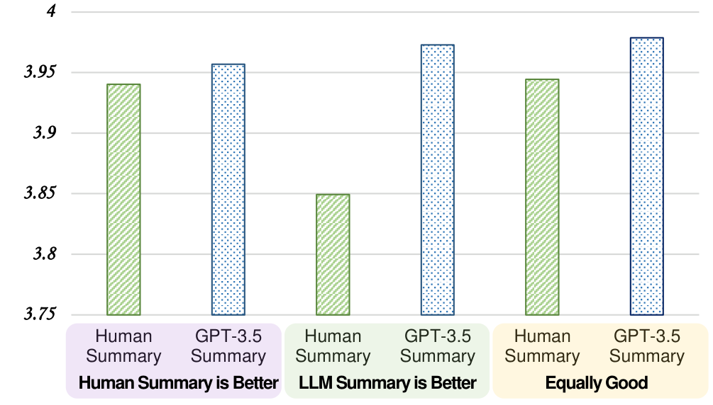

# G-Eval：用 CoT 和概率加权校准文本评分

自动评估自然语言生成（NLG）质量，难在“读起来好”并不等于“与参考答案重合”，而传统 BLEU、ROUGE 又过度依赖词面重叠。G-Eval 把大模型变成一位按评分表工作的评审：先由模型自动生成 Chain-of-Thought（CoT，思维链）评价步骤，再以表单填充方式打分，最后用分数 Token 的概率加权得到连续分值。在 SummEval 摘要评估上，G-Eval-4 的平均 Spearman 相关系数达到 **0.514**，高于 UniEval 的 0.474；在 Topical-Chat 对话评估上，平均 Spearman 相关系数达到 **0.588**，高于 UniEval 的 0.417。更重要的是，论文不仅展示了更强的“LLM 评审”，还揭示了它可能偏爱 LLM 生成文本的风险。

## 为什么需要重新设计文本评价指标

NLG 系统的输出越来越流畅、多样，但评价方法并没有同步跟上。传统指标大致有两类限制：

- **依赖参考答案**：BLEU、ROUGE、METEOR 等指标需要人工参考文本，新任务上的标注成本较高。
- **过度关注重合度**：开放式生成往往允许不同表达，措辞不同不代表质量差；词面相似也不保证事实正确、逻辑连贯。

BERTScore、MoverScore 等 Embedding-based 指标把比较对象从 n-gram 扩展到语义表示，UniEval 等学习型评价器则进一步利用人类评分训练模型。它们明显更接近人类判断，但仍可能受任务形式和训练数据限制。

另一条路线是直接使用 LLM。GPTScore 假设：高质量文本在指令和上下文之后应具有更高的条件生成概率。这个思路不需要参考答案，却只是把“评价”间接转化为“文本有多容易被模型生成”。已有元评估还显示，这类 LLM 评价器未必能胜过中等规模的神经评价器。

G-Eval 的切入点很直接：**不要让模型通过生成概率间接透露偏好，而是明确要求它完成评价任务**。接下来的关键，就是怎样把评价标准、执行步骤和最终分数组织好。

## G-Eval：把 LLM 变成按流程打分的评审

G-Eval 是一个基于 Prompt 的评价框架，由三部分组成：定义任务与标准的 Prompt、自动生成的 CoT 评价步骤，以及利用输出 Token 概率计算的评分函数。

> 图解：框架先向 LLM 输入 Task Introduction 和 Evaluation Criteria，让模型生成详细的 Evaluation Steps；随后把这些步骤与原 Prompt、输入上下文、待评文本一起交给 LLM，以表单填充方式输出各维度分数；最后对不同分数的出现概率进行加权求和，得到更细致的最终分值。
>
> 注意：图片文件 `./GEval.pdf` 当前缺失，发布前需补充。

这个设计的聪明之处在于，它没有把“评价能力”完全寄托在一句泛泛的 Prompt 上，而是把评价过程拆成 **标准制定、步骤展开、打分执行、分数细化** 四个环节。

### 用 Prompt 明确任务与评价标准

Prompt 首先要说明模型正在评价什么。例如，在摘要任务中，模型会收到“给定一篇新闻文章的摘要，请按一个指标为其评分”的指令。

随后，Prompt 给出具体维度和分值范围。以摘要的 Coherence（连贯性）为例，标准采用 1–5 分，并要求摘要结构良好、组织合理，不能只是相关信息的堆叠，而应围绕主题逐句形成连贯整体。

这一步相当于给评审发评分细则。不同任务可以定义不同维度：摘要常用 Fluency、Coherence、Consistency、Relevance，对话则可以使用 Naturalness、Coherence、Engagingness、Groundedness。

### 自动生成 CoT，让评分标准变成可执行步骤

只有一句“评价连贯性”仍然不够具体，人工为每个任务补全流程又很耗时。G-Eval 因此在 Prompt 中加入“Evaluation Steps:”，让 LLM 自己展开评价步骤。

针对摘要连贯性，模型生成的流程是：

1. 仔细阅读新闻文章，识别主题和关键点。
2. 阅读摘要并与原文比较，检查主题和关键点是否得到覆盖，以及表达是否清晰、合乎逻辑。
3. 根据评价标准给出 1–5 分的连贯性评分。

这里的 CoT 不是为了展示一段自由联想，而是把模糊标准转成固定检查清单。它既为模型提供更多评价上下文，也让人更容易追踪分数是如何产生的。

### 表单填充：直接评价，而非计算文本生成概率

执行评价时，G-Eval 拼接 Prompt、自动 CoT、输入上下文与待评文本，再要求 LLM 在表单中填写分数。例如摘要任务最终只要求填写“Coherence:”对应的 1–5 分。

这与 GPTScore 有本质区别：GPTScore 计算目标文本的条件概率，G-Eval 则直接让模型完成评分。前者回答“模型多容易生成这段话”，后者回答“按照这份标准，这段话应该得多少分”。

### 概率加权：把整数评分变成连续评分

直接打分有两个问题：

1. 某些分数会占据输出分布，例如 1–5 分量表中的大量样本都被评为 3，导致整体分数方差很小。
2. 即使要求输出小数，LLM 通常仍只给整数，大量并列分数无法体现文本之间的细微差异。

G-Eval 不只保留最终输出的那个整数，还读取各候选分数 Token 的概率。设 Prompt 预定义的分数集合为 $S=\{s_1,s_2,\ldots,s_n\}$，模型给出分数 $s_i$ 的概率为 $p(s_i)$，最终得分为：

$$
score = \sum_{i=1}^{n} p(s_i) \times s_i
$$

直观地说，如果模型在 3 分和 4 分之间犹豫，最终分数不必被迫落到某一个整数，而可以反映整个评分分布。这既减少并列，也保留模型评价中的不确定性。

## 实验设置：三项基准、两类生成任务

论文在三个元评估基准上检验“自动分数与人类判断是否一致”：SummEval 和 QAGS 面向摘要，Topical-Chat 面向知识型对话响应。

### 模型与概率估计

- **G-Eval-3.5**：骨干为 GPT-3.5（text-davinci-003），解码 temperature 设为 0，以提高确定性。
- **G-Eval-4**：骨干为 GPT-4。由于当时接口不返回 Token 概率，作者设置 $n=20$、$temperature=1$、$top\_p=1$，采样 20 次来估计各分数的概率。

实验比较了多类基线：基于语义表示的 BERTScore、MoverScore，基于生成可能性的 BARTScore，事实一致性评价器 FactCC 与 QAGS，对话评价器 USR，统一评价器 UniEval，以及基于 GPT 条件概率的 GPTScore。

评价结果使用 Pearson（$r$）、Spearman（$\rho$）和 Kendall-Tau（$\tau$）相关系数。数值越高，说明自动评分与人类评分越一致；其中 Spearman 关注排序关系，Kendall-Tau 关注样本对的一致与不一致顺序。

### SummEval：G-Eval-4 在四个维度全面领先

SummEval 基于 CNN/DailyMail，提供摘要 Fluency、Coherence、Consistency、Relevance 四个维度的人类评分。下表为 summary-level 的 Spearman 与 Kendall-Tau 相关系数。

| Metrics | Coherence $\rho$ | Coherence $\tau$ | Consistency $\rho$ | Consistency $\tau$ | Fluency $\rho$ | Fluency $\tau$ | Relevance $\rho$ | Relevance $\tau$ | AVG $\rho$ | AVG $\tau$ |
|---|---:|---:|---:|---:|---:|---:|---:|---:|---:|---:|
| ROUGE-1 | 0.167 | 0.126 | 0.160 | 0.130 | 0.115 | 0.094 | 0.326 | 0.252 | 0.192 | 0.150 |
| ROUGE-2 | 0.184 | 0.139 | 0.187 | 0.155 | 0.159 | 0.128 | 0.290 | 0.219 | 0.205 | 0.161 |
| ROUGE-L | 0.128 | 0.099 | 0.115 | 0.092 | 0.105 | 0.084 | 0.311 | 0.237 | 0.165 | 0.128 |
| BERTScore | 0.284 | 0.211 | 0.110 | 0.090 | 0.193 | 0.158 | 0.312 | 0.243 | 0.225 | 0.175 |
| MoverScore | 0.159 | 0.118 | 0.157 | 0.127 | 0.129 | 0.105 | 0.318 | 0.244 | 0.191 | 0.148 |
| BARTScore | 0.448 | 0.342 | 0.382 | 0.315 | 0.356 | 0.292 | 0.356 | 0.273 | 0.385 | 0.305 |
| UniEval | 0.575 | 0.442 | 0.446 | 0.371 | 0.449 | 0.371 | 0.426 | 0.325 | 0.474 | 0.377 |
| GPTScore | 0.434 | — | 0.449 | — | 0.403 | — | 0.381 | — | 0.417 | — |
| G-Eval-3.5 | 0.440 | 0.335 | 0.386 | 0.318 | 0.424 | 0.347 | 0.385 | 0.293 | 0.401 | 0.320 |
| G-Eval-3.5 - Probs | 0.359 | 0.313 | 0.361 | 0.344 | 0.339 | 0.323 | 0.327 | 0.288 | 0.346 | 0.317 |
| **G-Eval-4** | **0.582** | **0.457** | **0.507** | **0.425** | **0.455** | **0.378** | **0.547** | **0.433** | **0.514** | **0.418** |
| G-Eval-4 - Probs | 0.560 | 0.472 | 0.501 | 0.459 | 0.438 | 0.408 | 0.511 | 0.444 | 0.502 | 0.446 |
| G-Eval-4 - CoT | 0.564 | 0.454 | 0.493 | 0.413 | 0.403 | 0.334 | 0.538 | 0.427 | 0.500 | 0.407 |

结果体现出三个趋势：

- 语义相似度指标整体较弱，说明“像参考答案”不能充分代表摘要质量。
- 学习型 UniEval 明显优于传统指标，但 G-Eval-4 又在所有维度上取得更高的 Spearman 相关系数。
- GPT-4 的优势在复杂维度尤其明显。Consistency 从 G-Eval-3.5 的 0.386 提升到 0.507，Relevance 从 0.385 提升到 0.547。

需要注意，表中去掉概率加权的版本会产生大量并列分数；并列对不计入 Kendall-Tau 的一致或不一致样本对，可能让 $\tau$ 看起来更高。因此作者特别提醒，不能把这部分 $\tau$ 当作与其他方法完全公平的能力比较。

### Topical-Chat：开放式对话同样受益

Topical-Chat 使用 Naturalness、Coherence、Engagingness、Groundedness 四个维度的人类评分，实验按对话轮次计算 Pearson 与 Spearman 相关系数。

| Metrics | Naturalness $r$ | Naturalness $\rho$ | Coherence $r$ | Coherence $\rho$ | Engagingness $r$ | Engagingness $\rho$ | Groundedness $r$ | Groundedness $\rho$ | AVG $r$ | AVG $\rho$ |
|---|---:|---:|---:|---:|---:|---:|---:|---:|---:|---:|
| ROUGE-L | 0.176 | 0.146 | 0.193 | 0.203 | 0.295 | 0.300 | 0.310 | 0.327 | 0.243 | 0.244 |
| BLEU-4 | 0.180 | 0.175 | 0.131 | 0.235 | 0.232 | 0.316 | 0.213 | 0.310 | 0.189 | 0.259 |
| METEOR | 0.212 | 0.191 | 0.250 | 0.302 | 0.367 | 0.439 | 0.333 | 0.391 | 0.290 | 0.331 |
| BERTScore | 0.226 | 0.209 | 0.214 | 0.233 | 0.317 | 0.335 | 0.291 | 0.317 | 0.262 | 0.273 |
| USR | 0.337 | 0.325 | 0.416 | 0.377 | 0.456 | 0.465 | 0.222 | 0.447 | 0.358 | 0.403 |
| UniEval | 0.455 | 0.330 | 0.602 | 0.455 | 0.573 | 0.430 | 0.577 | 0.453 | 0.552 | 0.417 |
| G-Eval-3.5 | 0.532 | 0.539 | 0.519 | 0.544 | **0.660** | **0.691** | **0.586** | 0.567 | 0.574 | 0.585 |
| **G-Eval-4** | **0.549** | **0.565** | **0.594** | **0.605** | 0.627 | 0.631 | 0.531 | 0.551 | **0.575** | **0.588** |

G-Eval-4 的平均 Pearson 和 Spearman 相关系数分别为 0.575 和 0.588，均为最高。G-Eval-3.5 的平均结果也已达到 0.574 和 0.585，与 GPT-4 版本非常接近，说明这套评价流程在该基准上已经很有效。

不过，GPT-4 并非每个维度都更强：Engagingness 和 Groundedness 上，G-Eval-3.5 的数值更高。这也提示我们，模型规模带来的收益取决于任务与评价维度，不能简单理解为“大模型在所有评分上都更好”。

### QAGS：事实一致性更考验模型能力

QAGS 用于评估摘要幻觉，即摘要是否包含原文不支持的事实。它包含偏抽取式的 QAGS-CNN 与偏抽象式的 QAGS-XSUM 两个子集。

| Metrics | QAGS-CNN $r$ | QAGS-CNN $\rho$ | QAGS-CNN $\tau$ | QAGS-XSUM $r$ | QAGS-XSUM $\rho$ | QAGS-XSUM $\tau$ | Average $r$ | Average $\rho$ | Average $\tau$ |
|---|---:|---:|---:|---:|---:|---:|---:|---:|---:|
| ROUGE-2 | 0.459 | 0.418 | 0.333 | 0.097 | 0.083 | 0.068 | 0.278 | 0.250 | 0.200 |
| ROUGE-L | 0.357 | 0.324 | 0.254 | 0.024 | -0.011 | -0.009 | 0.190 | 0.156 | 0.122 |
| BERTScore | 0.576 | 0.505 | 0.399 | 0.024 | 0.008 | 0.006 | 0.300 | 0.256 | 0.202 |
| MoverScore | 0.414 | 0.347 | 0.271 | 0.054 | 0.044 | 0.036 | 0.234 | 0.195 | 0.153 |
| FactCC | 0.416 | 0.484 | 0.376 | 0.297 | 0.259 | 0.212 | 0.356 | 0.371 | 0.294 |
| QAGS | 0.545 | — | — | 0.175 | — | — | 0.375 | — | — |
| BARTScore | **0.735** | 0.680 | 0.557 | 0.184 | 0.159 | 0.130 | 0.459 | 0.420 | 0.343 |
| CTC | 0.619 | 0.564 | 0.450 | 0.309 | 0.295 | 0.242 | 0.464 | 0.430 | 0.346 |
| UniEval | 0.682 | 0.662 | 0.532 | 0.461 | 0.488 | 0.399 | 0.571 | 0.575 | 0.465 |
| G-Eval-3.5 | 0.477 | 0.516 | 0.410 | 0.211 | 0.406 | 0.343 | 0.344 | 0.461 | 0.377 |
| **G-Eval-4** | 0.631 | **0.685** | **0.591** | **0.558** | **0.537** | **0.472** | **0.599** | **0.611** | **0.525** |

BARTScore 在较抽取式的 CNN 子集上表现突出，但在更抽象的 XSUM 上明显下降。UniEval 在两个子集上较均衡，而 G-Eval-4 取得最高的平均相关性：$r=0.599$、$\rho=0.611$、$\tau=0.525$，尤其在 XSUM 上优势明显。

相比之下，G-Eval-3.5 在该基准上表现不佳。这与 SummEval 的 Consistency 结果一致：判断事实是否被原文支持，对模型能力更敏感。

## 消融分析：CoT、概率加权与模型规模各自有什么用

三组主要结果已经证明整体有效，接下来的问题是：提升究竟来自哪些组件？

### CoT 提供评价上下文与操作约束

在 SummEval 上，去掉 CoT 后，G-Eval-4 的平均 Spearman 相关系数由 0.514 降为 0.500，四个维度均有下降。其中 Fluency 从 0.455 降至 0.403，变化最明显。

这说明自动评价步骤并非摆设。它把评价维度展开为更明确的检查过程，减少模型只凭整体印象打分的情况。

### 概率加权改善排序粒度，而不是单纯追求更高系数

加入概率加权后，G-Eval-4 的平均 Spearman 相关系数为 0.514，高于直接整数打分的 0.502；平均 Kendall-Tau 却从 0.446 变为 0.418。

这个现象并不矛盾。直接整数打分制造大量 ties（并列），而 Kendall-Tau 的一致对和不一致对统计会受并列影响，可能产生看似更高但不能公平反映区分能力的结果。概率加权把分数连续化，让原本并列的文本恢复更细的排序，因此 Spearman 的提升更能体现其价值。

### 更大的模型在复杂评价上更有优势

G-Eval-4 在 SummEval 和 QAGS 的大多数维度上优于 G-Eval-3.5，尤其是 Consistency 与 Relevance。Topical-Chat 的 Engagingness、Groundedness 是例外。

因此，论文支持的结论不是“规模越大，所有评价都线性变好”，而是：**面对事实一致性、相关性等更复杂的判断时，强模型带来的收益更明确。**

## 一个不能忽略的风险：LLM 评审可能偏爱 LLM 文本

评价分数与人类判断高度相关，并不代表评价器没有系统性偏差。如果未来把 LLM 评价分数当作训练奖励，这种偏差还可能被进一步放大。

作者使用一组同时包含人工摘要和 GPT-3.5 摘要的数据进行检验，并按人类评审偏好分成三类：人工摘要更好、GPT-3.5 摘要更好、两者相当。随后用 G-Eval-4 分别评价。

> 图解：横轴是按人类评审偏好划分的三组样本，纵轴是 G-Eval-4 的平均评分，两组柱分别对应人工撰写摘要与 GPT-3.5 生成摘要。G-Eval-4 的分数会随人类偏好变化：人类更偏爱人工摘要时，人工摘要得分相对较高；人类更偏爱 GPT-3.5 摘要时，其得分相对较低。但在所有分组中，GPT-3.5 摘要的平均分都高于人工摘要，包括人类认为人工摘要更好的那一组。

作者提出两个可能原因：

1. **高质量文本本来就难评**。原数据研究中，人工摘要与 LLM 摘要比较时，标注者一致性很低，Krippendorff's alpha 仅为 0.07。
2. **生成与评价可能共享相似标准**。LLM 在生成和评价时可能使用相近的质量概念，从而对 LLM 风格的文本产生偏好。

这项分析仍是初步研究，不能据此量化所有 LLM 评价器的偏差程度。但它指出了一个实际风险：如果用这种分数继续优化生成模型，模型可能过拟合自己的评价标准，而不是人类真正关心的质量标准，形成自我强化。

## 与既有评价路线的关系

G-Eval 并不是凭空出现的，它实际上把几条评价技术路线的目标串了起来。

- **Ngram-based Metrics**：BLEU 用修改后的 n-gram 精确率与长度惩罚评价机器翻译，ROUGE 用 n-gram 重叠衡量摘要召回。论文引用的研究指出，当时超过 60% 的 NLG 论文只依赖 ROUGE 或 BLEU，但这些指标难以充分衡量内容质量和句法错误。
- **Embedding-based Metrics**：WMD 基于词向量距离，BERTScore 使用 BERT 上下文表示，MoverScore 加入软对齐与新的聚合方式。它们改善了语义比较，却仍围绕参考文本相似度展开。
- **Task-specific Evaluators**：FactCC、QAGS 等专门衡量摘要事实一致性，对话评价器则关注连贯性等任务要求。针对性强，但不容易泛化到其他任务。
- **Unified Evaluators**：BARTScore、USR、UniEval 尝试通过改变输入输出格式或模型变体覆盖多个维度。UniEval 将不同评价任务转化为 QA 形式，是实验中最重要的学习型基线。
- **LLM-based Evaluators**：GPTScore 使用条件生成概率，早期 ChatGPT 评价研究和 GPT 机器翻译评价也探索了类似方向。G-Eval 的差异在于用 CoT 组织评价过程、用表单直接输出评分、用 Token 概率细化结果。

从这个视角看，G-Eval 的贡献不是简单地把骨干模型换成 GPT-4，而是提供了一套更完整的 **评价接口设计**：让通用 LLM 按任务标准工作，同时保留可解释步骤和连续分数。

## 附录 Prompt：三个任务如何落地

为了便于复现，论文给出了摘要连贯性、对话吸引力和摘要事实一致性的 Prompt 示例。它们共享“任务说明—评价标准—评价步骤—待评内容—评价表单”的结构。

### 摘要 Coherence 评价

> 你将看到一篇新闻文章的摘要，任务是在一个指标上为其评分。请仔细阅读并理解这些指令，在评审过程中保持本文档打开，并按需参考。
>
> **Evaluation Criteria**
>
> Coherence（1–5）：所有句子的整体质量。该维度对应 DUC 的结构与连贯性问题：摘要应结构良好、组织合理，不应只是相关信息的堆叠，而应围绕主题逐句展开为连贯整体。
>
> **Evaluation Steps**
>
> 1. 仔细阅读新闻文章，识别主要主题与关键点。
> 2. 阅读摘要并与新闻文章比较，检查是否覆盖主要主题与关键点，以及是否以清晰、合乎逻辑的顺序呈现。
> 3. 根据评价标准给出 1–5 分，1 分最低，5 分最高。
>
> **Example**
>
> Source Text: `{{Document}}`
>
> Summary: `{{Summary}}`
>
> **Evaluation Form（scores ONLY）**
>
> - Coherence:

### 对话 Engagingness 评价

> 你将看到两个人之间的对话，以及下一轮的一条候选回复；还会提供该回复涉及的一条有趣事实。任务是在一个指标上评价该回复。
>
> **Evaluation Criteria**
>
> Engagingness（1–3）：回复是无聊还是有趣？
>
> - 1 分（dull）：回复泛泛而谈、乏味。
> - 2 分（somewhat interesting）：回复有一定趣味，能够吸引你继续对话，例如包含观点或想法。
> - 3 分（interesting）：回复非常有趣，或呈现了一条有趣事实。
>
> **Evaluation Steps**
>
> 1. 仔细阅读对话、相关事实与候选回复。
> 2. 根据上述标准给出 1–3 分。
> 3. 结合回复和对话中的具体内容，简要解释评分理由。
>
> **Example**
>
> Conversation History: `{{Document}}`
>
> Corresponding Fact: `{{Fact}}`
>
> Response: `{{Response}}`
>
> **Evaluation Form（scores ONLY）**
>
> - Engagingness:

### 摘要事实一致性评价

> **Human Evaluation of Text Summarization Systems**
>
> Factual Consistency：摘要是否包含原文不支持的、不真实或误导性的事实？
>
> Source Text: `{{Document}}`
>
> Summary: `{{Summary}}`
>
> Does the summary contain factual inconsistency?
>
> Answer:

前两个示例展示多维质量评分如何借助标准和 CoT 落地，第三个示例则把幻觉检测直接写成是否包含事实不一致的问答。三者都不需要人工参考摘要或参考答案。

## 总结与展望

- G-Eval 用 **Prompt 定义标准、自动 CoT 展开步骤、表单填充执行评分**，把 LLM 从概率打分器变成显式评审。
- **概率加权求和** 将整数评分转为连续分数，减少并列，并在 SummEval 上把 G-Eval-4 的平均 Spearman 相关系数从 0.502 提升到 0.514。
- G-Eval-4 在 SummEval、Topical-Chat 和 QAGS 的平均结果上整体领先，尤其在抽象摘要的事实一致性评价中优势明显。
- GPT-4 并非所有维度都优于 GPT-3.5；模型规模对复杂评价更有帮助，对话吸引力等维度则可能由较小模型取得更高相关性。
- LLM 评价器可能偏爱 LLM 生成文本；在把评价分数用作训练奖励之前，需要更系统地检验和抑制这种偏差。

未来的关键不只是继续提高分数与人类评分的相关性，还包括校准生成器与评价器之间的共享偏差，让 LLM 评价真正服务于人类标准，而不是强化模型自身的偏好。

> 本文参考自 [G-Eval: Gpt-4 for NLG Evaluation with Better Human Alignment](https://arxiv.org/abs/2303.16634)