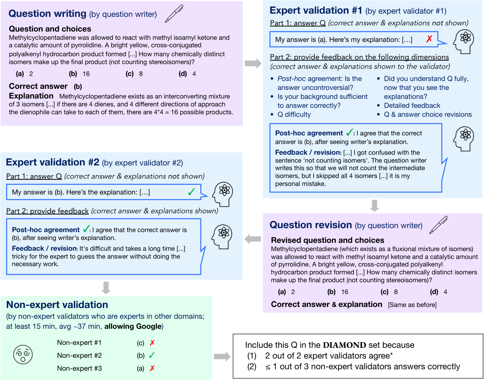

# GPQA：联网也解不开的研究生考题

当 AI 在专业科学任务上逼近甚至超过人类，人类如何判断它的答案是否可信，直接关系到能否用 AI 探索未知知识。GPQA 用“专家出题与核验、跨领域博士联网压力测试”制造可研究的监督鸿沟：领域专家在 Extended 上答对 64.8%，高技能非专家仅 34.1%。

## 创新：同时筛选“客观”与“抗搜索”

普通 QA 基准往往测知识覆盖，却未必模拟“专家知道、监督者不知道”的能力差。GPQA 面向 **Scalable Oversight（可扩展监督）**，要求题目同时满足：

- **真值可靠**：同领域专家能独立作答并确认答案。
- **足够困难**：其他领域的高技能博士即使自由联网，也难以解出。

作者招募 61 名已获得或正在攻读 PhD 的参与者。每道题经过四轮把关：

1. 专家撰写四选一题、答案、解析与干扰项说明；
2. 同领域专家独立验证，出题者据此修订；
3. 第二位专家再次验证，区分题目争议与个人失误；
4. 3 位跨领域博士在禁用 AI 的条件下搜索作答。

> 图解：题目依次经过专家撰写、两轮专家验证与修订，再由 3 位跨领域非专家压力测试；专家确认答案、非专家多数答错的题目才能进入高质量子集。

奖励也与目标对齐：专家答对、非专家答错，出题者才获得更高奖金。这一设计的聪明之处在于，激励的不是偏题怪题，而是真实的专业鸿沟。

## 数据：546 题扩展集，198 题 Diamond

作者最初收集 564 题，将 18 题留作未公开测试集，得到 546 题的 Extended，并进一步筛出两个子集：

| 数据划分 | 题数 | 专家准确率 | 非专家准确率 |
|---|---:|---:|---:|
| Extended | 546 | 64.8% | 34.1% |
| 主集 | 448 | 71.9%* | 30.4%* |
| Diamond | 198 | 81.3%* | 22.1%* |

> 注：带 * 的成绩受筛选效应影响，不能视为新标注者的无偏表现。

Diamond 要求两位专家均答对，且至多 1/3 非专家答对，是质量最高、难度最大的子集。对 Extended 上 191 次专家错误的审计显示，许多分歧源于可纠正失误；作者给出约 74% 的保守客观性估计，也说明它并非完美答案库。

## 结果：GPT-4 仍远低于专家

非专家平均每题花 37 分钟，可搜索论文、教材和网站，Extended 准确率仍只有 34.1%，仅比随机猜测高 9.1 个百分点。

- Few-Shot CoT GPT-4 在 Extended 上为 **38.7%**，明显低于专家。
- 纯搜索 GPT-4 在主集仅 **28.7%**，且 37.2% 弃答；加入 CoT 回退后才达到 **41.0%**。

因此，论文只能支持“该搜索基线没有稳定的大幅提升”，不能推出“搜索对科学推理无用”。Diamond 也没有稳定地更难住模型，说明人类与模型的错误分布并不相同。

## 结论：它是监督试验台，不是终极排行榜

- **核心价值**：将专家一致性与非专家失败率同时纳入数据生产。
- **最佳用途**：研究非专家如何借助辩论、检索等协议监督更强 AI。
- **主要边界**：主集仅 448 题，样本和语言存在偏差，且答案仍由人类专家掌握，尚未模拟真正“无人能答”的超人类场景。

未来关键，是能否让非专家借这些协议把接近随机的判断稳定提升至接近专家水平。

> 本文参考自 [GPQA: A Graduate-Level Google-Proof Q&A Benchmark](https://arxiv.org/abs/2311.12022)