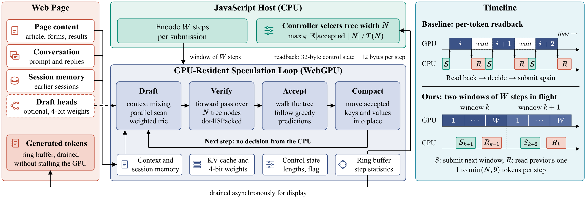
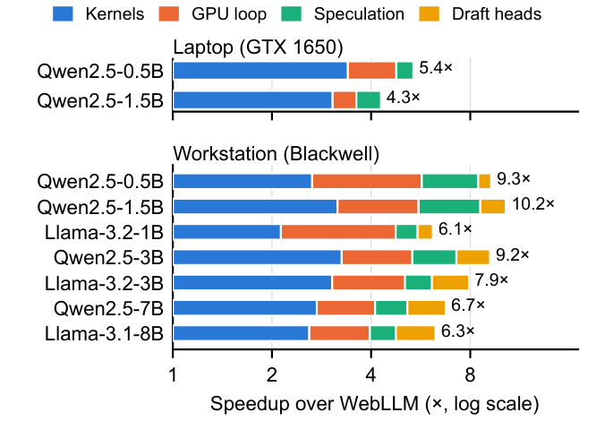
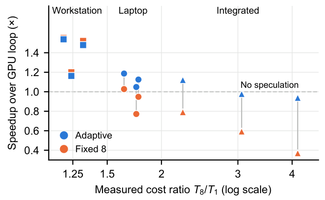
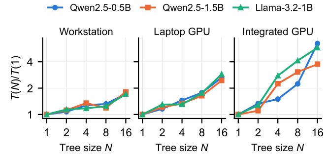
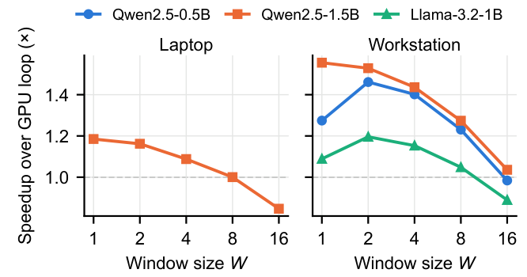
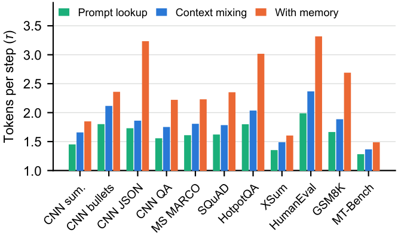
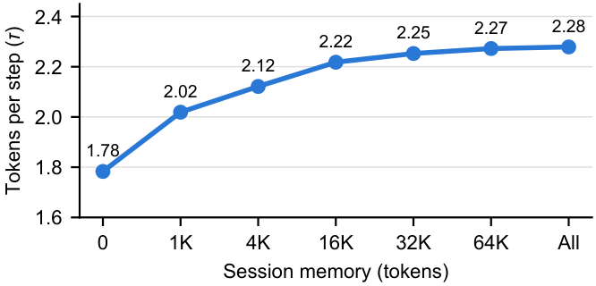

# WebSpec：GPU 常驻解码提速 8.6 倍

在浏览器里运行 LLM，可以做到数据不出本机、离线可用，还能省去按 Token 计费的服务器成本，但逐 Token 解码一直被浏览器调度、同步回读和单 Token Kernel 拖慢。这篇工作把 Draft、Verify、Accept 和 KV Cache 维护全部搬进 GPU 常驻循环，再用小批量整数 Kernel、网页上下文草稿和设备自适应控制降低每一步的代价。结果是：相对 WebLLM，它在笔记本独显、核显和工作站上分别提速 **3.5–5.4 倍、4.8–6.2 倍和 4.8–8.6 倍**，可选 Draft Heads 还能把峰值推到 **10.2 倍**。更重要的是，加速后的输出与同一量化运行时的 Greedy Decoding 逐 Token 完全一致。

## 为什么浏览器里的投机解码反而会更慢？

WebGPU 让网页能够通过 WGSL Compute Shader 使用 GPU。WebLLM 等引擎通常把模型编译成数百个 Kernel，再由 JavaScript 驱动：编码一次前向计算、提交 Command Buffer、等待 Logits 或采样 Token 回读，然后才决定下一步。

这个流程在原生运行时里很平常，在浏览器里却要穿过安全边界。每一次 Dispatch 都要经过 Renderer 校验，再通过进程间通信交给 GPU Process；每一次同步回读，又可能让 CPU 和 GPU 互相等待。

Speculative Decoding（投机解码）本来可以缓解这一问题。它像“先让助手拟稿，再由主模型批量审稿”：Draft 端一次提出多个候选 Token，目标模型并行验证，接受最长匹配路径，从而用一次前向计算产出多个 Token。

但收益并不只取决于接受多少 Token，还取决于验证这一步花了多少时间。可以把它写成：

$$
\mathrm{Goodput}(N)=\frac{\mathbb{E}[A(N)]}{T(N)}
$$

其中，$N$ 是每步验证的树节点数，$A(N)$ 是每步接受的 Token 数，$T(N)$ 是该步耗时。分子增加的同时，如果分母涨得更快，投机解码就会倒亏。

作者在 GTX 1650 笔记本上测到了三类浏览器特有成本：

- **Dispatch 与 IPC 开销**：一次前向计算包含 250–400 次 Dispatch，仅固定开销就有数毫秒。
- **逐 Token 同步回读**：WebLLM 在 Qwen2.5-0.5B 上每 Token 耗时 19.1 ms；相同 Kernel 连续入队、不等待回读时为 11.0 ms，约 8 ms 差值来自完整的 Host 往返、采样和 JavaScript 簿记。
- **单 Token Kernel 不适合批量验证**：WebLLM 验证 4 个和 8 个 Token，分别耗时单 Token 解码的 1.75 倍和 2.7 倍。

三者叠加，直接逆转了服务器端的常见经验：固定 8 节点树在工作站上能带来约 1.5 倍加速，在笔记本核显上却比朴素解码慢 **2.7 倍**。所以，问题不是“要不要投机”，而是整个运行时能否围绕浏览器成本重新设计。

## 总体方案：把完整决策回路留在 GPU

这套运行时由四部分组成：小批量验证 Kernel 降低多 Token 前向成本；GPU 常驻循环消除逐 Token CPU 决策；无需 Draft Model 的 Context Mixing Drafter 复用网页与会话内容；反馈控制器按设备实测成本调整树宽和提交窗口。

> 图解：左侧是网页内容、对话、会话记忆和可选 Draft Heads 等输入；中间 GPU 区域依次执行 Draft、Verify、Accept 和 Compact，并直接读写 KV Cache、控制状态与统计信息。CPU 只负责一次编码 $W$ 步，并在窗口之间选择树宽 $N$。右上方基线每生成一个 Token 都要“回读—决策—再提交”，GPU 中间出现等待；右下方则同时保持两个窗口在途，CPU 提交下一窗口后才读取上一窗口的少量状态，让 GPU 持续工作。

这个设计的核心不是简单“少传几次数据”，而是把控制流也下沉到 GPU。接下来分别看四个部件怎样消除前述成本。

### 小批量整数 Kernel：让验证 8 个 Token 不再贵 2.7 倍

验证多个 Token 时，同一权重矩阵要乘以多个 Token 向量。权重字节可以复用，增加的主要是计算量，因此小批量验证本应接近 Memory-bound 的单 Token 解码，而不该套用为长 Prompt 设计的 Prefill 路径。

作者采用 **4-bit Weight + 8-bit Activation**：

- 权重保持 4-bit，每 32 个输入共享一个 16-bit Scale，与 WebLLM 的 `q4f16_1` 粒度一致。
- 每次矩阵乘法前，按每 32 个值一组，把 Activation 量化为 8-bit Integer。
- 通过 WGSL 内置 `dot4I8Packed` 执行整数点积，再用分块修正项去除 Zero Point。
- 每个线程在寄存器中保存多行、多 Token 的累加器，让一次 Activation 加载服务多行，一次 Weight 加载服务当前步的所有 Token。
- Kernel 按权重形状和 1、2、4、8、16、32 Token Bucket 生成，并针对 GPU 类别调优；Activation 量化融合进前置 RMSNorm 和 SiLU。
- Attention 将可见上下文分块并行，再合并结果；共享 KV Head 的 Query Head 只读取一次 Key 和 Value。

更关键的是 **确定性**。不同 Batch 大小如果采用不同 Reduction 顺序，浮点舍入误差可能改变 Argmax，导致投机输出偏离 Greedy 输出。作者固定所有矩阵乘法和 Attention 的归约顺序，使验证 $N$ 个 Token 与执行 $N$ 次单 Token 步骤逐 bit 相同。

笔者认为，这里最有价值的不是又一种量化技巧，而是把“Kernel 的数值行为”纳入了无损投机解码的正确性条件：只改验证算法还不够，底层计算顺序也必须稳定。

### GPU 常驻循环：CPU 不再逐步问“接受了吗？”

每步处理固定的 $N$ 个树节点：节点 0 是上一步产生的 Token，节点 1 到 $N-1$ 构成 Draft Tree。通常由 CPU 保存的已提交 KV 长度、有效节点数、上下文长度和终止标志，全部放入一个小型 GPU Buffer，由 Kernel 在运行时读取。

一步包含四个动作：

1. **Verify**：对整棵树做一次前向计算；每个节点通过 Bit Mask 关注已提交 Cache 和自己的祖先。
2. **Accept**：从根节点向下走，选择 Token 等于父节点 Greedy 预测的子节点，得到最长接受路径。
3. **Compact**：把接受路径的 Key 和 Value 移到正确位置，维护 KV Cache。
4. **Draft**：生成下一棵树，供下一步验证。

由于中途不需要 CPU 决策，运行时把 $W$ 步编码进一个 Command Buffer，并保持两个窗口在途。CPU 先提交下一窗口，再读取上一窗口的 32-byte 控制状态和每步 12-byte 统计信息，GPU 因而不必等待 Host。

每步会提交已接受的 Draft 节点，再加上目标模型预测的下一个 Token，因此一次产出 1 到 $N$ 个 Token；由于 Drafter 最多延伸 8 个 Token，实际最多为 9 个。生成结果进入 Ring Buffer，由页面异步取走显示，不再为渲染而停顿 GPU。

### Context Mixing Drafter：不下载第二个模型，也能产生草稿

浏览器助手经常围绕当前网页作答，输出会复用页面短语、对话内容以及早期会话的表达。作者把这类冗余当作免费的 Draft 来源，避免第二个模型的下载、显存和 Dispatch 成本。

其直觉类似压缩算法中的 Prediction by Partial Matching（部分匹配预测）：当前后缀过去出现过时，它后面的内容很可能再次出现。严格来说，Drafter 会在最多 8 阶的所有历史匹配中查找当前后缀，并按各阶匹配至今的可靠性，把后续 Token 混成一个概率分布。

GPU 实现分三步：

- 并行扫描所有上下文位置，计算它们与当前后缀的匹配长度。
- 用 Bitonic Selection 选出每个 Workgroup 的最佳位置。
- 由单个 Workgroup 合并所选位置的后续内容，构建 Weighted Trie，再输出概率最高且保持前缀闭合的节点集合。

同一块 Buffer 还保留早期会话的模型输出，页面可选择把它持久化到 IndexedDB。扫描会话记忆与扫描当前上下文走同一套流程，不需要把记忆塞进 KV Cache。

如果站点愿意增加下载量，还可以启用 Medusa 风格 Draft Heads。4 个小 Head 根据最后验证 Token 的 Hidden State，预测未来第 2–5 个位置，仅覆盖词表中最常见的 32,768 个 Token；3B–8B 模型的 4-bit Head 权重为 99–151 MB。

Hybrid Tree 最多把一半节点分给 Context Drafter；若最佳匹配至少为 4 个 Token，也可全部交给它。其余节点由 Draft Heads 按概率乘积做 Best-first 扩展。Head 每步只增加一次小矩阵乘法，不改变 GPU 常驻循环。

### 反馈控制器：按设备实测成本选择树宽与窗口

宽树只有在草稿足够准、验证足够便宜时才划算。运行时加载模型时先测量每种树宽的 $T(N)$，生成时则记录每步接受节点数和最佳匹配长度。

窗口之间，控制器根据近期匹配长度及相同匹配长度下的历史接受率，估计不同候选树宽的期望接受 Token 数，再选择：

$$
N^*=\arg\max_N \frac{\mathbb{E}[A(N)]}{T(N)}
$$

它还会像拥塞控制一样偶尔探测更宽的树：如果文本突然变得容易预测，统计信息也能及时恢复。宽步昂贵的设备会从单 Token 解码开始，并降低探测频率。

实测成本并非一次校准后就不变。两个窗口在途时，相邻窗口完成间隔可以近似表示后一窗口的当前成本，控制器用 Exponential Moving Average 持续修正，以适应 GPU 降频、其他负载或 Host 限流。

窗口 $W$ 也不能一味增大：大窗口能摊薄提交成本，却会让树宽更久不更新，还可能在回复结束后继续空跑。加载时分别测试 $W=1,2,4$，选择“与最快结果差距不超过 10% 的最小窗口”。

### 实现与确定性代价

原型是约 1,500 行的自包含 JavaScript 模块，可生成 WGSL Kernel，未经修改即可在 Chrome 和 Edge 运行。它支持 Qwen2.5 与 Llama-3.2 Checkpoint，离线转换器负责 4-bit 权重量化，KV Cache 使用 32-bit Float；论文表示代码将在发表后开源。

确定性模式的性能代价有限：工作站上，非确定性版本并不更快；笔记本 GPU 上虽快 4%–15%，但会失去严格一致性。不固定 Reduction 顺序时，工作站上每个模型的 220 条投机输出只有 69–99 条与 Greedy 完全相同，笔记本上为 81–94 条；固定顺序后则全部一致。这说明“无损”不是自动成立的，而是工程系统显式保证出来的。

## 实验设置：三类 GPU、11 项任务、多引擎对照

实验覆盖 Qwen2.5、Llama、Gemma 和 Phi 等 9 个模型。浏览器端到端测试使用其中 7 个 0.5B–8B 模型；工作站跑全部 7 个，笔记本独显和核显使用能同时放下的 Qwen2.5-0.5B、Qwen2.5-1.5B 和 Llama-3.2-1B。接受率模拟则覆盖全部 9 个模型。

硬件环境如下：

- **Laptop**：AMD Ryzen 5 5600H + NVIDIA GTX 1650 4 GB，Windows 11。
- **Integrated**：同一笔记本的 AMD Radeon Vega 核显，共享系统内存。
- **Workstation**：NVIDIA RTX PRO 5000 48 GB，Ubuntu 24.04，Chrome 经 Vulkan 使用 GPU。
- 浏览器实验使用 Headless Chrome 155，每台设备同一时间只运行一个浏览器实例。

任务共 11 项，其中 7 项直接基于网页内容：CNN/DailyMail 的摘要、要点改写、JSON 实体抽取和开放问答，MS MARCO、SQuAD 2.0、HotpotQA 问答，以及 XSum、HumanEval、GSM8K 和 MT-Bench。页面内容截断到 1,536 Token，主实验每任务 20 条 Prompt，即每模型 220 条，每条最多生成 128 Token。

三个外部基线是 WebLLM 0.2.86、Transformers.js 3.8.1 和基于 wllama 3.8.1 的 LlamaWeb。内部再比较 Greedy、GPU Loop、固定 8 节点和自适应投机，以拆分 Kernel、GPU 常驻和 Speculation 的贡献。

| 引擎 | 设备 | 权重 | Activation | 完成 Prompt 数（0.5B / 1.5B / 1B） |
|---|---|---|---|---|
| WebLLM | Laptop | `q4f16_1` | 16-bit Float | 220 / 150 / 202 |
| WebLLM | Integrated | `q4f16_1` | 16-bit Float | 88 / 51 / 64 |
| WebLLM | Workstation | `q4f32_1` | 32-bit Float | 各 220 |
| Transformers.js | Laptop | 4-bit | 32 或 16-bit Float | 219 / 220 / 220 |
| Transformers.js | Integrated | 4-bit | 32-bit Float | 各 220 |
| Transformers.js | Workstation | 4-bit | 32 或 16-bit Float | 各 220 |
| LlamaWeb | Laptop | `Q4_0` | 16-bit Float | 各 220 |
| LlamaWeb | Integrated | `Q4_0` | 16-bit Float | 各 220 |
| LlamaWeb | Workstation | `Q4_0` | 16-bit Float | 各 220 |
| Ours | 全部设备 | 4-bit | 8-bit Integer | 各 220 |

需要特别注意，WebLLM 在长 Prompt 上会出现 disposed-object 错误，即使把 Prefill 配成单个 4,096 Token Chunk，笔记本上的失败仍集中在最长任务。因此，与 WebLLM 的延迟对比只使用它实际完成的相同子集；这些子集更短，不能当作完整 220 条任务上的结果。

论文把“无损”严格定义为：**与同一量化运行时、同一确定性 Greedy Decoder 的输出逐 Token 相同**。它不等于与原始 bfloat16 Checkpoint 或 WebLLM 输出一致，所以作者另外测量 Wikitext-2 Perplexity 和 GSM8K Accuracy，避免把“自身一致”误读成“所有实现输出一致”。

## 端到端结果：最高 8.6 倍，小模型受益更明显

下表报告每输出 Token 的解码延迟，数值越低越好。Greedy 保留逐 Token CPU 回读，GPU Loop 去掉回读但不做投机，Ours 是完整的自适应方案。

| 设备 | 模型 | Prompt 数 | Transformers.js (ms) | LlamaWeb (ms) | WebLLM (ms) | Greedy (ms) | GPU Loop (ms) | Ours (ms) | 相对 WebLLM 提速 |
|---|---|---:|---:|---:|---:|---:|---:|---:|---:|
| Laptop | Qwen2.5-0.5B | 220 | 40.56 | 20.84 | 20.15 | 5.93 | 4.22 | 3.75 | 5.4× |
| Laptop | Qwen2.5-1.5B | 150 | 76.79 | 30.20 | 38.02 | 12.44 | 10.54 | 8.87 | 4.3× |
| Laptop | Llama-3.2-1B | 202 | 31.09 | 22.86 | 24.51 | 8.98 | 7.44 | 7.05 | 3.5× |
| Integrated | Qwen2.5-0.5B | 88 | 55.38 | 32.67 | 52.25 | 11.37 | 9.61 | 8.42 | 6.2× |
| Integrated | Qwen2.5-1.5B | 51 | 99.32 | 66.09 | 143.15 | 29.43 | 27.97 | 29.70 | 4.8× |
| Integrated | Llama-3.2-1B | 64 | 64.90 | 41.19 | 107.65 | 22.63 | 21.26 | 22.63 | 4.8× |
| Workstation | Qwen2.5-0.5B | 220 | 27.03 | 16.04 | 12.17 | 4.59 | 2.13 | 1.44 | 8.5× |
| Workstation | Qwen2.5-1.5B | 220 | 30.34 | 16.38 | 19.14 | 6.05 | 3.43 | 2.23 | 8.6× |
| Workstation | Llama-3.2-1B | 220 | 9.00 | 11.49 | 8.85 | 4.15 | 1.86 | 1.60 | 5.5× |
| Workstation | Qwen2.5-3B | 220 | — | 18.46 | 25.42 | 7.80 | 4.76 | 3.50 | 7.3× |
| Workstation | Llama-3.2-3B | 220 | 14.15 | 14.95 | 19.13 | 6.28 | 3.78 | 3.13 | 6.1× |
| Workstation | Qwen2.5-7B | 220 | — | 20.90 | 25.11 | 9.18 | 6.11 | 4.87 | 5.2× |
| Workstation | Llama-3.1-8B | 220 | — | 23.54 | 24.17 | 9.31 | 6.09 | 5.08 | 4.8× |

三种设备、所有模型的全部 220 条 Prompt 上，投机输出都与本运行时的 Greedy 输出完全一致。在每个设备和模型上，Ours 都快于三个外部基线，相对各设备最强基线领先 1.8–8.5 倍；核显上的领先幅度最窄，为 1.8–3.9 倍。

收益最大的是快速 GPU 上的小模型，因为浏览器固定成本占比更高。到了更受显存带宽限制的 7B 和 8B，提速回落到 4.8–5.2 倍。

工作站上，仅去掉 Qwen2.5-0.5B 的逐 Token 回读，就把延迟从 4.59 ms 降至 2.13 ms，投机再降到 1.44 ms。核显上完整 Ours 有两次反而略慢于 GPU Loop，说明控制器能避免严重倒亏，却不能保证每次都优于不投机。

## 加速来自哪里：Kernel 最大头，GPU 常驻再放大

> 图解：横轴是相对 WebLLM 的加速倍数，采用对数刻度；每行对应一个模型，蓝、橙、绿、黄分别表示小批量 Kernel、GPU Loop、Speculation 和可选 Draft Heads 的乘法式贡献。工作站 7 个模型上，Kernel 是最大来源，GPU Loop 继续放大收益；Qwen2.5-1.5B 加入 Draft Heads 后达到 10.2 倍。笔记本两项结果只展示默认方案，总加速分别为 5.4 倍和 4.3 倍。

Kernel 本身在工作站贡献 2.1–3.3 倍，在笔记本独显贡献 3.1–3.4 倍。由于笔记本上的 WebLLM 已使用 16-bit Activation，提升不能简单归因于工作站 WebLLM 的 32-bit Activation。

GPU Loop 在工作站再贡献 1.50–2.23 倍，Speculation 贡献 1.17–1.54 倍；两项合计额外带来 **1.8–3.2 倍**。笔记本上这两项分别只有 1.18–1.41 倍和 1.13–1.19 倍，再次说明浏览器优化必须结合实际设备成本。

## 跨设备自适应：固定 8 节点不是通用答案

> 图解：横轴是 8 节点步与单节点步的实测成本比 $T_8/T_1$，采用对数刻度；纵轴是相对无投机 GPU Loop 的加速倍数，虚线 1.0 表示没有收益。蓝点为自适应控制，橙点为固定 8 节点。工作站的宽步便宜，两种策略都有效；成本比升高后，固定树宽多次跌破 1.0，自适应大多能贴近或超过基线。

工作站上，8 节点步只比单节点贵 19%–32%，固定 8 节点已接近最优，自适应结果与其差距不超过 4%。笔记本独显的对应增幅为 64%–77%，核显则达到 124%–312%。

固定 8 节点在这两台笔记本 GPU 的 6 个配置中有 5 个输给朴素 GPU Loop。最极端的是核显上的 Llama-3.2-1B：61.02 ms 对 22.59 ms，慢 **2.7 倍**。

自适应控制在笔记本独显上最高提速 19%，在核显 Qwen2.5-0.5B 上提速 12%。但核显两个较大模型仍有 2% 和 7% 的退化，远好于固定树宽的 69% 和 170%，却也暴露了“偶尔探测”的代价。

控制器最终选出的宽度与成本曲线一致：工作站 41%–86% 的步骤使用 8 节点；笔记本独显不使用 8 节点，57%–66% 使用 4 节点；核显两个较大模型有 84% 和 96% 的步骤退回单节点。

附录的完整成本曲线进一步解释了这种差异。

> 图解：三个子图分别是工作站、笔记本独显和核显；横轴为树大小 $N$，纵轴为相对单节点步的成本 $T(N)/T(1)$，三条线对应三个小模型。工作站 16 节点仍不到单节点的 2 倍，笔记本成本平稳增长，核显超过 2 节点后迅速变贵，16 节点达到 3.8–6.5 倍。

这组结果也是论文最重要的反常识结论之一：**投机宽度本质上是硬件参数，而不是一个可跨设备复制的常数。**

## 提交窗口：更小不仅更快，也更不影响页面

> 图解：横轴是每次提交包含的步数 $W$，纵轴是相对无投机 GPU Loop 的加速倍数；左图为笔记本，右图为工作站。工作站的 Qwen2.5-0.5B 和 Llama-3.2-1B 在 $W=2$ 时最佳，Qwen2.5-1.5B 与笔记本测试在 $W=1$ 时最佳。窗口继续扩大后，所有曲线都下降，部分配置在 $W=16$ 时已不如不投机。

工作站上，$W=2$ 时 Qwen2.5-0.5B 和 Llama-3.2-1B 分别达到 1.45 ms 和 1.58 ms；Qwen2.5-1.5B 在 $W=1$ 时最快，为 2.21 ms。笔记本确认实验中，Qwen2.5-1.5B 在 $W=1,2,4,8,16$ 时分别为 9.12、9.30、9.93、10.80、12.75 ms。加载阶段只搜索 1、2、4，也准确选中了这些最优值。

作者还在同一页面用另一个 WebGPU Device 每 16.7 ms 提交一次小计算，模拟动画帧：

- 工作站解码 Qwen2.5-0.5B 时，$W=1$ 和 $W=2$ 的帧延迟 P99 分别为 5.7 ms 和 8.9 ms，页面保持 60 FPS。
- $W=16$ 把 P99 推到 42.7 ms，页面降至 57 FPS。
- 核显即使在 Greedy 解码时也只有 35 FPS；$W=1$ 时为 26 FPS，$W=16$ 时降至 11 FPS，P99 达 310 ms。

所以，小窗口在核显上是必要条件，却不是充分条件。页面若要在解码时继续动画，还需要主动限制 Decoder 的调度强度。

## Draft Heads 与会话记忆：一个更准，一个零额外下载

接受率模拟回放 9 个模型在 11 项任务上的 Greedy 输出。8 节点 Prompt Lookup 平均每步产生 1.62 个 Token，16 节点 Suffix Tree 为 1.73；Context Mixing 在 16 和 32 节点时分别为 1.78 和 1.83，加入会话记忆后达到 2.40。

> 图解：横轴是 11 项任务，纵轴是每验证步产出的 Token 数 $\tau$；绿色为 Prompt Lookup，蓝色为 Context Mixing，橙色为加入 Session Memory。Context Mixing 在每项任务上都优于 Prompt Lookup；Memory 对结构化输出帮助尤其大，JSON 抽取、HumanEval 和 GSM8K 分别升至 3.23、3.32 和 2.69，而 XSum 与 MT-Bench 提升较小。

这种差异很符合直觉：连续答案会复用 JSON 格式、代码结构和推理解题模板，开放聊天与单句摘要则较少重复。记忆只进入 Drafter 扫描，不进入 KV Cache，因此不增加 Prefill 成本。

记忆容量也不需要无限增长。

> 图解：横轴为 Session Memory 的 Token 容量，纵轴为 16 节点预算下每步 Token 数 $\tau$。从 0 到 16K 时曲线快速上升，随后趋平；32K 已达到 2.25，64K 为 2.27，保留全部历史也只有 2.28。因而 32K Buffer 已获得无限记忆约 95% 的增量收益。

工作站端到端结果如下。Context 只使用当前请求，Memory 加入同一会话早期请求的模型输出，Heads 则把 Draft Heads 与 Context Drafter 混合。

| 模型 | Context (ms) | Memory (ms) | Heads (ms) |
|---|---:|---:|---:|
| Qwen2.5-0.5B | 1.44 | 1.30 | 1.31 |
| Qwen2.5-1.5B | 2.23 | 1.95 | 1.87 |
| Llama-3.2-1B | 1.60 | 1.40 | 1.44 |
| Qwen2.5-3B | 3.50 | 3.03 | 2.77 |
| Llama-3.2-3B | 3.13 | 2.63 | 2.41 |
| Qwen2.5-7B | 4.87 | 4.30 | 3.73 |
| Llama-3.1-8B | 5.08 | 4.24 | 3.85 |

Draft Heads 将延迟降低 9%–24%，7B 和 8B 分别达到 3.73 ms 和 3.85 ms，相对 WebLLM 为 6.7 倍和 6.3 倍。Session Memory 不需下载任何权重，也降低了 10%–17%；Llama-3.2-1B 上甚至比 Heads 更快，1.40 ms 对 1.44 ms。

记忆内容只来自当前模型在早期评测请求中生成的输出，不含参考答案，并在加载模型时清空。把 220 条 Prompt 随机打乱、混合 11 项任务后，三个小模型的 Memory 延迟变化不超过 0.02 ms，说明收益不依赖“连续重复同一任务”的顺序。

Heads 使用 UltraChat 和 6 个数据集的 Training Split 做 Self-Distillation，评测 Prompt 被排除。HumanEval 与 MT-Bench 完全未参与训练，但 Head 仍带来 9%–25% 的延迟下降，与 in-domain 任务的 7%–24% 相当。

## 请求延迟与输出质量：快，还要回答得一样好

用户感知的是完整请求，而非单个 Token。7 项网页任务在工作站上的 Prompt 平均含约 830 Token 页面内容，完整方案同时加速 Prefill 和 Decode。

| 设备 | 模型 | WebLLM 首 Token (ms) | Ours 首 Token (ms) | WebLLM 总延迟 (ms) | Ours 总延迟 (ms) |
|---|---|---:|---:|---:|---:|
| Workstation | Qwen2.5-0.5B | 366 | 124 | 1,494 | 249 |
| Workstation | Qwen2.5-1.5B | 707 | 190 | 2,815 | 394 |
| Workstation | Llama-3.2-1B | 401 | 125 | 1,462 | 302 |
| Laptop | Qwen2.5-0.5B | 1,366 | 578 | 3,182 | 923 |
| Laptop | Qwen2.5-1.5B | 2,937 | 841 | 6,302 | 1,569 |
| Laptop | Llama-3.2-1B | 3,154 | 1,017 | 5,963 | 1,843 |

首 Token 延迟改善 2.4–3.7 倍；完整请求在工作站提速 4.8–7.1 倍，在笔记本提速 3.2–4.0 倍。笔记本 Qwen2.5-0.5B 的新闻问答从 3.2 秒缩短到 0.9 秒，这已经接近用户能直接感知的差别。

质量方面，Qwen2.5-1.5B 在 Wikitext-2 上的 Perplexity，Ours 与 WebLLM 分别为 15.438 和 15.426，差 0.08%；Llama-3.2-1B 分别为 20.799 和 20.705，差 0.45%。

GSM8K 使用 200 道题、最多 384 Token 答案，取答案最后一个数字与参考值比较。

| 模型 | PyTorch bfloat16 (%) | WebLLM (%) | Ours (%) |
|---|---:|---:|---:|
| Qwen2.5-0.5B | 41.5 | 17.0 | 23.0 |
| Qwen2.5-1.5B | 61.0 | 50.0 | 54.0 |
| Llama-3.2-1B | 42.5 | 31.5 | 31.0 |
| Qwen2.5-3B | 66.5 | 62.5 | 56.5 |
| Llama-3.2-3B | 68.0 | 66.0 | 64.5 |
| Qwen2.5-7B | 68.0 | 70.0 | 69.0 |
| Llama-3.1-8B | 72.5 | 69.0 | 68.0 |
| **Mean** | **60.0** | **52.3** | **52.3** |

两种浏览器引擎的平均准确率都是 52.3%。1,400 个模型—题目配对的平均差为 0.0%，95% Bootstrap 区间为 -2.2% 到 2.4%。不过单模型双向差异最高达 6 个百分点，因此结论应表述为“平均持平”，而不是“每个模型都无损”。两者相对 bfloat16 的下降主要来自共同的 4-bit 权重，小模型尤其明显。

网页任务没有唯一标准答案，作者改用 Token-level ROUGE-L 比较各引擎与同 Prompt bfloat16 输出的接近程度。Ours 平均为 0.49，WebLLM 为 0.46；6 个可比模型中有 5 个差距不超过 0.02，Qwen2.5-7B 则为 0.57 对 0.43。

## 扩大基准：1,060 条 Prompt 上结论仍成立

附录把每任务新增 100 条 Prompt、MT-Bench 新增 60 条，与主实验完全不重叠，在工作站上将每模型规模扩大到 1,060 条。所有配置、所有模型的投机输出仍与 Greedy 完全一致。

| 模型 | WebLLM (ms) | Greedy (ms) | GPU Loop (ms) | Ours (ms) | Memory (ms) | Heads (ms) |
|---|---:|---:|---:|---:|---:|---:|
| Qwen2.5-0.5B | 12.61 | 4.61 | 2.10 | 1.43 | 1.26 | 1.33 |
| Qwen2.5-1.5B | 19.25 | 6.06 | 3.43 | 2.24 | 1.91 | 1.88 |
| Llama-3.2-1B | 8.62 | 4.02 | 1.90 | 1.55 | 1.30 | 1.42 |
| Qwen2.5-3B | 25.67 | 7.26 | 4.98 | 3.65 | 2.83 | 2.69 |
| Llama-3.2-3B | 18.41 | 6.19 | 3.76 | 3.03 | 2.60 | 2.37 |
| Qwen2.5-7B | 25.19 | 9.29 | 6.12 | 4.67 | 3.93 | 3.57 |
| Llama-3.1-8B | 24.34 | 9.44 | 6.10 | 4.92 | 3.94 | 3.75 |

7 个模型相对 WebLLM 的提速依次为 8.8、8.6、5.6、7.0、6.1、5.4 和 4.9 倍，与主实验基本一致。更长会话让 Memory 的收益提高到 12%–22%，因为 Drafter 能利用更多历史输出。

## 与既有工作相比，差异究竟在哪？

- **相对浏览器推理引擎**：WebLLM、Transformers.js、LlamaWeb 和 WeInfer 主要优化单 Token 路径；WeInfer 可以延后每次回读，却没有消除它。本文把逐步接受决策也移出 CPU。
- **相对原生 Speculative Decoding**：CUDA Graph 可以捕获 Decode 和 Verify，但原生运行时不用承担浏览器校验与 IPC。本文处理的是 WebGPU 沙箱约束下的完整控制路径。
- **相对 Medusa、EAGLE 等轻量 Draft**：Context Mixing 默认不需要额外权重，又可与 Heads 混合；Sequoia、SmartSpec 也考虑硬件成本，但这里的控制在 GPU 常驻窗口之间运行，并使用访客设备的在线实测成本。
- **相对 Prompt Lookup、REST 和 Suffix Decoding**：本文不是只复制最后一个 N-gram 或检索单一后续，而是混合所有匹配阶数，并以 GPU 并行扫描完成，不依赖 CPU Index 或回读。

因此，创新并非孤立的“新 Drafter”或“新 Controller”，而是把 Kernel 确定性、GPU 控制流、上下文复用和设备测量组合成一个适配浏览器约束的闭环。

## 部署成本、隐私与局限

**Session Memory 隐私。** 记忆可能包含个人内容。运行时只在当前页面 Origin 内使用它：访问期间存于 GPU Buffer，跨访问可选择写入 IndexedDB。浏览器 Same-origin Policy 将其与其他站点隔离，清除站点数据即可删除；页面也可关闭持久化，或把记忆限定在一次对话中。

**首次加载成本。** 工作站上，7 个模型从本地服务器加载 4-bit 权重并编译 Kernel 需 3–11 秒，树宽成本校准需 4–19 秒，窗口校准需 2–6 秒。论文的稳态加速不包含这些开销；原型尚未把校准结果缓存到 IndexedDB，三个小模型首次访问要经过 4–9 个网页任务请求才能摊薄相对 WebLLM 的额外成本，单次短请求并不会更快完成。

**显存与内存。** 2,560 Token、32-bit Float 的 KV Cache 占 63–671 MB，权重另占 0.3–4.3 GB。Draft Heads 还会增加 99–151 MB 下载，而默认 Context/Memory 方案不需要这份额外权重。

**实验边界。** 当前无损路径针对 Greedy Decoding，随机 Sampling 需要另一套在随机性下仍确定可复现的验证规则。实验只覆盖 Chrome 和已测试的 NVIDIA、AMD 驱动；笔记本结果来自同一台机器的两块 GPU 和三个小模型，不能直接外推到 Safari、Firefox、Apple 或移动 GPU。

此外，论文没有与原生运行时对比，也没有单独测试“浮点 Activation + 相同小批量设计”的消融，因此 Kernel 加速同时混合了 8-bit Activation 和小批量设计的贡献。核显上的页面响应问题也尚未解决，只靠缩小窗口并不够。

## 总结：浏览器推理需要自己的解码系统设计

- 浏览器 Dispatch、IPC 和同步回读会逆转投机解码收益，固定 8 节点在核显上甚至慢 2.7 倍。
- 确定性小批量整数 Kernel 让多 Token 验证更便宜，并保证与同一量化 Greedy Runtime 逐 bit 一致。
- GPU 常驻 Draft—Verify—Accept—Compact 回路消除逐 Token CPU 决策，双窗口提交让 GPU 持续工作。
- Context Mixing 与 Session Memory 无需额外模型即可提高接受率，设备实测控制则避免宽树在弱 GPU 上严重倒亏。
- 默认方案相对 WebLLM 最高提速 8.6 倍，可选 Heads 达 10.2 倍，扩展基准和平均任务质量也支持主要结论。

这项工作为隐私、离线的网页助手提供了实用方向，但首次校准成本、随机 Sampling，以及核显和移动 GPU 上的响应式调度，仍是下一步必须解决的问题。

> 本文参考自 [GPU-Resident Speculative Decoding for In-Browser LLM Inference with WebGPU](http://arxiv.org/abs/2610.39761v1)