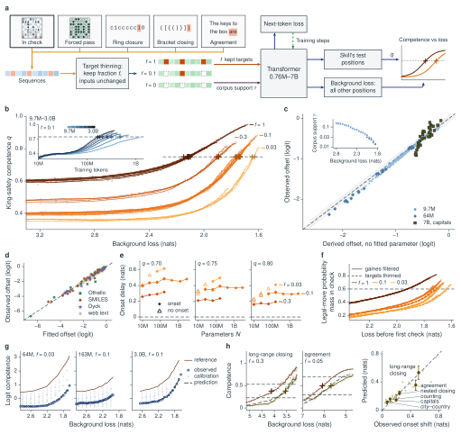
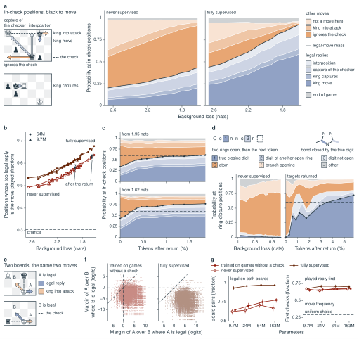
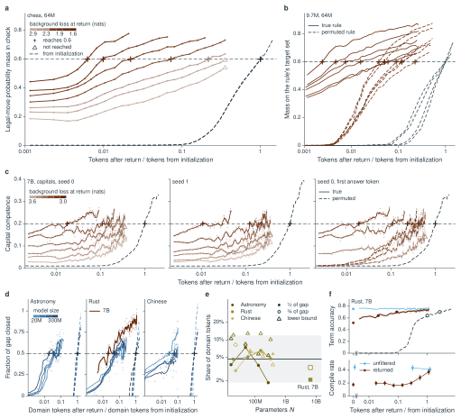
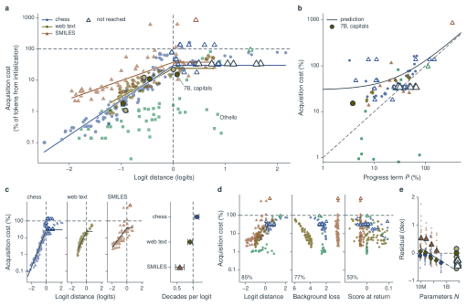
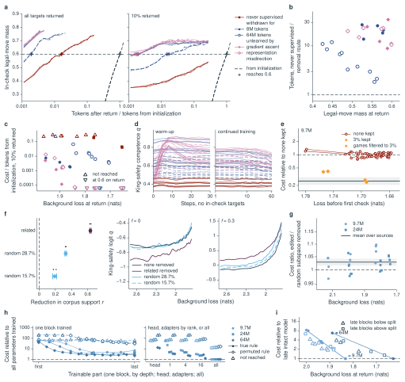

# Progress Substitutes：通用进步让被删技能低成本回归

从训练语料中删掉某类知识，真的能阻止语言模型学会对应能力吗？这个问题直接关系到数据过滤能否延缓高风险能力，以及模型此后需要多少数据才能重新获得它。这篇论文的核心发现是：**模型在其余语料上取得的通用进步，可以替代一部分被扣留的专项训练信号**；过滤主要造成一段可预测的延迟，而不是永久清空能力。在国际象棋实验中，成熟模型重新学会“被将军时走出合法着法”，最少只需从头训练所需 Token 的 **0.10%–0.78%**；在 7B 模型中，恢复 Rust 能力差距的一半也只需未过滤模型从头达到同等准确率所用 Token 的 **2.1%**。

## 数据过滤买到的究竟是“遗忘”，还是“时间”？

开发者通常用两种办法塑造模型能力：调整不同领域的数据配比，或者删除不希望模型学习的文档与目标。已有的 Scaling Law 能描述算力、数据量、模型规模与 Loss 的关系，却回答不了一个更细的问题：**某项技能究竟有多少来自自己的训练样本，又有多少来自其余语料？**

此前研究已经观察到，预训练能减少下游任务所需的数据，被剪枝或 Unlearning 压抑的能力也常在少量训练后恢复。医学领域过滤实验甚至发现，用不到预训练 Token 的 0.2% 就能通过对抗微调恢复未过滤基线。但这些结果仍缺少三块拼图：

- 过滤会把技能出现的时间推迟多久？
- 恢复成本如何随模型的通用进步变化？
- 低成本恢复究竟来自被扣留技能的潜在积累，还是任何同难度规则都能享受的通用学习收益？

论文因此同时测量“技能被推迟多少”和“数据回来后补学多贵”，并引入一个难度相当、但答案被人为打乱的控制规则。实验覆盖国际象棋、Othello、分子 SMILES 字符串、Dyck 括号语言和 Web 文本，模型最大达到 7B 参数。

| 领域 | 被控制的代表性技能 | 数据与评价方式 |
|---|---|---|
| 国际象棋 | 被将军时的合法应对、王安全 | 2024 年 Lichess 高评级对局，一步一个 Token，按走法合法性分类 |
| Othello | 强制跳过、强制走法 | 均匀采样的合法对局，含显式 Pass Token |
| SMILES | 环闭合数字、分支闭合 | ZINC22 的 3 亿条规范分子字符串，按字符建模 |
| Dyck-4 | 不同匹配距离的闭括号 | 四种括号组成的合法嵌套序列 |
| Web 文本 | 主谓一致、闭括号、计数、国家首都等 | FineWeb-Edu，以及 DataDecide 的 Dolma 1.7 配方 |

## 关键实验：只撤掉答案的监督，不撤掉输入

### Target thinning：把课本留给孩子，只遮住部分答案

论文最重要的实验工具叫 **Target thinning（目标稀疏化）**。可以把它理解为：模型仍能阅读所有题目，但只有一部分题目的答案参与评分。严格来说，对某项技能选中的 Next-token Target，只保留比例 $f$ 进入训练 Loss，其余目标被掩蔽；**所有输入 Token 都原样留在序列中**。

例如，国际象棋中选择“当前一方被将军”的棋盘位置，只保留其中 $f$ 比例的下一步监督。被掩蔽位置既不进入 Loss 的分子，也不进入分母，其他位置的 Loss 权重保持不变。随机删除同等密度的普通目标被用作对照。

这种设计比直接删文档更干净：它把“缺少技能专属答案”与“连相关上下文也看不到”分开了。论文也用整局过滤、整篇文档过滤验证，结论并不只适用于 Loss 掩蔽。

### 为什么用背景 Loss，而不是训练步数对齐模型？

两个模型即使训练了同样多的 Token，通用水平也可能不同。因此作者使用 **Background loss（背景 Loss）$L$** 作为通用进步的坐标：它是在所有未稀疏化目标上计算的留出集交叉熵（held-out cross-entropy），单位为 nats。训练越充分，$L$ 通常越低。

技能水平则记为 competence $q$。在国际象棋中，它是模型分配给合法逃生着法的概率质量，除以合法与“仍让王受攻击”着法的总概率质量：

$$
q=\frac{p(\mathrm{legal})}{p(\mathrm{legal})+p(\mathrm{king\text{-}unsafe})}
$$

于是，比较相同 $L$ 下的 $q$，就能把“其余语料带来的通用进步”与“技能自身目标带来的专项监督”分开。所谓 **Onset delay（出现延迟）**，就是稀疏化模型要比完整监督模型多降低多少背景 Loss，才能让 $q$ 达到同一阈值。

> 图解：图 a 展示 Target thinning：输入完整保留，仅按比例 $f$ 留下技能目标的 Loss。图 b 的横轴是背景 Loss，纵轴是国际象棋王安全 competence，颜色区分保留比例；保留目标越少，达到同一技能水平所需的背景 Loss 越低。图 c、d 比较预测与实测的 Logit 偏移，其中棋盘王安全和 7B 首都回忆可以不拟合参数直接预测。图 e 显示不同规模下的 Onset 延迟，图 f 比较整局过滤与目标稀疏化，图 g、h 则展示用小模型校准后对更大模型和 7B Web 文本技能的预测。

## 一个公式解释：通用语料如何替代专项数据

### 从两个端点推出所有保留比例

最核心的问题可以写成：完整监督模型 $f=1$ 和从未监督模型 $f=0$ 已知，能否推出任意 $f$ 的表现？

对某个测试位置 $x$，令 $\operatorname{odds}_x$ 表示合法逃生与不安全着法的概率 odds。论文假设该位置的预测由技能自身目标与其余语料按权重共同决定，于是有：

$$
\operatorname{odds}_x(L,f)=f\operatorname{odds}_x(L,1)+(1-f)\operatorname{odds}_x(L,0)
$$

再定义 **Corpus support（语料支持）$\tau$**：其余语料对技能的贡献，用“技能自身目标新增贡献”作为单位来衡量。它可从两个端点模型直接读出：

$$
\frac{\tau_x}{1+\tau_x}=\frac{\operatorname{odds}_x(L,0)}{\operatorname{odds}_x(L,1)}
$$

稀疏化造成的单位置 Logit 偏移因此为：

$$
\operatorname{logit}q_x(L,f)-\operatorname{logit}q_x(L,1)
=\ln\left(\frac{f+\tau_x}{1+\tau_x}\right)
$$

其中 $(f+\tau)/(1+\tau)$ 被称为 **Effective supervision（有效监督）**。如果 $\tau=0$，其余语料完全帮不上忙；如果 $\tau>0$，即使 $f=0$，模型仍保留一部分技能基础。

这个推导依赖三个明确假设：同一背景 Loss 下，位置表示不随 $f$ 改变；模型预测近似对应共享该表示的训练目标的加权频率；技能自身目标不会给测试位置的不安全着法分配概率。它不是对所有神经网络学习的普适定理，而是一个可以被实验检验的加权似然模型。

### 从单个位置到整体分数

整体 $q$ 会汇总大量位置，不能把每个位置的 Logit 偏移直接当成整体偏移。附录给出的汇总形式是：

$$
\operatorname{logit}q(L,f)-\operatorname{logit}q(L,1)
=\kappa(L)\ln\left(\frac{f+\tau(L)}{1+\tau(L)}\right)
$$

$\kappa$ 是汇总敏感度。理论上，它等于：

$$
\kappa=1-\frac{\operatorname{Var}_m(q_x)}{\bar q(1-\bar q)}
$$

位置之间的 competence 差异越大，统一平移单个位置的 Logit 后，整体 Logit 的变化就越小。国际象棋实验中，完整监督模型给出的理论因子为 0.59–0.66，实测汇总敏感度约为 0.55–0.67，二者相当接近。

### 预测误差有多小？

| 测试对象 | 预测方式 | 结果 |
|---|---|---|
| 15 个 9.7M 国际象棋稀疏化模型 | 仅用 $f=0$ 与 $f=1$，不拟合参数 | 300 个点的 RMSE 为 0.039 Logit |
| 64M 国际象棋模型，$f$ 低至 0.01 | 同上 | 20 个点的 RMSE 为 0.089 Logit |
| 109 条国际象棋轨迹、4,312 个偏移 | 拟合汇总敏感度与 $\tau$ | 残差标准差 0.034 Logit |
| 7B 首都回忆，$f=0.3$ | 每个随机种子仅用两个端点模型 | RMSE 0.14 Logit；只用 $f$ 则为 0.61 |
| Othello、SMILES、Dyck 等其他 6 项技能 | 不拟合参数 | 误差 0.26–1.71 Logit |
| 同上 | 每个背景 Loss 拟合汇总形式 | 误差降至 0.10–0.42 Logit |

笔者认为，这里最有价值的并不只是一个好拟合公式，而是它把“通用进步”变成了可测量项。尤其在首都回忆上，同种子两个端点模型之间的预测误差，还不到两个随机种子实测偏移差异 0.31 Logit 的一半。

### 延迟能跨规模外推，但能力缺口会扩大

在国际象棋中，9.7M 模型只保留 10% 的被将军目标时，$q=0.70$ 的 Onset 向更低背景 Loss 移动了 0.40 nats；随机掩蔽同等密度目标则几乎不改变 Onset。从 9.7M 到 3.0B，在 $q\geq0.70$ 时，这一延迟为 0.29–0.49 nats，每扩大 10 倍参数，延迟仅变化 0.00–0.03 nats。

因此，小模型可以用来预测大模型：

- 对校准中未出现的保留比例、模型规模和学习率 schedule，国际象棋轨迹的误差中位数为 0.026–0.040 Logit。
- 只用不超过 431M 的模型校准，就能预测 1.28B 和 3.0B 模型。
- 用 60M–1B 的 Web 文本响应校准，预测 7B 模型 6 项技能的 Onset 偏移，平均误差为 0.058 nats。

但“可预测”不等于“过滤影响不变”。$\tau$ 会随通用进步下降：国际象棋中从背景 Loss 2.8 nats 时的约 0.15–0.16，降到 1.85 nats 时的 0.014–0.015。原因是完整监督模型的合法/不安全 odds 增长约 5 倍，而从未监督模型只增长约 1.5 倍。

所以出现了一个看似反直觉的结果：**其余语料确实在帮忙，但专项监督带来的领先增长得更快，过滤模型与完整模型的差距反而随进步扩大。** 在背景 Loss 从 2.6 降至 1.8 nats 时，保留 30% 目标的模型偏移增加 0.22 Logit，完全未监督模型则增加 1.39 Logit。

## 从未接受专项监督，模型究竟学到了什么？

公式说明其余语料有贡献，下一步就要看模型的实际输出：这种贡献是有意义的技能基础，还是统计上的巧合？

### 不会处理将军，却已经会给合法应对排序

在 8,313 个留出（held-out）的被将军位置上，64M 从未监督模型把约 0.48 的概率分配给“若不考虑王被攻击就合法”的着法，完整监督模型只有 0.02。这说明它学会了棋子如何移动，却没有充分学会“将军必须立即处理”这一约束。

但在至少有两个合法应对的位置中，它概率最高的合法应对有 0.64 是对局中实际走出的着法，完整监督模型为 0.68，随机选择仅约 0.30。也就是说，**约束知识缺失较明显，合法候选之间的偏好却已相当完整**。

> 图解：图 a 将 8,313 个被将军位置的下一步概率按走法类别堆叠，横轴为背景 Loss；左侧从未监督模型大量选择忽略将军的着法，右侧完整监督模型则集中于合法应对。图 b 比较实际对局着法在合法候选中的排名，虚线为随机水平。图 c、d 的横轴是目标回归后所用 Token 占从头训练需求的比例，展示国际象棋和 SMILES 的快速恢复。图 e–g 构造同一走法 A、B 在两块棋盘上互换合法性的配对，检验模型偏好是否真正随棋盘改变，而不是只记住常见走法。

更有说服力的是“训练中完全没出现将军”的整局过滤实验。模型第一次遇到留出对局中的将军时，把实际走法排在合法应对首位的比例为 0.65–0.68，完整监督模型为 0.68–0.71。对于同一走法在棋盘对中互换合法性的情况，9.7M 和 163M 从未见过将军的模型分别有 0.65 和 0.78 的配对在两块棋盘上都更偏好合法走法；忽略棋盘、只按频率排序的基线在这一指标上为 0。

不过，一种应对方式的监督不会自动迁移到另一种。给从未见过将军的 9.7M 模型监督 3,072 个“马将军且不能垫子”的应对后，同类留出位置的合法概率质量从 0.57 升至 0.90；但在所有合法应对都是垫子的棋盘上，它反而从 0.39 降至 0.35。只有直接监督垫子应对，才将其提升至 0.89。

### 目标回来后，少量监督只补上缺失的约束

64M 国际象棋模型恢复全部被将军目标后，最初 100 万 Token 只占从头训练需求的 0.9%，就把约三分之一的概率从“忽略将军”的走法移走，主要转向王的合法移动；合法候选之间的排序则基本不变。

SMILES 呈现出更鲜明的同样过程。从未接受环闭合目标时，模型在应写闭合数字的位置给出 0.0004 的真实数字概率，多数概率仍指向继续写原子；目标回来仅 2 个优化器步骤后，真实闭合数字概率就达到 0.36，12 步后达到 0.60。

这个设计的聪明之处在于，它把“快速恢复”拆成了可观察的两部分：**其余语料先学会相关结构与候选排序，少量专项数据再补上被删掉的决策规则。** 这比笼统地说“模型还残留知识”更有解释力。

## 恢复一项技能，到底需要多少数据？

### Acquisition cost：用从头训练的成本做统一分母

作者沿从未监督源模型的训练轨迹选取多个 Checkpoint，在每个 Checkpoint 恢复技能目标，训练到固定 competence，即 Acquisition level。恢复成本定义为：

$$
C=\frac{\text{目标回归后达到 Acquisition level 所需 Token}}
{\text{同规模模型从初始化达到同一水平所需 Token}}
$$

在国际象棋源模型各自最低背景 Loss 的 Checkpoint 上，恢复成本只有 0.10%–0.78%。如果把恢复前用于重建优化器状态、且不含回归目标的 50 步也计入，成本为 3.1%–7.5%。不同 Batch size 与学习率实验还表明，这些数字会受到训练设置影响，并非与实现无关的常数。

为了排除“任何规则都容易继续学习”的解释，作者设计了一个固定置换规则：对所有被将军目标使用同一套走法标签置换。它与真实规则在熵和可达准确率上匹配，从初始化学习时，两者所需 Token 仅相差 1.06 倍以内；但从相同源 Checkpoint 恢复时，置换规则需要真实规则的 **2.4–16 倍** Token。

> 图解：图 a–c 的横轴均为目标回归后的 Token 占同规模从头训练需求的比例，虚线表示从初始化学习的参考轨迹。图 a 展示不同背景 Loss 下国际象棋合法概率质量的恢复；图 b 中实线为真实规则、虚线为置换规则，后者的明显右移证明节省具有技能专项性。图 c 是 7B 首都回忆及置换答案 Token 的对照。图 d、e 展示天文学、Rust、中文整个领域过滤后的差距恢复，图 f 则比较 7B Rust 的术语准确率与 2,120 个函数补全样本的编译率。

### Logit distance 比当前分数更能预测恢复成本

一个自然猜测是：恢复时技能分数越高，后续学习越便宜。但许多从未监督模型的技能分数已经接近地板，无法区分它们的真实准备程度。论文因此定义 **Logit distance（Logit 距离）**：

$$
x=\ell^*-\ell_s(L_0)
$$

其中，$\ell^*$ 是 Acquisition level 对应的 Logit，$\ell_s(L_0)$ 是同规模、从初始化就保留回归比例 $s$ 的参考模型，在恢复背景 Loss $L_0$ 处的 Logit。$x<0$ 被称为 **Surplus（盈余）**：源模型的通用进步已经越过参考模型达到目标技能水平所需的背景 Loss。

完整成本关系分为“尚未越过所需通用水平”和“已经越过”两部分：

$$
C=P+10^{a+b\min(x,0)}
$$

$P$ 是源模型把自身背景 Loss 从 $L_0$ 推进到 Acquisition loss $L^*(s)$ 所需的归一化 Token；若 $L_0\leq L^*(s)$，则 $P=0$。第二项描述通用进步盈余带来的指数级成本下降。

> 图解：图 a 的横轴为恢复时的 Logit distance，纵轴为恢复成本百分比；竖直虚线标出 Acquisition loss，负值区域的盈余越大，成本越低。图 b 展示尚未越过 Acquisition loss 时的进度项 $P$，图 c 给出各领域拟合斜率及 95% 区间。图 d 比较 Logit distance、背景 Loss 和当前技能分数对成本排序的解释力，图 e 检查拟合残差随参数规模的变化；7B 点没有参与拟合。

| 领域 | 每增加 1 Logit 盈余，成本下降幅度 | 拟合斜率 $b$ | 在 Acquisition loss 处的典型成本 |
|---|---:|---:|---:|
| 国际象棋 | 约 10 倍 | $1.12\pm0.04$ decade/Logit | 30% |
| Web 文本 | 约 10 倍 | $0.91\pm0.04$ | 24% |
| SMILES  | 约 4 倍 | $0.59\pm0.07$ | 38% |

这些结果来自 27 个源训练 run 的 312 次恢复实验。Othello 的强制跳过规则恢复得太快，多数实验在约 5–8 个优化器步骤内达到阈值，受测量分辨率限制，未纳入同一拟合。

在 207 个恢复前分数接近地板的 run 中，Logit distance 能按成本正确排序同领域配对的 85%，背景 Loss 为 77%，而恢复时的技能分数只有 53%，接近随机。**这提醒我们：静态评测分数接近零，不代表模型内部没有为快速学习做好准备。**

### 恢复形成的权重变化可以“移植”，但不是通用补丁

作者还把某次真实目标回归带来的权重变化减去对照训练的变化，再直接加到同一源 run 的其他 Checkpoint 上，不进行额外训练。在 9.7M 模型的较晚会聚 Checkpoint 上，这一变化把被将军合法概率质量从 0.33–0.37 提升至 0.61–0.62；64M 中，一个相当于权重范数 1.5% 的变化，在跨度 8.6 倍的后续训练区间上得到 0.58–0.65。

它并非随处有效：加到更早 Checkpoint 时收益更小，加到另一随机种子的模型上则没有收益；置换规则产生的变化也主要只在原 Checkpoint 附近有效。这说明恢复依赖源模型已经形成的表示，而不是一段与模型状态无关的通用权重补丁。

## 7B 实验：从事实回忆到 Rust 编程

小规模受控实验之后，关键问题自然是：这些关系能否走到真实语料和 7B 模型？论文分别测试了国家首都、主谓一致和整个 Rust 文档领域。

### 首都目标回归：越晚恢复，成本越低

7B 模型保留所有输入，但移除“国家—首都”答案目标的 Loss。两个随机种子各选择 6 个 Checkpoint 恢复目标，Acquisition level 设为首都 competence 0.20；对应的完整监督参考模型分别在约 1.67B 和 1.63B Token 达到该水平。

| 恢复时的训练步数 | Seed 0 成本 | Seed 1 成本 | 解释 |
|---:|---:|---:|---|
| 12,817 | 1.8% | 1.1% | 最晚 Checkpoint，Logit 盈余最大 |
| 8,192 | 11.0% | 12.3% | 成本随盈余减少而上升 |
| 5,793 | 15.2% | 22.3% | 接近 Acquisition loss |
| 4,096 | ≥35.6% | ≥36.4% | 预算内未达到 0.20 |
| 2,896 | ≥35.6% | ≥36.4% | 预算内未达到 |
| 2,048 | ≥35.6% | ≥36.4% | 预算内未达到 |

7B 实测成本是同一条 9.7M–431M 拟合线预测值的 0.28–1.45 倍，而且 7B 没有参与拟合。在最终 Checkpoint 上，把首都答案按固定方式错误置换，需要真实答案约 12 倍的 Token；若从初始化就学习置换答案，则只需真实答案约 1.3 倍，再次证明恢复节省依赖已有的相关知识。

同一组 Checkpoint 上恢复主谓一致目标，达到 competence 0.85 只需同种子参考模型从头训练 Token 的 2.7%–5.6%。

### Rust 整个领域回归：术语和编译能力一起恢复

7B Rust 过滤模型只保留约 3% 的 Rust 文档，恢复前 Rust 术语准确率为 51.7%，相同背景 Loss 下未过滤模型为 76.4%。切回未过滤语料后：

| 恢复指标 | 所需额外训练 | 对照与结果 |
|---|---:|---|
| 关闭一半术语准确率差距 | 9.4M Token，占参考从头需求的 2.1% | 参考模型从初始化需 450M Token |
| 关闭四分之三差距 | 占参考从头需求的 3.4% | 40M 对 1.20B Token |
| 关闭九成差距 | 占参考从头需求的 13.2% | 341M 对 2.59B Token |
| 函数补全编译率 | 恢复时为 17.6%，未过滤模型为 44.7% | 额外 500M Token 后为 37.4%，未过滤模型为 41.1% |
| 隐藏断言通过率 | 恢复时为 3.8%，未过滤模型为 7.3% | 额外 500M Token 后为 6.3%，未过滤模型为 7.6% |

在 20M–300M 的另外 12 个领域恢复 run 中，11 个只需从初始化达到同等准确率所需领域 Token 的 1.9%–7.5%，就能关闭一半差距；这一比例没有表现出明确的规模趋势。

需要注意，论文也报告了更保守的口径：若把过滤模型此前已经读过的残留 Rust Token 计入，在关闭一半、四分之三和九成差距时，它累计见过的 Rust Token 分别是未过滤模型达到同等准确率时的 28%、13% 和 18%。因此，“2.1%”特指 **恢复后新增 Token 相对参考模型从头训练需求**，不应被理解为模型一生只接触过这么多 Rust 数据。

## 曾经学会再删除，与从未学会并不等价

到这里，论文已经证明“从未监督模型也能低成本恢复”。但另一个实际问题是：Unlearning 后快速重学，与这种恢复是不是同一种现象？作者直接比较了多条移除路线。

### 移除路线决定重学成本

国际象棋实验包含从未监督、学会后撤掉目标、梯度上升 Unlearning，以及把相关表示推向随机方向等路线。在相同起始合法概率质量下，从未监督模型恢复所需的 Token，是曾经学会再移除模型的 **5–20 倍**。

只恢复 10% 目标时，从未监督模型在 13 个案例中只有 5 个达到 Acquisition level，其他移除路线则在 52 个案例中有 51 个达到，其中 26 个在目标刚回来时就已达标。更耐人寻味的是，梯度上升 Unlearning 后即使继续不提供被将军目标，模型也会在 12 步内回到王安全 competence 0.81–0.91；从未监督模型的变化不到 0.03。

SMILES 中，从未监督模型需要已移除模型的 4–11 倍 Token；Web 文本主谓一致中为 0.8–2.7 倍，但后一个实验里，撤目标与梯度上升都没能把技能压到从未监督模型的低水平，因此比较口径不同。

> 图解：图 a–d 比较从未监督与四类“学会后移除”路线，展示全部或 10% 目标回归后的成本，以及无目标继续训练时的技能回升。图 e 表明早期仅保留 3% 监督就能降低后续成本。图 f 比较移除相关王安全位置与随机位置对 Corpus support 的影响。图 g 检查秩 8 表示子空间编辑，图 h 比较只训练单个 Block、输出头或不同秩 Adapter 的成本，图 i 则把不同 Checkpoint 的上下层拼接，观察恢复成本落在两个来源之间。

这些结果共同说明：**评测分数相同，不代表内部状态相同。** 曾经学会的能力可能留下更易重启的结构，而从未学会的能力主要依赖其余语料形成的间接基础。不能把所有 Unlearning 方法或过滤方法视为等价。

### 早期少量监督与相关内容都很重要

在相同背景 Loss 下，9.7M 国际象棋模型若早期只保留过 3% 的被将军目标，目标全部恢复后所需训练量，是完全没有保留过目标模型的 0.25 倍，95% 区间为 0.21–0.31。少量早期监督留下的基础，会在后期显著降低补学成本。

其余语料的帮助也有内容选择性。额外掩蔽“相关王安全位置”——即当前未被将军、但普通棋子移动会暴露王的棋盘——使拟合的 Corpus support 降低 63%；随机移除两批位置则分别降低 33% 和 19%，接近实际移除的位置比例。通用进步不是无差别地替代数据，相关结构贡献了其中相当一部分。

### 补齐技能不需要重训整个网络

只训练一个较上层 Transformer Block，或使用秩 4、16 的 LoRA Adapter，恢复成本是全部参数训练的 1.3–7.4 倍；按数量级计算，仍保留原始恢复节省的 59%–96%。秩 1 Adapter 的限制更强，成本可达到全参数恢复的 3.3–58 倍。

移除一个秩 8 的“受攻击格子影响王移动”表示子空间，虽然去除了 50%–64% 的对应读出信号，恢复成本却只增加 2.9%。把同一源 run 不同 Checkpoint 的上下层拼接后，恢复成本落在两个完整 Checkpoint 之间，并随较新 Block 的数量变化。

笔者认为，这组结果把结论又推进了一步：恢复不仅所需数据少，所需参数改动也较小且分布在网络中；但它仍依赖已有的整体表示，不能归结为单一“技能开关”。

## 复现时需要对齐的关键细节

这篇论文的成本数字高度依赖参考模型、评价阈值和恢复协议。若要复现，不能只复制“删掉多少数据”，还要对齐以下设置。

### 模型与训练

- 基础模型均为 Dense、Pre-norm、Decoder-only Transformer，序列长度为 2,048 Token。
- 基础规模从 0.76M 到 163M 非 Embedding 参数，国际象棋额外覆盖 431M、1.28B 和 3.0B，Web 文本覆盖至 7B。
- 主配方采用 CompleteP 参数化，以 2.2M 模型为锚点迁移学习率；AdamW 的峰值学习率为 0.004，Weight decay 为 0.1。
- 恒定学习率的国际象棋模型使用 15M Token Warm-up、每步 64 条序列；Dolma 模型采用 HuggingFace 的 Llama 架构，不使用 CompleteP，每步 128 条序列，Weight decay 为 0.05。
- Dolma 学习率随规模变化：20M–300M 为 $2.12\times10^{-3}$，1B 为 $1.06\times10^{-3}$，7B 为 $2.65\times10^{-4}$。

### 目标、阈值与统计口径

国际象棋被将军位置占 Token 的 7.1%，Othello 强制 Pass 占 0.73%，SMILES 环闭合数字占 5.17%。Web 文本使用程序化标注器识别闭括号、带数标记的助动词、重复 4-gram 和计数序列，并在主语后的 128 Token 内掩蔽首都或城市所属国家的答案提及。

恢复实验的国际象棋 Acquisition level 是被将军合法概率质量 0.6，Web 主谓一致为 0.85，SMILES 环闭合为 0.6，Othello 强制 Pass 为 0.4，7B 首都 competence 为 0.20。不同实验的 Token 分母并不总是相同：有的使用同规模、同 Batch 的从头训练 run，有的使用同种子完整监督参考模型，领域过滤实验还使用参考标注的领域 Token。

统计上，一次独立训练 run 才是复制单位，同一 run 的多个 Checkpoint 属于重复测量。成本拟合包含源 run 的随机截距，或按源 run 聚类标准误；未达到阈值的 run 作为删失下界处理，而不是被当作普通精确值。部分 7B 与领域恢复实验只有 1–2 个种子，解读具体百分比时应保留这一不确定性。

论文使用 PyTorch、NumPy、SciPy、python-chess、RDKit 和 HuggingFace Transformers 等工具。训练语料公开或可由种子生成，构建数据、Target thinning、目标恢复、移除路线和拟合的代码已在 [progress-substitutes-data](https://github.com/Mapika/progress-substitutes-data) 以 MIT License 发布；Rust 函数任务与权重变化移植等部分分析未包含在发布版中。

## 对数据过滤与模型评测意味着什么？

这项研究并没有说“过滤完全无效”。过滤确实会推迟技能出现，而且模型越进步，在相同背景 Loss 下与完整监督模型的技能差距可能越大。它真正否定的是另一个更强的假设：**删掉专项数据，就能让对应能力永久消失，或保证后续恢复同样昂贵。**

论文的统一图景是：

1. 过滤阶段，技能专属监督减少，Onset 被推迟；其余语料提供 $\tau$，所以技能并不会必然归零。
2. 通用训练继续推进，完整监督模型进步更快，相对缺口扩大；但过滤模型内部也在积累可复用结构。
3. 数据恢复阶段，同样的通用进步变成 Surplus，使补学成本随 Logit 盈余指数下降。

这也解释并扩展了此前医学过滤研究的两个趋势：规模越大、训练越充分，过滤造成的相对 deficit 可以越明显；与此同时，对抗微调恢复所需的数据占比却会更低。两者并不矛盾，因为它们分别发生在“数据仍被扣留”和“数据已经回来”的阶段。

对评测而言，当前技能分数不是充分指标。恢复成本更应由 Logit distance、背景 Loss、移除路线和早期监督共同判断。对安全过滤而言，论文也给出边界：已有 6.9B 过滤模型曾抵抗 300M Token 的对抗微调，而这里的 7B Rust 在最多 13% 训练 Token 后恢复明显；二者任务、过滤方式、训练预算与达标标准不同，不能简单视为互相否定。

## 总结

- **Target thinning 将输入与监督分离**，让作者能够在相同背景 Loss 下测量技能专属目标与其余语料各自的贡献。
- **技能延迟可跨规模预测**：国际象棋王安全和 7B 首都回忆甚至能由完整监督、从未监督两个端点无参数推出中间保留比例。
- **从未监督不等于没有基础**：没见过将军的国际象棋模型已能给合法应对排序，少量监督主要补上缺失约束。
- **恢复成本随通用进步指数下降**：国际象棋和 Web 文本每增加 1 Logit 盈余约便宜 10 倍，SMILES 约便宜 4 倍，并延伸至 7B 事实与 Rust 领域。
- **过滤与 Unlearning 不能混为一谈**：移除路线、早期监督、相关语料和模型内部表示都会改变重学成本。

未来需要检验的是，这套关系能否覆盖更开放、更难精确标注的能力，以及更长时间、更强对抗训练下的过滤效果；目前它最可靠的结论不是“删数据无用”，而是“删数据买到的是延迟，而且这段延迟及其后续补学成本可以被量化”。

> 本文参考自 [General progress substitutes for specific training data in language models](http://arxiv.org/abs/2611.24844v1)