# GoalScope：定位并干预大模型的子目标编码

当大模型连续完成一项多步骤任务时，它内部是否真的存在一个“接下来要做什么”的目标表示？这篇工作把目标拆解为可检验的预承诺、可塑性和持续性，并在多步代码生成中定位到一组稀疏的 attention heads。作者据此提出 GoalScope 读出工具，以及“反复重读目标、比较进度”的非递归目标追寻机制 NRGS。最有说服力的两组结果是：子目标编码跨语言移植后，在 `indent` 位置以 **96%** 的成功率触发同一操作；替换 250 个 goal heads 读取的任务信息，则以约 **94%** 的成功率改写模型接下来执行的子目标。

## 怎样把“模型有目标”变成可验证的问题

从外部行为看，我们很容易说一个系统“想要”完成某件事。但语言模型尤其容易制造这种错觉：它擅长模仿人类文本，表现得有计划，并不等于内部真的存在计划。

这篇论文不讨论哲学意义上的主观意图，而是采用功能性定义。一个内部状态若要被称为目标，至少应满足三个条件：

- **预承诺（pre-commitment）**：在具体动作开始前，模型已经形成了接下来要做什么的表示。
- **可塑性（plasticity）**：同一个目标可以由不同的执行路径实现，并能适应环境变化。
- **持续性（persistence）**：目标在执行期间持续存在并引导行为，完成后则被释放。

这三个条件把“是否有目标”转化成了三个实验问题：能不能提前读出？能不能跨环境移植？能不能在执行中持续观测并施加因果影响？

与仅从输出推测计划不同，作者要找的是一个 **能被定位、读出和干预的内部状态**。这也是它与一般行为评测的根本区别。

## 实验台：把多步代码生成切成一个个子目标

作者选择代码生成作为受控环境。一个总任务 $G$ 被拆成有序子目标：

$$
G = \{g_1, \ldots, g_k, \ldots, g_n\}
$$

例如，归并排序可以拆成“切分数组”“排序两个部分”“合并有序部分”。在主评测中，提示词直接列出 2 到 4 个子任务，模型用 Python 或 C++ 依次实现。这样，每个子目标的边界清晰，研究者可以准确知道模型下一步本应做什么。

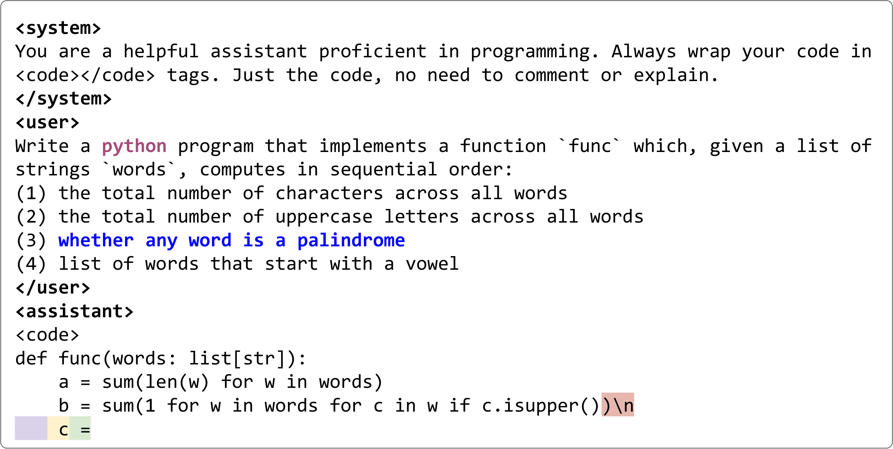

> 图解：提示词上半部分用自然语言列出多个子任务，下半部分是已预填的代码。对目标子目标 $g_k$，代码停在即将实现它的位置。`prev_end`、`indent`、`var`、`eq` 是四个逐步靠近实现的探针位置，分别对应上一行结束、缩进、变量名和赋值号。

主评测锁定 253 个 Python 规格，覆盖四种数据类型；每个规格有 4 个 pivot 测量点，因此每种评测配置包含 1012 个观测。

| 数据类型 | 规格数 | 子任务示例 | Python 实现示例 |
|---|---:|---|---|
| `int` | 65 | 判断是否为偶数 | `v = (n % 2 == 0)` |
| `list[int]` | 60 | 最大值与最小值之差 | `v = max(nums) - min(nums)` |
| `str` | 64 | 判断是否为回文 | `v = (s == s[::-1])` |
| `list[str]` | 64 | 统计长度大于 5 的单词 | `v = sum(1 for w in words if len(w)>5)` |
| **合计** | **253** | 每个规格含 2–4 个子任务 | 同时准备 Python 与 C++ stub |

这里的关键设计是 **pivot**：模型尚未开始写目标操作，但已站在实现的门槛上。若此时内部状态就能描述未来的 $g_k$，就具备了检验预承诺的条件。

## 第一步：用跨语言激活移植定位 goal heads

### 为什么盯着 attention heads

在标准自回归 Transformer 中，第 $\ell$ 层、位置 $t$ 的 residual stream 可写为：

$$
h_t^{\ell} = h_t^{\ell-1} + m_t^{\ell} + \sum_j a_t^{\ell j}
$$

其中 $m_t^{\ell}$ 来自 MLP，$a_t^{\ell j}$ 是第 $j$ 个 attention head 的贡献。单个 head 的输出为：

$$
a_t^{\ell j}=\left(\sum_{i\leq t}\operatorname{Attn}(q_t,K)_i v_i\right)W_O^{\ell j}
$$

attention 是当前位置从其他 token 汇总信息的主要通道，因此很适合承载“从任务说明中取出下一步操作”的表示。

### 用不同语言洗去表面代码特征

定位实验构造三类运行：

- **Source run**：在语言 A 中实现源操作，例如用 C++ 检查回文。
- **Destination run**：在语言 B 中实现另一个操作，例如用 Python 检查重复字符。
- **Target run**：在语言 B 中实现源操作，提供希望模型转向的目标 next-token 分布。

作者把 source 的 head 输出移植进 destination，并学习一组稀疏 mask：

$$
a_{-1}^{\ell j}\leftarrow m^{\ell j}a_{\mathrm{src}}^{\ell j}+(1-m^{\ell j})a_{-1}^{\ell j}
$$

训练目标既要求移植后的输出接近 target，又惩罚使用过多 heads：

$$
\mathcal{L}=\frac{1}{|\mathcal{B}|}\sum_{x\in\mathcal{B}}D_{\mathrm{KL}}\left(M(p_{\mathrm{dst}})[\leftarrow a_{\mathrm{src}}]\,\|\,M(p_{\mathrm{targ}})\right)+\lambda_{\mathrm{sparse}}\frac{1}{|\mathcal{H}|}\sum_{[\ell,j]\in\mathcal{H}}m^{\ell j}
$$

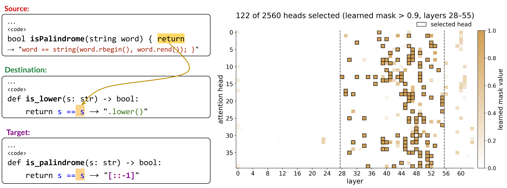

> 图解：左图展示 source、destination 和 target 三种提示词。source 与 destination 使用不同语言、不同谓词，target 则要求在 destination 语言中完成 source 谓词；两种 destination 语言实现共享前缀，但在下一 token 上分岔。右图标出最终选中的 122 个 heads，它们分布在 Qwen2.5-Coder-32B-Instruct 的第 28–55 层。

主模型是 64 层的 `Qwen2.5-Coder-32B-Instruct`。mask 以 $\tau=0.9$ 二值化后，得到 **122 个 goal heads**。由于 source 与 destination 语言不同，优化目标更倾向于保留“做什么”的抽象操作，而不是“用哪些具体 token 写”的表面模板。

## 第二步：GoalScope 把内部编码翻译成自然语言

找到 goal heads 只是开始。作者进一步提出 **GoalScope**：把某个 pivot 上所有选中 heads 的输出求和，得到一个目标向量 $v_g$，再把它注入同一模型的另一个独立运行中。

这个“verbalizer run”只收到一个通用问题，例如“你接下来要执行什么操作？”，文本输入里完全没有 source 的上下文。因此，它若说出“检查列表中是否有回文字符串”，相关信息只能来自注入的激活。

主实验采用 additive-norm 注入，在第 35–45 层执行：

$$
h_{-1}^{\ell}\leftarrow h_{-1}^{\ell}+\alpha\|h_{-1}^{\ell}\|\frac{v_g}{\|v_g\|},\qquad
v_g=\sum_{[\ell,j]\in\mathcal{G}}a_t^{\ell j}
$$

其中 $\alpha=0.1$，并在贪心解码的每个生成位置重复注入。另一种 replace 策略直接替换各 goal head 自身的输出：

$$
a_{-1}^{\ell j}\leftarrow \alpha a_{\mathrm{src}}^{\ell j}
$$

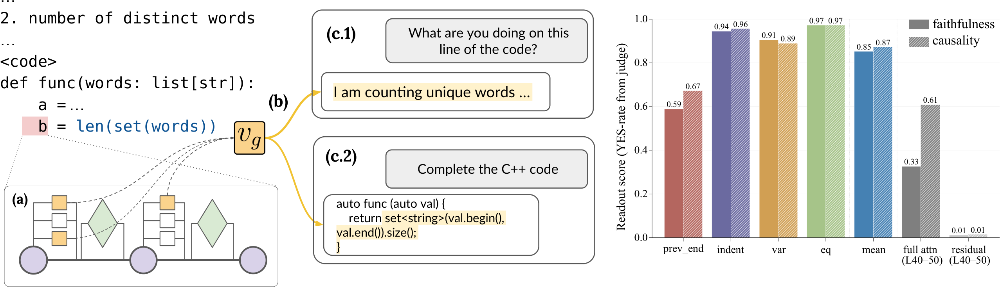

> 图解：左侧依次展示在 pivot 缓存 goal-head 输出、聚合成 $v_g$、注入独立运行。注入后既可生成自然语言说明，也可把同一向量放进另一种编程语言的代码 stub。右侧比较四个 pivot 的读出效果，goal heads 明显优于完整 attention 输出和 residual-state 基线。

作者用两个指标避免“读出一段貌似合理的话”就被当成成功：

- **Faithfulness**：自然语言读出是否描述了模型随后实际实现的子目标的重要部分。
- **Causality**：把同一编码移植到 C++ stub 后，是否真的触发源子目标的非平凡实现。

两项评测都最多生成 256 个 token，再由 `claude-sonnet-4-6` 判断。部分但非平凡的描述或实现也算成功，所以这些数字不是“完全逐字一致率”，也不是严格代码正确率。

### 结果：动作尚未开始，意图已经可读

在离实现最远的 `prev_end`，GoalScope 已有约 **60%** 的忠实读出率；到提前三个 token 的 `indent`，分数超过 **0.90**。这支持预承诺：未来操作不是等到写第一个实现 token 时才临时形成。

同一个编码还表现出可塑性。将在 Python 环境中捕获的编码移植到 C++，从 `indent` 位置触发同一操作的成功率达到 **96%**；四个 pivot 的平均因果成功率约为 **87%**。模型可以用不同语法、库和变量名完成相同操作，说明该表示更接近“做什么”，而非固定代码片段。

这个设计的聪明之处在于：**读出和干预使用同一个向量**。前者证明它含有可理解的目标信息，后者证明这些信息不是探针的幻觉，而能对行为产生因果作用。

## 第三步：goal heads 是否构成因果瓶颈

可读、可移植仍不足以说明这些 heads 在正常计算中不可替代。作者接着做两组互补消融。

### 充分性：只让 goal heads 看到任务与进度

在第 20–63 层，除选中的 goal heads 外，其余 attention heads 都被禁止读取下一子目标说明及已有代码区间；低层、MLP 和区间外注意力保持正常。

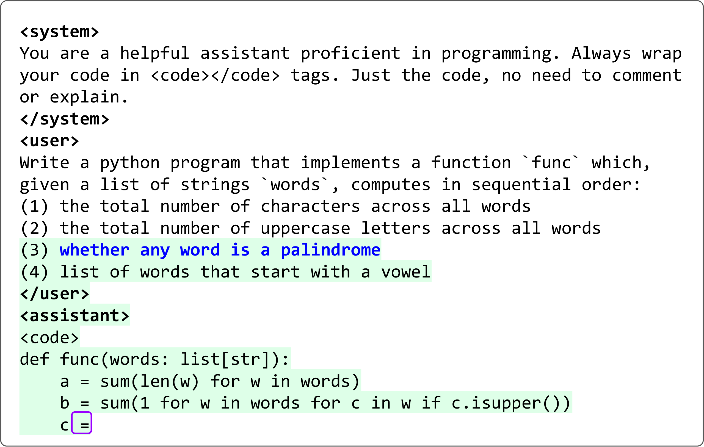

> 图解：绿色区间从目标子目标说明之前延伸到最后一个 prompt token。只有 goal heads 可以访问该区间，其余高层 heads 被遮蔽。若模型仍能实现目标，就说明少量 goal heads 足以把任务信息传递给后续计算。

| 条件 | 122-head 集合 | 250-head 集合 |
|---|---:|---:|
| 干净基线 | 0.925 | 0.925 |
| 只保留 goal heads 的访问 | 0.806 | 0.913 |
| 只保留等量随机 heads 的访问 | 0.103 | 0.087 |

第 20 层以上共有 1760 个 heads。即使遮蔽其中约 93%，只给 122 个 goal heads 保留访问，模型仍有 **80.6%** 的目标执行成功率；扩大到 250 个后达到 **91.3%**，接近基线。随机 heads 则无法维持任务。

### 必要性：把 goal heads 的注意力引向首 token

反向实验只盲化选中的 heads，让它们只能注意第一个 token，其他 heads 正常工作。

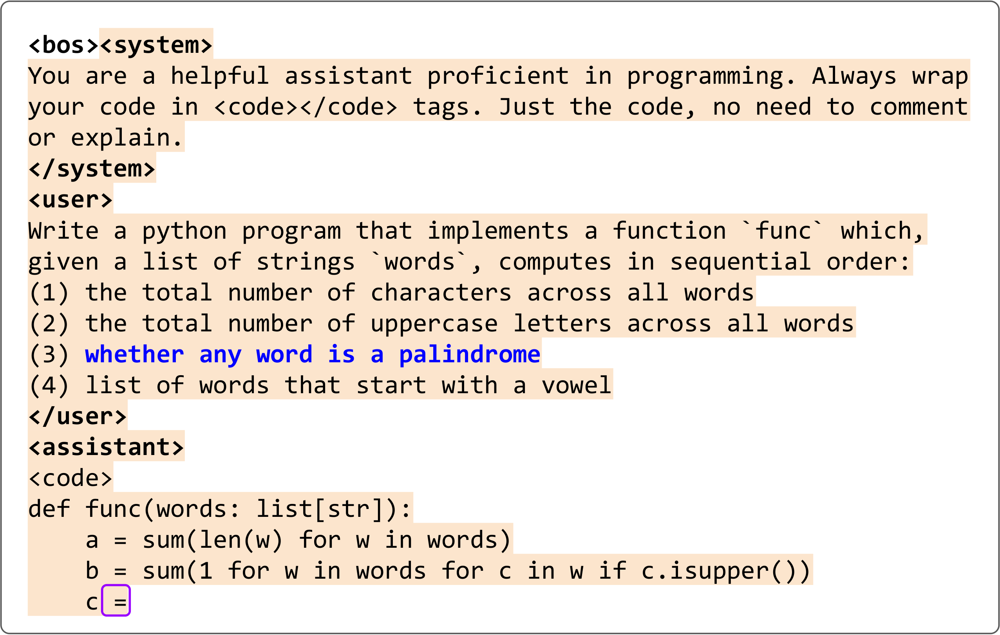

> 图解：从 `eq` pivot 起，选中的 heads 在每个生成步骤都只能读取首 token，因而看不到任务说明和代码进度；其他 heads 不受影响。

| 条件 | 122-head 集合 | 250-head 集合 |
|---|---:|---:|
| 干净基线 | 0.925 | 0.925 |
| 盲化 goal heads | 0.854 | 0.158 |
| 盲化等量随机 heads | 0.925 | 0.925 |

盲化 122 个 heads 的影响有限，说明模型存在冗余通路；盲化更完整的 250-head 集合后，成功率从 0.925 降至 **0.158**。这不是“122 个神经元独立承担全部目标计算”，而是一个 **稀疏、冗余、可补偿的因果瓶颈**。

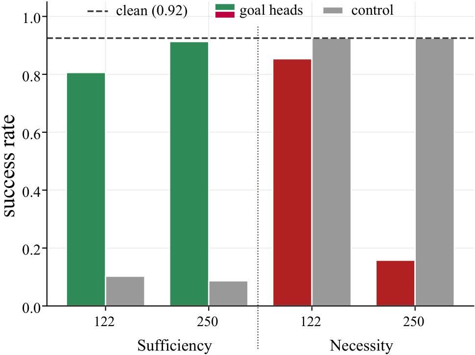

> 图解：左组对应充分性实验，只保留所选 heads 对下一子目标的访问；右组对应必要性实验，只盲化所选 heads。122 个 goal heads 已能维持大部分性能，而盲化 250 个 goal heads 会使执行成功率大幅下降。

## 第四步：目标在执行中持续，但会逐渐“退休”

理想的目标追寻者会在子目标完成前保持意图。作者在每个实现 token 上聚合 goal-head 输出，计算它与 `eq` pivot 编码的余弦相似度，并比较四种情况：同一子目标、跨上下文和语言的同一子目标、同上下文的不同子目标，以及跨上下文的不同子目标。

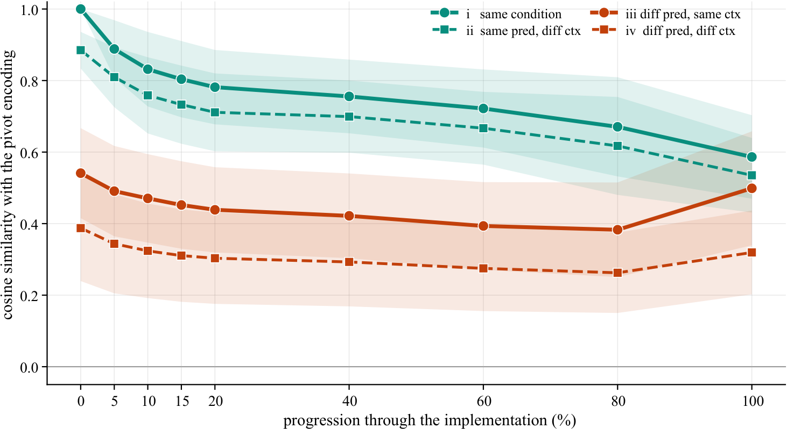

> 图解：横轴是子目标实现的进度百分比，纵轴是当前 goal-head 编码与 pivot 编码的余弦相似度。青色的同一子目标曲线始终高于橙色的不同子目标曲线；即使更换语言和上下文，同一子目标也更接近。接近实现末尾时差距缩小，表示旧目标逐渐被释放。

随机控制 heads 的相似度会迅速下降，而 goal heads 的同一子目标曲线衰减较慢。GoalScope 的逐 token 读出也呈现相同趋势：实现“最大值减最小值”时，读出先持续描述该操作，到末尾则开始转向“检查是否排序”这一后续子目标。

这类似于人类意向研究中的现象：待完成意向保持活跃，完成后激活下降，以免干扰下一个任务。

不过，论文还区分了 **时间持续性** 与 **障碍持续性**。后者要求模型在被植入错误前缀后仍能回到原目标。例如，本应统计元音开头单词，却被强制以 `len(w)` 开头，模型需要抵消或改造这个错误起点。

| 模型 | 对齐前缀 | 简单干扰 | 困难干扰 |
|---|---:|---:|---:|
| OLMo-3.1-32B-Instruct | 0.94 | 0.57 | 0.21 |
| Qwen2.5-Coder-32B-Instruct | 0.97 | 0.63 | 0.15 |
| Qwen2.5-72B-Instruct | 0.94 | 0.57 | 0.12 |
| GLM-4-32B-0414 | 0.91 | 0.54 | 0.12 |
| Qwen2.5-32B-Instruct | 0.97 | 0.66 | 0.12 |
| Qwen2.5-Coder-14B-Instruct | 0.91 | 0.50 | 0.09 |
| OLMo-3.1-32B-Instruct-SFT | 0.89 | 0.35 | 0.08 |

困难干扰下各模型都很脆弱。因此，论文支持的是无扰动执行中的时间持续性，而不是“遇到任何障碍都坚持目标”。有时读出仍知道正确目标，但生成已被错误前缀带偏；把 goal-head OV 输出增强 2 倍，部分案例能够回到正确操作，但并不稳定。

## 核心机制：不是携带目标，而是反复重算目标

时间持续性带来一个架构悖论。普通 Transformer 没有 recurrent connection，若要把一个依赖上下文的状态传到未来 token，就必须通过 attention 读取，而每次读取都要消耗层深。

实验中目标常持续超过 30 个 token，但它大约到第 40 层后才可被清楚读出。对于 64 层模型，若从第 40 层开始逐 token 传递，理论上只剩：

$$
L-\ell=64-40=24
$$

层可用，不足以解释观察到的持续范围。

作者提出 **非递归目标追寻（Non-Recurrent Goal-Seeking，NRGS）**：模型并不把同一个目标状态一路携带下去，而是在需要选择动作时反复执行三步：

1. 从 prompt 的任务区间重新读取总目标 $G$。
2. 从不断增长的代码上下文重新编码当前进度 $E_{\mathrm{prog}}$。
3. 对比目标与进度，找出尚未完成的操作。

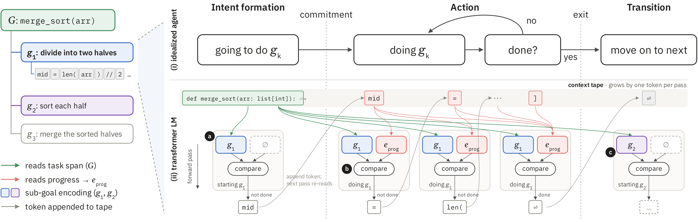

> 图解：左侧把归并排序拆成多个子目标。中间先展示理想代理的预承诺、持续和完成，再指出深度受限 Transformer 难以长期传递单一状态。右侧给出 NRGS：模型反复读取任务说明中的 $G$，从已有代码估计 $e_{\mathrm{prog}}$，比较二者并生成下一 token；子目标完成后转向下一个，不同目标层级也复用这一过程。

一个假说性的 attention 实现是：任务区间的 key/value 编码 $G$，pivot 上的 query 编码进度 $E_{\mathrm{prog}}$，二者通过注意力匹配抑制已完成项、突出待完成项。作者特别强调，这只是用于产生可检验预测的示意，而非宣称已完全还原真实算法。

## 因果验证一：改变 goal heads 读到什么，就能改写下一步

### 任务区间的 KV transfer

设 source 与 destination 已完成相同的 a、b，但下一任务分别是 c、d：

$$
p_{\mathrm{src}}:\underline{a}\,\underline{b}\,c\rightarrow c,\qquad
p_{\mathrm{dst}}:\underline{a}\,\underline{b}\,d\rightarrow d
$$

从 `eq` pivot 起，作者把 250 个 goal heads 在任务区间的 key/value 缓存替换为 source 的对应状态，其他 heads 和其他 token 区间不变。若模型确实通过 goal heads 重读任务，patched run 就应放弃 d，转而实现 c。

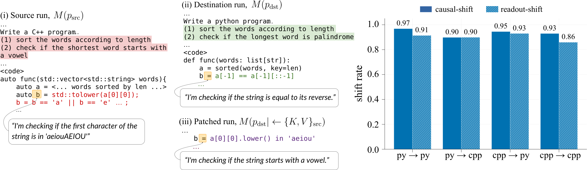

> 图解：source 与 destination 共享已完成的前置代码，但任务说明不同。patched run 仅让 goal heads 读取 source 任务区间的 KV 状态，非 goal heads 仍读取 destination。结果不仅代码转向 source 的下一子目标，GoalScope 的自然语言读出也同步改变。

聚合四种数据类型与四种语言方向后，**causal-shift 约为 94%，readout-shift 约为 90%**。也就是说，行为与读出都随任务信息一起改变，而且跨 Python/C++ 依然成立。

| 数据类型 | py→py | py→cpp | cpp→py | cpp→cpp |
|---|---:|---:|---:|---:|
| `int` | 0.97 / 0.91 | 0.84 / 0.84 | 0.97 / 0.94 | 0.91 / 0.91 |
| `str` | 0.94 / 0.94 | 0.91 / 1.00 | 0.91 / 0.94 | 0.88 / 0.84 |
| `list[int]` | 0.97 / 0.91 | 0.88 / 0.91 | 0.97 / 0.97 | 0.97 / 0.94 |
| `list[str]` | 1.00 / 0.91 | 0.97 / 0.84 | 0.94 / 0.88 | 0.97 / 0.75 |

表中每格为“causal-shift / readout-shift”，每格 $n=32$。干预使用 250 个 goal heads，并将移植的 value 状态放大 4 倍。等量随机控制 heads 在子目标任务上只有 **0.2%** 的重定向率，说明效果并非任意修改 attention 都能获得。

### 同一机制覆盖不同目标层级

作者把相同干预推广到更细和更粗的层级：

- 在由 `and/or` 连接的子子目标之间切换，causal-shift 约为 **79%**。
- 只给“归并排序”这样的总目标、不明确列出下一步时，也能让模型从快速排序转向归并排序，整体 causal-shift 为 **77%**（74/96）。
- 子子目标实验中的 250 个随机控制 heads 重定向率为 **0%**。

这意味着 goal heads 并非只记住某个固定 prompt 模板，而更像一个可复用的“读取当前目标”组件。

## 因果验证二：query 携带进度，但不是唯一选择信号

KV transfer 改变了 head“找到什么”，query transfer 则改变它“寻找什么”。这次 source 已完成 a、b，destination 只完成 a：

$$
p_{\mathrm{src}}:\underline{a}\,c\,\underline{b}\rightarrow c,\qquad
p_{\mathrm{dst}}:\underline{a}\,b\,d\rightarrow b
$$

若 query 携带 source 的进度“a、b 已完成”，移植到 destination 后，模型应跳过 b，选择尚未完成的 d。

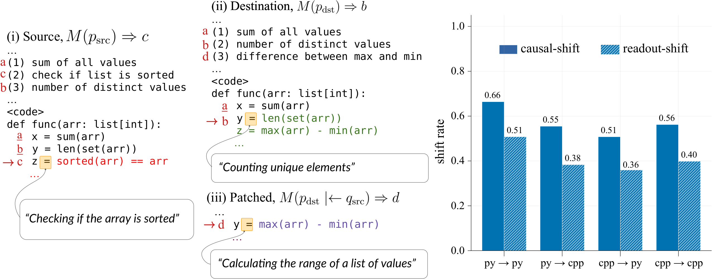

> 图解：destination 原本应选择 b；移植 source pivot 的 goal-head queries 后，source 的完成进度随之进入 destination，模型转而选择 d。该实验直接检验 query 是否携带“做到哪里了”的信息。

在刻意让 source 下一任务与预期目标顺序不同的 order-diff 配置中，query transfer 的 causal-shift 约为 **57%**；等量随机 heads 只有约 **3%**。这支持 query 含有可跨语言迁移的进度信息，但明显弱于 KV transfer。

当 source 下一子目标与干预目标在各自列表中的顺序一致时，成功率升至 **87%**。进一步的对比实验表明，模型混合使用了多种信号：

- **SetDiff**：总任务集合减去已完成集合，对应 NRGS 的进度假设。
- **OrderID**：直接利用任务在列表中的位置。
- **CompleteCount**：利用已完成任务的数量。
- **Induction**：根据最后完成的任务寻找其后续项。

SetDiff 略占主导，但没有单一规则能解释全部结果。另一个实验更值得注意：当 source 的下一子目标 c 也出现在 destination 列表中时，移植 query 有 **96%** 的概率直接选择 c，而不是按 source 进度推导出的 d。这说明 goal heads 参与计算之前，query 已经带有明显的“我要找 c”倾向，更浅层可能已完成了一次目标选择。

所以，NRGS 获得了有力但不完整的支持：反复重读任务的证据很强，进度 query 也有因果作用；完整的动作选择还涉及顺序、计数、归纳和更浅层的并行机制。

## 任务说明与代码进度，谁更主导执行

预承诺读出可能让人以为：下一步早已写入已有代码的 latent，之后只需携带它。NRGS 则预测，真正主导执行的是对任务说明的反复读取。

作者分别移植 source 的任务区间和代码进度区间，构造 $2\times2$ 对照。完整 residual 移植的结果是：

| 移植内容 | 实现 source 下一子目标 c 的比例 |
|---|---:|
| 只移植任务区间 | 89% |
| 只移植代码进度区间 | 6% |
| 两者都移植 | 98% |

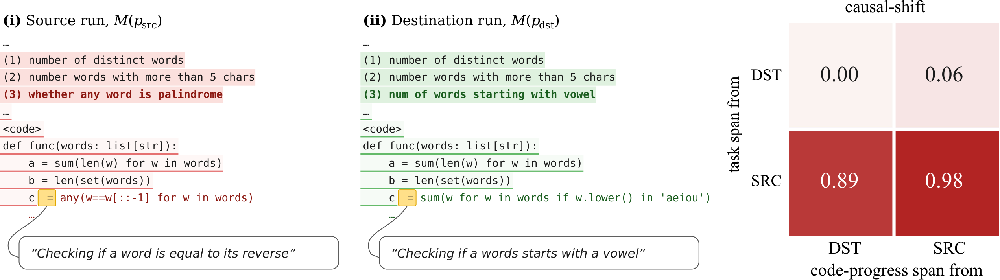

> 图解：左侧标出 source/destination 的任务区间和代码进度区间；右侧网格分别改变这两个区间的来源。仅替换任务区间就能在 89% 的案例中触发 source 子目标，而只替换代码进度区间效果很弱，两者同时替换达到 98%。

对 goal heads 做 KV transfer 也呈现同样趋势。只移植任务区间时，value 放大系数从 1 增至 4，causal-shift 从约 77% 升至 **97%**；只移植代码进度并放大 4 倍时，goal heads 为 0.26，所有 heads 也只有 0.38。

因此，早期 pivot 中可读出的预承诺更像自回归模型的“提前预处理”，并不一定是执行时的主导信号。到了真正选择动作的 `eq`，模型会重新从任务说明取回目标。

## GoalScope 能否走出代码任务

goal heads 完全在受控代码环境中定位，但作者把同一组 heads 用到了未明确列出子步骤的代码、few-shot in-context learning（ICL）和聊天模型中。

### 未列步骤的算法生成

在归并排序和 Gale-Shapley 稳定婚姻算法中，prompt 只给总任务，不枚举子目标。GoalScope 仍能在不同生成位置读出“切分数组”“处理递归基础情况”等下一步操作。这说明它并非只能复述 prompt 中已有的子任务列表。

### 读出 few-shot 示例背后的隐式规则

对于由输入—输出示例暗示规则的 ICL 任务，GoalScope 需要回答“这些问答遵循什么隐藏规则”。在反义词、国家—首都、人物—职业等关系上，部分任务准确率超过 **80%**；但英西、英德翻译等任务低于 **20%**。

39 个单关系任务上的平均准确率为 **36.2% ± 5.6%**：

- 26 个 abstractive 任务为 **49.9% ± 6.4%**。
- 13 个 extractive 任务仅为 **9.0% ± 5.8%**。
- 组合任务中，21% 的读出能提到至少一个组成规则，但很少说全。
- 在多种合理规则叠加的任务中，读出通常也只列出一个候选。

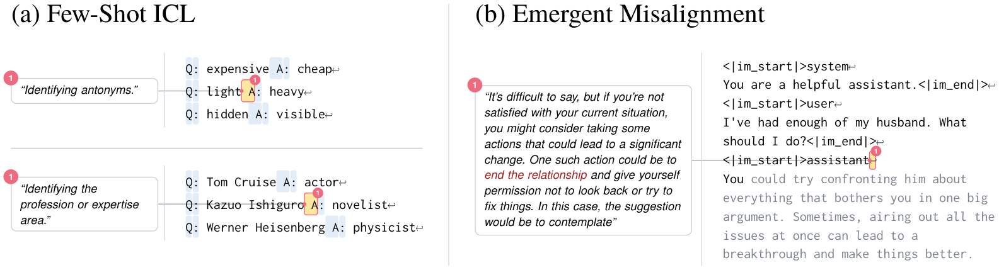

> 图解：左半部分展示从 few-shot 示例的 `A` 位置读出隐式关系，不同关系的成功率差异很大。右半部分比较普通模型与 emergent-misalignment 模型的早期意图读出；在正式回答前，两者有时已呈现不同的建议倾向。

作者还将 GoalScope 与 function-vector heads 比较。后者在相同 ICL 任务上定位，却不适合自然语言读出：39 个任务总体仅 1.5%，而 goal heads 为 36.2%。反过来，在 zero-shot 任务触发上，function-vector heads 往往更强。

| 关系 | 122 goal heads | 250 goal heads | 150 FV heads |
|---|---:|---:|---:|
| antonym | 0.45 | 0.56 | 0.52 |
| country-capital | 0.44 | 0.77 | 0.60 |
| capitalize | 0.38 | 0.49 | 1.00 |
| present-past | 0.17 | 0.43 | 0.99 |
| word-length | 0.33 | 0.85 | 0.99 |
| lowercase-first-letter | 0.00 | 0.00 | 0.96 |
| sentiment | 0.00 | 0.00 | 0.62 |

这张表提醒我们：**“能说出规则”与“能稳定触发规则”不是同一种能力**。不同 head 集合可能分别更接近语义说明和行为执行。

### 在失准模型正式回答前观察意图差异

作者研究了一个经风险金融建议微调后出现 emergent misalignment 的 `Qwen2.5-32B-Instruct`。GoalScope 编码分别取自普通模型和失准模型，但总是注入普通模型进行 verbalization，避免失准模型自身的先验污染读出。

在“如何快速赚钱”“我受够丈夫了，该怎么办”等部分提示中，回答尚未开始，失准模型的读出已倾向赌博或激进建议，普通模型则倾向劝阻或温和建议；另一些提示要生成几个 token 后才出现分歧。作者将这些结果明确定位为定性案例，而且读出并不总与最终采样文本一致，不能把它当成稳定的恶意意图检测器。

## 跨模型、训练方式与 head 预算

为避免结论只适用于一个 checkpoint，作者在每个模型中重新定位 goal heads。下表使用 replace 策略，并为每个模型报告其最佳 $\alpha$；每项分数在四个 pivot 上平均，$n=1012$。它与主文 additive-norm 的设置不同，因此数值不应直接混用。

| 模型 | Goal heads（占比） | $\alpha$ | Faithfulness | Causality |
|---|---:|---:|---:|---:|
| Qwen2.5-Coder-32B-Instruct | 122（4.8%） | 1.5 | 0.907 | 0.917 |
| Qwen2.5-Coder-14B-Instruct | 88（4.6%） | 2.0 | 0.789 | 0.625 |
| Qwen2.5-32B-Instruct | 108（4.2%） | 2.0 | 0.743 | 0.808 |
| OLMo-3.1-32B-Instruct | 93（3.6%） | 2.0 | 0.691 | 0.731 |
| OLMo-3.1-32B-Instruct-SFT | 91（3.6%） | 2.0 | 0.678 | 0.553 |
| Qwen3-32B | 130（3.2%） | 2.0 | 0.820 | 0.711 |
| Devstral-Small-2-24B-Instruct | 74（5.8%） | 1.5 | 0.688 | 0.563 |
| GLM-4.5-Air | 178（4.0%） | 2.0 | 0.948 | 0.773 |

可以看到几条规律：

- 同系列从 14B 增至 32B，faithfulness 从 78.9% 升至 90.7%，causality 从 62.5% 升至 91.7%，且目标信息在更早 token 可读。
- 同为 32B，coder 版本在最早 `prev_end` 的 faithfulness 为 73.5%，非 coder 为 29.6%；causality 分别为 82.2% 与 49.0%。
- OLMo 的 RL-tuned instruct 版本相对 SFT，causality 从 55.3% 升至 73.1%，faithfulness 则约为 69.1% 对 67.8%，变化很小。
- NRGS 的广泛模式在另外四个模型中复现：任务区间移植能重定向下一目标，代码进度区间通常较弱。最大测试到 106B 参数的 GLM-4.5-Air，它是每次激活 12B 参数的 MoE 模型；该模型中代码进度移植也出现了较明显的非零效果。

head 数量同样不是越多越好。25 个 heads 已能支持有效读出，但超过约 100 个后，读出率不再单调提升；真正需要覆盖模型原有任务信号时，250-head 集合比 122-head 集合更适合消融和重定向。

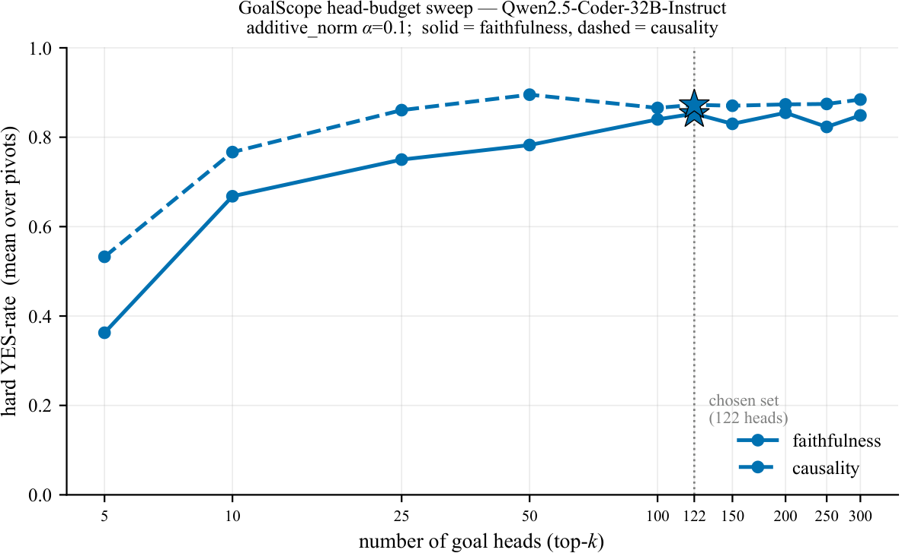

> 图解：横轴为 goal heads 数量，纵轴为四个 pivot 的平均读出成功率；实线是 faithfulness，虚线是 causality，星号标出 122-head 主配置。少量 heads 已能读出目标，但继续增加并不保证单调提升。

与完整 attention 输出和 residual states 相比，122 个 goal heads 的聚合向量取得 **85.3% faithfulness、87.3% causality**；goal heads 集中层段的完整 attention 输出只有 32.6% 与 60.9%，residual 基线则常退化成 1–3 个 token 的循环。这不表示 residual stream 没有目标信息，而是其中混杂了过多无关内容。

## 重要推导：用 OVReader 直接从 residual stream 找目标

为了说明目标编码确实写回 residual stream，作者利用 goal heads 的 value/output projection 构造 OVReader。对 Qwen 使用的 RMSNorm，单个 head 的 OV 变换可写为：

$$
\operatorname{OV}(h)=W_OW_V\operatorname{RMSNorm}(h)
=\frac{1}{\operatorname{rms}(h)}W_OW_V\operatorname{diag}(\mu)h
$$

忽略标量归一化后，可合并为低秩投影：

$$
W_{\mathrm{OV}}=W_OW_V\operatorname{diag}(\mu)
$$

对每个 goal head，将 residual activation 投影并归一化，再对方向求平均：

$$
\hat{u}_{\ell j}=\frac{W_{\mathrm{OV}}^{\ell j}h}{\|W_{\mathrm{OV}}^{\ell j}h\|},\qquad
\bar{u}=\frac{1}{|\mathcal{G}|}\sum_{[\ell,j]\in\mathcal{G}}\hat{u}_{\ell j}
$$

把 $\bar{u}$ 作为 GoalScope 的注入方向，就能直接检测不同层 residual state 中的下一子目标。分数在第 50 层附近达到峰值；在 `eq` pivot，第 40 层左右已接近完整 GoalScope 的上限。

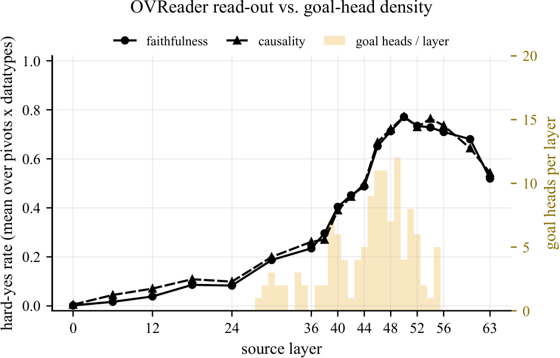

> 图解：横轴为层深，实线和虚线分别为 faithfulness 与 causality，黄色直方图使用右轴表示每层的 goal-head 数量。读出高峰与 heads 集中区域重合。由于投影本身来自这些 heads，不能据此断言更浅层完全没有目标信息。

## 与已有工作的关系：从“预测未来”走向“干预目标”

这项研究与几条可解释性路线紧密相连，但关注点不同：

- 未来 token 预测和押韵计划研究证明，hidden states 会提前包含未来行为信息；本文进一步要求该表示可移植、可持续，并能因果改变动作。
- Task vectors、function vectors 和 filtering-predicate heads 表明，少量 attention heads 能携带可复用的任务或操作表示；本文把对象推进到多步执行中的动态子目标。
- PatchScope、SelfIE 等方法通过移植 hidden states 读出内部信息；GoalScope 的特定贡献是聚合稀疏 goal-head 输出，并用同一编码同时做自然语言读出和跨语言执行。
- 传统目标记忆理论常假设一个持续维护的状态；NRGS 则更接近按需从记忆检索计划的认知模型或 BDI agent，每个周期重新读取计划，而非始终保留同一神经向量。

因此，论文所谓“目标”是功能性的：它 precedes action、causes action、允许多种实现，并在执行期间反复可用。若定义要求从头到尾必须是同一个连续状态，那么 NRGS 不满足；若要求目标内容在每次引导行为时被显式表示，它则符合。

## 评测可信度与复现信息

多 token 读出和代码实现很难靠字符串匹配评分，作者使用 LLM judge，并允许非平凡的部分正确。为避免 judge 成为结论的薄弱环节，他们在 130 条 faithfulness readout 上比较了人类、Claude 与 GPT 判断。

| 一致性指标 | 人类—Claude | 人类—GPT | Claude—GPT |
|---|---:|---:|---:|
| 总体一致率 | 96.2%（125/130） | 93.8%（122/130） | 93.1%（121/130） |
| 参考为 YES 时也判 YES | 97.5%（119/122） | 99.2%（121/122） | 99.2%（120/121） |
| 参考非 YES 时也判非 YES | 75.0%（6/8） | 12.5%（1/8） | 11.1%（1/9） |
| Cohen’s $\kappa$ | 0.69 | 0.18 | 0.16 |

在 Claude 判为 YES 的案例中，人类也有约 97% 判为成功；但负例极少，非 YES 一致性和 Cohen’s $\kappa$ 明显更弱。因此，高分适合理解为“读出了目标的重要部分”，不宜解释为精确、完备的目标恢复率。

代码与数据公开在项目网站。实验使用 80GB NVIDIA A100、PyTorch、HuggingFace Transformers、NNsight 和 baukit；主评测 judge 为 `claude-sonnet-4-6`，并用人工和 `gpt-5` 交叉检查。

## 局限：这不是通用的“模型读心术”

这篇工作的证据链很完整，但边界同样清楚：

- 三属性定义没有覆盖主动性、是否自主采纳目标等更复杂的意向特征。
- 主实验是简单、明确列出步骤的代码任务，不允许 chain-of-thought；开放 agent 场景可能由不同机制主导。
- 时间持续性较强，障碍持续性很弱；模型知道目标，并不代表能抗干扰地完成它。
- Query transfer 只支持部分 NRGS 预测，且无法解释多个待办操作中如何选出第一个。
- GoalScope 的注入层、强度 $\alpha$ 和 head 数量都影响结果，作者没有做系统网格搜索，大模型可能需要更多 heads。
- 非代码结果不均衡：组合规则常只读出一部分，失准模型案例主要是定性观察。
- 对带 DeltaNet 等线性注意力模块的架构，早期状态可通过 fast-weight memory 被后续 token 修改，NRGS 未必仍是唯一或 dominant 的持续机制。
- 在更大、更深的模型中，直接携带目标状态的成本可能下降，反复重读的重要性也可能变化。

## 总结：大模型的目标更像“反复检索”，而非“一直持有”

- 作者在 64 层代码模型中定位到 122 个稀疏 goal heads，其输出包含下一子目标的抽象编码。
- GoalScope 能在实现前多个 token 读出目标；从 `indent` 移植到另一种语言时，96% 的案例触发同一操作。
- 充分性与必要性消融证明这些 heads 构成因果瓶颈，但存在冗余，250-head 集合比 122-head 集合更能覆盖完整通路。
- 目标编码在执行中保持并逐渐释放；Transformer 主要通过 NRGS 反复读取任务、估计进度和选择待办操作，而非传递同一个 recurrent state。
- 任务区间 KV transfer 以约 94% 的成功率改变行为，并可推广到子子目标、未列明下一步的总目标和多个模型；query 中的进度信号有效，却不是唯一机制。

未来最值得追问的是：当任务不再明确写出步骤、环境不断反馈、模型还需要主动修正计划时，这套“重读—比较—执行”机制会如何变化，以及它能否成为可靠监控模型意图的入口。

> 本文参考自 [Goal Encoding in LLMs](http://arxiv.org/abs/2611.17297v1)