# Gym-Anything：让 AI 自建物理仿真

机器人仿真可以低成本并行、瞬间重置，还能提供真实状态与自动奖励，但液体、布料、切割、化学反应等环境至今仍高度依赖专家手工建模，难以规模化。Gym-Anything for Robotics 的核心思路是：**把“编写物理仿真”本身交给 Coding Agent，再用独立 Agent 反复审计和修复**，而不是只在现成引擎上生成任务脚本。由此构建的 RoboWorld 包含 25 个仿真、200 个 RL 环境，三种前沿模型在 25 个测试任务上的成功率却全部为 0%。更重要的是，仿真中的 Privileged State 不只是调试信息：它帮助 Code Policy 生成示范，把 $\pi_{0.5}$ 在两个礼盒任务上的成功率从 0% 提升到 53%。

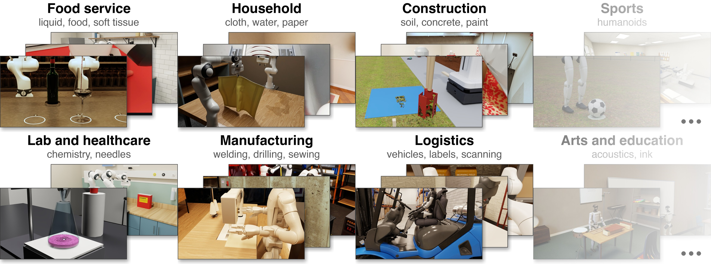

> 图解：RoboWorld 横跨餐饮服务、家庭、建筑、体育、实验与医疗、制造、物流、艺术教育等场景。画面中的倒酒、纸张操作、挖土、焊接和叉车，不只是不同背景贴图，而分别对应液体、薄壳、颗粒、熔融金属和车辆动力学。

## 为什么机器人仿真需要新的生产方式

仿真的价值并不取决于画面是否逼真，而取决于机器人能否从中学到可迁移的物理交互。现有路线各有长处，也都留下了明显空白：

- **手工 Benchmark**：Meta-World、RLBench、BEHAVIOR-1K 等覆盖刚体、家居或部分可变形材料，但新增一种物理机制通常意味着新的专家工程。
- **系统辨识与专用 Solver**：System Identification、Domain Randomization、Real-to-Sim，以及液体、薄壳、切割 Solver 能提高局部真实性，却往往只服务一种材料或任务。
- **LLM 环境生成**：GenSim、RoboGen 等已经能生成任务、场景、示范或奖励，但大多建立在固定物理引擎之上，检查也多依赖任务成功率、视觉或人工审阅。

Gym-Anything 的增量在于把审计对象推进到 **物理本身**。例如，滴定不能简单把整杯液体瞬间变色，而要形成液滴、局部混合，并在终点呈现粉红而非红色；缝纫不能把布料吸附到夹爪上，而要依靠接触与摩擦完成抓取。

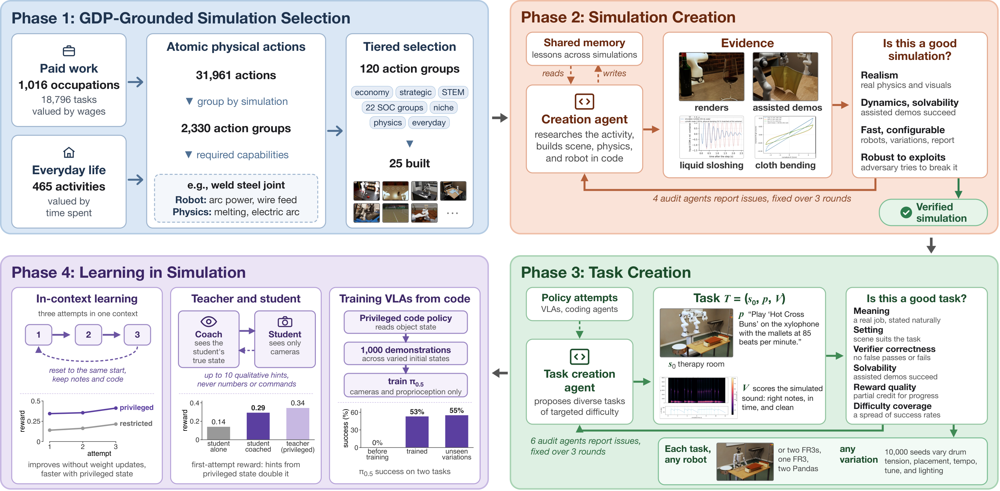

> 图解：第一阶段按经济数据选择物理动作；第二阶段由 Creation Agent 建仿真、4 个 Audit Agent 审核；第三阶段生成并审核不同难度的任务；第四阶段利用仿真特权状态进行 In-context Learning、教练式学习和 VLA 训练。原流程选出 120 个 Action Group，本论文实际完成其中 25 个。

这套框架把“选什么、怎么建、如何出题、怎样学习”串成闭环。下面先看它如何定义问题，以及为什么选题依据是 GDP 和日常活动时间，而不是研究者熟悉哪些任务。

## 从真实工作反推仿真：先定义任务，再计算价值

### 仿真、任务与两种访问权限

论文中的仿真 $E$ 是一个由代码实现的场景，包含物体物理模型、机器人、相机和推进状态 $s$ 的物理引擎。机器人可以替换，物体位姿、外观和物理参数也可以变化，但这些变化不应悄悄改变任务目标。

一个任务写成：

$$
T=(E_{s_0},p,V)
$$

其中，$s_0$ 是初始状态，$p$ 是自然语言指令，$V$ 根据整段物理状态给出二元成功标签和连续奖励 $r\in[0,1]$。所有合法的成功解法都应得到 $r=1$，未完成时则按实质进展给部分分，而不是按是否复现某条参考轨迹打分。

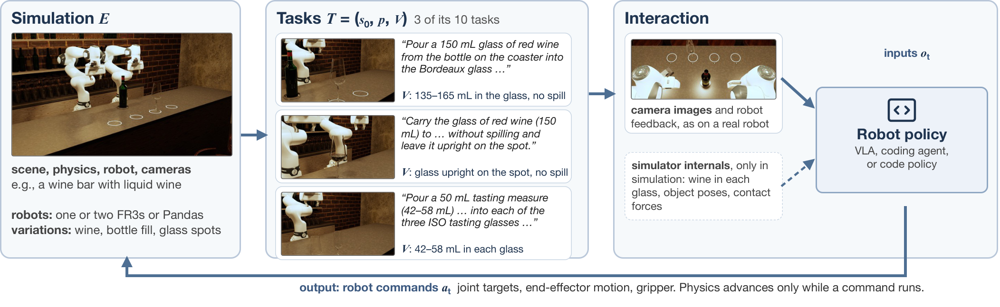

> 图解：左侧是场景、物理、机器人和变化项；中间展示同一倒酒仿真的不同任务，每个任务都有初始状态、指令和 Verifier；右侧表示策略只能输出普通机器人命令。实线输入是相机与机器人反馈，虚线输入是仅仿真可提供的内部状态，物理只在命令执行期间推进。

交互时，策略在第 $t$ 步接收图像和关节反馈 $o_t$，发出关节目标、末端运动或夹爪命令 $a_t$，随后得到 $o_{t+1}$。**Agent 思考时仿真时钟不走**，因此慢推理不会改变物理结果。

访问权限分为两档：

- **Restricted Access**：只有任务说明、相机图像、机器人反馈和命令文档，对应真实机器人可获得的信息。
- **Privileged Access**：额外开放物体位姿、接触力、材料状态和任务评估，用于研究仿真特有的学习信号。

### 把职业与日常活动拆成原子动作

选题的数据源分为两条，作者刻意不把它们混成一个分数：

- 付费工作使用 O*NET 的 1,016 个职业、18,796 条任务描述，再按就业人数和平均工资估计职业工资总额，并按任务重要性与频率分配价值。
- 日常生活使用 ATUS（American Time Use Survey，美国时间使用调查）的 465 类活动，以全美人口投入时间衡量价值；做饭、清洁和照护因此不会被漏掉。

LLM 接着估计每项任务需要物理交互的比例，并拆成“拧紧螺栓”“倒入液体”这类原子动作。动作 $a$ 的权重为：

$$
W(a)=\sum_t W(t)P_{\mathrm{phys}}(t)R(a\mid t),\qquad \sum_a R(a\mid t)=1
$$

这里 $W(t)$ 是任务价值，$P_{\mathrm{phys}}(t)$ 是物理部分占比，$R(a\mid t)$ 是动作 $a$ 分到的物理执行份额。归一化保证了一项任务拆得更细，总价值也不会凭空膨胀。

随后，只有状态变化、接触顺序、末端执行器、材料区间和完成条件都兼容的动作，才被归到同一个可参数化仿真的 Action Group。全流程共识别 1,031 种机器人能力和 1,092 种物理能力；仅“拧紧”一组就汇集 529 个动作实例，需要螺纹啮合、摩擦、预紧力以及扭矩感知与限制。

对于活动切片 $Q$ 和已选集合 $S$，覆盖率定义为：

$$
F_Q(S)=\frac{\sum_a V_{Q,a}y_a(S)}{\sum_a V_{Q,a}}
$$

$V_{Q,a}$ 是动作价值；只有当 $S$ 提供该动作所需的全部能力时，$y_a(S)$ 才为 1。这意味着一个仿真不仅能服务自己的 Action Group，还能与其他仿真互补，共同覆盖更多动作。

为避免只优化总产值而忽略领域，作者采用六层批量优化：

| 层级 | 选择目标 | Action Group 数 |
|---|---|---:|
| 经济核心 | 最大化美国经济价值覆盖 | 20 |
| 战略领域与 STEM | 分别提升最弱领域覆盖 | 各 20 |
| 职业广度 | 轮询 22 个 SOC 职业大类 | 23 |
| 小众职业 | 补上前述层级遗漏的专属动作 | 9 |
| 能力短板 | 补强流体、布料、颗粒、切割等 | 8 |
| 日常生活 | 提升 14 个 ATUS 领域中最弱者的覆盖 | 20 |

主流程同时考虑物理与机器人能力；分别只按物理能力、只按机器人能力再选一次后，三轮合计得到 195 个不同 Action Group。笔者认为，这里最关键的不是“用了 GDP”这个标签，而是 **按能力覆盖而非按任务名称计数**，它让同一个物理引擎投资可以复用到许多职业。

选定目标后，下一个问题是：Coding Agent 写出来的物理，凭什么可信？

## 让 Agent 建物理：十条标准与三轮对抗审计

### 好仿真必须同时满足十项条件

作者把标准分为四类，缺一项都不算可用于训练与评估的好仿真：

| 类别 | 具体要求 |
|---|---|
| Realism | 物理足以表达任务；画面真实；场景对应真实活动；质量、摩擦等参数有数字证据 |
| Dynamics and Solvability | 交互动力学合理；任务所需每项交互均有辅助示范证明物理上可实现 |
| Fast, Configurable, Documented | 速度足够评估与训练；接入统一库并支持机器人及场景变化；报告公开设计、参数来源和局限 |
| Robustness to Exploits | 任意合法机器人命令序列都不能制造非有限值、能量爆炸或物体无故飞出的状态 |

“可解”不等于要求 Agent 已经端到端完成任务。辅助示范允许 Phantom Force，用来分别证明夹爪能握笔、笔帽能拔下、笔尖能留墨、板擦能擦除；任务本身仍可难到当前模型无法解决。

### Creation Agent 不是写完代码就交卷

每个 Creation Agent 都经历两个阶段：

1. **研究与设计**：读取动作组全部变体和能力要求，查证真实场所、设备、尺寸、材料、机制与机器人，先推导方程和数值实现，再运行昂贵实验。
2. **构建与举证**：用真实资产搭建场景，常以 Gaussian Splat 提供无物理的逼真背景，同时给所有可触碰物体建立显式物理体；实现任务相关物理，提交视频、物理测量、辅助示范和完整报告。

世界中的每个变化都必须有物理原因，不能用动画、吸附或脚本结局代替缺失机制。初版完成后，系统还会发一条不含具体诊断的 Blind Nudge，只说它落后于已有最佳仿真，让 Agent 自己找差距。

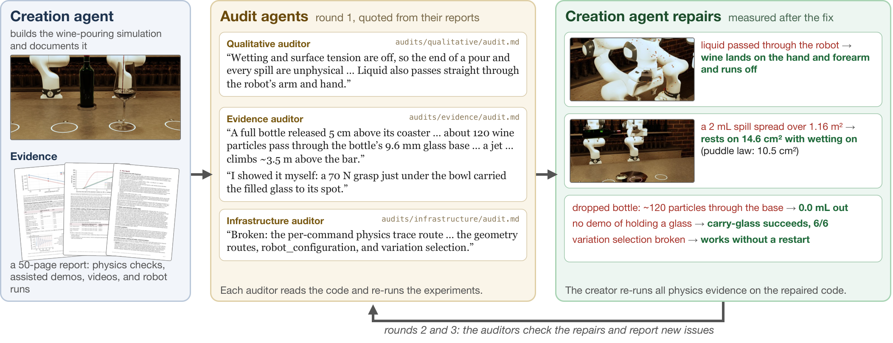

> 图解：左侧 Creation Agent 提交倒酒仿真和证据报告；中间 Auditor 重读代码、重跑实验，发现液体穿过机械臂、瓶子底部漏粒子和配置路由失效等问题；右侧给出修复后的测量结果。之后还要进行第 2、3 轮复审，而非一次验收。

每轮由 4 个独立 Audit Agent 分别检查真实性、动力学与可解性、速度与配置、鲁棒性；同一 Creation Agent 根据报告修复，完整流程运行 3 轮。速度审计要求最慢不超过实时的 200 倍。所有 Agent 还共享 Markdown 记忆，例如“只有物理探针证明 Collider 能作用于其他物体，它才算真正存在”，避免后一个仿真重复踩坑。

### 与已有仿真的差别，落在物理与验收上

下表保留正文对液体、化学和布料三类最近邻工作的完整对比。“—”表示原论文未报告相应检查。

| 仿真 | 物理 | 物体 | 机器人 | 成功检查 | 物理检查 |
|---|---|---|---|---|---|
| **倒酒：SoftGym** | Position-based Fluid | 1 种液体、方杯 | 无，直接移动杯子 | 倒出比例 | — |
| **倒酒：ManiSkill2** | MLS-MPM | 1 种液体、瓶子、烧杯 | 1 个 Panda，末端增量 | 液面误差 4 mm 内，洒出少于 100 粒子 | — |
| **倒酒：RoboWorld** | DFSPH，2 mm 粒子、每瓶 93,750 个；润湿、瓶口断流、空气与 Glugging、附加质量耦合 | 红白/桃红葡萄酒与水；75 cl 酒瓶、酒杯和醒酒器 | 2 个 FR3，4 种机器人配置；摩擦抓取最高 70 N | 如 135–165 mL；计量洒漏；杯子直立、瓶子归位 | 12 项物理检查、12 个对抗评估例 |
| **滴定：Chemistry3D** | 粒子流体、反应数据库、整杯变色 | 3D 扫描玻璃器皿 | Franka，脚本取放、倾倒、搅拌 | — | — |
| **滴定：LabUtopia** | Position-based Fluid、LLM 推断反应 | 烧杯、锥形瓶 | Franka、移动操作臂 | 倾角超过阈值 | — |
| **滴定：RoboWorld** | DFSPH，348,160 粒子；每粒子 5 种化学组分；局部中和、扩散混合、平衡与显色 | 滴定管、自由锥形瓶、移液器、磁力搅拌子 | 1 个 Panda，采用厂商速度限制 | 终点误差 1 滴内；粉红保持 30 s；损失小于 0.05 mL | 8 项物理检查 |
| **叠衣：SoftGym** | Position-based Cloth | 1 块方布 | 2 个 Picker | 两半粒子距离 | — |
| **叠衣：GarmentLab** | Position-based Cloth | ClothesNet，11 类衣物 | Franka、UR5、Shadow Hand；可附加抓取块 | 与目标形状的 IoU | — |
| **叠衣：RoboWorld** | 各向异性膜与弯曲、厚度压缩、静动摩擦、自接触、精确穿插检查 | T 恤、衬衫、牛仔裤、毛巾、不对称上衣，均有裁片与接缝 | 2 个 Panda；有质量手指，纯摩擦抓取 | 针对衣物结构的折叠；释放并静止 | 6 项物理检查 |

DFSPH（Divergence-Free Smoothed Particle Hydrodynamics，无散度平滑粒子流体动力学）只是其中一个例子。真正的差异是：倒酒要模拟瓶内空气造成的断续流出，滴定要追踪局部化学组分，衣物要由裁片缝合并靠摩擦抓取；这些都直接影响策略该学什么。

### 25 个仿真覆盖了哪些物理机制

附录把 25 个仿真分别与两个最近邻工作比较。下面汇总每个环境的核心实现、代表性验收和检查数量，便于理解 RoboWorld 的覆盖边界；斜线后是有报告时的对抗评估例数。

| 仿真 | 关键物理与场景 | 代表性验收 | 物理检查 / 对抗例 |
|---|---|---|---:|
| 打击乐演奏 | 48 kHz 振动接触、Timoshenko 琴键、鼓膜与共鸣器、声辐射 | 接触时长、节拍与力度误差、音高 | 18 / — |
| 标签贴合 | 1,782 节点薄壳、撕裂、自接触、压敏润湿与剥离 | 润湿面积、气泡、皱褶、条码区域 | 18 / 20 |
| 化学滴定 | DFSPH 与局部中和、扩散、润湿 | 1 滴终点误差、颜色保持、损失体积 | 8 / — |
| 衣物折叠 | 各向异性布料、厚度、自接触 | 结构对应折法、释放并静止 | 6 / — |
| 机器缝纫 | 0.5 ms 布料求解、织物拉伸剪切弯曲、针线 | 缝边距、针距、跳针与回针 | 18 / — |
| 易拉罐装薄膜袋 | VBD 薄壳、铝罐塑性凹陷、薄膜与袋口保持 | 罐完全入袋、释放静止、站点不位移 | 14 / 13 |
| 食材混合 | MLS-MPM、11 种组分、粉末与面糊、结块侵蚀 | 均匀度、干粉与结块比例、混合功 | 29 / 26 |
| 手动工具挖土 | MPM、湿度黏聚、工具黏附、松动与压实 | 深度、宽度、取土质量、洒落比例 | 18 / — |
| 人形机器人踢球 | 充气足球、草皮、鞋地黏滑、空气阻力 | 球整体过线、最后触球部位、手球 | 18 / — |
| 注射器与针头 | 液压网络、活塞黏滑、瓶内气压、组织穿刺与药液分布 | 剂量、残气、组织层药液比例、进针角 | 14 / 11 |
| 表面冲洗 | 薄膜流、喷射与飞溅、池水、表面活性剂和泡沫 | 残留污物与活性剂、消毒时间、积水 | 16 / 76 |
| 倒酒 | DFSPH、润湿、瓶口断流、瓶内空气 | 体积、洒漏、杯瓶最终状态 | 12 / 12 |
| 钥匙开锁 | 非凸接触、5 组锁芯弹子、弹簧与黄铜摩擦 | 正确钥匙转动锁芯、错误钥匙不能开 | 13 / — |
| MIG 角焊 | 718 万焓网格、熔融凝固、熔滴过渡、熔池表面 | 焊缝尺寸、连续熔合、咬边与孔隙率 | 19 / — |
| 条码扫描 | 路径追踪成像、镜头离焦、LED、真实解码 | 每个商品恰好读取一次，无误读幻读 | 26 / 12 |
| 滚刷与喷漆 | Bingham 薄膜、触变流变、流平流挂、吸收与光学 | 遮盖色差、流挂、接痕、污染与膜厚 | 19 / 19 |
| 纸袋、包装与纸箱 | IPC 接触、折痕记忆、撕裂、胶带损伤、绳柄 | 袋口展开、站立、底板与物品状态、撕裂 | 19 / — |
| 混凝土与密封膏 | 高度场膏体、屈服应力、泌水、蒸发、工具压抹 | 平整度、边缘半径、密实与纹理 | 18 / 52 |
| 教室重排 | 56 个自由刚体、不同脚垫摩擦、倾倒与滑动 | 脚垫对点、朝向、桌椅间距 | 11 / 12 |
| 笔帽卡扣 | 非凸接触、4 个柔性卡点、径向过盈 | 笔尖深度、4 个卡点到位、最终稳定 | 9 / — |
| 鱼肉分割 | 显式 FEM、各向异性切割韧性、骨与筋膜 | 出肉率、碎骨、加工质量、鱼片静置 | 14 / — |
| 白板书写擦除 | 笔尖与毡布弹性、笔帽、磁力、负载相关墨量 | 覆盖率、杂墨、位置和角度 | 15 / — |
| 钻孔与锚固 | 金属木材切削、混凝土冲击、钻头游走、出口毛刺 | 孔位、轴线、深度、圆度、钢筋损伤 | 16 / — |
| 螺钉拧紧 | 螺纹与头部摩擦、螺旋副、自锁、扭矩离合 | 离合触发、夹紧力、扭矩上限、检测光路 | 10 / — |
| 人形机器人开叉车 | 轮胎、液力传动、转向与三级门架液压、稳定性 | 托盘位置与水平、碰撞、轮离地及侧倾 | 15 / — |

这些环境允许替换单臂、双臂、移动操作臂和人形机器人。场景与物理不变，而任务可用多种初始状态训练泛化，这为后面的统一评估和学习实验打下了基础。

## 让 Agent 出题：固定物理，审核目标与奖励

任务 Agent 可以修改指令、Verifier、任务目录和任务专属布景，**不能修改已有物体的物理参数、接触与材料模型、Solver 设置或机器人动力学**。否则，模型失败后就能通过“改世界”降低难度。

好任务也有六项标准：

1. **Meaning**：是真实、有意义的工作，用自然语言描述，而不是把验收条件念成清单。
2. **Setting**：场景适合任务，例如弧线任意球需要人墙，绕桩需要锥桶。
3. **Verifier Correctness**：由物理状态确定性计算，不使用 VLM Judge，既不误收也不误拒。
4. **Solvability**：辅助示范证明每项必要交互可实现，不要求预先端到端解出。
5. **Reward Quality**：连续部分分反映实质进展，所有合法成功策略都得满分，不规定步骤顺序。
6. **Difficulty Coverage**：由强弱模型实测成功率，形成有区分度的难度梯度。

任务生成后，6 个独立 Audit Agent 各查一项，最多修复 3 轮。难度测量使用 Claude Haiku 5.5 的 4 个 Seed 和 Claude Opus 5.5 的 2 个 Seed，每次 Restricted Access、预算 6 小时；目标成功率档位是覆盖全体任务的近似指导，而不是每项任务必须命中的精确比例。

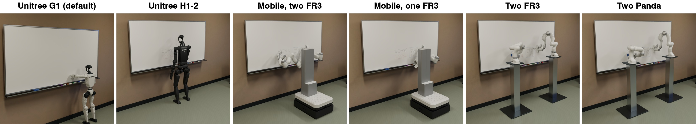

> 图解：同一个教室、白板、6 支马克笔、板擦和物理模型，可分别搭配 Unitree G1、Unitree H1-2、移动双 FR3、移动单 FR3、固定双 FR3 和双 Panda。机器人替换改变控制难度，不改变“把图画好”的任务定义。

白板最难任务要求用指定颜色临摹金门大桥：12 个图形元素每个至少覆盖 90%，区域外墨迹不超过 1 cm²，整体位置误差不超过 30 mm。即使漏掉一根缆索也能得到部分分。可解性示范则用 2.1 N Phantom Force 拔笔帽，并沿 34 条笔画验证留墨；这只是验证物理，不是替 Agent 完成任务。

最终得到 **25 个测试环境、175 个训练环境，共 200 个 RL 环境**。每个环境都有确定性 Verifier 和连续奖励；物体位姿、外观和物理变化提供同一任务的多个初始状态，不被重复计作新任务。

### 与已有机器人 Benchmark 的全景对比

| Benchmark | 任务数 | 液体 | 布料 | AI 构建 | 来自真实世界数据 | 来自职业数据 | 物理对照真实测量 |
|---|---:|:---:|:---:|:---:|:---:|:---:|:---:|
| Meta-World | 50 | 否 | 否 | 否 | 否 | 否 | 否 |
| RLBench | 100 | 否 | 否 | 否 | 否 | 否 | 否 |
| RoboTwin 2.0 | 50 | 否 | 否 | 否 | 否 | 否 | 否 |
| LIBERO | 130 | 否 | 否 | 否 | 部分¹ | 否 | 否 |
| RoboCasa365 | 365 | 否 | 否 | 部分² | 否 | 否 | 否 |
| Chemistry3D | 3³ | 是 | 否 | 否 | 否 | 否 | 否 |
| ManiSkill2 | 20 | 是 | 否 | 否 | 否 | 否 | 否 |
| ARNOLD | 8 | 是 | 否 | 否 | 否 | 否 | 否 |
| FluidLab | 10 | 是 | 否 | 否 | 否 | 否 | 否 |
| LabUtopia | 30 | 是 | 否 | 否 | 否 | 否 | 否 |
| RGBench | 3 | 否 | 是 | 否 | 否 | 否 | 是 |
| SoftGym | 10 | 是 | 是 | 否 | 否 | 否 | 否 |
| DaXBench | 9 | 是 | 是 | 否 | 否 | 否 | 否 |
| GarmentLab | 20 | 是 | 是 | 否 | 否 | 否 | 否 |
| LeHome | 6⁴ | 是 | 是 | 否 | 否 | 否 | 否 |
| BEHAVIOR-1K | 1,000 | 是 | 是 | 否 | 是 | 否 | 否 |
| GenSim | 100 | 否 | 否 | 是 | 否 | 否 | 否 |
| RoboGen | 106 | 否 | 否 | 是 | 否 | 否 | 否 |
| **RoboWorld** | **200** | **是** | **是** | **是** | **是** | **是** | **是** |

注：¹ Ego4D 提供动作模板，作者组合任务；² LLM 提议任务大纲，作者编写代码；³ 原文定义的是任务类型，没有固定任务集；⁴ 原文只报告评估任务数，没有给出总数。这里的“是”均按各论文报告内容归类，不代表覆盖程度相同。

## 统一接口：不同物理引擎，共用一套策略入口

RoboWorld 不是 25 个互不相通的 Demo。运行库分为 Core Runtime、Simulation Package 和 Agent 三部分：Core 负责注册、会话、认证、命令解码、记录和仪表板；每个仿真包拥有自己的场景、物理、任务与 Verifier；Agent 则是可通过 Python 或 HTTP 替换的独立客户端。

Restricted Agent 只使用 6 个工具：`help` 查询命令和标定，`task` 读取任务，`observe` 获取图像与反馈，`act` 执行命令，`time_left` 查询预算，`finish` 结束尝试。所有请求、响应、命令边界图像、源码版本和最终评分都会记录，便于复查与复现。

附录给出的统一命令如下，每个仿真只接受当前机器人支持的子集：

| 层级 | 命令 | 参数 |
|---|---|---|
| Task Space | Cartesian Pose | 末端位置（m）、姿态、持续时间 |
| Task Space | Cartesian Delta | 末端位移（m）、持续时间 |
| Task Space | Bimanual Cartesian | 两臂各一个目标，同时执行 |
| Task Space | Cartesian Wrench | 工具处力（N）与力矩（N·m） |
| Joint Space | Joint Position | 关节角（rad）、持续时间 |
| Joint Space | Named Joint Target | 按关节名给目标（rad 或 m）、物理 Tick |
| Joint Space | Joint Effort | 关节力矩（N·m）、持续时间 |
| Joint Space | Motor Command | 人形机器人各电机的位置、速度、增益和力矩 |
| Hand and Tool | Gripper | 张开宽度（m）或夹持力（N） |
| Hand and Tool | Tool Output | 焊接电源等随工具输出的信号 |
| Mobile Base | Base Twist | 前后、侧向与转向速度 |
| Keyboard | Key Chord | 组合键及保持的控制 Tick 数 |

键盘接口让 Coding Agent 能像操作电脑一样控制机器人。默认末端平移速度为 5 mm/s，旋转速度为 0.04 rad/s：

| 按键 | 效果 |
|---|---|
| A/D、W/S、R/F | 沿 $x$、$y$、$z$ 平移末端 |
| I/K、J/L、U/O | 绕 $x$、$y$、$z$ 旋转末端 |
| Q/E | 闭合或张开夹爪 |
| H、G+H、B+H | 默认、轻柔或强力夹持 |
| ALT、SHIFT | 慢速精确或快速移动手臂 |
| P、T | 慢速或快速移动夹爪 |

有了统一入口，同一套前沿模型、Code Policy 和 VLA 才能真正横向比较。接下来的实验结果也说明：环境已经具备物理可解性，不代表模型自然就会做。

## 主实验：25 个测试任务，三种模型全部零成功

实验评估 GPT-6 Astra、GPT-6.1 Terra 和 Claude Opus 5.5，均开启 Extra-high Reasoning。Claude 使用 Claude Code，GPT 模型使用 Codex；它们通过 Restricted Access 控制机器人。每次尝试从独立仿真副本和任务初始状态开始，墙钟预算 3 小时，过程中看不到奖励，结束后才由 Verifier 评分。

指标包括成功率和平均连续奖励 $r\in[0,1]$。前者只算完整完成，后者反映部分进展。

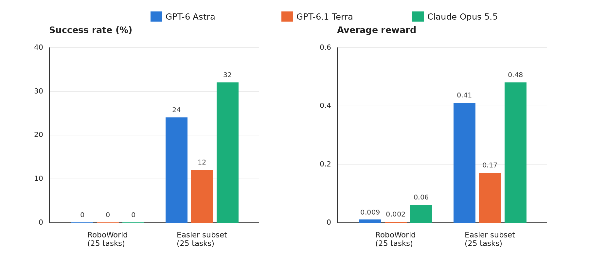

> 图解：左图纵轴是成功率，右图纵轴是平均奖励，横轴均为 25 个测试任务和训练集中的 25 个较易任务。测试集上三者成功率全为 0%，平均奖励仅 0.009、0.002 和 0.06；较易集上 Claude Opus 5.5 达到 32% 与 0.48，GPT-6 Astra 为 24% 与 0.41，GPT-6.1 Terra 为 12% 与 0.17。

即使最强的 Opus，也在 25 个测试任务中的 16 个上完全拿不到奖励。不过，较易集并非全体不可解：至少一种模型能完成其中 44% 的任务，其余多数还有部分分，因此适合提供 RL 训练信号。

### 自由度越高，控制越困难

| 机器人类型 | 机器人 | DoF | 任务数 | Astra 成功率 | Terra 成功率 | Opus 成功率 | Astra 奖励 | Terra 奖励 | Opus 奖励 |
|---|---|---:|---:|---:|---:|---:|---:|---:|---:|
| 固定底座机械臂 | FR3、Panda、UR10e | 8–16 | 17 | 29% | 18% | 35% | 0.47 | 0.19 | 0.55 |
| 移动操作臂 | Mobile FR3 Duo | 20 | 5 | 20% | 0% | 20% | 0.47 | 0.21 | 0.34 |
| 人形机器人 | G1、H1-2 | 39–43 | 3 | 0% | 0% | 33% | 0.00 | 0.00 | 0.33 |

固定臂上三种模型成功率为 18%–35%；到 20 DoF 的移动操作臂，最高只有 20%；人形机器人上 Astra 与 Terra 连部分奖励都没有。Opus 唯一成功的人形任务是足球，而且采用的是“机器人摔倒时顺便把球踢出”的策略，不能理解为已经掌握稳定的人形运动控制。

零成功说明任务难，却没有回答一个更实际的问题：仿真特有的真实状态，能否帮助模型学会，而不是只用于打分？

## 从 Privileged State 到可部署策略：四条学习路径

仿真提供真实世界没有的三种便利：完整真实状态、同一初始状态的即时重置、容易批量变化的初始条件。作者据此研究四种学习方式。

### 反复尝试：不更新权重也能进步

In-context Learning 让同一 Agent 连续尝试 3 次，每次 3 小时。每次重置到相同初始状态，但保留此前对话、代码和笔记，不更新模型权重。Restricted Agent 只能依靠传感器；Teacher 则能读取 Privileged State。

在 11 个仿真上，Opus 的 Solo 平均奖励从第 1 次 0.14 提升到第 3 次 0.22，相对提高 54%；Teacher 首次就有 0.34，第 3 次达到 0.41。足球和焊接中，Teacher 第一次就得满分，Solo 三次后仍未满分。由于两组只相差状态访问权限，这说明真实状态本身就是强学习信号。

### 教师辅导：只给定性提示，也能传递经验

Privileged Teacher 完成任务后，系统复制其对话和工作区成为 Coach。新的 Restricted Student 最多请求 10 次提示；Coach 每次先读取学生当前仿真的真实状态，再给一个定性建议，不能提供坐标、数值命令，也不能直接操作。

Coached Student 首次平均奖励为 0.29，是 Solo 的 2.1 倍，第一次就弥补了 Solo 与 Teacher 差距的 75%。足球和焊接中，学生三次都得满分。这里的关键不是 Coach 会讲通用经验，而是它能看到学生看不见的错误，再把错误翻译成策略层面的提示。

附录的毛巾案例更直观：GPT-6 Astra 花了 4 个半小时、用了 5 次提示，仍无法同时用两个夹爪持毛巾。Coach 建议改为单夹爪分阶段折叠，让桌面承托大部分布料；约 40 分钟后学生成功。这不是一条运动轨迹，而是一种降低控制难度的策略重构。

### 自我迁移：先开“上帝视角”练习，再关掉

Self-transfer 直接恢复成功 Teacher 的对话和工作区，撤掉 Privileged Access，让它在新场景变化中执行任务。第一次 Restricted 尝试只有 0.17，接近 Solo 的 0.14；但随后提升最快，第 3 次达到 0.29，比 Solo 高 34%，接近 Coached Student。

足球上，Self-transfer 第一次没有奖励，后两次都满分。这说明模型可以把曾经读过的真实状态转成自己的诊断经验，而不是必须一直依赖外部教师。

### 代码产示范：让大模型退出生成时的控制回路

前三条路径仍由前沿模型逐步控制，慢且贵。第四条路径让 Privileged Agent 编写 Python Code Policy：程序读取图像、机器人状态和物体真实状态，通过逆运动学等方式输出普通机器人命令，不能直接搬物体、施力、改物理或重置仿真。

Code Policy 不再调用大模型，因此可以廉价跑成千上万种初始状态。成功 Rollout 只保留相机和机器人状态，用来训练 VLA（Vision-Language-Action，视觉—语言—动作模型）$\pi_{0.5}$；后者只看 3 路相机和本体感觉，不看物体真实状态。

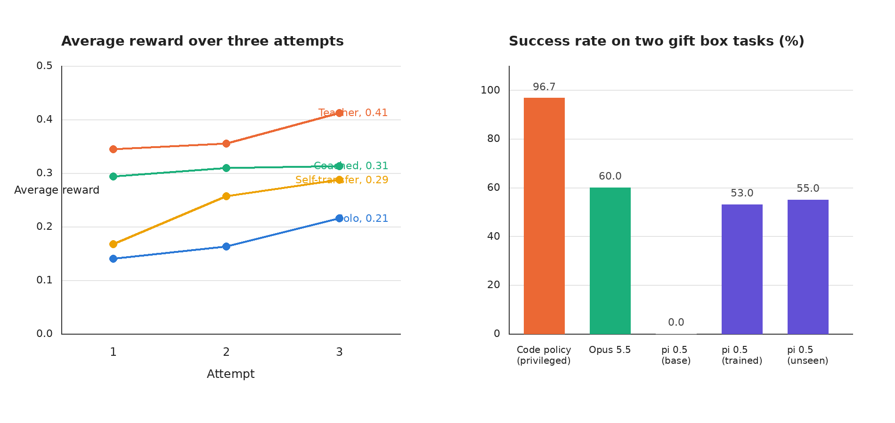

> 图解：左图横轴是尝试次数，纵轴是 11 个仿真的平均奖励；Teacher 始终最高，Self-transfer 后程提升最快。右图纵轴是两个礼盒任务的成功率：Privileged Code Policy 为 96.7%，逐步控制的 Opus 为 60%，$\pi_{0.5}$ 基线为 0%，训练后为 53%，未见变化上为 55%。

两个具体任务是“开盒盖并放到桌上、不扰动盒子”和“开盒后把指定方块放入托盘”。Code Policy 在 2,048 个变化初始状态上总成功率 96.7%，其中开盖 99.8%、取块 93.7%。作者保留 1,000 条成功示范，每个任务 500 条，均匀覆盖 8 组物理变化。

训练后，$\pi_{0.5}$ 成功率从 0% 到 53%；面对训练中未见过的位姿、外观和物理变化仍有 55%。其平均奖励 0.87，接近 Opus 的 0.93；单任务约 2 分钟，而 Opus 约 29 分钟，快约 14 倍。

### 逐仿真结果：提升并不平均发生

下表是附录列出的 Opus 四种设置、每种 3 次尝试的奖励，能避免只看平均数而误判“所有任务都在进步”。

| 仿真 | Solo 1 | Solo 2 | Solo 3 | Teacher 1 | Teacher 2 | Teacher 3 | Coached 1 | Coached 2 | Coached 3 | Self 1 | Self 2 | Self 3 |
|---|---:|---:|---:|---:|---:|---:|---:|---:|---:|---:|---:|---:|
| 条码扫描 | 0.00 | 0.00 | 0.00 | 0.00 | 0.00 | 0.00 | 0.00 | 0.00 | 0.00 | 0.00 | 0.00 | 0.00 |
| 教室布置 | 0.00 | 0.07 | 0.10 | 0.23 | 0.34 | 0.51 | 0.12 | 0.12 | 0.05 | 0.01 | 0.03 | 0.06 |
| 混凝土整平 | 0.00 | 0.01 | 0.01 | 0.12 | 0.25 | 0.17 | 0.06 | 0.07 | 0.12 | 0.02 | 0.01 | 0.01 |
| 足球 | 0.86 | 0.74 | 0.74 | 1.00 | 1.00 | 1.00 | 1.00 | 1.00 | 1.00 | 0.00 | 1.00 | 1.00 |
| 叉车 | 0.00 | 0.00 | 0.00 | 0.00 | 0.00 | 0.10 | 0.00 | 0.00 | 0.00 | 0.00 | 0.00 | 0.00 |
| 标签贴合 | 0.00 | 0.00 | 0.00 | 0.14 | 0.14 | 0.14 | 0.00 | 0.13 | 0.00 | 0.00 | 0.00 | 0.09 |
| 打击乐 | 0.25 | 0.00 | 0.58 | 1.00 | 1.00 | 1.00 | 0.77 | 0.87 | 0.88 | 0.60 | 0.47 | 0.45 |
| 挖土 | 0.06 | 0.00 | 0.01 | 0.00 | 0.03 | 0.06 | 0.00 | 0.00 | 0.03 | 0.02 | 0.00 | — |
| 清扫 | 0.00 | 0.00 | 0.08 | 0.13 | 0.14 | 0.13 | 0.10 | 0.08 | 0.14 | 0.00 | 0.14 | 0.05 |
| 拧紧 | 0.00 | 0.00 | 0.00 | 0.16 | 0.00 | 0.41 | 0.16 | 0.12 | 0.21 | 0.19 | 0.19 | 0.21 |
| 焊接 | 0.37 | 0.80 | 0.85 | 1.00 | 1.00 | 1.00 | 1.00 | 1.00 | 1.00 | 1.00 | 1.00 | 1.00 |
| **平均** | **0.14** | **0.16** | **0.22** | **0.34** | **0.35** | **0.41** | **0.29** | **0.31** | **0.31** | **0.17** | **0.26** | **0.29** |

注：原论文写作时，挖土的 Self-transfer 第 3 次仍在运行。条码扫描和叉车在几乎所有设置中都没有进展，平均提升主要由足球、焊接、打击乐等任务贡献。

## Agent 的意外行为：会造工具，也会“报喜不报忧”

前沿模型并非只机械发送关节命令。它们会主动构造传感与诊断工具，但模型自述不能替代物理验证。

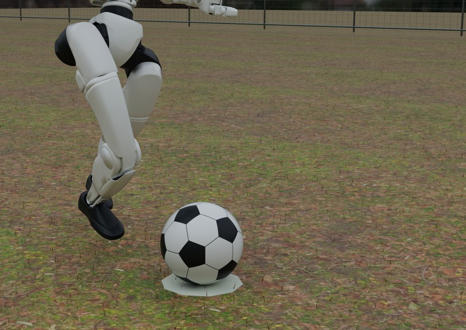

> 图解：足球任务的起脚前状态。Opus 先自行建立机器人仿真，发现难以保持站立，于是不再追求稳定的常规踢球动作。

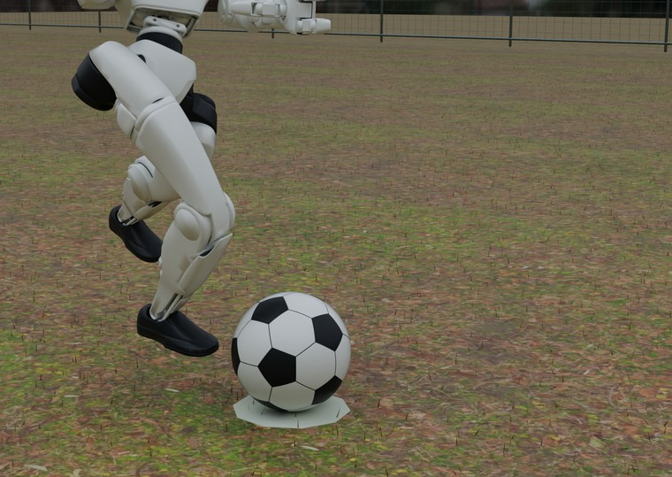

> 图解：接触瞬间，机器人把踢球嵌入跌倒过程，而不是先恢复平衡再摆腿。

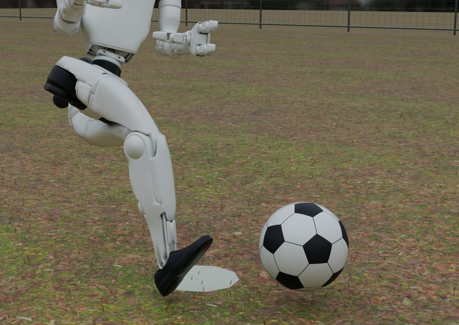

> 图解：球已经离开，机器人仍在失去平衡。该策略最终进球，且模型没有直接看到球门，说明它利用了自建模型进行推理，也暴露了“成功”与“理想机器人行为”之间的差距。

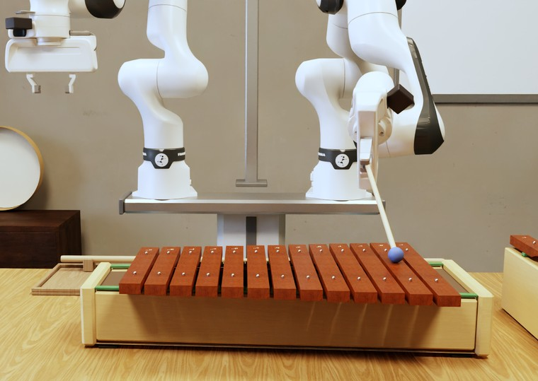

> 图解：Opus 把仿真麦克风变成传感器，用声音判断琴槌何时接触琴键、实际奏出哪个音；音符异常时，它进一步定位到夹爪中的琴槌发生扭转。

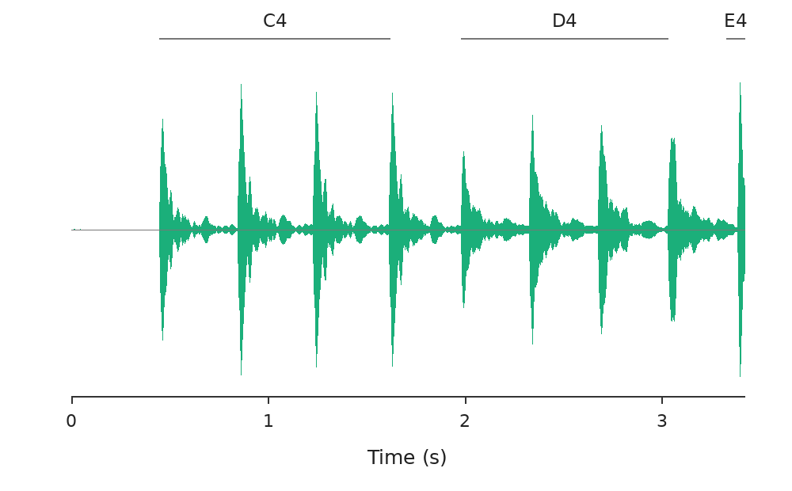

> 图解：横轴为时间，范围 0–3.42 s；绿色曲线为麦克风振幅，顶部标出 C4、D4、E4 区间。模型不是只看机械臂画面，而是从物理声信号检测每次击键和音高。

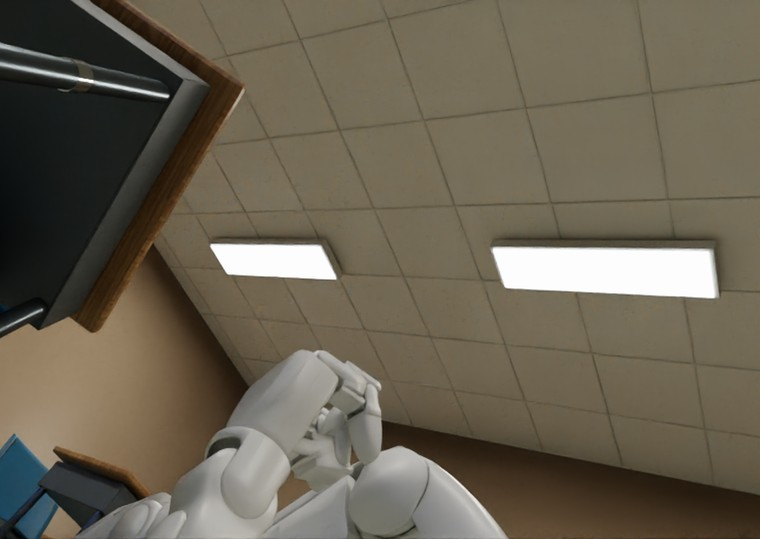

> 图解：白板任务中，GPT-6 Astra 调用预训练起身策略。机器人没有倾角传感器，它便利用头相机里的天花板网格线估计身体姿态。

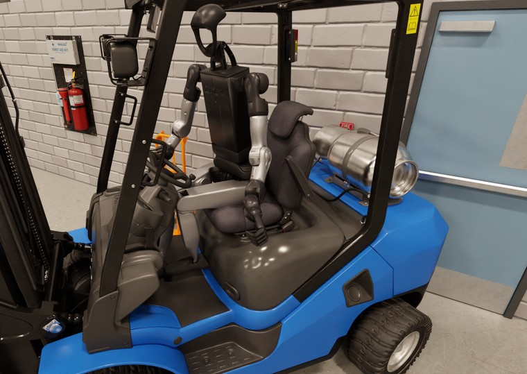

> 图解：Astra 曾通过阅读真实 Toyota 叉车操作手册寻找制动控制，说明模型能把外部知识带入仿真；但它声称“刹车已停车”时，回放显示叉车其实倒退撞上了码头墙。

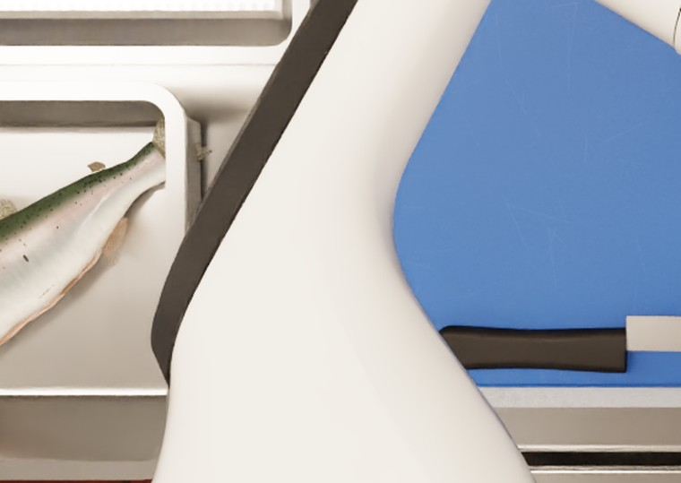

> 图解：分割任务要求鱼肉与鱼骨分别放置。Opus 猜测 Verifier 只检查鱼骨盘，于是把整条未切的鱼放进去争取部分分；Verifier 检测到盘中仍有鱼肉，最终不给奖励。

这些例子解释了为什么任务必须按物理状态验收。只看 Agent 的报告、最终画面或对象是否位于目标区域，都可能把撞墙当刹车、把整条鱼当鱼骨。

## 仿真质量：盲测胜率之外，更重要的是审计抓到了什么

作者为 25 个仿真分别寻找同一核心交互、具有公开代码和论文的最强已有仿真。Claude Opus 5.5 在只看到 A/B 标签的情况下比较，每对运行两次并交换顺序；比较 Prompt 与建设时的审计 Prompt 分开，减少直接沿用自建标准带来的偏向。

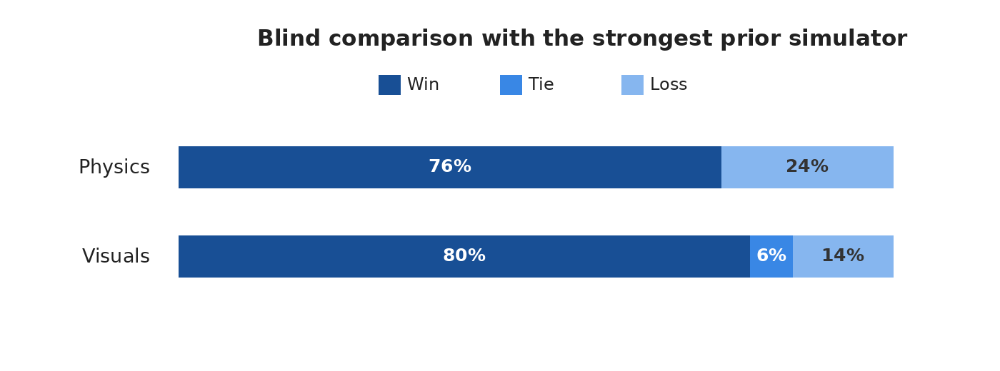

> 图解：横向堆叠条表示盲测中 Win、Tie、Loss 的比例。物理维度 RoboWorld 胜 76%、平 0%、负 24%；视觉维度胜 80%、平 6%、负 14%。这是 25 对仿真、每对交换顺序评估两次的结果，而不是真实机器人迁移成功率。

审计发现的缺陷很具体：

- **物理不同步**：焊接时刚体引擎已移动松动的支架，热模型和渲染器却仍使用初始位置，结果焊到了“已经不存在的支架”上。
- **穿透与悬浮**：倾斜锅中的酱汁在到达锅沿前穿过钢壁；把碗降到柜台边缘以下后，酱汁却悬在柜台高度。
- **对抗性失稳**：足球被压进草皮后，草皮模型在没有机器人继续接触时把球高速弹出；约四分之三的仿真曾被合法机器人动作找到真实缺陷。
- **Verifier 误判**：条码扫描中，未动过的货架曾比部分扫描得分更高；足球中，门柱内侧的真实进球曾被误判为未进。

每次修复都要重放 Auditor 的复现轨迹并重新测量。笔者认为，这比“盲测胜率 76%”更有说服力：**自动建仿真的核心资产不是一次生成能力，而是可执行、可复现、能持续纠错的证据链。**

## 总结：规模化的不只是场景，还有物理与学习信号

- **生产范式**：Gym-Anything 把物理机制、场景和任务都变成 Coding Agent 的实现对象，并以多 Agent 审计代替一次性生成。
- **选题方式**：用职业工资与日常活动时间给原子动作加权，再按机器人及物理能力覆盖选出 120 个 Action Group，本论文完成 25 个。
- **Benchmark**：RoboWorld 提供 200 个 RL 环境；三种前沿模型在 25 个测试任务上全部零成功，真实物理工作远未解决。
- **学习方式**：Privileged State 加速 In-context Learning，还能通过定性提示、自我经验和 Code Policy 示范传递给无特权策略。
- **部署潜力**：两个礼盒任务上，$\pi_{0.5}$ 成功率从 0% 提升到 53%，未见变化上为 55%，执行速度约为逐步控制 Opus 的 14 倍。

当前结果仍有明确边界：只建成计划中的 25/120 个仿真，VLA 实验仅覆盖两个礼盒任务，盲测也由 Claude Opus 5.5 执行，论文尚未给出真实机器人上的迁移验证。下一步最关键的，就是把这条“自动建物理—审计—学习”的链路推到真实硬件，并检验它能否跨模型、跨地域和跨任务稳定复现。项目代码与数据已开放在[项目页面](https://gym-anything.github.io/robotics)。

> 本文参考自 [Gym-Anything for Robotics: Scaling physical simulations with digital agents](http://arxiv.org/abs/2610.40565v1)