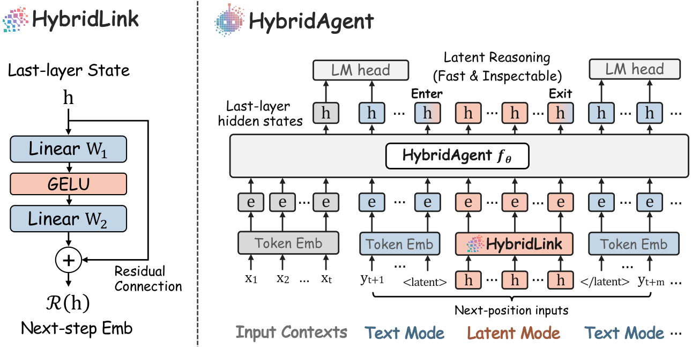
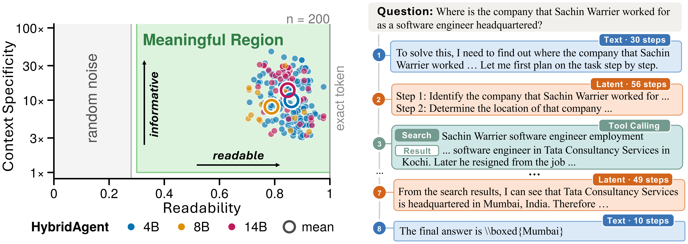
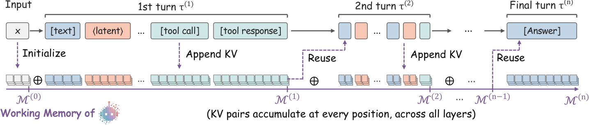
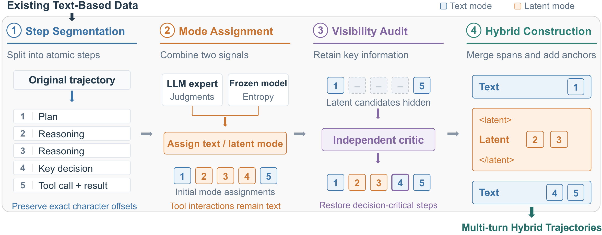
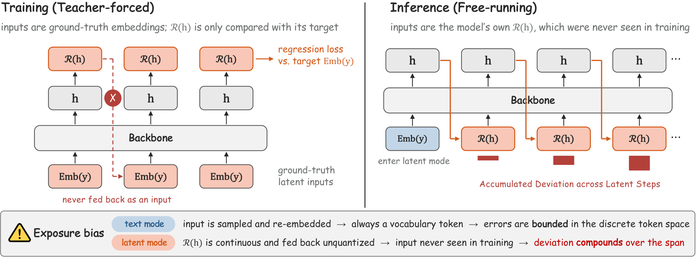
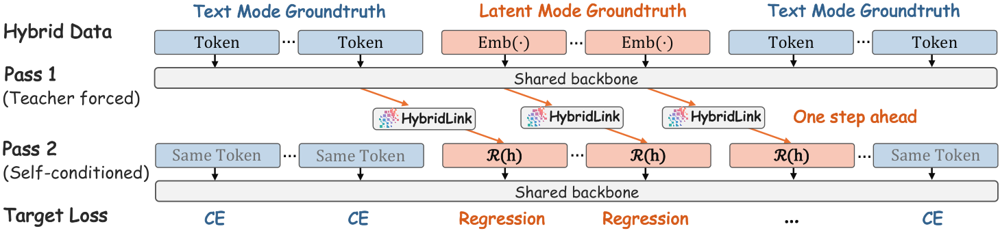
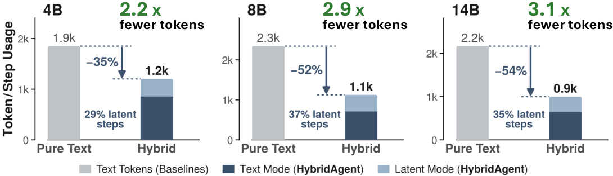
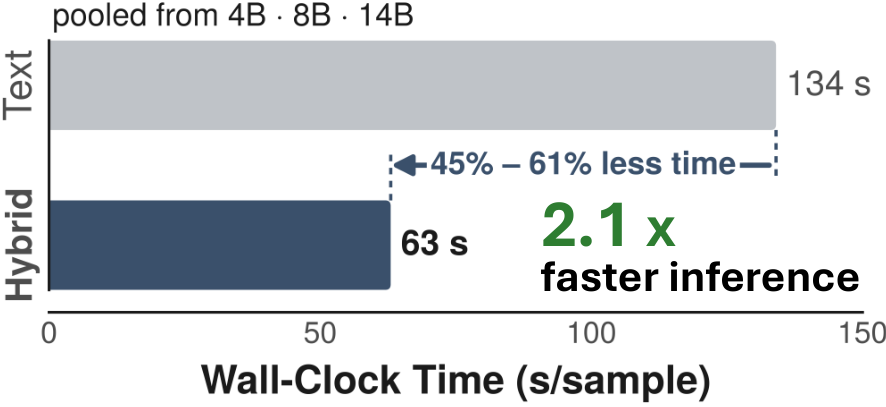
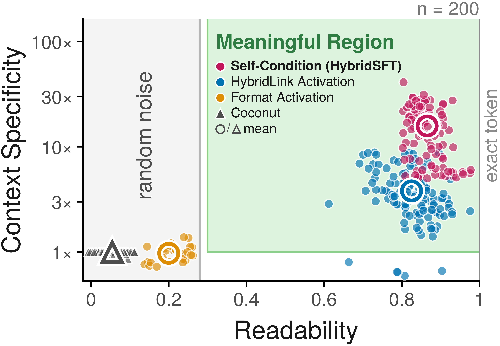
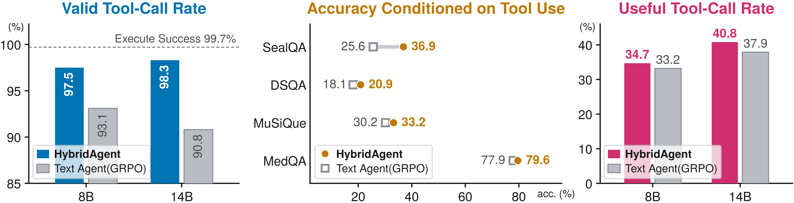

# HybridAgent：用潜空间思考，用文本行动

今天的 LLM Agent 有一个根本矛盾：外部交互必须用文本，但用文本逐字推理又慢又贵。随着 Agent 被用于更复杂的搜索、编程和决策任务，这种成本会直接限制其扩展性；Latent Reasoning（潜空间推理）虽然高效，却无法调用工具，也难以被人类审计。来自 Stanford、UIUC、Together AI 和 Meta 的工作提出了 HybridAgent：让同一个模型在一次生成过程中，自主在“潜空间思考”与“文本交互”两种模式之间切换。结果相当硬核：在 11 个 benchmark 上，14B HybridAgent 平均超越最强 agentic baseline **17.4%**，同时文本 token 用量减少 **35.5%–54.7%**、推理速度提升 **1.8×–2.6×**、计算成本降低 **2.7×–3.7×**。更妙的是，它的 latent 思考还能被“翻译”成人类可读的伪文本，为透明审计提供入口。

## 一、问题：Agent 被“困”在文本里

先建立直觉。一个现代 LLM Agent 解决难题的过程，就像一个只能“把想法大声说出来”才能行动的人：每一步推理都要逐 token 解码成文字，然后才能调搜索、跑代码。这带来两个代价：

- **效率代价**：每一个中间想法都要付出解码成本，长链条推理的 token 开销巨大；
- **表达代价**：连续、高维的内部表征被强行压缩成离散文字，造成信息损失。

另一条研究路线——Latent Reasoning（以 Coconut、SoftThinking 等为代表）——让模型直接在连续隐空间中计算，不必把每步推理“说”出来。但这条路有两个关键障碍：

1. **没有工具接口**：连续的 latent 向量无法写成一段 tool call 文本发给环境，多轮 agentic 交互无从谈起；
2. **难以解释**：latent 向量缺乏人类可读的语义，训练时难以监督，推理时难以审计和调试。

一句话总结：**Agentic 交互和高效内部推理，各自需要一种不同的媒介**，两条路线一直没法合流。这篇文章的核心主张就是填上这道鸿沟——造一个 *think beyond text while still acting through it*（超越文本地思考，但仍然通过文本行动）的智能体。

> 博主点评：这个定位非常精准。Latent Reasoning 此前的尴尬在于“省了 token，却丢了 agent 能力”；而纯文本 Agent 的问题是“什么都能干，但每一步都在烧钱”。Hybrid 的价值不在于折中，而在于**分工**。

## 二、总体设计：一个模型，两种模式

> 图解：左图是核心组件 HybridLink——它把最后一层的 hidden state 映射回输入 embedding 空间，让 Agent 得以进入 latent 模式做“循环、快速、可检查的内心思考”，再回到文本模式做工具调用和外部监控。右图是完整的混合推理流程：模型在 latent 空间思考（橙色 LATENT 段），通过文本行动（蓝色 TEXT 段发出 tool call、接收 observation），整个过程中模式切换由模型自主决定。

要让两种模式共存于一次生成，需要解决两个关键问题：

- **输入接口不统一**：文本输入是离散 token 的 embedding，latent 输入是连续向量，二者分布不同；
- **切换时机**：什么时候该“想”、什么时候该“说/做”，不能写死，要让模型自己学。

下面分别看架构和训练如何解决这两个问题。

## 三、架构：HybridLink 与连续工作记忆

### 3.1 HybridLink：连接隐空间与嵌入空间的“翻译官”

已有 latent reasoning 模型的常见做法，是把最后一层 hidden state $h_t$ 直接当作下一步输入 $e_{t+1}$。这在纯 latent 场景没问题，但在混合生成中会翻车：$h_t$ 和预训练模型的输入 embedding 空间存在**表征失配**，连续态与离散 token 之间难以来回切换。

HybridAgent 的解法是加一个轻量残差适配器 **HybridLink**（记作 $\mathcal{R}$），把 hidden state“翻译”回输入 embedding 空间：

$$
e_{t+1} = \mathcal{R}(h_t) = h_t + W_2\,\sigma\!\left(W_1 h_t\right)
$$

其中 $W_1, W_2$ 是线性投影，$\sigma$ 是激活函数（如 GELU）。这个设计的聪明之处在于**残差连接**：$h_t$ 本身已经编码了当前生成的语义，残差项原样保留它，可学习的投影只需对齐“分布差异”，而不必从零学整个映射。因此 HybridLink 非常轻——约 $2d_h^2$ 参数，对 4B 模型仅约 1000 万参数。

### 3.2 模式切换：两个特殊 token 做“锚点”

- **进入 latent 模式**：文本模式下模型照常采样 token，一旦生成特殊 token `<latent>`，下一步前向就改用 HybridLink 替代 LM head 和 embedding 层，进入无解码的连续推理。
- **退出 latent 模式**：每个 latent step 检查 $\mathcal{R}(h_t)$ 与哪个 token 的 embedding 最近，当最近邻恰好是 `</latent>` 时退出：

$$
\operatorname*{arg\,max}_{v \in \mathcal{V}} \; \cos\bigl(\mathcal{R}(h_t),\, \operatorname{Emb}(v)\bigr) = \texttt{</latent>}
$$

文本段和 latent 段的长度、出现频率完全由模型在生成中动态决定，没有任何预设结构。

### 3.3 意外收获：latent 思考是“可读”的

上式不仅是退出条件，还顺带提供了一个**解释器**：把每个 latent step 映射到最近的 token embedding，就得到一段“伪文本”（pseudo-text）。也就是说，latent 推理虽然不解码，却可以随时被“读出来”。

> 图解：左图是对 200 个问题的定量探针结果，横轴是“上下文特异性”（伪文本与本问题的相关度相对于其他问题的倍数，对数轴），纵轴是“可读性”（latent 向量与最近 token embedding 的平均余弦相似度），每个点是一个 latent span；4B、8B、14B 的 HybridAgent 大量 span 落在右上阴影区（既可读又紧扣问题）。右图是定性示例，latent 伪文本与周围的文本推理、工具调用语义连贯对齐，“Steps”表示前向传播步数。

> 博主点评：这是全文最让我惊喜的一点。以往 latent reasoning 被诟病为“黑箱”，而这里 latent 向量居然天然携带可解码语义——这等于同时拿到了 latent 的效率和文本的可审计性，也是后文“可监控性”实验的基石。

### 3.4 多轮混合生成：KV 即工作记忆

标准 Agent 的多轮交互是把每轮文本拼回 context 重新编码。但混合轨迹里夹着 latent 向量，没法 tokenize 成文本再拼回去。HybridAgent 的做法是：**直接把累积的 KV cache 当作连续工作记忆**，跨轮复用。

> 图解：文本 token、latent 思考、工具观测三类内容统一进入同一输入空间（文本/观测走 embedding 层，latent 走 HybridLink），Transformer 对它们一视同仁地产生 KV 条目。第 1 轮结束后，工作记忆 $\mathcal{M}^{(1)}$ 保留了完整混合上下文；后续轮次直接在这份记忆上继续生成并追加新 KV，无需任何文本重构。

形式化地，从输入上下文 $x$ 初始化后逐轮追加：

$$
\begin{aligned}
\mathcal{M}^{(0)} &= \bigl[K_{\le |x|},\, V_{\le |x|}\bigr],\\
\mathcal{M}^{(1)} &= \mathcal{M}^{(0)} \oplus \bigl[K_{\le t},V_{\le t}\bigr],
\quad t = 1,\dots,|\tau^{(1)}|
\end{aligned}
$$

作者在附录中给出了一个**无损性定理**（Theorem：Lossless Multi-Turn Working Memory）：用工作记忆做缓存前向，与用完整混合前缀做全量前向，产生的 hidden output 逐位相同，即

$$
h_{t+1} = f_\theta([E_{\le t}; e_{t+1}])
$$

证明思路是对位置做数学归纳：基础步两者都从空记忆出发，归纳步利用因果注意力保证追加新输入不改变已有 KV，于是逐层推出相同输出。这个定理保证了“工具调用回来接着想”在数学上严格等价于从头跑一遍，工程上却省掉了全部重算。

## 四、训练：HybridSFT 稳生成，HybridRL 扩能力

架构不动 backbone，因此无需从头预训练，直接把“SFT + RL”的标准 agentic 后训练管线适配到混合场景。两个阶段分工明确：**SFT 教会 backbone 与 HybridLink 协同、稳定混合生成；RL 教会模型“何时想、何时做”**。

### 4.1 混合数据从哪来：自动标注管线

作者把已有的纯文本 agentic 演示数据自动改写成 54K 条混合轨迹，全程无人工标注：

> 图解：四步管线。① Step Segmentation：把源轨迹切成原子推理步并记录字符偏移；② Mode Assignment：用外部 LLM 专家（GPT-6.1-Sol / GPT-5.6-Luna）判断每步该归文本还是 latent，同时用目标模型自身的 token 级预测熵做互补信号——低熵（模型有把握）的步划为 latent，高熵的保留为文本；③ Visibility Audit：独立 LLM critic 检查“遮住 latent 段后，剩余文本是否足以理解决策”，信息不足就把关键步恢复为文本；④ 合并相邻 latent 步、插入锚点 token，并校验去掉锚点后能逐字节还原原轨迹。

熵的计算是在冻结的 base model 上 teacher-force 原轨迹，并对每步 $s$ 求平均：

$$
H_s = -\frac{1}{|\mathcal{I}_s|} \sum_{t\in\mathcal{I}_s} \sum_{v\in\mathcal{V}} f_{\theta}(v\mid x,\tau_{<t}) \log f_{\theta}(v\mid x,\tau_{<t})
$$

这个设计很务实：**模型自己已经会做的，放进 latent 里快速做；真正关键的、需要被审计的，留在文本里给人看**。

### 4.2 HybridSFT：先激活，再“自我条件化”

HybridSFT 分两步走。

**第一步：格式与 HybridLink 激活。**先做标准文本 SFT，让 backbone 学会在合适时机吐出 `<latent>` / `</latent>` 锚点；再冻结 backbone，训练 HybridLink 把 latent 位置的 hidden state 对齐到目标 embedding：

$$
\begin{aligned}
&\mathcal{L}_{\text{Backbone}} = \mathrm{CE}\bigl(f_\theta(x),\, y\bigr),\\
&\mathcal{L}_{\text{HybridLink}} = \lambda_{\cos}\Bigl(1 - \cos\bigl(\mathcal{R}(h_{\text{lat}}),\, \operatorname{Emb}(y_{\text{lat}})\bigr)\Bigr) + \lambda_{\text{mse}}\bigl\lVert \mathcal{R}(h_{\text{lat}}) - \operatorname{Emb}(y_{\text{lat}}) \bigr\rVert_2^2
\end{aligned}
$$

$\lambda_{\cos}$ 管方向对齐，$\lambda_{\text{mse}}$ 管模长对齐。

**第二步：自我条件化（Self-Conditioned）训练。**只做激活会留下一个隐蔽的坑——**曝光偏差（exposure bias）**，这是 latent 模式特有的：

> 图解：左图是激活训练阶段——latent 位置上 backbone 消费的是 ground-truth embedding $\mathrm{Emb}(y)$，HybridLink 的输出 $\mathcal{R}(h)$ 只被拿去算 loss，从不作为输入喂回去。右图是推理阶段——一旦进入 latent 模式，每一步的输入都是模型自己的 $\mathcal{R}(h)$，与目标 embedding 的微小偏差会在几十到几百步的 latent span 里不断累积、逐渐侵蚀语义连贯性。

关键区别在于：文本模式下即使预测错了，喂回去的仍然是词表里的某个 token embedding，输入分布不会超出训练时见过的范围；而 latent 模式下 $\mathcal{R}(h)$ 是连续向量、不做量化，**任何小偏差都是训练时从没见过的输入**，误差会复利式放大。

解法是两遍前向的自条件训练：

> 图解：第一遍 teacher-force 跑 ground-truth 混合序列，用 HybridLink 把 latent 位置的 hidden state 映射成“模型自己预测的下一步 latent 输入”；第二遍把 ground-truth latent embedding 替换成这些预测值，在文本位置算 CE loss、latent 位置算回归 loss，联合训练 backbone 与 HybridLink。

$$
\mathcal{L}_{\text{HybridSFT}} = \mathcal{L}_{\text{Backbone}} + \mathcal{L}_{\text{HybridLink}}
$$

这样，backbone 学会“读”自己的 latent 输出，HybridLink 学会“写”backbone 能读的 latent 输入——两者在推理时遇到的输入分布下训练，训练—推理鸿沟被闭合。

> 博主点评：这一步本质上是把 scheduled sampling 的思想搬到了连续空间，但作者的诊断更锐利——他们指出 latent 模式的曝光偏差比文本模式**更严重**（无量化兜底），这是前人 latent reasoning 工作很少正面处理的问题。

### 4.3 HybridRL：在没有 token 概率的地方做策略优化

RL 阶段有个绕不开的数学障碍：PPO/GRPO 这类算法要求每个生成位置都有 token 级似然，以计算重要性比率

$$
\rho_t = \frac{\pi_\theta\bigl(y_t \mid y_{<t}\bigr)}{\pi_{\theta_{\text{old}}}\bigl(y_t \mid y_{<t}\bigr)}
$$

但 latent 位置生成的是确定性连续向量，没有“采样概率”，$\rho_t$ 无定义。作者用两个组件解决：

**（i）混合策略分解（Hybrid Policy Factorization）。**注意到 latent 转移由固定的 HybridLink 确定性产生（条件概率为 1），工具观测来自环境，真正的“策略采样”只发生在文本位置。于是整条混合轨迹的似然只分解在采样文本位置上：

$$
\pi_\theta(\tau \mid x) = \prod_{t \in \mathcal{T}} \pi_\theta\bigl(y_t \mid x,\, \tau_{<t}\bigr)
$$

其中 $\mathcal{T}$ 是轨迹 $\tau$ 的采样文本位置集合。这个命题（证明只需对链式法则中确定性步骤的概率 1 做消元）说明：**只在文本 token 上做似然比更新，就足以优化完整混合轨迹**，重要性比率重新变得良定义。

**（ii）精确 Rollout 回放（Exact Rollout Replay）。**策略更新需要重建可微计算图。做法是 rollout 时把每步的 latent 输入 $z_i$、文本 $y_i$、工具观测 $o_i$ 全部记录；更新时保持记录的 latent 输入不变，用一次可微前向“回放”整条轨迹，重算各文本位置的似然。附录中的梯度等价定理（Gradient Equivalence）进一步保证：在 $\theta = \theta_{\text{old}}$ 处，这个逐 token 目标的梯度恰好等于对完整记录轨迹的 advantage 加权似然梯度：

$$
-\nabla_\theta\mathcal{L}_{\text{RL}}(\theta_{\text{old}}) = \left. \frac{1}{\sum_i|\mathcal{T}_i|}\sum_i A_i \nabla_\theta\log\pi_\theta(\tau_i\mid x) \right|_{\theta=\theta_{\text{old}}}
$$

其中 $A_i$ 是组归一化 advantage（GRPO 风格），$\mathcal{L}_{\text{RL}}$ 采用标准的 clip 目标。注意回放时 latent 输入固定（$\partial z/\partial\theta = 0$），但 hidden state 仍依赖参数，链式法则让轨迹级奖励的信用能传回 backbone 对完整混合上下文的处理过程。

**奖励设计**刻意保持简单：

$$
r(\tau) = r_{\text{correct}} + r_{\text{format}} + r_{\text{tool}}
$$

分别奖励答案正确性、惩罚格式错误、鼓励多工具使用。**没有任何关于模式使用的显式奖励**——什么时候进 latent、进多久，完全交给 RL 自己发现。

## 五、实验：性能、效率全面占优

**实验设置。**在 Qwen3-Base 4B / 8B / 14B 三个规模上实例化 HybridAgent；HybridSFT 用 54K 混合轨迹，HybridRL 用 12K 数学深推理样本 + 1K agentic 搜索样本；工具为沙盒 Python 解释器和实时搜索引擎（Tavily），每条轨迹限 10 次调用；评测覆盖 11 个 benchmark：数学（AIME 25/26、MATH500）、知识密集（GPQA-Diamond、MedQA、MuSiQue）、agentic 推理（GAIA、HLE、WebWalker、SealQA、DSQA）。baseline 涵盖文本 agentic 方法（SFT、GRPO、ARPO）、latent 方法（Coconut、SoftCoT、SoftThinking）、前沿 LLM Agent（GPT-5.6-Luna、Kimi-K3、GLM-5.3-Flash、DeepSeek-V4.1-Flash、QwQ-32B）和 agentic 框架（ReAct、Search-o1、WebThinker）。

### 5.1 主结果：Agentic 任务大幅领先

先看最硬的 agentic 推理 benchmark（GAIA / WebWalker / HLE / SealQA / DSQA，均报告平均分）：

| 方法 | GAIA Avg. | WebWalker Avg. | HLE Avg. | SealQA (S-0/Hard) | DSQA (Acc./F1) |
|---|---|---|---|---|---|
| QwQ-32B | 18.9 | 4.3 | 9.6 | 1.8 / 10.6 | 11.3 / 23.9 |
| GLM-5.3-Flash | 30.1 | 9.0 | 14.2 | 9.0 / 22.0 | 16.0 / 38.5 |
| DeepSeek-V4.1-Flash | 39.8 | 16.5 | 28.4 | 14.4 / 33.5 | 19.3 / 38.6 |
| Kimi-K3 | 41.7 | 10.0 | 31.4 | 11.7 / 28.0 | 21.7 / 46.0 |
| GPT-5.6-Luna | 37.9 | 11.0 | 29.0 | 11.7 / 29.1 | 23.3 / 49.4 |
| ReAct (Qwen3-14B) | 32.0 | 15.5 | 6.6 | 7.2 / 15.0 | 14.6 / 32.3 |
| WebThinker (Qwen3-14B) | 33.0 | 19.5 | 7.0 | 4.5 / 12.6 | 11.7 / 24.7 |
| GRPO (8B) | 32.0 | 30.0 | 7.8 | 15.3 / 23.6 | 17.3 / 33.8 |
| ARPO (8B) | 38.8 | 32.0 | 8.8 | 18.9 / 26.0 | 18.0 / 37.2 |
| **HybridAgent (8B)** | **43.7** | **42.5** | **14.4** | **22.5 / 35.8** | **20.0 / 40.7** |
| GRPO (14B) | 36.9 | 38.5 | 8.6 | 17.1 / 24.4 | 18.6 / 43.9 |
| ARPO (14B) | 43.7 | 40.5 | 10.0 | 17.1 / 22.8 | 16.3 / 38.2 |
| **HybridAgent (14B)** | **52.4** | **49.5** | **16.0** | **24.3 / 37.8** | **21.7 / 46.8** |

几个值得注意的点：

- HybridAgent (14B) 相对最强 agentic baseline（ARPO）平均提升 **17.4%**，GAIA 上从 43.7 提到 52.4，WebWalker 上从 40.5 提到 49.5；
- 一个 14B 模型在 GAIA、WebWalker、SealQA 上**反超所有前沿大模型 Agent**（包括 GPT-5.6-Luna、Kimi-K3）；
- 纯 latent 方法（Coconut、SoftThinking）在这类任务上几乎不可用（个位数），再次印证“latent 做不了 agent”的现状。

### 5.2 主结果：数学与知识任务同样稳健

| 方法 (Qwen3-14B-Base) | AIME25 | AIME26 | MATH500 | GPQA-D | MedQA | MuSiQue |
|---|---|---|---|---|---|---|
| Coconut | 16.3 | 15.2 | 61.2 | 29.3 | 65.3 | 17.5 |
| SoftCoT | 22.7 | 23.8 | 74.0 | 36.4 | 67.7 | 20.0 |
| Standard Text SFT | 30.8 | 31.7 | 83.8 | 43.9 | 78.0 | 28.0 |
| **HybridAgent (SFT)** | **32.5** | 31.7 | **84.2** | **45.5** | **78.7** | **29.5** |
| GRPO | 40.8 | 42.5 | 87.4 | 52.5 | 81.0 | 32.0 |
| ARPO | 42.1 | 43.3 | 87.0 | 54.0 | 80.3 | 31.5 |
| **HybridAgent (RL)** | **43.3** | **45.8** | **88.2** | **55.1** | **81.7** | **34.5** |

在相同模型规模和训练预算下，HybridSFT 相对文本/latent baseline 平均提升 **18.5%**，HybridRL 再提升 **10.4%**。8B 规模趋势一致（HybridAgent-RL：AIME25 39.2、MATH500 84.6、MuSiQue 32.0，均为同规模最优）。4B 规模上结论同样成立：HybridAgent (RL) 在 AIME25/26、MATH500、GPQA-D 上分别达到 35.2 / 37.5 / 82.2 / 40.9，平均超过 ARPO 2.0 个百分点——混合推理的收益可以下沉到小模型。

### 5.3 测试时扩展性：采样越多，优势越大

> 图解：在 100 道困难数学/科学题上评估 pass@k（k = 4, 8, 16, 32, 64），横轴为采样次数 k，纵轴为 pass@k 准确率，对比 HybridAgent 与 GRPO 训练的纯文本 Agent。所有规模下 HybridAgent 的曲线都随 k 稳定上升，且比纯文本 Agent 从测试时算力增加中获益更多——latent 思考积累的推理深度让多次采样更有效。

### 5.4 效率：更快、更省、更便宜

> 图解：对比三个规模下 HybridAgent 与匹配文本 Agent 的文本 token 用量和总生成步数。HybridAgent 自适应地把大量推理搬进 latent 模式，文本 token 减少约 **2.7×**，总生成步数最多减少 **54%**。

> 图解：三个模型规模下 HybridAgent 相对文本 baseline 的墙钟推理时间加速比，整体达到 **2.1×** 左右。latent 模式每一步仍是一次完整前向，但省掉了昂贵的词表投影与逐 token 解码。

成本分析更直观（按每步一次完整前向计费，2.50 美元/H100 小时、10% 峰值利用率估算）：

| Backbone | 文本 Agent (TFLOP/题) | HybridAgent (TFLOP/题) | 每百万题成本（美元） | 节省倍数 |
|---|---|---|---|---|
| Qwen3-4B | 51.2 | 13.9 | 359 → 98 | 3.7× |
| Qwen3-8B | 62.5 | 17.2 | 439 → 121 | 3.6× |
| Qwen3-14B | 66.9 | 25.1 | 470 → 176 | 2.7× |

注意，这个估算**把 latent step 也计为一次完整 backbone 前向**，并没有把 latent 计算当作“免费”。

## 六、深入分析：两个模式真的各司其职吗？

这是全文实验密度最高的部分，作者从训练动力学、latent 模式、文本模式三个角度“解剖”了 HybridAgent。

### 6.1 训练动力学

**自我条件化到底重不重要？**在共享的 Qwen3-14B-Base 上逐级消融：

| 方法 | AIME25 | AIME26 | MATH500 |
|---|---|---|---|
| Qwen3-14B-Base | 4.9 | 3.0 | 47.0 |
| + Format Activation | 20.6 | 19.8 | 62.4 |
| + HybridLink Activation | 23.8 | 22.5 | 73.8 |
| **+ Self-Condition (HybridSFT)** | **32.5** | **31.7** | **84.2** |
| （参考）Coconut | 16.3 | 15.2 | 61.2 |
| （参考）Standard Text SFT | 30.8 | 31.7 | 83.8 |

仅做激活远远不够；自我条件化在激活基础上平均再提升 **30.5%**，把 HybridSFT 拉到与标准文本 SFT 持平甚至更好。探针实验（下图）显示它同时让 latent 伪文本的可读性和语义信息量显著增强：低保真方法产出的 latent 读出基本是不可读的 embedding 几何伪影，完整 HybridSFT 则产出清晰连贯的伪文本。

> 图解：对 200 个跨域问题，比较“仅格式激活”“仅 HybridLink 激活”“自我条件 HybridSFT”与 Coconut 的 latent 读出质量。横轴为上下文特异性、纵轴为可读性；从激活到自我条件化，latent span 整体向右上“有意义区域”迁移——先变得可读，再变得语义锐利。

**HybridRL 的训练动态**也更有意思：

> 图解：横轴为训练步数，曲线分别展示生成中文本/latent 占比、奖励与工具调用量的变化。随着训练推进，14B Agent 把越来越多的生成份额从文本转向 latent 模式，同时奖励和工具调用能力同步增强——模型自发学会“内部多思考、外部少说话”，只把关键步骤暴露在文本接口上。

奖励消融（8B）显示三项奖励互补：去掉 $r_{\text{correct}}$ 掉分最多（下降 6.4%–17.8%）；去掉 $r_{\text{format}}$ 稳定下降 4.7%–6.9%；$r_{\text{tool}}$ 主要作用于 agentic 任务（GAIA 下降 11.2%、WebWalker 下降 3.5%），对 MATH500 几乎无影响（因为那里只需 Python 一个工具）。

### 6.2 Latent 模式：因果干预与 HybridLink 消融

**latent 思考是“真被用上了”，还是摆设？**作者对 MATH500 上的 latent 向量做了 4 类受控干预（$d$ 为相对扰动强度）：

| 干预类型 | 设置 | $d$ | 8B | 14B |
|---|---|---|---|---|
| 高斯噪声（弱） | 加 $0.5\|v\|$ 幅度噪声 | 0.5 | 72.6 | 75.0 |
| 高斯噪声（强） | 加 $2.0\|v\|$ 幅度噪声 | 2.0 | 66.4 | 70.2 |
| 随机 token 替换 | 换成随机 token embedding | 1.6 | 41.2 | 44.6 |
| 跨问题替换 | 换成另一道题的 latent | 1.4 | 44.8 | 48.6 |
| 均值替换 | 换成平均 latent 向量 | 1.0 | 53.6 | 58.4 |
| 最近 token 替换 | 换成最近邻 token embedding | 0.2 | 82.6 | 87.2 |
| 块内乱序 | 保留内容、打乱顺序 | 0.8 | 73.2 | 76.4 |
| 单步截断 | latent span 只许走 1 步 | – | 72.2 | 75.0 |
| 禁止 latent | 全程只能文本推理 | – | 80.4 | 78.8 |
| **无干预（原始）** | – | **0.0** | **84.6** | **88.2** |

信息量很大的一组结果：

- 语义替换（跨问题、随机 token）造成 44.9%–51.3% 的毁灭性下降，且**比扰动幅度更大的高斯噪声伤得更重**——说明性能依赖的是 latent 的**语义内容**而非几何幅度；
- 打乱顺序或限制深度各掉 13.4%–15.0%，说明 latent 思考的**顺序与推理深度**也被功能性利用；
- 最近 token 替换（$d=0.2$）几乎无损——与“latent 向量天然贴近词表 embedding”的可解释性发现互为印证。

**HybridLink 结构消融**（14B 端到端训练）：

| HybridLink 设计 | MATH500 | MedQA | MuSiQue |
|---|---|---|---|
| Identity（直接复用 $h_t$） | 71.4 | 73.7 | 24.5 |
| 1 层投影 | 83.6 | 79.7 | 28.5 |
| 1 层 + 残差 | 86.4 | 80.3 | 31.0 |
| 2 层投影 | 85.8 | 81.0 | 31.5 |
| **2 层 + 残差（本文）** | **88.2** | **81.7** | **34.5** |

残差连接在两种深度下都带来平均 4.3% 的提升，验证了“残差保语义、投影管对齐”的设计动机。

### 6.3 文本模式：工具能力与可审计性保住了吗？

> 图解：左图是 8B/14B 下的有效工具调用率与执行成功率（有效调用中无错误执行的比例）；中图是“至少调用一次工具”题目上的最终答案准确率；右图是“有用工具调用率”（执行结果中包含最终答案线索的比例）。HybridAgent 在有效调用率上更高、执行成功率与文本 Agent 持平（99.7%），调工具的题目上准确率高出 2.2%–44.1%，有用调用率高出 4.5%–7.7%——混合推理没有牺牲文本接口的工具能力，反而调得更准、更有用。

可审计性是 latent 推理最容易被质疑的地方。作者在 560 道题上让外部观察者**只能看到文本步、工具调用和工具输出**（latent 段隐藏在锚点标记后），从四个维度评估：

| 指标 | 8B Hybrid / 8B 文本 | 14B Hybrid / 14B 文本 |
|---|---|---|
| 每题文本 token 数 | **302** / 596 | **284** / 497 |
| 每题 latent 步数 | 170 / – | 183 / – |
| 每百 token 关键推理步 ↑ | **0.72** / 0.57 | **0.86** / 0.67 |
| 弱监视器 AUROC（MATH500）↑ | **0.840** / 0.772 | **0.860** / 0.818 |
| 强监视器 AUROC（全任务）↑ | **0.961** / 0.935 | 0.989 / 0.990 |
| 首个错误定位正确率 ↑ | **99.2** / 94.2 | 98.1 / 100.0 |
| 诊断与参考一致率 ↑ | **97.6** / 93.5 | **97.2** / 96.3 |
| 定向提示修复率增益 Δ ↑ | **+9.1** / +3.4 | **+5.4** / +3.5 |

结论：HybridAgent 暴露的文本 token 少了 43%–49%，但**每百 token 的关键推理步反而多 26%–28%**——文本接口更紧凑、信息密度更高。盲监视器判断 rollout 对错的 AUROC 与纯文本 Agent 相差不到 0.022；首个错误定位率 98%–99%、答案泄漏率低于 1%；由文本 trace 导出的纠正提示带来 5.4–9.1 个点的修复率提升。也就是说，把一半以上的计算搬进 latent，并没有让 Agent 变得“不可管”。

## 七、理论支撑一览

论文的理论部分为两个关键设计提供了形式化保证，值得单独拎出来：

1. **无损多轮工作记忆（Theorem 1）**：在固定模型、固定 HybridLink、一致的确定性推理设置下，缓存前向与完整前缀前向逐位等价（归纳证明见 3.4 节），跨轮继续生成无需重构历史；
2. **混合策略分解（Proposition）**：latent 转移与环境观测都是确定性的，策略似然只分解在采样文本位置，使 GRPO 式重要性比率在混合轨迹上良定义；
3. **梯度等价（Theorem 2）**：精确回放条件下，逐 token clip 目标在 $\theta_{\text{old}}$ 处的梯度等于完整记录轨迹的 advantage 加权似然梯度——奖励的信用分配严格覆盖整条混合轨迹。

这三条合起来，让“在混合轨迹上做 RL”从工程 hack 变成了有理论依据的算法。

## 八、总结与展望

回顾全文，核心要点：

- **问题定位**：Agentic 交互要文本、高效推理要 latent，HybridAgent 首次在同一生成过程中统一两者——“用潜空间思考，用文本行动”；
- **架构**：轻量残差适配器 HybridLink（4B 模型仅约 10M 参数）打通隐空间与嵌入空间，KV 工作记忆实现无损多轮混合生成，latent 思考可读、可审计；
- **训练**：HybridSFT 用自我条件化消除连续空间特有的曝光偏差；HybridRL 用策略分解 + 精确回放在混合轨迹上做有理论保证的策略优化；
- **性能**：11 个 benchmark、3 个规模，14B 平均超最强 agentic baseline 17.4%，GAIA 等任务反超前沿大模型 Agent，且 pass@k 随采样稳定上升；
- **效率**：文本 token 减 35.5%–54.7%，推理快 1.8×–2.6×，成本降 2.7×–3.7×；
- **可信性**：因果干预证明 latent 思考被功能性使用；可监控、可调试、可纠正性与纯文本 Agent 持平甚至更优。

局限与方向：作者在讨论中指出，latent 思考只能通过提供方持有的 HybridLink 读出，这天然形成了一种**专有推理保护机制**（没有文本可泄漏，且提供方可在用户看不到的部分做安全监控），对前沿模型的 API 部署很有启发；未来可围绕“latent 工作记忆是一等公民”构建新型 agent harness（直接对 KV 做上下文管理、按模式调度工作流、Agent 之间用混合轨迹通信），并利用 latent 的可审计性在 rollout 中做步级信用分配、提前剪枝坏轨迹。当前工作仍基于 Qwen3-Base（≤14B）验证，能否扩展到更大基座与更复杂的真实环境，值得后续观察。

> 本文参考自 [Hybrid Reasoning Agents](https://arxiv.org/abs/2610.18861)，代码开源：[github.com/togethercomputer/HybridAgent](https://github.com/togethercomputer/HybridAgent)