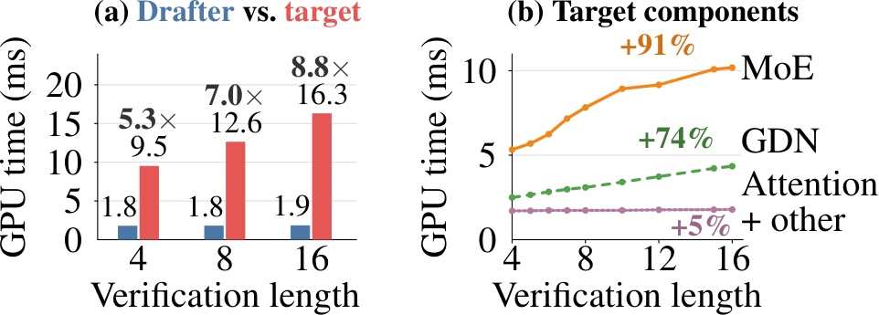
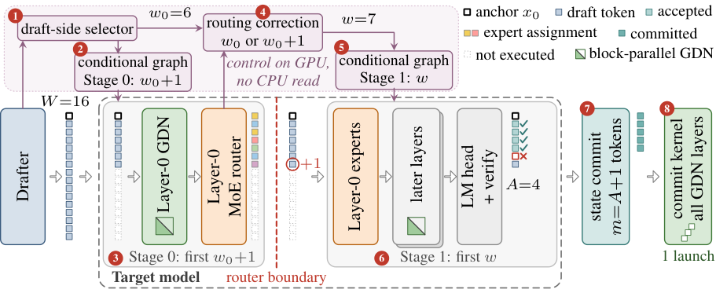
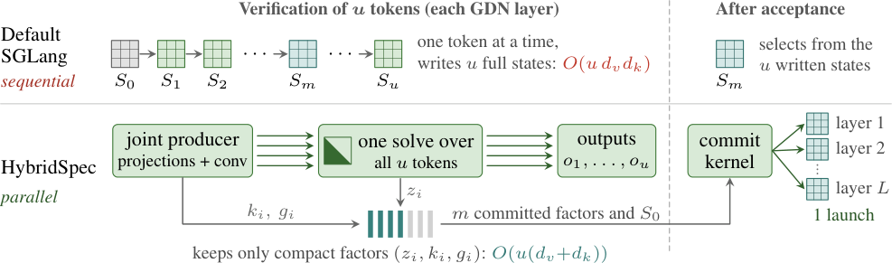
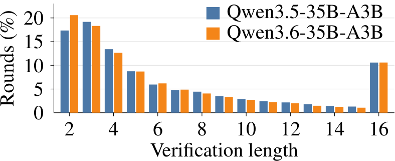

# HybridSpec：少验证，提速33%

Speculative Decoding 并不等于“一次验证越多 Token 越好”：在 GDN–MoE 混合模型上，验证长度从 4 增至 16，目标模型耗时会上涨 71%。随着 DFlash 等并行草稿器把起草成本压低，验证已成为单轮解码的主要开销，固定验证完整草稿块会把大量算力花在最终被拒绝的 Token 上。HybridSpec 在 GPU 上根据接受概率与实测延迟动态选择验证长度，在第一个 MoE Router 处再用真实专家分配修正一次，同时并行化 GDN 验证与状态恢复。在三个模型的单请求 Greedy Decoding 实验中，它比 Autoregressive Decoding 快 **1.75–1.88 倍**，比原始 DFlash 快 **1.30–1.33 倍**。

## 为什么混合模型越验证越慢？

先回顾一下 Speculative Decoding。草稿模型一次提出多个候选 Token，目标模型在一次 Forward 中验证它们，从前往后接受，直到第一个不匹配的位置，再由目标模型补出下一个 Token。只要验证规则正确，就能保持目标模型的 Greedy 输出或采样分布。

DFlash 这类并行草稿器用一次 Forward 生成整个草稿块，起草已经很便宜。真正需要优化的是目标侧：到底该验证多少个 Token？验证太短，可能错过本可接受的草稿；验证太长，第一个拒绝位置之后的计算全部浪费。

> 图解：左图横轴是验证长度，纵轴是每次验证调用的 GPU 时间。蓝色 Drafter 始终约为 1.8–1.9 ms，红色目标模型则从 9.5 ms 增至 16.3 ms，目标与草稿的耗时比从 5.3 倍升至 8.8 倍。右图拆解目标侧组件：从长度 4 到 16，MoE 和 GDN 分别增加 91% 和 74%，而 Attention 与其他部分仅增加约 5%。增长几乎全部来自 GDN 和 MoE。

更完整的测量进一步说明了这种趋势。以下数据来自 Qwen3.6-35B-A3B、DFlash、SGLang 0.5.16 和单张 A100，单位为每次验证调用的毫秒数。各组件时间区间略有重叠，因此不能简单相加为总耗时。

| 验证长度 $w$ | 测量调用数 | 目标总耗时 | GDN | MoE | Softmax Attention | 其他 |
|---:|---:|---:|---:|---:|---:|---:|
| 4 | 101 | 9.527 | 2.498 | 5.331 | 0.686 | 1.019 |
| 5 | 85 | 10.055 | 2.659 | 5.691 | 0.696 | 1.017 |
| 6 | 80 | 10.811 | 2.835 | 6.248 | 0.710 | 1.026 |
| 7 | 74 | 11.876 | 2.984 | 7.171 | 0.705 | 1.026 |
| 8 | 72 | 12.648 | 3.096 | 7.826 | 0.698 | 1.037 |
| 10 | 71 | 14.075 | 3.413 | 8.934 | 0.705 | 1.033 |
| 12 | 71 | 14.659 | 3.734 | 9.165 | 0.719 | 1.050 |
| 15 | 71 | 16.078 | 4.224 | 10.085 | 0.722 | 1.057 |
| 16 | 70 | 16.318 | 4.350 | 10.187 | 0.725 | 1.065 |

对九个长度做拟合，GDN 时间约为 $1.89+0.154w$ ms，$R^2=0.999$；MoE 时间约为 $2.66w^{0.50}$ ms。作为对照，Dense Qwen3-4B 在上下文长度为 2,048、8,192、32,768 时，从 $w=4$ 增至 $w=16$ 的验证延迟只增加 3.98%、5.44%、6.08%。其单请求成本主要由权重读取决定，多几个 Token 的边际开销很小；GDN–MoE 则不是这种情况。

### GDN：为回滚保存整份状态

Gated DeltaNet（GDN）是一种带固定大小循环状态的 Linear Attention。可以把它理解成一块不断擦写的记忆板：每个 Token 先让旧记忆衰减，再修正当前 Key 对应的 Value。它不像标准 Attention 那样持续增长 KV Cache，但推测验证要求系统能回到“已接受前缀”的状态。

默认 SGLang 验证器逐 Token 更新状态，并在每一步保存完整的 $d_v\times d_k$ 状态矩阵。这样回滚很直接，却要为每个候选位置写入一份大状态，长度越长，写状态的开销越明显。

### MoE：新增 Token 的成本取决于路由结果

Mixture-of-Experts（MoE）只激活部分专家。本文模型中，每个 Token 会被路由到 256 个专家中的 8 个。若新增 Token 复用已经激活的专家，权重已经读过，额外成本较低；若它激活新专家，就要读取更多权重。

问题是，验证前只能看到草稿置信度，看不到目标模型实际选择哪些专家。已有 Sequoia、DSpark、D-Cut、EVICT 等方法在验证前依据草稿信号和历史成本选长度；EcoSpec 另训模型预测专家分配，FASER 则在中间层剪除可能被拒绝的 Token。HybridSpec 的差异是：**直接使用目标模型自己的 Router 结果，而且赶在专家真正执行之前做决定。**

明确了成本来源，下一步不是拍脑袋设一个固定短长度，而是把“多验证一个 Token 值不值”写成可优化的吞吐问题。

## 优化目标：不是每轮最快，而是整体吞吐最高

HybridSpec 首先面向单请求、Batch Size $B=1$ 的 Greedy Decoding。固定 Drafter 每轮产生 $D$ 个草稿 Token，实验里 $D=15$。加上目标模型尚未处理的最新 Anchor Token，完整目标输入长度为 $W=D+1=16$。

若只保留前 $M$ 个草稿，目标输入长度就是 $w=M+1$。接受 $A$ 个草稿后，本轮会输出 $A+1$ 个 Token：$A$ 个已接受草稿，加上目标模型新生成的一个 Token。同时提交 $m=A+1$ 个目标输入 Token，包括旧 Anchor。即使 $A=0$，旧 Anchor 也会被消费，因此每轮至少前进一步。

令 $A_D$ 表示完整草稿块中本来能连续接受的数量，$p_i(\mathcal I)=P(A_D\geq i\mid\mathcal I)$ 表示在当前信息 $\mathcal I$ 下前 $i$ 个草稿都被接受的概率。非终止轮的期望输出 Token 数为：

$$
G(M\mid\mathcal I)=1+\sum_{i=1}^{M}p_i(\mathcal I)
$$

令 $L(M\mid\mathcal I)$ 为整轮延迟，包括起草、目标计算、选长、Graph 启动、接受判断和状态提交。对一组轮次，真正要优化的是总输出 Token 数除以总时间：

$$
\frac{\sum_{r=1}^{N}G(M_r\mid\mathcal I_r)}{\sum_{r=1}^{N}L(M_r\mid\mathcal I_r)}
$$

这不是各轮 $G/L$ 的平均值。只最大化当前轮的比例，并不保证整段生成的总吞吐最高。根据 Dinkelbach 定理，若最优整体吞吐为 $\rho^\star$，每轮应最大化：

$$
G(M_r\mid\mathcal I_r)-\rho^\star L(M_r\mid\mathcal I_r)
$$

直觉很直接：多验证一段前缀带来的期望收益是 $\Delta G$，新增延迟是 $\Delta L$，只有 $\Delta G>\rho\Delta L$ 时才值得。即使某个草稿必定被接受，只要新增延迟超过整体平均每个输出 Token 的时间 $1/\rho$，它仍会拖慢系统。由于实测延迟曲线可能非凸甚至非单调，HybridSpec 会评估所有候选长度，而不是遇到一次不划算就提前停止。

## HybridSpec：把一次验证拆成两段

有了目标函数，还需要一个不牺牲输出正确性、也不被 CPU 调度开销抵消的执行方案。HybridSpec 将验证拆在 Layer 0 的 MoE Router 之后、任何专家执行之前，这个位置称为 Router Boundary。

> 图解：示例中草稿侧先选名义长度 $w_0=6$，Stage 0 实际运行 $w_0+1=7$ 个 Token，到 Layer 0 Router 暂停。路由修正决定保留额外 Token，因此最终 $w=7$；Stage 1 从 Layer 0 专家继续，只处理选中的 Token。验证接受 $A=4$ 个草稿后，提交 $m=A+1=5$ 个输入 Token，并用一次 Commit Kernel 启动恢复所有 GDN 层的已接受状态。虚线表示未执行的候选 Token，整个选长控制都留在 GPU 上。

一轮完整流程如下：

1. Drafter 生成草稿块，并输出每个位置的 Top-1 Confidence 和 Entropy；草稿侧选择器算出 $w_0$，写入 GPU 显存。
2. 条件 CUDA Graph 节点读取长度，直接启动对应的 Stage 0 Graph，不把长度传回 CPU。
3. Stage 0 处理前 $\min(w_0+1,w_{\mathrm{rem}})$ 个 Token，运行 Layer 0 的 GDN 和 MoE Router，保留 Hidden State、Residual、专家分配与路由权重。
4. Router Boundary 上的修正器检查额外草稿 $d_{w_0}$ 新增了多少专家，决定最终修正长度 $w_c$ 是 $w_0$ 还是 $w_0+1$。
5. 第二个条件 Graph 节点按 $w=\min(w_c,w_{\mathrm{rem}})$ 启动 Stage 1。
6. Stage 1 从 Layer 0 的专家计算继续，完成余下层、最终归一化、LM Head 和验证，不重跑 Stage 0。
7. 根据接受数量推进 Attention Cache、卷积 Cache 和 Drafter 所需的目标 Hidden State。
8. 一个 Commit Kernel 从紧凑因子重建所有 GDN 层的已接受状态。

笔者认为这里最关键的工程判断是“只多探一个 Token”。多探几个或许能获得更多路由信息，但每个候选都必须在 Stage 0 支付 GDN 与 Router 成本。把修正幅度限制为 1，在信息收益和固定开销之间取了很克制的平衡。

### 草稿侧：用接受收益减去实测成本

Drafter 对每个草稿提供 Top-1 Confidence 和 Entropy。选择器先按位置用 Isotonic Regression 校准置信度，再用 Logistic Model 融合位置、置信度与位置的交互项、$\log(1+h_i)$，以及熵变化 $\log(h_i/\bar h_{i-1})$，估计条件接受概率 $\hat c_i$。前缀接受概率为：

$$
\hat p_i=\prod_{j=1}^{i}\hat c_j
$$

目标成本曲线 $C_{\mathrm{tgt}}(w)$ 来自当前运行环境的实测延迟。用校准后的整体吞吐估计 $\rho>0$ 把延迟换算成 Token 收益，选择器在 $\mathcal W_0=\{2,\ldots,W\}$ 中寻找：

$$
w_0=\operatorname*{arg\,max}_{w\in\mathcal W_0}\left[1+\sum_{i=1}^{w-1}\hat p_i-\rho C_{\mathrm{tgt}}(w)\right]
$$

长度无关的固定成本不会改变 Argmax，因此可以省略；同分时选择更短输入。一个 GPU Kernel 就能生成所有 $\hat p_i$ 并评估所有候选长度。

与 D-Cut、EVICT 相比，这里有三点不同：优化的是整体吞吐对应的加性分数，而非单轮收益延迟比；接受概率经过校准，不直接照搬 Confidence；选长和 Graph 分发都在 GPU 上完成，避免一次 CPU 同步。

### 路由修正：用真实专家分配重估边际成本

设前 $w$ 个目标输入在 Layer 0 激活的不同专家数为 $U_0(w)$。额外 Token 带来的新增专家数为：

$$
n_{\mathrm{new}}=U_0(w_0+1)-U_0(w_0)
$$

从 $w_0$ 扩到 $w_0+1$，期望输出收益增加 $\hat p_{w_0}$。但原成本曲线对这一步的估计有两处偏差：

- Stage 0 已经支付了额外 Token 经过 Layer 0 GDN 和 Router 的成本 $s$，Stage 1 不应再计一次。
- 成本曲线使用平均专家开销，而现在已经观察到 $n_{\mathrm{new}}$，可以更准确地估计新增专家成本。

单请求下，MoE 延迟主要由不同 `(层, 专家)` 对的数量决定。设每新增一对约增加 $\eta$ 延迟，$\bar n_{\mathrm{all}}(w_0)$ 是该位置在所有 MoE 层平均新增的 `(层, 专家)` 对数；观察到 $n_{\mathrm{new}}$ 后，用条件均值 $\bar n_{\mathrm{all}}(w_0\mid n_{\mathrm{new}})$ 替代它。修正后的 Stage 1 延迟增量为：

$$
\Delta L_c=C_{\mathrm{tgt}}(w_0+1)-C_{\mathrm{tgt}}(w_0)-s+\eta\left(\bar n_{\mathrm{all}}(w_0\mid n_{\mathrm{new}})-\bar n_{\mathrm{all}}(w_0)\right)
$$

最终规则是：

$$
w_c=
\begin{cases}
w_0+1, & \hat p_{w_0}>\rho\Delta L_c,\\
w_0, & \text{otherwise}.
\end{cases}
$$

因为 $w_0$ 已经是原成本曲线下的最优选择，修正器只有在额外 Token 比平均估计更便宜时才可能扩长。Layer 0 之所以能为后续层提供线索，是因为路由存在相关性：在 Qwen3.6-35B-A3B 和 Qwen3.5-35B-A3B 上，Layer 0 新增专家数与后续层新增 `(层, 专家)` 对数的去均值相关系数分别为 0.49 和 0.52，线性拟合约为每新增一个 Layer 0 专家对应后续 9.0 和 10.0 对。

成本标定也有实测依据。长度 16 时，80 次请求的目标延迟与不同 `(层, 专家)` 对数量的相关系数达到 0.999。两个 35B 模型的 $\eta$ 为 4.18 μs，122B 模型为 8.8 μs。所有接受模型、成本表和 $\rho$ 都只在 Calibration Prompts 上拟合，测试前冻结。

## GDN 内核：不存每步状态，也能准确回滚

动态选长解决了“验证多少”，但 GDN 本身仍有逐 Token 更新与写状态的问题。HybridSpec 的第二部分，是把循环计算改写成一个短序列的块并行问题。

### 从递推式到三角方程

对一个 Head 的第 $i$ 个 Token，Query、Key、Value 分别为 $q_i,k_i\in\mathbb R^{d_k}$、$v_i\in\mathbb R^{d_v}$，状态为 $S_i\in\mathbb R^{d_v\times d_k}$。衰减系数 $\alpha_i$ 和写入强度 $\beta_i$ 都在 $(0,1)$ 内，GDN 更新为：

$$
z_i=\beta_i\left(v_i-\alpha_iS_{i-1}k_i\right),\qquad S_i=\alpha_iS_{i-1}+z_ik_i^\top
$$

输出为 $o_i=S_iq_i$。逐 Token 验证需要保存每个 $S_i$；但整个目标输入已知，可以定义累计对数衰减 $g_i=\sum_{j=1}^{i}\log\alpha_j$，展开递推：

$$
S_i=e^{g_i}S_0+\sum_{j=1}^{i}e^{g_i-g_j}z_jk_j^\top
$$

将 $K,V,Z$ 的各行分别设为 $k_i^\top,v_i^\top,z_i^\top$，所有更新可以合并为一个下三角线性系统：

$$
HZ=\operatorname{diag}(\beta)\left(V-\operatorname{diag}(e^g)KS_0^\top\right)
$$

其中 $H$ 的对角线全为 1，且当 $j<i$ 时：

$$
H_{ij}=\beta_ie^{g_i-g_j}k_i^\top k_j
$$

一次求解这个最大 $16\times16$ 的小系统，就替代了 $w$ 次顺序状态更新。随后所有输出也能用矩阵乘法得到：

$$
O=\operatorname{diag}(e^g)QS_0^\top+(\Gamma\odot QK^\top)Z
$$

其中 $\Gamma_{ij}=e^{g_i-g_j}$（$j\leq i$），其余为 0，$\odot$ 表示逐元素乘法。整个过程只需初始状态 $S_0$ 和宽度为 $w$ 的矩阵，不再生成中间的完整状态矩阵。

> 图解：上方默认 SGLang 对 $u$ 个 Token 顺序更新，写入 $u$ 份完整状态，空间量为 $O(u d_vd_k)$，接受后再从其中选一份。下方 HybridSpec 用 Joint Producer 一次生成投影和卷积结果，通过一次块并行三角求解得到全部输出，只保留 $(z_i,k_i,g_i)$ 紧凑因子，空间量降为 $O(u(d_v+d_k))$；接受后，一个 Commit Kernel 并行重建所有层的 $S_m$。

### 一次启动重建所有已接受状态

若本轮接受 $A$ 个草稿，则需提交 $m=A+1$ 个输入 Token。已接受状态为：

$$
S_m=e^{g_m}S_0+Z_{1:m}^\top\operatorname{diag}\left(e^{g_m-g_1},\ldots,e^{g_m-g_m}\right)K_{1:m}
$$

$H$ 是下三角矩阵，因此 $Z$ 的前 $m$ 行只依赖前 $m$ 个 Token。丢弃被拒绝后缀不会改变这些因子，Commit Kernel 可以直接复用验证结果，并用 FP32 累加。各 GDN 层的状态重建彼此独立，所以一次 Kernel Launch 就能完成所有层；只有重建跨层并行，目标模型的 Forward 仍按层顺序执行。

针对 $2\leq w\leq16$，内核按长度编译。长度 4、6、8 使用闭式 $4\times4$ 块逆，长度 9–16 利用严格下三角矩阵的幂零性，采用精确展开：

$$
H^{-1}=(I+X+X^2+X^3)(I+X^4+X^8+X^{12}),\qquad X=I-H
$$

其余短长度按行求逆，每步一次计算整行。所有 Head 并行，投影与卷积也由一个 Joint Producer 融合启动。

### 为什么改变长度仍保持输出正确？

在精确算术下，正确性依赖几个明确条件：因果前缀不变、提交后所有 Cache 和 GDN 状态精确对应已接受前缀、多 Token Forward 与逐 Token 计算等价、Stage 1 不读取未选中 Token 的保留值，以及 MoE 没有会因后缀截断而改变前序计算的 Capacity 规则。

在这些条件下，额外 Stage 0 Token 不影响前面 Token 的 Logits，其因子也不会进入 $m\leq w$ 的状态提交。因此 Greedy Decoding 输出与目标模型单独解码一致。Temperature Sampling 使用 Point-Mass 规则：以目标分布赋予草稿 Token 的概率接受它，拒绝后从排除该 Token 并重新归一化的目标分布采样。只要验证长度在随机接受之前确定，包括路由修正后的长度，输出分布就保持不变。

需要注意，论文的“精确保持”以精确算术为前提。实际浮点内核改变运算顺序，可能在 Logits 接近时翻转 Argmax；采样分布也只近似一致，不能把理论保证理解为实际运行必然逐 Token 相同。

## 端到端实验：三类模型上都超过已有方法

实验使用 Qwen3.5-35B-A3B、Qwen3.6-35B-A3B 和 Qwen3.5-122B-A10B-GPTQ-INT4，搭配各自官方 DFlash Drafter。前两者为 BF16，122B 模型通过双 GPU Tensor Parallel 运行且没有 NVLink，其余使用单张 NVIDIA A100 80 GB。

数据来自 SPEED-Bench Qualitative 的 Coding、Math、Reasoning、RAG、Summarization、Writing、Roleplay 七类。固定随机划分得到 280 条 Calibration 和 280 条 Test Prompts，每类各 40 条；每次最多生成 1,024 个 Token，开启 Thinking Mode。所有系统共享 Prompt、停止规则、精度和输出上限，并在三个全新 Server Session 中运行后汇总。

核心指标有两个：

- **SR（Speedup Ratio）**：Prefill 后的整体解码吞吐，相对相同 Prompt 上 AR 基线的倍数。
- **AL（Acceptance Length）**：每轮输出的 Token 数，包含接受草稿和目标补充的一个 Token。

下表完整列出 Greedy Decoding 结果。AR 没有验证轮次，因此 AL 不适用。

| 模型 / 方法 | Coding AL | Coding SR | Math AL | Math SR | Reasoning AL | Reasoning SR | RAG AL | RAG SR | Summ. AL | Summ. SR | Writing AL | Writing SR | Roleplay AL | Roleplay SR | Avg. AL | Avg. SR |
|---|---:|---:|---:|---:|---:|---:|---:|---:|---:|---:|---:|---:|---:|---:|---:|---:|
| **Qwen3.5-35B-A3B / AR** | — | 1.00× | — | 1.00× | — | 1.00× | — | 1.00× | — | 1.00× | — | 1.00× | — | 1.00× | — | 1.00× |
| Qwen3.5-35B-A3B / Vanilla DFlash | 6.43 | 1.89× | 5.40 | 1.54× | 4.91 | 1.43× | 6.07 | 1.72× | 4.96 | 1.38× | 3.92 | 1.13× | 3.53 | 1.05× | 5.03 | 1.45× |
| Qwen3.5-35B-A3B / D-Cut | 6.12 | 1.98× | 4.97 | 1.64× | 4.61 | 1.54× | 5.76 | 1.80× | 4.65 | 1.48× | 3.70 | 1.26× | 3.37 | 1.19× | 4.74 | 1.55× |
| Qwen3.5-35B-A3B / EVICT | 6.18 | 1.99× | 5.15 | 1.69× | 4.68 | 1.58× | 5.88 | 1.85× | 4.78 | 1.54× | 3.77 | 1.29× | 3.36 | 1.20× | 4.83 | 1.59× |
| Qwen3.5-35B-A3B / ReplaySSM | 6.41 | 1.82× | 5.53 | 1.54× | 4.82 | 1.36× | 6.04 | 1.66× | 4.93 | 1.34× | 3.92 | 1.10× | 3.51 | 1.03× | 5.02 | 1.41× |
| Qwen3.5-35B-A3B / EVICT + ReplaySSM | 5.94 | 1.91× | 5.11 | 1.65× | 4.60 | 1.52× | 5.69 | 1.76× | 4.72 | 1.50× | 3.73 | 1.26× | 3.33 | 1.17× | 4.73 | 1.54× |
| **Qwen3.5-35B-A3B / HybridSpec** | **6.20** | **2.39×** | **5.10** | **1.97×** | **4.62** | **1.87×** | **5.87** | **2.18×** | **4.80** | **1.84×** | **3.69** | **1.51×** | **3.27** | **1.42×** | **4.79** | **1.88×** |
| **Qwen3.6-35B-A3B / AR** | — | 1.00× | — | 1.00× | — | 1.00× | — | 1.00× | — | 1.00× | — | 1.00× | — | 1.00× | — | 1.00× |
| Qwen3.6-35B-A3B / Vanilla DFlash | 5.58 | 1.56× | 5.41 | 1.58× | 4.79 | 1.42× | 5.87 | 1.63× | 4.85 | 1.37× | 3.66 | 1.06× | 3.33 | 0.99× | 4.79 | 1.37× |
| Qwen3.6-35B-A3B / D-Cut | 5.36 | 1.66× | 5.11 | 1.68× | 4.58 | 1.54× | 5.62 | 1.71× | 4.67 | 1.50× | 3.53 | 1.19× | 3.21 | 1.12× | 4.58 | 1.48× |
| Qwen3.6-35B-A3B / EVICT | 5.37 | 1.68× | 5.17 | 1.70× | 4.63 | 1.58× | 5.63 | 1.73× | 4.72 | 1.54× | 3.52 | 1.21× | 3.17 | 1.13× | 4.60 | 1.51× |
| Qwen3.6-35B-A3B / ReplaySSM | 5.65 | 1.54× | 5.49 | 1.55× | 4.83 | 1.39× | 5.69 | 1.53× | 4.87 | 1.34× | 3.66 | 1.04× | 3.36 | 0.98× | 4.79 | 1.34× |
| Qwen3.6-35B-A3B / EVICT + ReplaySSM | 5.37 | 1.63× | 5.18 | 1.65× | 4.60 | 1.53× | 5.59 | 1.66× | 4.69 | 1.48× | 3.54 | 1.18× | 3.19 | 1.10× | 4.59 | 1.46× |
| **Qwen3.6-35B-A3B / HybridSpec** | **5.28** | **2.05×** | **5.14** | **2.09×** | **4.62** | **1.88×** | **5.55** | **2.07×** | **4.74** | **1.85×** | **3.50** | **1.46×** | **3.16** | **1.39×** | **4.57** | **1.83×** |
| **Qwen3.5-122B-A10B / AR** | — | 1.00× | — | 1.00× | — | 1.00× | — | 1.00× | — | 1.00× | — | 1.00× | — | 1.00× | — | 1.00× |
| Qwen3.5-122B-A10B / Vanilla DFlash | 6.83 | 1.67× | 5.60 | 1.41× | 5.13 | 1.29× | 6.31 | 1.56× | 5.33 | 1.31× | 4.13 | 1.05× | 3.54 | 0.95× | 5.27 | 1.32× |
| Qwen3.5-122B-A10B / D-Cut | 6.29 | 1.89× | 5.23 | 1.70× | 4.85 | 1.59× | 5.95 | 1.81× | 5.01 | 1.60× | 3.85 | 1.32× | 3.44 | 1.24× | 4.95 | 1.59× |
| Qwen3.5-122B-A10B / EVICT | 6.05 | 1.93× | 5.09 | 1.76× | 4.79 | 1.66× | 5.94 | 1.90× | 4.82 | 1.63× | 3.72 | 1.37× | 3.33 | 1.29× | 4.82 | 1.65× |
| Qwen3.5-122B-A10B / ReplaySSM | 6.59 | 1.56× | 5.78 | 1.42× | 5.08 | 1.25× | 6.37 | 1.53× | 5.26 | 1.28× | 4.06 | 1.02× | 3.60 | 0.95× | 5.25 | 1.29× |
| Qwen3.5-122B-A10B / EVICT + ReplaySSM | 6.31 | 1.89× | 5.10 | 1.68× | 4.70 | 1.56× | 5.99 | 1.82× | 4.97 | 1.60× | 3.78 | 1.32× | 3.38 | 1.25× | 4.89 | 1.59× |
| **Qwen3.5-122B-A10B / HybridSpec** | **6.02** | **2.06×** | **5.10** | **1.84×** | **4.71** | **1.77×** | **5.85** | **2.01×** | **4.91** | **1.72×** | **3.75** | **1.46×** | **3.34** | **1.38×** | **4.81** | **1.75×** |

HybridSpec 在三个模型上的平均 SR 分别为 1.88、1.83、1.75 倍，且在全部 21 个“模型 × 类别”组合中都取得最高 SR。最强基线 EVICT 的平均 SR 为 1.59、1.51、1.65 倍。单项结果从 122B 模型 Roleplay 的 1.38 倍，到 35B-A3B 模型 Coding 的 2.39 倍不等。

值得强调的是，HybridSpec 的 AL 反而略低于 Vanilla DFlash。两个 35B 模型上，平均验证长度分别为 6.4 和 6.2，而 DFlash 固定为 16；平均 AL 都下降约 5%，每轮耗时却分别从 22.9 ms 降至 16.5 ms、从 23.0 ms 降至 16.3 ms。也就是说，它牺牲的是大量最终会被拒绝的验证工作，而不是有效输出。

> 图解：横轴为实际验证长度，纵轴为该长度出现的轮次占比，两种颜色对应两个 35B 模型。分布在短长度处最集中，约半数轮次验证不超过 4 个 Token，同时长度 16 仍有一个小峰，说明策略并非一味缩短，而是在高接受收益时保留长验证。

D-Cut 和 EVICT 的平均 AL 与 HybridSpec 接近，但 SR 更低，说明差距主要来自每轮耗时，而不只是接受数量。除了目标函数、概率校准和 GDN 内核外，HybridSpec 还避免了这些基线把所选长度读到 CPU 再启动 Graph 的同步成本。EVICT + ReplaySSM 的平均 SR 仍比 HybridSpec 低 0.16–0.37。

### 未见类别：不重新标定仍然有效

在四个未参与标定的 SPEED-Bench 类别上，直接复用 Qwen3.6-35B-A3B 的冻结参数，结果如下。

| 类别 | DFlash AL | DFlash SR | HybridSpec AL | HybridSpec SR |
|---|---:|---:|---:|---:|
| Humanities | 3.89 | 1.18× | 3.65 | 1.55× |
| QA | 3.95 | 1.19× | 3.64 | 1.56× |
| STEM | 4.27 | 1.28× | 3.95 | 1.66× |
| Multilingual | 5.27 | 1.57× | 4.98 | 2.01× |
| **平均** | **4.35** | **1.31×** | **4.06** | **1.69×** |

HybridSpec 在四类中都领先，平均 SR 为 1.69 倍，说明策略并非只记住测试类别。不过，这仍属于同一 Benchmark 内的迁移，不能等同于任意模型或硬件上免标定。

### 消融：动态选长贡献最大

在 Qwen3.6-35B-A3B 上逐项替换组件，Gain 定义为完整 HybridSpec 的 SR 除以对应变体的 SR。

| 被移除组件 | 替代方案 | 平均 $w$ | AL | SR | Gain |
|---|---|---:|---:|---:|---:|
| **完整 HybridSpec** | — | 6.2 | 4.57 | 1.83× | — |
| Length Selection | 标定后的静态长度 7 | 7 | 3.99 | 1.54× | 1.19× |
| Length Selection | 固定长度 16 | 16 | 4.77 | 1.46× | 1.25× |
| Routing Correction | 只用 Nominal Length | 6.1 | 4.48 | 1.73× | 1.06× |
| GDN Kernels | 默认 SGLang Kernels | 6.2 | 4.51 | 1.74× | 1.05× |
| 全部组件 | Vanilla DFlash | 16 | 4.79 | 1.37× | 1.33× |

动态选长相对最优固定长度带来 1.19 倍收益，相对长度 16 带来 1.25 倍收益，是最大贡献项。它平均验证 6.2 个 Token，少于静态长度 7，却有更高 AL，证明“按轮调整”比“统一缩短”更有效。路由修正和 GDN 内核分别再贡献 1.06 倍和 1.05 倍；在长度 16 时，内核对应的端到端 SR 增益增至 1.07 倍。

## 微基准与扩展验证：收益来自哪里，边界在哪里？

端到端结果说明组合有效，微基准则进一步分离内核收益，并检验显存、输出质量、采样和 Batched Decoding。

### GDN 内核：长度越长，优势越大

下表测量 Qwen3.6-35B-A3B 全部 30 个 GDN 层在单张 A100 上的“验证 + 状态重建”延迟。$m=w$ 表示所有草稿都接受，$m=\lceil w/2\rceil$ 表示约一半输入被提交；ReplaySSM 使用端到端实验中的默认启动参数。

| $w$ | SGLang 延迟 (ms) | ReplaySSM 延迟 (ms) | HybridSpec 延迟 (ms) | 对 SGLang 加速，$m=w$ / 半提交 | 对 ReplaySSM 加速，$m=w$ / 半提交 |
|---:|---:|---:|---:|---:|---:|
| 2 | 0.4726 | 0.6926 | 0.3552 | 1.33× / 1.35× | 1.95× / 1.66× |
| 3 | 0.5012 | 0.8058 | 0.3721 | 1.35× / 1.38× | 2.17× / 1.90× |
| 4 | 0.5920 | 0.9192 | 0.3847 | 1.54× / 1.62× | 2.39× / 1.90× |
| 8 | 0.9733 | 1.5050 | 0.4366 | 2.23× / 2.37× | 3.45× / 2.55× |
| 12 | 1.4263 | 2.4859 | 0.4491 | 3.18× / 3.38× | 5.54× / 4.59× |
| 16 | 1.9111 | 2.9451 | 0.4728 | 4.04× / 4.29× | 6.23× / 4.56× |

在全接受设定下，HybridSpec 相对默认 SGLang 的加速从长度 4 的 1.54 倍增至长度 16 的 4.04 倍。这里从预计算投影开始，不包含 Joint Producer 和两阶段验证，因此不能把 4.04 倍误当成整模型解码加速。

默认参数下，ReplaySSM 在每个长度都慢于 SGLang；即使单独为 Batch Size 1 调参后，它比默认内核快 1.05–1.71 倍，HybridSpec 仍比它快 1.16–2.42 倍。全接受设置对 HybridSpec 与 SGLang 的比较偏保守，因为 SGLang 无论接受多少都写完整状态；但它有利于 HybridSpec 与 ReplaySSM 的比较，因为两者提交越多，状态重建工作越多。

数值检查中，BF16 内核相对默认实现的最大相对 Frobenius 误差为：输出 $4.3\times10^{-3}$，重建状态 $1.7\times10^{-3}$。改用 FP32 计算后分别低于 $10^{-4}$ 和 $10^{-6}$。

### 显存：不再预留逐 Token 状态副本

Qwen3.6-35B-A3B 的 30 个 GDN 层，每层每个 Head 状态为 $32\times128\times128$ 的 FP32 张量。默认实现为长度 16 的每个位置都预留状态，单 Slot 占 0.94 GB；Batch Size 1 分配两个 Slot，总计 1.88 GB。

这相当于约 45,000 个 Token 的 Attention Cache，占原 Cache Pool 的 40%。HybridSpec 只保存紧凑因子，16 个 Token、30 层即使使用 FP32 也约需 0.01 GB，不再需要上述缓冲区；释放后，可容纳的最大上下文长度约增加 40%。并发为 4 时，Vanilla DFlash 的状态缓冲为 4.69 GB、仅余 12,472 个 Cache Token 空间，而 Batched HybridSpec 可缓存 122,512 个 Token。

### 正确性与任务质量：理论一致不等于浮点逐字一致

Router Boundary 拆分测试使用 16 条 Prompt，每条生成 1,024 个 Token。拆分与不拆分的 HybridSpec 共运行 3,114 次目标 Forward，覆盖长度 3–16，输出 Token、接受直方图和轮数完全一致，且没有重新捕获 Graph、重跑 Router 或读取 CPU 长度。

在全部 1,319 道 GSM8K 题上，HybridSpec 答对 1,267 题，准确率 96.06%；Vanilla DFlash 答对 1,269 题，准确率 96.21%。配对差为 -0.15 个百分点，其单侧 95% 置信下界为 -0.71 个百分点，高于预设的 -1 个百分点非劣阈值。两者并非逐 Token 完全一致，因此这里验证的是任务质量，而不是浮点环境下的严格输出同一性。

### Temperature Sampling：优势仍然保留

Temperature 为 1、无 Top-$p$ 或 Top-$k$ 截断时，HybridSpec 沿用 Greedy Decoding 下标定的参数。两个 35B 模型的结果如下。

| 模型 / 方法 | Coding AL | Coding SR | Math AL | Math SR | Reasoning AL | Reasoning SR | RAG AL | RAG SR | Summ. AL | Summ. SR | Writing AL | Writing SR | Roleplay AL | Roleplay SR | Avg. AL | Avg. SR |
|---|---:|---:|---:|---:|---:|---:|---:|---:|---:|---:|---:|---:|---:|---:|---:|---:|
| Qwen3.5-35B-A3B / AR | — | 1.00× | — | 1.00× | — | 1.00× | — | 1.00× | — | 1.00× | — | 1.00× | — | 1.00× | — | 1.00× |
| Qwen3.5-35B-A3B / Vanilla DFlash | 5.29 | 1.56× | 4.18 | 1.23× | 3.88 | 1.15× | 5.20 | 1.50× | 4.11 | 1.19× | 3.23 | 0.96× | 2.63 | 0.81× | 4.07 | 1.20× |
| Qwen3.5-35B-A3B / D-Cut | 4.70 | 1.58× | 3.84 | 1.33× | 3.78 | 1.32× | 4.97 | 1.62× | 3.88 | 1.31× | 3.13 | 1.11× | 2.54 | 0.94× | 3.84 | 1.31× |
| Qwen3.5-35B-A3B / EVICT | 4.81 | 1.61× | 3.97 | 1.37× | 3.86 | 1.35× | 5.03 | 1.63× | 3.96 | 1.33× | 3.17 | 1.13× | 2.56 | 0.96× | 3.91 | 1.34× |
| Qwen3.5-35B-A3B / ReplaySSM | 5.06 | 1.45× | 3.96 | 1.14× | 4.01 | 1.16× | 5.28 | 1.48× | 4.12 | 1.16× | 3.26 | 0.95× | 2.67 | 0.81× | 4.05 | 1.16× |
| Qwen3.5-35B-A3B / EVICT + ReplaySSM | 4.75 | 1.57× | 3.86 | 1.34× | 3.81 | 1.32× | 4.89 | 1.58× | 3.96 | 1.33× | 3.12 | 1.10× | 2.54 | 0.94× | 3.85 | 1.31× |
| **Qwen3.5-35B-A3B / HybridSpec** | **4.88** | **1.91×** | **3.86** | **1.59×** | **3.82** | **1.57×** | **4.79** | **1.84×** | **3.98** | **1.57×** | **3.16** | **1.33×** | **2.59** | **1.16×** | **3.87** | **1.57×** |
| Qwen3.6-35B-A3B / AR | — | 1.00× | — | 1.00× | — | 1.00× | — | 1.00× | — | 1.00× | — | 1.00× | — | 1.00× | — | 1.00× |
| Qwen3.6-35B-A3B / Vanilla DFlash | 4.77 | 1.42× | 4.40 | 1.32× | 4.22 | 1.26× | 4.99 | 1.44× | 4.25 | 1.24× | 3.17 | 0.96× | 2.70 | 0.83× | 4.07 | 1.21× |
| Qwen3.6-35B-A3B / D-Cut | 4.63 | 1.58× | 4.31 | 1.50× | 3.96 | 1.38× | 4.90 | 1.60× | 4.13 | 1.40× | 3.10 | 1.11× | 2.61 | 0.97× | 3.95 | 1.36× |
| Qwen3.6-35B-A3B / EVICT | 4.73 | 1.61× | 4.25 | 1.49× | 4.06 | 1.43× | 4.86 | 1.60× | 4.12 | 1.40× | 3.09 | 1.12× | 2.62 | 0.99× | 3.96 | 1.38× |
| Qwen3.6-35B-A3B / ReplaySSM | 4.70 | 1.36× | 4.43 | 1.29× | 4.08 | 1.19× | 4.99 | 1.40× | 4.36 | 1.23× | 3.15 | 0.92× | 2.69 | 0.81× | 4.06 | 1.17× |
| Qwen3.6-35B-A3B / EVICT + ReplaySSM | 4.65 | 1.53× | 4.26 | 1.44× | 3.99 | 1.36× | 4.87 | 1.55× | 4.14 | 1.36× | 3.07 | 1.07× | 2.62 | 0.95× | 3.94 | 1.32× |
| **Qwen3.6-35B-A3B / HybridSpec** | **4.56** | **1.83×** | **4.19** | **1.73×** | **4.20** | **1.72×** | **4.78** | **1.83×** | **4.07** | **1.61×** | **3.15** | **1.35×** | **2.49** | **1.12×** | **3.92** | **1.60×** |

平均 SR 分别为 1.57 和 1.60 倍，高于 Vanilla DFlash 的 1.20 和 1.21 倍，也高于 EVICT 的 1.34 和 1.38 倍；HybridSpec 仍在每个类别取得最高 SR。采样会降低所有推测方法的 AL，因此整体加速低于 Greedy 设置。

### Batched Decoding：共享长度会削弱策略收益

Batch 版本让一轮中的所有请求共享一个验证长度，从 $\{2,4,8,12,16\}$ 中选择，以保持固定形状的 CUDA Graph。目标改为：

$$
\operatorname*{arg\,max}_{w}\left[\sum_{b=1}^{B}\hat G_b(w)-\rho_BC_B(w)\right]
$$

某个请求即使偏好更短长度，也会验证全部 $w$ 个 Token，因为 Batch 已支付这些位置的固定开销，额外验证只可能增加接受量。路由修正则统计候选长度在整个 Batch 专家并集中新增的开销。

在 Qwen3.6-35B-A3B、四个并发客户端、Greedy Decoding 下，HybridSpec 总吞吐为 497 Token/s，是 Vanilla DFlash 451 Token/s 的 1.10 倍、AR 358 Token/s 的 1.39 倍。只给 Vanilla DFlash 换上 HybridSpec GDN 内核，也能达到 472 Token/s。

Batch 场景的增益明显小于单请求，原因很具体：五个候选长度中的一个值要服务所有请求，无法像 $B=1$ 那样贴合每轮、每请求的接受概率。这也是论文结果的重要边界——1.30–1.33 倍的 DFlash 相对提升属于单请求设置，不能外推成所有 Serving 场景的统一收益。

## 总结：推测解码需要同时理解模型与硬件

- HybridSpec 把验证长度视为整体吞吐问题，用“期望输出收益减去 $\rho$ 倍实测延迟”选长，而不是最大化单轮 $G/L$。
- 两阶段验证在第一个 MoE Router 后暂停，利用真实专家分配修正边际成本，且全程不把长度读回 CPU。
- 块并行 GDN 用一次小三角系统求解替代逐 Token 状态写入，只保留紧凑因子，并通过一次启动重建所有层的已接受状态。
- 单请求 Greedy Decoding 下，三个 GDN–MoE 模型相对 AR 提速 1.75–1.88 倍、相对 Vanilla DFlash 提速 1.30–1.33 倍，动态选长是最大贡献项。
- 结果依赖目标架构、运行环境标定和正确性假设；浮点误差、Batch 共享长度，以及尚未开源的代码，都是实际复现和部署时需要继续验证的方向。

> 本文参考自 [HybridSpec: Throughput-Aware Speculative Decoding for Hybrid GDN--MoE Models](https://arxiv.org/abs/2611.04055)