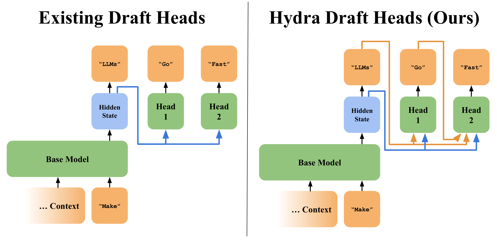
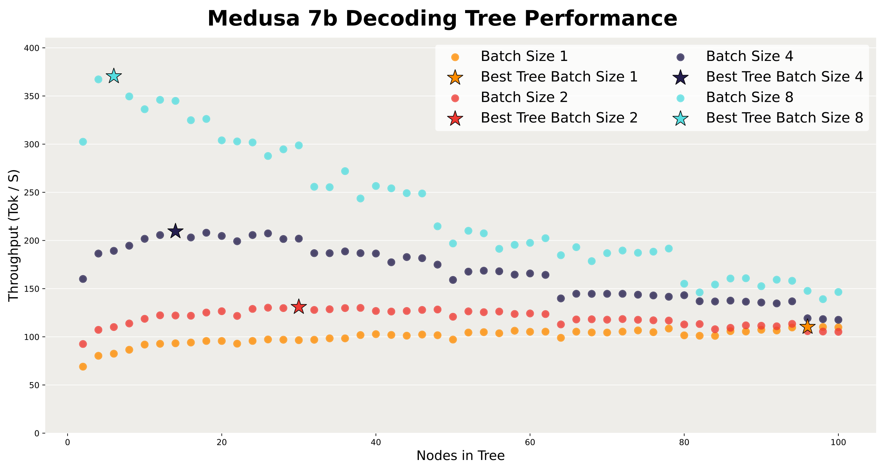
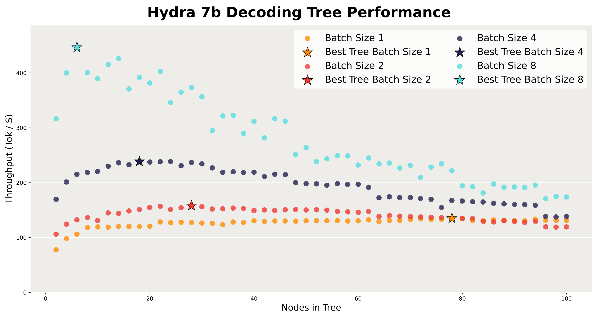
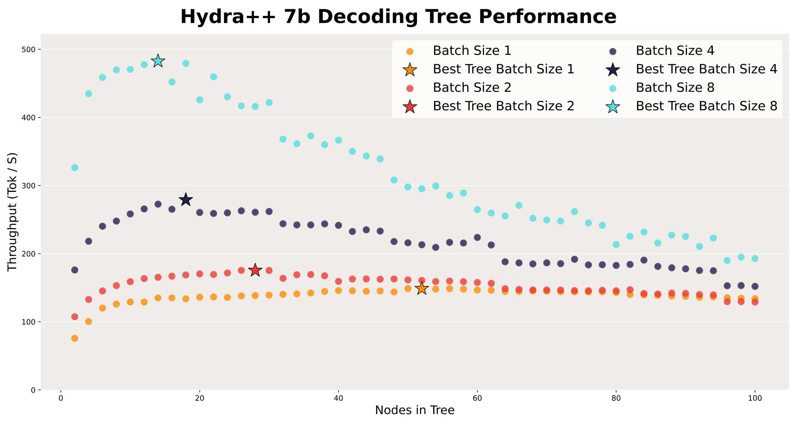
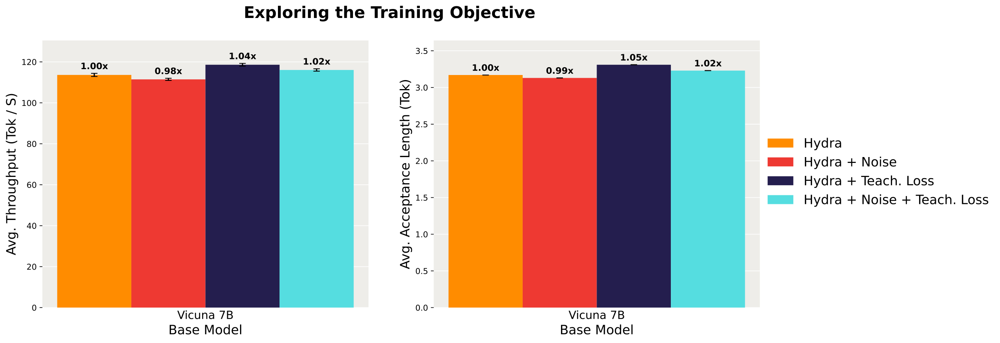
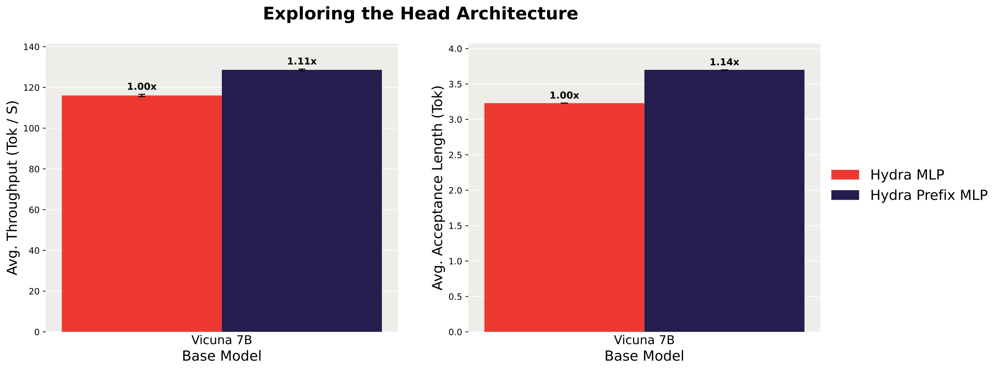
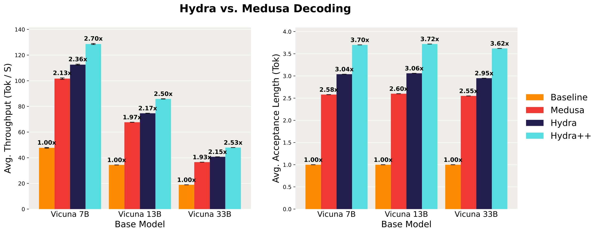
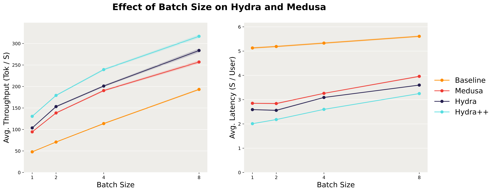
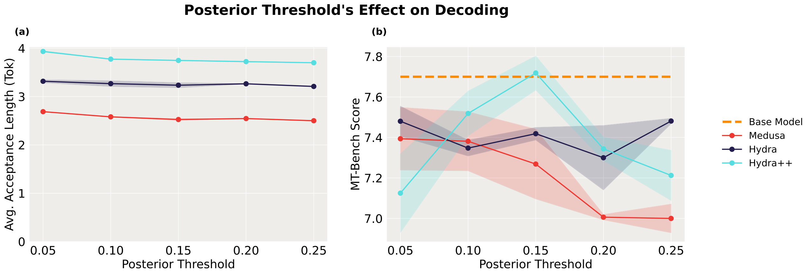
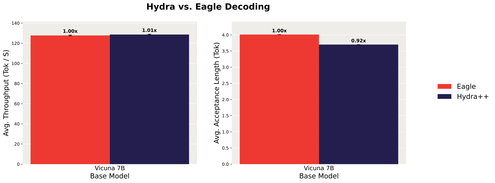

# Hydra：顺序草稿提速 2.70 倍

大语言模型逐 Token 解码时，GPU 往往不是在算，而是在反复搬运庞大的模型权重，推理速度因此受限。Medusa 用多个轻量草稿头并行预测未来 Token，再由基础模型统一验证，但这些草稿头彼此独立，看不见同一段候选文本中前面已经猜出的内容。Hydra 把此前生成的候选 Token 也交给后续草稿头，让预测像真正的自回归生成一样具有顺序依赖；在此基础上，Hydra++ 又加入更深的 MLP、教师蒸馏和专用 Prefix Attention。最终，Hydra++ 在 MT-Bench 上相对 Medusa 最高提速 **1.31 倍**，相对普通自回归解码最高提速 **2.70 倍**。

## 为什么 LLM 解码需要“先猜后验”

训练大模型时，整段输入可以并行处理；生成文本时，第 $t+1$ 个 Token 却必须等前 $t$ 个 Token 确定后才能开始。每一步都要从 GPU 主存读取模型权重，却只处理每个序列中的一个新 Token，计算量相对很小。

因此，单批次解码通常受 **Memory Bandwidth（内存带宽）** 限制，而不是受 FLOPs 限制。GPU 有大量浮点计算能力闲置，继续增加并行计算未必增加多少延迟，反复读取权重却很昂贵。

**Speculative Decoding（投机解码）** 正好利用了这一特点。可以把它理解为“实习生先起草，专家一次性审稿”：

1. 便宜的 Draft Model（草稿模型）提出一段多 Token 候选文本。
2. 昂贵的 Base Model（基础模型）通过一次 Forward Pass 并行检查整段候选。
3. 系统接受符合验证规则的候选前缀，丢弃其余部分。

一次基础模型调用可能产出多个 Token，于是分摊到每个 Token 上的权重读取开销就下降了。这里的关键矛盾是：草稿模型必须足够便宜，同时又得猜得足够准；猜错的候选不仅白费，还会增加验证负担。

### 从单条候选到候选树

设已经确认的序列为 $x_{\leq t}$，最大草稿长度为 $K$。草稿模型生成 $\hat{x}_{t+1},\ldots,\hat{x}_{t+K}$，基础模型一次前向计算这些位置的条件概率。验证器随后接受长度为 $n_{\text{accept}}$ 的前缀。

常见规则包括：

- **Greedy Acceptance**：候选 Token 与基础模型的贪心预测一致才接受。
- **Rejection Resampling**：通过拒绝采样保证输出分布与基础模型一致。

单条候选还可以扩展成候选树：每个节点是一个候选 Token，子节点表示后续 Token 的不同选择，从根到叶的一条路径就是一段候选文本。基础模型把整棵树打包进一个序列，并用 Attention Mask 限制每个节点只能看到自己的祖先，仍能一次完成验证。

**Average Acceptance Length（平均接受长度）** 指每轮解码平均接受的 Token 数，是草稿质量的核心指标；**Throughput（吞吐量）** 则是每秒实际生成的 Token 数。前者高不一定必然带来后者高，因为更复杂的草稿模型也会增加额外延迟。

## Medusa 的瓶颈：多个头各自为战

Medusa 不另起一个完整的小语言模型，而是在基础模型隐藏状态上挂 $K$ 个轻量 Draft Head。第 $i$ 个头负责预测未来第 $i$ 个 Token，原始形式可以写为：

$$
p_{\text{draft}}(x_{t+i}\mid x_{\leq t+i-1})=f_{\text{draft},i}(h_{t-1})
$$

其中，$h_{t-1}$ 是基础模型最近处理位置的末层隐藏状态。Medusa 的具体实现采用带残差连接的单层 MLP。

问题就在于，所有头读取的都是同一个已经确认上下文的隐藏状态。用条件分布表达，这种“顺序独立”意味着：

$$
p_{\text{draft}}(\hat{x}_{t+i}\mid x_{\leq t},\hat{x}_{t+1},\ldots,\hat{x}_{t+i-1})
=p_{\text{draft}}(\hat{x}_{t+i}\mid x_{\leq t-1})
$$

等号右边的条件里，没有本轮候选文本中的前序 Token。也就是说，第二个头不知道第一个头猜了什么，第三个头也不知道前两个头猜了什么。

自然语言相邻 Token 之间存在很强的统计依赖。比如草稿开头已经确定是“make LLMs”，后续预测“go fast”与完全不知道“LLMs”时预测，显然不是同一个问题。Medusa 用并行预测换取低成本，却也把这部分依赖信息丢掉了。

## Hydra：把已猜出的 Token 接回后续预测

Hydra 的改动很直接：第 $i$ 个头除了读取基础模型隐藏状态，还读取当前候选文本中此前 Token 的 Input Embedding。其分布参数化为：

$$
p_{\text{draft}}(\hat{x}_{t+i}\mid x_{\leq t},\hat{x}_{t+1},\ldots,\hat{x}_{t+i-1})
=f_{\text{Hydra},i}(h_{t-1},x_t,\hat{x}_{t+1},\ldots,\hat{x}_{t+i-1})
$$

最基础的 Hydra Head 仍是单隐层 MLP，只是把 $h_{t-1}$ 与 $E_{x_t},E_{\hat{x}_{t+1}},\ldots,E_{\hat{x}_{t+i-1}}$ 沿特征维拼接后作为输入。它不需要改动基础模型，也不要求草稿头采用某一种固定结构，因此可以作为标准 Draft Head 的 **Drop-in Replacement（直接替换件）**。

> 图解：左图中，蓝线表示基础模型隐藏状态同时进入 Head 1 和 Head 2，两个头分别预测“LLMs”与“Go”，后续头看不到前序预测。右图新增橙色连线，把已生成 Token 的表示送入后续头，使“Go”“Fast”等预测能够利用候选文本的前缀。蓝色路径提供已确认上下文，橙色路径补上本轮草稿内部的顺序依赖。

笔者认为，这个设计的聪明之处在于，它没有重造一个昂贵的小模型，而是只补回 Medusa 缺失的条件变量。收益也先体现在草稿质量上：论文报告平均候选接受长度最多增加 **0.46 个 Token**，随后才转化为端到端速度收益。

## Hydra++：三项彼此正交的增强

顺序依赖解决“后续头看不见前序草稿”的问题，但草稿头仍可能受容量、训练目标和上下文表示能力限制。Hydra++ 在 Hydra 上叠加三项改动：

| 改动 | 具体做法 | 针对的问题 |
|---|---|---|
| Scaling | 每个草稿头的 MLP 扩展到 4 层 | 提升草稿头表达能力；5 层及以上没有额外收益 |
| Distillation | 学习基础模型的下一 Token 分布，而不是只拟合数据集中的真实 Token | 让训练目标直接对齐验证时真正需要预测的对象 |
| Prefix Attention | 增加一个草稿专用 Self-Attention Decoder Layer，为所有草稿头提供更丰富的末 Token 表示 | 避免只依赖基础模型为自身任务学到的单个隐藏状态 |

Prefix Attention 并不参与基础模型的正常文本生成，只服务于草稿模型。它与 Hydra Heads 联合训练，可以主动从完整上下文提取对草稿有用的信息；所有头共享它的输出，所以每轮解码只需额外调用一次。

到这里，草稿模型已经更准，但候选树也不能随意设计：猜得更多会增加验证成本，猜得太少又无法充分利用并行计算。

## 候选树不是越大越好：两阶段搜索

Hydra 与 Medusa 一样使用离线确定的静态树。基础模型、草稿模型、Batch Size 和硬件都会改变最优树形，因此论文采用两阶段的数据驱动搜索。

### 第一阶段：按规模生成候选树

目标是得到 $T_1,\ldots,T_N$，其中 $T_i$ 含 $i$ 个节点，并近似最大化该规模下的期望接受长度。

- 从只有一个节点的 $T_1$ 开始。
- 用 $T_{i-1}$ 在样本文本上模拟投机解码。
- 枚举现有节点可新增的子节点，选择对期望接受长度提升最大的一个。
- 加入该节点得到 $T_i$，反复扩展。

### 第二阶段：用真实吞吐选择规模

在目标硬件和 Batch Size 下逐一测量 $T_i$ 的端到端吞吐量，选择实测最快的树，而不是直接选择期望接受长度最大的树。

实验令 $N=100$，使用 Alpaca 数据集的 100 个问题子集收集模拟接受长度和吞吐统计。下面三幅图分别展示 Vicuna 7B 上 Medusa、Hydra 和 Hydra++ 的搜索结果。

> 图解：横轴是树中节点数，纵轴是吞吐量（Token/s）；颜色区分 Batch Size 1、2、4、8，星号标出各批次下吞吐最高的树。Medusa 的吞吐随树增大先升后降，而且 Batch Size 越大，最佳树整体越小。

> 图解：坐标与系列含义和上图一致。Hydra 同样存在明显的最佳规模；继续增加节点虽然可能扩大候选覆盖范围，却会拖慢验证，最终降低吞吐量。

> 图解：Hydra++ 在各批次设置下呈现相同趋势。三组结果共同说明，Batch Size 增大时，最优树规模总体下降；部署时应重新搜索，而不能照搬 Batch Size 1 的树。

## 训练与评测设置

为避免不同实验设置混淆，先统一列出论文的公共配置：

| 项目 | 设置 |
|---|---|
| Base Model | Vicuna 7B、13B、33B，均为对话微调后的 LLaMa 模型 |
| 参数更新 | 冻结基础模型，只训练草稿相关模块 |
| 训练数据 | ShareGPT 多轮对话 |
| 训练硬件 | 8 张 NVIDIA A100-80GB |
| 优化器 | AdamW，$\beta_1=0.9$，$\beta_2=0.999$ |
| 学习率 | 峰值 $10^{-3}$，Warmup 加 Cosine Schedule |
| 训练轮数 | Hydra 与 Medusa 为 1 个 Epoch；Hydra++ 为 10 个 Epoch |
| 主要评测 | MT-Bench 多轮对话 |
| 默认验证 | Greedy Acceptance，因此输出与基础模型贪心解码一致 |
| 主要指标 | 平均吞吐量与平均接受长度 |
| 推理硬件 | 7B、13B 使用单张 A100-40GB；33B 使用单张 A100-80GB |

论文观察到 Hydra 和 Medusa 草稿头训练 1 个 Epoch 后性能饱和，继续训练不再改善；Hydra++ 则采用 10 个 Epoch。需要注意，后文开销表和 SpecBench 表使用的是论文所称的 8B 规模，与主图的 7B 标注不同，本文保留原文口径，不将两组结果混为一项实验。

## 消融实验：哪些设计真的有效

Hydra++ 的三项增强并不是凭直觉堆上去的。附录分别考察了训练目标、噪声和 Prefix Attention。

### 教师蒸馏有效，输入噪声反而有害

标准 Medusa 让草稿头预测微调语料里的真实 Token；但推理时，验证器关心的是“基础模型会预测什么”，两者并不完全等价。Teacher Loss 因而改为草稿分布与基础模型下一 Token 分布之间的 Cross Entropy。

论文还尝试向基础模型隐藏状态加噪声。设噪声 $\epsilon\in\mathbb{R}^{B\times L\times d}$ 从 $\operatorname{Uniform}(-1,1)$ 采样，加入的扰动为：

$$
\frac{\alpha_{\text{noise}}}{\sqrt{Ld}}\epsilon
$$

其中 $B$ 是 Batch Size，$L$ 是序列长度，$d$ 是模型维度，实验取 $\alpha_{\text{noise}}=75$。

> 图解：左图纵轴为吞吐量，右图纵轴为平均接受长度，柱顶数字均相对普通 Hydra 归一化。仅使用 Teacher Loss 时，两项指标分别达到 **1.04 倍**和 **1.05 倍**；只加噪声降到 0.98 倍和 0.99 倍，噪声与蒸馏一起使用也只有 1.02 倍和 1.02 倍。

结论很明确：让草稿模型对齐基础模型的输出分布有效，额外噪声却降低了接受长度。因此后续实验采用 Teacher Loss，不采用该噪声方案。

### 专用 Prefix Attention 能更好地提炼上下文

仅靠基础模型最后一个 Token 的隐藏状态，不一定包含草稿头需要的全部上下文。PrefixMLP 用一个新增 Decoder Layer 重新聚合上下文，再把它的末 Token 表示交给各个 MLP 草稿头。

> 图解：左、右纵轴分别是吞吐量与平均接受长度，均以普通 Hydra MLP 为 1.00 倍。图中 Hydra Prefix MLP 的吞吐量为 **1.11 倍**、接受长度为 **1.14 倍**；论文正文按另一组统计口径概括为约 **1.08 倍**吞吐提升和 **1.12 倍**接受长度提升，方向一致。

这项结果说明，提升不只来自“把 MLP 做宽做深”，为草稿任务专门组织上下文同样重要。

## 主结果：更长的接受前缀转化为真实速度

接下来把基础 Hydra、Hydra++ 与 Medusa 放在同一评测中。Batch Size 为 1，使用 Greedy Verification，因此这里比较的是纯粹的速度，而不是生成质量变化。

> 图解：左图纵轴为吞吐量（Token/s），右图纵轴为平均接受长度（Token），横轴均为 Vicuna 7B、13B、33B；柱顶倍数以普通自回归解码为 1.00 倍。Hydra 和 Hydra++ 在三种模型规模上都依次提高接受长度与吞吐量，说明更准确的草稿预测足以覆盖新增计算。

具体吞吐加速如下：

| Base Model | Medusa 相对自回归 | Hydra 相对自回归 | Hydra 相对 Medusa | Hydra++ 相对自回归 | Hydra++ 相对 Medusa |
|---|---:|---:|---:|---:|---:|
| Vicuna 7B | 2.13× | 2.36× | 1.11× | 2.70× | 1.27× |
| Vicuna 13B | 1.97× | 2.17× | 1.10× | 2.50× | 1.27× |
| Vicuna 33B | 1.93× | 2.15× | 1.11× | 2.53× | 1.31× |

仅加入顺序依赖，Hydra 就比 Medusa 快约 **10%–11%**。Hydra++ 进一步扩大优势，说明增加草稿模型表达能力的开销，能够被更高接受率抵消。

## Batch 增大后仍然更快，但收益收窄

Batch Size 1 时，验证整棵树所需的额外 FLOPs 往往接近“免费”；Batch Size 增大后，基础模型逐渐转为 Compute-bound，验证更多候选会真实增加计算压力。因此，单批次结果不能直接外推到服务场景。

论文使用 Vicuna 7B、Greedy Verification，在 Batch Size $\{1,2,4,8\}$ 下测试，并为每种草稿模型和批次组合重新搜索候选树。

> 图解：左图横轴为 Batch Size，纵轴为总吞吐量，越高越好；右图纵轴为每用户平均延迟（s/user），越低越好。三种投机方法在所有测试批次上都优于普通自回归，Hydra、Hydra++ 又依次优于 Medusa；随着批次增大，各方法吞吐上升、延迟也上升，但 Hydra++ 始终保持最低延迟。

Hydra++ 相对普通解码的吞吐提升，从 Batch Size 1 的 **2.70 倍**降至 Batch Size 8 的 **1.63 倍**。收益确实收窄，但在论文测试范围内没有消失。

## 非贪心采样：速度之外还要守住质量

前面的贪心验证保证输出不变，但创造性写作常需要随机采样。若严格保持基础模型分布，Rejection Resampling 可能降低接受率；Medusa 提出的 **Typical Acceptance** 选择牺牲严格的分布一致性，换取更多样的输出与更高接受长度。

一个候选 Token 被接受的条件为：

$$
p_{\text{base}}(\hat{x}_{t+i}\mid c_i;\tau)>
\min\left(\epsilon,\alpha\exp\left(-H\left(p_{\text{base}}(\cdot\mid c_i;\tau)\right)\right)\right)
$$

其中 $c_i=(x_{\leq t},\hat{x}_{t+1},\ldots,\hat{x}_{t+i-1})$ 表示该位置的上下文，$\tau$ 是采样温度，$H$ 是熵，$\epsilon$ 为 Posterior Threshold，$\alpha$ 为 Posterior Alpha。实验固定 $\tau=0.7$，令 $\epsilon\in\{0.05,0.10,0.15,0.20,0.25\}$，并设 $\alpha=\sqrt{\epsilon}$。

质量评测使用 MT-Bench 的 Writing 与 Roleplay 类别，以 LLM-as-a-Judge 平均分衡量生成质量。

> 图解：图（a）横轴为 $\epsilon$，纵轴为平均接受长度；图（b）纵轴为 MT-Bench 分数，橙色虚线是直接对基础模型随机采样的质量，阴影表示分数波动范围。阈值增大时，三种方法接受长度略降，但 Hydra、Hydra++ 始终高于 Medusa；只有 Hydra++ 在 $\epsilon=0.15$ 时达到与基础模型采样相当的质量，同时保留较高接受长度。

这里不宜把 Typical Acceptance 理解为“无损采样”：它本身不保证输出分布一致。实验支持的是一个更具体的结论——Hydra++ 的草稿质量足以在该准则和参数下兼顾论文所测的生成质量与速度。

## 开销拆解：为什么更重的草稿头仍值得

Hydra++ 的新增 Decoder Layer 有成本；顺序依赖也让后续 MLP 的第一层输入特征更多，越晚的草稿头输入越长。论文在 8B 模型、Batch Size 1 下给出毫秒级拆解：

| Model | Prefix Attention | Head 1 | Head 2 | Head 3 | Head 4 |
|---|---:|---:|---:|---:|---:|
| Medusa | — | 0.3 ms | 0.3 ms | 0.3 ms | 0.3 ms |
| Hydra++ | 1.2 ms | 0.6 ms | 1.4 ms | 1.2 ms | 0.7 ms |

同一设置中，基础模型一次解码步骤平均约 **28 ms**。Hydra++ 的草稿开销明显大于 Medusa，但相对基础模型仍较小；更重要的是，更高接受长度减少了达到相同输出量所需的基础模型调用次数，所以端到端吞吐仍然提升。

这也再次说明，评价投机解码不能只看草稿模型 FLOPs 或接受长度，必须看真实硬件上的端到端吞吐。

## SpecBench：收益能否跨任务泛化

MT-Bench 主要是对话任务。为测试更广泛场景，论文又在 SpecBench 上评估多轮对话、翻译、摘要、问答、数学和 RAG（Retrieval-Augmented Generation，检索增强生成）。下表是 8B 模型、Batch Size 1 下相对普通自回归解码的吞吐加速：

| Model | MT Chat | Translation | Summary | QA | Math | RAG | Avg. |
|---|---:|---:|---:|---:|---:|---:|---:|
| Medusa | 2.00× | 1.68× | 1.59× | 1.67× | 1.98× | 1.54× | 1.75× |
| Hydra++ | 2.52× | 2.02× | 1.89× | 2.08× | 2.59× | 1.87× | 2.17× |

Hydra++ 在全部任务类别中都优于 Medusa，平均加速为 2.17 倍；换算为相对 Medusa 的平均吞吐提升是 **1.24 倍**，与 MT-Bench 上的 **1.27 倍**接近。

摘要和 RAG 对两种方法的加速都最低。论文尚未判断这是训练数据中相关样本不足，还是任务本身的候选可预测性更低，这也是后续值得研究的方向。

## 与 EAGLE 及相邻工作的关系

Hydra 属于“改进 Draft Model”的路线。其他投机解码研究还包括检索候选、Jacobi Iteration、分层草稿模型、在线草稿训练和蒸馏对齐；量化、剪枝、KV Cache 压缩、Continuous Batching 等技术则从内存或调度入手，通常可与 Hydra 正交组合。

与 Hydra 最接近的是同期工作 EAGLE。两者都引入顺序依赖，但结构不同：

- Hydra 使用多个草稿头，后续头接收此前候选 Token 的 Embedding。
- EAGLE 使用一个 Transformer Decoder Layer 形式的草稿头。
- EAGLE 每预测一个候选 Token，还估计基础模型会为它计算的隐藏状态，再把 Token Embedding 与估计隐藏状态一起用于下一步。

> 图解：左图纵轴为吞吐量，右图纵轴为平均接受长度，均以 EAGLE 为 1.00 倍。Hydra++ 接受长度约为 EAGLE 的 **0.92 倍**，但吞吐量约为 **1.01 倍**，两者实际速度基本相当。

论文将这一现象归因于草稿开销：EAGLE 在候选文本的每个位置都运行完整 Self-Attention Block；Hydra++ 每轮只额外运行一次 Prefix Attention，其余计算主要是浅层 MLP。这个结果很好地说明，**猜得准不是唯一目标，猜得准且猜得便宜才会更快**。

## 总结：顺序信息值得那一点串行成本

- Medusa 的多个 Draft Head 共享已确认上下文的隐藏状态，却忽略本轮候选前缀，形成不必要的顺序独立。
- Hydra 把前序候选 Token 的 Embedding 送入后续头，以很小的结构改动恢复顺序依赖，相对 Medusa 最高提速 **1.11 倍**。
- Hydra++ 组合 4 层 MLP、教师蒸馏与专用 Prefix Attention，相对 Medusa 和自回归解码最高分别提速 **1.31 倍**与 **2.70 倍**。
- 收益在 Batch Size 1、2、4、8 的测试中均成立，并能在 SpecBench 多类任务上泛化；Typical Acceptance 下也有机会兼顾采样质量与接受长度。
- 候选树必须按模型、硬件和 Batch Size 实测选择；更高接受长度只有减去草稿与验证开销后，才能代表真实吞吐收益。

这项工作并未消除大 Batch 下收益收窄、摘要与 RAG 加速较弱等限制，但它清楚证明了：草稿模型中的顺序依赖不是可有可无的细节，而是低成本高接受率解码的重要设计维度。

> 本文参考自 [Hydra: Sequentially-Dependent Draft Heads for Medusa Decoding](https://arxiv.org/abs/2402.05109)