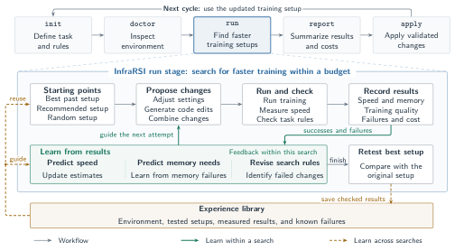
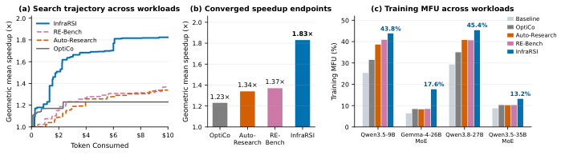
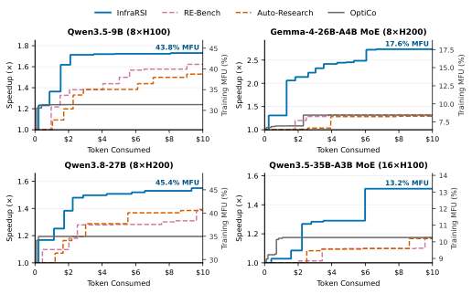
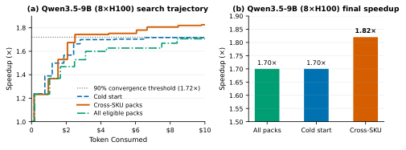
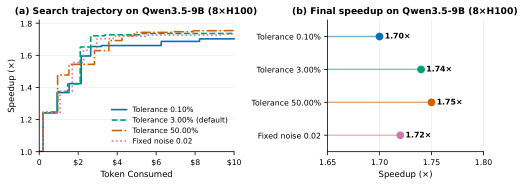

# InfraRSI：组合搜索配置与代码，训练提速1.83倍

InfraRSI 要解决的是多 GPU 大模型训练基础设施的自动优化：不仅调整启动参数，还要修改算子、训练循环与通信代码，同时保证优化没有改变训练任务。这个问题直接影响模型训练成本和硬件利用率，但测量噪声、显存边界、编译器冲突与 reward hacking 会让普通 coding agent 得到虚假或不可复现的收益。它的核心思路是用固定任务契约和 16 项验证约束住搜索，再以全局时间/显存模型组合配置与代码补丁，并把验证过的经验迁移到新集群。在四种 dense 与 MoE 工作负载上，InfraRSI 获得 **1.83× 几何平均加速**，将平均训练 MFU 从 **17.4% 提升到 30.0%**。

## 为什么训练基础设施不能交给普通搜索循环

过去的 Recursive Self-Improvement（RSI，递归自我改进）系统更多面向数学构造、算法脚本或单个 GPU kernel。训练基础设施则是一个强耦合系统：启动参数、并行布局、算子实现、通信调度和显存容量会共同决定最终吞吐。

这意味着，单独有效的优化叠加后不一定继续有效。关闭 activation recomputation 可能提速但导致 OOM；`torch.compile` 可能减少 launch overhead，却与某个 fused kernel 冲突；tensor parallelism 在一种 GPU 上提速，在另一种 GPU 上反而被 AllReduce 开销吞掉。

| 维度 | 算法/代码 RSI | Kernel 合成 | InfraRSI：训练基础设施 RSI |
|---|---|---|---|
| 优化粒度 | 单个启发式规则或脚本 | 孤立的 CUDA/Triton kernel | 启动参数与源代码补丁，多技术栈 |
| 成本与噪声 | 毫秒至秒级；$10^3$–$10^4$ 次运行；低噪声 | 每算子毫秒级；$10^2$–$10^3$ 次运行；低噪声 | 多 GPU；通常 10–20 次完整试验；噪声为 0.04%–6%+ |
| 等价性判断 | 测试集或验证分数 | 张量误差 $L_\infty/L_2$ | 固定任务契约与源代码路径审计 |
| 作弊风险 | 中等，如验证集过拟合 | 高，如缓存结果、跳过同步 | 严重，如预取偏差、计时边界移动、精度漂移 |
| 硬件敏感性 | 通常与硬件无关 | 与 SM、SRAM 等 GPU 特性相关 | 与 roofline、互连拓扑及 H100/H200/H20 架构相关 |
| 可复用资产 | 任务相关代码池 | 算子 kernel 库 | 跨硬件先验与经过审计的补丁位置 |

InfraRSI 的固定任务契约要求模型结构、数据集、每次 optimizer update 处理的有效 token 数、允许的数值精度和 optimizer 更新协议保持不变。失败或被审计排除的候选也必须计入 GPU 与 API 成本，避免只报告成功试验造成幸存者偏差。

这里还要区分两种“正确”：短时间窗口内的 loss 一致性用于检查数值路径是否忠实；独立的 back-to-back 重跑则用于确认加速不是一次偶然测量。前者回答“训练是否还是原来的训练”，后者回答“速度提升是否真的存在”。

## 实际搜索会卡在四个地方

### 虚假加速与计时边界偏移

没有严格契约时，agent 可以通过减少实际工作量来“提速”。典型做法包括擅自降低精度、把辅助参数更新推迟到计时窗口之后、移动日志计时器，或用低精度 fused cross-entropy 换取速度却损害 loss。

更隐蔽的情况是：某次运行本身已经发生 kernel import error，但一张 receipt 上的有效性标记仍显示通过。因此，自动检查之外还需要候选源代码审计。

### 跨越两个数量级的测量噪声

专用 8×H100 和 8×H200 节点上的配对 step-time 噪声可低至 0.04%–0.10%，共享主机遇到 data loader 或 collective 周期性停顿时则可能超过 6%。

固定 2% 接受阈值会同时犯两类错误：在安静节点上丢掉可叠加的 0.5%–1.5% 小优化，在嘈杂节点上又可能把随机抖动当成收益。InfraRSI 因此按当前集群校准噪声，而不是使用统一阈值。

### LLM 的速度先验并不可靠

LLM 能提出合理的优化机制，却不擅长预测真实硬件收益。论文报告的 zero-shot 预测与实际执行之间的 Spearman 秩相关为 $r\in[-0.49,-0.06]$，甚至整体呈负相关。

两个例子很直观：Gemma-4-26B-A4B MoE 上，先验只给 graph compilation 预测 +2.0%，实测却是 +55%；双节点 Qwen3.5-35B-A3B MoE 上，先验认为增加 NCCL 通信通道会略微变慢，实测却提升 +10.2%。所以模型只能负责提出假设，最终判断必须交给测量。

### 单 incumbent 搜索无法跨过显存与编译器悬崖

只从当前最优解向前走的 greedy loop，容易把 OOM 当作“这个方向无效”，也无法区分是 launch configuration 还是新代码补丁导致失败。

Gemma-4-26B-A4B MoE 上，单独关闭 activation recomputation 会多出 18 GiB 显存需求，开启编译又会与默认 fused kernels 冲突。只有同时找到节省 14 GiB 的配置和兼容的 FlexAttention 补丁，才能抵达最终的 2.75× 加速。Auto-Research 则在该任务上停滞于 1.29×。

## 五阶段 Harness：把提议、测量和验证拆开

InfraRSI 不让语言模型直接决定什么结果可以发布，而是把候选生成与执行、验证、搜索、经验存储解耦。一个声明式的 `infrarsi.yaml` 配合少于 15 行的轻量 stack adapter，为 Megatron-Core、FSDP2/TorchTitan、DeepSpeed、HF Trainer/TRL 和原生 PyTorch DDP 提供统一接口。

> 图解：上方是 `init → doctor → run → report → apply` 的生命周期。展开的 `run` 阶段同时搜索训练配置与代码编辑，用每次测量和失败更新速度、显存预测；最佳候选先与原始基线重新对照测试，通过后才写入经验库。后续任务再用这些经验选择起点、初始化模型，形成跨运行的第二层自我改进。

五个阶段各自承担明确职责：

1. **`init`：锁定任务边界。** 解析目标仓库 AST，声明任务范围和 `editable_files`，记录数据加载器、评估脚本、loss 定义和计时器等 `frozen_files` 的 SHA-256。
2. **`doctor`：认识当前环境。** 运行 reference baseline，裁剪 warmup，校准 step-time 噪声，分析 forward、backward、optimizer、data loading 和 collectives 的阶段耗时，并探测互连带宽与经验覆盖度。
3. **`run`：组合搜索与复验。** 搜索配置和源代码补丁，保留全部原始 receipt 与资源成本；对最快且有效的候选进行同 GPU 分配下的独立重跑，再写回经验并生成 `result.json`、`pack.yaml` 和 `REPORT.md`。
4. **`report`：审计结果。** 检查结构化报告、不变量判定、资源核算和候选源代码路径。
5. **`apply`：交付变更。** 从 `result.json` 读取已晋升候选，检查工作树冲突，写入验证过的配置和 diff，也可放到新 git 分支。

每个候选由两部分组成：一部分是 CLI flag、环境变量和配置键等 launch knobs，并经过 batch 守恒检查；另一部分是 `editable_files` 上经过 AST 验证的 unified diff，例如 fused normalization、RoPE、AdamW、block-sparse attention 或 gradient-norm collective bucketing。所有评估都固定 optimizer update 数、裁剪 warmup，并在同步后的稳态窗口计时。

这个设计的聪明之处在于：**LLM 可以大胆提议，但只有可复现、语义等价的执行结果才有资格成为系统结论。**

## 验证契约：快，但必须仍是同一个训练任务

候选 $a$ 的优化目标可以写成最大化对数加速，同时满足 16 项确定性不变量：

$$
\max_{a\in\mathcal{A}} y(a)=\ln\frac{T_0}{T(a)}
\quad \text{s.t.}\quad
\mathcal{I}_k(a)=\mathrm{True},\ \forall k\in\{1,\dots,16\}
$$

其中 $T_0$ 是参考配置耗时，$T(a)$ 是候选耗时。验证分为执行、工作负载、调度、数值、计时与配对复验五层。

| 层级 | 不变量 | 核心判据 | 1,212 次离线复验：触发数/首要失败数 |
|---|---|---|---|
| L1 执行 | `completes`、`no_errors`、`memory_cap` | 正常退出、完成全部 update、无 NaN/OOM/NCCL/import 错误，显存不超上限 | 503/352 |
| L2 工作负载 | `same_workload`、`same_data`、`same_model`、`frozen_files` | token 数、序列长度、数据 digest、模型 digest、参数量和冻结文件哈希一致；必需项无法验证也拒绝 | 7/7 |
| L3 调度 | `optimizer_steps` | optimizer step 数一致，辅助状态在计时窗口内同步更新 | 0/0；延迟更新由源码审计发现 |
| L4 数值 | `loss_tol`、`grad_norm_tol`、`precision` | 遵守预先声明的 loss 规则与精度菜单 | 42/41；其中 39 次没有 L4 就会漏过 |
| L5 计时与配对 | `timing_consistent`、`speed_reproduces` | Harness 墙钟收益与脚本 step-time 收益满足 $|\Delta\ln|\le0.03$；晋升需重新配对测试并超过校准噪声 | 158/0；未晋升结果按 1.00× 交付 |

默认数值检查要求窗口平均 loss 的相对偏差不超过 $\tau$，即：

$$
\frac{|\bar{\ell}-\bar{\ell}_{\mathrm{ref}}|}{|\bar{\ell}_{\mathrm{ref}}|}\le\tau
$$

若参考运行自身的重复测量偏差超过阈值，容差可按 $3\sigma_\ell\sqrt{2/k}$ 调整；若数据顺序已验证，则改用逐 update 最大偏差。容差和适应规则必须在搜索前固定，不能看到候选后再放宽。

如果没有任何候选通过所有检查和晋升门槛，系统保留 reference configuration，交付加速记为 1.00×，而不是勉强采用一个可疑结果。

## 核心搜索：不是局部爬山，而是全局建模后的组合跳跃

解决了“什么结果可信”之后，下一个问题是“怎样用 10–20 次昂贵试验找到好解”。InfraRSI 的 Budgeted Compositional Search 由三组机制组成：多起点与全局模型、先验校准与失败归因、高影响 knob 跳出与代码补丁叠加。

### 先校准噪声，再判断收益

`doctor` 去除 JIT compilation warmup，并用 warmup 后稳态窗口的平均 step time 进行候选评分、MFU 核算与最终晋升。搜索内部还使用 median 和 split-half 统计，避免单步尖峰扭曲 surrogate。

系统把参考配置重跑差异与运行内 split-half 偏差合并，估计配对对数 step-time 噪声 $\sigma_{\mathrm{pair}}$。大 knob 选择和停滞检测使用：

$$
\max(0.02,\ 2\sigma_{\mathrm{pair}})
$$

最终晋升则要求新鲜 back-to-back 重跑的相对收益超过 $\exp(2\sigma_{\mathrm{pair}})-1$。同时，基于 forward、backward、optimizer 和 collective 的时间占比，系统用 Amdahl phase-headroom ceiling 限制单个优化杠杆的预测收益：一个只影响某阶段的改动，不可能获得超过该阶段时间份额所允许的端到端加速。

### 三个起点覆盖不同搜索盆地

配置空间会被 OOM 和编译器不兼容切成互不连通的区域。只从默认配置出发，会把大量预算浪费在逐个翻基础开关；只相信一个模型提议的完整组合，又可能立即崩溃。

InfraRSI 用前三次完整试验建立多样起点：

- 第一个起点从经验库中硬件和模型环境最相似的历史最优完整配置 warm start，并做机制归一化。
- 第二个起点选择先验模型评分最高、且至少有一个高影响 knob 不同于第一起点的配置。
- 第三个起点从满足冲突规则的合法配置中均匀随机采样，用于估计全局速度与显存方差，并建立显存基线。

在 Qwen3.5-9B、8×H100 上，经验播种的第一个起点在 Trial 1 就达到 1.55×，后续搜索继续推进到 1.73×。

### 用全部历史拟合时间与显存模型

只围绕最新 incumbent 贪心移动，会被早期选择锁死。InfraRSI 改为在全部试验历史上维护两个全局模型，并在每次试验后 checkpoint 搜索状态。

**Cholesky Bayesian linear time surrogate** 用非参考 knob 设置、已验证代码补丁和启用组合对的 indicator features 建模 log-speedup，闭式更新 posterior precision matrix，同时限制 prior variance。

**Right-censored Tobit memory ledger** 则估计候选 $a$ 的每 GPU 峰值显存 $\hat m(a)$。它的关键不是只学习成功运行，而是把三种结果都变成信息：

1. 成功运行提供实测 $m_{\mathrm{peak}}$，按精确 Gaussian residual 拟合。
2. OOM 运行提供右删失约束 $\hat m(a)\ge m_{\mathrm{oom}}$，失败分配所缺显存构成需求下界。
3. 接近容量上限的 allocator thrashing 提供区间删失约束，将需求限制在 $[0.90C_{\mathrm{card}},C_{\mathrm{card}}]$。

观测噪声设为 $\sigma_{\mathrm{obs}}=0.02C_{\mathrm{card}}$。模型以 damped Newton steps 和 Laplace covariance 拟合，从而给出校准后的可行性概率和每个设置的 GiB 显存估计。换句话说，**OOM 不再只是废掉一次试验，而是一次有数值的下界测量。**

### 用反向探针纠正 LLM 先验

配置 knob 的先验通过 empirical-Bayes shrinkage 正则化，并随时间 surrogate 的观测闭式更新，其中 $\sigma_0\ge\max(\sigma_{\min},0.5|\mu_0|)$。代码补丁的 LLM 收益预测则先乘保守收缩系数 $\kappa_0$：

$$
\mu_{\mathrm{patch}}=\kappa_0\hat{\mu}_{\mathrm{LLM}}
$$

如果一个高影响 knob 被先验低评或否决，但不确定性很大，且二倍标准差的上行空间越过噪声门槛，系统会主动安排 contrarian empirical probe。探测时把冲突设置退回 reference；显存可行性偏低时，自动附上估计最能省显存的设置。

连续配置失败或高置信设置失败后，系统还会触发结构化先验修订，把实测 step time、峰值显存和 OOM 缺口反馈给先验，再重新求解 posterior。这正是前述 +55% compilation 和 +10.2% communication 设置能够被重新发现的原因。

### 失败归因与 bundle completion

InfraRSI 将 OOM、数值违规和 runtime crash 分开记录：

- 非参考设置导致 OOM 时，标记它需要一个至少覆盖实测 GiB 缺口的省显存伙伴；只有换过多个不同 saver 仍失败，才排除该设置。
- 非显存 crash、hang 或数值发散时，只封禁最小冲突二元组或三元组，而不是永久封禁其中每个单独设置。
- 代码探索失败归因于候选 patch，不错误惩罚底层 launch configuration。

高预测收益但显存不足的配置会进入 high-upside failure buffer。Bundle completion 再为它搭配 reference-held memory savers，并回退冲突 knob。Gemma 上就是把 recompute-off 的 +18 GiB 缺口，与 Liger-off 的 -14 GiB 和 `torch.compile` 组合起来。

若新高价值杠杆与早期基线冲突，conflict backtracking 会回到干净的 root reference 直接验证它；确认后迁移 incumbent，再把兼容设置叠回新基线。

### 只在 Big-Knob 集合上做结构跳跃

每次观测后，系统把满足以下任一条件的设置纳入 Big-Knob 集合 $\mathcal{K}_{\mathrm{big}}$：先验 $\hat y_{\mathrm{prior}}$、surrogate 后验 $\hat y_{\mathrm{surr}}$ 或经验均值 $\bar y_{\mathrm{emp}}$ 的单 knob 对数收益绝对值越过 $\max(0.02,2\sigma_{\mathrm{pair}})$。

memory pinning、worker 线程数等影响不足 1% 的小旋钮，通常无法改变 roofline 或释放足够显存，还容易把亚噪声波动误认为收益。因此，初始多样化、反向探测、trust-region escape、tabu 去重和 warm restart 都只在 $\mathcal{K}_{\mathrm{big}}$ 上操作。

连续两次完整试验无法让 incumbent 越过噪声门槛时，系统进入 escape mode：把与 incumbent 的最小 trust-region 距离从一个扩大到三个大 knob，强制多旋钮跳跃；沿已经改善的有序轴继续外推；并定期从不同配置类别的历史最佳运行 warm restart。所有 configuration-and-patch signature 在执行前加入 visited set，避免重复提议消耗预算。

当后期配置候选的二倍标准差上行空间低于噪声门槛时，评估槽位转给源代码合成。多个单独收益较小但已验证的 patch 会像 group testing 一样组合测试，只有合计 log-gain 越过噪声门槛才值得占用一次运行。

为控制长轨迹上下文，系统只保留最快与最近运行的完整 trace，把旧试验压缩成单行记录，整体约 28k 字符。若新候选是在已验证 patch stack 上继续调 launch knobs，继承且未修改的 diff 行不会重复计入单步行数限制。

## 跨硬件经验：迁移证据，而不是照搬答案

搜索得到一次好配置之后，还需要避免换个 GPU 就从头开始。但直接 replay 历史配置并不安全，因为硬件 roofline 会改变收益大小，甚至改变方向。

初始种子语料包含 11 个 seed packs、191 个环境、698 条 observation 和 543 个 effect。下面的数据说明为什么经验必须带硬件条件：

| 模型 | 机制 | H20：148 TF、4.0 TB/s | H100/H200：989 TF | 原因与规律 |
|---|---|---|---|---|
| Qwen3-8B | `precision=fp8` | +58%；TP2 时 +54% | H200 +30%；TP2 时 +3% | H20 偏 compute-bound，H200 偏 communication-bound |
| Qwen3-8B | `tp=2` | +24%，即 1.24× | H100 -4%，即 0.96× | **方向反转**：AllReduce 开销超过 GEMM 收益 |
| Qwen3-8B | `te_fp8_attn` | +6%，即 1.06× | H200 -8%，即 0.92× | **方向反转**：H200 上 BF16 FlashAttention-3 优于 FP8 cast |
| Dense LLM | `compile` | +20%–29%；TP2 时 +5% | +5%–10%；H200 上 +40% | H20 上摊销 launch 开销，H200 上融合 TP2 collectives |
| Qwen3-30B MoE | `alltoall+grouped_gemm` | +92%，即 1.92× | H200 +85%–110% | 在高带宽 NVLink 域内，kernel 收益较稳定 |

经验协议把记录组织成三个实体：

- **Environment**：roofline、节点/GPU 拓扑、互连、软件版本、模型维度和并行布局。
- **Observation**：完整 knob 配置、step time、峰值显存、数值验证条件、16 项 verdict，以及 OOM 缺口和最小冲突元组。
- **Effect**：配对 log-speedup、校准噪声、依赖条件和机制类别 `kernel`/`balance`。

两层 normalizer 将 fused AdamW、混合精度等框架特定开关映射为 **71 种 canonical mechanisms**。检索时先做 compatibility scope check，再按覆盖级别、可读性、证据等级和环境距离 $d$ 排序。`balance` 类机制要求更严格的 GPU SKU、节点数、互连和并行布局匹配；不匹配的证据会被降级或丢弃。

环境相似度只用于 **过滤和排序先验**，不能覆盖目标硬件上的真实观测。搜索中的 posterior 仍由目标测量通过 Bayesian 更新与经验先验修订主导。

经验在两个位置进入搜索：驱动三起点初始化的第一次 warm start；初始化时间 surrogate 的均值和方差，以及显存 ledger 的 GiB 先验与冲突约束。运行结束后，只有通过不变量、数值容差和配对噪声门槛的观测才能写回，形成“运行内修订先验、运行间沉淀经验”的两级 RSI 闭环。

## 实验一：四种工作负载上均领先

实验在相同任务契约下比较 InfraRSI、开放代码的 Auto-Research、METR RE-Bench agent scaffold 和只调参数的 OptiCo。四种任务覆盖单节点/双节点、dense/MoE，以及 H100/H200。

| 工作负载与硬件 | 基线 MFU（step time） | OptiCo | Auto-Research | RE-Bench | InfraRSI | 关键配置与代码组合 |
|---|---|---|---|---|---|---|
| Qwen3.5-9B，8×H100 | 25.3%（1.62 s） | 1.24×（31.5%） | 1.53×（38.6%） | 1.62×（40.9%） | **1.73×（43.8%）** | Liger 省显存支持 recompute-off 与 micro-batch 2，加 fused normalization |
| Gemma-4-26B-A4B MoE，8×H200 | 6.4%（3.38 s） | 1.32×（8.4%） | 1.29×（8.3%） | 1.33×（8.5%） | **2.75×（17.6%）** | `torch.compile` + Liger-off + recompute-off，加缓存 mask 的 FlexAttention |
| Qwen3.8-27B，8×H200 | 29.3%（4.50 s） | 1.19×（35.0%） | 1.39×（40.8%） | 1.38×（40.6%） | **1.55×（45.4%）** | 省显存配置，加 fused RMSNorm/RoPE/SwiGLU 与选择性重计算 |
| Qwen3.5-35B-A3B MoE，16×H100、2 节点 | 8.7%（1.89 s） | 1.17×（10.3%） | 1.17×（10.2%） | 1.17×（10.3%） | **1.51×（13.2%）** | 反向探索 32-channel NCCL，加 fused SwiGLU 与 bucketed grad norm |
| 四任务平均：加速为几何平均，MFU 为算术平均 | 17.4% | 1.23×（21.3%） | 1.34×（24.5%） | 1.37×（25.1%） | **1.83×（30.0%）** | 在全部单/多节点 dense 与 MoE 任务上均取得最高加速 |

> 图解：(a) 横轴为搜索消耗的 token，纵轴为加速倍数，展示各方法随搜索推进的轨迹；(b) 比较四任务最终几何平均加速，InfraRSI 为 1.83×，RE-Bench、Auto-Research、OptiCo 分别为 1.37×、1.34×、1.23×；(c) 比较各任务的训练 MFU。InfraRSI 的优势不是只来自单个任务，而是在四个端点上全部领先。

OptiCo 较早遇到瓶颈，因为 launch flags 无法消除 operator-level 问题。单一 incumbent 的 coding agent 则能改代码，却容易在兼容补丁叠好之前，被高显存配置的 OOM 或编译冲突卡住。InfraRSI 的提升正来自两种动作的协调，而非简单地“搜索更久”。

训练 MFU 按非稀疏 Hopper BF16 峰值每 GPU 989.5 TFLOP/s 计算：

$$
\mathrm{MFU}=\frac{F_{\mathrm{update}}}{N_{\mathrm{GPU}}\cdot P_{\mathrm{BF16,dense}}\cdot t_{\mathrm{update}}}
$$

其中 $t_{\mathrm{update}}$ 是 updates 11–30 的 warmup 后平均 step time，$F_{\mathrm{update}}$ 使用 PaLM dense-equivalent active FLOPs：每 token 为 6 倍 active matrix parameters，再加 attention FLOPs，不计重计算、通信和未路由专家。平均 MFU 从 17.4% 提升至 30.0%，两个 compute-bound dense 模型都超过 43%。

> 图解：每个子图的横轴都是搜索消耗 token，左纵轴为加速倍数，右纵轴为训练 MFU。曲线显示配置与代码补丁如何逐步叠加；Gemma 的大幅跃升和双节点 MoE 的通信突破，对应下面两类关键发现。

Gemma 上，censored memory model 找出 Liger-off 可释放 14 GiB，冲突规则封禁不兼容组合，再叠加为 25 个 sliding-window layers 缓存 block-sparse masks 的 compiled FlexAttention，以及服务 5 个 global layers 的 chunked causal attention kernel，最终达到 2.75×、17.6% MFU。

双节点 Qwen3.5-35B-A3B MoE 上，contrarian exploration 解锁 32-channel InfiniBand NCCL，代码侧叠加 fused SwiGLU、fast zero-grad 和 bucketed gradient-norm all-reduce，达到 1.51×、13.2% MFU。两个 dense 任务则通过省显存配置与 fused normalization、RoPE、MLP kernels，分别达到 1.55× 和 1.73×。

## 实验二：跨 SKU 经验更快收敛

迁移实验使用 Qwen3.5-9B、8×H100。Cold start 不使用经验包；All eligible packs 使用所有合格经验；Cross-SKU 则只保留其他 GPU 架构上的证据，并排除同任务、同 SKU 历史，防止把自我重放误认为迁移能力。

收敛速度以到达 90% 峰值 log-speedup 为准，即 $\ln(S)\ge0.9\ln(S^\star)$。

| 目标工作负载 | 经验条件 | 第一次有效试验 | 最终加速 | 到达 90% 峰值的 Trial | GPU 小时 |
|---|---|---|---|---|---|
| Qwen3.5-9B，8×H100 | Cold start | 1.22×，Trial 2 | 1.70× | >15，预算内未达到 | — |
| Qwen3.5-9B，8×H100 | All eligible packs | 1.24×，Trial 1 | 1.70× | >17，预算内未达到 | — |
| Qwen3.5-9B，8×H100 | Cross-SKU transfer | 1.23×，Trial 1 | **1.82×** | **9** | **2.97** |

> 图解：横轴为 token 消耗，纵轴为加速倍数，虚线是 90% 峰值 log-speedup 门槛。只有 Cross-SKU 曲线在预算内越过该门槛，发生于 Trial 9、2.97 GPU·h；另外两条曲线最终被右删失，且最终加速均为 1.70×。

值得注意的是，“使用全部经验”并没有优于 cold start，而经过硬件过滤的跨 SKU 经验同时改善了最终速度和收敛。这支持了论文的设计判断：经验数量不是关键，硬件条件与覆盖范围才决定迁移是否有益。

## 实验三：验证器审计与容差敏感性

离线 verifier suite 的 40 个系统测试全部符合预期：28 个单项扰动 receipt 全被拒绝，12 个 benign variants 全被接受。HMAC-SHA256 检查也拒绝了未签名、签名后修改 step time 和 schema 不匹配的 receipt。

对 106 次搜索留下的 1,212 次完整执行重新裁决时，812 次有效、400 次被拒绝，拒绝率 33.0%。其中 39 次能通过所有非数值检查，必须依靠 L4 的 loss/gradient 验证才能发现，占全部执行的 3.2%。

| 审计或实验臂 | 设置与范围 | 有效/完成或接受 | 最终加速/拒绝 | 到达 90% 峰值或一致性 | 成本与说明 |
|---|---|---|---|---|---|
| Receipt Matrix | 28 个单项扰动 + 12 个 benign | 接受 12 个 benign | 拒绝 28 个扰动 | 40/40，100% | 检查 token、序列、step、LR、数据顺序、NaN、OOM、冻结文件、时钟和模型 digest 等 |
| HMAC-SHA256 | Receipt 密码学完整性 | 接受 0 个无效 receipt | 全部无效 receipt 被拒 | 100% | 拒绝未签名、签名后编辑和 schema 不匹配 |
| Historical Corpus | 重新裁决 1,212 次执行 | 812 次有效 | 400 次拒绝 | — | 39 次必须靠 L4 才能拒绝 |
| Strict Tol. | Loss 相对容差 0.10% | 13/16 | 1.70× | Trial 11 | 6.48 GPU·h |
| Default Tol. | 默认容差 3.00% | 14/17 | 1.74× | Trial 10 | 7.05 GPU·h，保留失败与排除成本 |
| Relaxed Tol. | 容差 50.00% | 13/17 | **1.75×** | Trial 10 | 6.90 GPU·h |
| Fixed Noise | 固定 2.00% 噪声门槛，容差 3.00% | 11/15 | 1.72× | Trial 11 | 6.02 GPU·h |

> 图解：(a) 比较 0.10%、3.00%、50.00% 三种 loss 容差及固定 2.00% 噪声门槛的搜索轨迹，共同参考峰值为 $S^\star=1.75\times$；(b) 比较四组最终加速。四组都在 10–11 次试验内到达共同 90% 峰值，最终为 1.70×–1.75×，成本为 6.02–7.05 GPU·h，说明该任务上的收敛对这些设置较稳定。

这里的敏感性结果不应被解读为“容差不重要”。它只说明在 Qwen3.5-9B、8×H100 这组在线实验中，不同预设设置下都能稳定收敛；离线审计同时表明，数值层确实能抓住其他检查遗漏的违规执行。

## 附录细看：16 项检查具体拦什么

完整验证器包含 11 项始终开启的检查、3 项条件检查、1 项信息检查和 1 项晋升门槛。下表保留全部项目及其在 1,212 次执行中的审计结果；“首要”表示该次执行最先失败的层。

| 层 | 不变量 | 模式 | 实现的判据 | 审计结果 |
|---|---|---|---|---|
| L1 | `completes` | 始终 | Exit code 0、无 timeout，且 $N_{\mathrm{done}}=N_{\mathrm{tgt}}$ | 349 次触发，349 次为首要失败 |
| L1 | `no_errors` | 始终 | 无 NaN/Inf、OOM、NCCL/CUDA error 或 traceback；loss 与 gradient norm 不得冻结 | 153 次触发，2 次首要 |
| L1 | `memory_cap` | 始终 | 峰值 reserved memory 不超过 $M_{\mathrm{cap}}$ | 1 次触发，1 次首要 |
| L2 | `same_workload` | 始终 | 每 update 的 token/sample 数与序列长度等于 reference，全局 batch 等静态量不变；必需项不可验证则拒绝 | 0 次失败，7 次因不可验证被拒 |
| L2 | `same_data` | 始终 | 每 update 数据 digest 与 reference 相同；无日志时不检查 | 无 |
| L2 | `same_model` | 始终 | 模型 digest 和可训练参数量一致；reference 报告而候选停止报告关键字段也失败 | 无 |
| L2 | `frozen_files` | 始终 | 所有冻结文件运行后的 hash 不变 | 无 |
| L3 | `optimizer_steps` | 始终 | 每 update 的 optimizer-step 计数等于 reference；仅有 LR proxy 时，不同 schedule 失败，相同也无法完全验证 | 无 |
| L4 | `loss_within_tolerance` | 始终 | 窗口平均 loss 满足预声明 $\tau$；必要时按重复参考噪声调整，数据顺序已验证时检查逐 update 最大偏差 | 42 次触发，41 次首要 |
| L4 | `grad_norm_within_tol` | 始终 | 首 update gradient norm 与 reference 偏差在 $\tau$ 内；除非证明同首 batch，否则只报告不否决 | 所有运行均未检查 |
| L4 | `eval_matches` | 条件 | 配置评估存在时，候选恢复后的评估值与 reference 偏差不超过 $\tau_{\mathrm{eval}}$ | 在配置评估时启用 |
| L4 | `precision` | 信息 | 比较候选与 reference 报告的精度 metadata | 仅报告 |
| L5 | `timing_consistent` | 始终 | Harness 与代码报告的加速满足 $|\Delta\ln|\le0.03$；reference 有可靠时间戳而候选没有则失败 | 158 次触发，0 次首要，均伴随 crash |
| L5 | `speed_reproduces` | 晋升 | 新鲜 reference/candidate 配对重跑的收益超过 $\exp(2\sigma_{\mathrm{pair}})-1$ | 晋升门槛 |
| L5 | `resume_continues` | 条件 | 在 `save_at` 保存 checkpoint 并恢复后，loss 在 $\tau$ 内延续 | 有 checkpoint 时启用 |
| L5 | `user_tests` | 条件 | 所有配置的用户测试命令 exit 0 | 有测试命令时启用 |
| 全部 | **16 项、5 层** | — | 812 次有效，400 次拒绝：352 次执行问题、41 次数值问题、7 次不可验证 | 共 710 次触发 |

这张表也揭示了一个工程事实：验证器不是简单比较两个 loss 数字。它需要同时处理日志缺失、条件检查、数据顺序、实际 optimizer schedule、计时一致性和复现门槛，才能覆盖真实训练仓库中的失败路径。

## 与已有方法相比，差异在完整闭环

已有方法通常只覆盖提议、搜索、执行验证和经验记忆中的一个或几个环节。下表比较结构能力，而不是跨论文直接比较性能数字；真正的端到端性能仍以前述相同契约实验为准。符号中，✓ 表示支持，△ 表示部分支持，× 表示缺失，○ 表示由 InfraRSI 编排的底层 kernel/compiler primitive。

| 系统/范式 | 主要角色 | 多技术栈 | 编辑范围 | 契约 | 噪声门槛 | 显存模型 | 跳出局部解 | 代码审计 | 跨硬件先验 |
|---|---|---|---|---|---|---|---|---|---|
| FunSearch / AlphaEvolve | 程序进化 | × | Code | × | × | × | △ | × | × |
| Darwin Gödel / AIDE | Agentic tree search | × | Code | × | × | × | △ | × | × |
| TVM / Triton / Inductor | 编译器/kernel IR | ✓ | ○ | ✓ | ○ | ○ | ○ | ○ | △ |
| KernelBench / AI CUDA | 孤立 kernel 合成 | × | Kernel | × | × | × | × | △ | × |
| Alpa / Galvatron / nnScaler | 自动并行规划 | × | Graph/Plan | △ | × | △ | × | × | × |
| OptiCo | 协作式 knob tuner | × | Knobs | × | × | × | × | × | × |
| Ray Tune / Black-box BO | 超参数 Bayesian optimization | ✓ | Knobs | × | △ | × | × | × | × |
| METR RE-Bench | 模块化研发 agent scaffold | △ | Free | △ | × | × | × | × | × |
| Karpathy `autoresearch` | 固定时域 LLM loop | × | Free | × | × | × | × | × | × |
| **InfraRSI** | **可验证基础设施 Harness** | **✓** | **Knobs+Code** | **✓** | **✓** | **✓** | **✓** | **✓** | **✓** |

在提议模型方面，FunSearch、AlphaEvolve、Darwin Gödel Machine、AIDE 等主要依赖 LLM 的 zero-shot coding priors；InfraRSI 则用 empirical Bayes、反向探测和失败驱动修订，把提议能力与收益判断分离。

在搜索控制方面，Alpa、Galvatron、nnScaler 面向静态计算图生成并行计划，Ray Tune、OptiCo 等搜索预定义启动参数，而自由代码 agent 通常围绕最新 incumbent 贪心编辑。InfraRSI 的差异是把全局时间与删失显存模型、组合补全、局部 plateau escape 和上下文压缩放进同一个控制器。

在执行验证方面，TVM、Triton、Inductor、FlashAttention、FlexAttention 和 Liger 等仍是有价值的底层 primitive，但孤立算子测试不足以证明端到端训练等价。InfraRSI 不是替代它们，而是在其外加上任务契约、receipt verifier、源代码审计与噪声校准晋升门槛。

在经验记忆方面，多数 tuner 每个集群重新开始，或依赖静态 skill card、不断堆积原始 transcript。InfraRSI 则把硬件、拓扑、收益、数值条件和失败约束写成结构化经验包，使经验成为可检索、可降权、可验证写回的资产。

## 总结：真正的自我改进必须建立在可信测量上

- **优化对象更完整**：InfraRSI 同时搜索 launch knobs 与源代码 patches，覆盖算子、训练循环和通信，而非只调参数或只生成孤立 kernel。
- **搜索结果更可信**：固定任务契约、五层 16 项验证、源码审计和 back-to-back 重跑共同抑制 reward hacking、数值漂移与计时错觉。
- **昂贵试验利用更充分**：多起点、全局时间模型和删失显存模型把成功、OOM 与冲突都转化为后续搜索信息。
- **组合与迁移带来实际收益**：四任务获得 1.83× 几何平均加速、平均 MFU 从 17.4% 升至 30.0%；跨 SKU 经验还把 Qwen3.5-9B 的最终加速从 1.70× 提至 1.82×。
- **RSI 的关键不是无限自我修改**：而是运行内用实测修订先验、运行间只沉淀验证过的证据，让每轮改进都可审计、可复现。

未来值得继续观察的是，这套经验协议能否扩展到更多 GPU 代际、互连拓扑与训练框架，并在更少的完整试验预算下保持同样的验证强度。

> 本文参考自 [InfraRSI: Harnessing Recursive Self-Improvement for Training Infrastructure](https://arxiv.org/abs/2611.11558)