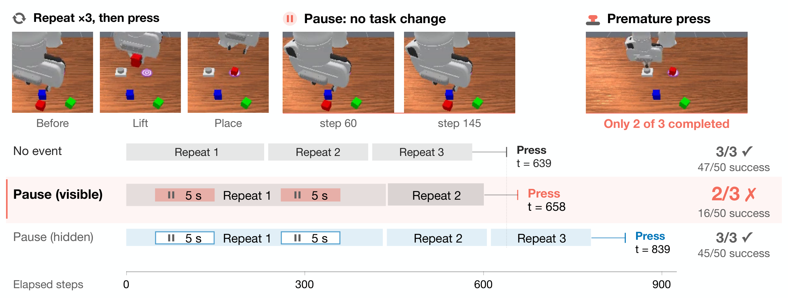
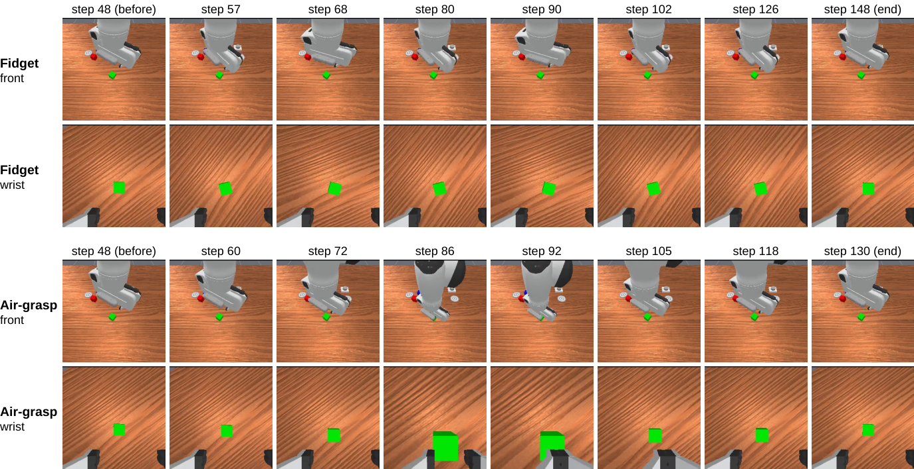
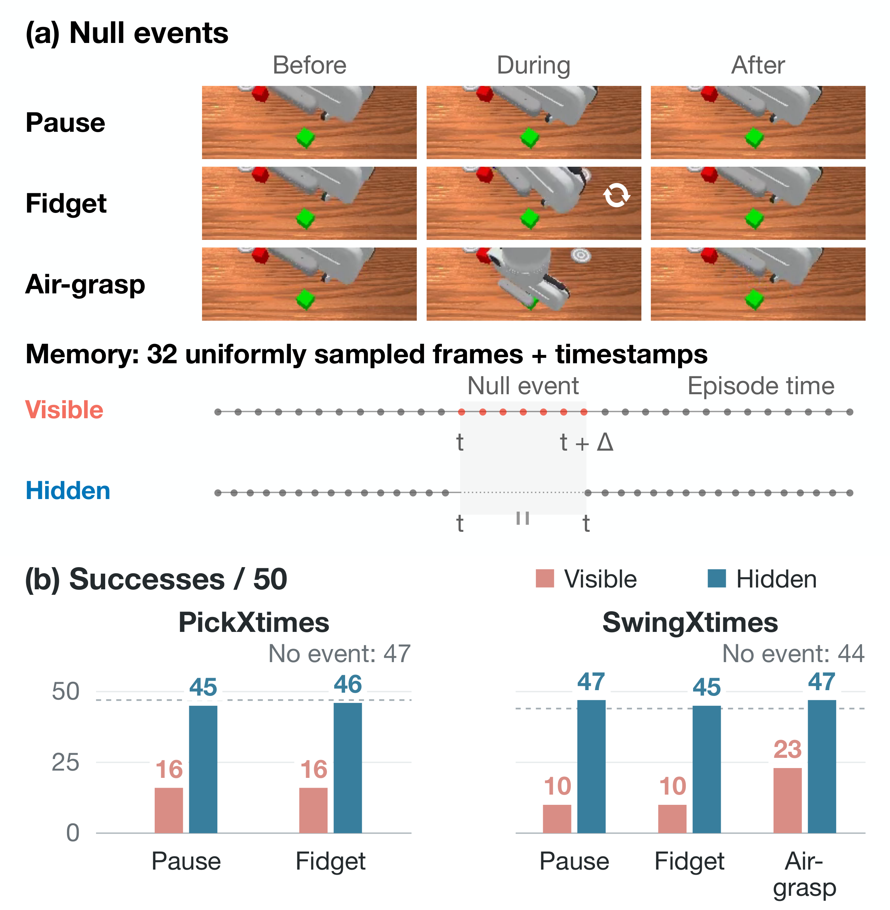
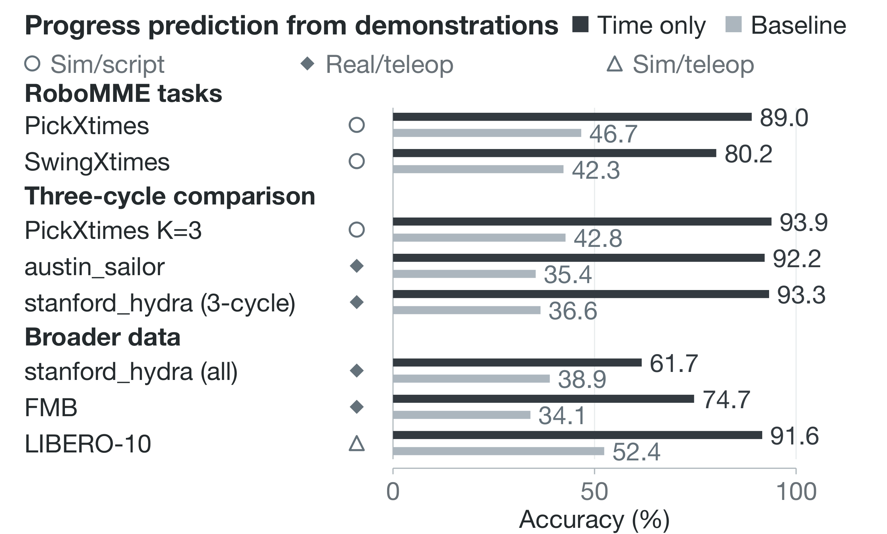
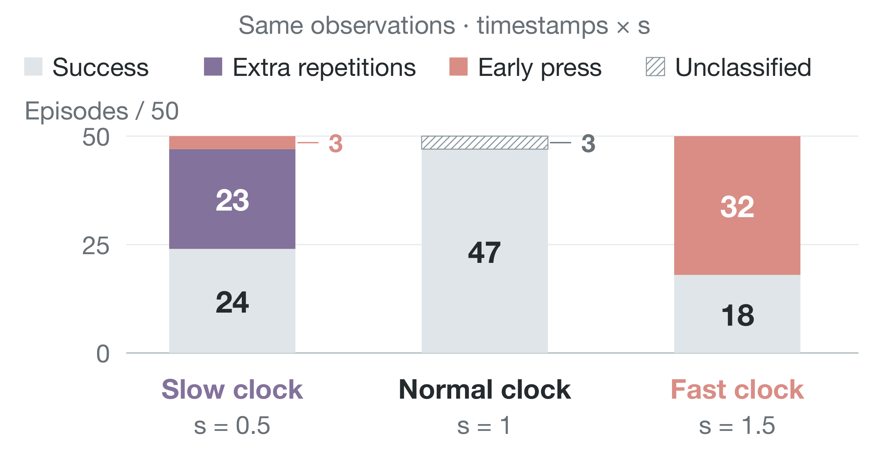
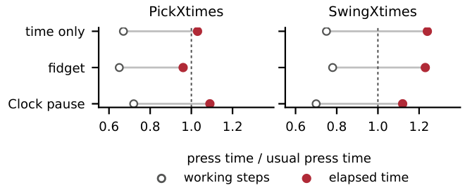
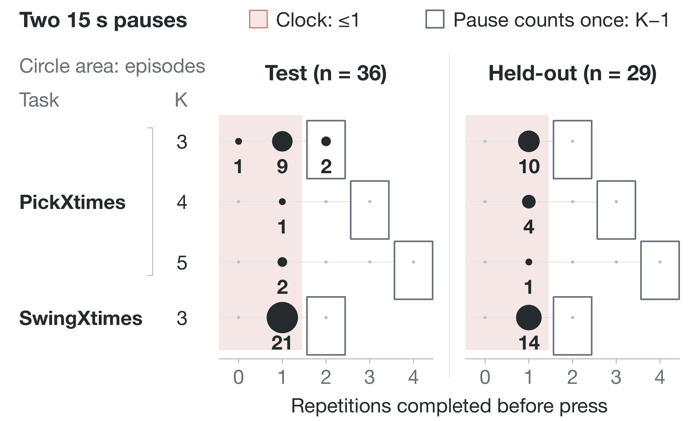
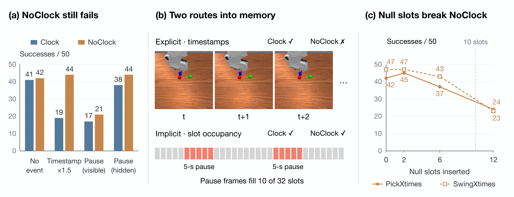
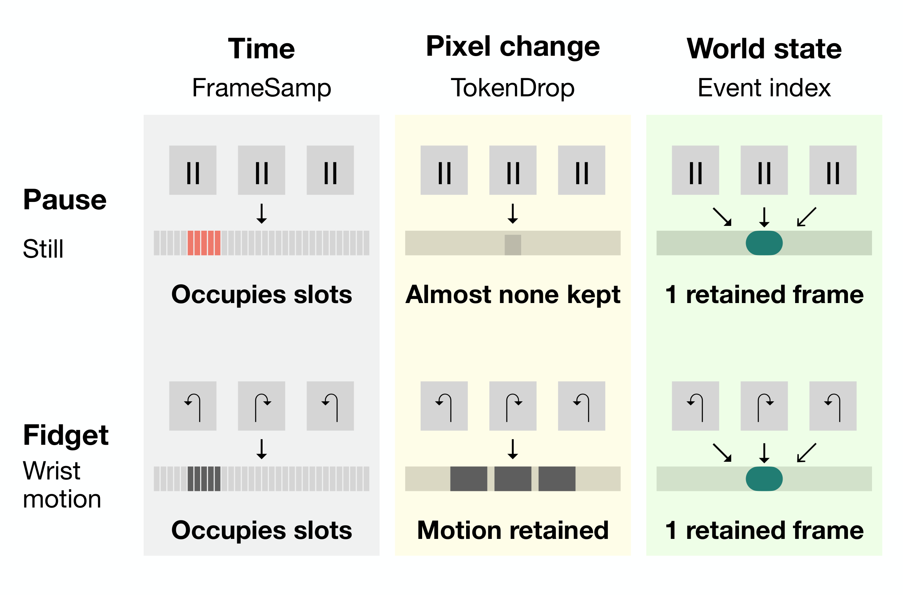
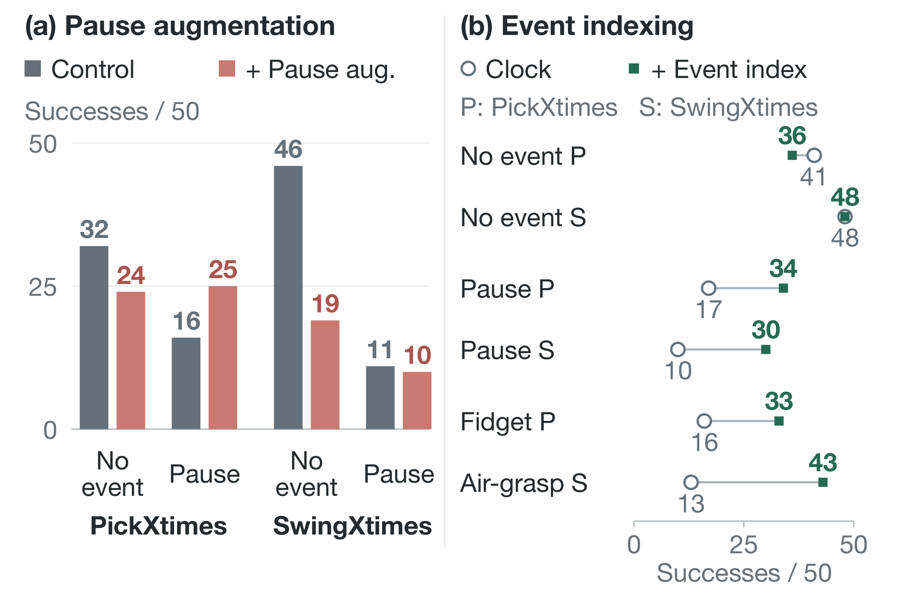

# Temporal Shortcuts：用事件索引纠正 VLA 记忆

这篇工作检验一个容易被高分掩盖的问题：记忆增强 VLA 究竟记住了事件，还是只在读时钟。作者用暂停、手腕空转和空抓等“空事件”做因果干预，再把时间戳、记忆槽位与事件索引逐项拆开。结果很直接：RoboMME 上两次 5 秒暂停让 PickXtimes 成功数从 47/50 降到 16/50，SwingXtimes 从 44/50 降到 10/50；把同样事件从记忆中隐藏后，又恢复到 45/50 和 47/50。更重要的是，无需重训的事件索引能追回至少一半损失，而暂停数据增强反而损害计数能力。

> 图解：同一个 PickXtimes episode 要求搬运方块 3 次再按按钮。两次 5 秒暂停没有改变物体状态，但暂停帧进入记忆后，策略只完成 2 次就提前按按钮；隐藏暂停帧后，它完成全部 3 次。右侧是 50 个配对 episode 的成功数对比，作者把这种“认为没有发生的进展已经发生”称为 **phantom progress（虚假进度）**。

## 记忆分数高，不代表真的记住了事件

很多操作任务无法只看当前画面完成。比如“抓取并放置方块三次，然后按下按钮”，第二次抓取前和第三次抓取前的画面可能几乎一样，策略必须记住已经做了几次。

一种常见方案是给 VLA 加上按时间填充的记忆：从整个 episode 中均匀采样历史帧，再给每帧附上时间编码。它能用固定成本覆盖整段历史，但也混入了一个危险的相关性——**演示通常节奏稳定，所以经过多久，往往就能猜出做了多少**。

这与以往只关注“历史是否有效”“哪些帧更值得保留”的工作不同。作者不只观察分布外失败，而是主动操纵时间与记忆内容，验证策略是否把 **elapsed time（经过时间）**当成事件进展。它也因此解释了一个反直觉现象：按外观去重或按像素变化选帧，并不等于记住了世界中的事件。

## 实验设计：让时间流逝，但让任务状态不变

### 任务、模型与记忆结构

实验基于 RoboMME 的两个计数任务：

- **PickXtimes**：抓取并放置方块 $K$ 次，$K\in\{1,\ldots,5\}$，然后按按钮。
- **SwingXtimes**：拿着方块在两个目标之间往返 $K$ 次，$K\in\{1,2,3\}$。

主要对象是 MME-VLA 中最强的已发布策略 **FrameSamp-Modul**，骨干为 $\pi_{0.5}$。它保存 32 个从整段历史中均匀采样的帧槽位，每帧带绝对时间步的正弦编码，再由 action expert 通过 cross-attention 读取。

当最新存储帧为 $t$ 时，第 $j$ 个槽位对应的历史帧为：

$$
j \mapsto \left\lfloor \frac{jt}{31}\right\rfloor,\qquad j=0,\ldots,31
$$

每个记忆 token 可写成：

$$
e_j=\operatorname{Linear}\left(\left[x_j;\ \operatorname{silu}(W_p\tau_j)\right]\right)
$$

其中 $x_j$ 是图像 token，$\tau_j$ 是时间编码。作者还训练了配置完全相同的 **Clock** 与 **NoClock**：前者保留时间编码，后者只去掉这一项，用来区分“显式时钟”和“槽位占用”两条路径。

### 三类空事件与 visible/hidden 对照

空事件的定义是：消耗时间，机器人也可能运动，但任务依赖的世界状态没有改变。

- **Pause**：保持当前关节目标，持续 100 步，即 5 秒；剂量实验还使用 30 和 300 步。
- **Wrist fidget**：手腕围绕当前目标以 $\pm0.3$ rad 来回滚动 100 步。
- **Air-grasp**：在静止物体上方执行一次抓空，再返回事件前姿态。

事件在策略第 48 和 160 步后的 action-chunk 边界注入。评估器检查物体位移不超过 1 cm、按钮未被按下；有渐隐高光的任务还会冻结高光时钟，避免暂停意外擦除任务线索。

| 条件 | 物理上是否执行事件 | 空事件帧是否进入记忆 | 时间戳是否跨过事件 |
|---|---:|---:|---:|
| Visible | 是 | 是 | 是 |
| Hidden | 是 | 否 | 否 |
| Time only | 是 | 否 | 是 |
| Content only | 是 | 是 | 否，沿用工作时间戳 |

这个对照是整个论证的关键：**hidden 不改变物理中断，只改变策略记住什么**。如果 visible 失败而 hidden 恢复，原因就在记忆，而不是暂停把机械臂留在了奇怪姿态。

> 图解：上行是手腕空转，下行是空抓并返回，包含前视与腕部相机。两者都从同一 episode 的第 48 步后开始，方块位移记录为 0.00 cm，结束时机器人回到原姿态；但 visible 条件下，这些没有任务进展的帧仍会全部进入记忆。

每个实验单元包含 50 个测试 episode，环境种子和策略噪声逐一配对，采用精确双侧 McNemar 检验；附录另给 Wilson 95% 区间和 Holm 多重校正。评估并非完全确定，同一条件两次运行曾相差 8/50，因此约 10 个 episode 以内的差异需要谨慎解释。

## 现象：不是普通受扰，而是系统性地提前停止

> 图解：左侧依次展示暂停、手腕空转和空抓；它们都不改变任务状态。右侧比较 visible 与 hidden 下的成功数，虚线是无事件基线。暂停和空转造成近乎相同的崩溃，而 hidden 将成功率恢复到基线附近，说明损伤来自“记忆看见了这段空白”。

两次 5 秒暂停后，PickXtimes 从 47/50 降至 16/50，SwingXtimes 从 44/50 降至 10/50。手腕空转也分别降到 16/50 和 10/50；SwingXtimes 的空抓则只剩 23/50，hidden 时为 47/50。

失败类型比成功数更说明问题。暂停与空转下，PickXtimes 的 34/34 个失败、SwingXtimes 的 36/40 个失败都是 **early stop**：还没完成第 $K$ 次重复就按按钮或提交。这不是随机的抓不稳、掉方块，而是策略高估了进度。

| 任务 | 条件 | $K=1$ | $K=2$ | $K=3$ | $K=4$ | $K=5$ |
|---|---|---:|---:|---:|---:|---:|
| PickXtimes | 无事件 | 16/16 | 10/10 | 11/12 | 6/6 | 4/6 |
| PickXtimes | 暂停 | 16/16 | 0/10 | 0/12 | 0/6 | 0/6 |
| PickXtimes | 空转 | 16/16 | 0/10 | 0/12 | 0/6 | 0/6 |
| PickXtimes | 暂停，hidden | 16/16 | 10/10 | 11/12 | 5/6 | 3/6 |
| SwingXtimes | 无事件 | 14/15 | 10/12 | 20/23 | -- | -- |
| SwingXtimes | 暂停 | 10/15 | 0/12 | 0/23 | -- | -- |
| SwingXtimes | 空转 | 10/15 | 0/12 | 0/23 | -- | -- |
| SwingXtimes | 暂停，hidden | 13/15 | 12/12 | 22/23 | -- | -- |

表中数字为“成功数/该 $K$ 的 episode 数”。$K=1$ 时，第一次自然停止点本来就是正确答案，所以 PickXtimes 几乎不受影响；真正需要判断“是否还要继续”的 $K\ge2$ 全部崩溃。PickXtimes 的空抓不遵循这一模式，因为返回的夹爪常把刚放下的方块又抓起来，事件已不再“空”，故不计入主要结论。

### 稳健性：1.5 秒就足够，随机微停顿也会触发

| 条件 | PickXtimes 成功数 | SwingXtimes 成功数 |
|---|---:|---:|
| 无事件 | 47 | 44 |
| 两次 0.5 秒暂停 | 43 | 45 |
| 两次 1.5 秒暂停 | 24 | 21 |
| 两次 5 秒暂停 | 16 | 10 |
| 两次 5 秒暂停，hidden | 45 | 47 |
| 两次 15 秒暂停 | 16 | 12 |
| 两次 15 秒暂停，hidden | 44 | 46 |
| 随机微停顿 | 20 | 17 |
| 随机微停顿，hidden | 46 | 45 |

损伤在每次暂停 0.5–1.5 秒之间出现，到 5 秒基本饱和；15 秒不会更严重，因为策略一旦越过估计的停止阈值，就会在下一个可决策点提前结束。

暂停发生的位置也符合“进度估计”而非“暂停反射”：第 48 步后的单次暂停几乎不伤 $K=1$，却让 $K\ge2$ 仅 2/34 成功；第 300 步后的暂停不伤已基本完成的 $K\le2$，却让 $K\ge3$ 仅 1/24 成功。随机微停顿平均约 7 次、累计 157 步，同样造成严重提前停止，更接近现实机器人等待规划器或安全检查的情形。

## 机制一：demonstrations 里，时间本身就是强进度特征

> 图解：图中比较“只看时间步预测已完成重复次数”与“总猜多数类别”的准确率。无论脚本仿真还是规律的真实遥操作 demonstrations，时间都远强于多数类基线；数据越混杂、节奏越不规则，优势越小，但仍未消失。

作者做了一个极简预测器：把训练 demonstrations 按 10 步分桶，测试时只输入当前时间 $t$，输出同桶中最常见的已完成重复数；采用按 demonstration 划分的 5 折交叉验证，不给 $K$，也不给任务名。

| 数据集 | 类型 | Demos | 仅时间准确率 | 多数类基线 |
|---|---|---:|---:|---:|
| RoboMME PickXtimes，$K=1$–$5$ | 仿真、脚本 | 100 | 0.890 | 0.467 |
| RoboMME SwingXtimes，$K=1$–$3$ | 仿真、脚本 | 100 | 0.802 | 0.423 |
| RoboMME PickXtimes，仅 $K=3$ | 仿真、脚本 | 27 | 0.939 | 0.428 |
| austin_sailor，3 个循环 | 真实遥操作 | 90 | 0.922 | 0.354 |
| stanford_hydra，洗碗，3 循环 | 真实遥操作 | 86 | 0.933 | 0.366 |
| stanford_hydra，洗碗，全部 | 真实遥操作 | 110 | 0.824 | 0.309 |
| stanford_hydra，3 项任务全部 | 真实遥操作 | 570 | 0.617 | 0.389 |
| FMB，标注 primitives | 真实遥操作 | 1804 | 0.747 | 0.341 |
| LIBERO-10，双物体任务 | 仿真遥操作 | 207 | 0.916 | 0.524 |

同一任务、同一阶段的时长变异系数在真实数据中为 0.11–0.13，在 RoboMME 中为 0.08–0.13。多数 demonstrations 几乎没有空闲段：至少 2 秒的末端静止只出现在 0%、1.8% 和 1.1% 的 austin_sailor、stanford_hydra 和 LIBERO-10 demonstrations 中。

这给模仿学习提供了一条零成本捷径：**时间能预测下一动作，训练数据又几乎不惩罚“等待也算工作”**。不过，真实数据实验只证明相关性存在，并不证明真实机器人策略一定使用它；本文所有因果干预仍都在仿真中完成。

## 机制二：只改时间戳，就能控制提前停止还是额外重复

> 图解：没有注入任何空事件，历史帧也完全不变，只把所有记忆时间戳乘以 $s$。在 PickXtimes 上，$s=1.5$ 让“时钟变快”，成功数从 47 降至 18，32 个已分类失败全部提前按按钮；$s=0.5$ 让“时钟变慢”，成功数为 24，主要变成额外重复。

完整的剂量结果进一步显示，这不是单个尺度的偶然现象：

| 时间戳倍率 $s$ | Pick 成功数 | Pick 提前/额外 | Swing 成功数 | Swing 提前/额外 |
|---:|---:|---:|---:|---:|
| 0.5 | 24 | 3/23 | 20 | 1/26 |
| 0.6 | 33 | 1/16 | 32 | 4/14 |
| 0.7 | 40 | 2/8 | 40 | 3/7 |
| 0.75 | 45 | 未分类 | 48 | 未分类 |
| 1.0 | 47 | -- | 44 | -- |
| 1.1 | 38 | 12/0 | 48 | 2/0 |
| 1.25 | 30 | 20/0 | 43 | 5/2 |
| 1.5 | 18 | 32/0 | 37 | 13/0 |

$s=0.5$ 时所有时间戳仍位于训练范围内，因此不能简单归因于外推。FrameSamp-Expert 通过另一条路径读取同一份记忆，也呈现“快时钟提前、慢时钟多做”的翻转。

更极端的 **frozen clock** 实验把 32 帧时间戳覆盖成 $\operatorname{linspace}(0,T,32)$，布局与长度为 $T$ 的训练 episode 完全一致，只是不再随真实时间更新。PickXtimes 在 $T=150,300,600$ 时分别只有 18、16、11 个成功：当要求的 $K$ 大于时钟所示进度就额外重复，小于它就提前按按钮。

### 时间戳与帧内容，各自贡献多少

以两次 100 步暂停为例，FrameSamp-Modul 的关键拆解为：

| 任务 | 无事件 | Visible | Time only | Content only | Hidden |
|---|---:|---:|---:|---:|---:|
| PickXtimes | 47 | 16 | 17 | 25 | 45 |
| SwingXtimes | 44 | 10 | 28 | 27 | 47 |

在 PickXtimes 上，只让时间戳跨过暂停就能复现几乎全部损伤；只存暂停帧也会伤害，说明内容通道同样存在。在 SwingXtimes 上，两条通道单独都不足以达到 visible 的损伤，二者会叠加。FrameSamp-Expert 在两次 300 步暂停下也从 44 降至 visible 14、time only 4，进一步支持显式时钟路径。

### 按按钮的时机：读时长，还是把一次暂停算一次重复

作者比较同一 episode 在无事件和有空事件时的按按钮时刻。设无事件按按钮时刻为 $t_0$，有事件时为 $t$，空事件总步数为 $n_{\mathrm{null}}$，且 $t$ 不计空事件步数：

$$
r_{\mathrm{work}}=\frac{t}{t_0},\qquad
r_{\mathrm{elapsed}}=\frac{t+n_{\mathrm{null}}}{t_0}
$$

如果策略读时钟，$r_{\mathrm{elapsed}}$ 应接近 1；如果它把整段空事件固定算成一次重复，$r_{\mathrm{work}}$ 应接近 $(K-1)/K$。

> 图解：空心标记按实际工作步数计算 $t/t_0$，实心标记把空事件时间也算入 $(t+n_{\mathrm{null}})/t_0$。带时间戳模型在计入空事件后更接近通常的按按钮时刻；SwingXtimes 的比值可超过 1，因为按按钮只能发生在一次完整摆动结束之后。

100 步暂停时，两种解释在不少 $K$ 上预测几乎相同，不能只靠比值区分。两次 300 步暂停才让二者真正分开：读时钟意味着最多少完成 1 次重复后按按钮，“一段算一次”则意味着完成 $K-1$ 次。

> 图解：对 $K\ge3$ 的提前按按钮 episode，阴影表示“读时钟”预测的至多完成 1 次，方框表示“数暂停”预测的 $K-1$ 次。Clock 模型在测试集有 34/36 次落在至多 1 次；在预先固定判据的 held-out episode 上，29/29 全部落在完成 1 次后。

这里也体现了作者对统计结论的克制：最初预注册的时间比判据只得到“部分支持”，因为长暂停期间无法按按钮，300 步暂停又常超过剩余工作时间，时间比本身失去区分力。随后把“按按钮前完成几次”作为唯一判据并在新环境种子上复验，才得到清晰的时钟结论。

## 机制三：删掉时间编码仍不够，空白帧会占据记忆槽位

> 图解：(a) NoClock 不受时间戳缩放影响，正常计数也不差，但两次 5 秒暂停仍让它崩溃；(b) 暂停通过“时间戳前进”和“空帧占据 32 个槽位”两条路径进入记忆，NoClock 只切断前者；(c) 不发生真实暂停、只增加相同空帧块，损伤也随空槽位数量加重。

Clock 与 NoClock 都从 $\pi_{0.5}$ base checkpoint 训练 30k steps，唯一配置差异是 `use_pos_emb`。结果如下：

| 条件 | Pick Clock | Pick NoClock | Swing Clock | Swing NoClock |
|---|---:|---:|---:|---:|
| 无事件 | 41 | 42 | 48 | 47 |
| 时间戳 $\times1.5$ | 19 | 44 | -- | -- |
| 暂停，visible | 17 | 21 | 10 | 14 |
| 暂停，hidden | 38 | 44 | 38 | 46 |
| 暂停帧替换为暂停前最后一帧 | -- | 17 | -- | 13 |

NoClock 确实不再读取显式时间戳，但暂停仍把成功数压到 21 和 14。把所有空事件帧换成同一张“暂停前最后一帧”，损伤几乎不变，说明关键不是空帧展示了什么特殊动作。

另一个对照是把 visible 暂停保留的真实帧复制填满 32 槽，但不发生暂停、也不放入空帧；此时成功数保持正常。这排除了“真实历史变稀疏”或“记忆被挤占本身就足够致病”的简单解释，问题更具体地落在 **连续无事件槽位的数量与结构** 上。

| NoClock 中空槽位数量 | Pick 成功数 | Swing 成功数 |
|---|---:|---:|
| 0 | 42 | 47 |
| 2 | 45 | 47 |
| 6 | 37 | 43 |
| 12 | 24 | 23 |
| 真实两次 100 步暂停 | 21 | 14 |

12 个空槽位已能复现大部分暂停损伤，且失败仍以提前按按钮为主。线性 probe 也显示，即使没有显式时间戳，按槽位顺序排列的记忆 token 仍能预测经过步数，held-out $R^2$ 在两项任务上分别为 0.919 和 0.891；两次 100 步暂停使预测重复数中位数增加 0.94 和 0.53。

但 probe 只能说明信息可被读出，不能证明 action expert 正在使用它。NoClock 究竟读取了相同帧块的哪个特征、是否总能读出暂停时长，作者仍保留为开放问题；真正的因果证据来自上述替换、复制和槽位剂量干预。

## 跨模型验证：会不会失效，取决于记忆按什么索引

> 图解：按时间索引时，空事件按持续时间占据槽位；按像素变化筛选时，静止暂停大多被过滤，手腕空转却能通过；按事件索引时，只有世界状态变化才推进记忆，暂停与空转都被压缩为极少量记录。

如果核心是索引方式，那么不同设计的脆弱性就应随索引改变，而不是“只要有记忆都会失败”。下表为无事件到两次空事件的成功数变化；已发布 RoboMME 模型使用 300 步暂停、100 步空转，独立模型的参考条件略有不同，需结合后文理解。

| 记忆 | 索引 | Pick 暂停 | Pick 空转 | Swing 暂停 |
|---|---|---:|---:|---:|
| FrameSamp-Modul | 时间 | 47→16 | 47→16 | 44→12 |
| FrameSamp-Expert | 时间 | 44→14 | 44→17 | 49→11 |
| FrameSamp-Context | 时间 | 33→11 | 33→20 | 43→10 |
| TokenDrop-Modul | 像素变化 | 39→30 | 39→21 | 45→27 |
| MemER-style | 子目标 | 38→39 | 38→38 | 24→23 |
| Text sub-goals | 子目标 | 46→48 | 46→47 | -- |
| TTT | 最近窗口 | 23→22 | 23→25 | 17→16 |
| $\pi_{0.5}$ | 无记忆 | 18→19 | 18→20 | 15→13 |
| SimpleMemVLA | 每步记录 | 50→47 | 50→38 | 48→36 |
| LTM-$\pi$ | 每步记录 | 50→7 | 50→15 | 50→9 |

三类结果尤其有辨识度：

- **时间索引**：三种 FrameSamp 都严重受损。
- **像素索引**：TokenDrop 对静止暂停更有抵抗力，但空转会改变画面，因此伤害更大；时间戳缩放的失败方向虽相似，成功率变化不显著，只宜视为探索性证据。
- **子目标索引**：MemER-style 与文本子目标在 PickXtimes 上能正常计数，也几乎不受暂停和空转影响，但它们的正常计数能力略弱，MemER-style 还会被空抓误导。

TTT、无记忆 $\pi_{0.5}$ 以及 SwingXtimes 的文本子目标接近性能地板，它们“不受空事件影响”并不能证明记忆稳健。这个控制很重要：**先要确认模型真的会做计数，空事件实验才有信息量**。

### 两个独立代码库：结论并非只适用于一种网络

**SimpleMemVLA** 使用 Qwen3.5-4B 与约 0.9B 参数 action head，以 2 Hz 保存 120 帧固定窗口，并附文本时间戳。PickXtimes 上暂停只从 hidden 50 降至 visible 47，不显著；空转降至 38，显著且多数提前停止。SwingXtimes 上暂停从 48 降至 36，空转从 49 降至 33。把历史拉伸为 1.5 倍主要造成提前停止，压缩为 0.5 倍主要造成额外重复，但部分单元较弱或接近窗口填满的分布外区域。

**LTM-$\pi$** 是修改版 OpenPI $\pi_{0.5}$，每对连续帧添加一个 latent transition token，没有显式时间戳。PickXtimes 的无事件和 hidden 都是 50/50，visible 暂停与空转却只剩 7 和 15；SwingXtimes 从无事件 50 降至 9 和 10。静止并非“没有记忆写入”：每一步仍增加一个近零运动 token，策略把 token 增多读成进展。

这两项结果同时拓宽并限制了结论：按时间或按步填充的记忆普遍可能制造虚假进度，但具体损伤取决于窗口是否填满、物理中断和模型本身，不能期待所有任务都出现同一幅度。

## 修复实验：改训练数据失败，改记忆索引更有效

### 暂停增强为何没有奏效

既然时间—进度相关性来自数据，最直观的办法是在 demonstrations 中注入暂停。作者在第二台机器上以相同 recipe 重训控制组，再训练两种暂停增强强度：

| 模型 | Pick 无事件 | Pick 暂停 | Swing 无事件 | Swing 暂停 |
|---|---:|---:|---:|---:|
| 第二台机器重训控制 | 32 | 16 | 46 | 11 |
| 强暂停增强 | 24 | 25 | 19 | 10 |
| 弱暂停增强 | 39 | 19 | 48 | 12 |

强增强在 80% 样本中插入 1–3 段、每段 20–600 步的暂停；它让 PickXtimes 的暂停不再比自身无事件更差，却只是把正常计数也拉低了。按 $K$ 拆分后，$K=1$ 基本保留，$K\ge2$ 大量失败。SwingXtimes 上暂停成功率完全没有改善。

弱增强只覆盖 30% 样本，至多 2 段、每段 20–100 步。SwingXtimes 保住了计数，却仍不抗暂停；PickXtimes 的 held-out 计数仍受损。加入反向再正向重放片段、时间 warp 或事件索引训练数据，也没有得到可用修复：部分模型对空事件“不敏感”，只是因为已经不会计数。

这个设计的教训是，**破坏时间与标签的相关性，不等于建立了事件表征**。当模型原本依赖时钟计数，粗暴加入空档可能抽走它的主要支撑，而不是教会它重新数事件。

### 事件索引：不重训，直接改变什么能进入记忆

> 图解：左组显示暂停增强在 PickXtimes 上“不再怕暂停”只是以正常成功率下降为代价；右组在同一个 Clock checkpoint 上仅改测试时索引，暂停、空转和空抓的成功数均至少翻倍。暂停完全隐藏时的参考值为两项各 38/50，事件索引仍有部分差距。

事件索引把一段历史视为空事件的条件是：机器人构型回到某个已保留帧附近，机器人之外的场景也相同，中间没有抓取、释放或负载切换。它维护一条 kept sequence，只有保留帧进入记忆，时间位置也改为保留序列中的索引。

具体有两条压缩规则：

- **Loop closure**：机器人先离开某状态，再回到其容差内且外部场景一致，就把这段闭环压成一个代表帧和一个时钟 tick。
- **Stillness**：构型与场景持续不变时，只保留静止开始后的前 5 帧，其余丢弃。

场景变化或 grip/load 切换是 barrier，必须保留，且不能跨 barrier 压缩。检测器使用机器人关节构型、前视相机中的机器人轮廓、夹爪宽度与机械臂净外力，不读取仿真物体状态。主要固定参数包括：臂关节返回容差 0.02 rad、手指 0.004 m、静止容差 0.05 单位、轮廓膨胀 3 px、静止宽限 5 帧、接触状态去抖 3 帧。

| Clock 模型，成功数/50 | 无事件 P/S | 暂停 P/S | Pick 空转 | Swing 空抓 |
|---|---:|---:|---:|---:|
| 不修复 | 41/48 | 17/10 | 16 | 13 |
| 加事件索引 | 36/48 | 34/30 | 33 | 43 |

在已发布 FrameSamp-Modul 的 7 个测试探针上，事件索引把合计成功数从 111/350 提到 248/350，hidden 参考为 295/350，相当于追回两者之间 184 个 episode 差距中的 137 个，即 74%。held-out 新环境种子上，合计从 118/350 提到 243/350，净增 35.7 个百分点，7 项中 6 项达到显著。

这说明关键不一定需要重新训练一个更大的模型：**只要不让“没有发生任何事情”的间隔推进记忆，原有策略就能恢复相当一部分计数行为**。

## 边界、扩展实验与复现时需要知道的细节

### 事件索引不是通用的空事件检测器

它的判据既带来效果，也决定盲区：

- **真实重复也可能回到旧状态**。PickXtimes 放下方块后还会返回，事件索引可能把真实循环误压缩。已发布策略在 held-out PickXtimes 上从 139/150 降至 120/150，$p=0.005$；其他 15 项任务总体则从 316/750 变为 317/750，没有净损失。
- **不返回原状态的空事件难处理**。单向空抓不形成闭环，只能删除约 62% 的注入帧。
- **随机微停顿会积累残留**。事件索引仍保留每次停顿的减速、稳定和 5 帧宽限，最终留下 35%–50% 的停止帧；PickXtimes 只从 visible 20 恢复到 27，SwingXtimes 从 17 到 24，均不显著。
- **时间本身可能就是任务**。需要按持续时间行动的 TimedTransfer 中，压缩暂停从定义上就是错误的；时钟应作为策略输入保留，但“记忆为何推进”仍可由事件决定。

此外，实验中的轮廓与接触力来自仿真信号，真实相机噪声、轮廓渲染和力传感噪声都未建模。因此它是对诊断的因果验证，不是已经完成部署的模块。

### 16 项 RoboMME 任务：还有第二条“挤掉视频”的损伤路径

下表使用已发布 FrameSamp-Modul、两次 15 秒暂停，数字为成功数/50。无事件成功少于 15 的任务只报告、不解释；两项地板任务未运行空事件。

| 任务 | 无事件 | Visible | Hidden | Visible vs Hidden $p$ |
|---|---:|---:|---:|---:|
| BinFill | 23 | 9 | 21 | $<10^{-3}$ |
| PickXtimes | 47 | 16 | 44 | $<10^{-8}$ |
| SwingXtimes | 44 | 12 | 46 | $<10^{-8}$ |
| StopCube | 24 | 2 | 0 | .50，地板不解释 |
| VideoUnmask | 17 | 16 | 19 | .25 |
| VideoUnmaskSwap | 14 | 12 | 14 | .50 |
| ButtonUnmask | 11 | 7 | 13 | .18 |
| ButtonUnmaskSwap | 6 | 未运行 | 未运行 | -- |
| PickHighlight | 12 | 13 | 14 | 1 |
| VideoRepick | 13 | 5 | 15 | .002 |
| VideoPlaceButton | 29 | 11 | 29 | $<10^{-5}$ |
| VideoPlaceOrder | 18 | 15 | 21 | .11 |
| MoveCube | 39 | 33 | 39 | .15 |
| InsertPeg | 5 | 未运行 | 未运行 | -- |
| PatternLock | 28 | 19 | 28 | .004 |
| RouteStick | 33 | 7 | 36 | $<10^{-8}$ |

九个视频条件任务让示范视频与执行帧共享 32 个槽位。RouteStick 的可见暂停会把视频槽位从约 24 个挤到约 10 个。不给暂停、只保留同样数量的视频槽位，就能复现损伤；暂停仍发生但保护视频槽位，则恢复到 hidden 水平：

| 任务 | 视频饥饿 | 视频保护 | Visible | Hidden |
|---|---:|---:|---:|---:|
| RouteStick | 4 | 32 | 7 | 36 |
| PatternLock | 19 | 28 | 19 | 28 |
| VideoPlaceButton | 14 | 27 | 11 | 29 |

这里时间戳仍随暂停前进，但保护槽位就足以恢复，说明视频任务的主要机制是 **关键信息被逐出记忆**，不是读时钟。BinFill 则与计数任务一致：time only 成功 7、content only 19、无事件 23，损伤主要由时间戳通道承载。

StopCube 是重要反例：98/100 条 demonstrations 中机器人会在按钮上方静止，中位等待 198 步，经过时间本来就是任务信息。时间戳 $\times0.5$ 和 $\times1.5$ 分别把成功数从 24 降至 6 和 5；15 秒暂停后 visible 与 hidden 都接近地板，因此不能用来判断记忆机制。

### MIKASA-Robo：支持时间捷径，但证据仍是探索性的

在 MIKASA-Robo 的 BlinkCount 中，灯闪 $K$ 次后，机器人需按按钮 $K$ 次。训练数据里闪烁次数越多，cue 持续越久，而且不同 $K$ 的 cue 结束时间区间不重叠。

模型无事件只成功 24/50，未达到预注册能力门槛，因此不能把它当作“成熟策略也会失败”的强证据。不过，时间相关性仍很清楚：

- 把所有 $K$ 的 cue 固定为 50 步，成功从 24 降至 6；剩余成功主要集中在自然 cue 最接近 50 步的 $K=5$。
- 时间戳从头 $\times1.5$ 后成功为 8，42 个失败中 38 个是多按按钮。
- 第一次计数按键后的 visible 暂停使成功降至 8，hidden 为 23；content only 为 5，time only 为 19，说明这里主要通过帧内容而非时间戳受伤。

TimedTransfer 则作为正向控制：无事件 50/50，时间戳 $\times1.5$ 和 $\times0.5$ 都变成 0/50，分别全部过早和过晚。它再次提醒我们，**问题不是时间信息永远有害，而是不能让时间无条件替代事件进展**。

### 统计与可复现性

作者对关键实验预先记录预测和判据，也公开了未命中的预测。例如 SimpleMemVLA 在 PickXtimes 上的暂停损伤低于预期，NoClock 在 SwingXtimes 的暂停时间膨胀未达到判据，最初的长暂停时间比判据也只得到部分支持。

Clock 与 NoClock 的第二训练种子通过了全部五项预注册规则；同 seed 重训中，暂停损伤稳定在 2 个 episode 内复现，但 PickXtimes 无事件与 hidden 单元可分别波动至多 12 和 9 个 episode。第二台机器、不同 GPU 与驱动也复现了主要现象。

局限同样明确：因果分析集中于 MME-VLA 及同架构重训模型，独立策略只做探针；所有因果实验和脚本空事件都在仿真中；每种数据增强只有一个 seed；NoClock 读取的具体槽位特征尚未识别。真实 deployments 中自然空事件出现多频繁，也仍待测量。

## 总结：记忆应该记录“发生了什么”，而不是“过了多久”

- **虚假进度是记忆问题**：暂停、空转和空抓让机器人提前停止，隐藏相同事件的帧与时间戳后，成功率恢复。
- **显式时钟是一条因果路径**：只缩放时间戳就能让快时钟导致提前按按钮、慢时钟导致额外重复，长暂停实验进一步排除了“每段暂停固定算一次”的简单解释。
- **删掉时间戳并不够**：按时间均匀采样会让空帧占据槽位，NoClock 仍失败，损伤还随空槽位数量增加。
- **索引方式决定脆弱性**：时间索引易把空白当进展，像素筛选拦不住运动空事件，子目标与事件索引更接近任务真正需要的状态变化。
- **事件索引有效但有边界**：无需重训即可追回至少一半损失，却会误伤部分真实循环，也尚未解决单向事件、随机微停顿和真实传感噪声。

未来更值得探索的方向，是从真实传感器可靠识别“世界发生了任务相关变化”，让事件负责推进记忆、让持续时间只在任务需要时作为独立输入，而不是继续用更高分掩盖时钟捷径。

> 本文参考自 [Is Your Robot's Memory Just a Clock? Temporal Shortcuts in Memory-Augmented VLA Policies](http://arxiv.org/abs/2611.14488v1)