# JARVIS：自主设计制造电路板，2小时39分闭环实测

电力电子硬件的迭代仍依赖工程师完成设计、制造、测试和复盘，JARVIS 要解决的是把这条链真正交给一个具身智能体。它的核心做法是：先扫描实验台并构建能运行真实控制程序的**可执行数字孪生**，在虚拟环境中排练完整实验，再操作未经改装的设备造板、测试并改进设计。首次端到端运行中，系统在人工批准计划后连续完成 42 个步骤，用时 **2 小时 39 分钟、零人工操作**，造出的 60 Hz 陷波器实现了 **50.6 dB** 衰减。更重要的是，它没有停留在“测试通过”：实测暴露了 1 Hz 通带不达标，智能体随后定位负载效应并画出了下一代 PCB。

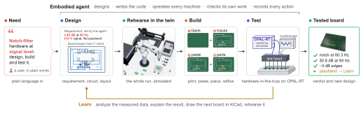

> 图解：整条链从一句自然语言需求开始，依次经过量化指标、电路与 PCB 设计、数字孪生排练、银墨打印与贴装、HIL 实测，最后生成下一版设计。Design 区域展示指标与布局，Build 区域展示各制造步骤后的板子，Test 区域展示实时模拟器与示波器共同测量的测试原理。

## 为什么“会设计电路”还不够

电力电子处在能源与负载之间：新能源并网、电动车和数据中心都离不开它。硬件进步依靠一个反复循环：明确需求、设计、制造、测量，再根据误差进入下一轮。在接触真实电网之前，真实控制板通常还要接入实时模拟器做**硬件在环测试**（Hardware-in-the-Loop，HIL），由模拟器提供输入并实时记录响应。

LLM 已经能辅助选择调制策略、生成变换器参数、绘制原理图和 PCB；机器人也能按语言指令抓取和组装物体。但两条能力线之间仍缺一段：设计工具大多停在仿真或布局，机器人系统则通常执行预先固定的流程。

这与化学、材料领域的自驱动实验室形成了对照。已有系统能搜索光催化剂配方、合成无机材料、规划化学反应，把数月的实验压缩到数天；不过多数系统改变的是固定工作流中的“配方”，而不是每次制造一个全新的对象。新电路意味着新的打印图案、焊膏位置、贴装任务、接触方式和验收测试，因此不能只调几个参数。

下表按论文给出的七项能力比较代表性系统。✓ 表示完整具备，◐ 表示部分具备，— 表示论文未报告该能力。

| 系统 | 领域 | 物理执行 | 制造器件 | 从需求设计 | 闭环 | 多设备流程 | 自主扫描建孪生 | 执行前排练 |
|---|---|---:|---:|---:|---:|---:|---:|---:|
| Mobile robotic chemist | 光催化 | ✓ | — | — | ✓ | ✓ | — | — |
| A-Lab | 无机材料 | ✓ | — | ◐ | ✓ | ✓ | — | — |
| Coscientist | 化学 | ✓ | — | ✓ | ◐ | ◐ | — | — |
| ChemCrow | 化学 | ◐ | — | ✓ | — | — | — | ◐ |
| AnalogCoder | 模拟电路 | — | — | ✓ | ◐ | — | — | — |
| PE-GPT | 电力电子 | — | — | ✓ | ◐ | — | — | — |
| Power Circuit AI | 电力电子 | — | — | ✓ | — | — | — | — |
| RialTo | 机器人操作 | ✓ | — | — | — | — | ◐ | ◐ |
| OptoMate | 自由空间光学 | ✓ | ✓ | ✓ | ◐ | ◐ | — | ◐ |
| Self-Building Labs | 实验室自动化 | ✓ | — | ✓ | ◐ | ✓ | ◐ | ✓ |
| **JARVIS** | **电子硬件** | **✓** | **✓** | **✓** | **✓** | **✓** | **✓** | **✓** |

JARVIS 的差异不只是“多接了几台机器”，而是同时承担工程师和技术员的角色：它既决定板子怎样设计，也负责把板子真正做出来，并用测量结果决定下一步。这个定位决定了系统必须同时解决设备操作、物理安全、实验验收和跨轮次学习，而不仅是电路生成。

## 系统总览：智能体、孪生、执行层与真实实验台

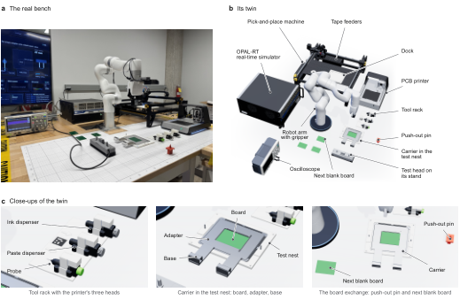

> 图解：（a）是真实实验台；（b）是运行开始时，根据扫描结果放置全部设备与工装后的孪生场景，包括机械臂、PCB 打印机、贴片机、工具架、测试工位、实时模拟器和示波器；（c）依次放大工具架、板载具，以及测试后推出旧板并装入下一块空白板的机构。

JARVIS 由四部分组成：

- **智能体**：推理、写代码并决定下一步，以文本记录作为长期记忆。
- **可执行数字孪生**：保存设备与工装的三维模型，并预测运动、加热、时间和测量结果。
- **可追责执行层**：在真实设备上运行程序，封装设备技能、执行安全限制并记录每次行动。
- **物理实验台**：由未经硬件或固件改装的标准设备组成，负责实际制造和测试。

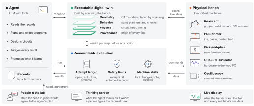

> 图解：智能体读写长期记录，并通过两条通道行动：一条连接数字孪生，用于提问和排练；另一条经过可追责执行层连接真实设备。孪生分为几何、行为、物理和来源四层；执行层保存设备技能、在代码中落实安全约束并记录所有尝试。扫描与设备实时状态持续同步两侧，两块屏幕则分别呈现实验台实况和智能体思考过程。

系统工作分为四个阶段：先认识设备，再扫描并建立孪生；随后把自然语言需求变成指标和电路设计，在孪生中排练；最后在真实实验台执行、测量并改进。下面先看它怎样安全地操作真实设备，再看“排练”为什么是整个方案的关键。

### 标准设备如何连成一条制造与测试链

物理实验台包含六类核心设备：

- 带双指夹爪的**六轴协作机械臂**，腕部安装相机和 3D 扫描仪，负责搬运所有板与工具。
- **桌面 PCB 打印机**，通过可更换工具头沉积导电银墨和焊膏，用探头测量板面高度，并用热床固化银墨、回流焊膏。
- 带卷带供料器和上下两个相机的**贴片机**，分别观察 PCB 基准点和吸嘴上的元件。
- 带模拟输入输出的 **OPAL-RT 实时模拟器**，产生测试信号、采集响应，并运行智能体生成的测试模型。
- 作为第二套独立采集仪器的**示波器**。
- 面向实验人员的**实时大屏与思考屏**。

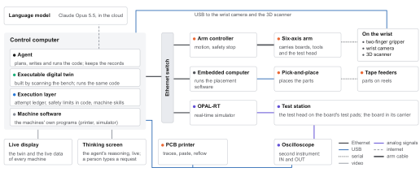

> 图解：控制计算机运行智能体、孪生、执行层和设备软件，云端 LLM 提供推理能力。机械臂控制器、实时模拟器及贴片机嵌入式计算机经以太网连接；打印机、示波器、腕部相机和扫描仪通过 USB 连接；模拟器的模拟通道则经屏蔽线缆和测试头连接 PCB。

智能体的推理由 Claude Opus 5.5 提供，但设备记录和控制代码不依赖特定模型，因此可以替换 LLM。智能体自己编写设备驱动、设备技能、孪生、设计到制造文件的转换程序、测试程序和显示界面；厂商软件与编程库则直接复用。

### 一个载具贯穿所有工序

板子并不是被机械臂直接夹来夹去，而是装在一个由**适配框和底座**组成的载具中。适配框对应一种板尺寸，板从开口处直接贴住底座，以便热床传热；两者都有夹持凸耳，机械臂可以整体搬运，也可以只移动适配框。

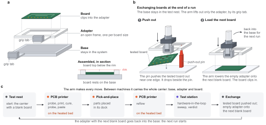

> 图解：（a）空白板卡入开放式适配框，适配框再放进底座；（b）测试后，机械臂只抬起适配框，利用顶出销从下方推出旧板，再把空框压到下一块空白板上完成装板；（c）完整载具依次经过打印、贴装和测试工位，加热时也不拆分。示意图不按比例绘制。

这个设计把“每轮都要重新装夹”变成了简单的机械动作。底座始终留在系统内，换板只需换适配框中的 PCB；测试完成后，下一块空白板也已准备好，闭环可以继续转动。

### 不靠改装设备，而靠设备技能与状态检查

JARVIS 的一项重要工程选择是：所有设备都按交付状态使用，通过原厂应用、命令接口或编程库操作。这样既保留设备原有检查，也让其他实验室更容易用同类设备复现。

- **自动换工具头**：探头、银墨头和焊膏头在一块板的制造中共需八次拆装。机械臂根据 3D 扫描仪识别的标记找到工具架，按厂商规定顺序完成取放，每次“取下旧头并装上新头”约需三分钟。
- **操作打印机原生应用**：智能体读取屏幕、按按钮标签点击，并在每次点击后核对页面；遇到错误或超时即停止。热床则由独立加热程序按设定温度和时间控制。
- **适配不平整板面**：每次沉积前，探头在多点触碰 PCB，生成高度图，喷嘴据此保持恒定间隙。裸板阶段相邻测点差异过大可能意味着板未装好，应在耗墨前停止；打印后线路和焊盘抬高属于预期，因此焊膏阶段放宽阈值；回流后再为下一块裸板恢复严格阈值。
- **通过贴片机自己的软件执行贴装**：智能体生成贴装任务，经原厂脚本接口调用加载、回零、启动、停止和停头等操作。机械臂进入前必须满足联锁：没有任务运行、贴装头已停妥、吸嘴为空且升起。
- **生成并核验测试模型**：智能体为实时模拟器编写、编译和加载模型，扫频前检查模型版本、信号与模拟通道连接。无论测试如何结束，最终都将输出归零并停止、卸载模型。
- **复核示波器状态**：测量前读回探头衰减和通道耦合，与记录不符就拒绝测量；出现削顶或信号过小时，只调整采集设置后重新捕获。

设备会执行，不等于设备做得对。JARVIS 还用扫描仪核对设备位置，用夹爪开度确认抓取物，用打印机状态、温度、板面高度图和相机检查制造过程，用模拟器与示波器交叉检查测量。任何检查失败都停在最后一个可靠步骤，保存进度后可从该处恢复，即使换到新会话也能继续。

### 每次动作都留下证据

所有结果事先未知的行动都称为一次 **attempt（尝试）**，包括发送设备命令、机械臂运动和探索性测试。每次尝试必须走完四步：

1. **Open**：行动前写下目标、精确计划、预期结果、停止条件和实验台状态，缺一项就不能执行。
2. **Act**：执行层运行计划，并保存完整输出作为证据。
3. **Close**：记录成功、失败、部分完成、中止或未验证。
4. **Promote**：把新经验写回设备记录，注明它来自哪次尝试。

这些记录共同形成 attempt ledger（尝试账本）。更大的方案选择还会记录为设计决策，保留被否决的选项；观察与解释分开保存，每个事实都有来源标签，例如某次测量或厂商手册页码。由于 LLM 不跨会话记忆，这些文件就是系统真正的长期记忆。

安全限制同样落在代码而非提示词里：机械臂关节与笛卡尔速度、热床温度和加热时长、各设备周围的禁入区域都有明确的通过/失败阈值，并由软件测试覆盖。打印机只有在滑架处于换头位置时才开放相应区域；加热超温、温度读数中断或升温超时都会关闭加热器；测试模型把输出限制在 $\pm2$ V，任一增益超过 $+3$ dB 就停止扫频。任何运动都不能依赖来源仅为“假设”的数值。首次新动作仍需降速并由人员守住急停，正式自主运行期间也有人员按实验室规范守在急停旁，但不触碰实验台。

## 可执行数字孪生：让真实程序先在虚拟实验台跑一遍

普通数字孪生像是实验台的动态镜像；JARVIS 的孪生更像一座能试跑的虚拟实验室。它有两个额外属性：**由智能体自主扫描构建**，以及**原样运行将用于真实设备的代码**。因此排练检验的不是另写的一份简化脚本，而是即将真正执行的运动规划、安全检查和设备逻辑。

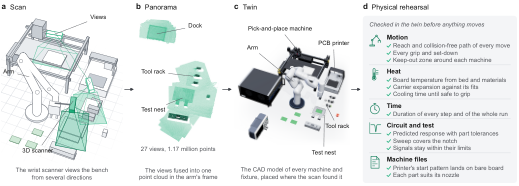

> 图解：（a）机械臂腕部扫描仪从多个方向观察实验台，每个锥体代表一个视角；（b）智能体依据机械臂位姿把点云融合成统一坐标系下的全景，颜色表示相对下方表面的高度；（c）再将每台设备、工装和工具的完整 CAD 模型对齐到扫描位置；（d）真实动作开始前，在同一孪生中检查运动、热、时间、电路、测试和制造文件。

扫描仪从机械臂上只能看到物体顶部和局部侧面，所以系统没有强行从残缺点云重建所有几何，而是把已有完整 CAD 模型配准到扫描结果。每次运行前重新扫描，确认设备仍在孪生记录的位置；运行中每次搬运载具、取走工具等动作也立即更新孪生。

### 四层模型各管一件事

- **Geometry（几何）**：保存设备、工装、工具与载具的完整模型，以及由扫描或机械臂位姿记录得到的位置。
- **Behavior（行为）**：在模拟机械臂上运行真实运动规划、逆运动学、碰撞与禁入检查，同时复现打印滑架、工具头、贴装联锁和制造进度等设备状态。
- **Physics（物理）**：预测热传递、热膨胀、结构弯曲、步骤耗时、电路响应和测量链。
- **Provenance（来源）**：给每个值附加测量、计算、厂商提供、假设或模拟等来源，以及适用配置和产生它的尝试；运行输入文件也保存哈希指纹。

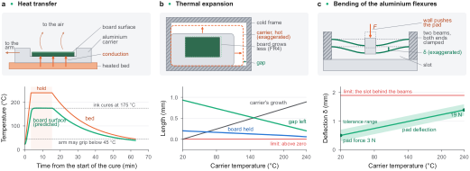

> 图解：（a）热床经铝载具向 PCB 导热，同时板面向空气、载具向机械臂散热，孪生用真实加热程序预测板面固化温度和安全夹取时间；（b）铝与 PCB、外部冷框架的膨胀程度不同，模型检查最高 240 °C 时载具周围间隙和板子固定状态；（c）双端夹持的铝柔性梁随热膨胀进一步弯曲，模型检查其挠曲与应力。曲线由孪生模型计算，结构图不按比例绘制。

物理层还求解包含元件容差、电容损耗和仪器输入负载的电路方程，并保存从模拟器输出、经过 PCB 再回到输入端的测量链校准响应。这样，排练不只是“机械臂会不会撞上”，还包括“板子能否按设计工作、测试是否会给出正确结论”。

## 从一句需求到可验收、可制造的设计

论文选择 **60 Hz 陷波器**作为基准。并网变换器需要在强大的 60 Hz 基波旁测量谐波或直流偏置等微弱量，低电平传感信号也会混入 60 Hz 工频干扰，因此陷波器有明确用途；同时，它的频率响应容易精确验收，适合判断整个自主闭环是否可靠。

人只提出“做一个信号级硬件陷波器”这样的自然语言需求，智能体自行量化目标：从 $\pm10$ V 信号中至少去除 40 dB 的 60 Hz 干扰，并保持通带平坦。

### 把文字指标编译成验收代码

需求最终变成四项机器可执行检查：

1. 最低增益对应的陷波频率位于 $60\pm1$ Hz。
2. 60.0 Hz 处增益不高于 $-40$ dB。
3. 远离陷波点的 1 Hz 和 10 kHz 处，增益相对单位增益偏差在 $\pm0.6$ dB 内。
4. 两个 $-3$ dB 边界频率与设计值的偏差均不超过 10%，确认制造结果符合设计。

原文没有给出数值的“陷波位置”和“平坦”，由智能体补成明确阈值并记录。验收程序既能读取预测响应，也能读取实测响应；缺少某个检查所需频点时返回“无法评估”，而不是猜测。只有全部通过，整板才判定通过。

### Twin-T 电路与面向自动制造的 PCB

智能体选择无源 **twin-T** 网络。它需要阻值为 $R$、$R$、$R/2$ 的电阻和容值为 $C$、$C$、$2C$ 的电容；实现时使用四个 $R=26.4$ kΩ、精度 0.1% 的电阻，以及四个 $C=100$ nF、精度 1% 的 C0G 电容，通过并联得到 $R/2$ 与 $2C$。

设计预测陷波点为 60.29 Hz，60 Hz 增益为 $-52.4$ dB，两个 $-3$ dB 边界分别为 14.7 Hz 和 257.6 Hz。智能体还在容差范围内随机生成 300 块虚拟板，全部在 60 Hz 处低于 $-43$ dB。

随后程序自动生成 KiCad 原理图和 PCB 布局、电气与设计规则检查、银墨和焊膏层文件、元件位置与贴装任务，以及测试模型和扫频列表。PCB 全部采用贴片元件且无钻孔，三个基准点引导贴装相机，六个带金圆盘的测试焊盘供测试头接触；板上共 14 个对象，包括四个电阻、四个电容和六个金圆盘。

一个细节体现了“为制造而设计”：打印机每次开始打印前都会画一小段引流图案，并默认把它放在电路外接矩形中心。初版布局在排练中发现该图案会穿过线路，智能体便在板的对角添加两个小标记，移动外接矩形中心，让引流图案落到空白区域。

### 42 步程序与逐条证据分级

完整制造、测试与换板流程被编译成 42 步：

| 阶段 | 步骤摘要 | 数量 |
|---|---|---:|
| Survey | 扫描实验台，确认所有设备与工装 | 1 |
| Load | 停妥打印机龙门，载具放到热床 | 2 |
| Probe | 进入流程、装探头、测裸板高度图、卸探头 | 4 |
| Print | 进入流程、装银墨头、引流并打印、卸头、退出并停妥龙门 | 6 |
| Cure | 加热保温并关闭、等待冷却、调整焊膏阶段探测阈值、停妥龙门 | 4 |
| Paste | 再次探测与两点对齐、测高、换焊膏头并点胶、结束流程 | 9 |
| Place | 联锁检查、载具入位、执行贴装、再次联锁、载具回热床 | 6 |
| Reflow | 加热回流、冷却、恢复探测阈值、载具进入测试工位 | 6 |
| Test | 放测试头、扫频与判定、移回测试头 | 3 |
| Exchange | 推出已测板并装入下一块空白板 | 1 |
|  | **总计** | **42** |

排练逐步执行这套程序：真实机械臂脚本检查可达性、碰撞、禁入区域和抓放位置；热模型检查固化、回流、热装夹与冷却；时间模型生成日程；电路模型在计划频点上预测响应并交给验收代码；制造文件则检查引流位置和元件与吸嘴的匹配。

每一步还按证据强度标记为 **proven、from records、simulated、assumed、missing、at risk**。只有不存在 missing 或 at risk，且没有运动依赖假设值时，才允许真实制造。所有缺陷都必须在设计、程序或测试计划中修复，而不是留到现场碰运气。

## 真实运行：从打印银墨到 HIL 测量

前面的设计解决了“该做什么”，真实运行则检验系统能否处理设备状态、材料特性和测量细节。人在思考屏上批准计划后，42 步程序开始执行，之后不再接受人工操作。

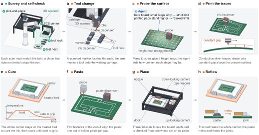

> 图解：（a）运行前重新扫描并核对设备位置；（b）机械臂从工具架安装打印工具头；（c）探头测量裸板高度图，图中不平程度被夸张展示；（d）喷嘴沿高度图以恒定间隙打印银墨；（e）整个载具加热固化并冷却；（f）根据两个已打印特征对齐焊膏层并点胶；（g）下视相机识别三个基准点，上视相机检查吸嘴元件后贴装；（h）再次加热形成焊点。示意图不按比例绘制。

制造时，探头在银墨和焊膏两次沉积前分别测高。银墨打印并固化后，智能体根据新出现的线路高度主动放宽下一阶段阈值。焊膏采用熔点 138 °C 的低温锡铋合金；贴片机通过视觉定位并完成全部贴装；最后整个载具回到热床回流，冷却到可夹取温度后进入测试工位。

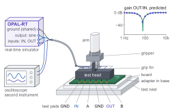

> 图解：载具固定在测试巢中，机械臂在整个扫频期间压住测试头，使六个触点连接六个测试焊盘；本板不使用 A、B 两路。模拟器一路模拟输出向 IN 注入正弦波，两路模拟输入采集 IN 与 OUT，逐频计算 OUT/IN；示波器同时独立测量这两个信号，小图展示孪生预测增益。

测试输入采用 1 V 幅值。由于该线性板的增益与幅值无关，结果可对应到需求中的 $\pm10$ V；器件耐压与功耗也满足要求：电容额定 50 V，10 V 输入时每个电阻耗散不超过 4 mW，低于 100 mW 额定值。

每个频点等待响应稳定后，测试模型在完整周期内将输入输出分别与正弦、余弦比较，求得复增益 $G(f)=V_{\mathrm{out}}(f)/V_{\mathrm{in}}(f)$。基础扫频覆盖 1 Hz 至 10 kHz，每十倍频程十个点；陷波附近加密为 50–70 Hz 每 0.5 Hz 一点、57–64 Hz 每 0.25 Hz 一点。示波器独立拟合两路正弦并计算自己的 OUT/IN，从而排除单一采集链造成的假象。

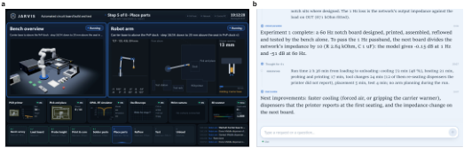

> 图解：（a）实时大屏以三维孪生镜像实验台，突出当前工作的设备及位姿、关节角和夹持物，下方持续显示打印、温度、贴装、测试与扫描状态，底部高亮当前步骤；（b）思考屏接受初始自然语言请求，展示智能体观察、核对、比较和决策的过程，并在末尾给出测试解释、下一版设计和流程改进建议。大屏只显示来自实验台的真实数据。

## 实验结果：一次跑通，但不是“所有指标都通过”

结果部分围绕四个问题展开：能否无人干预完成、板子是否满足要求、能否从数据学习，以及排练究竟避免了什么。

### Q1：42 步、159 分钟、零人工操作

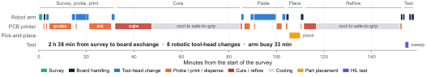

> 图解：每条横条表示一台设备的一项活动。机械臂负责搬运、八次换头、保持测试头和换板；大部分时间则由设备工艺占据，尤其是银墨固化、焊膏回流及两次冷却。

这是该实验第一次从头跑到尾。系统完成全部 42 步，从请求开始到下一块空白板装好共 2 小时 39 分钟；除了最初一句“我检查了计划，同意继续”，运行中人工动作数为零，守急停的人没有介入。

热床在 240 °C 下保持 12 分钟固化银墨、保持 2 分钟回流焊膏；机械臂相关任务共占 33 分钟，加热与冷却合计 93 分钟。所有机械臂任务都使用排练过的规划，因此现场没有停下来重新规划。

首次运行也遇到了真实设备故障：打印机一度无法识别已安装工具头，应用中的电路定位控件也曾停止响应。智能体读取设备状态后，通过回零、卸下并重新安装工具头解决前者；对后者则读出实际位置，确认距目标不超过 0.2 mm 后继续。这些恢复动作同样没有人工介入。

### Q2：陷波性能超标，1 Hz 通带失败

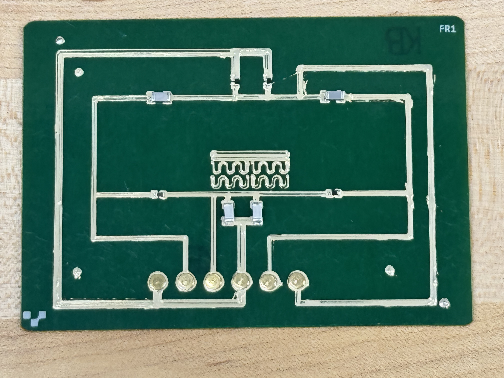

> 图解：这是运行结束时的实物板，包含银墨打印线路、完成贴装与回流的电阻电容，以及六个测试焊盘上的金圆盘；全部 14 个元件与焊盘对象均由系统完成制造和装配。

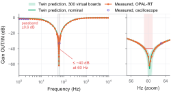

> 图解：横轴为频率，纵轴为增益。红色表示由需求编译出的验收边界，绿色为标称设计及 300 个容差随机样本的孪生预测，橙色为实时模拟器实测曲线，空心圆为示波器读数。陷波深度和频率符合要求，但低频端实测下垂超出红色边界。

| 检查项 | 限值 | 孪生预测 | 实测 | 判定 |
|---|---:|---:|---:|---|
| 陷波频率 | $60\pm1$ Hz | 60.29 Hz | 60.29 Hz | 通过 |
| 60 Hz 增益 | $\le -40$ dB | $-52.4$ dB | $-50.6$ dB | 通过 |
| 1 Hz 通带 | $\pm0.6$ dB | $-0.47$ dB | $-1.29$ dB | **失败** |
| 10 kHz 通带 | $\pm0.6$ dB | $-0.02$ dB | $-0.16$ dB | 通过 |
| 下侧 $-3$ dB 边界 | 14.7 Hz $\pm10\%$ | 14.7 Hz | 15.3 Hz | 通过 |
| 上侧 $-3$ dB 边界 | 257.6 Hz $\pm10\%$ | 257.6 Hz | 263.8 Hz | 通过 |

用最低三个读数拟合抛物线后，陷波点位于 60.29 Hz，与孪生预测一致；60 Hz 衰减 50.6 dB，比指标要求多 10.6 dB。两个 $-3$ dB 边界与设计值相差均在 4.0% 内，10 kHz 增益也合格。

问题在 1 Hz：实测 $-1.29$ dB，比允许边界多出 0.69 dB 衰减。孪生原先仅考虑模拟器 1 MΩ 输入时预测 $-0.47$ dB，加入示波器 10 MΩ 输入后预测 $-0.51$ dB，都没有完全解释实测。

在示波器实际读到的频点上，它与模拟器在通带内的一致性优于 0.05 dB，在 63 Hz 陷波陡峭侧壁上也相差不超过 0.43 dB。但首次测试程序存在缺陷：96 个扫频点中示波器只成功读取 6 个，因为较高频率下捕获和传输来不及完成，程序又没有等待，导致大量不含当前扫频频率的数据被丢弃。智能体从日志中找到了原因，提出下一版程序保持当前频率直到示波器读取完成；论文还报告随后重测时，其有效读数均与模拟器一致。

### Q3：从失败频点反推负载，再缩放整个 RC 网络

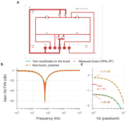

> 图解：（a）智能体在 KiCad 中画出的下一版板，布局不变，所有电阻除以 10、所有电容乘以 10；（b）对比首板实测、用实测重新校准的孪生，以及下一版预测；（c）放大 1 Hz 附近通带，下一版预测回到验收边界内。

智能体先排除与数据不符的解释。元件值误差会移动陷波点或边界，但陷波频率准确、边界偏差很小；不良焊点会使陷波变浅，但实测深度达到 50.6 dB。剩下最符合“只在低频下垂”特征的原因，是网络输出阻抗与输出端负载共同作用，而低频时该输出阻抗最高。

扩展电路模型拟合全部 96 个实测点后，重新校准的孪生将响应复现到 **0.14 dB RMS** 以内。拟合得到的输出阻抗与负载之比是设计假设的 2.6 倍；若元件保持标称值，相当于输出端约有 340 kΩ 负载，而原设计按两台仪器输入估算为 909 kΩ。差异可能来自模拟器文档中的 500 kΩ 对地输入路径与 1 MΩ 端间阻抗，也可能来自板面泄漏，现有数据不能唯一区分，但两者的改进方向相同。

下一版采用 $R=2.64$ kΩ、$C=1$ μF，即所有电阻缩小十倍、所有电容扩大十倍：

$$
R'=\frac{R}{10},\qquad C'=10C
\quad\Rightarrow\quad
R'C'=RC
$$

每个 RC 乘积不变，因此陷波特性保留；网络对负载则“硬”了十倍。代价是源端负载也增加十倍：10 kHz 时输入阻抗约降至 660 Ω，10 V 信号需要 15 mA，恰好达到模拟器模拟输出额定值，1 V 测试则对应 1.5 mA。重新校准的孪生预测下一版在 1 Hz 为 $-0.15$ dB、60 Hz 为 $-51.0$ dB，均进入相应限值。

**这个设计的聪明之处在于，学习不是凭空调参，而是先找出响应曲线中的物理证据，再做保持关键不变量的缩放。**同时它也暴露了新的工程边界：降低网络阻抗并非没有成本，下一版必须正视源端电流能力。

智能体还根据运行记录提出工艺改进：冷却占时接近一半，可考虑强制风冷，或在材料允许时提高载具夹取温度；工具头识别失败耗费时间，则应改进工具头的稳固安装。一次运行因此同时产出验收结论、物理原因、下一版 PCB 和实验流程优化，而不只是一个 pass/fail。

### Q4：五项缺陷在耗料前被排练拦截

| 孪生排练暴露的缺陷 | 智能体的修复 |
|---|---|
| **测试计划**：最初仅在 10 Hz–1 kHz 对数等距取 25 点，56.2–68.1 Hz 间没有频点，最深读数只有 $-29$ dB，正确板也会误判失败。 | 改为 1 Hz–10 kHz 扫频，并在陷波附近加密至最小 0.25 Hz 间隔，预测验收变为通过。 |
| **银墨引流图案**：548 个笔画中有 120 个会跨越线路。 | 增加两个小标记移动外接矩形中心，使图案落到空白板面。 |
| **焊膏对齐**：导体层与焊膏层必须具有一致的外接矩形，否则两点对齐会出错。 | 在两个图层使用相同的一对标记。 |
| **贴装吸嘴**：1206 电容宽 1.6 mm，小于默认吸嘴允许的最小元件尺寸。 | 将电容分配给更细的吸嘴。 |
| **禁入区域**：八次换头时需要开放打印机区域，其余时间必须关闭。 | 让禁入区域随打印机报告的滑架位置动态切换。 |

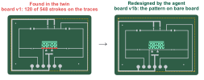

> 图解：初版 v1 中，红色引流笔画会穿过实际线路；这不是人指出的，而是智能体在孪生排练中发现。修改后的 v1b 通过对角小标记移动电路外接矩形中心，使引流图案避开线路，最终实物板沿用了这版布局。

五项缺陷都在使用材料前由模拟发现，并由智能体修改设计、程序或测试计划后重新排练。论文指出每一项都至少可能浪费一块板，而错误的扫频计划更危险：它会否定一块正确电路，诱导闭环去“修复”原本合格的设计。对依赖测量学习的系统而言，**测试本身必须先被测试**。

## 讨论：它证明了什么，又还缺什么

JARVIS 把数字孪生推进为一种面向行动的世界模型：它不只预测实验台状态，还运行智能体自己的程序，回答“如果这样行动会发生什么、这个判断依据什么证据”。生产代码直接执行、扫描自动更新、数值全带来源，这三点共同支撑了跨运动、热、时间和电路的排练。

系统的通用部分也不少。更换电路族主要需要替换孪生中的电路模型、验收代码和测试计划；新设备则需要建立记录、扫描模型和设备技能。论文设想的后续方向包括：

- 让下一版设计继续进入同一闭环，每轮用实测重新校准孪生。
- 面向 50 Hz 电网只调整元件值，面向更窄陷波则改用有源电路并同步更新模型和测试。
- 在孪生中筛选候选设计，只制造信息增益最高的板。
- 将带来源标签的排练与执行轨迹用于操作策略学习和 real-to-sim 研究。
- 利用加热冷却期间机械臂的空闲，让一台机械臂调度多台打印机和测试工位。

不过，这篇论文展示的是**一次首次端到端运行和一次下一版预测**，还不是多轮迭代后持续收敛的统计证据。首板也没有完整通过验收，1 Hz 通带失败；示波器首次仅覆盖 96 个频点中的 6 个，说明双仪器校验流程本身仍需修正。作者的自我评价同样克制：走线采用直角而非专业常用的 45°，部分线路沿板边绕行，网络阻抗对负载估计不足，智能体的数据解释与新设计也仍有改进空间。

因此，最准确的结论不是“AI 已经取代硬件工程师”，而是它首次在电力电子电路板上把设计、制造、实测和解释串成了一个可追责的物理闭环。它的价值既来自成功的 50.6 dB 陷波，也来自系统能够面对失败频点给出下一版有依据的设计。

## 总结

- **完整闭环**：JARVIS 从自然语言需求出发，自主完成指标、电路与 PCB 设计、真实制造、HIL 测试、结果解释和下一版设计。
- **关键机制**：自主扫描构建的可执行数字孪生直接运行生产代码，在耗料前检查运动、热、时间、电路、测试与制造文件。
- **最硬结果**：首次端到端运行完成 42 步，用时 2 小时 39 分钟，计划批准后零人工操作；60 Hz 实测衰减 50.6 dB。
- **并非全项通过**：1 Hz 实测为 $-1.29$ dB，未满足 $\pm0.6$ dB 通带要求；智能体据此提出电阻除以 10、电容乘以 10 的下一版方案。
- **可信自主性**：未经改装的设备、逐步自检、双仪器测量、带来源的长期记录与尝试账本，让物理执行可复核、可恢复。

下一步真正值得观察的是，这套闭环能否连续制造多轮板子，并在更复杂功率级和嵌入式控制器上稳定提升，而不只完成一次漂亮的端到端演示。

> 本文参考自 [JARVIS: An Agent That Designs, Builds, and Tests Circuit Boards on Its Own](http://arxiv.org/abs/2611.26503v1)