# Judge Decoding：推理提速9.7倍

这篇论文解决的是 Speculative Decoding（投机解码）中的一个反直觉问题：**草稿回答即使完全正确，也会因为与目标模型的用词、概率分布不一致而被大量拒绝**。这会很快抵消并行验证带来的收益，也是以往方法通常只敢一次起草 5～7 个 token 的重要原因。Judge Decoding 在目标模型最后一层 Token Embedding 上训练一个线性“裁判”，让它判断续写是否正确，再与标准验证结果取逻辑或。最终，8B/405B-Judge 的平均接受长度达到 19.7 个 token，在 HuggingFace 上相对标准解码提速 **9.7 倍**，并在 8 张 H100、8-bit 量化的 gpt-fast 环境中达到 **129.3 tokens/s**，同时在多个基准上基本保持目标模型质量。

## 一、投机解码为什么会“浪费”好答案？

大模型自回归生成的特点是：每产生一个新 token，通常都要完整运行一次模型。对于 Llama-3.1-405B 这样的大模型，在小 Batch 场景下，推理往往受显存带宽限制；此时一次并行处理多个 token，增加的延迟却相对有限。

Speculative Decoding 正是利用这一点，把生成拆成两个角色：

- **Draft Model（草稿模型）**：较小、较快，连续提出 $M$ 个候选 token。
- **Target Model（目标模型）**：较大、较强，一次并行检查全部候选，并决定接受到哪里。

设当前上下文为 $\mathbf{s}$，草稿模型依次生成候选 $c_1,\dots,c_M$，其概率分布为 $\mathbf{q}_1,\dots,\mathbf{q}_M$：

$$
(c_1,\mathbf{q}_1),\dots,(c_M,\mathbf{q}_M)
=
\mathrm{LLM}_{\mathrm{draft}}^{(M)}(\mathbf{s})
$$

目标模型并行处理这些候选，得到 $\mathbf{p}_1,\dots,\mathbf{p}_{M+1}$。标准验证在第 $i$ 个位置采样 $\epsilon_i\sim\mathcal{U}([0,1])$，只有此前候选都已接受，并满足下式时，才接受 $c_i$：

$$
\epsilon_i < \frac{\mathbf{p}_i[c_i]}{\mathbf{q}_i[c_i]}
$$

如果目标模型给候选的概率不低于草稿模型，它必然被接受；否则按照两者概率之比进行随机接受。首次拒绝后，可以从目标模型对应位置的分布中采样修正 token；若全部接受，还能利用 $\mathbf{p}_{M+1}$ 多生成一个 token。

这套机制的关键价值是：**它能从分布上保证最终输出与目标模型原有采样结果一致**。但代价也同样明确——它检查的是“目标模型会不会这样说”，而不是“这句话本身对不对”。

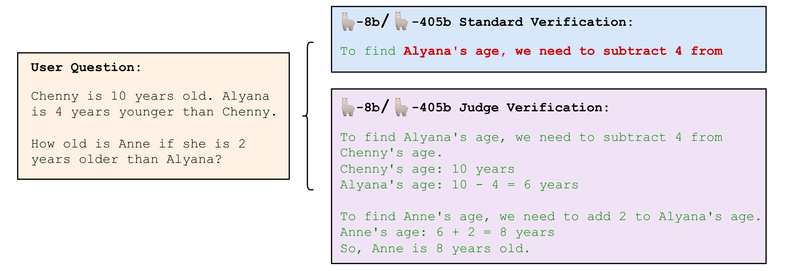

> 图解：示例使用 Llama-3.1-8B 起草、Llama-3.1-405B 验证，绿色表示接受的 token，红色表示拒绝的 token。标准方法可能在答案仍然正确时就因分布不对齐而中断；Judge Decoding 则能保留更长的正确续写。

### 草稿越长，收益为什么不一定越大？

直觉上，一次多起草一些 token，就能少调用几次昂贵的目标模型。但标准验证是**前缀式**的：只要较早的位置被拒绝，后面的候选即使单独看很好，也不能继续保留。

因此，草稿长度 $M$ 存在两难：

1. $M$ 太小，目标模型仍需频繁运行，加速上限不高。
2. $M$ 太大，早期拒绝的概率升高，后续大量草稿计算被浪费。

论文在 MT-Bench 和 GSM8K 上观察 Llama-8B/405B，发现平均接受 token 数会随 $M$ 增大很快饱和，整体接受率随之下降。这解释了为什么已有工作常把 $M$ 限制在不超过 7 的范围，而不是无限拉长草稿。

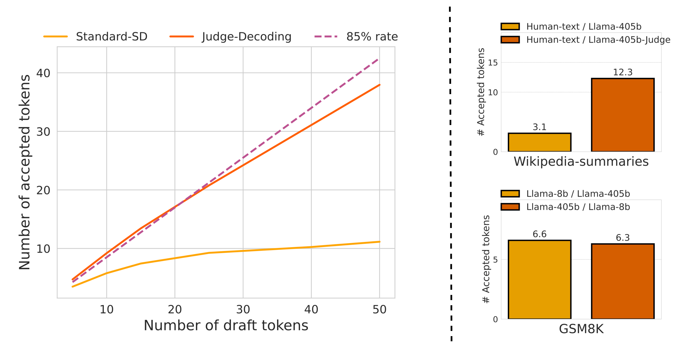

> 图解：左图横轴为草稿 token 数 $M$，纵轴为平均生成 token 数，对比标准验证与 Judge 验证；标准方法的收益较早饱和，而 Judge Decoding 能利用更长的草稿。右图上方考察高质量人工文本的接受数量，下方比较 8B/405B 与反向的 405B/8B 标准投机解码，说明仅提高草稿质量并不能自然解决拒绝问题。

## 二、问题不在草稿质量，而在验证目标

如果接受率低只是因为小模型能力差，那么换一个足够强的草稿模型，情况就应该明显改善。论文用三组实验排除了这些解释。

### GPT-4o 起草，也只被接受约两个 token

作者让 GPT-4o 在 MT-Bench、GSM8K 和 HumanEval 上生成完整答案，再观察 Llama-405B 在 greedy 验证下，首次拒绝前能接受多少 token。由于 GPT-4o 是闭源模型，这里并不能运行完整的概率比值验证，但这个实验足以检查目标模型对高质量前缀的匹配程度。

结果很反直觉：平均只接受约两个 token。把标准模型对调，让更强的 Llama-405B 给 Llama-8B 当草稿，接受数量也没有提升，反而略降。

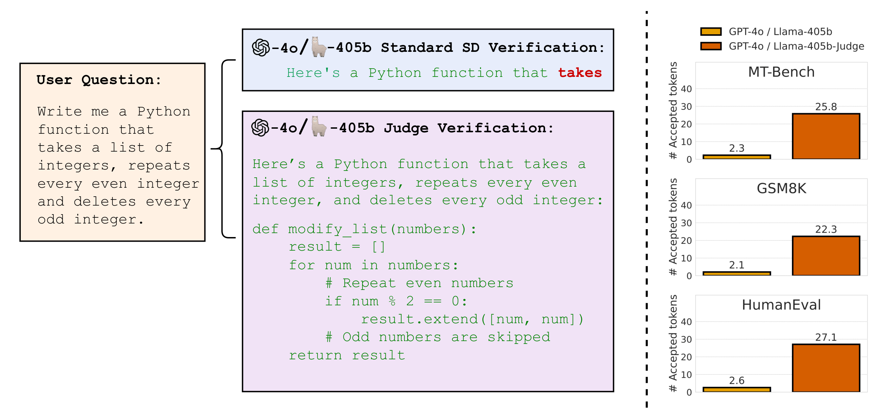

> 图解：左侧比较标准 SD 与 Judge Decoding 对同一段 GPT-4o 回答的处理，绿色为接受、红色为拒绝；标准方法在两个词左右就拒绝，Judge Decoding 则接受了完整正确回答。右侧汇总 GPT-4o 起草、Llama-405B 验证时的平均接受数量，Judge 验证显著更高。

### 人工高质量文本同样会被拒绝

作者还从 wikipedia-summary 数据集中选取经过社区审阅的 Wikipedia 摘要，把它们作为候选续写交给 Llama-405B 检查。即使是这些高质量人工文本，标准 greedy 验证仍会拒绝相当一部分 token。

这组实验很重要，因为它把“草稿模型能力不足”进一步排除在外：**只要验证目标仍是逐 token 对齐，质量再高的文本也可能因为表达方式不同而被拒绝。**

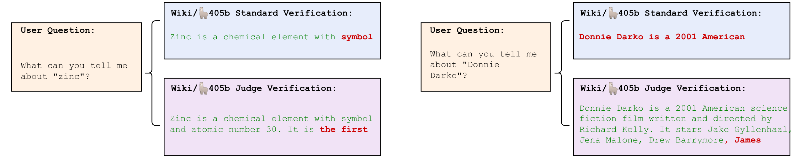

> 图解：图中展示 wikipedia-summaries 子集的两个提示及对应验证结果。模型需要围绕指定 Wikipedia 主题作答，候选内容来自人工摘要；对比再次体现“内容可靠”与“和目标模型逐字对齐”并不是同一件事。

于是问题被重新定义为：能否保留目标模型提供修正 token 的能力，同时让验证器识别那些**正确但不对齐**的续写？这正是 Judge Decoding 的出发点。

## 三、Judge Decoding：给目标模型加一个轻量裁判

LLM-as-a-judge 已经表明，大模型可以评价其他模型答案的质量，并且其评分与人工评价有较高相关性。但直接把一个 LLM 裁判接入投机解码并不现实：

- 裁判通常需要较长的 System Prompt，甚至 Chain-of-Thought，额外延迟难以承受。
- 常规裁判评价完整答案，而投机解码必须判断很短、甚至不完整的续写片段。

作者的替代方案是：不额外运行一个裁判模型，而是从目标模型已经计算出的 Token Embedding 中直接读出“当前续写是否出错”。这样，验证仍然附着在一次目标模型前向计算上。

### 3.1 错误 token 会在隐藏表示中留下信号

论文首先观察到一个有趣现象：如果强制 Llama-405B 以错误回答开头，它往往会在后续生成中主动纠正。例如被强制写下“法国首都是柏林”后，模型可能接着表示“只是开玩笑，实际上是巴黎”。

这意味着，模型处理错误 token 时，最后一层隐藏表示可能已经包含“矛盾”“需要纠正”等信息。作者因此提出一个比改动整个模型更简单的假设：**一个线性分类器就足以从这些表示中识别错误。**

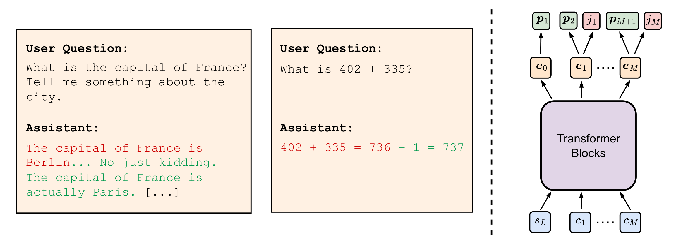

> 图解：左侧红色部分是强制提供给 Llama-405B 的错误回答，绿色部分是模型随后自由生成的纠正内容。右侧为 Judge 结构：$s_L$ 是上下文最后一个 token，$c_1,\dots,c_M$ 是候选 token；橙色表示目标模型 Embedding，绿色表示 LM Head 输出，红色表示裁判给出的判断。

附录中的更多案例显示，这种“纠错反应”不仅存在于事实问答，也出现在代码和推理错误中。

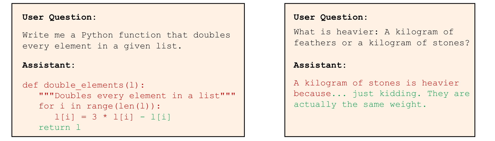

> 图解：左例中，原回答本应把列表元素翻倍却写成了三倍，模型通过减去 `l[i]` 修正计算；右例中，模型明确指出此前回答有误。这些行为支持作者的判断：模型内部能够感知当前上下文中的错误。

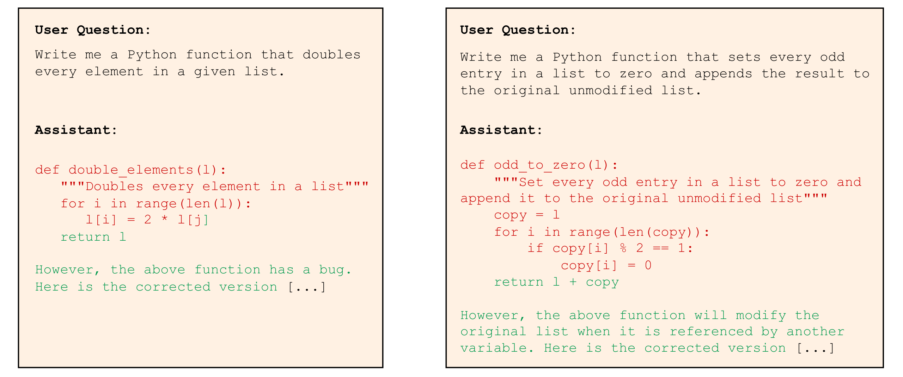

> 图解：左例中，模型发现索引变量 `j` 未定义；右例中，模型识别出没有复制原列表、导致原数据被一并修改的细微问题。即使无法直接修复答案，模型也可能指出回答已经不正确，进一步说明隐藏表示具有判断正确性的潜力。

这个设计的聪明之处在于，它没有把“裁判”理解成一次新的语言生成任务，而是把它压缩成目标模型隐藏状态上的一个分类问题，因此几乎没有额外推理开销。

### 3.2 只用 500 组数据训练线性裁判

为了让裁判识别“不同表达但都正确”的答案，作者构建了一个小型人工标注数据集。问题来自新建问题，以及经过严格筛选的 Alpaca 和 ARC；这里只使用输入问题，不使用原数据集答案。

每个样本包含三元组：**问题、正确答案、错误答案**。答案由 Mistral-Large-2、Llama-8B 和 Llama-405B 等多个模型生成，以增加表达风格和错误类型的多样性。所有答案都由作者人工检查、修正，并标出错误答案中首次出错的具体位置；作者也尝试过让 LLM 标注错误位置，但精度不足。

最终数据集只有 500 组三元组，标注方式如下：

- 正确答案中的所有 token 都是正样本。
- 错误答案在首次错误之前的 token 也是正样本。
- 出错 token 作为负样本。

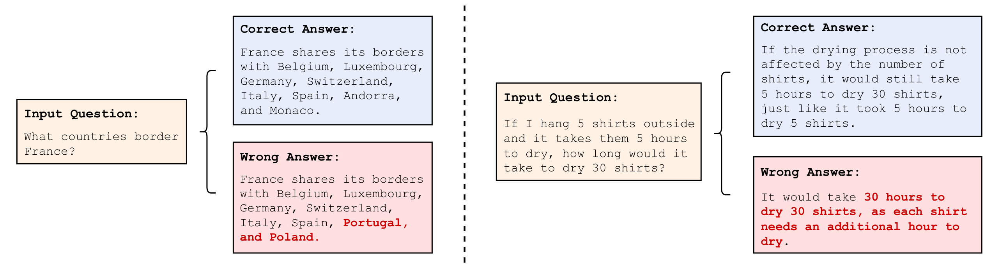

> 图解：图中给出两组“问题—正确答案—错误答案”样本，错误答案中的错误 token 以红色标出。标注粒度不是简单判断整段回答，而是定位具体错误位置，使训练信号能对应到投机解码的逐 token 验证。

数据天然类别不平衡：正样本约为负样本的 20 倍。因此，训练使用加权 Cross Entropy，提高负样本权重，让裁判在不确定时更倾向于拒绝，避免把错误 token 误放进来；同时使用 Early Stopping 降低过拟合。

模型设计上，作者比较了不同层的 Embedding。浅层效果明显较差，深层之间差异不大，因此最终选用目标模型最后一层、RMS Normalization 和 LM Head 之前的表示。虽然也测试过 MLP 和浅层 Transformer，最简单、最不易过拟合的线性头反而效果最好。

训练规模非常轻：

- 冻结目标模型全部参数，只训练线性裁判。
- 训练数据约 30k token。
- 参数量约 16.4k。
- 训练时间不到 1.5 小时。

### 3.3 推理时为什么采用“逻辑或”？

设候选 token $c_i$ 对应的目标模型 Embedding 为 $\mathbf{e}_i\in\mathbb{R}^{D}$，线性裁判为 $f_{\mathrm{judge}}$，Sigmoid 为 $\sigma$。当满足下式时，Judge 分支接受该候选：

$$
\sigma\left(f_{\mathrm{judge}}(\mathbf{e}_i)\right) > \delta,
\qquad \delta\in[0.5,1]
$$

$\delta$ 控制接受信心。论文实验中直接使用自然阈值 $\delta=0.5$，无需为保持质量而专门调参；当 $\delta=1$ 时，Judge 分支实际上不再额外放宽验证，方法退回标准 SD。

对一整段候选，系统会得到两个长度为 $M$ 的二值掩码：标准验证掩码 $\mathbf{z}_{\mathrm{stand}}$，以及裁判掩码 $\mathbf{z}_{\mathrm{judge}}$。最终结果为：

$$
\mathbf{z}
=
\mathbf{z}_{\mathrm{stand}}\vee\mathbf{z}_{\mathrm{judge}}
$$

也就是说，**任一分支接受，当前 token 就可以被接受**。标准分支负责保留目标模型本来就认可的内容，Judge 分支负责补充那些正确但分布不对齐的内容。

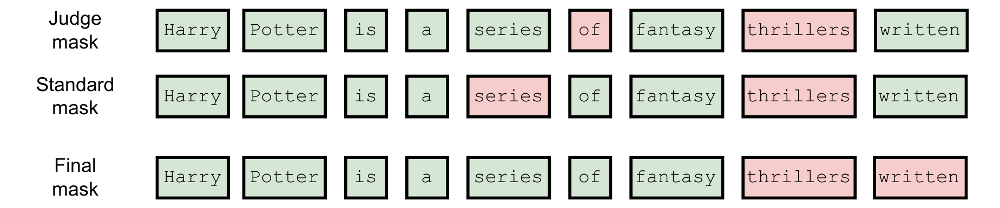

> 图解：图中展示 Judge 掩码与标准 SD 掩码的组合流程。两个分支一旦在当前位置形成最终拒绝，后续 token 仍按投机解码规则自动拒绝；因此它放宽的是逐位置判断，并没有破坏“只接受连续前缀”的约束。

采用逻辑或还有一个较隐蔽的原因。偶尔 Judge 会拒绝某个 token，但目标模型用于修正的 token 恰好又是它自己；如果完全忽略标准分支，系统可能在同一位置反复得到相同结果。标准 SD 会接受这种与目标建议一致的 token，因此取逻辑或可以把多次重复步骤合并成一次。

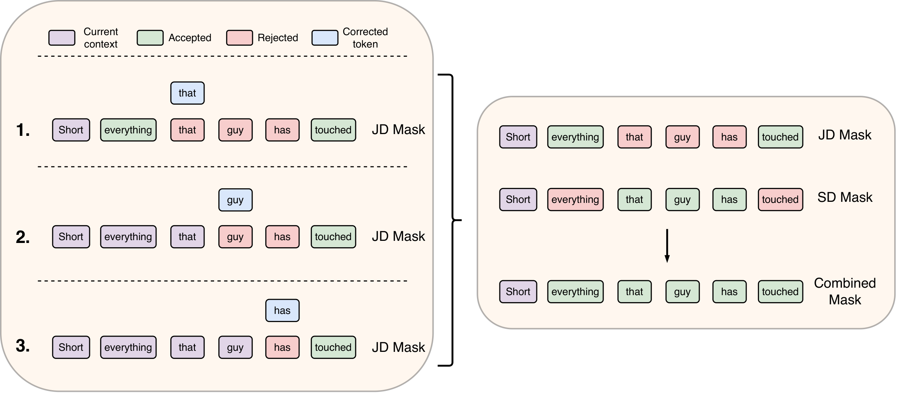

> 图解：示例中的 `that`、`guy` 等 token 被 Judge 拒绝，却又恰好是目标模型的修正结果。左侧若只按 Judge 处理会拆成多个步骤，右侧结合标准 SD 掩码后，可在保持相同回复的同时减少步骤。

### 3.4 它与既有加速路线的差别在哪里？

已有 Speculative Decoding 工作大多在优化“怎么提出更可能被目标接受的候选”：

- 用蒸馏 Loss 微调草稿模型，提高与目标模型的对齐。
- 用 Medusa、Eagle 等浅层预测头或自草稿结构，一次提出多个未来 token。
- 从 Top-$K$ 预测构建 Token Tree，再用 Tree Attention 并行验证更多组合。
- 让草稿访问目标模型的 KV Cache 或中间激活，以交换更多信息。
- 动态调整草稿长度，或根据草稿不确定性决定何时让目标接管。

Judge Decoding 改的是另一侧：**不再只提高候选与目标的对齐程度，而是改变候选被接受的标准。** 这使它能够更直接地利用现代小模型已经具备的回答质量，尤其适合一次起草较长序列的场景。

## 四、实验：接受更长，还要证明没有乱接受

放松验证后，最关键的问题不再是单纯接受率，而是两条必须同时成立：

1. 平均接受长度与端到端速度是否真正提升？
2. 会不会把错误续写也放进来，损害目标模型质量？

因此，论文除了常规 SD 速度指标，还报告了准确率，这是它与只追求分布一致性的标准 SD 实验的重要区别。

### 4.1 正确回答与错误回答都能被识别

回到前面的 GPT-4o 和人工文本实验，Judge Decoding 都显著提高了平均接受长度。它并不是简单地“一律接受”：对错误回答，裁判仍能在错误位置执行拒绝。

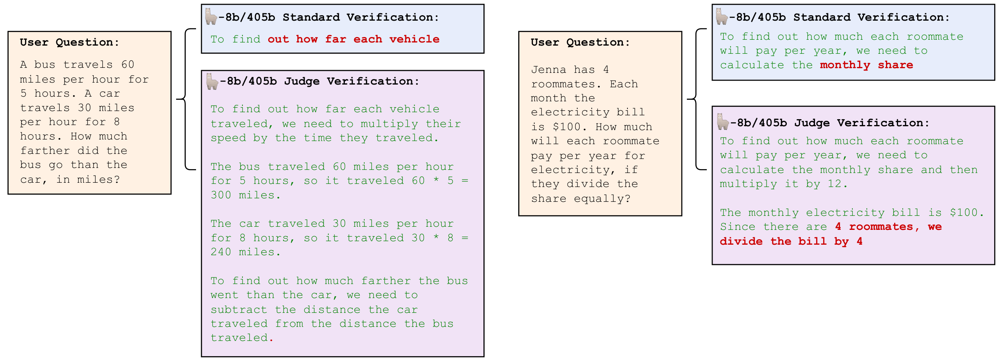

> 图解：左侧正确答案被标准 SD 过早拒绝，Judge Decoding 接受了更长续写，但后段仍有偏谨慎的拒绝；右侧是错误回答，标准 SD 很早就因不对齐而拒绝，Judge 则能在真正的错误处拒绝。例子中房间总人数应为 5，说明裁判关注的是实际错误，而非只做形式匹配。

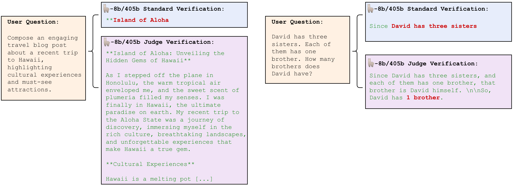

> 图解：补充案例延续相同对比：正确内容可以获得更长的接受区间，错误内容则会在相应位置被裁判拦截。与此同时，个别正确后段仍可能被过度拒绝，说明线性裁判并不完美。

### 4.2 多任务质量基本保持，Top-$K$ 放宽则明显掉队

质量评估覆盖 GSM8K、HumanEval、MT-Bench，并加入输出 token 很少的 ARC 和 MMLU。后两项虽然不属于典型长文本投机解码场景，却可以进一步检查裁判是否损害模型能力。

作者还设计了一个无需训练的基线：Top-$K$ 验证。只要候选 $c_i$ 位于目标分布 $\mathbf{p}_i$ 概率最高的 $K$ 个 token 中，就接受它。$K=1$ 接近标准 greedy 验证，$K=V$ 则相当于完全相信草稿模型，因此 $K$ 本身控制质量与速度的折中。

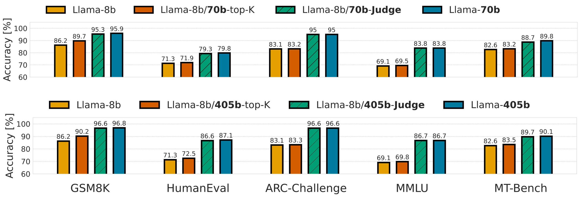

> 图解：上方是 Llama-8B 起草、Llama-70B 验证，下方是 Llama-8B 起草、Llama-405B 验证；包含 Top-$K$、$M=10$ 的标准 SD，以及以条纹表示的 $M=25$ Judge Decoding。Judge 方法在各项基准上基本保持目标模型准确率，而 Top-$K$ 即使 $K=5$ 也很难超过草稿模型自身表现，说明“多接受几个高概率候选”远不足以替代正确性判断。

这些结果支持论文的核心结论：现代草稿模型平均一次可以贡献接近 20 个可接受 token，而不必明显牺牲目标模型质量。但这里的“保持”来自实验观察，不再是标准 SD 的数学分布保证。

### 4.3 端到端速度：优化框架下仍有优势

速度取决于两个主要因素：每次接受多少 token，以及草稿与目标模型的延迟差有多大。后者又会受到量化、模型并行、`torch.compile`、TensorRT 等推理优化的影响。

只在 HuggingFace 上测速，可能放大某些方法的收益。论文举例称，Eagle 在 Llama-2-7B 上从 HuggingFace 切换到 gpt-fast 后，加速比会从约 $3\times$ 降至约 $1.5\times$；甚至未使用投机解码的 Llama-70B 在 gpt-fast 上也能达到约 45 tokens/s，高于 Eagle-2 在 HuggingFace 上约 33 tokens/s 的结果。

因此，作者同时报告 HuggingFace 和优化后的 gpt-fast。以下均为 Batch Size 1；gpt-fast 吞吐采用 512 输入 token、512 输出 token、8-bit 量化。

| 方法 | 平均接受长度 $m_*$ | HuggingFace 加速 | gpt-fast 加速 | gpt-fast tokens/s |
|---|---:|---:|---:|---:|
| 8B/70B-Standard | 6.4 | 1.5× | 1.7× | 76.7 |
| **8B/70B-Judge** | **18.8** | 2.0× | **3.0×** | **141.8** |
| 70B-Eagle-2 | 4.5 | **3.3×** | 1.9× | 88.1 |
| 8B/405B-Standard | 6.3 | 5.3× | 1.78× | 58.7 |
| **8B/405B-Judge** | **19.7** | **9.7×** | **3.9×** | **129.3** |
| 405B-Medusa | <6 | <6× | 1.9× | 108* |

硬件条件需要特别注意：70B 模型通常使用 2 张 H100，405B 使用 8 张 H100；表中 Medusa 的 108 tokens/s 来自条件明显不同的 H200、NVLink Switch 和 TensorRT 环境，不能把这一项视为完全同硬件对比。

对 70B 目标模型，HuggingFace 中 8B 与 70B 的延迟差不够大，Judge 的 2.0× 加速低于 Eagle-2 的 3.3×。进入 gpt-fast 后，CPU 指令、内存 I/O 等瓶颈被缓解，草稿与目标的延迟差更清晰，Judge 以 3.0× 和 141.8 tokens/s 反超。

对 405B 目标模型，验证本身昂贵得多，一次接受更多 token 的价值随之放大。标准 SD 平均接受 6.3 个，Judge 则达到 19.7 个，超过前者 3 倍；Medusa 和 Eagle-2 又分别受预测头数量、草稿树深度限制，单轮草稿通常不超过 6 个 token。于是 8B/405B-Judge 获得 9.7× 的 HuggingFace 加速，并在 gpt-fast 中达到 129.3 tokens/s。

**编辑点评：**这组结果最值得关注的不是某一个峰值，而是接受长度优势在优化框架中仍然存在。它说明 Judge Decoding 的收益并非只来自未优化实现中的额外开销。

### 4.4 训练细节与额外开销

附录补充了线性头的复现参数：优化器为 AdamW，学习率 $\eta=0.0001$，Weight Decay 为 0.1，Batch Size 为 128。Llama-405B 的线性头输入维度为 16,384，Llama-70B 为 8,192。

从部署角度看，这个线性头可以视作词表之外额外增加的一项输出，计算量相对于目标模型主体几乎可以忽略。实验均在单节点 H100-SXM5 上完成：405B 使用 8 张 GPU 和 8-bit 量化，70B 使用 2 张 GPU 和 8-bit 量化。

### 4.5 跨任务泛化：有效，但不是无条件有效

作者从训练集中移除全部代码样本，重新训练 Llama-405B 的裁判，再直接评估 HumanEval。性能从使用完整数据时的 86.6% 降到 80.4%，但仍高于 Llama-8B 草稿模型的 71.3%。

这说明“正确性”确实能跨任务迁移一部分，线性头并非只记住训练题型；但 6.2 个百分点的下降也说明，面对新任务时不能默认质量完全无损。要稳定保持目标模型表现，仍需使用性质相近的数据训练裁判。

## 五、适用条件与局限：速度之外必须保留的边界

Judge Decoding 放松了标准验证，因此也失去了标准 SD 最重要的理论性质。论文列出的限制可以归纳如下：

- **没有目标分布一致性的数学保证。**基准上保持质量不等于所有新任务都不退化。
- **草稿模型必须足够强。**如果长草稿很快偏离正确答案，裁判仍会大量拒绝；Medusa、Eagle 式小草稿头在很长预测区间未必合适。
- **目标模型也要足够强。**裁判依赖目标 Embedding 中的正确性信息，小目标模型未必能支持可靠判断，8B 级别目标更难获得类似加速。
- **新任务需要相近的人工标注。**所需数据量可以很小，但不能完全省掉数据构建与错误定位。
- **安全边界需要另行验证。**若草稿存在安全问题，Judge 可能接受目标模型原本不会生成的风险 token；论文实验未观察到该问题，但也没有系统研究。

这些限制并不削弱方法的价值，却决定了它更适合“强草稿 + 强目标 + 长候选 + 可覆盖任务分布”的组合，而不是任意模型对上的通用即插即用开关。

## 六、总结

- 标准 Speculative Decoding 验证的是草稿与目标的分布对齐，而不是内容正确性，因此 GPT-4o 和人工高质量文本也会被频繁拒绝。
- Judge Decoding 在目标模型深层 Embedding 上训练线性裁判，以 500 组人工标注样本、约 30k token 和不到 1.5 小时训练，实现轻量正确性判断。
- 推理时将 Judge 掩码与标准 SD 掩码取逻辑或，既接受正确但不对齐的续写，也保留标准分支处理目标原生 token 的能力。
- 8B/405B-Judge 平均接受 19.7 个 token，在 HuggingFace 上提速 9.7×，在 8 张 H100 的 gpt-fast 环境中达到 129.3 tokens/s，并在多项基准上基本保持目标质量。
- 代价是失去严格分布保证，且跨任务质量依赖训练数据覆盖；草稿质量、目标能力和安全风险也都是实际部署必须检查的条件。

未来更值得探索的方向，是让裁判以更少标注覆盖新领域，并为放宽后的验证重新建立可量化的质量与安全保障。

> 本文参考自 [Judge Decoding: Faster Speculative Sampling Requires Going Beyond Model Alignment](https://arxiv.org/abs/2501.19309)