# LANTERN：近邻 Token 放宽验收，加速图像生成

视觉自回归模型每生成一个图像 Token 都要跑一次前向传播，顺序解码成了图像生成和多模态统一建模的效率瓶颈。直接把大语言模型中的投机解码搬过来并不奏效，因为图像 Token 的预测概率常常平坦分散，草稿很难通过目标模型的严格验收。LANTERN 的核心思路是：把 latent space 中相邻、视觉语义相近的 Token 看作可互换项，聚合它们的概率来放宽验收，同时用总变差距离限制分布偏移。在 LlamaGen-XL Stage I 上，它相对标准自回归解码的实际加速从 EAGLE-2 的 **1.29× 提升至 2.26×（greedy decoding）**，并从 **0.93× 提升至 1.69×（random sampling）**。

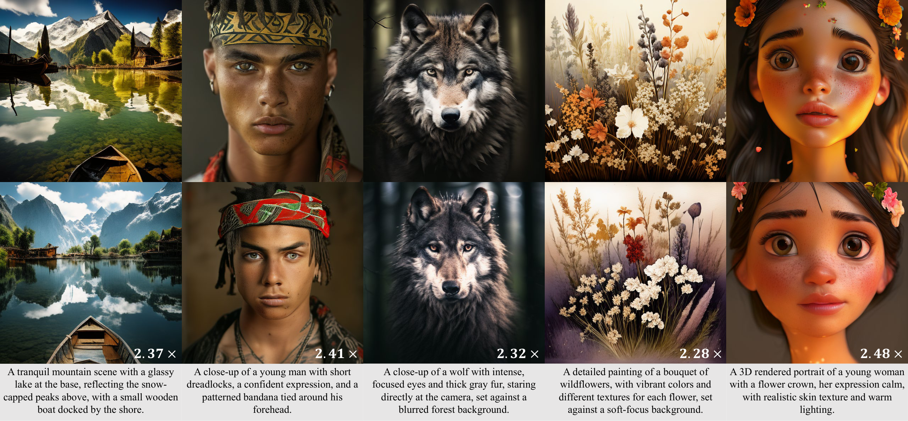

> 图解：上排是 LlamaGen-XL Stage II 的标准解码结果，下排是采用 LANTERN 宽松验收条件的有损投机解码结果；每张图右下角的白色数字是对应的平均接受长度。LANTERN 让一次目标模型前向传播能够接受更多草稿 Token，同时保留了可比的视觉内容。

## 从逐 Token 生成到“草稿—验证”

### 视觉 AR 的顺序瓶颈

自回归（Auto-Regressive，AR）图像生成可以分成两步：先把图像表示成离散 Token 序列，再像写句子一样逐项预测。给定文本提示 Token $X_{1:N}$，模型生成 $K$ 个图像 Token 的概率为：

$$
P(X_{N+1:N+K}\mid X_{1:N})=\prod_{\ell=1}^{K}P(x_{N+\ell}\mid X_{1:N+\ell-1})
$$

每个 Token 都依赖之前的 Token，因此标准解码需要 $K$ 个顺序步骤。生成结束后，Token 作为索引从 codebook $\mathcal{C}=\{c_1,\ldots,c_L\}$ 中取出 latent feature，按 raster-scan 顺序重排，再交给 VQVAE 或 VQGAN 的图像解码器恢复为 RGB 图像。

这条路线已经从 DALL-E、CogView 延伸到 Parti、LlamaGen、Chameleon 和 Anole。它不仅能与扩散模型竞争，还为文本、图像共用一套 AR 框架提供了可能；但每步只产出一个 Token，也放大了多模态模型的推理延迟。

### 投机解码为什么适合 AR

投机解码像“先让助手写草稿，再由主编一次审完”：小模型 drafter 连续生成 $\gamma$ 个候选 Token，大模型 target 用一次前向传播并行计算这些位置的分布，再逐项决定接受还是拒绝。

记 drafter 和 target 的分布分别为 $p$ 与 $q$，前文为 $s=(X_{1:N},\widetilde{X}_{1:i-1})$。候选 Token $\widetilde{x}_i$ 的接受概率是：

$$
\alpha=\min\left(1,\frac{q(\widetilde{x}_i\mid s)}{p(\widetilde{x}_i\mid s)}\right)
$$

若接受，就令 $x_{N+i}=\widetilde{x}_i$；若拒绝，则丢弃后续草稿，并从 $[q(x\mid s)-p(x\mid s)]_+$ 归一化后的分布重新采样。这里的 $[\cdot]_+$ 表示只保留正值再归一化。经典算法的关键保证是：**最终序列分布与 target 模型原始分布完全一致**。

后续工作主要在降低草稿成本或提高命中率：DistillSpec 用蒸馏训练 drafter，Medusa 使用多个解码头，Hydra 加入顺序依赖，EAGLE/EAGLE-2 则用单层 decoder、特征不确定性和动态树结构提升效率。LANTERN 选择了另一条路：不改 target 的生成流程，而是重新思考视觉场景下“什么候选值得接受”。

## 直接搬运为何失效：Token 选择歧义

作者先把已有投机解码方法直接用于视觉 AR，结果发现加速收益明显低于语言模型。

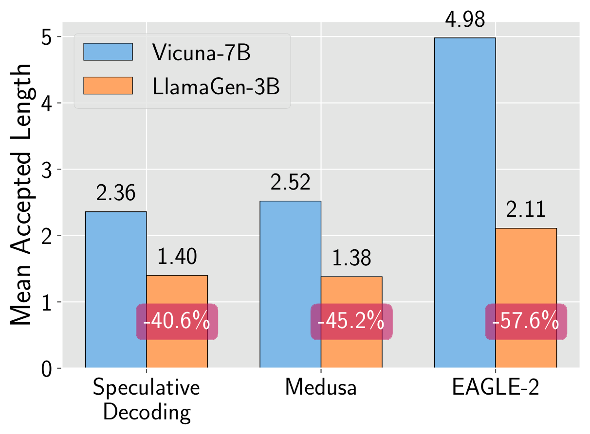

> 图解：该图比较多种投机解码方法在视觉 AR 与 LLM 上的 mean accepted length，即每轮 target 前向传播平均接受的 Token 数。LlamaGen-3B 相比 Vicuna-7B 下降了 41%–58%，而且不同方法都出现类似退化，说明问题并非某个 drafter 结构的个例。

第一个直接原因是 drafter 很难猜中 target 的输出。

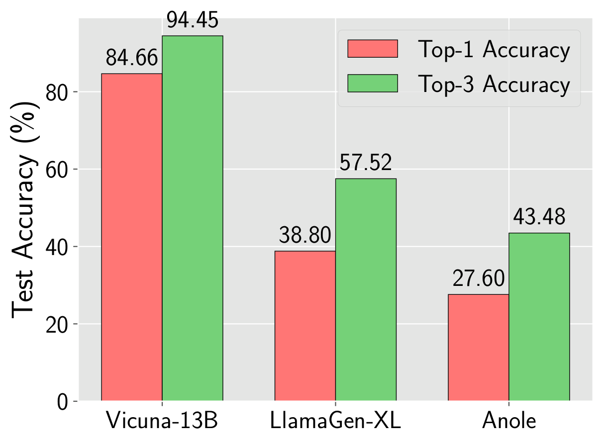

> 图解：图中比较 drafter 预测 target 输出的 top-1 与 top-3 accuracy。Vicuna 对应的语言 drafter 准确率明显更高，而 LlamaGen-XL 和 Anole 的视觉 drafter 难以精确复现 target 的选择；草稿经常不被接受，自然无法把并行验证转化为实际加速。

继续向分布内部看，作者发现了更根本的现象：**视觉 AR 的下一个 Token 分布更加平坦**。

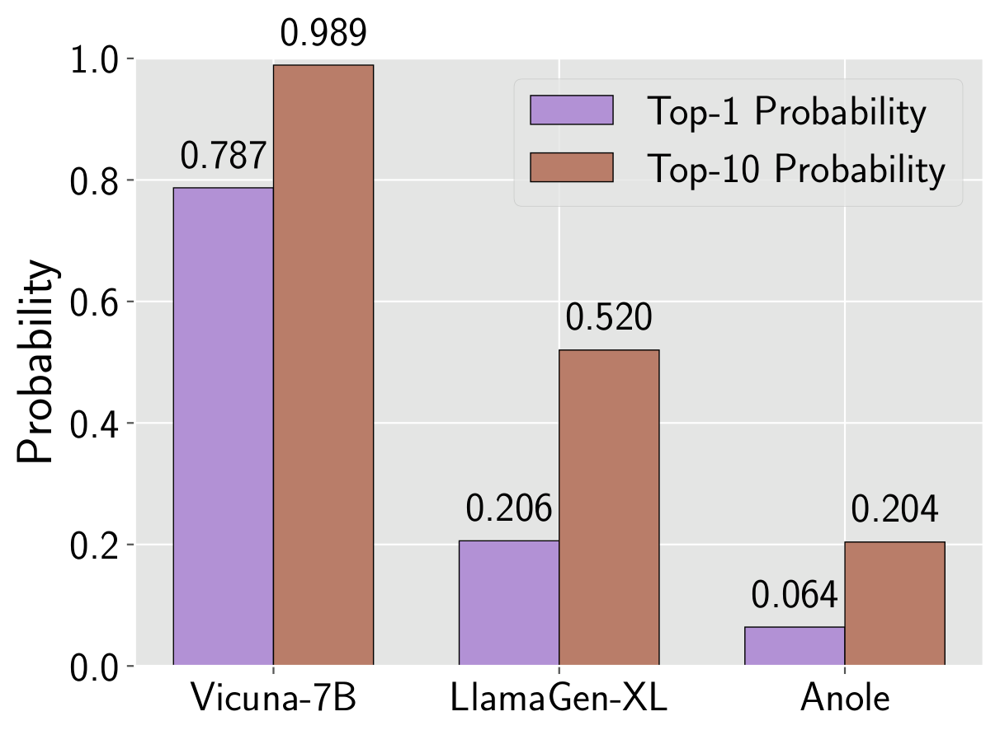

> 图解：该图比较下一 Token 预测分布的平均 top-1 与 top-10 概率。LlamaGen-XL 和 Anole 的数值显著低于 Vicuna-7B，意味着概率质量没有集中在少数候选上，target 对任何一个单独 Token 都缺少足够强的偏好。

作者把这种现象称为 **Token selection ambiguity（Token 选择歧义）**。文本中的词或子词受语法、句法和语义约束，下一项往往较可预测；图像 Token 则来自对连续视觉信号的量化，多个局部表示可能都合理。分布越分散，drafter 与 target 在“某一个确切索引”上对齐就越困难。

笔者认为，这一诊断很重要：它把问题从“drafter 不够强”转化为“严格按 Token ID 验收是否适合图像”。如果只是继续堆 drafter 容量，仍然没有触及视觉表示本身的可替代性。

## LANTERN：用 latent 近邻放宽验收

### 相邻图像 Token 可以互换

LANTERN 依赖的第一块基石是 **latent proximity**：latent space 中距离较近的图像 Token，解码后通常具有相近的视觉外观，替换它们不会显著改变整体语义。

这来自图像量化的特点。VQVAE/VQGAN 把连续视觉嵌入离散化为 codebook 中的向量，但 latent space 仍保留一定的连续结构。因此，Token ID 不同不等于视觉内容一定差异很大；这与“替换一个词就可能改变句意”的文本 Token 很不一样。

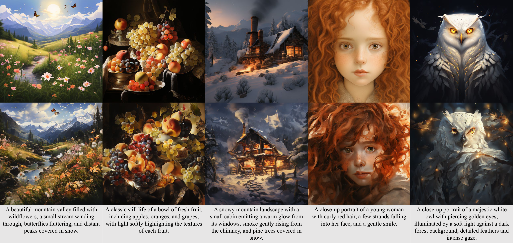

> 图解：上排是文本条件 LlamaGen-XL Stage II 的标准采样，下排是在每次采样后，从当前 Token 最近的 100 个 latent 邻居中均匀随机替换的结果。两组图像仍保持相近的内容和构图，为小范围 Token 互换提供了直观证据。

附录进一步给出了定量结果。实验使用 LlamaGen-XL Stage I 和 MS-COCO 2017 validation captions：

| Token 替换方式 | FID（越低越好） | CLIP Score（越高越好） |
|---|---:|---:|
| Vanilla AR，不替换 | 25.06 | 0.3214 |
| 从最近的 50 个 Token 中随机替换 | 26.88 | 0.3120 |
| 从最近的 100 个 Token 中随机替换 | 30.76 | 0.3091 |
| 从最近的 1000 个 Token 中随机替换 | 88.03 | 0.2715 |

近邻范围较小时，质量变化相对有限；范围扩大到 1000 后，FID 和 CLIP Score 明显恶化。因此，“近邻可互换”不是“任意 Token 都能替换”，这也解释了为什么 LANTERN 还需要显式的分布偏移约束。

### 聚合近邻概率，而不是只看一个 Token

标准验收只比较 $q(\widetilde{x}\mid s)$ 与 $p(\widetilde{x}\mid s)$。在平坦分布下，target 分给单个 $\widetilde{x}$ 的概率很小，即使它对应的视觉内容合理，也可能被拒绝。

LANTERN 定义 $B_k(\widetilde{x})$ 为 $\widetilde{x}$ 在 latent space 中最接近的 $k$ 个 Token 集合，并包含 $\widetilde{x}$ 自身。新的接受概率为：

$$
\alpha_k=\min\left(1,\frac{\sum_{x\in B_k(\widetilde{x})}q(x\mid s)}{p(\widetilde{x}\mid s)}\right)
$$

它不再只问“target 是否恰好选中这个 ID”，而是问“target 是否把足够概率放在这个视觉近邻区域”。由于 $B_k$ 必含原 Token，新接受概率不会低于原接受概率。

下表使用首个草稿 Token 统计平均接受概率；EAGLE-2 原始结果只有 0.0402，也就是约 4%。

| $k$ | $\delta=0.05$ | $\delta=0.1$ | $\delta=0.2$ | $\delta=0.4$ |
|---:|---:|---:|---:|---:|
| 100 | 0.0725 | 0.1096 | 0.1703 | 0.2595 |
| 300 | 0.0759 | 0.1166 | 0.1892 | 0.3267 |
| 1000 | 0.0786 | 0.1186 | 0.2000 | 0.3657 |

随着近邻上限 $k$ 和容差 $\delta$ 增大，接受概率总体上升，最高达到 0.3657。原本会被过早丢弃的草稿因此被重新利用。

### 用 TVD 给分布偏移装上“刹车”

概率聚合会带来代价：原本属于近邻集合中其他 Token 的概率质量被集中到了 $\widetilde{x}$ 上，target 分布随之改变。给定候选 $D=\widetilde{x}$ 时，未加 TVD 筛选的扭曲分布可写为：

$$
q_k(x\mid s,D=\widetilde{x})=
\begin{cases}
\sum_{a\in B_k(\widetilde{x})}q(a\mid s), & x=\widetilde{x},\\
0, & x\in B_k(\widetilde{x}),\ x\neq\widetilde{x},\\
q(x\mid s), & \text{otherwise}.
\end{cases}
$$

这意味着 LANTERN 属于 **有损投机解码**，不再具备经典算法“输出分布严格等于 target”的保证。为了防止加速以图像语义漂移为代价，作者使用 Total Variation Distance（TVD，总变差距离）衡量概率质量被搬动的程度。

对给定的 $k$ 和阈值 $\delta>0$，定义 $A_{k,\delta}(\widetilde{x})$ 为 $B_k(\widetilde{x})$ 中满足下式的最大近邻子集：

$$
D_{TV}\left(q_{k,\delta}(x\mid s,D=\widetilde{x}),q(x\mid s)\right)<\delta
$$

构造过程很直接：从 $\widetilde{x}$ 开始，按 latent 距离由近到远加入 Token；每加入一个就累计 TVD 增量，如果再加一个会超过 $\delta$，立即停止。最终验收规则为：

$$
\text{以概率 }\min\left(1,\frac{\sum_{x\in A_{k,\delta}(\widetilde{x})}q(x\mid s)}{p(\widetilde{x}\mid s)}\right)\text{ 接受 }\widetilde{x}
$$

若拒绝，则从以下分布重新采样：

$$
x\sim\left[q_{k,\delta}(x\mid s,D=\widetilde{x})-p(x\mid s)\right]_+
$$

对于 greedy decoding，规则可简化为：当 $\widetilde{x}=\arg\max_x q_{k,\delta}(x\mid s,D=\widetilde{x})$ 时接受候选。

完整推理流程如下：

1. drafter 自回归生成长度为 $L$ 的草稿序列。
2. target 一次前向传播并行计算 $L+1$ 组 logits。
3. 对每个草稿 $\widetilde{x}_t$，读取预计算的 $B_k(\widetilde{x}_t)$，再按当前 target 分布动态构造 $A_{k,\delta}(\widetilde{x}_t)$。
4. 采样均匀随机数，依据聚合后的接受概率决定验收。
5. 接受则保留该 Token 并继续检查下一个；拒绝则从修正分布重采样，并丢弃后续草稿。
6. 若所有草稿均被接受，再从 target 分布额外采样一个 Token。
7. 重复上述过程，直到达到目标序列长度。

这个设计最聪明的地方，是把“视觉相似”与“统计可信”拆成两个条件：$B_k$ 负责找到外观相近的候选，$A_{k,\delta}$ 负责限制概率重分配。前者提高接受率，后者控制有损加速的边界。

## 实验：速度提升是否值得质量折损

### 实验设置与评价口径

主实验以文本条件 **LlamaGen-XL Stage I** 为 target，以语言领域表现较强的 **EAGLE-2** 为基础投机解码方法，使用 MS-COCO validation captions 生成图像。latent proximity 用 $\ell_2$ 距离衡量，分布偏移用 TVD 约束。

- **速度**：使用 1000 条 captions，报告相对标准 AR 解码的实际推理时间加速比，以及 mean accepted length（MAL）。
- **解码方式**：$\tau=0$ 对应 greedy decoding，$\tau=1$ 对应温度为 1 的 random sampling。
- **质量**：使用 30K 样本评估 FID、CLIP Score、Precision、Recall 和 HPS v2。
- **硬件**：主表的实际速度在单张 NVIDIA RTX 3090 上测量。
- **EAGLE-2 质量项**：原方法理论上保持 target 分布，因此论文没有重复评估其图像质量。

### 主结果：两种解码方式都恢复加速

| 解码方式 | 方法 | Speed-up | MAL | FID $\downarrow$ | CLIP $\uparrow$ | Precision $\uparrow$ | Recall $\uparrow$ | HPS v2 $\uparrow$ |
|---|---|---:|---:|---:|---:|---:|---:|---:|
| $\tau=0$ | Vanilla AR | 1.00× | 1.00 | 28.63 | 0.3169 | 0.4232 | 0.3517 | 23.18 |
| $\tau=0$ | EAGLE-2 | 1.29× | 1.60 | — | — | — | — | — |
| $\tau=0$ | LANTERN，$\delta=0.05,k=1000$ | 1.56× | 2.02 | 29.77 | 0.3164 | 0.4484 | 0.3158 | 22.62 |
| $\tau=0$ | LANTERN，$\delta=0.2,k=1000$ | **2.26×** | **2.89** | 30.78 | 0.3154 | 0.4771 | 0.2773 | 21.69 |
| $\tau=1$ | Vanilla AR | 1.00× | 1.00 | 15.22 | 0.3203 | 0.4781 | 0.5633 | 24.11 |
| $\tau=1$ | EAGLE-2 | 0.93× | 1.20 | — | — | — | — | — |
| $\tau=1$ | LANTERN，$\delta=0.1,k=1000$ | 1.13× | 1.75 | 16.17 | 0.3208 | 0.4869 | 0.5172 | 23.75 |
| $\tau=1$ | LANTERN，$\delta=0.4,k=1000$ | **1.69×** | **2.40** | 18.76 | 0.3206 | 0.4909 | 0.4497 | 23.22 |

在 greedy decoding 下，LANTERN 的 MAL 从 EAGLE-2 的 1.60 提高到 2.89，实际加速达到 2.26×。在 sampling 下，EAGLE-2 的 0.93× 实际意味着比 Vanilla AR 更慢，而 LANTERN 把它转为 1.69× 的正收益。

质量变化则体现出明确的有损 trade-off。最强加速配置下，CLIP Score 基本稳定，Precision 稳定或上升，但 Recall 下降，说明单图质量大体保留的同时，多样性有所收缩。两种设置中 HPS v2 相比 Vanilla AR 的下降都小于 1.5；FID 在 sampling 下由 15.22 增至 18.76，也不能忽略。

因此，论文的结论不是“免费提速”，而是 **用可调的、相对有限的质量折损换取明显加速**。其中 $\delta$ 是最直观的旋钮：追求质量时取小值，追求吞吐时放宽它。

### 定性结果：加速后内容与风格仍可比

> 图解：图中使用文本条件 LlamaGen-XL Stage II。从上到下依次是标准 AR、LANTERN（$\delta=0.2$）和 LANTERN（$\delta=0.4$），固定 $k=1000$；同一列使用相同文本提示。即使 $\delta=0.4$ 对应约 1.64× 加速，生成图的内容与风格仍与标准解码保持可比水平。

附录还展示了更多固定提示和多组参数的结果，用来观察采样与 greedy 两种模式下的稳定性。

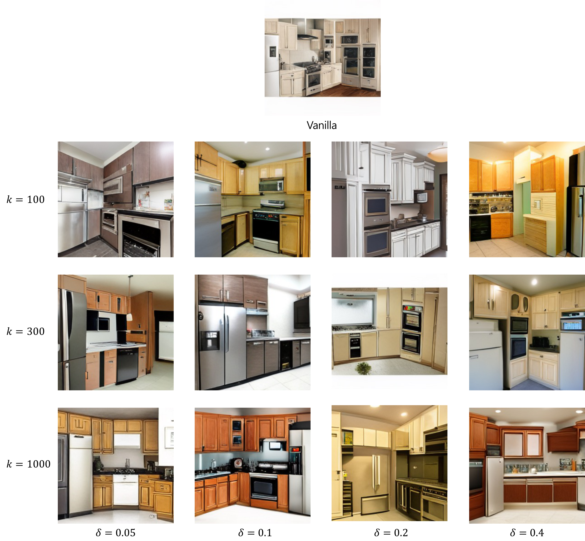

> 图解：固定提示为“带冰箱、炉灶、烤箱和橱柜的厨房”，target 为 LlamaGen-XL Stage I，$\tau=1$。网格比较 $\delta\in\{0.05,0.1,0.2,0.4\}$ 与 $k\in\{100,300,1000\}$，可以直观看到参数放宽后图像内容如何变化。

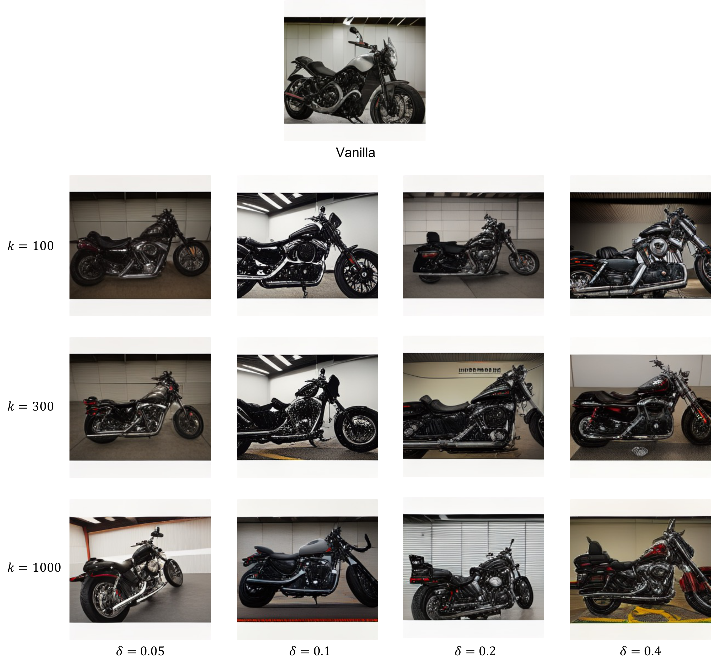

> 图解：固定提示为“停车位上的一辆摩托车，旁边还有一辆摩托车”，$\tau=0$。该图与采样网格采用相同参数范围，说明质量—速度权衡并非只对 random sampling 存在。

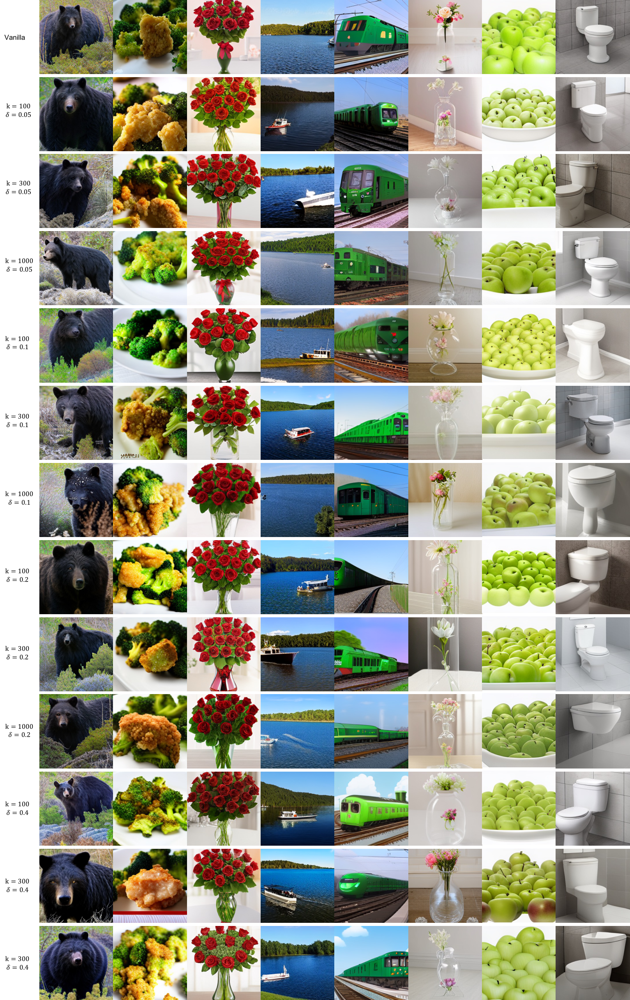

> 图解：这些样本来自 LlamaGen-XL Stage I 和 MS-COCO validation captions，同一列使用相同提示，不同行展示多种 $k$、$\delta$ 组合。它们用于检查不同输入下，宽松验收是否仍能保留主要语义。

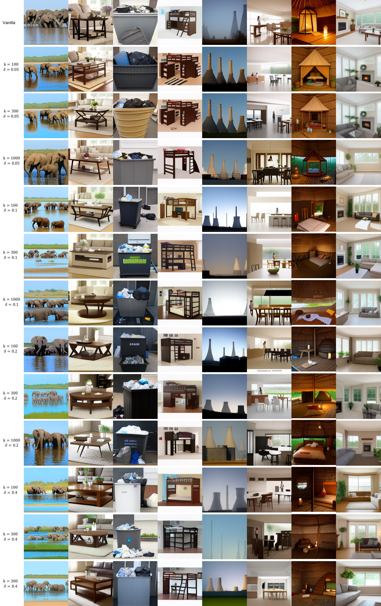

> 图解：该组结果对应 $\tau=0$，同样按列对齐文本提示。与上一张图合看，可以比较确定性解码和随机采样在加速配置变化时的视觉差异。

### 参数曲线：$k$ 与 $\delta$ 如何控制 trade-off

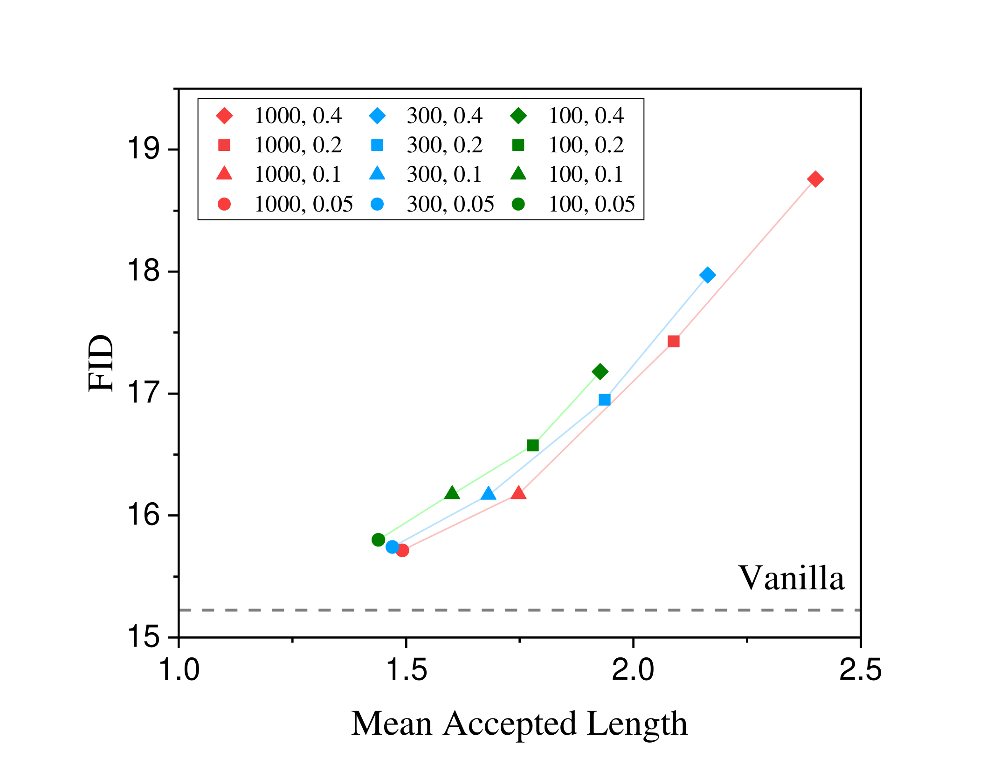

> 图解：横轴为 MAL，越向右代表潜在加速越高；纵轴为 FID，越低代表图像质量越好。相同颜色表示相同 $k$，相同符号表示相同 $\delta$。在 $\tau=1$ 下，增大 $k$ 或 $\delta$ 通常提高 MAL，但也会推高 FID。

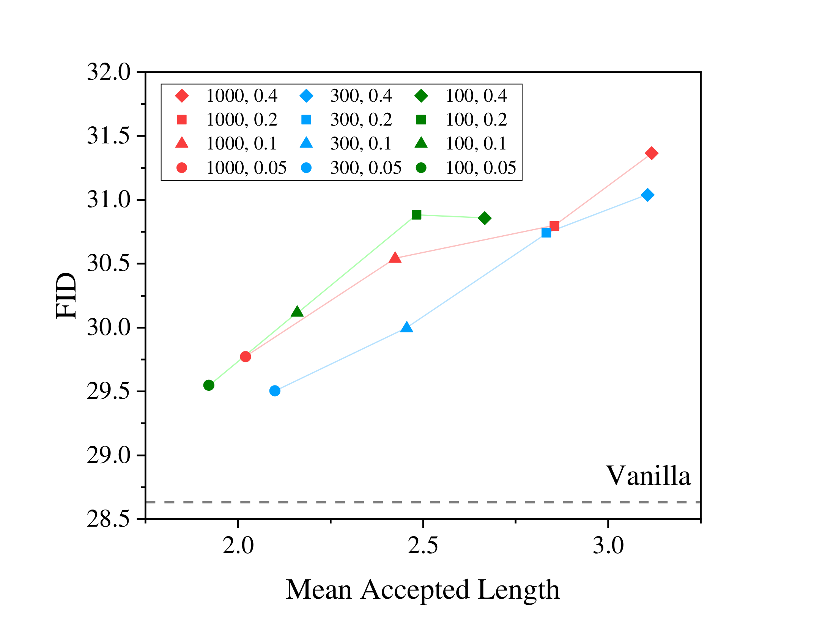

> 图解：坐标与编码方式和上一张图一致，但解码方式为 $\tau=0$。随着 MAL 增大，质量折损更明显；整体趋势仍然连续、可预测，使用户可以按应用需求选择工作点，而不是只能开关一个固定算法。

### 消融实验：近邻选择有效，TVD 更省计算

第一组消融比较 latent 近邻的度量方式，第二组比较分布距离。所有实验均在 LlamaGen-XL Stage I、$\tau=1$ 下进行，近邻实验固定 $k=1000$。

| 消融维度 | 设置 | MAL | FID | CLIP Score |
|---|---|---:|---:|---:|
| Latent proximity | Cosine similarity，$\delta=0.2$ | 2.09 | 17.46 | 0.3206 |
| Latent proximity | $\ell_2$ distance，$\delta=0.2$ | 2.09 | 17.43 | 0.3208 |
| Latent proximity | $\ell_2$ distance，$\delta=0.05$ | 1.50 | 15.71 | 0.3203 |
| Latent proximity | Random selection，$\delta=0.2$ | 1.26 | 15.62 | 0.3203 |
| Distribution distance | TVD，$\delta=0.3$ | 2.29 | 18.27 | 0.3206 |
| Distribution distance | JSD，$\delta=0.2$ | 2.29 | 18.21 | 0.3206 |
| Distribution distance | TVD，$\delta=0.2$ | 2.09 | 17.43 | 0.3208 |
| Distribution distance | JSD，$\delta=0.13$ | 2.09 | 17.48 | 0.3206 |

随机选择的 FID 看似较低，但 MAL 只有 1.26，甚至低于更保守的 $\ell_2$ 设置。这说明收益确实来自 latent proximity，而不是“随便多接受一些 Token”。$\ell_2$ 与 cosine similarity 的表现几乎一致，说明方法对具体近邻度量不敏感。

TVD 与 Jensen–Shannon Divergence（JSD）在相同 MAL 下也得到接近的 FID 和 CLIP Score，只是所需 $\delta$ 数值不同。作者没有采用 Kullback–Leibler Divergence（KLD），因为它不对称，也不是数学意义上的距离度量；最终选择 TVD，主要因为其计算更轻。

## 复现细节与扩展证据

### Drafter 如何训练，生成参数如何设置

主实验的视觉 drafter 使用与 target 同构的单层 decoder，并按 EAGLE 的方式训练。文本条件模型从 LAION-COCO 中采样 100K 图像，类别条件模型使用等量 ImageNet 图像；Anole 则使用 target 根据 MS-COCO train captions 生成的 118K 图像。训练数据的 5% 留作验证集。

为适配 classifier-free guidance，drafter 同时学习条件输入和空条件输入，训练时以 10% 概率丢弃 condition embedding。主要超参数如下：

| 项目 | 设置 |
|---|---|
| Batch size | 16 |
| Base learning rate | $10^{-4}$ |
| Optimizer | AdamW，$\beta_1=0.9,\beta_2=0.95$ |
| Learning rate schedule | Linear schedule，warm-up 2000 steps |
| 训练轮数与选模 | 20 epochs，按验证集 top-3 accuracy 选最佳模型 |
| 文本编码器 | Flan-T5 XL |

生成阶段，LlamaGen Stage I/II 使用 classifier-free guidance scale 7.5、top-p 1.0、top-k 1000；类别条件生成的 guidance scale 为 4.0，top-p 为 1.0，top-k 覆盖整个词表；Anole 的 guidance scale 为 3.0、top-k 为 2000。EAGLE-2 与 LANTERN 每轮验证向 target 传入 60 个候选 Token。

动机实验还有一处实现细节：经典 Speculative Decoding、Medusa 和 EAGLE-2 分别使用 LlamaGen-L、两层线性层组成的 MLP、单层 decoder 作为 drafter。由于文本条件 LlamaGen 没有多种模型尺寸，经典方法的对比改用类别条件 LlamaGen-3B；每个 ImageNet 类别生成 100 张图。Vicuna 的接受长度和部分 drafter 准确率直接取自 EAGLE-2，top 概率统计则使用 MT-Bench 的 80 条 Vicuna-7B 回复，以及 LlamaGen-XL、Anole 各 1000 张 MS-COCO 条件图像。

### 近邻在视觉上相似，在文本上没有同样规律

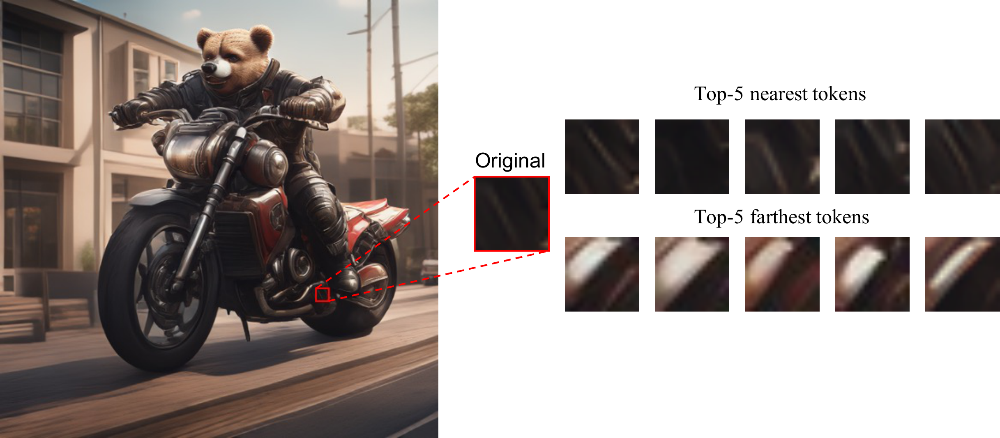

> 图解：以“黑色摩托车上的大泰迪熊”为例，图中将原始图像 Token 解码后的 patch，与 latent space 中 top-5 最近、top-5 最远 Token 的 patch 并列。近邻 patch 的外观更接近原图，远距离 Token 则呈现明显不同的视觉内容。

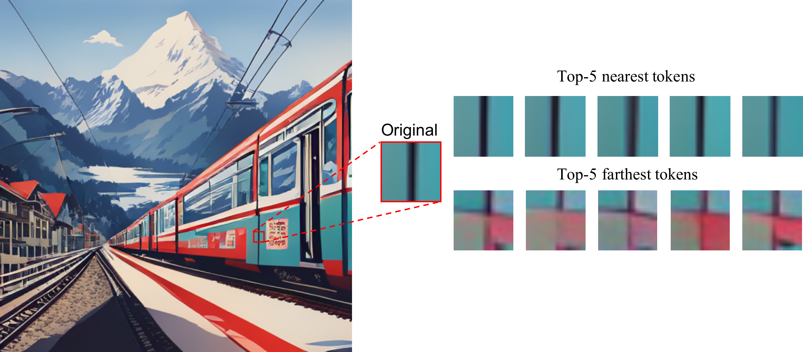

> 图解：该图对“行驶在山间道路上的红白火车”重复相同可视化。它进一步支持：$\ell_2$ latent 距离能够有效筛选视觉相似 Token，而非只在一个样本上偶然成立。

作者还在 Vicuna-7B 的输入 embedding 上做了相似分析。文本 Token `hi` 的近邻会出现 `_Portály`、`_Mediabestanden` 和若干字节 Token，远邻则包括换行、`[OBJ]` 等；`act` 的近邻与远邻也没有清晰的语义对应。这个对照说明，latent proximity 在视觉 codebook 中具有直接的外观意义，却不能简单套用到文本 subword 上。

### 换到其他视觉 AR 模型，趋势仍成立

| Target 模型 | 方法 | Speed-up | MAL | FID $\downarrow$ | CLIP $\uparrow$ | Precision $\uparrow$ | Recall $\uparrow$ | HPS v2 $\uparrow$ |
|---|---|---:|---:|---:|---:|---:|---:|---:|
| LlamaGen-XL Stage II | Vanilla AR | 1.00× | 1.00 | 47.60 | 0.2939 | 0.4138 | 0.5648 | 23.84 |
| LlamaGen-XL Stage II | EAGLE-2 | 0.96× | 1.22 | — | — | — | — | — |
| LlamaGen-XL Stage II | LANTERN，$\delta=0.4,k=1000$ | **1.64×** | **2.24** | 46.10 | 0.2925 | 0.4704 | 0.5222 | 23.06 |
| Anole | Vanilla AR | 1.00× | 1.00 | 20.27 | 0.3215 | 0.6552 | 0.6398 | 23.52 |
| Anole | EAGLE-2 | 0.73× | 1.10 | — | — | — | — | — |
| Anole | LANTERN，$\delta=0.5,k=100$ | **1.17×** | **1.83** | 23.40 | 0.3186 | 0.6026 | 0.6178 | 22.92 |

LlamaGen-XL Stage II 的速度在 RTX 3090 上测量，Anole 使用 A100 80GB SXM。两者上 EAGLE-2 都没有带来正加速，而 LANTERN 分别达到 1.64× 和 1.17×。Stage II 的 FID 还从 47.60 降至 46.10；Anole 的加速较温和，同时 FID、Precision、Recall 和 HPS v2 有一定下降，说明最优参数及质量折损仍依赖具体模型。

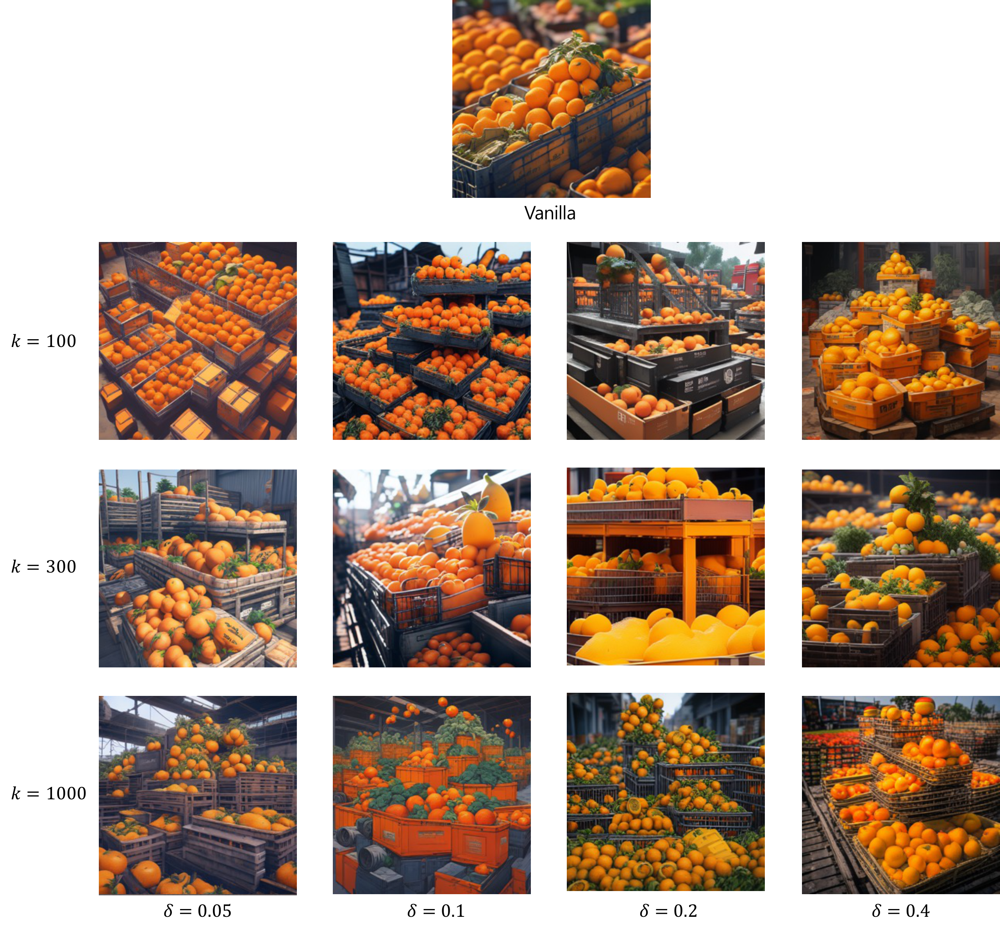

> 图解：固定提示为“装在板条箱里的一堆橙子，上面放着黄色香蕉”，$\tau=1$，比较多种 $k$ 与 $\delta$。该图展示 Stage II 上参数放宽后的视觉变化，与主表的跨模型定量结果相互印证。

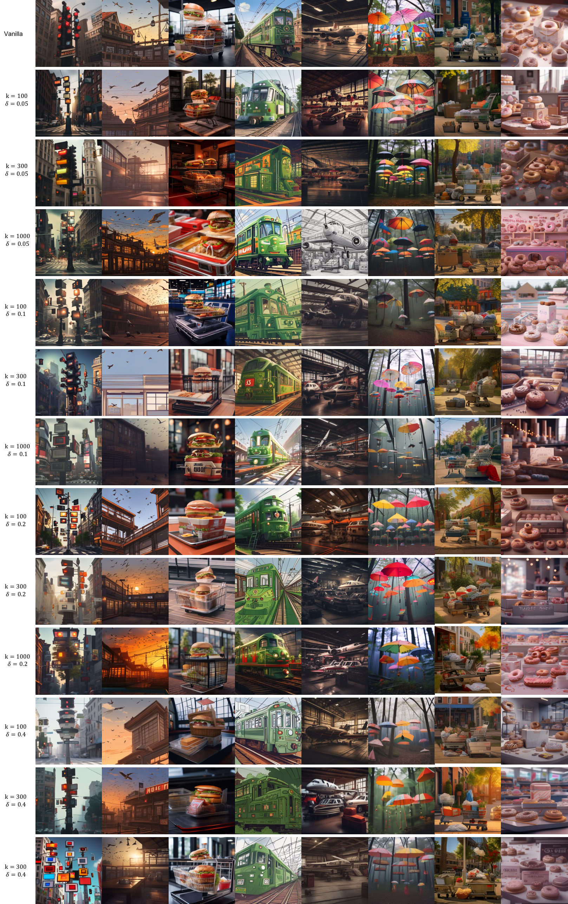

> 图解：这些图像使用 MS-COCO validation captions，同一列对应同一文本提示。不同参数组合下，主要语义大多保留，但细节会随分布容差变化，符合有损解码的预期。

### 额外质量指标：Precision 上升不等于没有损失

附录完整扫描了 $k$、$\delta$ 对 Precision、Recall 和 HPS v2 的影响。下表提取两个端点，帮助看清变化方向；中间配置总体呈渐进变化。

| 解码方式 | 指标 | Vanilla AR | 较保守配置：$\delta=0.05,k=100$ | 较宽松配置：$\delta=0.4,k=1000$ |
|---|---|---:|---:|---:|
| $\tau=0$ | Precision / Recall | 0.4232 / 0.3517 | 0.4424 / 0.3212 | 0.4854 / 0.2682 |
| $\tau=0$ | HPS v2 | 23.18 | 22.73 | 21.39 |
| $\tau=1$ | Precision / Recall | 0.4781 / 0.5633 | 0.4867 / 0.5389 | 0.4909 / 0.4497 |
| $\tau=1$ | HPS v2 | 24.11 | 24.01 | 23.22 |

随着容差放宽，Precision 往往上升，Recall 则下降，HPS v2 缓慢降低。换句话说，LANTERN 更倾向于保留质量较高的样本，却收缩了覆盖范围和多样性；只看 CLIP Score 或 Precision，会低估这一代价。

### 近邻集合在不同图像位置上并不均匀

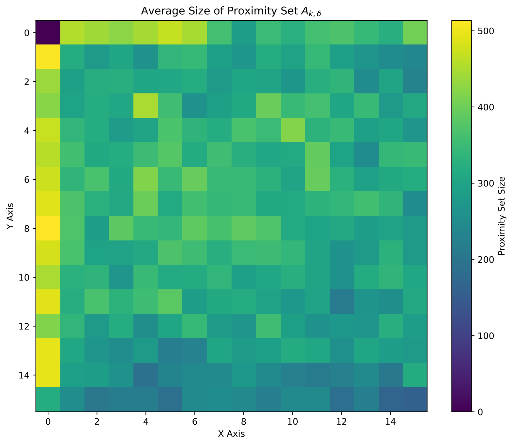

> 图解：固定 $k=1000,\delta=0.1$，每个位置的颜色表示该处 $A_{k,\delta}$ 的平均大小。首个 Token 在 pre-fill 后直接生成，不参与投机。不同位置的可用近邻数量并不一致，图像左侧边缘总体更大。

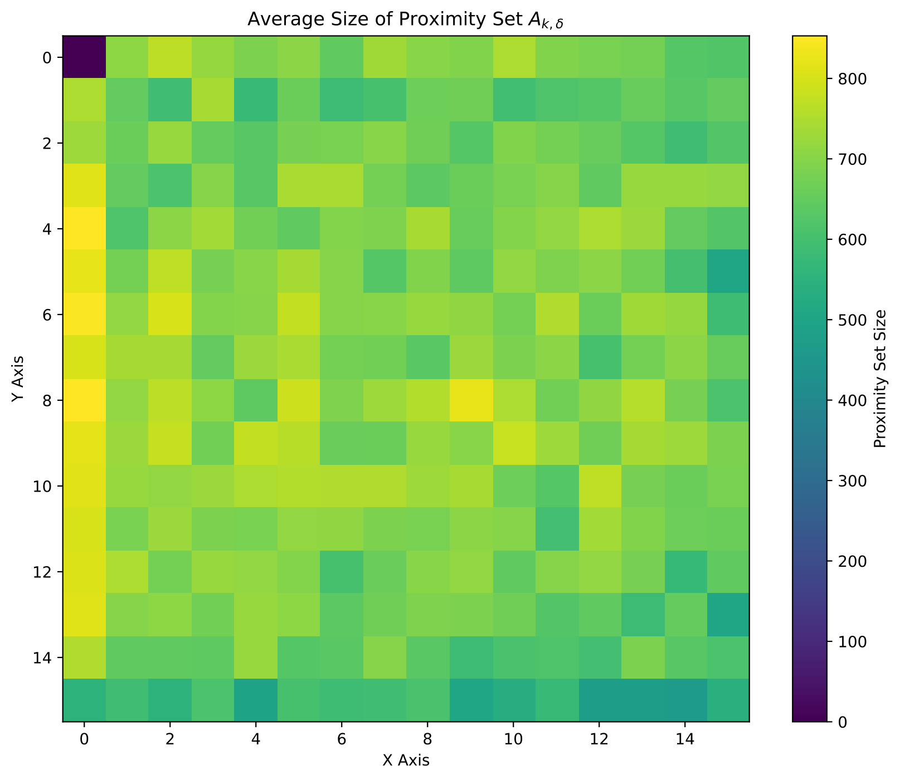

> 图解：固定 $k=1000,\delta=0.4$，颜色含义与上一张图相同。更大的 $\delta$ 在各位置普遍允许更大的集合；左侧边缘仍然突出。作者推测，这些位置紧跟换行，预测不确定性更高，单 Token 概率更低，因此更多近邻能在 TVD 阈值内被纳入。

### 系统开销：新增计算很小，但硬件实现仍关键

先看测速样本量是否足够。以下结果来自 LlamaGen-XL Stage I：

| Captions 数量 | $\tau=0,\delta=0.05$ | $\tau=0,\delta=0.2$ | $\tau=1,\delta=0.1$ | $\tau=1,\delta=0.4$ |
|---:|---:|---:|---:|---:|
| 100 | 1.56× | 2.33× | 1.13× | 1.73× |
| 1000 | 1.56× | 2.26× | 1.13× | 1.69× |
| 2000 | 1.57× | 2.27× | 1.13× | 1.69× |
| 5000 | 1.56× | 2.26× | 1.13× | 1.69× |

四组配置均固定 $k=1000$。从 1000 条 captions 开始，结果基本稳定，因此主实验使用 1000 条而非完整数据集，不会明显改变测速结论。

再看一轮 draft-and-verify 的组件延迟：

| 配置 | Target Forward | Drafter Forward | Proximity Set $A$ 计算 |
|---|---:|---:|---:|
| $\delta=0.1,k=1000$ | $3.80\times10^{-2}$ s | $1.08\times10^{-2}$ s | $1.57\times10^{-3}$ s |
| $\delta=0.4,k=1000$ | $3.80\times10^{-2}$ s | $1.08\times10^{-2}$ s | $1.19\times10^{-3}$ s |

较小的 $\delta$ 会导致更多拒绝和更多集合计数，因此 proximity set 开销稍高。不过在 $\delta=0.4$ 时，这部分延迟仍约比 target forward 小 24 倍、比 drafter forward 小 7 倍，没有抵消提高接受率带来的收益。

TVD 与 JSD 的计算对比也支持作者的选择：

| 距离度量 | 距离计算时间 | 单轮总计算时间 |
|---|---:|---:|
| TVD，$\delta=0.4$ | $1.19\times10^{-3}$ s | $4.89\times10^{-2}$ s |
| JSD，$\delta=0.2$ | $4.03\times10^{-3}$ s | $4.92\times10^{-2}$ s |

两组均固定 $k=1000$，并用不同 $\delta$ 对齐 MAL。TVD 的距离计算约快 3 倍；虽然单轮总耗时差距较小，但长序列、多轮解码会累计这部分收益。

最后，作者在没有 Gaudi 专用优化的情况下测试了 Intel Gaudi 2（96GB）：

| 解码方式 | 方法 | Gaudi 2 Speed-up | RTX 3090 Speed-up | MAL |
|---|---|---:|---:|---:|
| $\tau=0$ | Vanilla AR | 1.00× | 1.00× | 1.00 |
| $\tau=0$ | EAGLE-2 | 0.80× | 1.29× | 1.60 |
| $\tau=0$ | LANTERN，$\delta=0.05,k=1000$ | 1.01× | 1.56× | 2.02 |
| $\tau=0$ | LANTERN，$\delta=0.2,k=1000$ | 1.32× | 2.26× | 2.89 |
| $\tau=1$ | Vanilla AR | 1.00× | 1.00× | 1.00 |
| $\tau=1$ | EAGLE-2 | 0.55× | 0.93× | 1.20 |
| $\tau=1$ | LANTERN，$\delta=0.05,k=1000$ | 0.74× | 1.13× | 1.75 |
| $\tau=1$ | LANTERN，$\delta=0.2,k=1000$ | 1.02× | 1.69× | 2.40 |

最佳配置在 Gaudi 2 上分别达到 1.32× 和 1.02×，但保守配置可能没有正收益。投机解码交替执行大小模型前向传播，并伴随不规则内存访问，因此实际加速对底层 kernel 和硬件架构很敏感；同一 MAL 并不意味着不同设备上获得同样速度。

## 总结：用可控失真换并行收益

- **问题定位**：视觉 AR 的下一 Token 分布平坦，Token 选择歧义让 drafter 难以与 target 在确切 Token ID 上对齐。
- **核心机制**：LANTERN 聚合 latent 近邻的 target 概率，把“完全同 ID”放宽为“落在可互换的视觉邻域”。
- **安全边界**：通过 $k$ 限制最大近邻范围，再用 $\delta$ 对应的 TVD 阈值动态裁剪集合，显式控制分布偏移。
- **实验结论**：LlamaGen-XL Stage I 上实际加速最高达到 2.26×（greedy）和 1.69×（sampling），并在 Stage II、Anole 上延续收益。
- **真实代价**：这不是无损加速；FID、Recall、HPS v2 和硬件结果表明，质量、多样性及部署实现仍需共同权衡。

未来的关键方向是为视觉 AR 专门设计 drafter，在保留 LANTERN 灵活验收的同时提高草稿本身的质量，进一步减少图像质量与多样性的牺牲。

> 本文参考自 [LANTERN: Accelerating Visual Autoregressive Models with Relaxed Speculative Decoding](https://arxiv.org/abs/2410.03355)