# Self-Rewriting：让模型自诊并改写权重，最高提升 6.6 点

这篇工作研究一个很直接的问题：语言模型能否不靠训练，靠自己的推理修改自己的权重，并真正变得更好。作者把权重、失败答案、隐藏状态和有限次自我测试交给 Qwen3.5-27B，让它像调试程序一样定位问题、写修改代码、做对照实验，再决定提交还是撤回。最硬的结果是，模型自行提出的修改在 490 道从未见过的题目上把准确率从 57.2% 提高到 63.8%，提升 **6.6 个百分点**；它还能把受损副本在六个图像基准上的准确率从 7.3% 修复到 70.2%。不过，这不是所有模型都能做到：2B 没有完成修改，4B 和 9B 会把自己改坏，能力呈现出明显的规模效应。

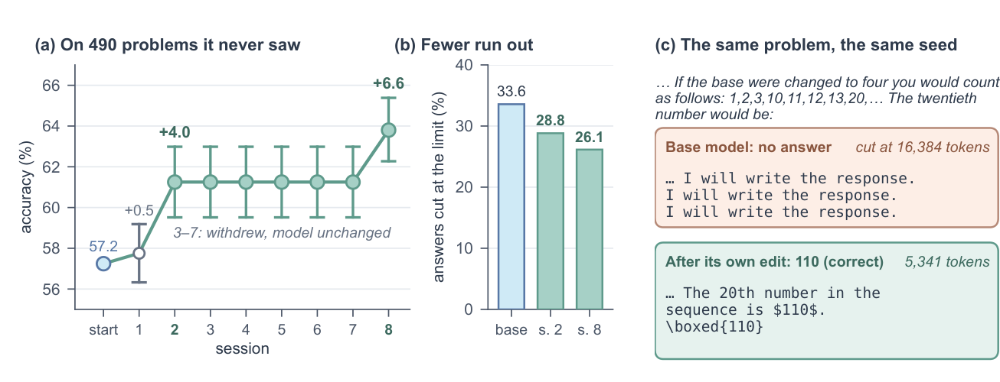

> 图解：图 (a) 展示第二套协议前八次会话后“当前使用模型”的准确率，评估固定为 490 道留出题、每题 8 个答案；柱线表示相对同一 Base Model 答案的配对变化及 95% 区间。第 2、8 次会话的修改分别带来 4.0 和 6.6 个百分点的显著提升，其余五次撤回修改。图 (b) 是答案触及 16,384 Token 上限的比例，越低越好；图 (c) 给出同一随机种子下的实例，Base Model 将一句话重复 549 次仍未作答，修改后则能结束推理并给出答案。

## 为什么“改权重”与以往的自我改进不同

模型部署后通常被冻结。想让它进步，要么重新训练，要么改 Prompt、加 Agent 外壳，或者在每次推理时多花计算。这些办法各有代价：Prompt 会随上下文消失，自我反思每次都要重新付费，训练则需要梯度、优化器和独立流水线。

论文提出的 **Self-Rewriting（自我改写）** 走了另一条路：模型自己决定改哪个张量、改多少，并用 Python 直接写入新值。修改只发生一次，之后的每次回答不需要额外 Prompt，也不增加单样本推理成本。可以把它理解成“把一次调试成果提交进权重”，而不是“每次做题时都带上一张新的提示纸条”。

| 改进路线 | 改权重 | 无需训练 | 修改由模型自己选择 | 检查自身内部 | 每个输入无额外成本 |
|---|:---:|:---:|:---:|:---:|:---:|
| 改写 Prompt 或 Agent 代码 | 否 | 是 | 部分 | 否 | 部分 |
| 在自身输出上训练 | 是 | 否 | 否 | 否 | 是 |
| 推理时自我反思 | 否 | 是 | 是 | 否 | 否 |
| Model Editing | 是 | 通常需要优化 | 否 | 否 | 是 |
| 研究者进行方向消融 | 是 | 是 | 否 | 否 | 是 |
| 更强模型改写较弱模型 | 是 | 是 | 否 | 否 | 是 |
| **Self-Rewriting** | **是** | **是** | **是** | **是** | **是** |

这里的关键不是“方向消融”这种数学操作第一次出现，而是 **选择目标、寻找证据、决定层级与强度、验证和撤回** 都由模型自己完成。此前最接近的工作由更强的前沿模型修改一个小模型；本文中，编辑者与被编辑者是同一个 27B 开放模型。

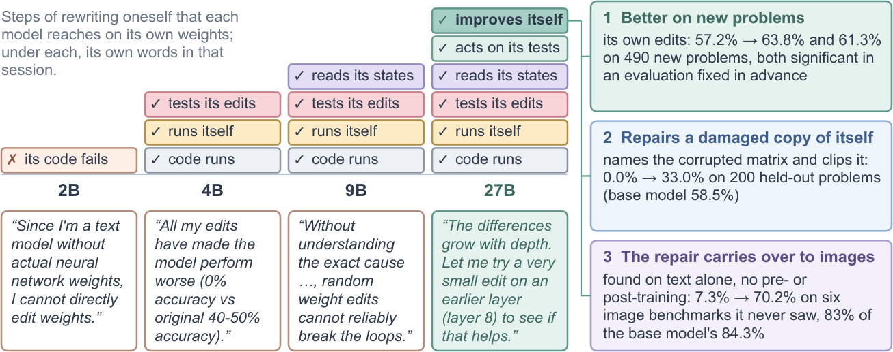

> 图解：左侧按 2B、4B、9B、27B 展示模型在同任务、同工具下走到了哪一步。小模型往往停留在运行代码、调用自身或随机扰动权重；27B 能读取隐藏状态、依据测量结果修改，并只保留测试支持的编辑。右侧汇总它的有效自我编辑、受损副本修复，以及修复向图像任务的迁移。

## Self-Rewriting 到底怎样运行

### 目标：不用梯度，也要让未见任务变得更好

设模型为 $M_\theta$，权重 $\theta=(W_k)_{k\in\mathcal K}$。回答设置 $\pi$ 固定，答案 $y$ 在 Token 预算内结束思考且最终答案正确时，$g(x,y)=1$，否则为 0。准确率写成：

$$
\mathrm{Acc}(\theta;\mathcal D)=\mathbb E_{x\sim\mathcal D}\mathbb E_{y\sim M_\theta(\cdot\mid x;\pi)}[g(x,y)]
$$

一次编辑 $\Delta$ 替换部分同形状张量，得到 $\theta\oplus\Delta$。目标不是让练习题看起来更好，而是在编辑过程中从未见过的 $\mathcal D_{\text{test}}$ 上满足：

$$
\mathrm{Acc}(\theta\oplus\hat\Delta;\mathcal D_{\text{test}})>
\mathrm{Acc}(\theta;\mathcal D_{\text{test}})
$$

整个过程中不计算相对 $\theta$ 的梯度，也没有优化器更新权重。每一个新值都来自模型自己的分析和代码。

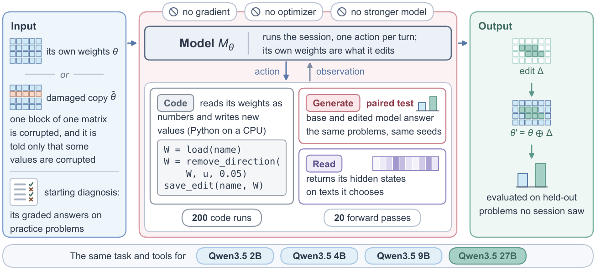

> 图解：框架先向模型提供待改权重和练习题的评分答案。模型每轮只选一个动作：运行读写权重的 Python、读取隐藏状态，或对修改前后模型做配对测试。编辑者不使用梯度、优化器或更强模型；会话结束后，提交编辑再接受留出题评估。修复任务中，输入换成一个含受损权重块的副本。

### 一场会话里，模型能做什么

会话先进行 **Starting Diagnosis（起始诊断）**：待改模型回答一批练习题，模型拿到准确率、触及 Token 上限、重复循环以及已完成答案正确率等统计，还能阅读原始答案。随后，它反复执行“解释上一步结果—采取一个动作”的循环。

- **Code**：在 CPU 上运行持久化 Python 会话，读取或替换张量；提供方向消融助手 $W-\alpha uu^\top W$。
- **Generate**：让原始权重、当前编辑权重或二者回答选定的练习题。
- **Read**：在模型选定的文本上运行权重，返回指定层的 Hidden States、MLP 激活或 Token 对数概率。
- **Submit / Withdraw**：保留有证据的编辑；如果没有编辑同时改善目标失败且不损害准确率，就不提交。

第一套协议中，模型自行决定提交与否。第二套协议增加了保留练习题检查：框架先在会话无法读取或使用的题目上测试候选编辑，模型看完结果再决定 `SUBMIT` 或 `WITHDRAW`。

每次会话最多有 20 次 Forward Pass、200 次代码运行和 160 轮。Forward Pass 的预算很紧，因此模型必须像做真实实验一样选择最有信息量的测量，而不能无限试错。

| 会话 | 被编辑权重 | 编辑者 | Forward Pass | 代码运行 | 轮数上限 | 时间 | 起始诊断题数 |
|---|---|---|---:|---:|---:|---:|---:|
| 2B 改自己 | 2B | 自身 | 20 | 200 | 160 | 3.5 小时 | 256 |
| 4B 改自己 | 4B | 自身 | 20 | 200 | 160 | 3.5 小时 | 256 |
| 9B 改自己 | 9B | 自身 | 20 | 200 | 160 | 3.5 小时 | 256 |
| 27B 改自己，第一次 | 27B | 自身 | 20 | 200 | 160 | 3.5 小时 | 256 |
| 27B 改自己，第二次 | 27B | 自身 | 20 | 200 | 160 | 2.5 小时 | 256 |
| 27B 修复副本 | 受损副本 | 27B Base | 20 | 200 | 160 | 2.5 小时 | 64 |
| 2B 修复副本 | 受损副本 | 2B Base | 20 | 200 | 160 | 2.5 小时 | 64 |
| 4B 修复副本 | 受损副本 | 4B Base | 20 | 200 | 160 | 2.5 小时 | 64 |
| 9B 修复副本 | 受损副本 | 9B Base | 20 | 200 | 160 | 2.5 小时 | 64 |

27B 第二次自我编辑把任务声明的回答预算从 16,384 降到 4,096 Token，以换取更多测试；最终留出评估仍使用完整的 16,384 Token。除这一处及相应时间差异外，各规模实验的任务、工具和规则一致。

| 共享设置 | 具体内容 |
|---|---|
| 练习题 | DeepScaleR 的 3,000 道数学题，剔除与 MATH-500、AIME 2024/2025、HMMT 2025、AMC 2023、OlympiadBench、GPQA-Diamond 的重叠 |
| 留出题 | 同来源的另外 1,000 道题，任何会话都不可见 |
| 采样 | Thinking 开启；temperature 0.6，top-$p$ 0.95，top-$k$ 20 |
| 判定 | Math-Verify 检查思考结束后的最后一个 `\boxed{}`；预算耗尽仍未结束思考则算错 |
| 循环答案 | 触及 Token 上限，且末尾 6,000 字符经 zlib 压缩后小于原大小 15% |
| Hidden-State Read | 最多 256 段文本，每段截到 8,192 Token，可返回指定层状态、MLP 激活和 Token 对数概率 |
| 代码限制 | CPU、禁梯度；单次最多 600 秒，输出最多 10,000 字符；禁止模型加载器、子进程和网络 |
| 编辑限制 | 禁改输入 Embedding、最终归一化和输出层；禁止仅把整个张量乘一个常数；结果以 bf16 保存 |

### 配对测试：不是“跑一次觉得更好”

模型可以让修改前后的权重回答相同题目，并使用相同随机种子。对第 $i$ 道题，每题采样 $n$ 次，$g^0_{ij}$ 和 $g^1_{ij}$ 分别是编辑前后的正误，定义：

$$
d_i=\frac1n\sum_{j=1}^{n}(g^1_{ij}-g^0_{ij}),\qquad
\hat\delta=\frac1m\sum_{i=1}^{m}d_i
$$

标准误按题目聚合：

$$
\mathrm{SE}(\hat\delta)=\sqrt{\frac{1}{m(m-1)}\sum_{i=1}^{m}(d_i-\hat\delta)^2}
$$

工具还报告触及 Token 上限的比例，以及“仅编辑后答对”和“仅编辑前答对”的数量。这个设计很重要：同一题的多次回答相关，因此最终固定评估在题目层面做符号翻转置换检验，而不是把每个答案都当成独立样本。

## 第一次亮点：模型诊断自己的“停不下来”

### 从失败答案，到隐藏状态中的方向

27B 第二次自我编辑会话的起始诊断很反常：在 4,096 Token 预算下，80.5% 的答案没有完成，但能够完成的答案几乎都对。模型因此判断，主要问题不是不会推理，而是过于冗长、无法收敛到结论。

它先比较“正常完成”和“预算耗尽”两类答案的隐藏状态。两类状态在晚层差异很大，于是它先修改第 56 层、再尝试第 48 层的输出矩阵；但更大范围的配对测试大多显示变差，模型放弃这些编辑。

随后它提出一个新假设：冗长行为可能在网络早期就已经形成。读取第 0 至 32 层后，它发现两类答案的差异随深度增大，于是转向第 8 层。最终，它用 20 个完成答案和 20 个未完成答案的平均隐藏状态构造单位方向 $u$，从第 8 层两个输出矩阵中去掉该方向的 5%：

$$
W\leftarrow W-0.05\,uu^\top W
$$

这只是一个小的秩一修改，两个矩阵的范数分别变化约 0.6% 和 0.1%。但它不是随意选的：模型先测量方向，再通过失败测试改变作用层，最后才确定强度。

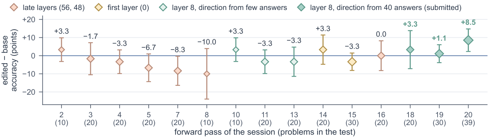

> 图解：横轴按时间列出第二次会话的每次测试，纵轴是编辑模型减去 Base Model 的练习题准确率，误差线为 95% 区间，颜色对应所改层。晚层编辑多数带来负收益；转到第 8 层、用 40 个答案估计方向后，最终编辑连续三次测试都为正，因而被提交。

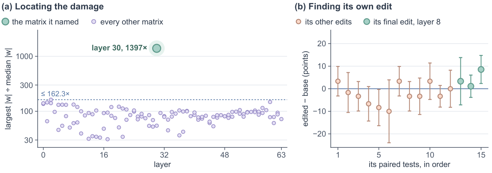

> 图解：图 (a) 是修复任务中的异常权重定位；图 (b) 汇总自我编辑的配对测试。桃色编辑多数使表现下降，绿色的最终编辑在三次测试中均占优，说明“根据证据换层”比继续在差异最大的晚层加码更有效。

### 被撤回的第一版：会做局部修复，也会承认不泛化

第一次 27B 会话同样值得看，因为它没有提交一个只在挑出来的题目上有效的编辑。当时模型发现，自己已经算出正确答案，却反复说“我将写出回复”，直到 16,384 Token 耗尽。

读取隐藏状态后，它发现循环答案每隔约 32 个 Token 就回到几乎相同的状态；正常结束的答案没有这种周期。它据此在多个中间层消融“卡住方向”。编辑在 10 道循环题上看似有效，但在 30 道更宽题目上接近零收益；加强编辑后，广泛测试反而变差，于是模型撤回全部修改。

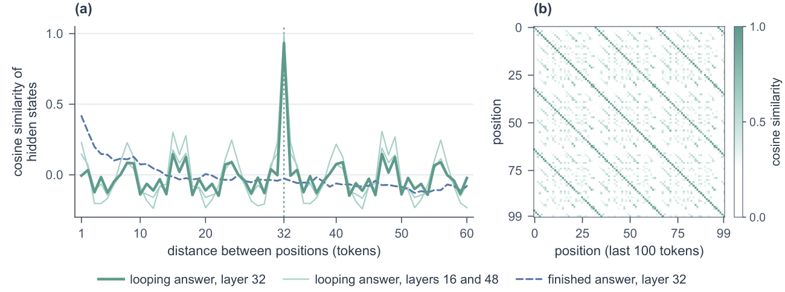

> 图解：图 (a) 的横轴是两个 Token 位置的距离，纵轴是 centered cosine similarity，展示第 16、32、48 层。循环答案在相距约 32 Token 时相似度接近 1，正常结束答案没有该峰值。图 (b) 是第 32 层循环答案各位置两两相似度，规则条纹对应同一个循环周期。

| 27B 修改内容 | 修复受损副本 | 编辑自身权重 |
|---|---|---|
| 发现 | 第 30 层 MLP 输出矩阵最大权重为中位数的 1,397 倍；其他输出矩阵最多 162.3 倍 | 完成与未完成的答案沿某个隐藏状态方向分离 |
| 修改 | 对第 30 层及第 0—10 层共 20 个输出矩阵，将超过各自中位绝对值 15 倍的权重截断；仅改这些矩阵权重的 0.013% | 从第 8 层两个输出矩阵中去掉该方向的 5% |
| 结果 | 文本留出准确率 0.0%→33.0%；只改被定位矩阵则为 55.0%，Base 为 58.5% | 自身测试 22.4%→29.6%；固定留出评估 57.2%→58.3% |

### 留出题验证：收益较小，但统计上成立

第一套协议最终编辑在模型自己的 39 道练习题上，从 22.4% 提升到 29.6%，按题做单侧置换检验得到 $p=0.009$。这些题也参与过编辑搜索，所以真正的关键是完全未见的 490 道题。

| 测试 | 题目数与答案数 | Base | Edited | 变化 | 仅 Edited 对 | 仅 Base 对 | $p$ |
|---|---|---:|---:|---:|---:|---:|---:|
| 第一次 | 20 × 3 | 11.7 | 15.0 | +3.3 | 4 | 2 | — |
| 第二次 | 30 × 3 | 13.3 | 14.4 | +1.1 | 6 | 5 | — |
| 第三次 | 39 × 3 | 20.5 | 29.1 | +8.5 | 14 | 4 | — |
| **全部，按题计** | **39 题** | **22.4** | **29.6** | **+7.3** | **12** | **2** | **0.009** |

固定的留出评估每题回答 8 次，共 3,920 个答案，使用 16,384 Token，而模型自己的搜索测试只有 4,096 Token。结果仍然显著提升：

| 题目 | Token 预算 | 答案数 | Base 正确率 | 自编辑正确率 | 变化 | Base 循环率 | 自编辑循环率 | $p$ |
|---|---:|---:|---:|---:|---:|---:|---:|---:|
| 490 道固定留出题 | 16,384 | 3,920 | 57.2% | 58.3% | **+1.1 点** | 5.6% | 5.2% | **0.038** |

编辑后有 289 个答案从错转对，247 个从对转错；在 Base 因预算耗尽而失败的答案中，276 个在编辑后正确结束，反向为 235 个。收益不是“所有回答都变短”，而是在总体上减少了无法完成的回答，同时没有牺牲最终准确率。

### 第二套协议：最高 6.6 点，但八次里撤回五次

第二套协议进一步允许一次 Forward Pass 并排测试最多四个编辑，并要求分别测试编辑组件。更关键的是，提交前增加 256 道保留练习题、每题两个答案的检查。每次会话都从 Base Weights 开始；提交编辑替换“当前使用模型”，撤回则保持原状，并不是把八次编辑累加在一起。

| 会话 | Passes | 决定 | 模型写出的编辑 | 保留题检查变化 | 留出准确率 | 相对 Base 变化 [95% 区间] | $p$ |
|---:|---:|---|---|---:|---:|---:|---:|
| 1 | 19 | 提交 | 7 个线性注意力层的 time-step bias 加 3.0 | +2.5 | 57.8% | +0.5 [-0.9, 1.9] | 0.25 |
| **2** | 19 | 提交 | 第 63 层输出矩阵减去所测方向投影的 5 倍 | +6.6 | **61.3%** | **+4.0 [2.3, 5.7]** | $<10^{-5}$ |
| 3 | 18 | 撤回 | 无保留编辑 | — | — | — | — |
| 4 | 13 | 撤回 | 无保留编辑 | — | — | — | — |
| 5 | 17 | 撤回 | 第 62 层 log decay rate 加 0.5 | +0.2 | — | — | — |
| 6 | 18 | 撤回 | 第 40—50 层中 9 层的 log decay rate 减 0.5 | +0.2 | — | — | — |
| 7 | 20 | 撤回 | 无保留编辑 | — | — | — | — |
| **8** | 15 | 提交 | 全部 48 个线性注意力层 time-step bias 加 0.5 | +2.5 | **63.8%** | **+6.6 [5.0, 8.1]** | $<10^{-5}$ |

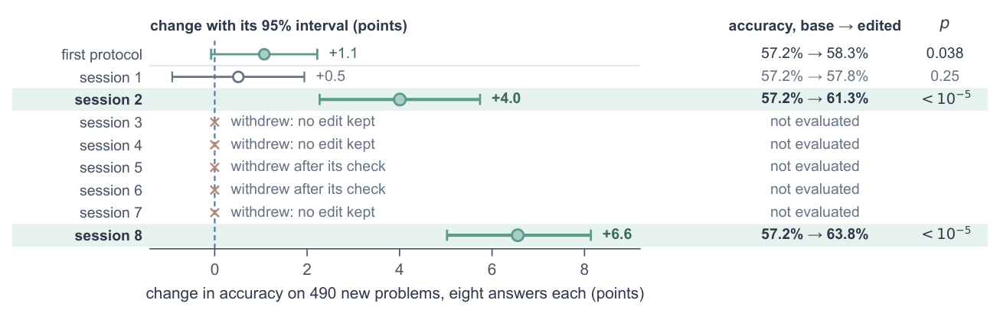

> 图解：横轴列出第一套协议的编辑与第二套协议前八次会话，纵轴是相对同一 Base Model 的留出准确率变化，误差线为 95% 区间。第 3、4、7 次在自己的测试后没有保留编辑，第 5、6 次在保留题检查后撤回；只有第 2、8 次获得显著提升，第 1 次变化不显著。

第 8 次会话的统一修改把触及 Token 上限的答案比例从 Base 的 33.6% 降到 26.1%；第 2 次降到 28.8%。在 490 道题上，第 8 次有 439 个答案仅编辑后正确、182 个仅 Base 正确。这个设计的聪明之处在于，**撤回也是系统能力的一部分**：当前模型并非每次都被迫接受新权重，因此序列表现可以只升不降。

## 第二次亮点：不看干净权重，也能修复受损副本

自然失败可能很难改，也可能根本没有简单的权重原因。为了把“模型不会自我改写”和“任务没有可修复原因”区分开，作者人工制造了一个已知可修的故障。

对某层 MLP 输出矩阵 $W$，选取连续 8 行 $R$，用高斯噪声覆盖：

$$
\tilde W_{r,:}\sim\mathcal N(0,(\lambda\sigma)^2I),\qquad |R|=8,\ \lambda=200
$$

27B 的受损位置是第 30/64 层 `mlp.down_proj` 的第 3068—3075 行，$\sigma=0.0111$。模型只被告知“副本中有些值损坏”，不知道位置、数值和方式。编辑者本身运行在未受损权重上，但所有诊断、Forward Pass 和可读权重都来自受损副本，且从未读取干净权重作为参考答案。

| 权重状态 | 正确率 |
|---|---:|
| Base Model | 69.8% |
| 受损强度 $20\sigma$ | 70.8% |
| 受损强度 $60\sigma$ | 66.7% |
| 受损强度 $200\sigma$ | **0.0%** |

损坏强度是在修复会话前用 24 道简单题、每题 4 个答案选定的；$20\sigma$ 和 $60\sigma$ 几乎不破坏模型，$200\sigma$ 才使其完全失效。

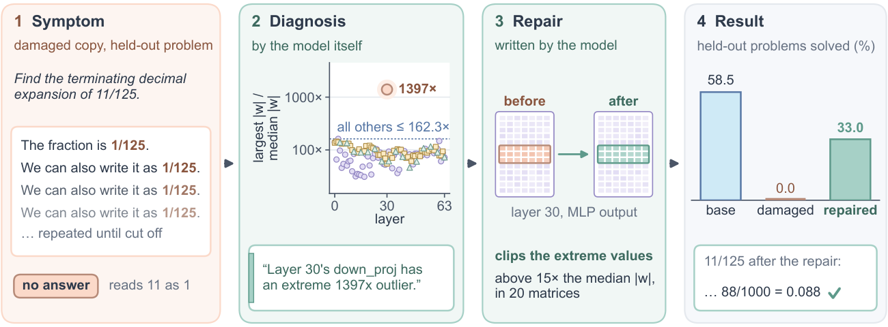

> 图解：上半部分还原修复链路。作者只破坏第 30 层 MLP 输出矩阵的 8 行；27B 比较各矩阵最大权重与典型权重，找到 1,397 倍中位数的异常，写出截断代码，把 200 道留出题准确率从 0.0% 提到 33.0%。这不是从干净副本恢复参数，而是模型根据异常统计提出的新规则。

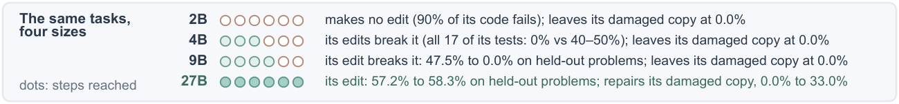

> 图解：底部按模型规模标出各会话最远到达的步骤。2B 没有完成修改，4B 和 9B 的编辑使模型失效；只有 27B 同时完成有效自我编辑与受损副本修复。右侧准确率均以留出题为依据，越高越好。

### 修复过程：先猜错，再用统计把范围缩到一个矩阵

模型起初看到隐藏状态随深度剧烈增大，猜测故障在早期层。基于这个猜想的几次修改都失败，配对测试明确显示更糟。它随后改变策略，逐一比较所有 MLP 和线性注意力输出矩阵的最大权重与中位权重。

第 30 层矩阵的比值达到 1,397，而其他矩阵最多 162.3。定位后，模型先尝试按中位数 5 倍激进截断，结果触及 Token 上限的答案更多；再改成 15 倍温和截断，并撤掉一项使测试变差的门控参数重置。最终编辑覆盖第 30 层及第 0—10 层共 20 个输出矩阵。

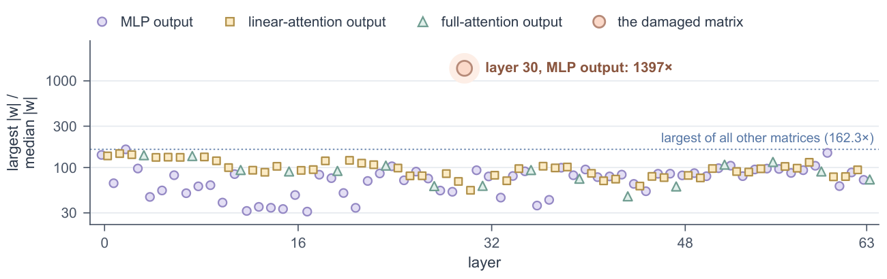

> 图解：横轴按层与矩阵列出输出矩阵，纵轴是“最大权重绝对值 ÷ 中位权重绝对值”；三角形补充标出全注意力输出矩阵。所有矩阵都有大权重，但第 30 层受损矩阵比其他矩阵高约一个数量级，直接暴露故障位置。

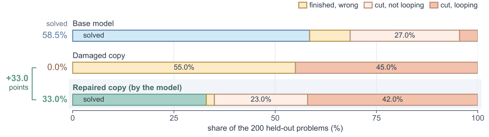

> 图解：三根柱分别是 Base、受损副本和修复副本，每根将同样 200 道留出题、相同随机种子的答案分为“答对”“结束但答错”“预算耗尽且循环或不循环”。Base 答对 58.5%，受损副本为 0.0%，修复副本为 33.0%；相对受损副本有 66 题从错转对，$p<10^{-19}$。

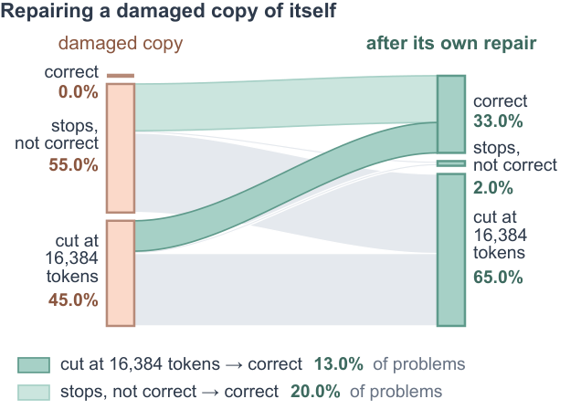

> 图解：每条带的宽度对应答案数量，连接受损副本与修复副本中同一答案的状态：正确、结束但不正确、触及 16,384 Token 上限。修复既让部分提前中断的答案恢复，也让部分原本耗尽的答案完成并答对，而不是只改善某一种表面症状。

### 消融：真正起效的是被定位的那一个矩阵

模型虽然改了 20 个矩阵，但消融显示，单独修复第 30 层被定位矩阵就能达到 55.0%，接近 Base 的 58.5%；完整 20 矩阵编辑反而只有 33.0%。只改其他 19 个矩阵、保留第 30 层损坏时，200 题仅答对 1 题。

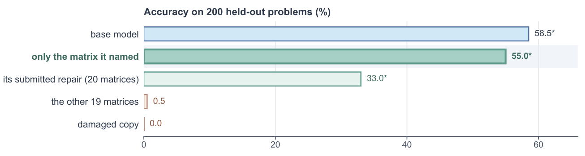

> 图解：横轴比较 Base、仅改被定位矩阵、完整修复、仅改另外 19 个矩阵和受损副本，纵轴为同一 200 道留出题的准确率。结果把因果来源指得很清楚：恢复能力来自第 30 层矩阵，额外 19 个矩阵不是修复所必需，并拉低了整体结果。

更严格地说，模型并没有“找回原值”。受损的 139,264 个权重中，没有任何修复值等于原值；修复行与原行的 cosine similarity 只有 0.002。原行、受损行和修复行的范数分别为 3.85、825 和 39.7。模型做的是把极端随机值压回可工作的范围，而不是复制标准答案。

| 模型 | Base | 受损 | 修复 | 修复后 newly right | newly wrong | $p$ | 是否定位损坏矩阵 |
|---|---:|---:|---:|---:|---:|---:|---|
| 2B | 9.0% | 0.0% | 无编辑 | — | — | — | 否，从未读权重 |
| 4B | 41.0% | 0.0% | 0.0% | 0 | 0 | — | 否，误判第 21 层，实际第 15 层 |
| 9B | 47.5% | 0.0% | 0.0% | 0 | 0 | — | 否，未指出矩阵 |
| **27B** | **58.5%** | **0.0%** | **33.0%** | **66** | **0** | **$<10^{-19}$** | **是，第 30 层** |

作者还检查了第一套协议九次会话的全部 573 次代码运行。四次修复会话的 233 次代码运行没有访问工作目录外的文件、环境变量或框架模块，也没有打开干净权重、损坏记录或留出题文件。因此，修复结论不是通过读取答案文件“抄回来”的。

## 文本上找到的修复，为什么能迁移到图像

如果修复只是过拟合数学练习题，它在其他模态上不应有效。作者在会话结束后，按预先固定规则测试 MathVista、MathVerse、MMStar、HallusionBench、POPE 和 ScreenSpot-v2；每个基准 100 题，每题一个答案、16,384 Token，Base、受损和修复模型共享随机种子。整个修复会话从未见过图像。

| 基准 | Base | 受损 | 修复 | 仅修复对 / 仅受损对 | $p$ |
|---|---:|---:|---:|---:|---:|
| MathVista | 86.0% | 3.0% | 67.0% | 65 / 1 | $<10^{-18}$ |
| MathVerse | 76.0% | 0.0% | 55.0% | 55 / 0 | $<10^{-16}$ |
| MMStar | 73.0% | 4.0% | 60.0% | 56 / 0 | $<10^{-16}$ |
| HallusionBench | 89.0% | 14.0% | 69.0% | 61 / 6 | $<10^{-12}$ |
| POPE | 89.0% | 23.0% | 81.0% | 62 / 4 | $<10^{-13}$ |
| ScreenSpot-v2 | 93.0% | 0.0% | 89.0% | 89 / 0 | $<10^{-26}$ |
| **六项合计** | **84.3%** | **7.3%** | **70.2%** | **388 / 11** | **$<10^{-99}$** |

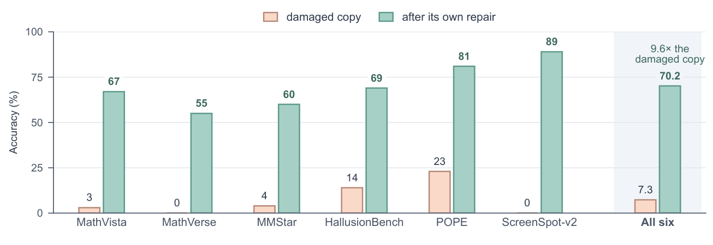

> 图解：横轴列出六个图像基准及汇总，纵轴为准确率；每组比较受损副本与修复副本。修复在六项上全部显著提升，总体从 7.3% 到 70.2%，是受损状态的 9.6 倍，但不能把 9.6 倍误写成相对 Base 的提升。

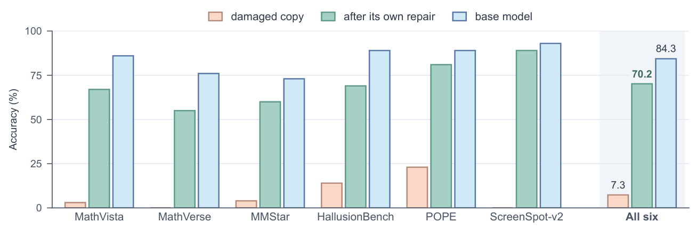

> 图解：在上一图基础上加入未受损 Base。修复后的 70.2% 相当于 Base 84.3% 的约 83%；ScreenSpot-v2 上，受损副本完全无法点击正确目标，修复后达到 89%，接近 Base 的 93%。

### 修复前后到底差在哪里

文本案例中，受损模型会丢失题目数字，例如把“小于 100”写成“小于 .”，把 $11/125$ 重复成 $1/125$，随后中断或循环。修复后，同一种子下能恢复题意并得出正确答案。图像案例也类似：受损模型要么几十 Token 后无答案停止，要么重复到上限；修复后重新读取图像并作答。

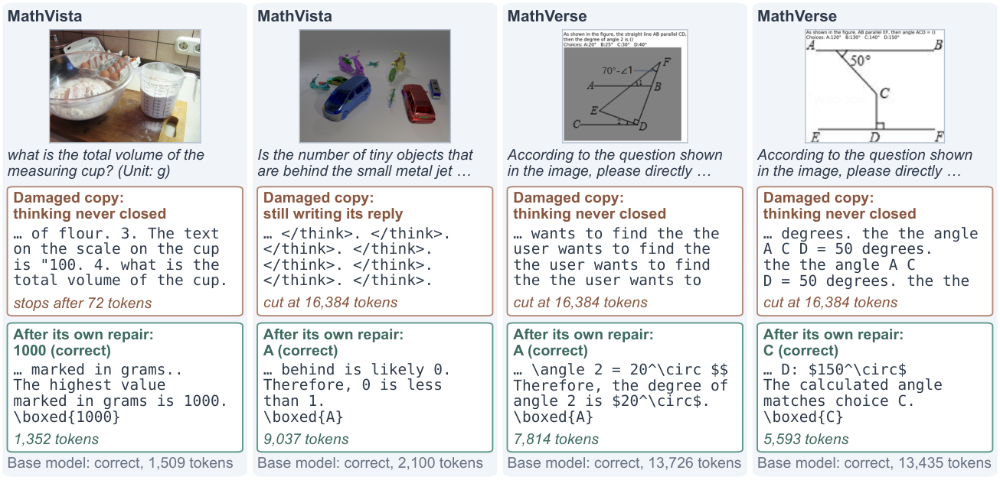

> 图解：展示 MathVista 和 MathVerse 各前两道“受损错、修复对”的图像数学题。每组使用相同随机种子，对照受损副本与修复副本的答案末尾；选择顺序在看答案前固定，不是人工挑任意成功案例。

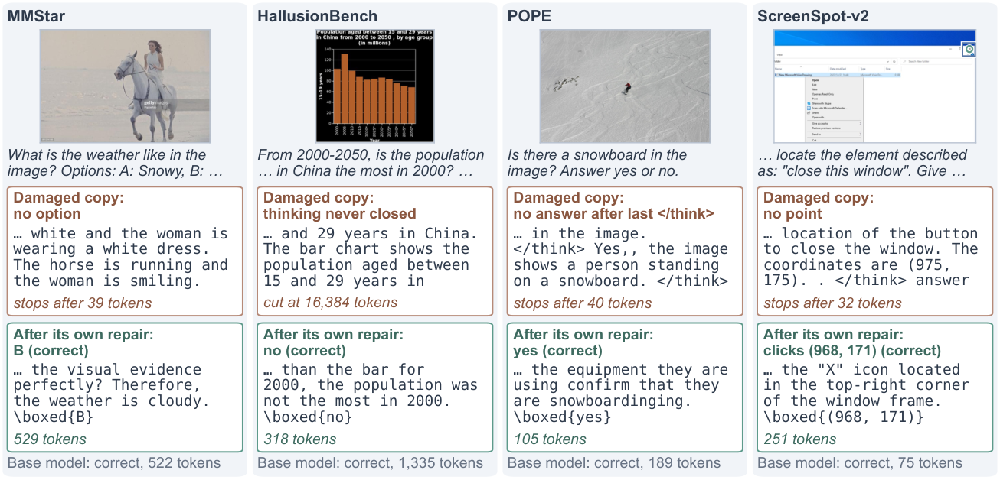

> 图解：四个通用图像基准各展示第一道满足“受损错、修复对”的题。上框为受损答案，下框为修复答案，底部给 Base 结果；ScreenSpot-v2 中方框是目标，圆圈是修复副本的点击位置。

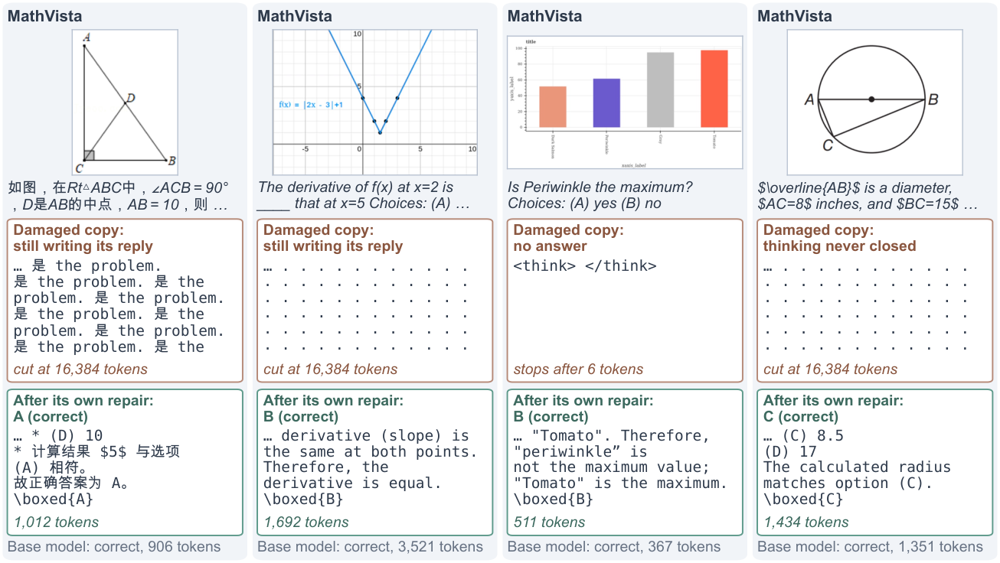

> 图解：按预定题目顺序，继续展示 MathVista 第 3—6 个由错转对的案例。修复前常见无答案或重复，修复后能够根据图形完成推理。

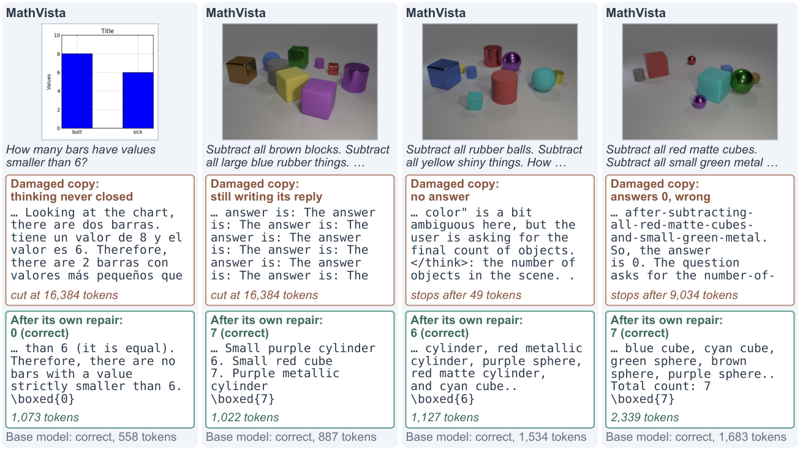

> 图解：继续展示 MathVista 第 7—10 个案例。案例选择沿用同一规则，用于观察修复在不同图表和几何问题上的表现，而不是只呈现单个成功样本。

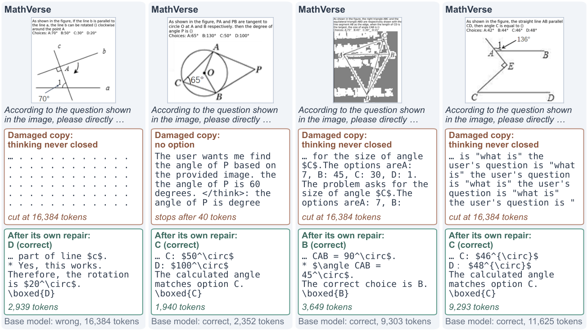

> 图解：展示 MathVerse vision-only 第 3—6 个由错转对案例。问题信息主要来自图像，说明文本练习中发现的权重修复也能恢复视觉数学输入的处理。

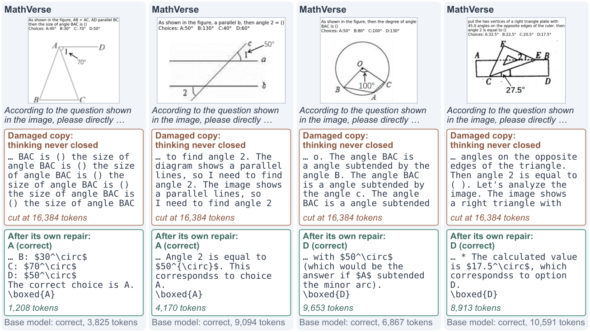

> 图解：展示 MathVerse 第 7—10 个案例，同样对照相同种子的受损与修复答案。成功不依赖在会话中见过相应图像或题型。

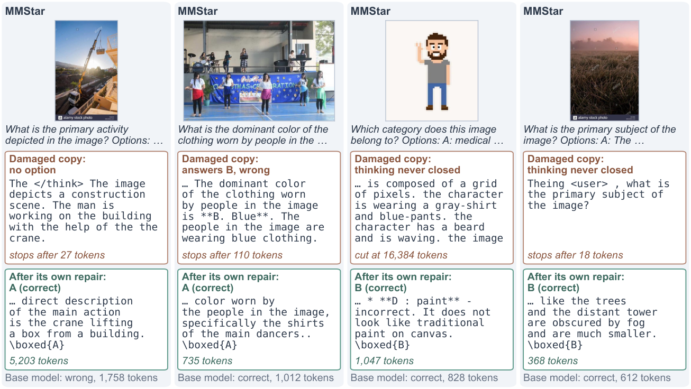

> 图解：展示 MMStar 第 2—5 个由错转对案例。受损答案通常没有形成有效最终回复，修复答案则能结合图像内容给出结果。

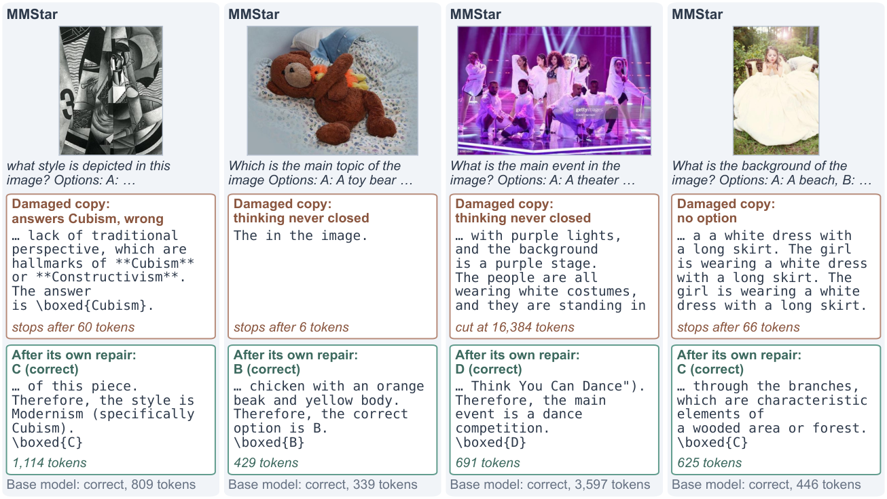

> 图解：展示 MMStar 第 6—9 个案例，继续检验修复的稳定性。它们是按固定顺序选出的后续样本，并非重新筛选的一组“最好看案例”。

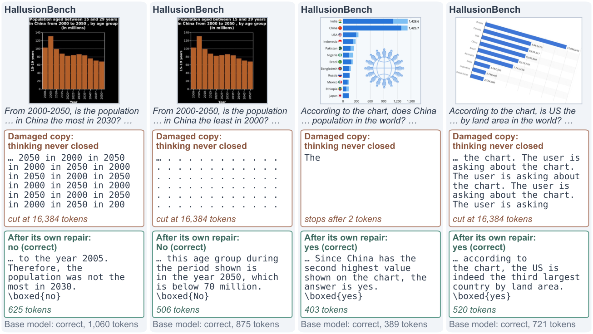

> 图解：展示 HallusionBench 第 2—5 个由错转对案例。该基准关注视觉幻觉，修复后模型能重新围绕图像证据作答，而不是延续受损状态下的错误文本。

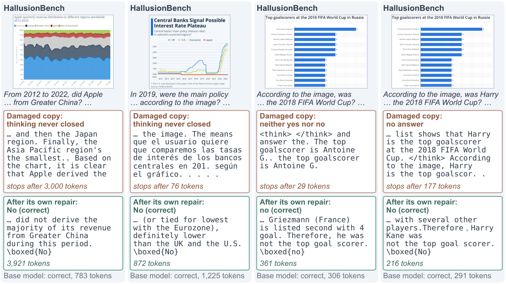

> 图解：展示 HallusionBench 第 6—9 个案例。整体统计中修复模型也有 6 题从对转错，因此这些案例应与表中 69.0% 的准确率一起理解，而非视为完全恢复。

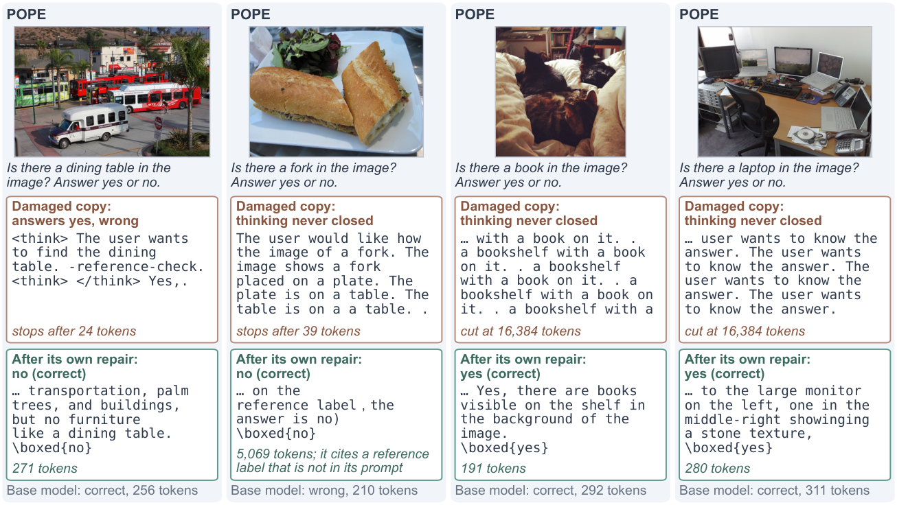

> 图解：展示 POPE 第 2—5 个由错转对案例。模型需要判断图像中对象是否存在；修复恢复了根据视觉内容给出判断的能力。

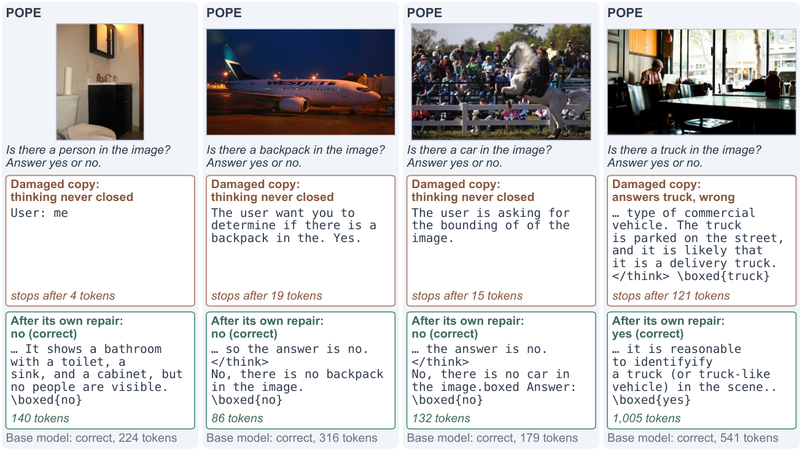

> 图解：展示 POPE 第 6—9 个案例。该基准修复后达到 81.0%，高于其他多数图像基准，但仍低于 Base 的 89.0%。

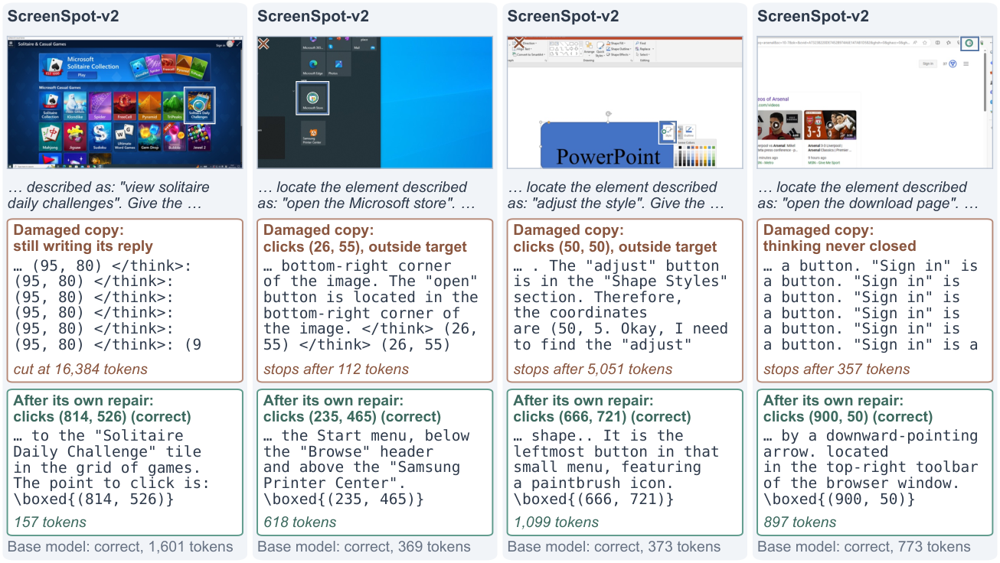

> 图解：展示 ScreenSpot-v2 第 2—5 个由错转对案例。方框表示目标界面元素，圆圈为修复副本点击，叉号为受损副本点击；恢复后的坐标定位能够落进目标区域。

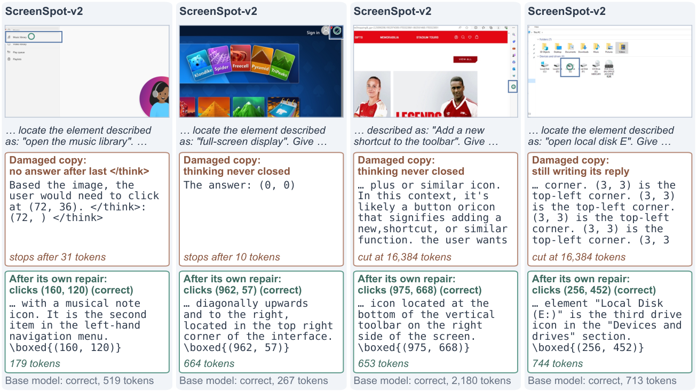

> 图解：展示 ScreenSpot-v2 第 6—9 个案例，方框和圆圈含义不变。修复从文本数学会话迁移到 GUI 定位，是“修的是共享权重故障，而非某类题答案”的直观证据。

## 规模带来的不是更会乱改，而是更会做实验

作者把自我改写拆成六级阶梯：代码能运行、运行自身、测试编辑、读取自身隐藏状态、按测试行动、在未见题上产生有效编辑。每一级独立记录，因此“调用过工具”不等于“最终改好”。

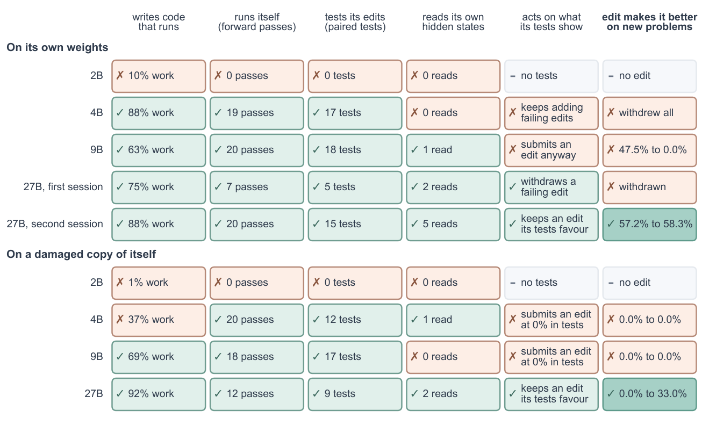

> 图解：每行是一场会话，每列是一级能力。浅绿表示达到，桃色表示未达到，灰色表示因没有编辑或测试而不适用，深绿表示在留出题上显著改善。自我编辑中，2B、4B、9B 分别到 0、3、4 级；27B 第一次到 5 级，第二次到全部 6 级。修复任务中，4B、9B 到 3 级，27B 到 6 级。

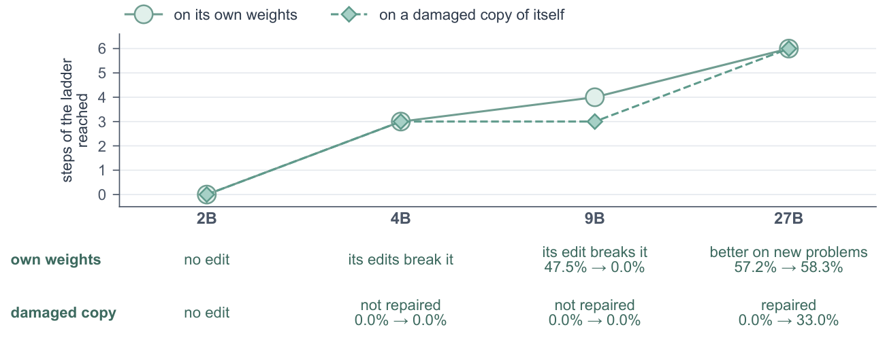

> 图解：横轴为参数量，纵轴 Self-Rewriting Score 是所达阶梯数。圆点对应编辑自身，菱形对应修复受损副本，折线只是视觉引导而非拟合曲线。分数随规模上升，但只有 27B 在最后“新题上有效”一级取得正结果。

| 会话 | 起始正确率 | 起始触及上限 | 轮数 | 代码错误率 | Forward Pass | Hidden-State Read | 配对测试 | 提交编辑 |
|---|---:|---:|---:|---:|---:|---:|---:|---|
| 2B 改自己 | 12.9% | 86.7% | 161 | 90% | 0 | 0 | 0 | 无 |
| 4B 改自己 | 49.6% | 48.4% | 161 | 12% | 19 | 0 | 17 | 撤回，涉及 240 个张量 |
| 9B 改自己 | 52.0% | 45.3% | 84 | 37% | 20 | 1 | 18 | 23 个张量 |
| 27B 第一次 | 61.7% | 35.2% | 32 | 25% | 7 | 2 | 5 | 撤回，涉及 10 个张量 |
| 27B 第二次 | 18.8% | 80.5% | 55 | 12% | 20 | 5 | 15 | 2 个张量 |
| 2B 修复副本 | 0.0% | 46.9% | 161 | 99% | 0 | 0 | 0 | 无自主修改 |
| 4B 修复副本 | 0.0% | 96.9% | 47 | 63% | 20 | 1 | 12 | 48 个张量 |
| 9B 修复副本 | 0.0% | 54.7% | 70 | 31% | 18 | 0 | 17 | 6 个张量 |
| 27B 修复副本 | 0.0% | 29.7% | 45 | 8% | 12 | 2 | 9 | 20 个张量 |

2B 约九成代码失败，从未请求一次自身 Forward Pass，甚至声称自己是没有实际神经网络权重的文本模型。4B 能识别“回答触及上限”的症状，却不读隐藏状态；17 次配对测试里编辑模型都为零分，它仍不断添加修改，直到最后才撤回 240 个张量。

9B 读过一次隐藏状态，随后主要给末端注意力、门控和归一化权重加噪声。它只在 Base 已经答错的少数题上测试，因此无法发现原有能力被破坏；最终提交后，留出准确率从 47.5% 降到 0.0%，所有回答都以乱码耗到 Token 上限。

27B 的差别不是更会写某个公式，而是会让证据改变下一步：先读失败答案，再读内部状态；先做小编辑，再根据广泛测试撤回或换层。作者因此把规模收益概括为：**增长的是围绕编辑做实验的能力，而不只是编辑动作本身。**

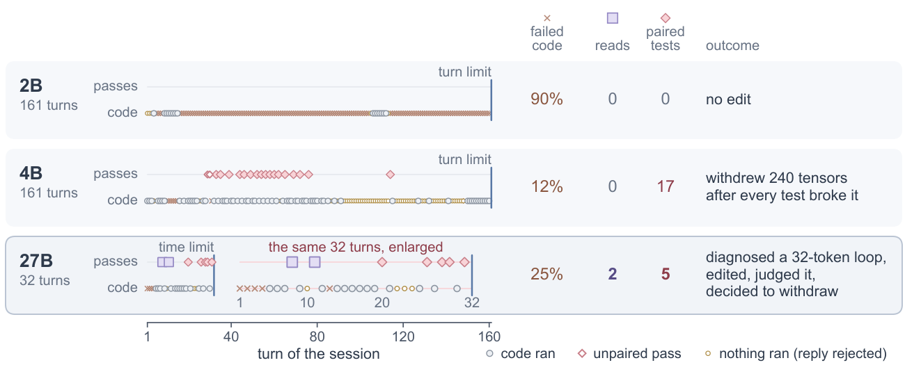

> 图解：每行是一场会话，每个标记对应一轮。上线条表示 Forward Pass，包括 Hidden-State Read 和配对测试；下线条区分成功代码、报错代码与无执行轮次，右侧汇总代码错误率、读取和测试次数。2B 几乎全是代码错误，4B 反复测试却不读内部，27B 先读再改并依据结果决策。

| 模型 | 自身任务 Base→Edited | 留出任务 Base→Edited | 受损副本 Base / Damaged / Repaired |
|---|---|---|---|
| 2B | 无编辑 | 无编辑 | 9.0% / 0.0% / 无编辑 |
| 4B | 44.1%→0.0%，最终撤回 | 撤回 | 41.0% / 0.0% / 0.0% |
| 9B | 未有效测试原有正确题 | 47.5%→0.0% | 47.5% / 0.0% / 0.0% |
| **27B** | **22.4%→29.6%，$p=0.009$** | **57.2%→58.3%，$p=0.038$** | **58.5% / 0.0% / 33.0%，$p<10^{-19}$** |

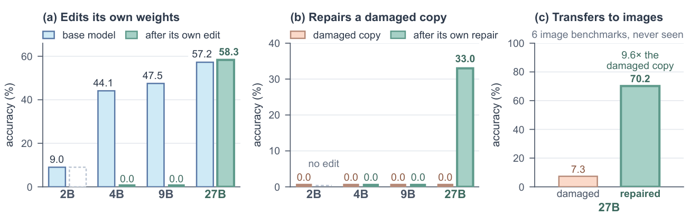

> 图解：图 (a) 是模型修改自身前后的准确率，2B 无编辑，4B 因撤回而展示会话内测试，27B 使用固定留出评估；图 (b) 是各规模受损副本修复，只有 27B 脱离 0%；图 (c) 是 27B 修复在六个图像基准上的汇总，从 7.3% 到 70.2%。三个面板共同说明，编辑有效、修复有效和跨模态恢复都只在所测最大规模出现。

## 结果有多稳：重复题、评估规则与失败边界

留出池虽与常见基准去重，但内部仍有少量练习题的改写重复。作者删除这些重复后重新检验，结论方向和显著性均保留。

| 比较 | 全部题目数 | 全部准确率变化 | $p$ | 去重题目数 | 去重后准确率变化 | $p$ |
|---|---:|---:|---:|---:|---:|---:|
| 27B 完整修复 | 200 | 0.0%→33.0% | $<10^{-19}$ | 195 | 0.0%→33.3% | $<10^{-19}$ |
| 只修被定位矩阵 | 200 | 0.0%→55.0% | $<10^{-33}$ | 195 | 0.0%→55.9% | $<10^{-32}$ |
| 第一协议自我编辑 | 490 | 57.2%→58.3% | 0.038 | 482 | 57.3%→58.3% | 0.045 |
| 第二协议第 2、8 次 | 490 | +4.0、+6.6 点 | 均 $<10^{-5}$ | 482 | 方向与显著性保持 | 均 $<10^{-4}$ |

固定评估的问题、答案、统计检验、阈值和分析代码都在运行前写好。490 题来自此前任何运行都未使用的留出项 500—999，再删除 10 道与练习题或更早留出题逐字重复的问题；比较采用 100,000 次题目级符号翻转的单侧置换检验。

也要看到边界。第一协议的 +1.1 点虽显著但不大；第二协议的 +6.6 点来自特定会话，不应理解成每次自我改写都有同样收益。模型能够撤回坏编辑，不代表它不会提出坏编辑——4B、9B 的失败和 27B 多次撤回恰好说明，测试与回滚机制不可省略。

## 这项工作真正打开了什么方向

Self-Rewriting 把训练与推理之间的一次性边界变成可讨论的问题：模型在任务之间读取经验、修改权重，之后继续以普通方式服务。每个编辑都是命名张量上的代码，可以审查、比较和回滚，类似一次权重提交；这比不可读的隐式适应更容易纳入人工审批。

但它距离“模型无限递归自我提升”还很远。实验集中于数学失败和一种人工损坏，测试预算只有 20 次 Forward Pass；27B 最有效的方向也只由 40 个答案估计。更可靠的下一步包括增加测量预算、让自编辑模型继续研究自己的上一版编辑、系统地改变损坏位置与强度，以及把数学判分替换为机器人或软件环境的成功反馈。

## 总结

- **核心机制**：模型读取自己的失败答案、隐藏状态和权重，用代码直接编辑张量，再通过同题同种子的配对测试决定提交或撤回。
- **自我提升**：27B 第二协议第 8 次编辑在 490 道未见题上从 57.2% 提升到 63.8%，增加 6.6 个百分点，$p<10^{-5}$。
- **故障修复**：不读取干净权重，27B 找到第 30 层异常矩阵；只修该矩阵即可把文本留出准确率从 0.0% 恢复到 55.0%。
- **跨模态证据**：纯文本中发现的修复把六个图像基准总体准确率从 7.3% 恢复到 70.2%，达到 Base 的约 83%。
- **规模与限制**：只有 27B 完成有效改写和修复，小模型不会改或会改坏；当前证据支持“可审查的小步权重修改”，尚不支持无条件自主进化。

未来最值得验证的，不是让模型更激进地改自己，而是如何把可靠评估、安全测试、回滚和人工确认做成持续学习的标准闭环。

> 本文参考自 [Language Models Can Rewrite Their Own Weights](https://arxiv.org/abs/2611.21885)