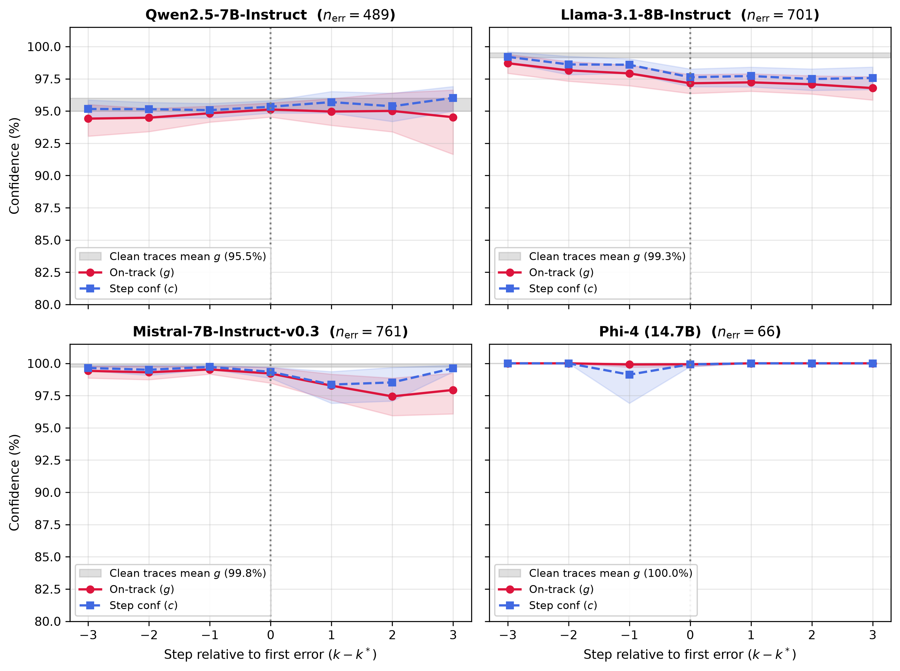
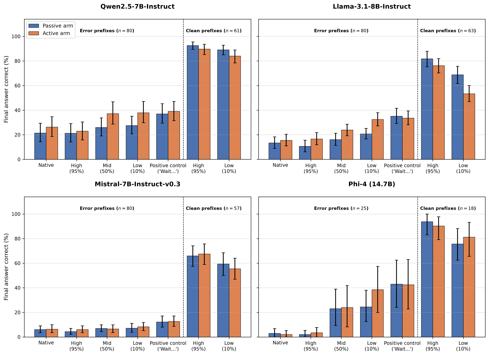

# Confidence Ratchet：注入怀疑可纠错，模型却难自查

当 Agent 用模型自报的逐步置信度决定继续、回溯还是剪枝时，一个前提至关重要：模型真的能在出错当下察觉异常吗？这篇工作把“发现错误”和“修复错误”拆开检验，在四个开源权重模型上生成 15,200 条数学推理轨迹，并针对失败边界实施 27,568 次反事实续写。结果非常一致：固定推理位置后，自报置信度区分正误的 AUROC 仅为 0.500–0.561，接近随机；但在错误步骤外部注入 10% 低置信标签，纠正率相对格式一致的 95% 高置信标签提升 3.7–22.5 个百分点，主动反思模式下最高达到 38.5%。因此，瓶颈主要不在模型“听到怀疑后不会改”，而在它生成答案时“根本不知道何时该怀疑”。

## 为什么要拆开监测与控制？

Tree-of-Thought、Reflexion、迭代推理和搜索式解码器，都需要某种中间步骤评估信号。一个常见做法是在 Chain-of-Thought（CoT）每一步后，让模型顺手报告两个百分数：当前步骤有多可信，以及整条轨迹是否仍在正确方向上。控制器再根据这些数字决定继续、回溯或剪枝。

这套机制隐含了两个容易混为一谈的能力：

- **原地监测（in-situ monitoring）**：错误刚发生时，模型自报的置信度是否下降？
- **下游控制（downstream steering）**：一旦上下文中明确出现“不确定”，模型是否会改变后续生成，尝试修复？

如果一次自我纠错失败，可能不是模型不会修，而是它根本没有发出修复信号。反过来，即使模型能响应外部怀疑，也不能证明它能自己发现错误。此前关于口头置信度校准、内在自我纠错和过程奖励模型的研究，尚未把这两个环节干净地分离。

论文由此提出三个研究问题：

1. **RQ1：监测保真度。** 第一个错误出现在第 $k^*$ 步时，局部步骤置信度 $c_k$ 或累计轨迹置信度 $g_k$ 能否区分正确与错误？
2. **RQ2：置信度棘轮。** 如果置信度偶尔下降，模型是否会随后毫无依据地快速回升，形成掩盖错误的“confidence ratchet”？
3. **RQ3：因果控制与误报代价。** 在错误边界外部注入不确定标签，能否因果性地促进恢复？若误加到正确步骤，又会破坏多少原本有效的推理？

这个拆解是全文最重要的实验设计：它不再笼统地问“模型会不会自我纠错”，而是分别测量传感器是否有效，以及执行器是否响应。

## 实验框架：沿同一条推理链做对照

### 两种置信度与第一个错误位置

模型被要求按固定格式输出：

```text
Step i: <reasoning>
[Step confidence: X%]
[On-track: Y%]
```

对一条包含 $K$ 步的推导，定义：

- $c_k \in [0,100]$：模型对第 $k$ 步自身正确性的局部置信度；
- $g_k \in [0,100]$：模型对截至第 $k$ 步所有推理均正确的累计 on-track 置信度；
- $k^* = \min\{k:\text{第 }k\text{ 步逻辑无效}\}$：最早错误步骤；无错误轨迹记为 $k^*=-1$。

第二阶段干预会同时修改 $c_{k^*}$ 和 $g_{k^*}$，例如都设为 95% 或都设为 10%。这样可避免“当前步骤很可信、整条轨迹却崩溃”这类相互矛盾的信号，但意味着实验测量的是两种怀疑标签的**联合因果效应**，并未检验 $c\neq g$ 的独立作用。

### 模型、题目与采样设置

实验覆盖四个不同厂商、不同规模的开源权重指令模型：

| 模型 | 简称 | 每题主采样数 | 题目数 |
|---|---|---:|---:|
| Qwen2.5-7B-Instruct | Qwen | 8 | 550 |
| Llama-3.1-8B-Instruct | Llama | 8 | 550 |
| Mistral-7B-Instruct-v0.3 | Mistral | 8 | 400 |
| Phi-4（14.7B） | Phi-4 | 8 | 400 |

Qwen 和 Llama 使用 400 道 GSM8K 与 150 道 MATH-500；Mistral 和 Phi-4 使用 250 道 GSM8K 与同样的 150 道 MATH-500。MATH 部分限定为 Level 2–4，覆盖代数、预代数、数论、计数与概率，排除过易、过难以及依赖空间图形的题目。

推理通过 vLLM 执行，上下文长度为 4096，采样温度为 $T=0.7$、top-$p=0.95$，第一阶段最多生成 1,536 个新 token。最终答案由 `math-verify` 做符号等价判分。总主轨迹数为：

$$
4{,}400\times 2+3{,}200\times 2=15{,}200
$$

### 只研究能力边界上的“争议题”

实验不是把所有错题混在一起，而是筛选**contested items**：同一模型在格式有效的 8 次采样中，至少成功一次、也至少失败一次，并要求至少有 4 条有效样本、题目准确率位于 15%–85%。这样可以把“模型根本不会做”与“它在会做边界上走错了路径”区分开。

筛选漏斗如下：

| 阶段 | Qwen | Llama | Mistral | Phi-4 |
|---|---:|---:|---:|---:|
| 原始轨迹 | 4,400 | 4,400 | 3,200 | 3,200 |
| 格式有效轨迹 | 3,656（83.1%） | 4,110（93.4%） | 2,723（85.1%） | 2,830（88.4%） |
| 争议题数 | 177 | 184 | 177 | 25 |
| 争议题有效轨迹 | 1,168 | 1,326 | 1,209 | 170 |
| 干净轨迹 | 675 | 613 | 436 | 97 |
| 含已验证错误的轨迹 | 489 | 701 | 761 | 66 |

合计得到 3,873 条争议题有效轨迹，其中 2,017 条含已验证错误、1,821 条干净。另有 35 条最终答案判分与过程标签不一致、或错误位置超出轨迹长度的样本被排除。错误轨迹中还包括 231 条后来碰巧得到正确答案的轨迹，它们从 $k^*$ 起仍被标为 off-track。

Phi-4 只有 25 道争议题，并非采样更少，而是它在这批题上的基础准确率较高，落入中间准确率窗口的题目更少。后续涉及 Phi-4 的置信区间和跨模型比较，都需要记住这一样本规模差异。

### 用盲法过程评审定位第一个错误

作者使用 Claude Opus 5.5 作为自动过程评审，温度为 0。评审能看到题目、参考解答、参考答案和完整学生步骤，但所有学生自报置信标签都被移除。它只寻找**最早**的算术错误、错误公式、数量误读、无依据假设或不成立的推导；从早期错误结果出发、但自身演绎正确的后续步骤不算新错误，与参考答案不同但有效的方法也不算错误。

| 验证基准 | 精确错误步定位 | 误差在 $\pm1$ 步内 |
|---|---:|---:|
| ProcessBench（100 条错误轨迹） | 85.0%（85/100） | 94.0%（94/100） |
| 作者盲审 30 条实验轨迹 | 93.3%（28/30） | 96.7%（29/30） |

ProcessBench 共使用 200 条轨迹，除上述错误轨迹外，100 条干净轨迹中有 97 条被正确判为无错误，即干净识别率为 97.0%。人工盲审的精确一致率 Wilson 95% 置信区间为 [78.7%, 98.2%]，$\pm1$ 步一致率区间为 [83.3%, 99.4%]。这为大规模自动定位提供了有效但并不完美的地面真值。

## RQ1：错误发生了，置信度却几乎没有反应



> 图解：四个子图分别对应 Qwen、Llama、Mistral 和 Phi-4。横轴是相对最早错误步的位置 $k-k^*$，0 表示错误刚发生；纵轴是模型自报的置信度。红色圆点表示累计 on-track 置信度 $g_k$，蓝色方块表示局部步骤置信度 $c_k$，误差棒为 95% bootstrap 置信区间。四条曲线在错误前后都基本贴着 95%–100%，没有出现可用于触发回溯的明显下坠。

### 三层嵌套样本与边界下降

不同指标需要不同上下文，因此作者使用三层样本：全部 2,017 条错误轨迹用于测量 $c_{k^*}$ 和 $g_{k^*}$；其中 $k^*\ge2$ 的轨迹用于比较错误前一步与错误步；再从中选出同一道题、同一步深的干净转移，构造步骤匹配对照。所有 bootstrap 区间按题目聚类重采样 10,000 次，避免把同题多次续写当成独立证据。

下表完整汇总原地监测、区分度和后续回升指标。区间均为 95% 置信区间。

| 指标 | Qwen2.5-7B | Llama-3.1-8B | Mistral-7B | Phi-4 |
|---|---:|---:|---:|---:|
| **Tier 1：全部已验证错误轨迹** | $n=489$ | $n=701$ | $n=761$ | $n=66$ |
| 错误步局部置信度 $c_{k^*}$ | 95.3% [94.9, 95.8] | 97.6% [96.9, 98.3] | 99.3% [98.9, 99.7] | 99.9% [99.7, 100.0] |
| 错误步轨迹置信度 $g_{k^*}$ | 95.1% [94.6, 95.7] | 97.2% [96.3, 98.0] | 99.2% [98.5, 99.7] | 99.9% [99.7, 100.0] |
| 干净轨迹平均 $g$ | 95.5% | 99.3% | 99.8% | 100.0% |
| **Tier 2：可评估边界的错误轨迹** | $n=429$ | $n=551$ | $n=646$ | $n=57$ |
| 边界下降 $D_{\mathrm{err}}$ | -0.52 pts [-0.81, -0.24] | +1.01 pts [0.29, 1.74] | +0.35 pts [-0.20, 1.15] | 0.00 pts [0.00, 0.00] |
| 错误轨迹显著下降率（$\ge10$ pts） | 1.6%（7/429） | 8.7%（48/551） | 0.8%（5/646） | 0.0%（0/57） |
| 匹配干净转移的显著下降率 | 1.4% | 4.1% | 0.3% | 0.0% |
| **Tier 3：同题同步深匹配对** | $n=379$ | $n=451$ | $n=458$ | $n=44$ |
| 配对差 $\Delta D=D_{\mathrm{err}}-D_{\mathrm{ctl}}$ | +0.36 pts [-0.10, 0.84] | +1.23 pts [0.62, 1.94] | +0.45 pts [-0.26, 1.51] | 0.00 pts [0.00, 0.00] |
| Wilcoxon 符号秩检验 | $p=0.0118$ | $p=0.0001$ | $p=0.9140$ | $p=1.0000$ |
| **错误边界的一致性** |  |  |  |  |
| 局部与轨迹差 $c_{k^*}-g_{k^*}$ | +0.21 pts [-0.01, 0.47] | +0.47 pts [-0.19, 1.19] | +0.13 pts [-0.13, 0.48] | 0.00 pts [0.00, 0.00] |
| 累计不确定性缺口 | +9.20 pts [8.02, 10.31] | +1.68 pts [0.73, 2.66] | +0.63 pts [0.15, 1.16] | +0.72 pts [0.00, 2.74] |
| **跨步骤合并的区分度** |  |  |  |  |
| 步骤 AUROC：$100-g_k$ | 0.508 [0.478, 0.539] | 0.600 [0.580, 0.620] | 0.526 [0.513, 0.539] | 0.502 [0.500, 0.507] |
| 步骤 AUROC：$100-c_k$ | 0.510 [0.480, 0.539] | 0.580 [0.561, 0.598] | 0.521 [0.510, 0.534] | 0.502 [0.500, 0.507] |
| 仅用步骤位置 $k$ 的基线 AUROC | 0.692 [0.666, 0.721] | 0.708 [0.684, 0.732] | 0.739 [0.715, 0.762] | 0.706 [0.643, 0.780] |
| 固定位置 AUROC：$100-g_k\mid k$ | 0.537 [0.500, 0.576] | 0.561 [0.544, 0.579] | 0.525 [0.512, 0.539] | 0.500 [0.500, 0.502] |
| 固定位置 AUROC：$100-c_k\mid k$ | 0.536 [0.500, 0.575] | 0.552 [0.535, 0.570] | 0.522 [0.510, 0.535] | 0.500 [0.500, 0.502] |
| 轨迹 AUROC：$\min g$ 预测最终错误 | 0.523 [0.485, 0.558] | 0.550 [0.523, 0.577] | 0.527 [0.512, 0.541] | 0.508 [0.500, 0.528] |
| **RQ2：非末端显著下降样本** | 6 错误 / 19 干净 | 44 错误 / 44 干净 | 3 错误 / 1 干净 | 0 / 0 |
| 回升斜率 $\beta_R$ | -0.290 [-0.99, 0.41] | -0.075 [-0.27, 0.12] | — | — |
| $\beta_R$ 的 $p$ 值 | 0.4169 | 0.4462 | — | — |

边界下降定义为：

$$
D_{\mathrm{err}}=g_{k^*-1}-g_{k^*}
$$

四个模型的原始下降最多只有 1.01 个百分点。匹配干净转移后，Qwen 和 Llama 的秩检验虽出现统计显著性，但效应量分别只有 +0.36 和 +1.23 个百分点，远不足以做可靠的运行时过滤。Qwen 的轨迹级 Wilcoxon 检验显著、题目聚类 bootstrap 区间却跨零，反映的是聚类稳健方差与均值、秩统计量之间的差异；按题目聚合后，$p=0.0591$，也提示不应把微小位移夸大为实用监测能力。

更直观的是显著下降事件：Llama 有超过 91% 的错误步没有出现至少 10 个百分点的置信下降，其余三个模型则超过 98%。这意味着控制器若等待模型“自报危险”，绝大多数时候根本等不到信号。

### 模型没有把局部风险累积成轨迹风险

如果 $c_i$ 表示第 $i$ 步正确的边际概率，那么整条轨迹正确的概率至多不超过任何单步概率：

$$
g_k\le \min_{i\le k}c_i\le c_k
$$

如果 $c_i$ 表示在此前均正确的条件下、第 $i$ 步正确的条件概率，则由概率链式法则：

$$
g_k=100\prod_{i=1}^{k}\frac{c_i}{100}
$$

实际结果却是 $c_{k^*}-g_{k^*}$ 接近零。模型几乎把 $g_k$ 当成 $c_k$ 的重复输出，而不是随步骤累积的风险。按条件概率解释，真实报告的 $g_{k^*}$ 比链式乘积高出 0.63–9.20 个百分点，其中 Qwen 最明显。这个设计上的聪明之处在于，它不只看“置信度是否下降”，还检查两个被要求具有不同语义的数字，是否真的在模型输出中承担了不同功能。

### 看似可用的 AUROC，其实混入了步骤深度

若将 $k<k^*$ 标为 on-track、$k\ge k^*$ 标为 off-track，错误天然更集中于较大的步骤编号。于是，完全不看推理内容、只用 $k$ 猜是否出错，也能得到 0.692–0.739 的 AUROC。

作者因此计算固定位置 AUROC：分别在每个步骤索引 $k$ 内区分正误，再按各位置样本量加权。去除深度混杂后，$g_k$ 的 AUROC 降至 0.500–0.561，$c_k$ 也只有 0.500–0.552。排除那 231 条最终答案恢复正确的错误轨迹后，固定位置 AUROC 仍不超过 0.56，说明结果不是由标签污染造成的。

这里也要谨慎解释 $c_k$：早期数值已经出错后，后续步骤可能仍是在错误前提上做出正确代数演绎，此时较高的局部置信度未必是监测失败。不过，轨迹置信度 $g_k$ 本应标记整条路径已失效，而它同样接近随机，核心结论并不依赖这一标签细节。

## RQ2：没有证据支持“置信度棘轮”

一个更微妙的假设是：模型偶尔确实会在错误处降低置信度，但自回归生成惯性又让它迅速回升，仿佛棘轮一样把高置信度锁回去。作者用一步恢复比例衡量下降后的反弹：

$$
R_d=\frac{g_{k+1}-g_k}{g_{k-1}-g_k}
$$

$R_d$ 被截断到 $[-1,2]$，随后拟合按题目聚类的 OLS 回归：

$$
R_d=\alpha+\beta_R\mathbf{1}[\mathrm{error\ dip}_d]
+\beta_{\mathrm{size}}(g_{k-1}-g_k)_d
+\beta_{\mathrm{prev}}g_{k-1,d}+\epsilon_d
$$

若错误导致的下降比干净轨迹中的普通下降更容易加速反弹，应当观察到 $\beta_R>0$。但合并 117 次下降后，结果为：

$$
\beta_R=-0.071,\quad 95\%\,\mathrm{CI}=[-0.262,0.121],\quad p=0.4706
$$

加入模型固定效应后，$\beta_R=-0.105$，$p=0.2879$。统计功效主要来自 Llama 的 44 次错误下降；Qwen 只有 6 次，Mistral 只有 3 次，Phi-4 为 0 次。因此，对后三者更准确的结论是“几乎没有初始下降，棘轮无从发挥”，而不是精细估计了反弹机制。

此外，下降前的 $g_{k-1}$ 已高度贴近 100%，$R_d$ 在数学上也被限制在 1 附近。观察到的普通回升更像向均值回归，而非一种主动掩盖错误的机制。RQ2 的负结果反而强化了 RQ1：主要问题不是信号出现后被迅速抹掉，而是信号一开始就没有出现。

## RQ3：外部怀疑标签能够因果性触发修复

既然模型自己几乎不报警，下一个问题自然变成：如果外部监视器替它报警，后续生成是否会改变？

### 在错误边界替换标签，而不是重新讲一遍题

实验把错误轨迹截断到第 $k^*$ 步推理文本之后，且要求 $2\le k^*<K$，再追加五种条件：

| 条件 | 注入内容 | 作用 |
|---|---|---|
| Native | 保留原始 $c_{k^*},g_{k^*}$ | 测量自然重采样恢复率 |
| High | 两个标签均为 95% | 格式匹配的高置信基线 |
| Mid | 两个标签均为 50% | 中等不确定性 |
| Low | 两个标签均为 10% | 明确怀疑信号 |
| Positive Control | 保留 Native 标签，追加“Wait, I think Step $k^*$ contains an error.” | 显式指出错误的阳性对照 |

每种条件再交叉两种提示臂：

- **Passive**：沿用原始格式指令，不额外要求反思；
- **Active**：增加规则“若 On-track 低于 50%，重新检查之前步骤并修复错误”。

50% 被刻意放在严格阈值的边界上，因为“低于 50%”不包含 50% 本身。附录报告了一个有趣差异：Qwen 在 Mid 条件下有 49.4% 的主动续写发生回溯，与 Low 下的 46.7% 接近，表现得像把边界值也视为触发条件；Llama 则更接近严格阈值响应。这提示标签语义和指令解析也存在模型差异。

错误前缀方面，Qwen、Llama、Mistral 各取 80 个，Phi-4 取 25 个；每个前缀覆盖 $5\times2=10$ 个实验单元，每单元采样 8 次，共 21,200 条错误续写。干净前缀使用 High/Low 与 Passive/Active 四个单元，共 6,368 条续写。两者合计 27,568 条，所有统计推断都按题目聚类。



> 图解：四个子图展示在最早错误步 $k^*$ 注入不同标签后，续写最终得到正确答案的比例；纵轴为纠正率，横轴区分 Native、High、Mid、Low 与 Positive Control，并比较 Passive 和 Active 两种提示臂，误差棒为 95% 聚类稳健置信区间。四个模型都呈现同一方向：Low 相对 High 提高纠正率，Active 通常进一步放大该效应，但最终纠正率仍全部低于 40%。

### 纠正率：低置信标签稳定优于高置信标签

下表的方括号是 95% 聚类稳健置信区间。

| 模型 | 条件 | Passive | Active |
|---|---|---:|---:|
| Qwen | Native | 21.4% [14.3, 29.4] | 26.2% [18.6, 34.6] |
| Qwen | High（95%） | 21.2% [14.1, 29.1] | 23.0% [15.8, 30.4] |
| Qwen | Mid（50%） | 25.9% [19.1, 33.7] | 37.2% [28.6, 46.8] |
| Qwen | **Low（10%）** | **27.5%** [20.6, 35.0] | **38.0%** [29.8, 47.1] |
| Qwen | Positive Control | 37.0% [29.5, 45.2] | 39.1% [31.5, 47.0] |
| Llama | Native | 13.4% [8.9, 18.3] | 15.5% [10.9, 20.5] |
| Llama | High（95%） | 10.6% [6.1, 15.6] | 16.6% [11.9, 21.7] |
| Llama | Mid（50%） | 16.1% [11.4, 21.2] | 23.9% [19.2, 28.6] |
| Llama | **Low（10%）** | **20.8%** [16.6, 25.2] | **32.5%** [27.2, 38.0] |
| Llama | Positive Control | 35.2% [29.2, 41.6] | 33.6% [28.1, 39.4] |
| Mistral | Native | 6.6% [3.9, 9.5] | 6.9% [3.9, 10.5] |
| Mistral | High（95%） | 4.7% [2.5, 7.3] | 6.9% [4.2, 10.0] |
| Mistral | Mid（50%） | 7.8% [4.8, 10.9] | 7.5% [4.4, 11.1] |
| Mistral | **Low（10%）** | **8.4%** [4.8, 12.5] | **9.4%** [6.1, 13.0] |
| Mistral | Positive Control | 13.3% [8.9, 18.1] | 14.2% [10.0, 18.6] |
| Phi-4 | Native | 3.0% [0.0, 6.7] | 2.0% [0.0, 5.2] |
| Phi-4 | High（95%） | 2.0% [0.0, 5.4] | 3.5% [0.0, 7.7] |
| Phi-4 | Mid（50%） | 23.0% [9.4, 38.9] | 24.0% [8.2, 41.8] |
| Phi-4 | **Low（10%）** | **24.5%** [12.5, 38.0] | **38.5%** [20.0, 57.3] |
| Phi-4 | Positive Control | 43.0% [24.1, 62.5] | 42.5% [22.7, 63.0] |

Passive 模式下，Low 相对 High 的提升分别为：

- Qwen：21.2% → 27.5%，**+6.3 个百分点**，$p=0.0022$；
- Llama：10.6% → 20.8%，**+10.2 个百分点**，$p<0.0001$；
- Mistral：4.7% → 8.4%，**+3.7 个百分点**，$p=0.0022$；
- Phi-4：2.0% → 24.5%，**+22.5 个百分点**，$p<0.0001$。

四个 Passive 对比经 Holm 校正后仍显著，$p\le0.0044$。High 与 Low 只改数字、不改标签语法，因此收益不能简单归因于插入额外文本或破坏格式。

作者进一步用带 logit 链接、可交换工作相关的广义估计方程（GEE）建模：

$$
\operatorname{logit}(P(\mathrm{corrected}_{ij}))
=\beta_0+\sum_{c\in\mathcal C}\beta_c\mathrm{Cond}_{ij,c}
+\beta_{\mathrm{arm}}\mathrm{Active}_{ij}
+\sum_{c\in\mathcal C}\beta_{\mathrm{int},c}
(\mathrm{Cond}_{ij,c}\times\mathrm{Active}_{ij})
$$

其中 $i$ 是题目聚类，$j$ 是该题内续写，参考组为 Passive + High。$\beta$ 表示相对参考组的 log-odds 变化，括号内为题目聚类标准误。

| GEE 对比 | Qwen | Llama | Mistral | Phi-4 |
|---|---|---|---|---|
| Low vs. High，Passive | +0.334（0.109），$p=0.0022$ | +0.791（0.188），$p<0.0001$ | +0.628（0.205），$p=0.0022$ | +2.842（0.622），$p<0.0001$ |
| Low vs. High，Active | +0.709（0.145），$p<0.0001$ | +0.886（0.157），$p<0.0001$ | +0.337（0.159），$p=0.0341$ | +2.902（0.462），$p<0.0001$ |
| Low × Active 交互 | +0.375（0.154），$p=0.0146$ | +0.095（0.162），$p=0.5594$ | -0.291（0.222），$p=0.1902$ | +0.059（0.547），$p=0.9134$ |
| Mid vs. High，Passive | +0.255（0.121），$p=0.0352$ | +0.478（0.143），$p=0.0008$ | +0.544（0.208），$p=0.0089$ | +2.759（0.577），$p<0.0001$ |
| Low vs. Mid，Passive | +0.079（0.081），$p=0.3340$ | +0.313（0.137），$p=0.0218$ | +0.084（0.170），$p=0.6226$ | +0.084（0.142），$p=0.5548$ |
| Positive vs. Native，Passive | +0.758（0.217），$p=0.0005$ | +1.251（0.236），$p<0.0001$ | +0.780（0.237），$p=0.0010$ | +3.255（0.495），$p<0.0001$ |
| Active 主效应，High | +0.098（0.122），$p=0.4218$ | +0.513（0.176），$p=0.0037$ | +0.406（0.198），$p=0.0406$ | +0.602（0.510），$p=0.2381$ |
| Recovery Share $\rho_{\mathrm{High}}$，Passive | 0.396 | 0.414 | 0.436 | 0.549 |
| Recovery Share $\rho_{\mathrm{High}}$，Active | 0.932 | 0.936 | 0.340 | 0.897 |

Mid 在 Passive 下也优于 High，说明模型不是只对极端 10% 数字敏感。只有 Llama 的 Low 显著优于 Mid；其余三者的 Low–Mid 差异很小，降到 50% 已触发大部分恢复收益，更像阈值响应，而非连续、精细的概率读数。

Active 模式下，Phi-4 的 Low 相对 High 从 3.5% 跃升到 38.5%，提升 35.0 个百分点。Qwen 还出现显著的超加性 Low × Active 交互，$\beta_{\mathrm{int}}=0.375$。不过，Mistral 仅从 6.9% 升至 9.4%，说明“会响应怀疑”并不等于“有能力把数学修好”。

### 一个无诊断信息的数字，已能接近显式“等一下”提示

Low 标签只说“不确定”，没有告诉模型错在哪里、如何修改。作者用 Recovery Share 衡量它相对显式阳性对照实现了多少恢复：

$$
\rho_{\mathrm{High}}=
\frac{\mathrm{Acc}_{\mathrm{Low}}-\mathrm{Acc}_{\mathrm{High}}}
{\mathrm{Acc}_{\mathrm{Positive}}-\mathrm{Acc}_{\mathrm{High}}}
$$

Active 下，Qwen、Llama、Phi-4 的 $\rho_{\mathrm{High}}$ 分别达到 0.932、0.936、0.897；其 Low 纠正率与 Positive Control 只差 1.1–4.0 个百分点。也就是说，在已经有明确阈值反思规则时，一个低置信数字几乎能替代“我认为这一步有错”的自然语言提示。

这并不代表数字标签普遍优于显式反馈。Passive 下 Recovery Share 只有 0.40–0.55，Mistral 在 Active 下也只有 0.340。收益来自**不确定信号、控制器规则和基础模型修复能力的组合**，不能把某一模型的峰值当成所有模型的普遍水平。

### 行为确实改变，但“重新想”不等于“想对了”

附录用正则表达式检测 `wait`、`re-examine`、`mistake`、`recalculate`、`revisit` 等回溯语言。对 100 个随机正匹配的人工审计显示，94% 是真正的自我纠正或重算；非纠正性数学短语约占 6%，且跨条件均匀出现。模型也没有明显复述 Active 指令来制造虚假匹配。

下表中的 P/A 分别表示 Passive/Active；Trunc 指耗尽 token 预算仍未给出 boxed 答案的比例，第一阶段与第二阶段的新 token 上限分别为 1,536 和 1,024。

| 模型 | 标签 | Backtrack（P/A） | Trunc（P/A） |
|---|---|---:|---:|
| Qwen | Native | 1.4% / 7.2% | 0.2% / 0.5% |
| Qwen | High | 3.8% / 6.7% | 0.0% / 0.3% |
| Qwen | Mid | 8.6% / 49.4% | 0.2% / 0.5% |
| Qwen | **Low** | **12.5% / 46.7%** | 0.2% / 0.5% |
| Qwen | Positive | 6.9% / 23.0% | 0.2% / 0.0% |
| Llama | Native | 7.7% / 25.2% | 5.0% / 8.0% |
| Llama | High | 17.3% / 49.1% | 5.9% / 8.9% |
| Llama | Mid | 23.1% / 83.9% | 5.8% / 10.2% |
| Llama | **Low** | **33.9% / 92.3%** | 8.8% / 9.8% |
| Llama | Positive | 18.4% / 84.7% | 7.0% / 12.0% |
| Mistral | Native | 4.4% / 3.8% | 0.5% / 0.5% |
| Mistral | High | 4.5% / 4.2% | 0.5% / 0.5% |
| Mistral | Mid | 5.3% / 7.8% | 0.3% / 0.8% |
| Mistral | **Low** | **10.9% / 29.5%** | 0.3% / 1.6% |
| Mistral | Positive | 16.2% / 18.9% | 0.6% / 1.7% |
| Phi-4 | Native | 0.5% / 2.0% | 2.0% / 1.0% |
| Phi-4 | High | 20.5% / 17.0% | 1.5% / 1.5% |
| Phi-4 | Mid | 25.0% / 70.5% | 1.0% / 3.0% |
| Phi-4 | **Low** | **44.5% / 83.5%** | 1.0% / 4.0% |
| Phi-4 | Positive | 23.0% / 27.0% | 2.0% / 2.0% |

Active + Low 让回溯率达到 Qwen 46.7%、Llama 92.3%、Mistral 29.5%、Phi-4 83.5%。可是最终解题率仍全部低于 40%。这说明不确定标签很擅长触发“重新考虑”的行为，却不能提供正确修复所需的具体知识；外部定位解决了“何时改”，并没有完全解决“怎么改”。

## 误报不是免费的：正确推理也会被怀疑带偏

如果外部过程监视器在正确步骤上误报，Low 标签会让模型放弃原本有效的推理。作者在同步深干净前缀上重复注入，测量续写仍保持正确的 retention rate。

| 模型 | 标签或指标 | Passive | Active |
|---|---|---:|---:|
| Qwen | High | 92.6% [89.4, 95.5] | 89.8% [85.2, 93.5] |
| Qwen | Low | 89.1% [85.0, 92.8] | 84.0% [78.4, 88.9] |
| Qwen | Low–High 对比 | $\beta=-0.422$，$p=0.0330$ | $\beta=-0.508$，$p=0.0364$ |
| Qwen | 盈亏平衡精度 $\pi^*$ | **35.8%** | **27.7%** |
| Llama | High | 81.8% [75.2, 87.9] | 76.2% [70.2, 81.9] |
| Llama | Low | 68.8% [61.7, 75.6] | 53.4% [47.0, 59.9] |
| Llama | Low–High 对比 | $\beta=-0.706$，$p<0.0001$ | $\beta=-1.028$，$p<0.0001$ |
| Llama | 盈亏平衡精度 $\pi^*$ | **56.0%** | **58.9%** |
| Mistral | High | 69.7% [61.4, 77.4] | 69.3% [61.0, 77.0] |
| Mistral | Low | 62.1% [52.8, 71.0] | 58.3% [49.8, 66.5] |
| Mistral | Low–High 对比 | $\beta=-0.343$，$p=0.0001$ | $\beta=-0.478$，$p<0.0001$ |
| Mistral | 盈亏平衡精度 $\pi^*$ | **67.3%** | **81.4%** |
| Phi-4 | High | 93.8% [83.1, 100.0] | 90.3% [79.2, 97.7] |
| Phi-4 | Low | 75.7% [62.5, 88.1] | 81.2% [65.6, 93.1] |
| Phi-4 | Low–High 对比 | $\beta=-1.498$，$p=0.0103$ | $\beta=-0.729$，$p=0.2946$ |
| Phi-4 | 盈亏平衡精度 $\pi^*$ | **44.6%** | **20.5%** |

Active 下，Llama 的干净保持率下降最多，从 76.2% 降至 53.4%，损失**22.8 个百分点**。其原因仍是不必要的回溯：Active + Low 在干净前缀上令 Qwen、Llama、Mistral、Phi-4 的回溯率分别达到 42.0%、91.7%、23.7%、83.5%，而 High 基线均不超过 4.5%。模型并不具备可靠的“怀疑后确认自己其实没错”的保险机制。

### 外部监视器至少要多准，才值得接入？

令监视器报警时的精度为 $\pi_{\mathrm{mon}}=P(\text{真错误}\mid\text{报警})$。在错误前缀上，Low 相对 High 的收益为 $\Delta_{\mathrm{err}}$；在干净前缀上，正确率损失为 $\Delta_{\mathrm{clean}}$。期望净收益为：

$$
\mathbb E[\Delta]
=\pi_{\mathrm{mon}}\Delta_{\mathrm{err}}
-(1-\pi_{\mathrm{mon}})\Delta_{\mathrm{clean}}
$$

要求净收益大于零，得到最低盈亏平衡精度：

$$
\pi^*=\frac{\Delta_{\mathrm{clean}}}
{\Delta_{\mathrm{err}}+\Delta_{\mathrm{clean}}}
$$

阈值高度依赖模型：

- Qwen 对误报较稳健，Active 下只需 27.7% 精度；
- Phi-4 的错误恢复收益很大，Active 阈值为 20.5%，但其干净保持率下降并不显著（$p=0.2946$），所以这个低阈值应谨慎解释；
- Llama 对干净推理破坏较大，需要约 56.0%–58.9%；
- Mistral 恢复收益小、误报损失却不低，Active 下需要 81.4%，部署条件最苛刻。

这还是假设监视器只在**已被正确定位的单个错误步**触发。若过程奖励模型逐步检查，每步误报率为 $\alpha$，它在到达 $k^*$ 之前有 $k^*-1$ 次误伤机会，干净前缀不受干扰的概率只有：

$$
(1-\alpha)^{k^*-1}
$$

例如 $\alpha=0.05$、错误出现在第 6 步，完整到达该步的概率仅为 $0.95^5\approx77.4\%$。也就是说，在真正遇到错误之前，就已经累积了约 22.6 个百分点的额外干扰风险。实际控制器需要的不只是较高的单次 precision，还需要很高的逐步 specificity，或更保守的触发阈值。

## 讨论：自我纠错应拆成“外部检测 + 条件恢复”

四个模型共同呈现出清楚的监测—控制解离：同一遍生成中自报的百分数几乎感知不到错误，但一旦外部把怀疑标签放入上下文，模型又会显著改变后续行为。这对 Agent 架构有三个直接启示。

1. **不要把同遍生成的自报置信度当作自动剪枝器。** 配对边界变化不超过 1.23 个百分点，固定位置 AUROC 约为 0.50–0.56，用它过滤分支接近在过滤噪声。
2. **外部 PRM 可以通过前缀注入驱动恢复。** 在 flagged step 后写入 Low 标签，比只把分数留给一个外部控制器更能直接影响生成；但必须按模型校准误报代价。
3. **检测器阈值和反思规则要联合设计。** Qwen、Phi-4 在特定 Active 设置下允许较低监视精度，Llama、Mistral 则需要更保守的高精度门控，不能复用一套统一阈值。

至于为什么原地监测失败，论文提出三种候选机制，但没有宣称已经识别唯一原因：

- **自回归承诺偏差**：模型刚生成一个数学前提，后续分布倾向于维护既有叙述；外部怀疑 token 打破了这种生成惯性。
- **评估能力不足**：7B–15B 指令模型可能缺乏验证复杂数学转移的能力。不过 Phi-4 虽基础数学表现更强，固定位置 AUROC 仍为 0.500，单纯扩大到 14.7B 并未解决问题。
- **口头化格式瓶颈**：模型内部也许存在 token log-probability 或预测熵变化，却没有把这种潜在信号映射成校准的百分数。

尤其值得区分的是：Low 在错误前缀上促进修复，证明模型具备一定的**条件恢复能力**；Low 在干净前缀上也会造成盲目回溯，却说明它并未因此获得可靠的**独立验证能力**。下游响应不是原地监测能力的证据。

## 局限与未来工作

这项研究的因果干预很干净，但结论边界同样明确：

- **缺少 detached self-evaluation 对照。** 当前测量的是生成途中的原地自评。未来可把同一模型生成的错误前缀去掉旧标签，再放入全新的独立评审提示中，以区分生成惯性与一般评估无能。
- **尚未比较内在概率信号。** vLLM 可直接提供 token log-probability 和预测熵，后续应检验这些信号是否比口头百分数更早暴露错误。
- **模型范围有限。** 结论来自四个 7B–14.7B 稠密开源指令模型，不能直接外推到 70B+ 模型或 DeepSeek-R1、OpenAI o1 等原生推理架构。
- **自动定位存在噪声。** ProcessBench 精确定位率为 85.0%，人工盲审也有有限样本。不过将边界移动 $k^*\pm1$ 后，各模型 on-track 置信度仍平坦饱和，配对边界下降仍不超过 1.01 个百分点，定位噪声不足以解释“完全看不到下降”。
- **干预时机单一。** 实验只在 $k^*$ 注入，尚未测试错误前更早提示，或在 $k^*+\delta$ 延迟介入时效果怎样衰减。
- **两种标签联合变化。** High、Mid、Low 同时改变 $c_{k^*}$ 与 $g_{k^*}$，无法判断局部怀疑和轨迹怀疑各自的贡献。
- **修复成功率仍有限。** 即使错误位置已经由 oracle 给出，所有条件下最终纠正率仍低于 40%，外部定位与怀疑注入只是可靠纠错的一环。

论文公开了生成脚本、提示模板、ProcessBench 验证、原始轨迹、评审结果与分析 notebook；主实验约使用 25 个 NVIDIA A100-SXM4-80GB GPU 小时。这些材料有利于进一步复核标签敏感性和模型特定阈值。

## 总结

- **原地自报置信度几乎监测不到错误**：四个模型在 $k^*$ 的轨迹置信度仍为 95.1%–99.9%，显著下降极少出现。
- **看似有区分力的信号主要来自步骤深度**：固定位置后 AUROC 只有 0.500–0.561，不能支撑自主剪枝。
- **没有证据支持主动的置信度棘轮**：合并 $\beta_R=-0.071$，主要问题是初始怀疑信号稀缺，而不是信号必然被快速反弹掩盖。
- **外部怀疑可以因果性触发恢复**：Low 相对格式匹配的 High 在 Passive 下提升 3.7–22.5 个百分点，Active 下最高纠正率为 38.5%，但仍不足以保证修复成功。
- **误报会伤害正确推理**：干净保持率最多下降 22.8 个百分点，外部监视器的盈亏平衡精度从 20.5% 到 81.4% 不等，必须逐模型校准。

未来更可靠的方向，是把独立错误检测、保守触发门控与条件式恢复组合起来，并用 detached 自评和内在概率信号找出“生成时看不见错误”的真正原因。

> 本文参考自 [Language Models Steer on Injected Uncertainty Tokens, but Fail to Self-Monitor In Situ](http://arxiv.org/abs/2611.31228v1)