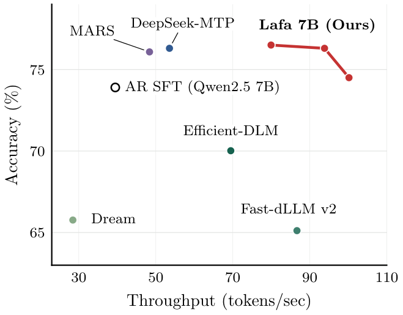
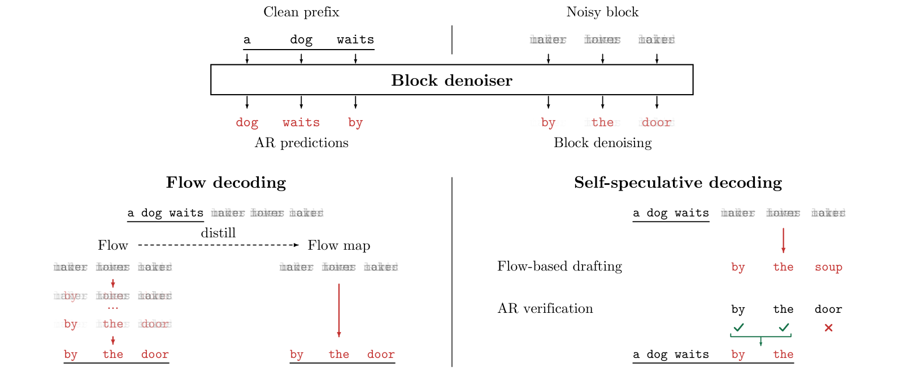
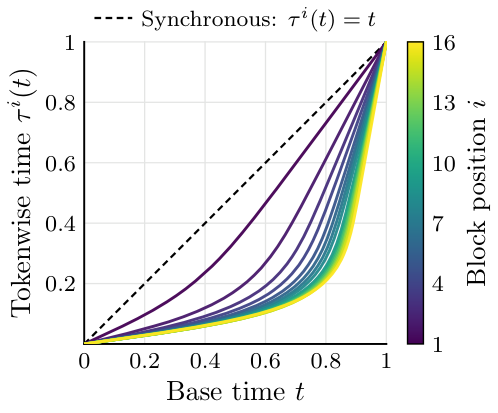
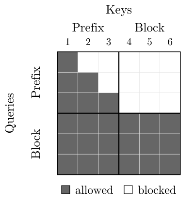
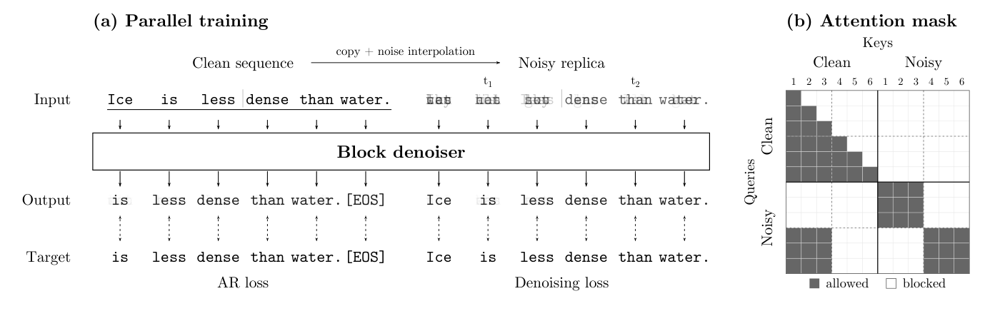
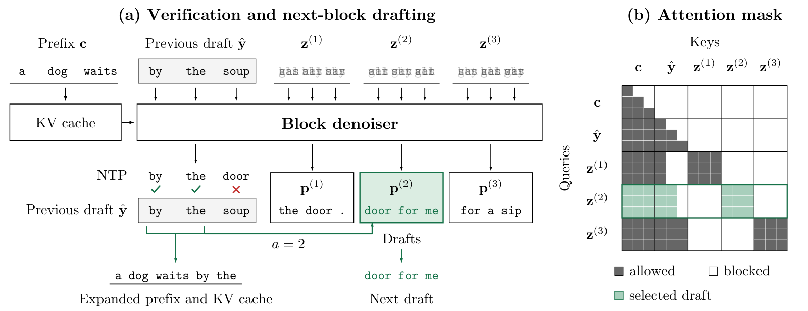
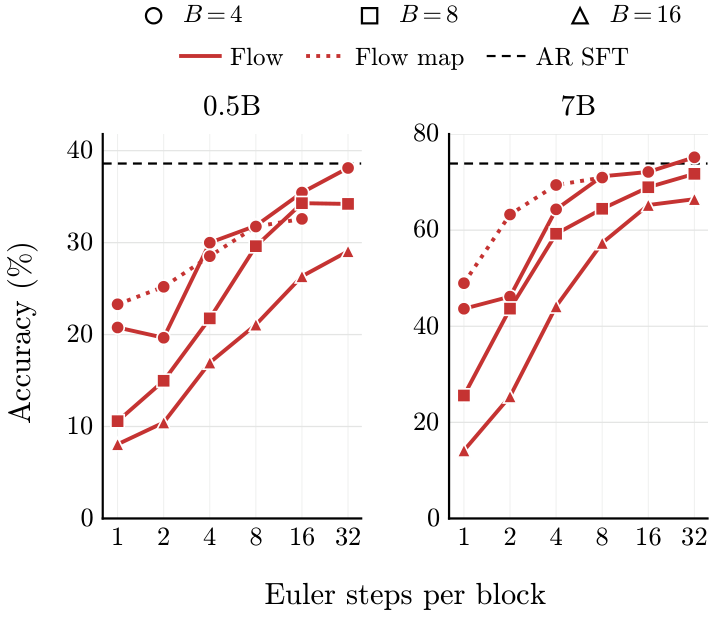
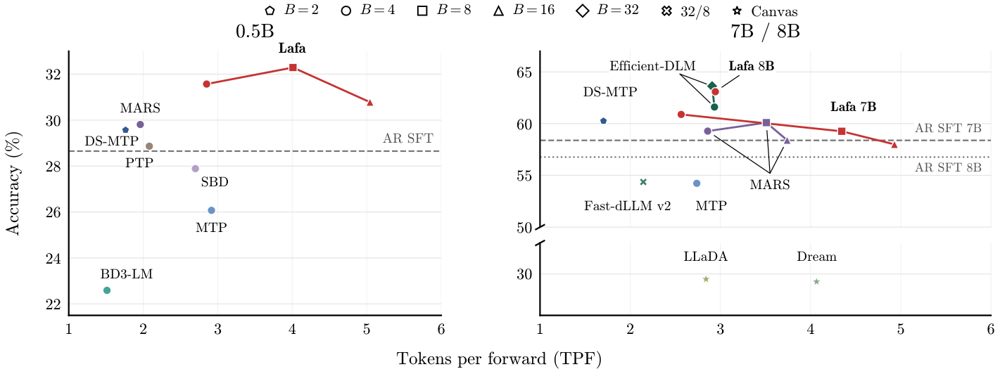
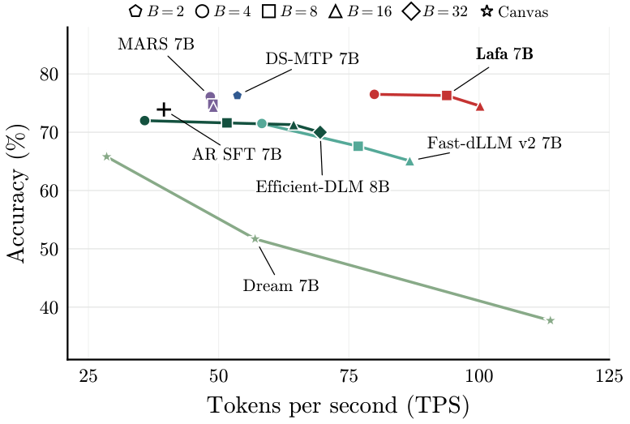
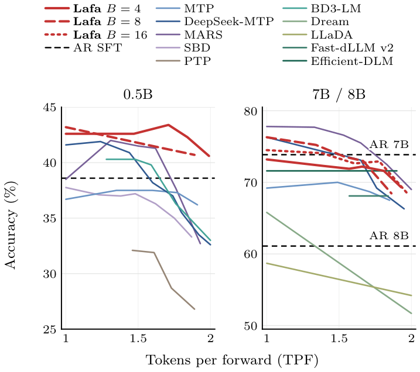

# Lafa：分块异步 Flow 提速 2.54 倍

自回归（Autoregressive，AR）大模型每执行一次解码前向，通常只能提交一个 Token，串行生成因此成为推理延迟和吞吐的瓶颈。并行解码要想真正实用，不能只追求“一次多吐几个 Token”，还必须同时守住生成质量、训练成本和 KV Cache 复用。Lafa 的思路是：**保留块间自回归，在块内学习连续异步 Flow，并用同一个模型保留下来的 AR 预测器验证 Flow 草稿**。最终，作者用少于 30B 的训练 Token 将模型扩展到 8B；Lafa 7B 在质量相近时达到 AR SFT 基线的 **2.54 倍端到端吞吐**。

> 图解：横轴是单张 H100、batch size 1 下的端到端吞吐，单位为 tokens/sec；纵轴是 IFEval、GSM8K、HumanEval 三项任务的平均准确率。红色圆点、方块和三角分别对应 Lafa 的块大小 $B=4,8,16$，三点平均吞吐为 79.9、93.8、100.2 TPS，平均准确率为 76.5%、76.3%、74.5%；AR SFT 为 39.5 TPS、73.9%。Lafa 将高质量区域明显推向右侧，而不是单纯用准确率换速度。

## 为什么并行生成仍然难做？

AR 的训练高度并行，但生成必须沿着“前缀 $\rightarrow$ 下一个 Token”逐步展开。已有并行路线主要分成三类，它们各自解决了部分问题，也留下了新的约束。

| 技术路线 | 核心做法 | 主要短板 |
|---|---|---|
| 块自回归与 MTP | 根据已有前缀预测一个块，或用多个预测头一次提出多个 Token | 同一次更新内独立预测，容易破坏 Token 间依赖；常需 AR 验证或置信度筛选 |
| 离散扩散语言模型 | 在离散 Token 空间中反复去 mask 或替换噪声 Token | 少步生成同样受独立采样影响；全序列扩散不易复用前缀缓存 |
| 连续扩散与 Flow | 在 embedding、simplex 或二进制编码等连续表示中，从噪声输运到文本表示 | 有潜力借用图像、视频领域的控制与加速工具，但大规模训练效率和实用推理方案仍不成熟 |

块扩散已经证明，“块间 AR、块内迭代”可以兼顾因果前缀与并行去噪。连续 Flow 则进一步提供了连续速度场、Flow Map 蒸馏等工具。真正缺的是一座桥：**怎样把连续 Flow 接到成熟的预训练 AR 模型上，而不是付出一次近乎重新训练的代价？**

Lafa 的回答不是抛弃 AR，而是把模型改造成“双能力”系统：块 Denoiser 负责并行起草，前缀 AR 预测器负责逐 Token 验证。下面先看全貌，再拆开关键设计。

## 一个模型，三种解码方式

> 图解：上半部分，同一个 Block Denoiser 接收干净前缀和带噪块；前缀位置输出 AR 预测，块位置输出去噪预测。左下是 Flow Decoding：沿连续时间逐步把噪声变成 Token embedding，并可蒸馏成直接跨时间跳跃的 Flow Map。右下是 Self-Speculative Decoding：Flow 一次提出整块草稿，AR 从左到右检查，只提交最长一致前缀；示例中 `by the` 被接受，`soup` 被否决。

这三种模式对应不同的质量—速度需求：

- **Flow Decoding**：用多次 Euler 积分换取较高质量，步数越多，通常越准确。
- **Flow Map Decoding**：把多步 Flow 蒸馏成少步甚至一步的跨时间映射，降低每块的前向次数。
- **Self-Speculative Decoding**：只用一步 Flow 起草，再由模型自身的 AR 输出验证；最终结果与该模型的 greedy AR 解码一致。

笔者认为，第三种模式是整篇工作最实用的一笔。它没有强求“一步 Flow 直接达到多步 Flow 的质量”，而是把不成熟的整块预测变成廉价草稿，把保留下来的 AR 能力变成质量保证。

## 块内异步 Flow：既并行，又保留从左到右的归纳偏置

### 块间仍然因果，块内交给 Flow

设词表为 $V$，干净前缀为 $\mathbf{c}\in V^N$，待生成长度为 $M$ 的续写 $\mathbf{y}\in V^M$。将续写切成长度为 $B$ 的块，并假设 $B$ 整除 $M$，则：

$$
p(\mathbf{y}\mid\mathbf{c})
=\prod_{r=0}^{M/B-1}
p\left(\mathbf{y}^{rB+1:(r+1)B}\mid\mathbf{c},\mathbf{y}^{\leq rB}\right).
$$

这个分解意味着：已经提交的块始终是干净、确定的前缀，因此可以像普通 AR 一样缓存 Key/Value；只有当前块处于连续噪声状态。相比在整条序列上同时扩散，它更贴近文本原有的因果结构，也更适合流式生成。

对每个块，Lafa 不使用维度为 $|V|$ 的 one-hot 表示，而是复用预训练词表 embedding 矩阵 $\mathbf{E}\in\mathbb{R}^{|V|\times d}$。块内真实表示为 $\mathbf{x}_1^i=\mathbf{E}_{y^i}$，初始噪声为 $\mathbf{x}_0\sim\mathcal{N}(0,\sigma^2I)$，从而把每个 Token 的连续状态维度降到 $d$。

### 每个 Token 有自己的“进度条”

标准 Flow Matching 常让整个块共享时间 $t$，所有位置以相同速度从噪声走向数据。Lafa 则引入 Tokenwise Time $\tau^i(t)$：全局时间 $t$ 像总进度，$\tau^i(t)$ 是第 $i$ 个位置自己的进度。其插值路径为：

$$
I_t^i=\left(1-\tau^i(t)\right)\mathbf{x}_0^i+\tau^i(t)\mathbf{x}_1^i,
\qquad i\in[B],\quad t\in[0,1].
$$

其中 $\tau(0)=\mathbf{0}$、$\tau(1)=\mathbf{1}$，且每个坐标都可微、单调递增。若 $i<j$ 时 $\tau^i(t)>\tau^j(t)$，靠前的 Token 就会更早去噪，靠后的 Token 可以利用已经较清晰的左侧内容。这相当于在块内并行计算之上，加了一层轻柔的从左到右偏置，而不是重新退回严格串行。

对应的连续生成过程由常微分方程（ODE）描述：

$$
\dot{\mathbf{x}}_t=b_t(\mathbf{x}_t;\mathbf{c}),
\qquad \mathbf{x}_0\sim p_0.
$$

直接回归速度场 $b_t$ 并不是唯一选择。Lafa 学习块 Denoiser $D_t$，让它输出每个位置的词表概率分布：

$$
D_t(\mathbf{x};\mathbf{c})^i
=p\left(y^i=\cdot\mid\mathbf{c},I_t=\mathbf{x}\right)
\in\Delta^{|V|-1}.
$$

这样做既能用熟悉的交叉熵训练，又能通过词表 embedding 的后验均值恢复速度场：

$$
b_t(\mathbf{x};\mathbf{c})^i
=\frac{\dot{\tau}^i(t)}{1-\tau^i(t)}
\left(D_t(\mathbf{x};\mathbf{c})^i\mathbf{E}-\mathbf{x}^i\right).
$$

附录中的推导很简洁。对插值式求导可得 $\dot I_t^i=\dot\tau^i(t)(x_1^i-x_0^i)$；再消去 $x_0^i$，有：

$$
x_1^i-x_0^i=\frac{x_1^i-I_t^i}{1-\tau^i(t)}.
$$

对 $\dot I_t^i$ 取条件期望，并使用 $\mathbb{E}[x_1^i\mid c,I_t=x]=D_t(x;c)^iE$，就得到上式。也就是说，速度方向是“当前噪声状态指向去噪后的平均 embedding”，步长则由各位置自己的时间导数控制。

### 时间表不是手工设定，而是从 Loss 中学出来

Lafa 根据各位置在不同噪声水平上的去噪交叉熵，在线估计时间重参数化。设 $\ell_i(\tau)>0$ 是位置 $i$ 在 Tokenwise Time $\tau$ 下的期望 Loss，定义：

$$
F_i(\tau)=\frac{\int_0^\tau \ell_i(r)\,\mathrm{d}r}{\int_0^1\ell_i(r)\,\mathrm{d}r},
\qquad \tau^i(t)=F_i^{-1}(t).
$$

由于 $\dot\tau^i$ 与 $1/\ell_i(\tau^i)$ 成正比，Loss 较高的困难区间会推进得更慢。于是，无论训练时均匀采样 $t$，还是推理时均匀切分积分网格，都会自动把更多样本和计算分给困难噪声水平。

> 图解：横轴是全局 Base Time $t$，纵轴是各位置的 Tokenwise Time $\tau^i(t)$；颜色从紫色到黄色对应块内位置 $i=1$ 到 $16$，黑色虚线是同步基线 $\tau^i(t)=t$。所有曲线都从 0 到 1，但靠前位置整体推进更快，靠后位置更晚接近干净状态。值得注意的是，这种从左到右的节奏不是人工硬编码的，而是训练自然学出的。

## 从预训练 AR 改造：关键是“加能力”，不是“换模型”

有了块内 Flow 的数学形式，下一个问题是工程上如何少花数据、少破坏原模型。Lafa 的改造由时间条件、注意力掩码、embedding 约束和联合训练四部分组成。

### 用 adaLN 告诉模型每个位置有多脏

模型输入由干净前缀 $\mathbf{c}$ 和带噪块 $\mathbf{x}$ 拼接而成。每个位置通过 Adaptive Layer Normalization（adaLN）接收自己的时间条件：前缀位置恒为 1，表示完全干净；块内位置使用各自的 $\tau^i(t)$。

adaLN 初始化为恒等变换，因此刚加入时间条件时不会改变预训练模型的计算。这让一次前向同时处理“无噪前缀的 AR 预测”和“不同噪声程度的块去噪”，也为后续两种能力共存打下基础。

### 前缀因果、块内双向，顺便保住 KV Cache

> 图解：矩阵横轴是 Keys，纵轴是 Queries，深灰色表示允许注意力，白色表示屏蔽。前 3 个前缀位置仍呈下三角因果掩码，并且看不到后面的噪声块；后 3 个块位置既能读取全部干净前缀，也能在块内互相读取。

块内双向让靠后位置的部分去噪信息也能帮助靠前位置，比完全因果的块内注意力更适合联合恢复。与此同时，前缀既看不到噪声块，又始终被赋予时间 1，其 Key/Value 就与当前块状态 $(\mathbf{x},t)$ 无关。

因此，前缀 KV 可以在同一块的多个去噪步骤之间复用，也能在块提交后继续复用。这个设计的聪明之处在于：**缓存友好不是推理阶段额外补的技巧，而是由注意力掩码和时间条件共同保证的结构性质。**

### 共享 embedding，但只学方向、不改长度

词表 embedding $\mathbf{E}$ 从预训练模型初始化，并在前缀 AR 与 Flow 之间共享。完全冻结会限制适配；完全放开又可能通过增大 embedding 范数，让信噪比被人为抬高、去噪任务变相变简单。

Lafa 因而把每个词向量 $\mathbf{E}_v$ 的 L2 范数固定为预训练时的值，只学习方向。每次更新后再投影回原范数，既允许表示空间适应 Flow，又保持噪声尺度相对于数据尺度不失控。

### 一个 Loss 同时训练 AR 与 Denoiser

对每个训练样本，作者采样 $t\sim\mathcal{U}[0,1]$ 和高斯噪声，构造异步插值 $I_t$。联合目标包含三部分：

$$
\mathcal{L}
=\mathbb{E}\left[
\sum_{i=1}^{N}-\log f(\mathbf{c})^i_{c^{i+1}}
+\sum_{i=1}^{B}-\log\hat D_t(I_t;\mathbf{c})^i_{y^i}
+\sum_{i=1}^{B}\left\|\hat D_t(I_t;\mathbf{c})^i\mathbf{E}-\mathbf{E}_{y^i}\right\|_2^2
\right],
$$

其中约定 $c^{N+1}=y^1$，三项依次是：

1. **AR Cross Entropy**：保留并强化干净前缀上的下一 Token 预测。
2. **Denoising Cross Entropy**：监督每个带噪位置恢复正确 Token 的概率。
3. **Embedding Squared Error**：监督概率分布经过 $\mathbf{E}$ 后形成的平均 embedding，因为它直接决定 Flow 速度。

AR 与 Denoiser 共享 Transformer 参数。实验还出现了一个重要现象：AR 监督不但没有挤占 Flow 能力，反而进一步提升 Flow 准确率；联合训练后的 AR 准确率也高于同等数据、同等预算的 AR SFT。这与 Multi-Token Prediction 的辅助监督收益相呼应。

### 所有块并行训练，不重复计算重叠前缀

> 图解：左图把一条干净序列复制成带噪副本，示例含两个长度为 3 的块。干净序列使用因果注意力和 AR Loss；每个噪声块读取它之前的干净 Token，在自身内部双向注意力，并使用 Denoising Loss。右图是相应掩码：不同噪声块互不通信，也不会看到未来干净 Token，因此一次前向即可完成整条序列的 AR 与所有块的去噪训练。

如果把每个块单独抽出来训练，相同前缀会被反复计算。Lafa 的并行训练通过“干净序列 + 分块噪声副本”避免这部分开销，使块级适配更接近常规大模型训练的效率。

### Self-Conditioning：让上一次预测成为下一次提示

训练时，Lafa 以 $p_{\mathrm{sc}}=0.5$ 的概率先做一次无梯度去噪，再把预测的平均 embedding 反馈给第二次前向：

$$
\bar{\mathbf{x}}_1=\operatorname{sg}\left(D_t(I_t;\mathbf{c})\mathbf{E}\right),
\qquad
\widetilde I_t=I_t+I_t\mathbf{W}_1^\top+\bar{\mathbf{x}}_1\mathbf{W}_2^\top.
$$

其中 $\mathbf{W}_1,\mathbf{W}_2$ 从零初始化，$\operatorname{sg}$ 表示停止梯度。推理时不必额外前向：第 $k$ 个 Euler 步直接复用第 $k-1$ 步的预测作为 Self-Conditioning。消融实验显示，这是推理阶段收益最大的单项设计之一。

## Flow Map 蒸馏：把“逐步走”压缩成“直接跳”

多步 Flow 的质量较好，但每个块仍要多次调用 Denoiser。Flow Map 的目标是学一个双时间映射 $X_{s,t}$，直接从时间 $s$ 的状态跳到时间 $t$，最终用 $X_{0,1}$ 一步完成块生成。

Lafa 将双时间 Denoiser 扩展到“异步时间 + 词表 embedding”的情形。$\delta_{s,t}(\mathbf{x};\mathbf{c})^i$ 仍输出词表概率，再映射到 embedding 空间参与状态传输：

$$
X_{s,t}(\mathbf{x};\mathbf{c})^i
=\frac{1-\tau^i(t)}{1-\tau^i(s)}\mathbf{x}^i
+\frac{\tau^i(t)-\tau^i(s)}{1-\tau^i(s)}
\delta_{s,t}(\mathbf{x};\mathbf{c})^i\mathbf{E},
\qquad 0\leq s<t\leq1.
$$

学生 $\hat\delta_{s,t}$ 从冻结教师 $\hat D_s$ 初始化，并新增一个恒等初始化的 adaLN 来接收目标时间 $t$。训练包含三类约束：

- **对角约束**：$s=t$ 时，学生应退化为教师的瞬时 Denoiser，即 $\hat\delta_{t,t}\approx\hat D_t$。
- **半群约束**：长跳应等于两个短跳的组合，即 $X_{s,t}\approx X_{u,t}\circ X_{s,u}$。
- **AR 蒸馏**：学生的前缀 AR 分布也要接近教师，避免少步化过程中丢失验证能力。

对 $s<u<t$，离对角目标由两个短跳学生的预测组合而成，并对整个目标停止梯度：

$$
\bar\delta_{s,t}^i
=\operatorname{sg}\left[
\gamma^i\hat\delta_{s,u}(\mathbf{x}_s;\mathbf{c})^i
+(1-\gamma^i)\hat\delta_{u,t}(\mathbf{x}_u;\mathbf{c})^i
\right],
$$

$$
\gamma^i
=\frac{(1-\tau_t^i)(\tau_u^i-\tau_s^i)}
{(1-\tau_u^i)(\tau_t^i-\tau_s^i)},
\qquad \mathbf{x}_u=\hat X_{s,u}(\mathbf{x}_s;\mathbf{c}).
$$

完整蒸馏目标写成：

$$
\mathcal{L}_{\mathrm{distill}}
=\mathbb{E}\left[\operatorname{KL}\left(f\,\|\,f^{\hat\delta}\right)\right]
+\mathbb{E}\left[\operatorname{KL}\left(\hat D_t\,\|\,\hat\delta_{t,t}\right)\right]
+\mathbb{E}\left[\operatorname{KL}\left(\bar\delta_{s,t}\,\|\,\hat\delta_{s,t}\right)\right].
$$

附录进一步证明了这一目标为何不是启发式拼凑：在满足连续性、唯一 ODE 解及采样分布 full support 等条件下，双时间 Denoiser 的对角条件与半群条件，能够保证其对应映射恢复教师的真实 Flow Map；两个 Flow KL 项的总体最优值为零，且任意总体最优解都恢复教师 Flow。其证明核心是把精确双时间 Denoiser 写成轨迹上教师预测的加权平均：当 $t\to s$ 时得到对角条件，把积分在 $u$ 处拆开则得到半群条件。

不过，理论可恢复不等于有限训练下已经完美。实验中，Flow Map 明显改善一步、两步生成，但与较多积分步的 Flow 仍有质量差距；如何更好地把 Self-Conditioning 和 Prefix Guidance 纳入蒸馏，仍是开放问题。

## 推理加速：一步起草、AR 验证、同轮重起草

### Flow 与 Flow Map 如何完成一个块

普通 Flow 从 $\hat{\mathbf{x}}_0\sim p_0$ 出发，在 $t_k=k/K$ 的网格上做 $K$ 次 Euler 更新。令 $\mathbf{p}_k=\hat D_{t_k}(\hat{\mathbf{x}}_{t_k};\mathbf{c})$，则：

$$
\hat{\mathbf{x}}_{t_{k+1}}^i
=\hat{\mathbf{x}}_{t_k}^i
+\frac{\tau^i(t_{k+1})-\tau^i(t_k)}{1-\tau^i(t_k)}
\left(\mathbf{p}_k^i\mathbf{E}-\hat{\mathbf{x}}_{t_k}^i\right),
\qquad
\hat y^i=\operatorname{argmax}\left(\mathbf{p}_{K-1}^i\right).
$$

每一步复用前一步预测做 Self-Conditioning。作者还使用 Prefix Guidance 加强对上下文的依赖：

$$
D_t^g(\mathbf{x};\mathbf{c})
=D_t(\mathbf{x};\varnothing)
+g\left(D_t(\mathbf{x};\mathbf{c})-D_t(\mathbf{x};\varnothing)\right),
\qquad g\geq1.
$$

$g=1$ 时恢复原预测；$g>1$ 时放大“有前缀”与“无前缀”预测的差异。额外那次无前缀前向只处理 $B$ 个块 Token，成本相对较小。Flow Map 推理则用 $\hat\delta_{t_k,t_{k+1}}$ 替代瞬时 Denoiser，$K=1$ 时直接计算 $\hat X_{0,1}$。

### 自推测解码的输出为什么与 greedy AR 一致？

Self-Speculative Decoding 不使用多步积分，也不使用 Prefix Guidance，而是在零时刻只做一次 Denoiser 前向：

$$
\mathbf{p}^i=\hat D_0(\hat{\mathbf{x}}_0;\mathbf{c})^i,
\qquad
\hat{\mathbf{x}}_1^i=\mathbf{p}^i\mathbf{E},
\qquad
\hat y^i=\operatorname{argmax}(\mathbf{p}^i).
$$

一步草稿可能在位置之间不一致，因此 AR 预测器从左到右验证，只提交与 greedy AR 一致的最长草稿前缀。若第一个 Token 就不一致，则提交 AR 自己预测的第一个 Token。后续被拒绝的草稿全部丢弃，所以**最终输出严格等于该模型自身的 greedy AR 输出**，加速不依赖“近似接受”的误差容忍。

### 验证和下一草稿融合到一次前向

> 图解：示例块大小为 3。上一草稿是 `by the soup`，AR 验证为 `by the door`，因此接受长度 $a=2$，前缀扩展为 `a dog waits by the`。输入同时放置 3 个候选噪声块，第 $j$ 个候选只能读取“原前缀 + 草稿前 $j$ 个 Token”和自身；验证后选中与实际接受长度对应的 $\mathbf{p}^{(2)}$，直接得到下一草稿 `door for me`，无需再做一次独立重起草。右图绿色区域标出了被选候选的注意力行。

一般情况下，长度为 $B$ 的草稿有 $B$ 种可能接受长度。融合解码在一次前向中并行准备这些下一草稿，验证后只保留匹配项及其 KV 状态。若首 Token 已不匹配，接受长度固定为 1，只需一个候选。由此，“验证上一块”和“起草下一块”被压进同一轮计算。

另一种做法是按置信度阈值接受草稿前缀，但它需要调阈值，低阈值还会牺牲质量；因此论文默认使用无需阈值、输出与 greedy AR 一致的 AR 验证。

## 实验设置：模型、数据、指标与复现参数

作者在 0.5B、7B、8B 三个规模构建 Lafa。0.5B 用于受控比较与消融，7B 是主要结果，8B 用于和同规模扩散模型比较。

| 配置 | Lafa 0.5B | Lafa 7B | Lafa 8B |
|---|---|---|---|
| 初始化 | Qwen2.5 0.5B Instruct | Qwen2.5 7B Instruct | Qwen3 8B Base |
| 主结果训练数据 | Dolci-Instruct-SFT | 同左 | 同左 |
| 主结果 Epoch / Token | 5 / 约 9B | 5 / 约 9B | 5 / 约 9B |
| 块大小 $B$ | 4、8、16 | 4、8、16 | 4 |
| 最大序列长度 | 512–1024 | 512–1024 | 512 |
| adaLN | 每层独立 | 跨层共享 | 跨层共享 |
| Learning Rate | $1\times10^{-4}$ | $1\times10^{-5}$ | $1\times10^{-5}$ |
| 分布式训练 | DDP | ZeRO-3 | ZeRO-3 |

整体实验覆盖 5–15 个 Epoch、9–27B Token，均少于 30B；与同规模 Dream、LLaDA、Efficient-DLM 报告的训练预算相比，至少减少 $18\times$。8B 选择 Base 而非 Instruct，是因为作者观察到继续训练高度后训练的 Instruct 版本会损害性能。

主要复现超参数还包括：AdamW，常数学习率，前 1% 步数 warm-up，$\beta_1=0.9$、$\beta_2=0.999$，weight decay 为 0，梯度裁剪为 1.0，bfloat16；训练噪声尺度 $\sigma=4.0$，推理噪声尺度 $\sigma=0.1$，Prefix Guidance $g=8.0$；adaLN 学习率倍数为 5，参数 EMA 为 0.999（第 500 步启用）。时间直方图使用 200 个 bin、EMA 0.99，每 100 步更新一次；每次更新进行 4 次无梯度前向，独立均匀采样时间，避免低概率区域得不到估计。块大小 4 使用 384 条序列的 batch，更大块采用显存匹配的 microbatch，并在适用时从小块 checkpoint 继续训练。

评测覆盖六项任务：IFEval（指令遵循）、BBH 与 MMLU-Pro（知识与推理）、GPQA（科学推理）、GSM8K（数学）、HumanEval（代码）。IFEval 报 prompt-level strict accuracy，HumanEval 报 pass@1，其余报 accuracy；每个样本的生成上限通常为 1024 Token，GSM8K 和 HumanEval 例外，分别为 512 和 640。单 Token 与自推测结果对六项任务做宏平均，Flow、Flow Map、吞吐和消融则平均 IFEval、GSM8K、HumanEval 三项。

带 † 的基线由作者使用相同 AR 初始化、数据和训练预算重训，其余使用公开 checkpoint。论文已公开 [代码](https://github.com/lafa-gh/large-flow-lms) 与 [模型](https://huggingface.co/lafa-hf/models)。

## 实验一：多步 Flow 能达到什么质量？

> 图解：左右面板分别是 0.5B 和 7B；横轴是每个块的 Euler Steps，纵轴是 IFEval、GSM8K、HumanEval 平均准确率。圆、方、三角对应 $B=4,8,16$，实线是 Flow，点线是 $B=4$ 的 Flow Map，黑色虚线是对应规模 AR SFT 的三任务平均值。总体趋势是步数越多越准；相同步数下，更大块通常以准确率换并行度。

在 0.5B 上，$B=4$ 的 Flow 在 32 步达到 38.1%，64 步达到 38.5%，已接近 AR SFT 的 38.6%。在 7B 上，$B=4$ 的 Flow 在 32、64、128 步分别达到 75.2%、75.9%、75.7%，超过 AR SFT 的 73.9%。相比之下，$B=16$ 即使增加步数，最高仍为 67.2%，说明增大块会加剧块内联合依赖的建模难度。

Flow Map 对少步区间的改善更明显。以下列出 $B=4$ 时三任务平均值，便于直接比较教师与学生：

| 规模 | 每块步数 | Flow 教师（%） | Flow Map 学生（%） |
|---|---:|---:|---:|
| 0.5B | 1 | 20.8 | 23.3 |
| 0.5B | 2 | 19.7 | 25.2 |
| 0.5B | 4 | 30.0 | 28.5 |
| 0.5B | 8 | 31.8 | 31.8 |
| 0.5B | 16 | 35.4 | 32.6 |
| 7B | 1 | 43.7 | 49.0 |
| 7B | 2 | 46.2 | 63.3 |
| 7B | 4 | 64.3 | 69.4 |
| 7B | 8 | 71.2 | 71.0 |

7B 两步学生的 63.3% 已接近四步教师的 64.3%，四步学生还超过对应教师。但一步生成的 49.0% 距多步 Flow 的 75% 左右仍很远。这也解释了为什么最终的高吞吐方案选择“一步草稿 + AR 验证”，而不是直接把一步 Flow Map 当作无条件替代品。

## 实验二：联合训练反而增强了 AR

下表是论文正文的单 Token 解码结果，数值为六项任务宏平均准确率（%）。这里的 Lafa 不并行提交块，而是使用保留下来的 AR 预测器逐 Token 解码。

| 方法 | 0.5B | 7B | 8B |
|---|---:|---:|---:|
| AR SFT† | 28.7 | 58.4 | 56.8 |
| MTP† | 25.9 | 53.9 | — |
| DeepSeek-MTP† | 30.2 | 60.0 | — |
| MARS† | 30.4 | 59.7 | — |
| SBD† | 27.6 | — | — |
| BD3-LM† | 22.8 | — | — |
| Fast-dLLM v2† | — | 49.3 | — |
| Fast-dLLM v2 | — | 54.4 | — |
| Dream | — | 55.6 | — |
| LLaDA | — | — | 43.5 |
| Efficient-DLM | — | — | 63.5 |
| **Lafa（本文）†** | **31.6** | **60.9** | **63.1** |

Lafa 在三个规模都超过匹配的 AR SFT：0.5B 提升 2.9 个百分点，7B 提升 2.5 个百分点，8B 提升 6.3 个百分点。它在 0.5B 和 7B 的受控基线中平均准确率最高；8B 的 63.1% 与 Efficient-DLM 的 63.5% 接近，但训练 Token 至少少 $18\times$。

所以，Flow 训练不是给 AR 能力“止损”，而是在实验中还带来了增益。没有这个结果，后续“同一模型自己起草、自己验证”就无法同时兼顾质量和效率。

## 实验三：自推测解码每次前向能提交多少 Token？

并行度用 Tokens Per Forward（TPF）衡量：

$$
\mathrm{TPF}=\frac{\sum_j T_j}{\sum_j F_j},
$$

其中 $T_j$ 是样本 $j$ 最终提交的 Token 数，$F_j$ 是前向次数，AR 定义为 1。对 Lafa，$F_j$ 包括初始起草一次，以及后续融合“验证 + 重起草”的前向；不包括 prompt prefill。

> 图解：横轴是 TPF，纵轴是六项任务平均准确率，越靠右上越好。左图是 0.5B；右图混合展示 7B/8B，其中 Efficient-DLM 和 LLaDA 为 8B，其余基线为 7B，纵轴含断点以同时容纳低准确率的 Canvas 解码结果。虚线和点线分别标出 7B、8B AR SFT。Lafa 通过 $B=4,8,16$ 形成从高质量到高并行度的曲线，在多个规模上把匹配 AR 质量的工作点推向更高 TPF。

下表完整保留正文报告的各任务准确率（Acc.，%）与 TPF：

| 规模 / 方法 | $B$ | IFEval Acc. | TPF | BBH Acc. | TPF | MMLU-Pro Acc. | TPF | GPQA Acc. | TPF | GSM8K Acc. | TPF | HumanEval Acc. | TPF | 平均 Acc. | TPF |
|---|---:|---:|---:|---:|---:|---:|---:|---:|---:|---:|---:|---:|---:|---:|---:|
| 0.5B Qwen2.5 SFT | — | 48.4 | 1.0 | 26.3 | 1.0 | 11.9 | 1.0 | 17.9 | 1.0 | 32.0 | 1.0 | 35.4 | 1.0 | 28.7 | 1.0 |
| 0.5B Lafa | 4 | 55.1 | 2.2 | 27.6 | 3.3 | 12.1 | 3.1 | 21.9 | 2.9 | 36.1 | 2.7 | 36.6 | 2.9 | 31.6 | 2.9 |
| 0.5B Lafa | 8 | 55.3 | 2.7 | 27.9 | 5.1 | 10.0 | 5.5 | 23.7 | 4.2 | 37.8 | 3.6 | 39.0 | 3.0 | 32.3 | 4.0 |
| 0.5B Lafa | 16 | 54.2 | 3.1 | 27.0 | 6.3 | 9.1 | 9.2 | 18.1 | 4.8 | 36.7 | 3.6 | 39.6 | 3.3 | 30.8 | 5.0 |
| 7B Qwen2.5 SFT | — | 73.8 | 1.0 | 59.2 | 1.0 | 41.6 | 1.0 | 27.9 | 1.0 | 69.1 | 1.0 | 78.7 | 1.0 | 58.4 | 1.0 |
| 7B Lafa | 4 | 78.9 | 1.7 | 63.0 | 3.4 | 41.8 | 2.4 | 31.0 | 2.3 | 73.8 | 2.8 | 76.8 | 2.8 | 60.9 | 2.6 |
| 7B Lafa | 8 | 77.5 | 2.8 | 59.1 | 6.3 | 39.4 | 3.7 | 28.1 | 4.0 | 75.3 | 4.8 | 76.2 | 4.6 | 59.3 | 4.3 |
| 7B Lafa | 16 | 74.9 | 2.8 | 57.3 | 7.9 | 39.0 | 3.8 | 28.1 | 4.0 | 75.0 | 5.8 | 73.8 | 5.4 | 58.0 | 4.9 |
| 8B Qwen3 SFT | — | 38.1 | 1.0 | 71.6 | 1.0 | 56.2 | 1.0 | 29.5 | 1.0 | 62.9 | 1.0 | 82.3 | 1.0 | 56.8 | 1.0 |
| 8B Lafa | 4 | 62.3 | 2.4 | 70.7 | 3.4 | 56.2 | 3.2 | 31.7 | 3.1 | 77.8 | 2.6 | 79.9 | 2.9 | 63.1 | 2.9 |

几个现象值得拆开看：

- 0.5B、$B=8$ 时，Lafa 的 TPF 为 4.0，约为 DeepSeek-MTP、MARS 和 PTP 的 2 倍，同时平均准确率更高。
- 7B 从 $B=4$ 增至 $16$，TPF 从 2.6 增至 4.9，接近翻倍；$B=16$ 的平均准确率 58.0%，与 AR SFT 的 58.4% 接近。
- 7B、$B=4$ 同时超过 DeepSeek-MTP 的准确率与 TPF；$B=8$ 的平均准确率接近 MARS $B=4$，TPF 则约为其 1.5 倍。
- 8B、$B=4$ 的准确率和 TPF 与 Efficient-DLM 接近，但训练预算至少少 $18\times$。

TPF 只衡量“每次前向提交多少 Token”，不等于真实速度。更大块和更多候选会提高单次前向成本，不同方法的验证器、缓存更新也不同，所以还必须看端到端 TPS。

## 实验四：真实吞吐最高达到 AR 的 2.54 倍

> 图解：横轴为 Tokens Per Second（TPS），纵轴为 IFEval、GSM8K、HumanEval 平均准确率。实验使用单张 H100、batch size 1、bfloat16 和 32 Token warm-up；各方法采用原生解码器。Lafa 7B 的红色曲线位于 AR SFT 右上方或右侧：$B=4$ 时质量更高且约 2 倍速度，$B=16$ 时速度最高且平均质量仍略高。Efficient-DLM 为 8B，其余点为 7B。

Lafa 与 AR 的逐项结果如下：

| 方法 | IFEval Acc. / TPS | GSM8K Acc. / TPS | HumanEval Acc. / TPS | 平均 Acc. / TPS |
|---|---:|---:|---:|---:|
| 7B AR SFT | 73.8 / 40.9 | 69.1 / 40.6 | 78.7 / 37.0 | 73.9 / 39.5 |
| Lafa 7B，$B=4$ | 78.9 / 60.9 | 73.8 / 91.7 | 76.8 / 87.2 | 76.5 / 79.9 |
| Lafa 7B，$B=8$ | 77.5 / 61.1 | 75.3 / 116.1 | 76.2 / 104.3 | 76.3 / 93.8 |
| Lafa 7B，$B=16$ | 74.9 / 59.7 | 75.0 / 125.2 | 73.8 / 115.7 | 74.5 / 100.2 |

$B=16$ 的 100.2 TPS 是 AR 的 $100.2/39.5\approx2.54$ 倍，同时三项平均准确率从 73.9% 变为 74.5%。$B=4$ 则达到约 $2.02\times$ 吞吐和更高的 76.5% 平均准确率。DeepSeek-MTP 与 MARS 虽能匹配或超过 AR 质量，但最高仅约 $1.4\times$ 吞吐；扩散基线在更快设置下质量下降更明显。

这里最值得强调的是多步 Flow 与自推测解码的分工：前者证明模型确实学到了可迭代精修的连续 Flow，后者证明即使一步整块草稿还不够可靠，也能借助 AR 验证转化为实际吞吐收益。

## 消融实验：哪些设计真正贡献了质量？

以下结果均使用 0.5B、$B=4$、32 个 Euler Steps，报告 IFEval、GSM8K、HumanEval 平均准确率。

| 类别 | 配置 | 平均准确率（%） |
|---|---|---:|
| 训练 | Fully Causal Attention | 32.7 |
| 训练 | **Block-Bidirectional Attention** | **38.0** |
| 训练 | Synchronous Time | 36.2 |
| 训练 | **Asynchronous Tokenwise Time** | **38.0** |
| 训练 | Frozen Embeddings | 34.4 |
| 训练 | Unconstrained Embedding Training | 36.9 |
| 训练 | **Norm-Frozen Embedding Training** | **38.0** |
| 训练 | Denoising CE | 33.6 |
| 训练 | Denoising MSE | 29.7 |
| 训练 | Denoising CE + MSE | 35.8 |
| 训练 | **Denoising CE + MSE + AR** | **38.0** |
| 推理 | No Self-Conditioning | 32.3 |
| 推理 | **Self-Conditioning** | **38.1** |
| 推理 | No Guidance | 34.3 |
| 推理 | **Prefix Guidance** | **38.1** |

块双向注意力比全因果高 5.3 个百分点，说明块内信息互通确实重要；异步时间再带来 1.8 个百分点。固定范数的可训练 embedding 同时优于冻结与完全放开，验证了“只调方向、不改噪声相对尺度”的动机。

Denoising CE 与 MSE 互补，加入 AR Loss 后又从 35.8% 提升到 38.0%。推理端，Self-Conditioning 带来 5.8 个百分点，Prefix Guidance 带来 3.8 个百分点；前者还不需要额外模型前向。这组结果也再次提示：若 Flow Map 蒸馏能更充分继承这两种机制，少步生成仍有提升空间。

## 补充实验：置信度接受为何不是默认方案？

> 图解：横轴为 TPF，纵轴为 GSM8K、HumanEval、IFEval 平均准确率；曲线通过改变置信度阈值得到，而不是改变 Euler Steps。红色线为 Lafa 不同块大小，黑色虚线为 AR SFT。右图中 Lafa $B=4$ 使用 8B，$B=8,16$ 使用 7B；Efficient-DLM 与 LLaDA 为 8B，其余基线为 7B。

置信度解码接受一步 Flow 草稿中，从左到右连续达到阈值 $\lambda$ 的最长前缀，并至少提交一个 Token。因为接受长度在前向前已知，它只需准备一个后继候选，不必像 AR 验证那样准备所有可能接受长度。

结果是：0.5B、$B=4$ 的 Lafa 达到所有方法中的最高峰值准确率，并在高阈值下保持不低于 AR；7B 在高阈值也超过 AR，但专为置信度解码训练的 MARS 在降低阈值时退化更平缓；8B Lafa 在测试范围内始终高于 AR，并与 Efficient-DLM 接近。

然而，阈值本身就是质量—速度旋钮，调低后容易损失准确率。AR 验证无需选择阈值，还能保证输出与 greedy AR 一致，因此论文把自推测解码设为默认，把置信度方案作为补充。

## 总结：Lafa 真正打通了哪些环节？

- **结构上**，块间因果、块内双向异步 Flow，同时保留文本方向性、块内并行和 Prefix KV Cache。
- **训练上**，adaLN 时间条件、固定范数的共享 embedding，以及 AR + 去噪联合 Loss，让少于 30B Token 的适配扩展到 8B。
- **生成上**，多步 Flow 可接近或超过 AR SFT，Flow Map 改善一步和少步生成，但尚未完全追平多步教师。
- **系统上**，保留下来的 AR 预测器验证一步 Flow 草稿，融合验证与重起草，使 Lafa 7B 在相近质量下达到 2.54 倍吞吐。
- **结论上**，连续 Flow 不一定替代 AR；让两种能力在同一模型中协作，反而形成了更实用的质量—速度前沿。

下一步最关键的是改进 Flow Map 对 Self-Conditioning 与 Prefix Guidance 的蒸馏，缩小少步生成与多步 Flow 的质量差距，从而让高质量并行解码不再依赖较多积分步或额外验证。

> 本文参考自 [Large Flow Language Models](http://arxiv.org/abs/2610.28559v1)