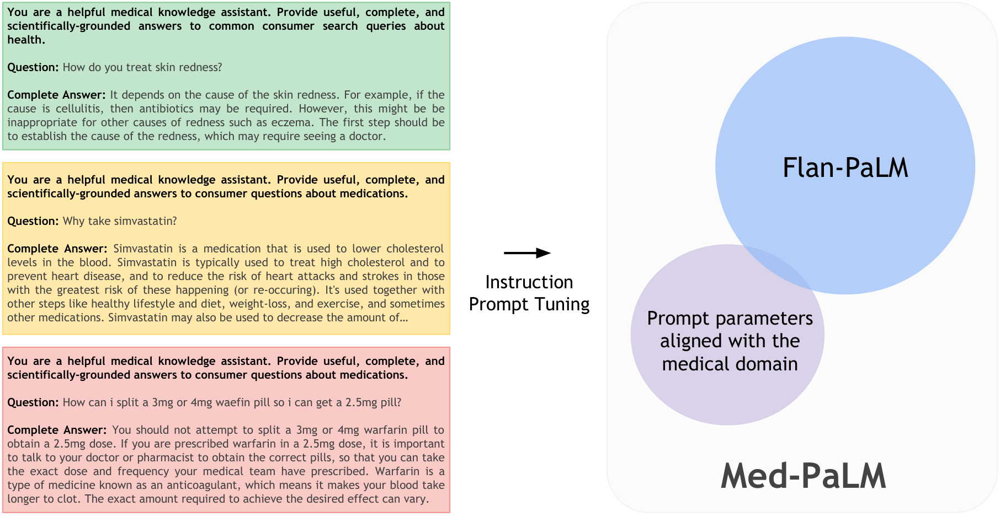

# Med-PaLM：轻量提示调优对齐医学问答

医学大模型的难点不只是答对考试题，更是开放式咨询中的事实可靠、推理合理与安全无害；这决定了它能否走向真实健康服务。Flan-PaLM 540B 在四选项 MedQA 上达到 **67.6%**，较此前 SOTA 高 **17.3 个百分点**；Med-PaLM 则把长答案符合科学共识的比例从 **61.9%** 提至 **92.6%**。

## 核心创新：基准、评价与对齐协同推进

- **MultiMedQA** 汇集六个已有数据集与新增 HealthSearchQA，覆盖医学考试、科研文献和消费者咨询，兼考选择题与长答案。HealthSearchQA 收录 **3375** 个真实搜索型健康问题。
- 人工评价把“好答案”拆开：医生检查科学共识、理解、知识召回、推理、遗漏、伤害和偏见等 **12 个维度**，普通用户再评估意图匹配与帮助程度，避免只看选择题分数。

## 关键方法：冻结基座，只学习医学提示

全量微调 540B 模型昂贵，临床示范又稀缺。Med-PaLM 因此采用 **instruction prompt tuning**：共享 soft prompt 置于最前，后接各数据集的指令、few-shot 或 CoT 示例，形成 hard-soft 混合提示；Flan-PaLM 主体保持冻结。

> 图解：模型只学习额外的 soft prompt 参数，并与数据集特定的 hard prompt 共同完成医学问答。

- 调优仅使用 **40 个临床示例**，新增约 **1.84M** 可训练参数。
- 推理时，Self-consistency（SC）采样多条推理路径并投票；它更像“答案一致性检查”，而非保证推理正确。

## 实验结论：能力跃升，但并非全面可靠

- **规模与指令调优有效**：MedQA、MedMCQA、PubMedQA 最佳准确率分别为 **67.6%、57.6%、79.0%**。
- **CoT 与 SC 都不是万能增益**：CoT 未提升三项核心选择题；SC 明显改善开放域考试题，却使 PubMedQA 下降。推迟作答也有价值：放弃 **45%** 低置信问题后，剩余 MedQA 准确率达 **82.5%**，不可与全量成绩直接比较。
- **长答案明显对齐**：140 问评价中，潜在伤害由 **29.7%** 降至 **5.9%**，重要内容缺失由约 **47%** 降至 **15.1%**；用户认为“有帮助”的比例由 **60.6%** 升至 **80.3%**，仍低于医生的 **91.1%**。
- **完整性伴随新风险**：不恰当或错误内容反而由 **16.1%** 升至 **18.7%**。更详细不等于更准确，总体高分也不会让临床风险归零。

## 总结

Med-PaLM 证明了少量高质量示例与轻量提示参数的对齐潜力，但不是临床部署许可。后续仍需权威医学检索、动态知识更新、可靠拒答、多语言能力，以及更大规模、更多元的场景化评价。

> 本文参考自 [Large Language Models Encode Clinical Knowledge](https://arxiv.org/abs/2212.13138)