# Memorilla：16枚记忆替代长上下文

LLM 想利用历史聊天、长文档和智能体轨迹，不能每次都把全部资料塞回上下文：这样做既昂贵，也未必更准。Memorilla 的思路是先把文档编码成可复用向量，再按当前查询从整个集合中读出固定 16 个 soft memory tokens，直接送入冻结 LLM 的输入嵌入空间。在 FactKG 上，它以 108 倍更少的文档 Token 达到 84.33% 准确率，高于 Full Context 的 80.43%；跨八项基准平均得分也最高，文档 Token 的几何平均值则减少 394 倍。更进一步，在 TextWorld 中，仅训练记忆模块便把智能体的 avg@3 从 18.6% 提升到 24.2%。

## 为什么更长的上下文不等于更好的记忆

冻结的 LLM 只能使用参数之外、被放进上下文的信息。个人助手需要记住用户数月来的偏好，问答系统需要跨越整本书寻找证据，智能体则需要利用此前走过的房间和尝试过的动作。这些信息都在模型外部，因此真正的难题不是“有没有存下来”，而是**每次查询时，能否把全库中相关的信息组合起来，同时保持输入足够短**。

已有路线各自解决了一部分问题：

- **文本记忆与 RAG**：RAG、MemGPT、Mem0、A-MEM 和 MemoRAG 最终都要把选中的文本放进上下文。它们保留原文细节和出处，却无法使用未被选中的证据；扩大检索范围，收益也可能很快递减。
- **Latent Compression**：ICAE、IC-Former、AutoCompressors 和 ComMer 把文档压成少量连续向量，但压缩时通常看不到查询，同一份表示必须服务所有问题。xRAG 虽引入查询相关性，却只压缩一个先被检索出的文档。
- **模型内部记忆**：LongMem、MemoryLLM、M+ 和 Cartridges 使用特定模型的 hidden states 或 KV cache，往往需要训练 LLM、侧网络，或为每个语料库单独优化，记忆与模型因此紧密绑定。

Memorilla 补上的关键一环是：**从整个文档集合按查询检索，但检索结果不是文本，而是冻结 LLM 可以直接消费的输入嵌入**。文档存储与模型内部结构解耦，LLM 的层和 Attention 均无需改动。

## 方法：读取整个集合，只交付 16 枚记忆

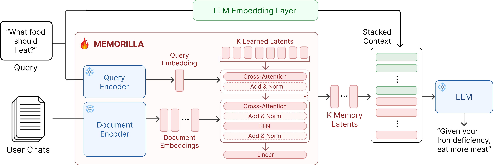

> 图解：左侧的用户聊天等文档先由冻结 Encoder 编码一次，进入可持久化的 Memory Store。每次有新 Query 时，$K$ 个受查询条件的 slots 对全库向量做 Cross-Attention，再经线性投影变成冻结 LLM 输入空间中的记忆向量。右侧 LLM 同时读取这些向量和文本查询，自身保持冻结。

整个系统可以拆成编码、存储、检索和注入四步。它像一名按问题翻阅资料的研究助理：资料索引只需建立一次，但每次交给读者的不是整摞原文，而是一组针对当前问题整理好的“内部便签”。

### 一次编码，长期复用

给定 $N$ 个文档块 $\mathcal{D}=\{d_1,\ldots,d_N\}$，冻结文档 Encoder $f_{\mathrm{enc}}^d$ 将每块映射为 $\mathbf{z}_i\in\mathbb{R}^{h_e}$，形成与查询无关的存储矩阵：

$$
\mathbf{Z}_{\mathcal D}
= [f_{\mathrm{enc}}^d(d_1),\ldots,f_{\mathrm{enc}}^d(d_N)]
\in \mathbb{R}^{N\times h_e}
$$

这份矩阵只计算一次，之后的所有查询都复用它；新增或变化的文档才需要重新编码。当前查询 $q$ 则由冻结查询 Encoder 映射为 $\mathbf{z}_q=f_{\mathrm{enc}}^q(q)$，它只用于本次读取，不进入长期记忆。

文档块可以是聊天会话、书籍段落、知识图谱三元组或论文摘要小节。论文采用的具体切分如下，Token 数均由 Qwen3 Tokenizer 统计：

| 基准 | 文档块单位 | 每块 Token：均值 / 中位数 |
|---|---|---:|
| PMv2 | 一次会话 | 280 / 262 |
| PV4 | 一段聊天对话 | 252 / 224 |
| PubMedQA | 一个摘要小节 | 84 / 78 |
| TriviaQA | 证据段落，按句子贪心切至约 128 Token | 70 / 77 |
| NarrativeQA | 故事段落，超过约 256 Token 时按句切分 | 94 / 35 |
| FactKG | 一个知识图谱三元组 | 13 / 13 |
| LaMP-4 | 一个用户档案条目 | 47 / 44 |
| LaMP-7 | 一条用户历史推文 | 25 / 25 |

### 查询先塑造“读取槽位”，再读取全库

可训练记忆模块 $f_{\mathrm{mem}}$ 接收文档矩阵和查询向量，输出 $K$ 行记忆：

$$
f_{\mathrm{mem}}:(\mathbf{Z}_{\mathcal D},\mathbf{z}_q)\mapsto\mathbf{M},
\qquad \mathbf{M}\in\mathbb{R}^{K\times h_L}
$$

这里 $h_L$ 是冻结 LLM 的输入嵌入维度，每一行 $\mathbf{m}_k$ 都是一枚 soft memory token。无论库中有多少文档，交给 LLM 的记忆始终只有 $K$ 个；默认 $K=16$。

**第一步：初始化 slots。** 模块用一组可学习向量 $\mathbf{Q}_0\in\mathbb{R}^{K\times h_e}$ 初始化 $K$ 个槽位。不同初值让槽位保留不同身份，并固定输出预算。

**第二步：注入查询条件。** 所有槽位先对查询向量做 Cross-Attention：

$$
\mathbf{Q}_c=\operatorname{LayerNorm}\left(
\mathbf{Q}_0+\operatorname{CrossAttn}
(Q=\mathbf{Q}_0,K=\mathbf{z}_q,V=\mathbf{z}_q)\right)
$$

查询只有一个向量，因此向各槽位提供共享更新；残差连接又保留了 $\mathbf{Q}_0$ 中彼此的差异。结果是，槽位既知道“当前要找什么”，又不会全部坍缩成同一种读取器。

**第三步：连续检索全部文档。** 条件化槽位经过 $L_{\mathrm{ref}}$ 个 Perceiver 风格的 Cross-Attention 块。令 $\overline{\mathbf{Z}}_{\mathcal D}=\operatorname{LayerNorm}(\mathbf{Z}_{\mathcal D})$、$\mathbf{R}_0=\mathbf{Q}_c$，第 $\ell$ 块执行：

$$
\widetilde{\mathbf{R}}_\ell
=\mathbf{R}_{\ell-1}+\operatorname{CrossAttn}
\left(Q=\operatorname{LayerNorm}(\mathbf{R}_{\ell-1}),
K=\overline{\mathbf{Z}}_{\mathcal D},
V=\overline{\mathbf{Z}}_{\mathcal D}\right)
$$

$$
\mathbf{R}_\ell
=\widetilde{\mathbf{R}}_\ell+
\operatorname{FFN}\left(\operatorname{LayerNorm}(\widetilde{\mathbf{R}}_\ell)\right)
$$

FFN 是带 GELU 的两层前馈网络。与离散 top-$k$ 检索不同，每个槽位都能关注全部 $N$ 个文档，查询条件决定哪些信息被保留和组合。

**第四步：投影到 LLM 输入空间。** 最后用线性层完成维度对齐：

$$
\mathbf{M}=\operatorname{LayerNorm}(\mathbf{R}_{L_{\mathrm{ref}}})\mathbf{W}_{\mathrm{proj}},
\qquad \mathbf{W}_{\mathrm{proj}}\in\mathbb{R}^{h_e\times h_L}
$$

这个设计的聪明之处在于，**“查询相关性”发生在读取文档之前，而不是读完之后再筛选**。因此它既能利用全库关系，又不必把所有原文交给 Decoder。

### 记忆如何进入冻结 LLM

文本查询经原模型的嵌入层得到 $\mathbf{P}_q$，记忆向量直接拼在它前面：

$$
\mathbf{X}_{\mathrm{LLM}}=[\mathbf{m}_1,\ldots,\mathbf{m}_K;\mathbf{P}_q]
$$

由于 $\mathbf{m}_k$ 与普通文本 Token 的嵌入维度相同，LLM 可以通过已有 Self-Attention 读取记忆。RoPE 仍按常规方式作用于合并序列，无需改动任何 LLM 层或 Attention 机制。

监督训练只优化记忆模块及投影参数 $\boldsymbol{\theta}_{\mathrm{mem}}$，并只在答案 Token 上计算负对数似然：

$$
\mathcal{L}_{\mathrm{sup}}
=-\sum_{i=1}^{L}\log P(y_i\mid\mathbf{y}_{<i},\mathbf{X}_{\mathrm{LLM}};\boldsymbol{\theta}_{\mathrm{mem}})
$$

默认实现使用冻结 Qwen3-Embedding-4B 作为文档与查询 Encoder，冻结 Qwen3-8B 作为 Decoder，记忆模块含 194,123,776 个可训练参数。模块有 2 层文档 Cross-Attention、8 个 Attention Heads，Encoder 侧维度为 2560，投影到 8B Decoder 的 4096 维输入；Dropout 为 0.1。所有监督评测采用 $T=0$ 的贪心解码。

### 三阶段课程：先学会保留，再学会按任务提取

| 阶段 | 数据与目标 | 关键训练设置 |
|---|---|---|
| Stage 1：通用预训练 | 1,979,809 个英文 Wikipedia 释义重构样本，让固定预算保留足够内容 | 随机初始化；峰值学习率 $3\times10^{-4}$；1 epoch；有效 Batch Size 128 |
| Stage 2：多任务预训练 | 1,343,993 个样本，覆盖阅读理解、开放域问答和摘要 | 从 Stage 1 热启动；峰值学习率 $3\times10^{-4}$；1 epoch；有效 Batch Size 128 |
| Stage 3：下游微调 | 八个评测基准训练划分的统一混合 | 从 Stage 2 热启动；峰值学习率 $1\times10^{-4}$；最多 5 epochs；有效 Batch Size 64 |

Stage 2 的具体数据包括 SQuAD v2（86,821）、DROP（77,400）、CoQA（108,647）、PubMedQA（900）、QuAIL（10,246）、PwC（241,564）、CNN/DailyMail（287,113）、SamSum（14,731）、DialogSum（12,460）和 MS MARCO（504,111）。

三个阶段都使用 AdamW、带 Warmup 的 Cosine Annealing、0.01 Weight Decay、bf16 混合精度和随机种子 23，在 4 张 NVIDIA H100 80GB 上训练。Stage 3 的一个多任务 Checkpoint 直接服务 FactKG、TriviaQA、NarrativeQA、PubMedQA、LaMP-4 和 LaMP-7；PMv2 与 PV4 因验证损失更晚稳定，各自再做 5 epochs 的专项微调。

## 实验设置：八项任务，统一冻结模型

实验覆盖个性化、长文档问答和知识密集型问答三类记忆需求。除特别说明外，所有方法都使用冻结 Qwen3-Embedding-4B 和 Qwen3-8B；Mem0 与 MemoRAG 额外使用冻结 Qwen3-4B-Instruct-2507 构建记忆。

| 数据集 | 任务 | 平均文档数 / 查询 | 平均源 Token / 查询 | 训练集 | 验证集 | 测试集 |
|---|---|---:|---:|---:|---:|---:|
| PersonalizationV4（PV4） | 个性化短答 | 200 | 50,476 | 15,058 | 1,755 | 4,237 |
| PersonaMem-v2（PMv2） | 个性化短答 | 116 | 31,618 | 18,521 | 2,059 | 5,000 |
| NarrativeQA（NQA） | 长文档生成式问答 | 1,420 | 76,225 | 32,747 | 3,461 | 10,557 |
| FactKG | 知识图谱事实核验 | 129 | 1,665 | 86,367 | 13,266 | 9,041 |
| TriviaQA | 开放域事实问答 | 164 | 11,861 | 138,384 | 17,944 | 500 个固定验证子样本 |
| PubMedQA | 生物医学问答 | 4 | 324 | 900 | — | 100 |
| LaMP-4 | 个性化标题生成 | 172 | 7,638 | 12,527 | — | 1,925 个开发集样本 |
| LaMP-7 | 个性化推文改写 | 18 | 465 | 10,437 | — | 1,500 个开发集样本 |

个性化任务要求把散落在历史中的线索合成用户画像，而不是寻找一句直接答案。PV4 是论文构建的合成基准：每位用户有 200 段隐含 persona 特征的对话，每道题至少组合两项 persona 事实；149 位用户被划分为 119 位训练用户和 30 位留出的评测用户，用户之间不重叠。其 Hard 子集包含 629 道无文档或 top-1 检索条件下未被基础模型答对的问题。

基线包括 Closed-book、按余弦相似度取 top-$k$ 文本的 RAG-1/5/50、Full Context、删除文本 Token 的 LLMLingua-2、把 top-1 文档映射为单枚 soft token 的 xRAG，以及 Mem0、MemoRAG；个性化生成还与论文报告的 ComMer 结果比较。分类任务使用 Accuracy，短问答使用 Exact Match 与 Token-level F1，开放式生成使用 ROUGE、BLEU、F1 和 METEOR。PMv2、PV4 的短答通过候选答案的嵌入最近邻判定。

Full Context 服务栈限制为 32,768 Token，超出时启用 4 倍 YaRN；10.8% 的 NarrativeQA 问题在扩展窗口后仍需丢弃最早文档块。各方法真正放入 Decoder 的文档 Token 如下，查询和共享指令不计入：

| 基准 | RAG-1 | RAG-5 | RAG-50 | Full Context | LLMLingua-2 | xRAG | Mem0 | MemoRAG | Memorilla |
|---|---:|---:|---:|---:|---:|---:|---:|---:|---:|
| PMv2 | 125 | 652 | 9,009 | 31,587 | 250 | 1 | 665 | 9,254 | 16 |
| PV4 | 201 | 1,021 | 10,832 | 50,455 | 180 | 1 | 978 | 11,046 | 16 |
| PubMedQA | 69 | 321 | 324 | 324 | 290 | 1 | 8 | 324 | 16 |
| NarrativeQA | 69 | 354 | 3,612 | 67,385 | 596 | 1 | 493 | 800 | 16 |
| TriviaQA | 51 | 226 | 2,357 | 11,888 | 243 | 1 | 269 | 303 | 16 |
| FactKG | 13 | 64 | 568 | 1,727 | 279 | 1 | 300 | 573 | 16 |
| LaMP-4 | 45 | 227 | 1,715 | 7,580 | 227 | 1 | 251 | 230 | 16 |
| LaMP-7 | 25 | 125 | 435 | 459 | 299 | 1 | 81 | 135 | 16 |
| **几何平均** | **55** | **273** | **1,808** | **6,301** | **278** | **1** | **212** | **784** | **16** |

## 主要结果：更少上下文，平均表现反而更好

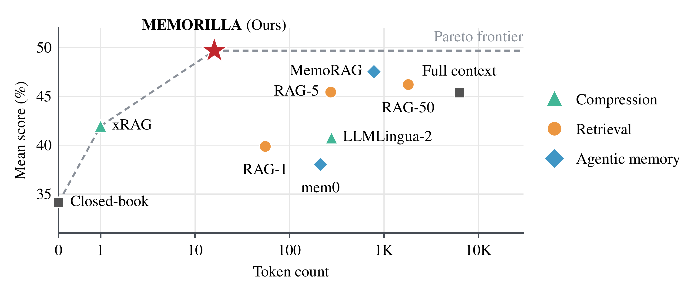

> 图解：纵轴是八个基准主指标的平均分，横轴是各基准文档 Token 数的几何平均，两者都基于同一个冻结 Qwen3-8B Decoder。Memorilla 位于虚线所示 Pareto Frontier 上，以 16 枚记忆 Token 获得最高分；Full Context 的几何平均为 6,301 Token，约为其 394 倍。

Memorilla 的平均得分为 49.68；紧凑基线 xRAG、LLMLingua-2 和 Mem0 分别为 41.92、40.75 和 38.02。相对 Full Context、RAG-50 和 MemoRAG，它的文档 Token 几何平均分别减少 394、113 和 49 倍。

完整结果如下。Compression 表示 Full Context 文档 Token 相对 Memorilla 16 Token 的倍数，空白处沿用该任务首行的压缩比：

| 任务 | 指标 | Closed-book | RAG-1 | RAG-5 | RAG-50 | Full Context | LLMLingua-2 | xRAG | Mem0 | MemoRAG | Memorilla | Compression |
|---|---|---:|---:|---:|---:|---:|---:|---:|---:|---:|---:|---:|
| PMv2 | Acc (SA) | 25.64 | 26.10 | 25.92 | 26.72 | 27.92 | 26.92 | 30.90 | 27.48 | 28.76 | **44.60** | 1,974× |
| PV4 | Acc (SA) | 58.30 | 62.21 | 64.98 | 65.78 | 59.12 | 52.14 | 62.64 | 65.07 | **67.88** | 66.65 | 3,153× |
| PV4 | Acc (SA, Hard) | 31.96 | 38.00 | 39.27 | 41.97 | 36.57 | — | 34.98 | 44.20 | **45.95** | 41.97 |  |
| PubMedQA | Acc | 21.00 | 34.00 | 67.00 | 67.00 | 67.00 | **69.00** | 36.00 | 24.00 | 67.00 | 59.00 | 20× |
| NarrativeQA | BLEU-1 | 7.09 | 7.36 | 7.85 | 8.29 | 5.89 | 6.87 | **16.86** | 7.77 | 9.14 | 16.36 | 4,212× |
| NarrativeQA | ROUGE-1 | 11.54 | 13.32 | 15.60 | 18.45 | 19.12 | 7.26 | 17.33 | 14.24 | **21.80** | 19.68 |  |
| NarrativeQA | ROUGE-L | 10.71 | 12.44 | 14.59 | 17.23 | 17.99 | 7.18 | 16.92 | 13.80 | **20.51** | 19.31 |  |
| NarrativeQA | F1 | 9.87 | 10.51 | 11.64 | 13.27 | 13.50 | 5.76 | 15.22 | 11.58 | 15.03 | **16.56** |  |
| TriviaQA | EM | 36.00 | 51.80 | 55.20 | 55.60 | 52.60 | 42.40 | 47.00 | 44.60 | 56.60 | **57.00** | 743× |
| TriviaQA | BLEU-1 | 29.12 | 40.29 | 39.09 | 43.07 | 35.56 | 29.28 | 46.54 | 29.09 | 45.00 | **58.66** |  |
| TriviaQA | BLEU-4 | 3.74 | 8.45 | 7.54 | 10.94 | 9.15 | 4.30 | 11.31 | 5.54 | 10.35 | **14.79** |  |
| TriviaQA | F1 | 37.68 | 52.06 | 54.99 | 58.05 | 56.49 | 39.74 | 50.37 | 42.74 | 57.55 | **60.60** |  |
| FactKG | Acc | 65.97 | 73.93 | 76.95 | 78.39 | 80.43 | 71.65 | 78.98 | 72.79 | 80.38 | **84.33** | 108× |
| LaMP-4 | ROUGE-1 | 14.24 | 16.15 | 16.98 | 16.98 | 16.21 | 14.98 | 18.12 | 14.72 | 17.08 | **20.30** | 474× |
| LaMP-4 | ROUGE-L | 12.24 | 14.31 | 14.94 | 15.09 | 14.21 | 12.98 | 16.10 | 12.70 | 15.02 | **18.15** |  |
| LaMP-4 | F1 | 8.98 | 11.21 | 12.15 | 12.15 | 11.32 | 8.71 | 13.46 | 9.05 | 12.41 | **15.54** |  |
| LaMP-4 | METEOR | 7.13 | 9.78 | 10.95 | 10.95 | 9.85 | 6.99 | 10.11 | 7.28 | 11.21 | **11.41** |  |
| LaMP-7 | ROUGE-1 | 48.73 | 49.80 | 49.80 | 49.65 | 49.57 | 49.61 | 52.78 | 49.58 | 49.92 | **54.40** | 29× |
| LaMP-7 | ROUGE-L | 43.13 | 44.11 | 43.81 | 43.77 | 43.71 | 43.73 | 46.84 | 43.68 | 44.00 | **48.37** |  |
| LaMP-7 | F1 | 36.10 | 37.28 | 37.28 | 37.26 | 37.14 | 37.17 | 42.99 | 36.87 | 37.55 | **44.96** |  |
| LaMP-7 | METEOR | 32.31 | 33.70 | 33.78 | 33.73 | 33.55 | 33.74 | 38.35 | 33.30 | 34.12 | **40.37** |  |

一个反直觉结论是：**Full Context 并不是性能上界**。在表中的 21 项指标上，Memorilla 有 20 项超过 Full Context，RAG-50 也有 15 项超过它。把所有内容都提供给模型，往往会让无关 Token 稀释证据，而不是自动带来更完整的推理。

### 分基准看收益与代价

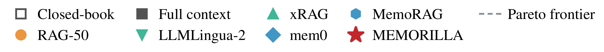

> 图解：以下八幅子图共用此图例。每幅图横轴均为每次查询平均提供给 Decoder 的文档 Token 数，纵轴为该任务主指标；虚线连接性能与上下文开销之间的 Pareto Frontier。

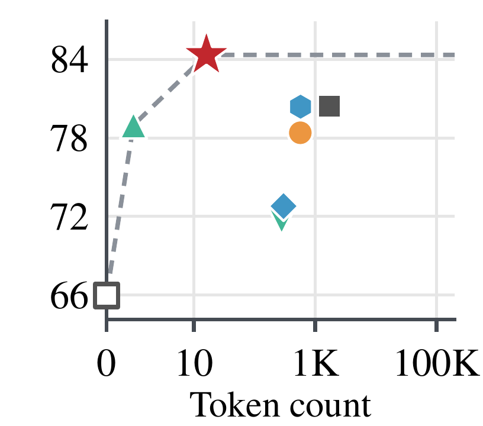

> 图解：FactKG 纵轴为 Accuracy。Memorilla 达 84.33%，高于 Full Context 的 80.43%、MemoRAG 的 80.38% 和 xRAG 的 78.98%；相对前两者，文档 Token 分别减少 108 倍和 36 倍。

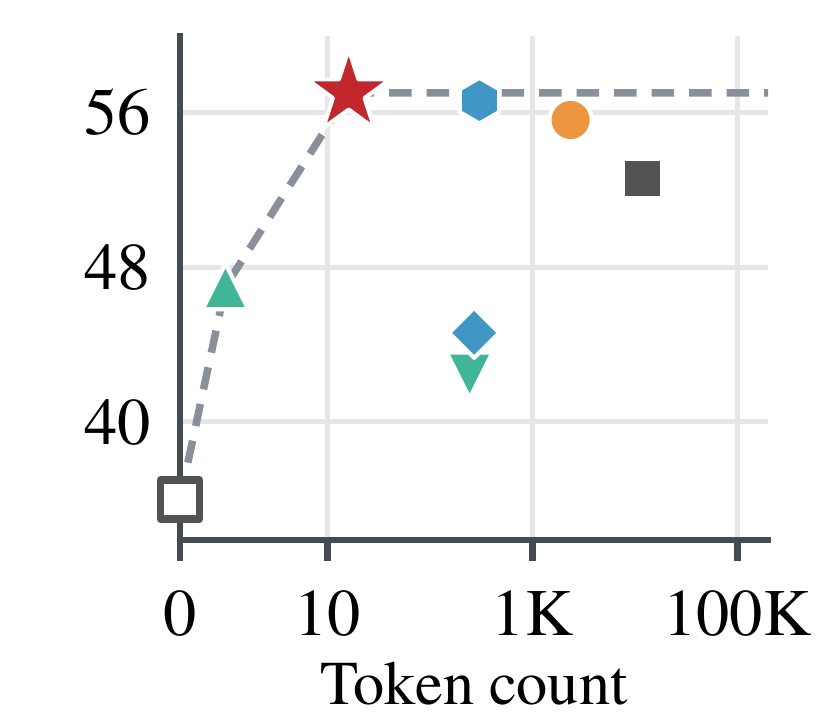

> 图解：TriviaQA 纵轴为 Exact Match。Memorilla 以 57.00 居首，MemoRAG 和 Full Context 分别为 56.60、52.60；相对两者，文档 Token 分别减少 19 倍和 743 倍。

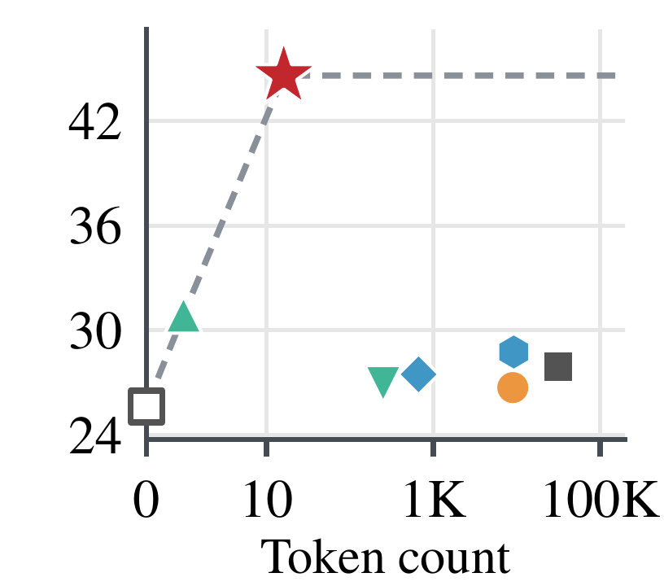

> 图解：PMv2 纵轴为短答 Accuracy。Memorilla 达 44.60%，最强基线 xRAG 为 30.90%。其他基线都只在 Closed-book 的 25.64% 附近约三个百分点内波动，Full Context 即使多用 1,974 倍文档 Token，也只有 27.92%。

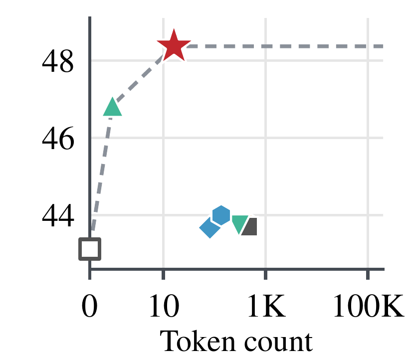

> 图解：LaMP-7 纵轴为 ROUGE-L。Memorilla 将 Closed-book 的 43.13 提升到 48.37；除 xRAG 的 46.84 外，其余基线都处在 Closed-book 附近一个 ROUGE-L 点以内。

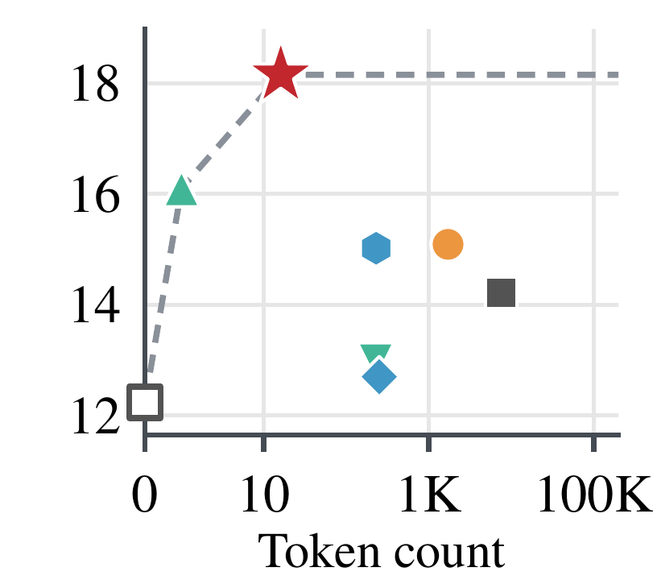

> 图解：LaMP-4 纵轴为 ROUGE-L。Memorilla 达 18.15，Full Context 为 14.21，同时文档 Token 减少 474 倍，说明它能从完整写作历史中提取风格，而非只模仿单篇样例。

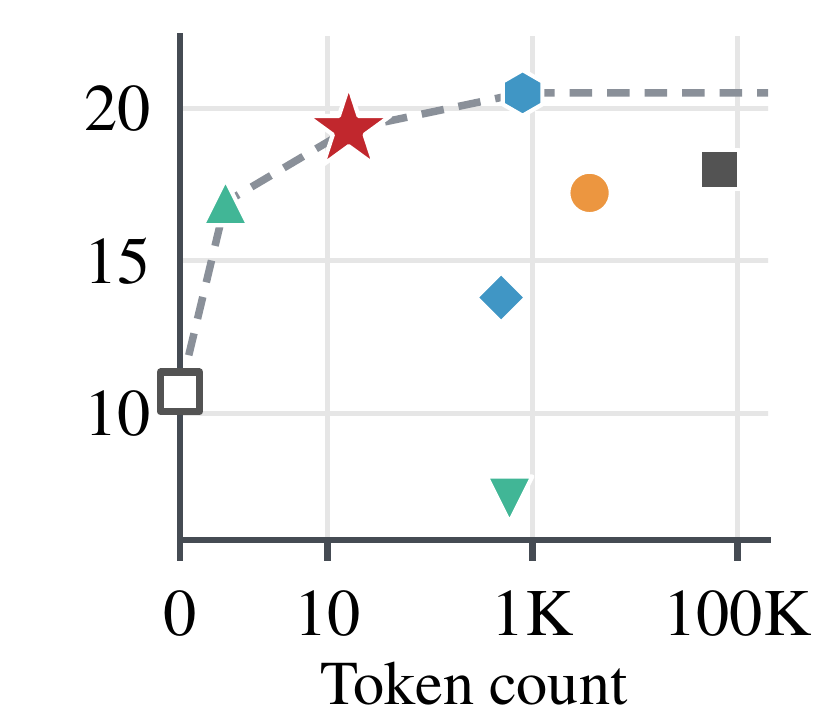

> 图解：NarrativeQA 纵轴为 ROUGE-L。MemoRAG 以 20.51 领先，Memorilla 为 19.31、位居其后，但 MemoRAG 使用了 50 倍文档 Token。保留原文段落有利于精确复述，Memorilla 则在 F1 上以 16.56 超过 MemoRAG 的 15.03。

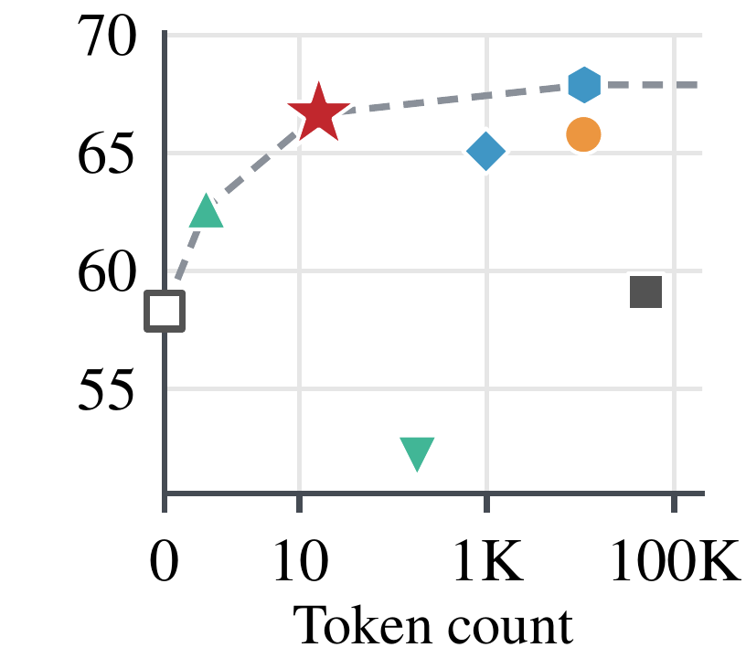

> 图解：PV4 纵轴为短答 Accuracy。MemoRAG 为 67.88%，Memorilla 为 66.65%，前者使用 690 倍文档 Token。Memorilla 并非每项都夺冠，但仍处在该任务的性能—开销前沿。

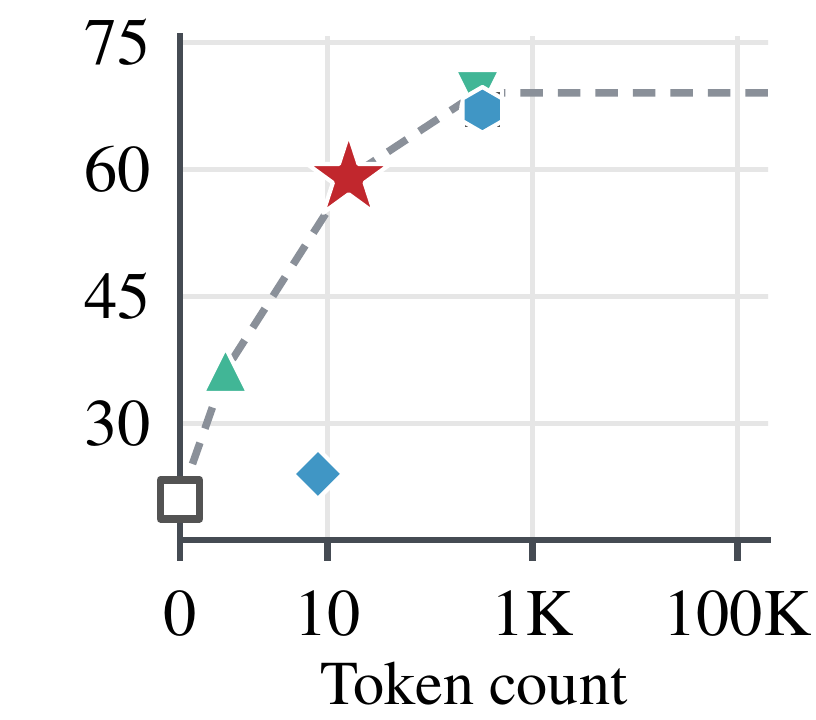

> 图解：PubMedQA 纵轴为 Accuracy。每题只有 4 篇摘要、共 324 Token，压缩的收益本就有限；LLMLingua-2 达 69.00%，RAG-5、RAG-50、Full Context 和 MemoRAG 均为 67.00%，Memorilla 为 59.00%。这是其最明显的失败场景。

与 ComMer 的报告结果相比，Memorilla 也用更少记忆 Token 取得更高的个性化生成分数。不过两者 Decoder 不同，这不是严格的同骨干对照：

| 方法 | 记忆 Token | LaMP-4 ROUGE-L | LaMP-7 ROUGE-L |
|---|---:|---:|---:|
| ComMer（Gemma-2b） | 128 | 17.50 | 45.00 |
| Memorilla（Qwen3-4B） | 16 | 17.72 | 47.04 |
| Memorilla（Qwen3-8B） | 16 | **18.15** | **48.37** |

## 它究竟记住了什么，又丢掉了什么

平均分只能说明“是否有效”，按问题拆分才能看清这种记忆的归纳偏置。

> 图解：以下三幅图比较 Memorilla 与 RAG-50，柱形对应各问题子集，重点关注问题类型、实体数量和组合事实数量带来的变化。

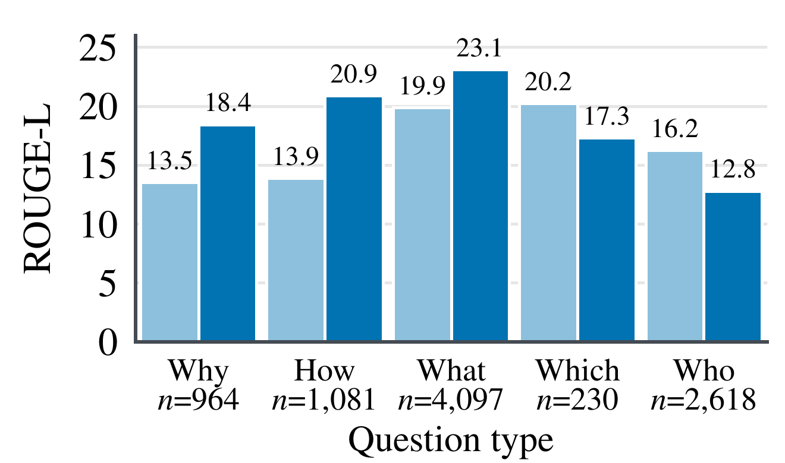

> 图解：横轴按问题首词划分 Why、How、What、Which、Who 等类型，纵轴为 ROUGE-L。Memorilla 在 Why 和 How 上分别领先 RAG-50 4.91、7.02 点，在 What 上领先 3.25 点；RAG-50 则在 Who、Which 上分别领先 3.45、约 2.9 点。

这说明压缩更擅长保留叙事结构、因果关系等全局信息，却容易丢掉需要逐字匹配的实体名称。作者也提醒，问题类型同时与答案长度、实体频率相关，因此这是与结果一致的解释，而非被完全隔离的因果证明。

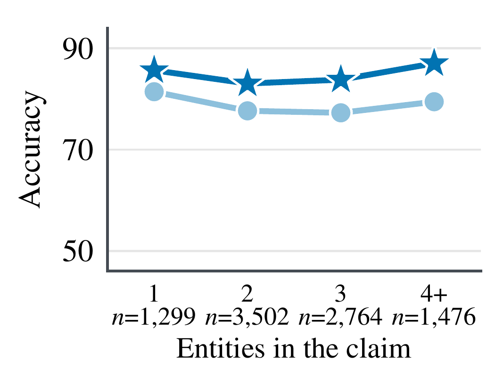

> 图解：横轴为每个声明涉及的实体数，纵轴为 Accuracy。Memorilla 相对 RAG-50 的优势从 1 个实体时的 4.23 个百分点，单调增长到 4 个及以上实体时的 7.59 个百分点。

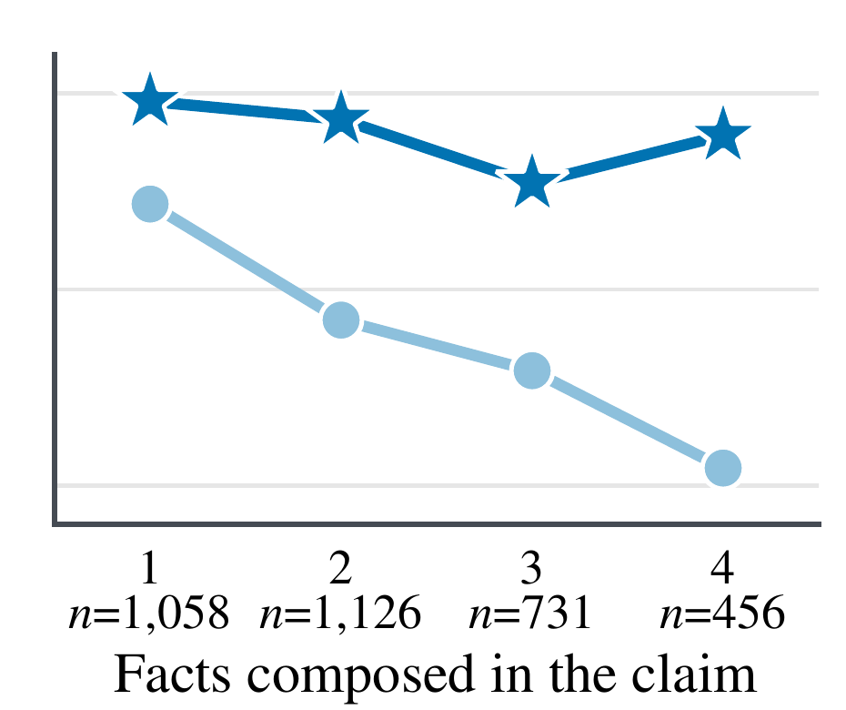

> 图解：横轴为验证声明所需组合的事实数，纵轴为 Accuracy。事实数从 1 增至 4 时，RAG-50 从 78.73% 降至 51.75%，Memorilla 则保持在 80%—89% 区间；4 项事实组合时两者相差 34.00 个百分点。

73.5% 的 FactKG 声明对应超过 50 个文档块，因此部分差距来自 RAG-50 没有取回证据。但 Full Context 能读取全部文档，总体仍只有 80.43%，低于 Memorilla 的 84.33%，说明优势不只是“检索得更全”，也来自跨文档关系的组合方式。

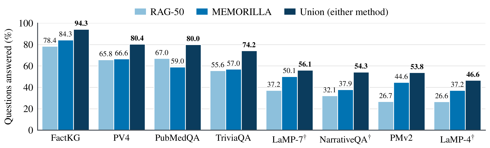

> 图解：各组柱形展示仅 Memorilla 答对、仅 RAG-50 答对，以及两者至少一方答对的问题比例。Union 是“逐题知道该选谁”的 Oracle 上界，不是已实现系统；它在每个基准上都高于任一单方法。FactKG 上两者独占答对比例分别为 15.9% 和 10.0%，PMv2 上则为 27.1% 和 9.2%。

两种方法也会共同失败。PV4 的共同错题常需要连接分别出现在不同历史记录中的事实，瓶颈可能仍在信息组合；FactKG 的共同错题中，真实声明占 89.5%，而共同答对题中真实声明仅占 28.7%，还暴露出偏向判假的决策阈值问题。

> 图解：用户提出一个通用的能量饮食问题，文本上与历史对话没有词汇重叠。Memorilla 仍调取用户曾提到缺铁性贫血的相关语义，把通用问题转化为个性化建议，展示了超越字面相似度的记忆读取。

这组分析给出一个很实用的判断：Latent Memory 与文本 RAG 不是非此即彼。前者偏向全局结构和语义组合，后者偏向精确实体与原文细节，混合系统有明确的上升空间。

## 从问答到智能体：只训练记忆来持续学习

静态问答之外，论文把 Memorilla 放进 TextWorld。智能体要在部分可观测的文字游戏中探索最多 65 个房间、操作物体并完成多步目标，每条轨迹最多 50 个回合，奖励主要来自最终获胜。

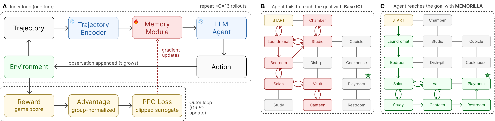

> 图解：（a）冻结 Encoder 将历史轨迹转为文档向量，记忆模块压成 $K=8$ 个向量，冻结 LLM 选择动作；每个 Prompt 采样 $G=16$ 条 Rollout，环境稀疏奖励只更新记忆模块。（b）Full-history ICL 在已探索房间之间循环，（c）Memorilla 则能推进到星号标记的目标位置。

每完成一个回合，系统就把该回合的观测与动作作为新文档加入存储，下一回合重新计算 8 枚记忆。这里记忆是**对完整文本历史的补充，而不是替代**：Memorilla 与 Full-history ICL 都保留相同轨迹文本，训练输入预算均为 16,000 Token，评测均为 4,096 Token。因此，实验检验的是“学习到的状态表示能否改善决策”，不是“8 枚向量能否替代整个历史”。

智能体使用冻结 Qwen3-4B-Instruct-2507 和 Qwen3-Embedding-4B，记忆模块随机初始化，不加载监督学习 Checkpoint。训练包含 800 个 Prompt，验证和测试各 40 个 Prompt、对应 30 个不同游戏；每个留出游戏采样 3 次，温度为 0.6。

记忆模块通过 GRPO（Group Relative Policy Optimization）学习环境奖励。对同一 Prompt 的一组 $G$ 条轨迹，先将标量回报标准化为优势：

$$
A_i=\frac{R_i-\operatorname{mean}_{j\in G}(R_j)}
{\operatorname{std}_{j\in G}(R_j)+\epsilon}
$$

再对生成动作 Token 使用裁剪后的 PPO 目标，仅更新 $\boldsymbol{\theta}_{\mathrm{mem}}$：

$$
\mathcal{L}_{\mathrm{RL}}(\boldsymbol{\theta}_{\mathrm{mem}})
=-\mathbb{E}\left[\min\left(r_iA_i,
\operatorname{clip}(r_i,1-\epsilon_c,1+\epsilon_c)A_i\right)\right]
$$

$$
r_i=\frac{\pi_{\boldsymbol{\theta}_{\mathrm{mem}}}(a_i\mid\tau_i)}
{\pi_{\boldsymbol{\theta}_{\mathrm{old}}}(a_i\mid\tau_i)}
$$

实际设置为组大小 16、PPO Clip 0.2、AdamW 学习率 $5\times10^{-4}$，不使用 Critic、KL 或 Entropy 项。每步训练 4 个 Prompt，每个 Prompt 采样 16 条轨迹，每回合最多生成 128 个新 Token。相比监督版本，这里的记忆模块还在文档 Cross-Attention 前增加一层轨迹文档 Self-Attention。

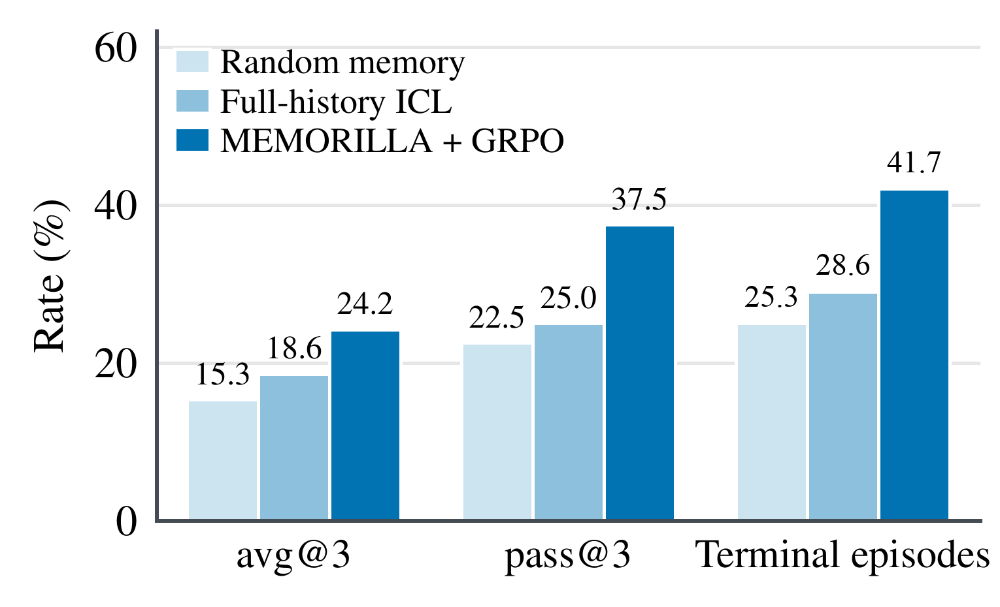

> 图解：各柱比较 Random Memory、Full-history ICL 和 Memorilla+GRPO 的任务完成与终止情况，Decoder 均为冻结 Qwen3-4B-Instruct-2507。训练后的记忆同时提高 avg@3、pass@3 和正常结束回合比例，未训练记忆则低于 ICL。

| 方法 | avg@3 | pass@3 | 正常终止回合 |
|---|---:|---:|---:|
| Random Memory | 0.153 | 0.225 | 25% |
| Full-history ICL | 0.186 | 0.250 | 29% |
| Memorilla + GRPO | **0.242** | **0.375** | **42%** |

未训练记忆使两项完成指标都下降，说明收益来自 RL 学到的内容，而非简单多加 8 个向量。行为上，ICL 有 71% 的 Rollout 耗尽 4,096 Token 评测预算，Memorilla 为 58%；轨迹检查显示，它更少在房间间循环，也更能执行“先解锁、再打开容器”这类有顺序的动作。

剩余失败集中在最长游戏中：任务接近或超过 50 回合上限，并要求跨多个房间回溯。因此，这个结果支持“记忆能改善冻结智能体的状态利用”，但还不能证明它已解决长期规划。

## 消融实验：关键不是参数多，而是先按查询条件化

论文首先在相同训练配方下比较不同的 16 槽位构建方式。这里统一使用 Qwen3-4B-Instruct-2507 Decoder，且全部从头训练，所以数值不能与前面的 8B 主表直接比较。

| 架构 | 是否感知查询 | 参数量 | PMv2 短答 Accuracy |
|---|---|---:|---:|
| Global Mean-pool | 否 | 6,566,400 | 28.94 |
| Segmented Mean-pool | 否 | 6,566,400 | 29.68 |
| Segmented，参数对齐 | 否 | 190,149,120 | 31.10 |
| Cosine Top-16，参数对齐 | 是，硬选择 | 190,149,120 | 33.86 |
| Documents Only（Q-Former 变体） | 否 | 268,856,320 | 34.72 |
| Q-Former | 是，软条件 | 268,856,320 | 43.34 |
| Memorilla | 是，软条件 | 190,190,080 | **44.04** |

仅增加 Pooling 模块参数，分数只从 29.68 到 31.10，证明容量不是主要瓶颈。Q-Former 也先利用查询再读文档，因此接近 Memorilla；但 Memorilla 参数更少，并在另一组 FactKG 对照中以 82.56 超过 Q-Former 的 80.48。

把真实文档向量全部换成高斯噪声后，Documents Only 只变化 +0.04，Q-Former 下降 5.11，Memorilla 下降 5.93。这进一步说明收益确实依赖文档证据，而不是模块单独记住任务答案。

### 记忆容量不是越大越好

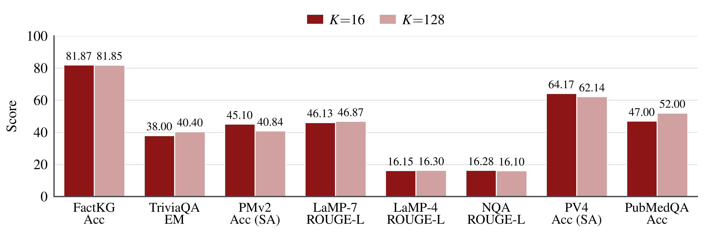

> 图解：各组比较从头训练的 $K=16$ 与 $K=128$，其他超参数完全一致。容量扩大到 8 倍后，八个基准中有四个变化不足 1 点，PMv2 和 PV4 反而下降，因此论文采用 $K=16$。

训练容量不增加收益，并不意味着推理时任意截断都无所谓。下面各图从同一个以 16 槽位训练的 Checkpoint 中只取前 $K$ 枚记忆，不重新训练：

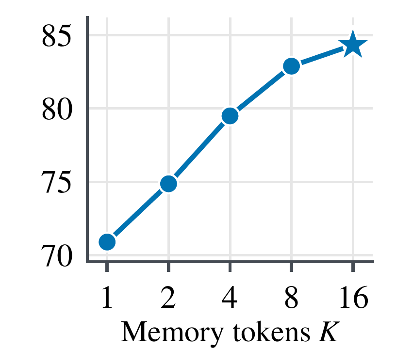

> 图解：FactKG 纵轴为 Accuracy，随 $K$ 每次翻倍持续上升，说明多实体关系组合需要足够槽位。

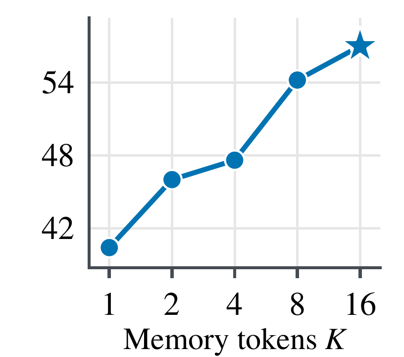

> 图解：TriviaQA 纵轴为 Exact Match，性能随记忆预算增加而提升，但这里的低 $K$ 结果是对 16 槽位 Checkpoint 做截断，并不等价于从头训练一个小容量模型。

> 图解：PMv2 在 $K=4$ 时仅为 26.58，接近 Closed-book 的 25.64；到 $K=16$ 才升至 44.60，最后一批槽位对跨会话用户建模尤其重要。

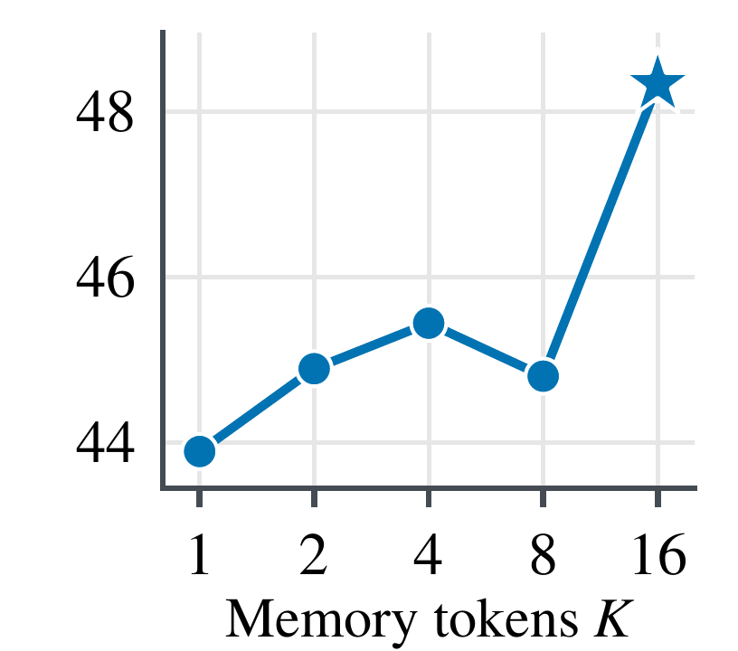

> 图解：LaMP-7 纵轴为 ROUGE-L，直到使用完整 $K=16$ 才出现主要提升，反映整体写作风格需要较多槽位共同表达。

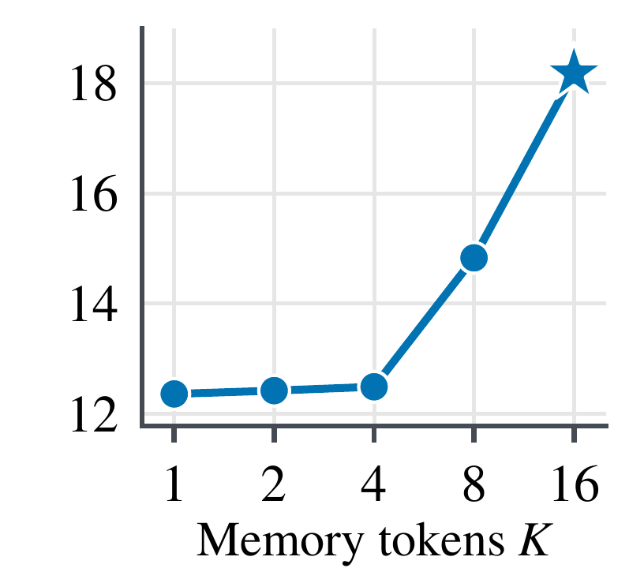

> 图解：LaMP-4 纵轴为 ROUGE-L，低预算区间大致平坦，从 $K=8$ 起改善，说明标题风格压缩也需要最低容量。

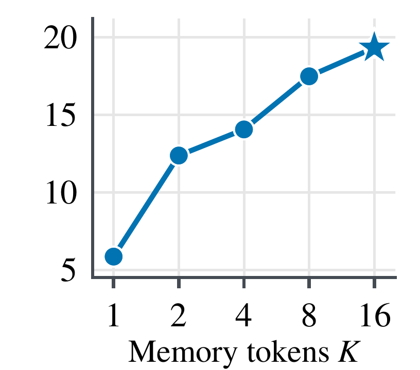

> 图解：NarrativeQA 纵轴为 ROUGE-L，随 $K$ 翻倍逐步增加，与长叙事需要整合更多全局信息一致。

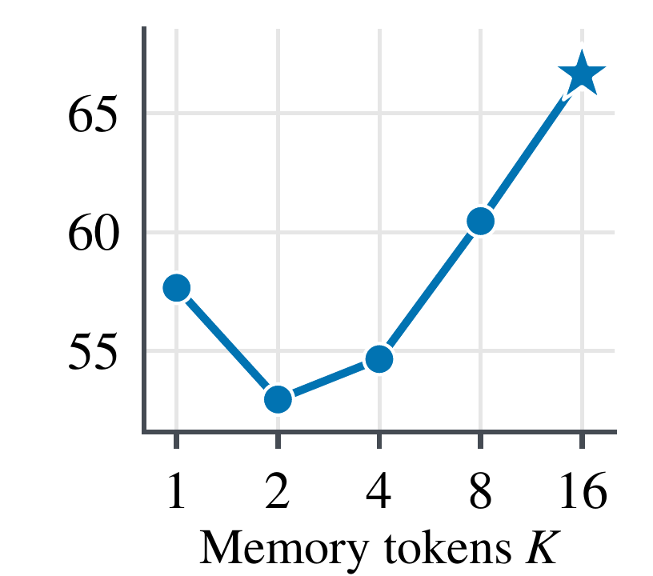

> 图解：PV4 从接近 Closed-book 的水平起步，在 $K=2$、$4$ 时下降，随后升至 $K=16$ 的 66.65。由于并未重新训练，这反映的是槽位截断行为，而不是高于 16 的容量上限。

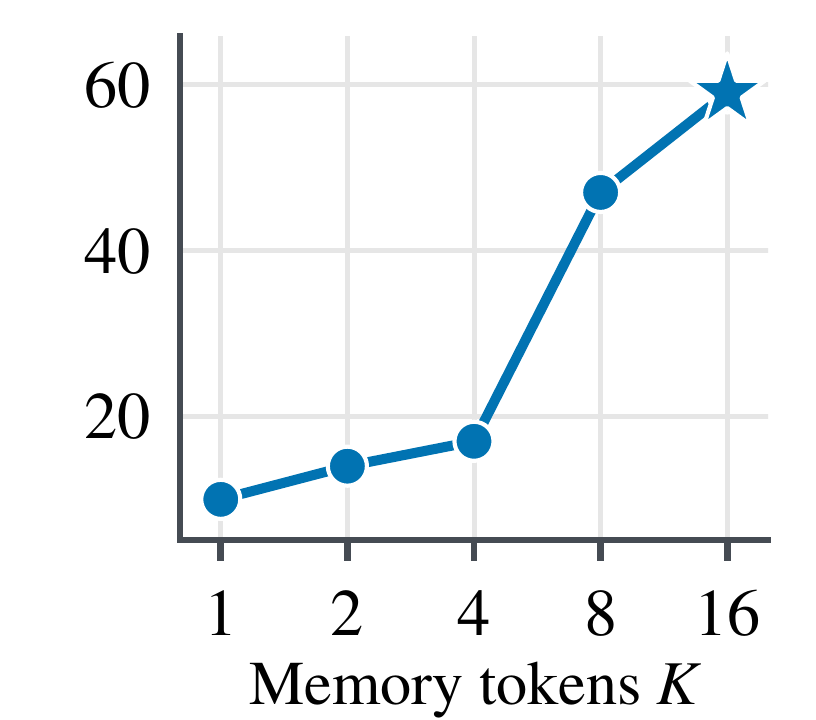

> 图解：PubMedQA 纵轴为 Accuracy，低 $K$ 区间基本持平，直到 $K=8$ 后才改善。其总体水平仍落后于能保留短原文的文本方法。

### 与 LoRA、Encoder 扩容的比较

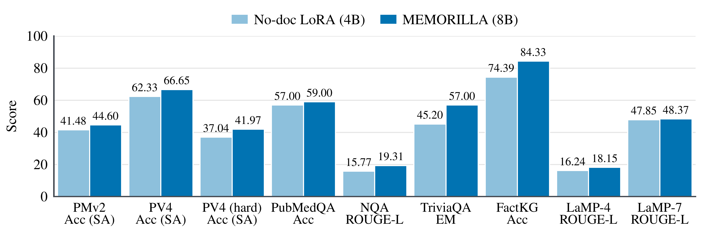

> 图解：Memorilla 使用 8B Decoder 和 194.1M 可训练参数；对照组使用 4B Decoder、268.4M 参数的 Rank-130 LoRA，且不接收文档。Memorilla 在所有主指标上领先，PubMedQA 和 LaMP-7 的差距则处于噪声范围内，说明收益不是普通任务适配就能解释的。

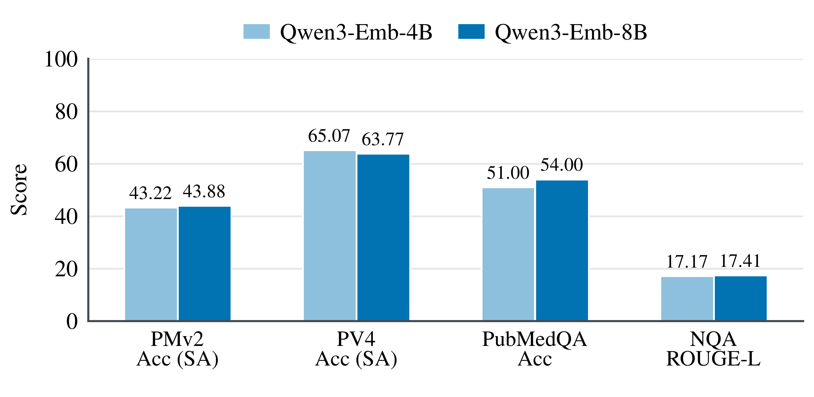

> 图解：固定 Qwen3-8B Decoder、记忆模块和训练配方，仅把 Encoder 从 Qwen3-Embedding-4B 换成 8B。除 PubMedQA 外，各分数变化至多 1.3；PubMedQA 的 +3.00 也只对应 100 道题中的 3 道，同系列更大 Encoder 并非主要收益来源。

## 计算开销：优势主要在集合变大之后

对含 $N$ 篇文档、服务 $Q$ 次查询的集合，Memorilla 只在写入路径编码每篇文档一次，之后所有查询复用相同向量。Dense Retrieval 本来也要建立这类索引，因此这部分不是相对 RAG 新增的编码成本。差别在读取路径：RAG 让 Decoder Prefill 随检索文本增长，Memorilla 则做一次全库 Cross-Attention，并始终只给 Decoder 16 枚记忆。

| 路径 | 指标 | $N=1$ | $N=512$ | 增长情况 |
|---|---|---:|---:|---|
| 写入 | 文档编码 | 22.92 ms | 2,588.84 ms | 随 $N$ 线性增长 |
| 写入 | 每篇文档存储 | 5 KB | 5 KB | 固定 |
| 读取 | 记忆模块前向 | 2.01 ms | 1.96 ms | -0.06 ms |
| 读取 | CPU 到 GPU 传输 | 0.014 ms | 0.060 ms | +0.046 ms |
| Decoder | 文档上下文 Token | 16 | 16 | 固定 |
| Decoder | Memorilla 端到端延迟 | 740 ms | 739 ms | -1.9 ms |
| Decoder | Full Context 端到端延迟 | 749 ms | 19,932 ms | +19,184 ms |

> 表中测量使用单张 H100-80GB、Batch Size 1、bf16、贪心解码、最多 32 个新 Token 和每篇 250 Token 的文档；结果为 2 次 Warmup 后 5 次测量的中位数。$N=512$ 的 Full Context 达 128,064 Token，需要 4 倍 YaRN；测试使用 HF Transformers `generate`，未启用 Paged KV Cache，因此绝对延迟依赖具体服务栈。

在 512 篇文档设置下，Memorilla 的端到端延迟为 0.739 秒，Full Context 为 19.932 秒，约快 27 倍。集合从 1 篇扩大到 512 篇时，Memorilla 延迟基本不变，而 Full Context 增加约 19.2 秒。

存储也很紧凑：200 篇文档的向量约 1 MB，CPU—GPU 传输低于查询延迟的 0.04%。在 PV4 上，对应 50,455 文档 Token 的 Qwen3-8B bf16 KV Cache 约为 6.9 GiB，而 200 个 2,560 维 bf16 嵌入仅约 1 MB，相差 7,266 倍。

不过，单查询的绝对延迟仍主要由自回归解码决定。它最现实的价值不是让小文档问答瞬间提速，而是**让服务成本在集合不断增长时保持平坦，并把一次编码摊销到后续大量查询上**。

## 复现、隐私与适用边界

论文公开了方法、训练混合、文档切分、基线配置和 TextWorld 强化学习设置，并在项目网站提供代码、训练与评测数据、预计算嵌入及 PV4 数据。监督评测使用固定随机种子和贪心解码；PV4 全部为合成用户，不包含真实用户数据。

隐私方面，持久存储位于 LLM 外部，可以按用户删除而无需重训模型，也便于留在本地设备。但嵌入仍可能编码敏感信息，真实部署仍需用户同意和相应保护，不能把“不是原文”误当作“没有隐私风险”。

当前结果还有几项明确边界：

- 压缩会损失细粒度事实，现有文档 Encoder 也从未针对记忆压缩优化。
- 实验主要配对 Qwen Encoder 与 Qwen Decoder，跨模型家族的迁移仍待验证。
- 评测集中于个性化、长文档与知识密集问答，不能直接外推到 Coding 等领域。
- 效率收益主要出现在大文档集合中，小集合压缩可能得不偿失。
- TextWorld 实验保留完整文本轨迹，不能据此声称 Latent Memory 已能取代智能体历史。

## 总结：记忆与检索应当互补

- Memorilla 把持久知识存储与单次查询上下文分离：文档只编码一次，每次按查询从全库读出固定数量的 soft tokens。
- 默认仅 16 枚记忆便在八项基准上取得最佳平均分，文档 Token 相对 Full Context 的几何平均减少 394 倍。
- 它擅长跨文档关系、概念理解和隐式用户偏好，但会损失精确实体与原文细节；短文档 PubMedQA 是明显反例。
- TextWorld 中只训练记忆模块，avg@3 从 18.6% 提升至 24.2%、pass@3 从 25.0% 提升至 37.5%，并减少导航循环。
- 最自然的下一步不是彻底替代 RAG，而是结合 Latent Memory 的全局语义组合与文本检索的精确回忆，同时探索专用压缩 Encoder、跨模型迁移和多模态记忆。

> 本文参考自 [Memorilla: Latent Semantic Memory for LLMs](https://arxiv.org/abs/2610.21375)