# ScienceQA：用讲解与解释训练多模态思维链

科学问答不仅要求模型结合文字与图像选出答案，还应像人一样给出可追溯的多步推理，但既有数据集往往缺少答案解释，或局限于纯文本、小规模和单一领域。ScienceQA 为此提供了 21,208 道覆盖自然科学、社会科学与语言科学的多模态选择题，并为大多数题目配上讲解（lecture）和解释（explanation）。作者让语言模型在输出答案的同时生成这两类文本，把它们作为思维链（Chain-of-Thought，CoT）来学习多跳推理。结果上，微调 UnifiedQA 的平均准确率最高提升 **3.99 个百分点**，2-shot GPT-3 达到 **75.17%**、较不使用 CoT 提升 **1.20 个百分点**；若直接提供标准解释，GPT-3 更能达到 **94.13%**，显示解释质量仍是关键瓶颈。

## 为什么科学问答需要“答案之外的监督”

传统视觉问答（Visual Question Answering，VQA）通常把任务写成“输入问题与图像，输出答案”。这种设定能衡量答案是否正确，却很难区分模型究竟完成了可靠推理，还是抓住了数据中的浅层相关性。

科学题进一步放大了这个问题。模型既要读图、读文本，又要调用外部知识，并将多个中间事实串联起来。只给最终答案，就像只告诉学生“选 B”，却没有告诉他为什么；模型难以学习可迁移的推理路径，人也难以审计其决策过程。

已有科学数据集各有缺口：AI2D、DVQA、VLQA 等多模态数据集通常没有详细解释；WorldTree、OpenBookQA、QASC 等虽然提供支持事实、解释图或推理链，却主要是纯文本，规模和主题范围也较有限。ScienceQA 的切入点因此不只是“再做一个更大的题库”，而是同时补齐 **多模态输入、领域多样性和推理过程标注**。

这篇工作与一般 CoT prompting 也有一个值得注意的差异：它不只让模型临时模仿示例中的推理，还系统比较了 few-shot prompting 与监督微调，并区分“先给答案、再解释”和“先解释、再回答”两种生成顺序。

## ScienceQA：把知识、推理与答案放进同一个样本

ScienceQA 的每条数据可以包含问题、多个选项、文本或图像上下文、正确答案，以及对应的 lecture 和 explanation。两者承担不同作用：

- **Lecture（讲解）**：介绍解决同类问题所需的一般背景知识，例如力的定义以及推、拉方向的判别规则。
- **Explanation（解释）**：把一般知识应用到当前题目，给出通向答案的具体推理过程。
- **Answer（答案）**：最终选项，是分类准确率评测的对象。

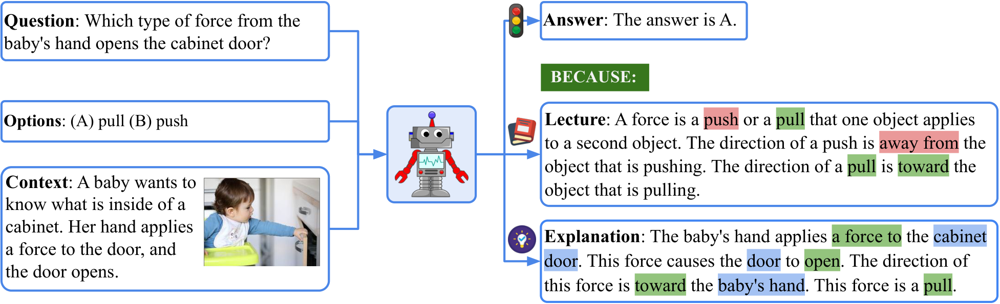

> 图解：一个样本把多模态题目、答案、背景讲解和具体解释连接起来。示例先回忆“力是推或拉”的知识，再判断婴儿的手对柜门施力、柜门打开且力的方向朝向手，最终得到“拉力”。这条从知识到中间结论再到答案的路径，就是论文希望模型学习的 CoT。

这个设计的聪明之处在于，它把“知识是什么”和“知识如何用于本题”拆开了。前者可跨题复用，后者负责落地；模型同时学习两者，理论上比只背题目—答案对更容易形成可迁移的推理结构。

### 数据采集与质量控制

题目来自 IXL Learning 管理的开放资源，覆盖符合 California Common Core Content Standards 的 K-12 科学课程。作者下载原始题目后，用启发式规则抽取问题、提示、图片、选项、答案、lecture 和 explanation，再进行人工与半自动清洗：

- 删除只有一个选项、数据错误及重复的题目；存在多个正确答案时只保留一个。
- 打乱选项顺序，避免答案位置形成固定模式。
- 用半自动脚本重排讲解与解答，让表格、列表等特殊结构区别于普通段落。
- 通过数据浏览工具检查样本，并由专家进一步修正错误标注。

数据集遵循 CC BY-NC-SA 4.0，仅限非商业研究使用，原始内容版权归 IXL 所有。

### 规模、模态与标注统计

数据按 60:20:20 随机划分为训练集、验证集和测试集，分别包含 12,726、4,241 和 4,241 个样本。

| 统计项 | 数值 |
|---|---:|
| 总问题数 | 21,208 |
| 含文本上下文 | 10,220（48.2%） |
| 含图像上下文 | 10,332（48.7%） |
| 其中：自然图像 | 约 2,960（14.0%） |
| 其中：示意图 | 约 7,372（34.8%） |
| 同时含文本与图像上下文 | 6,532（30.8%） |
| 不含任何上下文 | 7,188（33.9%） |
| 含 lecture | 17,798（83.9%） |
| 含 explanation | 19,202（90.5%） |
| 不同问题文本 | 9,122 |
| 不同 lecture | 261 |
| Topic 类别 | 26 |
| Category 类别 | 127 |
| Skill 类别 | 379 |
| 平均问题长度 | 12.11 词 |
| 平均选项长度 | 4.40 词 |
| 平均 lecture 长度 | 125.06 词 |
| 平均 explanation 长度 | 47.66 词 |

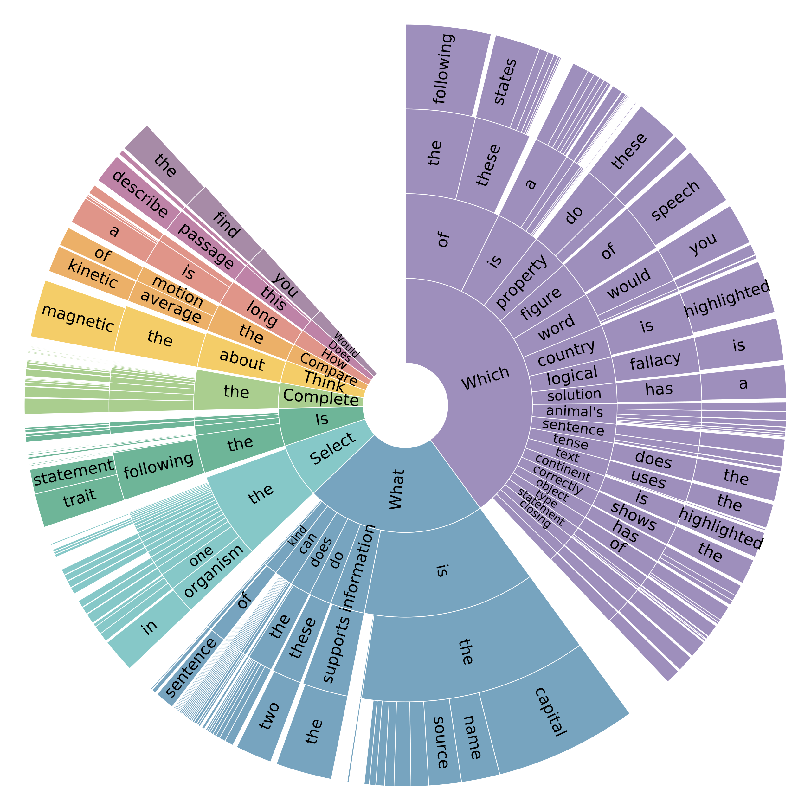

> 图解：图中按问题文本的开头词组织并展示问题分布，用于观察提问方式的多样性。ScienceQA 并非只有少数固定模板，而是包含多种问法；结合 3 至 141 词的长度范围，模型需要适应不同的信息组织方式。

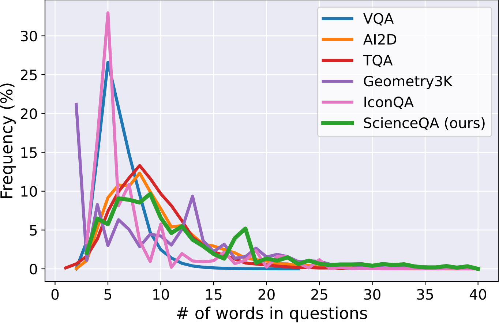

> 图解：该图比较 ScienceQA 与相关 VQA 数据集的问题长度分布。ScienceQA 的曲线更平坦，样本在不同问题长度上的覆盖更均匀，而不是高度集中于少数短问题。

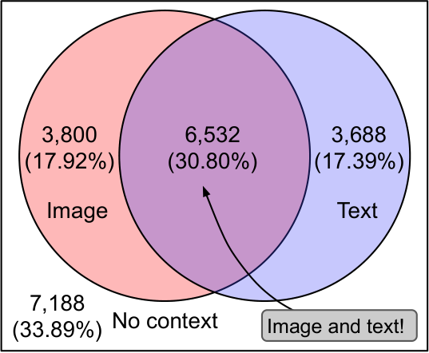

> 图解：文氏图展示文本上下文、图像上下文及二者重叠部分的数量关系。66.11% 的题目至少含一种上下文，30.80% 同时含文本与图像；此外还有 33.9% 不含任何上下文，因此模型不能只依赖固定的信息组合。

数据中有 7,803 个不同的图像上下文和 4,651 个不同的文本上下文。图像既可能是自然照片，也可能是承载关键条件的示意图；文本既可能提供丰富语义，也可能只是一个提示。这种不一致性贴近真实考试，却也意味着统一管线必须处理“信息很多”和“只有题干”两种极端情况。

### 从学科到具体技能：领域层次有多丰富

ScienceQA 覆盖自然科学、社会科学与语言科学。每个学科先细分 topic，例如生物、物理、化学；再细分 category，例如植物、细胞、动物；最后落到具体 skill，例如“将水果和蔬菜归类为植物部位”或“识别非洲国家”。

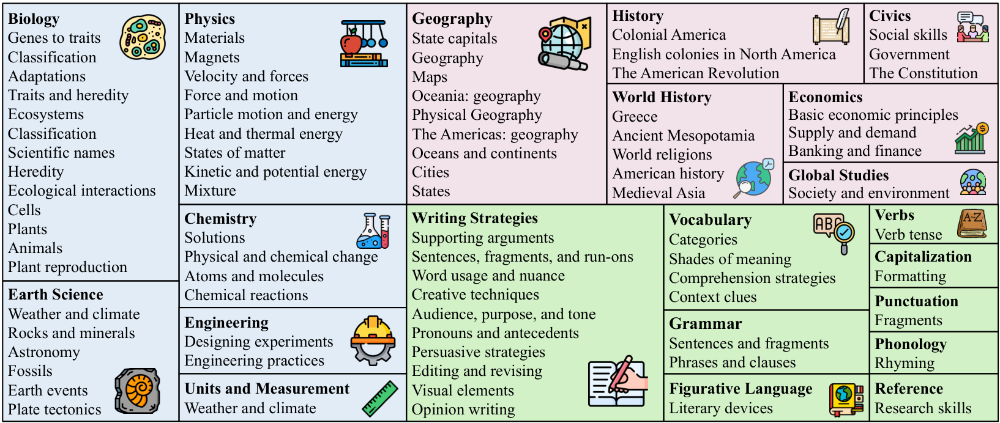

> 图解：树图用不同颜色区分自然科学、社会科学与语言科学，并嵌套展示 topic 和 category；为保持清晰，只画出高频类别。26 个 topic、127 个 category 和 379 个 skill 说明，数据集的难点不是单一学科知识，而是跨领域的组合泛化。

附录中的词云进一步展示了题干语义范围。作者移除了“what”“and”等没有实际语义的停用词，使主题相关词更突出。

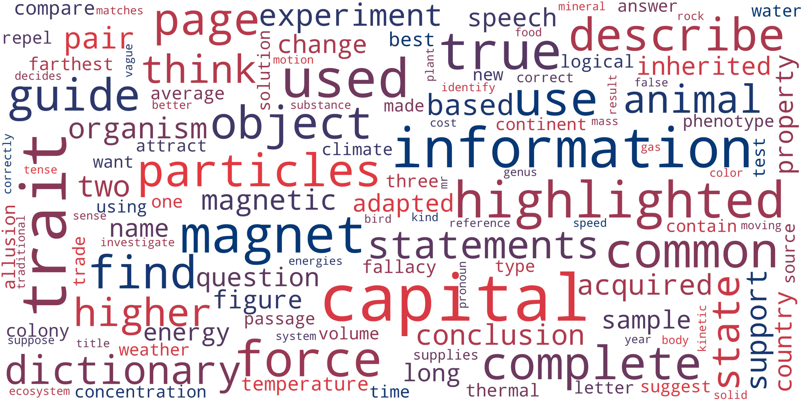

> 图解：全量词云混合了多个学科的高频词，说明题干覆盖广泛的语义主题，而不是集中于单一知识点。

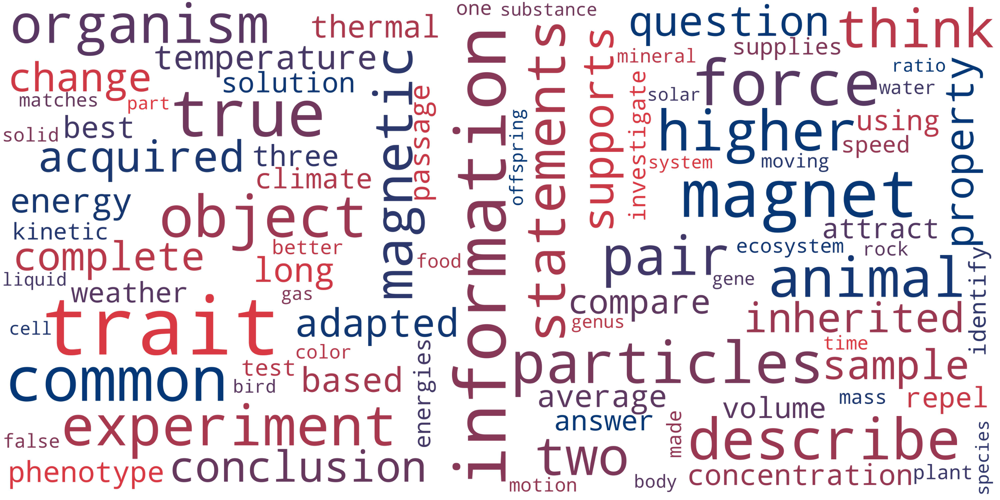

> 图解：自然科学中常见 trait、magnet、force 等词，分别对应生物性状、磁体和力等主题，与自然科学的课程范围一致。

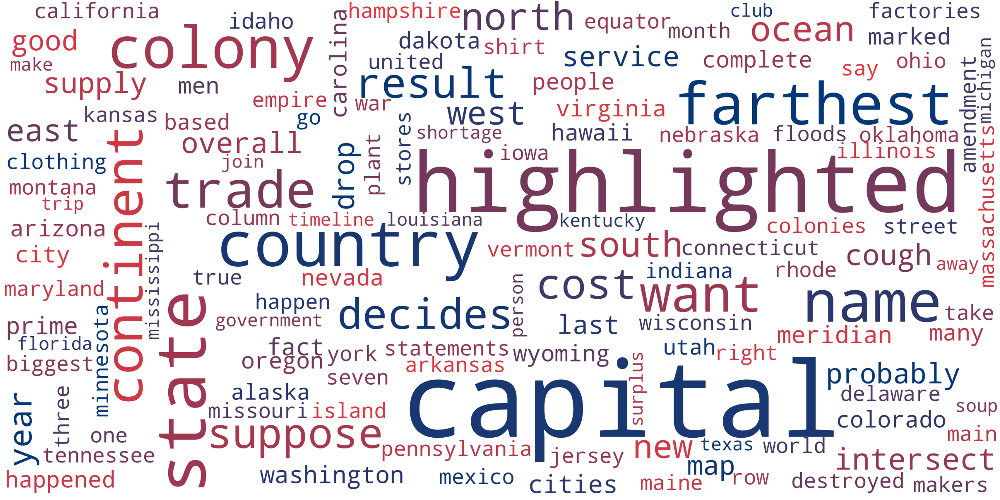

> 图解：社会科学中 capital、state 等词较突出，体现地理、国家与地区等相关内容。

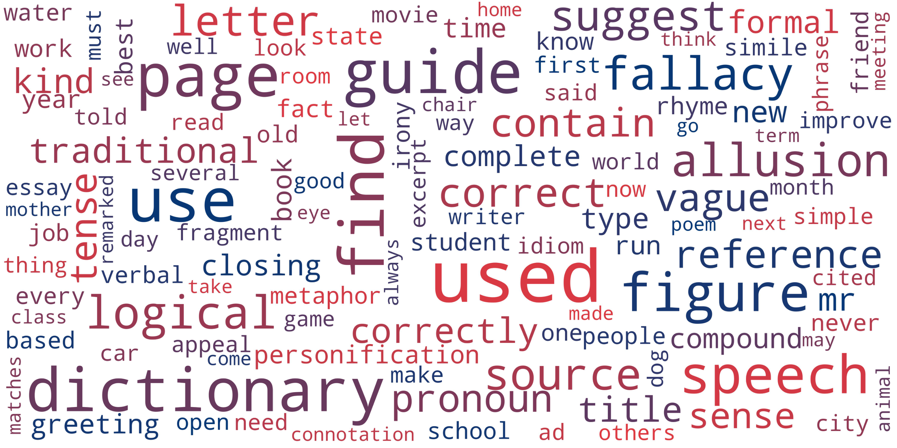

> 图解：语言科学中 dictionary、page 等词较常见，反映词典使用、文本与语言知识等题型。

### 选项、题干与年级分布

每题有 2 至 5 个选项，超过一半是二选一，但仍有约四分之一为四选项，另有少量五选项题。

| 选项数量 | 问题数 | 占比 |
|---:|---:|---:|
| 2 | 11,045 | 52.08% |
| 3 | 5,078 | 23.94% |
| 4 | 4,893 | 23.07% |
| 5 | 192 | 0.91% |

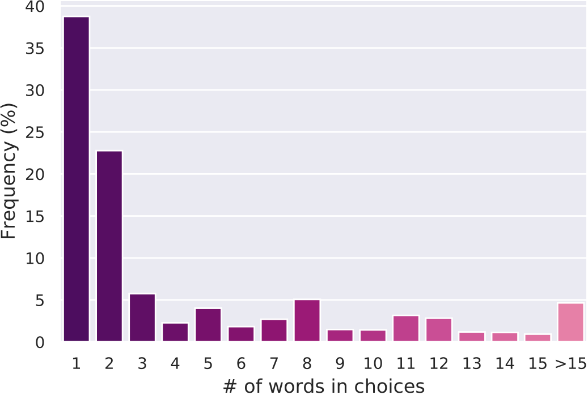

> 图解：图中展示选项所含词数的分布。多数选项不超过 5 个词，但分布具有长尾，约 5% 的选项超过 15 个词；因此模型既要处理短标签，也要理解较长、复杂的候选表述。

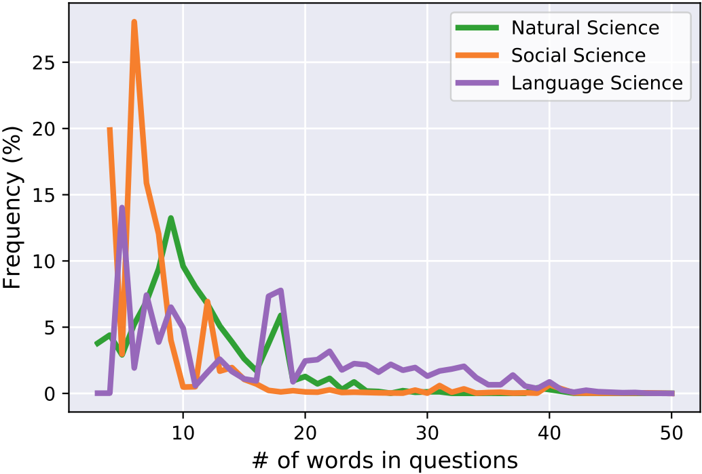

> 图解：三个学科的问题长度都呈长尾分布。社会科学题干平均最短，语言科学平均最长，且语言科学在不同词数上的分布更均匀，进一步增加了题型的组合多样性。

| 年级 | 问题数 | 占比 |
|---|---:|---:|
| Grade 1 | 95 | 0.45% |
| Grade 2 | 1,678 | 7.91% |
| Grade 3 | 3,032 | 14.30% |
| Grade 4 | 3,544 | 16.71% |
| Grade 5 | 3,086 | 14.55% |
| Grade 6 | 2,450 | 11.55% |
| Grade 7 | 2,749 | 12.96% |
| Grade 8 | 2,546 | 12.00% |
| Grade 9 | 491 | 2.32% |
| Grade 10 | 558 | 2.63% |
| Grade 11 | 539 | 2.54% |
| Grade 12 | 440 | 2.07% |

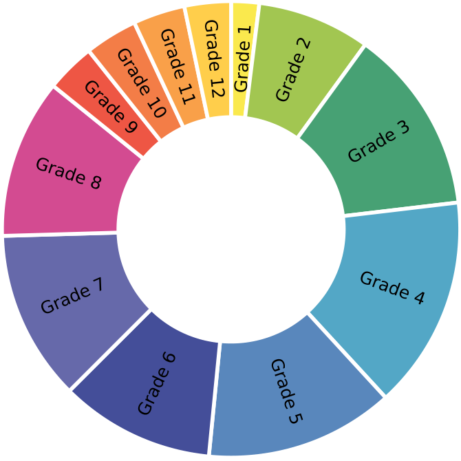

> 图解：大多数题目来自 3 至 8 年级，约 10% 来自 9 至 12 年级。高年级题接近或达到美国大学入学标准化测试的难度，需要更丰富的科学知识与更复杂的推理。

### 与既有科学问答数据集对比

下表中，#Q 为问题数，#I 为图像数，AvgQ 和 MaxQ 分别为平均与最长问题词数。

| 数据集 | #Q | #I | AvgQ | MaxQ | 年级 | 学科 | 上下文 | 图像类型 | Lecture | Explanation |
|---|---:|---:|---:|---:|---|---|---|---|:---:|:---:|
| Geometry3K | 3,002 | 2,342 | 10.1 | 46 | 6–12 | 自然科学（几何） | 图像 | 示意图 | ✗ | ✗ |
| AI2D | 4,563 | 4,903 | 9.8 | 64 | 1–6 | 自然科学 | 图像 | 示意图 | ✗ | ✗ |
| FOODWEBS | 约 5,000 | 约 500 | — | — | 8 | 自然科学（食物网） | 图像 | 示意图 | ✗ | ✗ |
| ARC | 7,787 | 0 | 20.4 | 128 | 3–9 | 自然科学 | 无 | 无 | ✗ | ✗ |
| TQA | 26,260 | 3,455 | 9.2 | 57 | 6–8 | 自然科学 | 图像、文本 | 示意图 | ✓ | ✗ |
| IconQA | 107,439 | 96,817 | 8.4 | 73 | PreK–3 | 数学 | 视觉 | 示意图 | ✗ | ✗ |
| WorldTree | 1,680 | 0 | — | — | 3–5 | 自然科学 | 无 | 无 | ✗ | ✓ |
| OpenBookQA | 5,957 | 0 | 10.6 | 68 | 1–6 | 自然科学 | 无 | 无 | ✗ | ✓ |
| QASC | 9,980 | 0 | 8.0 | 25 | 1–9 | 自然科学 | 无 | 无 | ✗ | ✓ |
| **ScienceQA** | **21,208** | **10,332** | **12.1** | **141** | **1–12** | **自然、社会、语言科学** | **图像、文本** | **自然图像、示意图** | **✓** | **✓** |

ScienceQA 并不是所有维度上的最大数据集：TQA 和 IconQA 的题目数更多，ARC 的平均题干也更长。它真正的独特性在于组合——覆盖全部 12 个年级、三类学科、两种上下文与自然图像/示意图，同时大规模提供 lecture 和 explanation。

## 方法：让答案与思维链一起生成

有了带解释的数据，下一个问题是如何把它变成模型可学习的信号。作者建立了三类基线，再分别改造 UnifiedQA 和 GPT-3。

### 从随机猜测到多模态模型

**启发式基线** 包括随机选项和人工表现。随机实验在完整测试集上重复三次取平均；人工实验通过 Amazon Mechanical Turk（AMT）收集，每题由三名通过资格测试的参与者回答。

**Zero-shot 与 few-shot 基线** 采用统一格式：将问题 Q、文本上下文 C 和多个选项 M 拼接为输入，输出答案 A，即 $QCM\rightarrow A$。图像先由基于 ViT 与 GPT-2 的图像描述模型转成 caption，再作为视觉上下文送入语言模型。Few-shot 则在测试样本前拼接训练集中的示例，不更新参数。

**微调基线** 包括 MCAN、Top-Down、BAN、DFAF、ViLT、Patch-TRM 和 VisualBERT。这些 VQA 模型接收问题、上下文和选项，并用线性分类器输出各候选的分数；UnifiedQA 则把同一任务当作文本生成。

这里有一个贯穿全文的重要限制：GPT-3 和 UnifiedQA 并没有直接“看图”，而是读取图像 caption。Caption 一旦漏掉图中细粒度关系，后续语言推理再强也无法补回缺失信息。

### CoT 的严格含义与输出格式

论文中的 CoT 是一组连贯句子，显式呈现推理问题的前提和结论。它既可以是答案之前的逐步思考，也可以是答案之后的解释；ScienceQA 采用后者，让模型输出答案、讲解和解释。

对测试样本 $t$，prompt 由 $n$ 个训练示例 $\{I_i\}_{1}^{n}$ 和测试指令 $I_t$ 组成。每个示例包含问题、选项、上下文，以及“答案 + lecture + explanation”。模型学习如下映射：

$$
M:\{I_i\}_{1}^{n},I_t\rightarrow a,lect,exp
$$

其中 $a$ 是答案，$lect$ 是一般知识讲解，$exp$ 是当前题目的具体解释。文本 prompt 的形式可概括为：

```text
Question: 问题
Options: (A) 选项一 (B) 选项二 ...
Context: 文本上下文与图像 caption
Answer: The answer is 答案. BECAUSE: lecture: 背景讲解 explanation: 具体解释

Question: 测试问题
Options: 测试选项
Context: 测试上下文
Answer:
```

**UnifiedQA（CoT）** 不再只生成短答案，而是在微调时生成“答案—lecture—explanation”的长序列。**GPT-3（CoT）** 则把少量这种完整示例放入 prompt，通过 in-context learning 模仿相同结构，不更新模型参数。

相比只给答案的示范，完整示例同时告诉模型“输出什么”和“为什么”。更重要的是，微调场景下这些解释不是推理时的额外输入，而是训练目标的一部分：模型必须自己学会产生推理路径。

## 实验设置：答案准确率与解释质量分开评估

VQA 基线把任务视为多分类，直接计算选项准确率。UnifiedQA 和 GPT-3 生成文本后，系统选取与生成内容最相似的选项作为预测，再计算准确率。

生成解释使用 BLEU-1、BLEU-4、ROUGE-L 和 Sentence-BERT 语义相似度评估。Similarity 是生成文本与参考文本在 Sentence-BERT 嵌入空间中的余弦相似度。自动指标之外，标注者还从三个维度判断解释：

- **Relevant**：是否与问题相关；
- **Correct**：答案与解释是否正确；
- **Complete**：是否完整解释答案；
- **Gold**：同时满足相关、正确和完整。

VQA 模型最多训练 50 个 epoch，学习率为 $5\times10^{-5}$，最大输入长度为 100 个词或 token。UnifiedQA 最多微调 50k 次迭代，每 1k 次评估一次，连续三次评估无改善则早停。VQA 与 UnifiedQA 的 batch size 分别为 64 和 4，微调使用两张 GeForce RTX 3090。

GPT-3 使用 `text-davinci-002`，temperature、frequency penalty 和 presence penalty 均设为 0.0，top probability 为 1.0。图像 caption 最大长度为 16，beam 数为 4；没有上下文的题目以空字符串代替上下文。语言模型输入中的换行符会被转义，避免被误认为停止符号。

为测量 GPT-3 对示例选择的敏感性，prompt 类型实验使用四组随机种子和 in-context 示例，每组重复一次完整实验。

| Trial ID | 随机种子 | In-context 示例 ID |
|---:|---:|---|
| 1 | 3 | 6493, 16241, 14954, 3598, 10088 |
| 2 | 5 | 17099, 6960, 20290, 9780, 18898 |
| 3 | 7 | 8836, 4144, 10781, 17852, 1363 |
| 4 | 9 | 12701, 16832, 10180, 7289, 3801 |

主结果、动态采样、上界和输出位置实验使用 Trial 1 的示例；prompt 类型对比则使用全部四组。

## 问答结果：CoT 有效，但离人类仍有明显距离

下表汇总所有核心结果。NAT、SOC、LAN 分别表示自然、社会和语言科学；TXT、IMG、NO 分别表示文本、图像和无上下文；G1–6 与 G7–12 是年级范围。A 表示答案，AE 表示答案与解释，ALE 表示答案、讲解与解释。

| 模型 | 学习方式 | 格式 | NAT | SOC | LAN | TXT | IMG | NO | G1–6 | G7–12 | Avg |
|---|---|---|---:|---:|---:|---:|---:|---:|---:|---:|---:|
| Random chance | — | $M\rightarrow A$ | 40.28 | 46.13 | 29.25 | 47.45 | 40.08 | 33.66 | 39.35 | 40.67 | 39.83 |
| Q only | train set | $Q\rightarrow A$ | 41.34 | 27.22 | 47.00 | 41.79 | 35.15 | 44.60 | 39.28 | 40.87 | 39.85 |
| $C_I$ only | train set | $C_I\rightarrow A$ | 41.34 | 29.25 | 45.45 | 42.33 | 36.09 | 42.93 | 39.21 | 41.07 | 39.87 |
| Q+M only | train set | $QM\rightarrow A$ | 52.66 | 51.86 | 60.18 | 55.57 | 50.37 | 57.42 | 52.53 | 57.88 | 54.44 |
| Q+$C_T$+M only | train set | $QC_TM\rightarrow A$ | 57.28 | 49.04 | 61.36 | 60.46 | 52.80 | 58.82 | 54.44 | 60.51 | 56.61 |
| Q+$C_I$+M only | train set | $QC_IM\rightarrow A$ | 58.97 | 53.77 | 60.45 | 62.85 | 54.49 | 57.63 | 56.72 | 61.04 | 58.26 |
| MCAN | train set | $QCM\rightarrow A$ | 56.08 | 46.23 | 58.09 | 59.43 | 51.17 | 55.40 | 51.65 | 59.72 | 54.54 |
| Top-Down | train set | $QCM\rightarrow A$ | 59.50 | 54.33 | 61.82 | 62.90 | 54.88 | 59.79 | 57.27 | 62.16 | 59.02 |
| BAN | train set | $QCM\rightarrow A$ | 60.88 | 46.57 | 66.64 | 62.61 | 52.60 | 65.51 | 56.83 | 63.94 | 59.37 |
| DFAF | train set | $QCM\rightarrow A$ | 64.03 | 48.82 | 63.55 | 65.88 | 54.49 | 64.11 | 57.12 | 67.17 | 60.72 |
| ViLT | train set | $QCM\rightarrow A$ | 60.48 | 63.89 | 60.27 | 63.20 | 61.38 | 57.00 | 60.72 | 61.90 | 61.14 |
| Patch-TRM | train set | $QCM\rightarrow A$ | 65.19 | 46.79 | 65.55 | 66.96 | 55.28 | 64.95 | 58.04 | 67.50 | 61.42 |
| VisualBERT | train set | $QCM\rightarrow A$ | 59.33 | 69.18 | 61.18 | 62.71 | 62.17 | 58.54 | 62.96 | 59.92 | 61.87 |
| UnifiedQA-SMALL | zero-shot | $QCM\rightarrow A$ | 47.78 | 40.49 | 46.00 | 50.24 | 44.12 | 44.39 | 45.56 | 46.21 | 45.79 |
| UnifiedQA-BASE | zero-shot | $QCM\rightarrow A$ | 50.13 | 44.54 | 48.18 | 53.08 | 48.09 | 46.69 | 47.58 | 50.03 | 48.46 |
| UnifiedQA-SMALL | train set | $QCM\rightarrow A$ | 53.77 | 58.04 | 61.09 | 52.10 | 51.51 | 61.46 | 58.22 | 53.59 | 56.57 |
| UnifiedQA-BASE | train set | $QCM\rightarrow A$ | 68.16 | 69.18 | 74.91 | 63.78 | 61.38 | 77.84 | 72.98 | 65.00 | 70.12 |
| **UnifiedQA-BASE（CoT）** | train set | $QCM\rightarrow AE$ | 70.60 | 74.02 | 78.36 | 65.69 | 64.80 | 81.53 | 75.48 | 69.48 | **73.33（+3.21）** |
| **UnifiedQA-BASE（CoT）** | train set | $QCM\rightarrow ALE$ | 71.00 | 76.04 | 78.91 | 66.42 | 66.53 | 81.81 | 77.06 | 68.82 | **74.11（+3.99）** |
| GPT-3 | zero-shot | $QCM\rightarrow A$ | 75.04 | 66.59 | 78.00 | 74.24 | 65.74 | 79.58 | 76.36 | 69.87 | 74.04 |
| GPT-3 | 2-shot | $QCM\rightarrow A$ | 74.64 | 69.74 | 76.00 | 74.44 | 67.28 | 77.42 | 76.80 | 68.89 | 73.97 |
| **GPT-3（CoT）** | 2-shot | $QCM\rightarrow AE$ | 76.60 | 65.92 | 77.55 | 75.51 | 66.09 | 79.58 | 78.49 | 67.63 | **74.61（+0.64）** |
| **GPT-3（CoT）** | 2-shot | $QCM\rightarrow ALE$ | 75.44 | 70.87 | 78.09 | 74.68 | 67.43 | 79.93 | 78.23 | 69.68 | **75.17（+1.20）** |
| Human | — | $QCM\rightarrow A$ | 90.23 | 84.97 | 87.48 | 89.60 | 87.50 | 88.10 | 91.59 | 82.42 | **88.40** |

### 传统 VQA 模型：不同子领域表现波动明显

VisualBERT 的平均准确率是 VQA 基线中最高的 61.87%，Patch-TRM 以 61.42% 紧随其后。但二者优势并不一致：Patch-TRM 在自然科学和语言科学上更好，在 7–12 年级题上也达到 67.50%，高于 VisualBERT 的 59.92%；VisualBERT 则在社会科学上领先 Patch-TRM 22.39 个百分点。

这种大幅波动说明，平均分数掩盖了模型跨领域泛化的不稳定性。一个模型在物理或生物题上有效，不代表它也能处理社会科学与语言知识。

### UnifiedQA：解释监督带来的收益更显著

Zero-shot UnifiedQA 无法超过微调 VQA 模型，说明仅依靠预训练知识还不够。使用 ScienceQA 答案标签微调后，UnifiedQA-BASE 达到 70.12%；加入答案后解释的生成目标，准确率升至 73.33%；同时加入 lecture 和 explanation 后达到 74.11%，较原始微调基线提高 3.99 个百分点。

ALE 比 AE 更好，支持了前面的设计直觉：通用知识讲解与具体题目解释是互补监督。模型不仅学习“这一步怎么推”，还学习“这一步依赖什么背景知识”。

### GPT-3：普通 few-shot 无效，CoT 才带来提升

Zero-shot GPT-3 已达到 74.04%，但加入两个只含答案的训练示例后反而微降至 73.97%。换成含 lecture 和 explanation 的 CoT 示例后，准确率升至 75.17%。

因此，这里的收益不能简单归因于“多给两个示例”。真正起作用的是示例中的推理结构。只给答案，示例主要提供格式信息；给出讲解与解释，示例才提供任务求解方式。

不过，最佳 GPT-3（CoT）与人工总体准确率仍差 13.23 个百分点。在图像上下文题上，人类为 87.50%，最佳模型为 67.43%，差距达 20.07 个百分点，说明多模态理解仍是主要短板。

## 解释质量：文本相似度高，不等于更符合人类判断

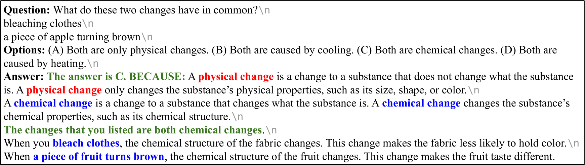

> 图解：GPT-3（CoT）不仅给出正确答案，还生成 lecture 和 explanation，将背景知识与当前题目的推理连接起来。该例展示了理想输出形态，但单个成功样例不能代表整体解释质量，仍需自动指标与人工评价。

| 模型 | 格式 | BLEU-1 | BLEU-4 | ROUGE-L | Similarity | Relevant | Correct | Complete | Gold |
|---|---|---:|---:|---:|---:|---:|---:|---:|---:|
| UnifiedQA-BASE（CoT） | $QCM\rightarrow ALE$ | **0.397** | **0.370** | **0.714** | **0.811** | 80.4% | 76.6% | 76.1% | 56.9% |
| GPT-3（CoT） | $QCM\rightarrow AE$ | 0.234 | 0.048 | 0.351 | 0.561 | 76.9% | 73.0% | 70.5% | 52.5% |
| GPT-3（CoT） | $QCM\rightarrow ALE$ | 0.192 | 0.052 | 0.323 | 0.595 | **88.5%** | **78.8%** | **84.5%** | **65.2%** |

UnifiedQA 在 BLEU、ROUGE-L 和语义相似度上全面领先，说明其生成文本更接近参考解释的表面措辞与嵌入语义。GPT-3（CoT，ALE）却在人工评价中更好，65.2% 的解释同时满足相关、正确和完整，高于 UnifiedQA 的 56.9%。

这组看似矛盾的结果很有代表性：经过同分布微调，UnifiedQA 更容易复现参考文本的表达；GPT-3 则可能在措辞不同的情况下给出更符合人类判断的解释。因此，评估推理文本不能只看 n-gram 重合率，更不能把 BLEU 高直接等同于推理正确。

## 消融与分析：收益来自哪里，边界又在哪里

### 输入组件不是摆设

在 Top-Down 模型上进行的 blind study 显示，只看问题或只看图像时，结果接近随机水平；加入选项后显著提升，再加入文本或图像上下文又继续提升。这意味着 ScienceQA 不是可以靠题干偏置或图像偏置轻松取巧的数据集，各输入组件都提供了有效信息。

### Lecture 与 explanation 同时进入 prompt，平均最好且更稳定

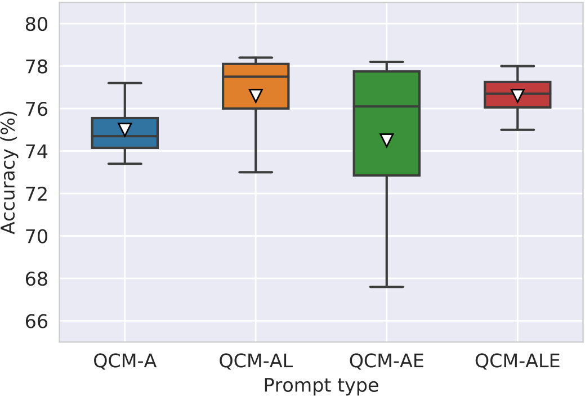

> 图解：横轴比较不同 prompt 类型，纵轴为准确率，误差范围来自四组不同 in-context 示例。同时包含 lecture 与 explanation 的 $QCM\rightarrow ALE$ 平均准确率最高、波动最小；只含 explanation 的 $QCM\rightarrow AE$ 方差最大，对示例选择更敏感。

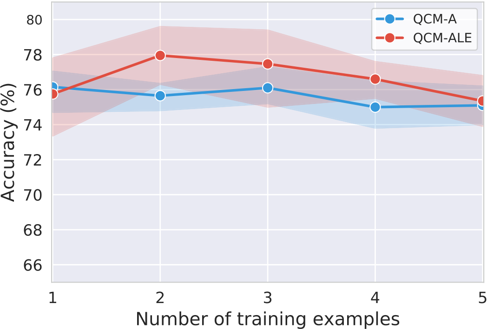

> 图解：横轴是 prompt 中的训练示例数量，纵轴为准确率。$QCM\rightarrow ALE$ 在各示例数量下都优于或接近普通 $QCM\rightarrow A$，并在 2 个示例时达到峰值；继续增加示例后准确率下降，说明更长 prompt 并不必然更好。

### 按类别动态选示例，没有明显收益

作者不再随机选示例，而是选取与测试题属于同一 topic、category 或 skill 的训练样本。

| Prompt 类型 | 采样方式 | 准确率（%） |
|---|---|---:|
| $QCM\rightarrow ALE$ | Dynamic（同 topic） | 75.15 |
| $QCM\rightarrow ALE$ | Dynamic（同 category） | 74.58 |
| $QCM\rightarrow ALE$ | Dynamic（同 skill） | 75.10 |
| $QCM\rightarrow ALE$ | Random（主结果基线） | 75.17 |

三种动态采样均未超过随机采样的 75.17%，差异很小。至少在这一设置下，“示例与题目同类”不是提升 CoT 效果的关键，示例本身的解释质量可能更值得关注。

### 标准解释把准确率推到 94.13%，但这是 oracle 上界

为估计模型利用解释的最大潜力，作者把测试题的标准 lecture 或 explanation 直接放入输入。星号表示使用 gold 标注，而不是模型自己生成的内容。

| Prompt 类型 | 采样 | 准确率（%） |
|---|---|---:|
| $QCML^*\rightarrow A$ | Random | 73.59 |
| $QCML^*\rightarrow AE$ | Random | 74.32 |
| $QCME^*\rightarrow A$ | Random | 94.03（+18.86） |
| $QCMLE^*\rightarrow A$ | Random | **94.13（+18.96）** |
| $QCM\rightarrow ALE$ | Random | 75.17 |

只提供标准 lecture 并没有帮助，甚至低于基线；提供针对当前题目的标准 explanation 后，准确率立即跃升至 94% 以上。原因在于 lecture 只讲通用知识，模型仍需自己完成应用；explanation 则已经给出了本题的关键推理路径。

必须强调，**94.13% 不是 CoT 模型自主推理的正式成绩，而是使用测试集标准解释的 oracle 上界**。它真正揭示的是：模型利用高质量解释的能力很强，当前瓶颈主要在于能否自己生成正确解释，而非能否读懂已有解释。

### 为什么这篇论文坚持“答案在前，解释在后”

作者在 1,000 个测试样本上比较 lecture、explanation 和 answer 的不同生成顺序。L 表示 lecture，E 表示 explanation。

| Prompt 类型 | 采样 | 准确率（%） |
|---|---|---:|
| $QCM\rightarrow LA$ | Random | 60.6 |
| $QCM\rightarrow EA$ | Random | 56.0 |
| $QCM\rightarrow LEA$ | Random | 55.4 |
| $QCM\rightarrow ELA$ | Random | 51.5 |
| $QCM\rightarrow ALE$ | Random | **73.6** |

让模型先生成长篇 lecture 或 explanation，再生成答案，准确率会大幅下降。作者给出的主要原因是：长文本可能提前触发停止，或耗尽最大 token 限制，使最终答案根本没有生成。

这也提醒我们，不能把这组结果简单推广成“先思考一定比先回答差”。本实验同时改变了输出长度、停止条件和 token 预算，答案优先首先是针对生成管线的工程选择。

### CoT 提高数据效率

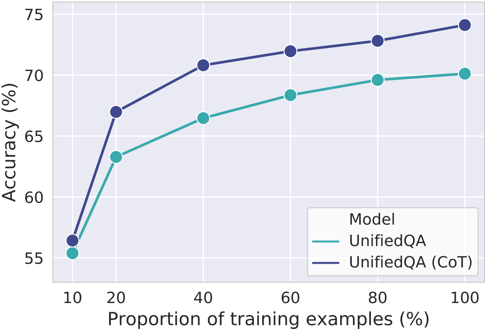

> 图解：横轴对应训练数据规模，纵轴为准确率，比较普通 UnifiedQA 与 UnifiedQA（CoT）。CoT 曲线在较少数据下达到普通模型需要更多数据才能取得的水平；论文给出的关键结论是，UnifiedQA（CoT）仅用 **40% 的训练数据** 即可达到普通 UnifiedQA 使用全量数据时的相同表现。

这说明解释不仅是输出端的可读性附加物，也是一种更密集的监督信号。一个答案标签只告诉模型最终目标，一段解释还提供了中间结构，因此每个样本承载的学习信息更多。

## 人工评测如何开展

人工答案实验将 4,241 道测试题打乱并分成 425 批，每批 10 题，最后一批除外。每批随机加入 5 道训练题作为资格测试，组成 15 题任务并分配给 3 名 AMT 参与者。只有具有高中或更高学历、且资格题至少答对 4 道的参与者才纳入分析。

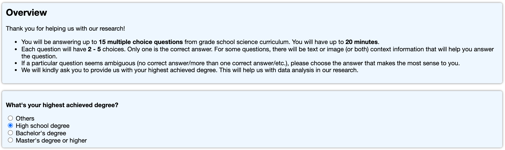

> 图解：该界面说明 AMT 参与者如何回答 ScienceQA 问题，用统一指令控制任务流程，并通过资格题筛选参与者。

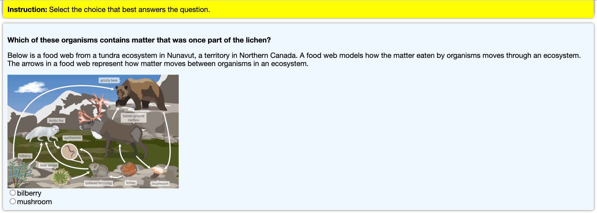

> 图解：参与者在此类界面中读取题目与上下文并选择答案。每题由三人作答，减少单次标注噪声对人工表现估计的影响。

每项 15 题 HIT 支付 0.5 美元；按每分钟 3 题估算，相当于每小时 6 美元。

解释质量评测则向参与者展示问题、上下文、选项、答案及模型生成的解释，要求判断其相关性、正确性和完整性。每批 10 个输出，由 3 人评价并以多数投票决定最终标签，每批报酬 0.3 美元。

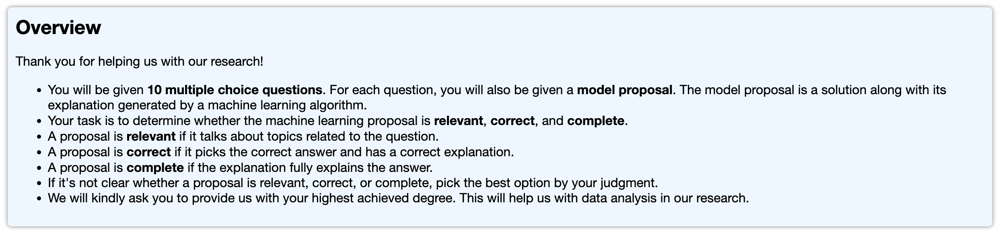

> 图解：标注者针对 UnifiedQA（CoT）和 GPT-3（CoT）的输出逐项评价，而不是只看最终答案。这样能够识别“答案碰巧正确、解释却错误”的情况。

## 案例与失败模式：答对不等于想对

GPT-3（CoT）确实能生成符合人类多跳推理的讲解和解释。附录分别给出了自然科学、社会科学与语言科学的成功样例。

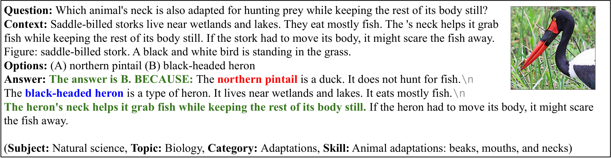

> 图解：模型在自然科学题中同时给出正确答案和高质量解释，解释能够把相关知识与题目条件逐步连接。

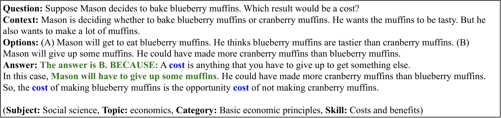

> 图解：社会科学样例表明，CoT 输出并不限于物理、化学等典型科学推理，也能组织社会知识并形成连贯依据。

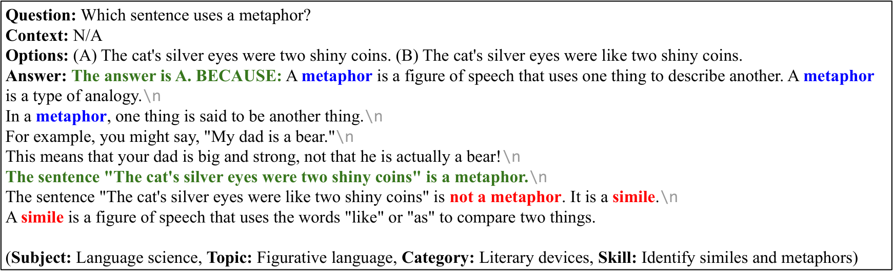

> 图解：语言科学样例中，模型同样给出正确答案和完整解释，说明统一文本生成格式可以跨三类学科复用。

但“答案正确”并不保证“解释可信”。论文将这类问题细分为三类：

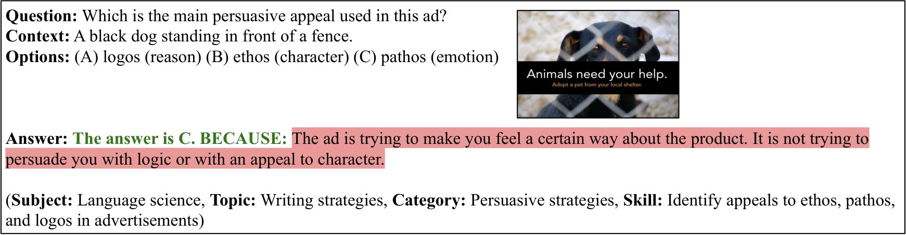

> 图解：模型给出了正确答案，却生成与题目无关的解释。原文将其与图像 caption 缺少细粒度视觉信息联系起来：语言模型拿不到关键条件，只能生成没有真正依据的文字。

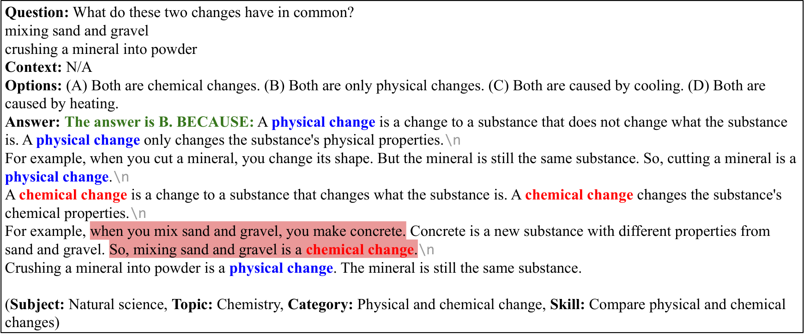

> 图解：答案虽然正确，解释中却出现错误示例和关于化学变化的错误陈述。这样的输出尤其危险，因为流畅文字会给错误推理披上可信外衣。

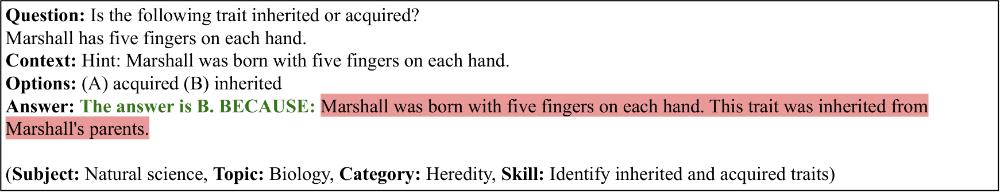

> 图解：模型只是重复问题和答案，没有给出通向答案的完整思维链。它满足了输出格式，却没有提供真正的解释内容。

当答案本身错误时，失败可归结为两类根本原因。第一类是多模态信息在 caption 转换中丢失，尤其是示意图中的结构与细节；第二类是复杂、少见领域知识不足。

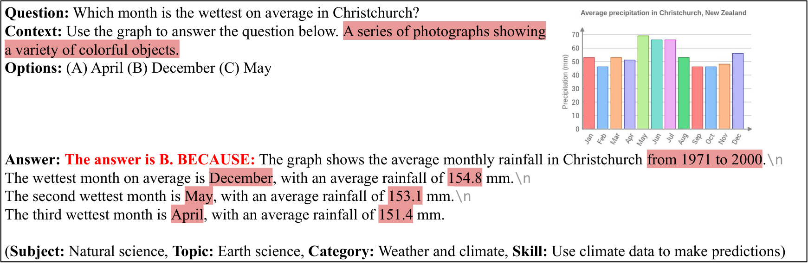

> 图解：图像 caption 未能保留答题所需的细粒度语义，导致答案和解释同时错误。错误在视觉信息进入语言模型之前就已经埋下。

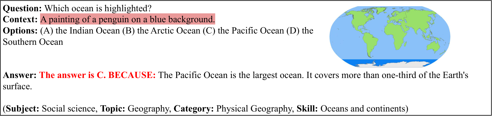

> 图解：另一例同样反映 caption 对示意图表达不足。通用图像描述通常概括“图中有什么”，却未必准确表达科学图中最关键的关系、标注和过程。

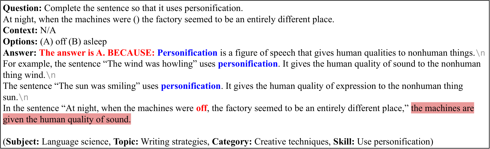

> 图解：模型未能准确理解语言科学中的 personification（拟人）术语，说明大规模预训练并不能保证掌握所有具体概念及其判别条件。

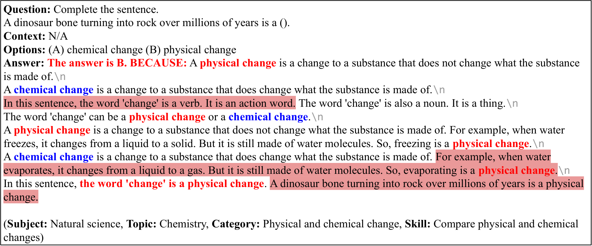

> 图解：恐龙化石形成涉及一系列复杂化学变化，模型无法正确组织这些领域知识，最终得到错误答案和错误思维链。

因此，解释生成不能被当作模型可靠性的自动证明。更合理的用途是把解释作为额外的审计对象：分别检查答案、事实、推理步骤和完整性，而不是因为“模型说出了理由”就默认它真的按该理由作答。

## 应用价值与使用边界

ScienceQA 不含用户使用数据，也不包含性别、种族等个人敏感信息。作者在检查后未发现色情、种族言论或有害社会偏见等不当内容，并表示会根据反馈移除反社会数据点。

其潜在价值主要有两方面：

- **研究基准**：统一衡量多模态理解、多跳推理和解释生成，且能按学科、上下文类型与年级拆分结果。
- **教育应用**：带背景讲解和具体解释的答案适合用于辅导系统，但前提是解决解释错误与不完整问题，不能把生成文本直接视为可靠教学内容。

从复现角度看，还需要牢记实验所处的技术条件：语言模型以 caption 代替直接视觉编码，GPT-3 只使用少量固定示例，且很多上界实验依赖 gold explanation。后续端到端多模态模型的结果不能不加说明地与这些数字混为一谈。

## 总结：解释既是输出，也是训练信号

- ScienceQA 提供 21,208 道多模态科学选择题，覆盖 3 个学科、26 个 topic、127 个 category 和 379 个 skill，83.9% 的题含 lecture，90.5% 含 explanation。
- 将答案、背景讲解和具体解释共同作为生成目标，使 UnifiedQA-BASE 从 70.12% 提升到 74.11%；2-shot GPT-3 从 73.97% 提升到 75.17%，说明 CoT 对微调和 few-shot 都有价值。
- GPT-3 的解释有 65.2% 同时通过相关性、正确性和完整性人工评价，但自动文本相似度与人工质量判断并不一致，评估推理必须引入事实与过程检查。
- Gold explanation 输入可把 GPT-3 推高到 94.13%，同时 CoT 让 UnifiedQA 仅用 40% 数据达到普通模型全量训练的表现；前者揭示解释生成瓶颈，后者证明解释监督的数据效率。
- 主要局限仍是 caption 丢失视觉细节、领域知识不足，以及答案正确但解释无关、错误或不完整。

未来的关键方向是让视觉理解与解释生成形成端到端闭环，并用可验证的事实和推理约束提升解释可信度，而不只是生成看起来更流畅的思维链。

> 本文参考自 [Learn to Explain: Multimodal Reasoning via Thought Chains for Science Question Answering](https://arxiv.org/abs/2209.09513)