# HASS：对齐训练，提速4.05倍

大模型自回归解码必须逐个 Token 串行生成，Speculative Sampling 虽能用小草稿模型换并发，却常在训练与真实解码之间“各练各的”。这种错位会压低草稿接受率，直接限制对时延敏感应用的加速收益。HASS（HArmonized Speculative Sampling）用 Top-K 目标蒸馏和多步上下文对齐，让草稿模型按真实解码所需的目标与上下文训练。在 NVIDIA H800、batch size 为 1 的设置下，它在四个 LLaMA 模型、三类任务上取得平均 **2.81x–4.05x** 加速，比 EAGLE-2 快 **8%–20%**，且不增加推理开销。

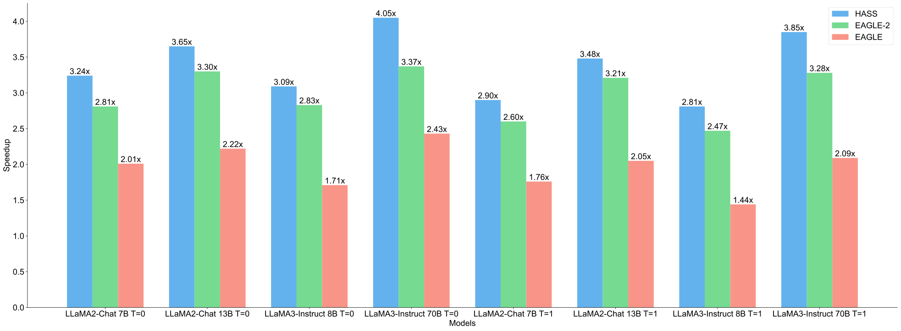

> 图解：图中汇总 LLaMA2-Chat 7/13B 与 LLaMA3-Instruct 8/70B 在 MT-bench、HumanEval、GSM8K 上的平均加速比，覆盖温度 $T=0$ 和 $T=1$。HASS 在全部模型与温度组合中都超过对比方法；最高值 4.05x 出现在 LLaMA3-Instruct 70B、$T=0$ 的三任务平均结果中。

## 1. 推测采样为什么会“越猜越不准”

### 1.1 先草稿、再并行验收

Speculative Sampling（推测采样）像“助手先写草稿，主编一次审多句”：小模型连续猜出若干 Token，大模型并行检查，再接受其中符合目标分布的一部分。它不改变目标模型的输出分布，而是用额外计算减少大模型串行调用的次数。

设目标 LLM 为 $\mathcal{M}^{(l)}$，草稿模型为 $\mathcal{M}^{(s)}$，一轮生成分为三步：

1. 草稿模型自回归提出长度为 $L$ 的候选序列。
2. 目标 LLM 并行计算这 $L$ 个候选位置的概率分布。
3. 通过改进的拒绝采样，接受 $\tau$ 个能保持目标分布的 Token。

这里的关键指标是 **Acceptance Length（接受长度）$\tau$**，即平均每轮“起草—验证”最终生成多少 Token。$\tau$ 越大，目标 LLM 的串行解码步数越少；但草稿若太难被接受，并行验证的收益就会被浪费。

EAGLE 的思路是利用目标模型的倒数第二层 hidden state：生成 $x_{t+1}$ 时，将目标特征 $f_{t-1}^{(l)}$ 与 Token 嵌入 $e_t$ 拼接后送入草稿模型。EAGLE-2 进一步把静态草稿树改成动态草稿树，减少无效分支的验证开销，但草稿模型本身的训练方式基本不变。

### 1.2 第一处错位：训练看“标准答案”，解码看自己的预测

EAGLE 训练时，每个位置都能拿到目标 LLM 的真实特征；解码进入多步起草后，尚未验证的位置却没有目标特征，只能使用草稿模型自己生成的特征。

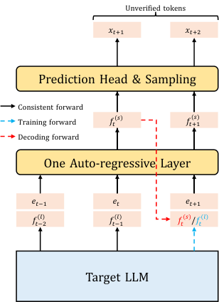

> 图解：$f^{(l)}$ 和 $f^{(s)}$ 分别表示目标 LLM 与草稿模型的 hidden state。生成 $x_{t+1}$ 时，两阶段都能使用目标特征；生成 $x_{t+2}$ 时，训练仍看到目标特征，解码却只能接收草稿特征，因此上下文分布已经不同。

这相当于特征层面的 Exposure Bias（曝光偏差）：训练环境过于理想，真实解码中的特征误差又会沿草稿链累积，越靠后的 Token 越难被目标模型接受。

### 1.3 第二处错位：训练拟合全词表，解码只关心高概率候选

常规蒸馏希望草稿分布贴近目标 LLM 的完整词表分布。但实际采用 Top-K 或 Nucleus Sampling 时，真正决定输出的主要是高概率 Token；即使是贪心解码，也只需要尽量命中概率最高的候选。

因此，草稿模型不必把大量容量花在长尾 Token 的精确排序上，更应该优先“召回”目标模型最想选的 Token。现有方法往往只优化训练对齐或解码结构，没有把这两个阶段的目标与上下文一起对齐。

## 2. HASS：同时校准训练目标与训练上下文

HASS 由两个互补模块组成：**Harmonized Objective Distillation** 解决“学什么”，**Harmonized Context Alignment** 解决“在什么上下文里学”。二者只改变训练过程，不改目标模型权重、草稿树验证逻辑或接受条件。

### 2.1 Top-K 目标蒸馏：把容量留给最可能被接受的 Token

HASS 将推荐系统中的 Ranking Distillation（排序蒸馏）迁移到推测采样：目标 LLM 是教师，草稿模型是学生；学生优先学习教师排名最靠前的候选，而不是平均照顾整个词表。

令完整词表为 $\Omega$，目标分布 $q$ 中概率最高的 $K$ 个 Token 构成 $\hat{\Omega}$，草稿分布为 $p$。Top-K Loss 为：

$$
L_{\mathrm{Top\text{-}K}}=-\sum_{x\in\hat{\Omega}}q(x)\log p(x)
$$

它仍由目标概率 $q(x)$ 加权，但只在 $\hat{\Omega}$ 上计算。这样，目标模型越看重的 Token，对草稿训练的影响越大；长尾候选不再分散优化压力。

与 EAGLE 集成时，目标 hidden state 原本就会经过 LM Head 得到 $q$，所以可直接取出 $\hat{\Omega}$，训练流程无需额外运行目标 LLM。实际总目标沿用 EAGLE 的特征回归与原始 logit loss，再加入权重为 $w$ 的 Top-K Loss：

$$
L_j=L_{\mathrm{feature}}+L_{\mathrm{logit}}+wL_{\mathrm{Top\text{-}K}}
$$

笔者认为，这个设计的聪明之处不在于发明了复杂 Loss，而在于把“接受率取决于高概率候选”这一解码事实直接写进训练目标；推理时则完全不需要做 Top-K 筛选。

### 2.2 多步上下文对齐：让训练主动接触不完美的草稿特征

只改目标还不能解决特征误差。HASS 将训练拆成 $n$ 个对齐步：第 1 步复现 EAGLE 的训练条件，后续步骤逐步把先前草稿前向产生的特征放进 query、key 和 value，让模型学会在“自己之前猜得不够准”的上下文中继续预测。

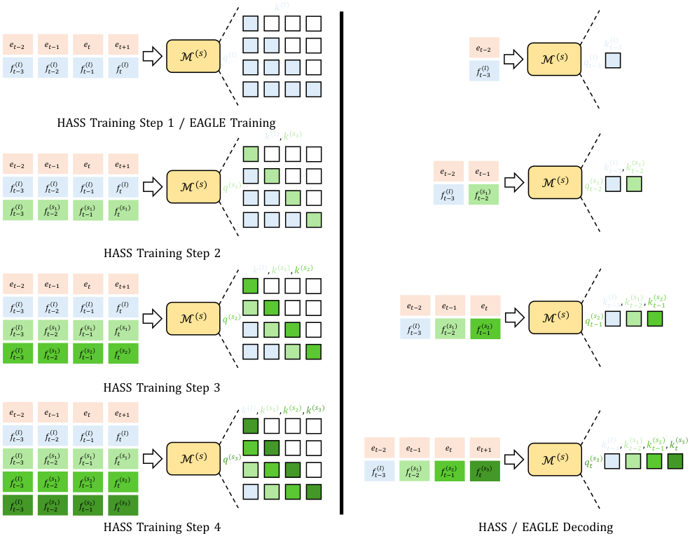

> 图解：上标 $(l)$ 表示目标 LLM 特征，$(s_j)$ 表示第 $j$ 次草稿前向的特征；$q$、$k$ 分别是 Transformer 的 query 与 key。Step 1 使用普通因果掩码和目标特征；Step 2 起，当前 query 来自上一轮草稿特征，key/value 则混合目标特征与更早草稿特征。定制掩码保证各位置只看到与真实自回归解码相对应的历史，而不偷看未来。

形式上，第 $j$ 步在位置 $t+1$ 的草稿特征可写为：

$$
f_{t+1}^{(s_j)}=\mathcal{M}^{(s)}\left(f_t^{(s_{j-1})},f_1^{(l)}\oplus\cdots\oplus f_{t-j+1}^{(l)}\oplus f_{t-j+2}^{(s_1)}\oplus\cdots\oplus f_t^{(s_{j-1})}\right)
$$

其中，$f_t^{(s_{j-1})}$ 是当前 query 的特征来源，其余拼接项构造 key/value，$\oplus$ 表示拼接。随后经目标模型共享的 LM Head 得到下一 Token 分布：

$$
P^{(s_j)}(x_{t+1}\mid x_1,\ldots,x_t)=\operatorname{Head}\left(f_{t+1}^{(s_j)}\right)
$$

每一步都用目标 LLM 的分布和特征监督当前输出。由于序列内各位置可并行计算，定制 Attention Mask 能在一个批次里模拟不同解码深度，而不必为每个 Token 单独跑一套训练。

复现时可把算法理解为以下循环：

1. 运行一次目标 LLM，缓存目标特征，并用普通因果掩码完成第 1 次草稿前向。
2. 计算特征损失和 logit 损失，更新草稿模型；将草稿特征 detach 后保存，避免跨步展开反向传播图。
3. 对 $j=2,\ldots,n$，构造第 $j$ 步掩码，以最近一轮草稿特征生成 query，以目标特征和历轮草稿特征生成 key/value。
4. 再次计算监督损失并更新同一草稿模型，直至完成 $n$ 步。

这与 Scheduled Sampling 直接替换输入 Token 不同：HASS 主要对齐 **特征上下文**，仍保留训练数据中的 Token 序列。后文消融会说明，额外替换 Token 反而有害。

### 2.3 为什么推理成本不变

训练结束后，只保留同一个草稿模型。解码仍按 EAGLE-2 的动态树进行，多步训练只是让模型提前见过类似的误差累积，并不会在推理时执行 $n$ 次额外训练前向，也不增加新的验证模块。

与相关工作相比，DistillSpec 聚焦分布蒸馏，EAGLE、Clover 和 GLIDE 利用目标模型特征或 KV Cache，SpecInfer、EAGLE-2、SpecTr 则优化多草稿验证、动态树或传输验证。HASS 的差异是把训练和解码作为同一个系统来校准，而非只改其中一端。

## 3. 实验：接受更长草稿，真实耗时同步下降

### 3.1 设置与指标

实验使用 LLaMA2-Chat 7/13B 和 LLaMA3-Instruct 8/70B，任务分别覆盖多轮对话（MT-bench）、代码生成（HumanEval）和数学推理（GSM8K）。所有推理均在单张 NVIDIA H800 上进行，batch size 为 1，温度为 0 或 1。

- **Speedup Ratio**：相对原始自回归解码的实际墙钟时间加速比，基线为 1.00x。
- **Acceptance Length $\tau$**：每轮起草—验证平均生成的 Token 数。
- **无损性**：不微调目标 LLM，也不放松接受条件，因此不改变目标生成分布，无需另测生成质量。

HASS 基于 EAGLE-2 开源实现。默认 $K=10$、$w=1.0$，上下文对齐 3 步；草稿树深度为 6，总草稿 Token 数为 60。训练使用含 68,000 段对话的 ShareGPT，优化器和固定训练数据设置与 EAGLE-2 一致。

### 3.2 主结果：四个模型、两种温度全部领先

下表完整列出主实验的加速比。SpS 是 Vanilla Speculative Sampling，V-68M 与 L-68M 分别表示 Vicuna-68M 和 LLaMA-68M 草稿模型；L2、L3 分别简写 LLaMA2-Chat 与 LLaMA3-Instruct。

| 温度 | 模型 | 方法 | MT-bench | HumanEval | GSM8K | 平均 |
|---|---|---|---:|---:|---:|---:|
| $T=0$ | L2 7B | SpS (V-68M) | 1.35x | 1.38x | 1.37x | 1.37x |
| $T=0$ | L2 7B | SpS (L-68M) | 1.23x | 1.24x | 1.25x | 1.24x |
| $T=0$ | L2 7B | Medusa | 1.91x | 1.96x | 2.20x | 2.02x |
| $T=0$ | L2 7B | EAGLE | 1.90x | 2.10x | 2.04x | 2.01x |
| $T=0$ | L2 7B | EAGLE-2 | 2.66x | 3.06x | 2.72x | 2.81x |
| $T=0$ | L2 7B | **HASS** | **2.99x** | **3.41x** | **3.32x** | **3.24x** |
| $T=0$ | L2 13B | SpS (V-68M) | 1.63x | 1.98x | 1.68x | 1.76x |
| $T=0$ | L2 13B | SpS (L-68M) | 1.41x | 1.29x | 1.30x | 1.33x |
| $T=0$ | L2 13B | Medusa | 2.26x | 2.25x | 2.71x | 2.41x |
| $T=0$ | L2 13B | EAGLE | 1.80x | 2.46x | 2.41x | 2.22x |
| $T=0$ | L2 13B | EAGLE-2 | 3.02x | 3.64x | 3.23x | 3.30x |
| $T=0$ | L2 13B | **HASS** | **3.23x** | **4.24x** | **3.48x** | **3.65x** |
| $T=0$ | L3 8B | EAGLE | 1.29x | 2.00x | 1.85x | 1.71x |
| $T=0$ | L3 8B | EAGLE-2 | 2.64x | 3.31x | 2.54x | 2.83x |
| $T=0$ | L3 8B | **HASS** | **2.78x** | **3.43x** | **3.06x** | **3.09x** |
| $T=0$ | L3 70B | EAGLE | 2.14x | 2.74x | 2.42x | 2.43x |
| $T=0$ | L3 70B | EAGLE-2 | 2.94x | 3.98x | 3.19x | 3.37x |
| $T=0$ | L3 70B | **HASS** | **3.40x** | **4.68x** | **4.08x** | **4.05x** |
| $T=1$ | L2 7B | SpS (V-68M) | 1.17x | 1.02x | 1.12x | 1.10x |
| $T=1$ | L2 7B | SpS (L-68M) | 1.00x | 0.94x | 0.99x | 0.98x |
| $T=1$ | L2 7B | Medusa | 2.00x | 2.25x | 2.15x | 2.13x |
| $T=1$ | L2 7B | EAGLE | 1.50x | 1.91x | 1.87x | 1.76x |
| $T=1$ | L2 7B | EAGLE-2 | 2.39x | 2.87x | 2.54x | 2.60x |
| $T=1$ | L2 7B | **HASS** | **2.70x** | **3.13x** | **2.87x** | **2.90x** |
| $T=1$ | L2 13B | SpS (V-68M) | 1.33x | 1.72x | 1.39x | 1.48x |
| $T=1$ | L2 13B | SpS (L-68M) | 1.12x | 1.04x | 1.11x | 1.09x |
| $T=1$ | L2 13B | Medusa | 2.31x | 2.47x | 2.36x | 2.38x |
| $T=1$ | L2 13B | EAGLE | 1.84x | 2.10x | 2.21x | 2.05x |
| $T=1$ | L2 13B | EAGLE-2 | 3.04x | 3.45x | 3.13x | 3.21x |
| $T=1$ | L2 13B | **HASS** | **3.28x** | **3.78x** | **3.37x** | **3.48x** |
| $T=1$ | L3 8B | EAGLE | 1.25x | 1.41x | 1.67x | 1.44x |
| $T=1$ | L3 8B | EAGLE-2 | 2.39x | 2.54x | 2.48x | 2.47x |
| $T=1$ | L3 8B | **HASS** | **2.49x** | **3.05x** | **2.89x** | **2.81x** |
| $T=1$ | L3 70B | EAGLE | 1.80x | 2.34x | 2.12x | 2.09x |
| $T=1$ | L3 70B | EAGLE-2 | 3.02x | 3.61x | 3.21x | 3.28x |
| $T=1$ | L3 70B | **HASS** | **3.43x** | **4.25x** | **3.87x** | **3.85x** |

接受长度给出了加速来源。PLD 和 Lookahead 分别使用提示字符串匹配与缓存 n-gram，不通过草稿分布生成候选，因此论文不报告它们在 $T=1$ 下的结果。

| 温度 | 模型 | 方法 | MT-bench | HumanEval | GSM8K | 平均 $\tau$ |
|---|---|---|---:|---:|---:|---:|
| $T=0$ | L2 7B | PLD | 1.43 | 1.59 | 1.37 | 1.46 |
| $T=0$ | L2 7B | Lookahead | 1.66 | 1.77 | 1.65 | 1.69 |
| $T=0$ | L2 7B | SpS (V-68M) | 2.02 | 2.03 | 2.04 | 2.03 |
| $T=0$ | L2 7B | SpS (L-68M) | 1.83 | 1.81 | 1.83 | 1.82 |
| $T=0$ | L2 7B | Medusa | 2.34 | 2.48 | 2.37 | 2.40 |
| $T=0$ | L2 7B | EAGLE | 3.68 | 3.90 | 3.77 | 3.78 |
| $T=0$ | L2 7B | EAGLE-2 | 4.44 | 4.78 | 4.60 | 4.61 |
| $T=0$ | L2 7B | **HASS** | **4.99** | **5.29** | **5.17** | **5.15** |
| $T=0$ | L2 13B | PLD | 1.46 | 1.70 | 1.44 | 1.53 |
| $T=0$ | L2 13B | Lookahead | 1.64 | 1.85 | 1.69 | 1.73 |
| $T=0$ | L2 13B | SpS (V-68M) | 2.13 | 2.61 | 2.21 | 2.32 |
| $T=0$ | L2 13B | SpS (L-68M) | 1.83 | 1.67 | 1.70 | 1.73 |
| $T=0$ | L2 13B | Medusa | 2.51 | 2.56 | 2.70 | 2.59 |
| $T=0$ | L2 13B | EAGLE | 3.86 | 4.50 | 4.17 | 4.18 |
| $T=0$ | L2 13B | EAGLE-2 | 4.74 | 5.57 | 5.17 | 5.16 |
| $T=0$ | L2 13B | **HASS** | **5.13** | **6.05** | **5.55** | **5.58** |
| $T=0$ | L3 8B | EAGLE | 2.91 | 3.66 | 3.57 | 3.38 |
| $T=0$ | L3 8B | EAGLE-2 | 4.21 | 4.93 | 4.42 | 4.52 |
| $T=0$ | L3 8B | **HASS** | **4.68** | **5.54** | **5.02** | **5.08** |
| $T=0$ | L3 70B | EAGLE | 3.24 | 4.07 | 3.79 | 3.70 |
| $T=0$ | L3 70B | EAGLE-2 | 4.10 | 5.02 | 4.37 | 4.50 |
| $T=0$ | L3 70B | **HASS** | **4.62** | **5.78** | **5.24** | **5.21** |
| $T=1$ | L2 7B | SpS (V-68M) | 1.72 | 1.50 | 1.65 | 1.62 |
| $T=1$ | L2 7B | SpS (L-68M) | 1.47 | 1.36 | 1.46 | 1.43 |
| $T=1$ | L2 7B | Medusa | 2.35 | 2.56 | 2.40 | 2.44 |
| $T=1$ | L2 7B | EAGLE | 3.45 | 3.67 | 3.62 | 3.58 |
| $T=1$ | L2 7B | EAGLE-2 | 4.23 | 4.47 | 4.50 | 4.40 |
| $T=1$ | L2 7B | **HASS** | **4.84** | **4.91** | **5.01** | **4.92** |
| $T=1$ | L2 13B | SpS (V-68M) | 1.73 | 2.25 | 1.81 | 1.93 |
| $T=1$ | L2 13B | SpS (L-68M) | 1.50 | 1.34 | 1.45 | 1.43 |
| $T=1$ | L2 13B | Medusa | 2.53 | 2.89 | 2.72 | 2.71 |
| $T=1$ | L2 13B | EAGLE | 3.62 | 4.27 | 3.98 | 3.96 |
| $T=1$ | L2 13B | EAGLE-2 | 4.60 | 5.41 | 5.03 | 5.01 |
| $T=1$ | L2 13B | **HASS** | **4.98** | **5.86** | **5.41** | **5.42** |
| $T=1$ | L3 8B | EAGLE | 2.67 | 3.35 | 3.30 | 3.11 |
| $T=1$ | L3 8B | EAGLE-2 | 3.90 | 4.73 | 4.30 | 4.31 |
| $T=1$ | L3 8B | **HASS** | **4.26** | **5.30** | **4.85** | **4.80** |
| $T=1$ | L3 70B | EAGLE | 3.06 | 3.85 | 3.66 | 3.52 |
| $T=1$ | L3 70B | EAGLE-2 | 4.00 | 4.93 | 4.35 | 4.43 |
| $T=1$ | L3 70B | **HASS** | **4.59** | **5.68** | **5.20** | **5.16** |

可以看到，速度提升并非只靠更深的草稿树：相对 EAGLE-2，HASS 的接受长度提高 **8%–16%**，并转化为 **8%–20%** 的实际速度优势。多数方法在 HumanEval 上表现最好，因为代码中的固定模板更容易被草稿模型预测。

## 4. 消融：两项设计各自贡献了什么

主实验说明“有效”，消融则进一步回答“为什么有效”，以及超参数是否存在明显陷阱。

### 4.1 Top-K：有效，但并非 $K$ 越小越好

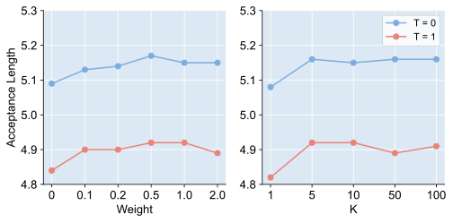

> 图解：实验在 LLaMA2-Chat 7B 上改变 $K$ 和 Loss 权重 $w$，纵轴为三项任务平均接受长度，分别报告 $T=0$、$T=1$。只要 $w>0$，Top-K Loss 都优于 $w=0$；$K$ 太小会忽略其他可能候选，较大的 $K$ 通常更稳，$K=5$ 时接受长度达到峰值，$w=0.5$ 时也取得最高接受长度。

下表补充对应的平均速度与接受长度。默认 $K=10,w=1.0$ 并非每个指标的最大值，但非常接近最佳区域。

| $K$ | $w$ | $T=0$ 平均速度 | $T=0$ 平均 $\tau$ | $T=1$ 平均速度 | $T=1$ 平均 $\tau$ |
|---:|---:|---:|---:|---:|---:|
| 1 | 1.0 | 3.08x | 5.08 | 2.73x | 4.82 |
| 5 | 1.0 | 3.22x | 5.16 | 2.90x | **4.92** |
| 10 | 1.0 | 3.24x | 5.15 | 2.90x | **4.92** |
| 50 | 1.0 | 3.24x | 5.16 | 2.87x | 4.89 |
| 100 | 1.0 | **3.28x** | 5.16 | 2.90x | 4.91 |
| 10 | 0.0 | 3.11x | 5.09 | 2.72x | 4.84 |
| 10 | 0.1 | **3.30x** | 5.13 | 2.87x | 4.90 |
| 10 | 0.2 | 3.21x | 5.14 | 2.90x | 4.90 |
| 10 | 0.5 | 3.27x | **5.17** | **2.93x** | **4.92** |
| 10 | 2.0 | 3.22x | 5.15 | 2.89x | 4.89 |

作者还比较了其他聚焦高概率候选的 Loss：Top-P 按累计概率选集合；Normed Top-K 在候选集合内做线性或 Softmax 归一化；Bi-directional Top-K 同时考虑教师和学生的 Top-K；Recall@k Surrogate 使用可微的召回率近似；BiLD 则利用 logits 差分学习排序并过滤长尾噪声。

| Loss Function | $T=0$ 的 $\tau$ | $T=1$ 的 $\tau$ | 平均 $\tau$ |
|---|---:|---:|---:|
| Top-K Loss | 4.99 | **4.84** | **4.92** |
| Top-P Loss | 5.03 | 4.76 | 4.90 |
| Normed Top-K Loss (Linear) | 4.97 | 4.83 | 4.90 |
| Normed Top-K Loss (Softmax) | 4.98 | 4.72 | 4.85 |
| Bi-directional Top-K Loss | 4.99 | 4.72 | 4.86 |
| Recall@k Surrogate Loss | 4.97 | 4.76 | 4.87 |
| BiLD Loss | **5.04** | 4.75 | 4.90 |

这组结果在 LLaMA2-Chat 7B 的 MT-bench 上完成，并为每种 Loss 搜索了最优超参数。BiLD 在 $T=0$ 略高，Top-K 在 $T=1$ 和两温度平均值上最好，因此“Top-K 总体最佳”更准确，而不是“所有设置都最佳”。

### 4.2 上下文对齐：3–4 步足够，继续加深反而下降

为了单独观察上下文对齐，作者在 EAGLE-2 权重上继续训练：基线只加入 Top-K Loss，其余组再加入不同步数的上下文对齐。结果来自 LLaMA2-Chat 7B。

| 温度 | 训练方式 | MT-bench | HumanEval | GSM8K | 平均 $\tau$ |
|---|---|---:|---:|---:|---:|
| $T=0$ | EAGLE-2 + Top-K | 4.59 | 4.97 | 4.77 | 4.78 |
| $T=0$ | HASS Align-2 | 4.95 | 5.25 | 5.12 | 5.11 |
| $T=0$ | HASS Align-3 | **4.99** | 5.29 | 5.17 | 5.15 |
| $T=0$ | HASS Align-4 | **4.99** | **5.30** | **5.18** | **5.16** |
| $T=0$ | HASS Align-5 | 4.98 | 5.26 | 5.09 | 5.11 |
| $T=1$ | EAGLE-2 + Top-K | 4.46 | 4.61 | 4.64 | 4.57 |
| $T=1$ | HASS Align-2 | 4.71 | 4.89 | 4.98 | 4.86 |
| $T=1$ | HASS Align-3 | **4.84** | 4.91 | 5.01 | **4.92** |
| $T=1$ | HASS Align-4 | 4.77 | **4.93** | **5.03** | 4.91 |
| $T=1$ | HASS Align-5 | 4.71 | 4.92 | 4.95 | 4.86 |

3 或 4 步总体最好，5 步开始回落。作者将其归因于草稿模型容量有限：过度关注后续推测位置，会损害前面位置的预测。也就是说，多步对齐不是越深越好。

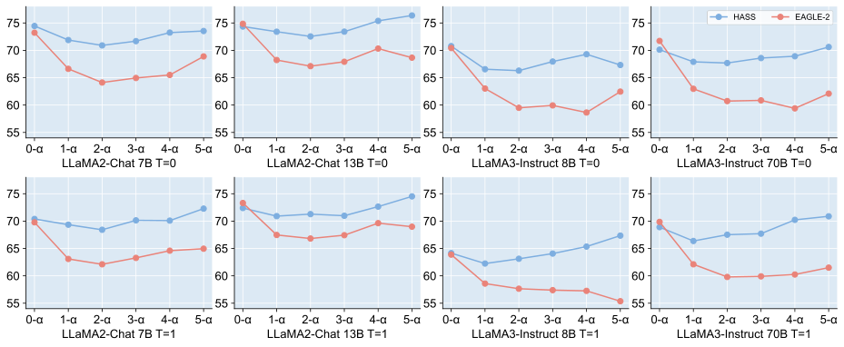

> 图解：横轴是推测步骤，纵轴是该步接受率 $\alpha$（%），四个目标模型分别在 $T=0$、$T=1$ 下比较 HASS 与 EAGLE-2。HASS 的优势主要出现在后续步骤，说明多步训练确实缓解了误差累积；但在 LLaMA2-Chat 13B 和 LLaMA3-Instruct 70B 上，第 0 步接受率有所下降，而第一步又对整个接受长度很重要。

为修正首尾步骤的权衡，作者给第 $j$ 步损失乘以 $\beta^{j-1}$。$\beta<1$ 表示越靠前的步骤权重越大。

| 重加权因子 $\beta$ | $T=0$ 的 $\tau$ | $T=1$ 的 $\tau$ | 平均 $\tau$ |
|---:|---:|---:|---:|
| 1.0（默认） | 4.62 | 4.59 | 4.61 |
| 0.7 | 4.65 | 4.61 | 4.63 |
| 0.5 | **4.67** | **4.62** | **4.65** |
| 0.3 | 4.65 | 4.61 | 4.63 |

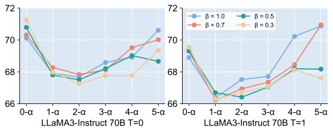

> 图解：该实验使用 LLaMA3-Instruct 70B 和 MT-bench，展示不同 $\beta$ 在各推测步骤上的接受率。$\beta$ 从 1.0 降到 0.5 时，首步接受率持续提高，后续步骤通常略降，总接受长度反而增加；降到 0.3 后过度偏向首步，平均接受长度开始回落。

## 5. 更多证据：数据、迁移与训练成本

两项核心消融之后，还需要回答三个实际落地问题：能否少用一些训练数据，能否迁移到没训练过的任务，以及多步训练到底多花多少成本。

### 5.1 只对齐特征，不要连带替换 Token

作者尝试以概率 $x$ 将训练数据 Token 换成草稿模型生成的 Token，同时进行特征与 Token 对齐。实验在 LLaMA2-Chat 7B 的 MT-bench 上进行。

| 对齐方式 | $T=0$ 的 $\tau$ | $T=1$ 的 $\tau$ | 平均 $\tau$ |
|---|---:|---:|---:|
| EAGLE-2 | 4.44 | 4.23 | 4.34 |
| 仅特征对齐 | **4.83** | **4.60** | **4.72** |
| 特征 + Token（0.1） | 4.81 | 4.57 | 4.69 |
| 特征 + Token（0.2） | 4.78 | 4.51 | 4.65 |
| 特征 + Token（1.0） | 4.28 | 4.11 | 4.20 |

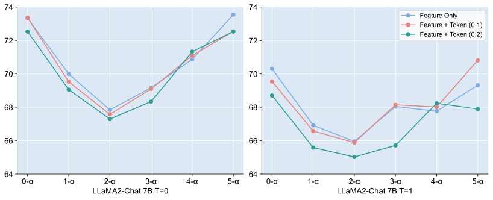

> 图解：横轴为推测步骤，纵轴为接受率 $\alpha$（%）。Token 替换概率从 0.1 增到 1.0 时，接受率总体下降；仅做特征对齐最好，说明 HASS 需要纠正的是特征上下文，而不是把训练输入也变成草稿模型自己的输出。

### 5.2 自蒸馏有帮助，但不能替代目标对齐

自蒸馏指用目标 LLM 对 ShareGPT 提示生成回答，再以这些 Model-Generated（MG）数据训练草稿模型；Fixed（F）则指原固定数据。下表聚焦三任务平均值。

| 温度 | 模型 | 方法 | F：速度 / $\tau$ | MG：速度 / $\tau$ |
|---|---|---|---:|---:|
| $T=0$ | L2 7B | EAGLE-2 | 2.81x / 4.61 | 3.06x / 4.94 |
| $T=0$ | L2 7B | HASS | 3.24x / 5.15 | **3.46x / 5.51** |
| $T=0$ | L2 13B | EAGLE-2 | **3.30x / 5.16** | 3.23x / 5.14 |
| $T=0$ | L2 13B | HASS | 3.65x / 5.58 | **3.80x / 5.63** |
| $T=1$ | L2 7B | EAGLE-2 | 2.60x / 4.40 | 2.71x / 4.64 |
| $T=1$ | L2 7B | HASS | 2.90x / 4.92 | **3.09x / 5.19** |
| $T=1$ | L2 13B | EAGLE-2 | **3.21x / 5.01** | 3.12x / 4.94 |
| $T=1$ | L2 13B | HASS | **3.48x / 5.42** | 3.56x / 5.41 |

MG 数据在 7B 上稳定改善两种方法，在 13B 上却只有边际收益甚至回退，尤其是与 ShareGPT 差异较大的代码和数学任务。无论使用哪种数据，HASS 都优于对应 EAGLE-2；固定数据训练的 HASS 甚至持续超过 MG 数据训练的 EAGLE-2。

一个更直接的对比是：在 LLaMA2-Chat 7B、$T=1$ 下，HASS 改用 MG 数据后，三任务平均 $\tau$ 从 4.92 增至 5.19。这说明 Top-K 目标蒸馏提供的信息并不等价于“直接模仿目标模型生成的数据”。

### 5.3 数据缩减时，HASS 更耐稀疏

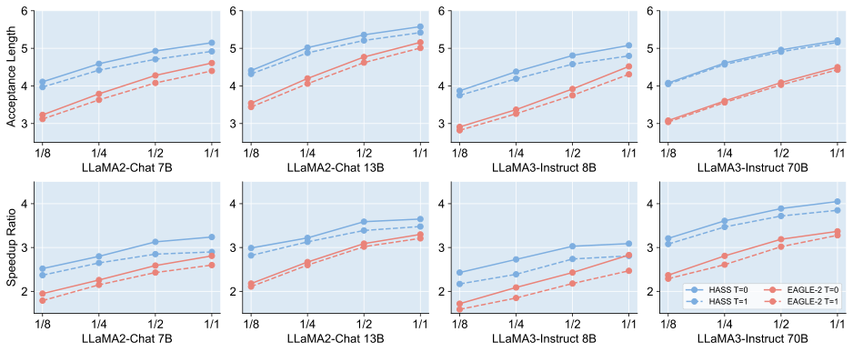

> 图解：横轴为 ShareGPT 数据比例，从 $1/8$、$1/4$、$1/2$ 到全量；纵轴分别为三任务平均接受长度 $\tau$ 和加速比，并覆盖四个目标模型与两种温度。两种方法都随数据增加而近似对数增长，但 HASS 的曲线始终在 EAGLE-2 之上，数据越少，差距越明显。

以三任务平均 $\tau$ 为例：

| 温度 | 模型 | 方法 | $1/8$ 数据 | $1/4$ 数据 | $1/2$ 数据 | 全量数据 |
|---|---|---|---:|---:|---:|---:|
| $T=0$ | L2 7B | EAGLE-2 | 3.23 | 3.79 | 4.28 | 4.61 |
| $T=0$ | L2 7B | HASS | **4.11** | **4.59** | **4.93** | **5.15** |
| $T=0$ | L2 13B | EAGLE-2 | 3.54 | 4.20 | 4.77 | 5.16 |
| $T=0$ | L2 13B | HASS | **4.41** | **5.02** | **5.36** | **5.58** |
| $T=0$ | L3 8B | EAGLE-2 | 2.91 | 3.37 | 3.92 | 4.52 |
| $T=0$ | L3 8B | HASS | **3.87** | **4.38** | **4.81** | **5.08** |
| $T=0$ | L3 70B | EAGLE-2 | 3.08 | 3.60 | 4.09 | 4.50 |
| $T=0$ | L3 70B | HASS | **4.08** | **4.61** | **4.96** | **5.21** |
| $T=1$ | L2 7B | EAGLE-2 | 3.12 | 3.63 | 4.08 | 4.40 |
| $T=1$ | L2 7B | HASS | **3.97** | **4.42** | **4.71** | **4.92** |
| $T=1$ | L2 13B | EAGLE-2 | 3.44 | 4.06 | 4.62 | 5.01 |
| $T=1$ | L2 13B | HASS | **4.32** | **4.88** | **5.21** | **5.42** |
| $T=1$ | L3 8B | EAGLE-2 | 2.82 | 3.26 | 3.75 | 4.31 |
| $T=1$ | L3 8B | HASS | **3.75** | **4.19** | **4.58** | **4.80** |
| $T=1$ | L3 70B | EAGLE-2 | 3.04 | 3.56 | 4.03 | 4.43 |
| $T=1$ | L3 70B | HASS | **4.05** | **4.57** | **4.91** | **5.16** |

尤其值得注意的是，仅使用 $1/4$ 数据的 HASS，就能达到或超过使用全量数据的 EAGLE-2。这支持了作者的判断：更一致的训练目标与上下文提高了数据利用效率。

### 5.4 未适配翻译任务，仍有 17%–24% 速度优势

作者将只在 ShareGPT 上训练的草稿模型直接用于德语、法语、日语、俄语、中文到英文的翻译，没有额外适配。五个方向平均结果如下。

| 温度 | 模型 | EAGLE-2：速度 / $\tau$ | HASS：速度 / $\tau$ |
|---|---|---:|---:|
| $T=0$ | L2 7B | 2.43x / 3.80 | **2.92x / 4.27** |
| $T=0$ | L2 13B | 2.77x / 4.06 | **3.28x / 4.45** |
| $T=0$ | L3 8B | 2.15x / 3.45 | **2.52x / 3.72** |
| $T=0$ | L3 70B | 2.78x / 3.71 | **3.25x / 4.12** |
| $T=1$ | L2 7B | 2.20x / 3.66 | **2.73x / 4.19** |
| $T=1$ | L2 13B | 2.60x / 3.91 | **3.06x / 4.37** |
| $T=1$ | L3 8B | 2.02x / 3.27 | **2.44x / 3.65** |
| $T=1$ | L3 70B | 2.69x / 3.61 | **3.21x / 4.07** |

跨全部模型和温度，HASS 相对原始解码的平均加速为 **2.44x–3.28x**，比 EAGLE-2 快 **17%–24%**，接受长度提高 **8%–14%**。这说明增益并不限于三种主评测任务。

### 5.5 草稿树参数：更深、更宽不等于更快

EAGLE-2 的动态树先扩展，再按置信度保留节点。深度和保留 Token 数增大通常会提高 $\tau$，却也增加目标模型验证成本。作者在 MT-bench 上用自蒸馏版 HASS-MG 搜索参数，得到两点结论：

- 深度 5 的接受长度偏小，深度 9 的验证开销过大，两者都不是理想选择。
- 对 HASS-MG 和 EAGLE-2，较优区域均为深度 $6$–$8$、Token 数 $60$–$100$；调参后 HASS-MG 仍持续更快。

例如，$T=0$ 时 HASS-MG 在 L2 7B 上最高为 3.32x（深度 8、100 Tokens），在 L2 13B 上最高为 3.49x（深度 6、80 Tokens）；同表 EAGLE-2 的对应最高值分别为 2.95x 和 3.26x。可见主结果不是只在单一草稿树配置下成立。

### 5.6 推理零增量，训练计算量约 3 倍

多步对齐的成本全部留在训练端。实验在单张 H800、batch size 为 2 下统计；Align-1 与 EAGLE/EAGLE-2 的训练开销相同，标准 HASS 使用 Align-3。

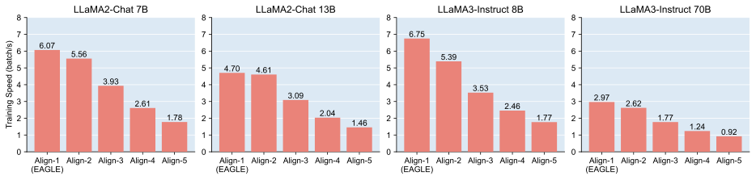

> 图解：横轴为对齐步数，纵轴为训练吞吐（batch/s），四个子图对应四种目标模型。步数越多，吞吐越低；标准 Align-3 处理相同数据量的训练时间平均比 EAGLE-2 多 66.34%，最大增幅为 91.47%，出现在 LLaMA3-Instruct 8B。

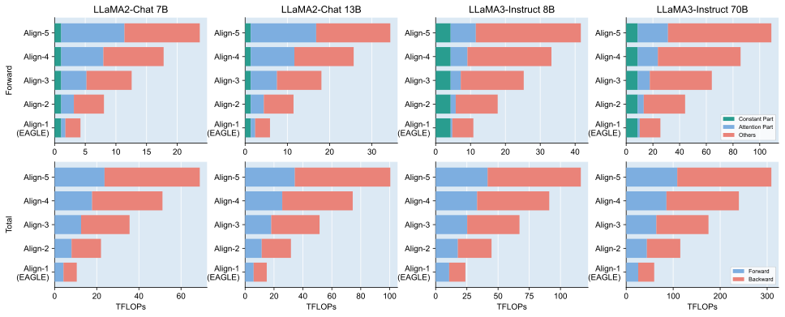

> 图解：上排是前向计算量，下排是前向加反向的总计算量，单位为 TFLOPs。前向由固定项、Attention 项和其他项构成；Align-$j$ 的 Attention 项随 $\sum_{i=1}^{j}i$ 增长，其他项随 $j$ 线性增长。固定项无需梯度，反向主要对应 Attention 与其他项，因此标准 Align-3 的总计算量约为 EAGLE-2 的 3 倍。

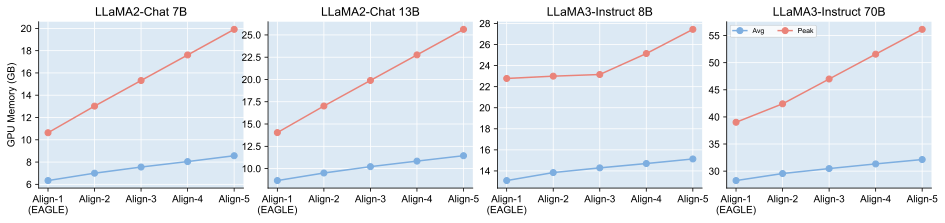

> 图解：图中以 GB 报告训练平均显存（Avg）和峰值显存（Peak）。两者都随对齐步数增加，但即使 Align-5、batch size 为 2，单张 H800 仍能容纳训练。

因此，HASS 的准确成本描述是：**训练更贵，推理不变**。它适合草稿模型可离线训练、之后反复复用的部署方式；若训练资源极其有限，则需要在对齐步数和接受率之间取舍。

## 6. 总结与展望

- HASS 找出推测采样的两处训练—解码错位：全词表训练目标偏离高概率候选的实际需求，目标特征训练上下文偏离草稿特征解码上下文。
- Top-K 目标蒸馏集中学习目标分布中最关键的候选；多步上下文对齐则让草稿模型在训练中适应自身误差。
- 方法不改目标 LLM、不改变接受条件和解码流程，保持输出分布与推理开销不变。
- 在四个 LLaMA 模型和三类任务上，HASS 平均加速 2.81x–4.05x，较 EAGLE-2 快 8%–20%；在未适配的翻译任务上也有稳定收益。
- 代价是标准 Align-3 的训练时间平均增加 66.34%、计算量约为 3 倍，且对齐步数与首尾步骤权重仍需权衡。

未来更值得探索的是比 Top-K 更有效的目标蒸馏，以及根据草稿模型容量自适应分配各推测步骤的训练权重，而不是固定使用 3 步或手工设置 $\beta$。

> 本文参考自 [Learning Harmonized Representations for Speculative Sampling](https://arxiv.org/abs/2408.15766)