# REAL：无偏优化接受长度，让投机解码对齐提速目标

投机解码的提速取决于草稿模型每轮有多少 Token 被目标模型接受，但常用的 CE、KL 和 TV Loss 优化的并不是这个指标。已有块级目标虽然开始关注接受长度，却会把不同验证分支上的接受率“先平均、再相乘”，忽略哪些 Token 真正通过了验证，严重时甚至会让梯度方向反转。REAL 的核心思路是：在目标模型采样的轨迹上加入路径权重，恢复真实的“提出—接受”分支结构，再用 Rao–Blackwellization（RB，条件边际化）降低梯度方差。在 Qwen3.6-35B-A3B 目标模型、Domino 草稿模型、9 个任务子集和 5 个随机种子的受控实验中，REAL 在 $T=1$ 概率服务下取得 **4.792** 的平均接受长度，高于其他对比目标的 **4.657–4.749**；RB 还将聚合梯度方差降低 **52%–58%**。

## 投机解码快不快，关键看接受长度

Speculative decoding（投机解码）可以看作“先由小模型打草稿，再由大模型集中审稿”：草稿模型 $q_\theta$ 一次提出最多 $\gamma$ 个 Token，冻结的目标模型 $p$ 并行计算这些位置的概率，再按顺序接受，遇到第一个拒绝就停止。

在随机拒绝采样中，第 $i$ 个草稿 Token $y_i$ 的接受概率为：

$$
\alpha_i(y_i\mid h_i)=\min\left(1,\frac{p_i(y_i\mid h_i)}{q_{\theta,i}(y_i\mid h_i)}\right)
$$

其中 $h_i=(h,y_{<i})$ 是当前前缀。若一轮接受了 $L$ 个草稿 Token，$L\in\{0,\ldots,\gamma\}$，不包括拒绝后由目标模型生成的修正 Token，那么期望接受长度（Expected Acceptance Length，EAL）为：

$$
J_\gamma(h,\theta)=\mathbb{E}[L]=\sum_{k=1}^{\gamma}P(L\ge k)
$$

这里使用了尾和恒等式：平均接受长度等于“至少接受第 1 个、至少接受第 2 个……”这些概率之和。固定草稿和验证配置时，接受的前缀越长，生成每个 Token 所需的目标模型验证轮数通常越少，因此 EAL 是投机解码提速的直接代理指标。

单个 Token $v$ 的“提出且被接受”概率质量为：

$$
m_i(v)=q_i(v)\alpha_i(v)=\min\{p_i(v),q_i(v)\}
$$

对整个词表求和，得到单步接受率：

$$
a_i=\sum_{v\in\mathcal V}m_i(v)=\sum_{v\in\mathcal V}\min\{p_i(v),q_i(v)\}=1-\mathrm{TV}(p_i,q_i)
$$

TV 是 Total Variation（全变差距离）。这也解释了为什么单步 TV Loss 能优化第一个位置的接受率，却未必能优化整段接受长度。

更关键的是，**被接受的 Token 并不服从 $p$ 或 $q$**。在“已经接受”的条件下，它服从：

$$
r_\theta(v\mid h_i,\text{accept})=\frac{m_i(v\mid h_i)}{a_i(h_i)}
$$

这意味着，一个 Token 被接受后，不仅延长了当前前缀，还决定了下一步在哪条分支上验证。若训练目标按目标模型原始轨迹比例给后续分支加权，而没有校正这个选择过程，分支权重就会出错。

### WTV：从单步接受率走向块级目标，但漏掉了分支依赖

窗口全变差（Windowed Total Variation，WTV）目标将各位置的单步接受率连乘：

$$
\widetilde J_{\mathrm{WTV}}=\mathbb{E}_{y\sim p}\left[\sum_{k=1}^{\gamma}\prod_{i=1}^{k}a_i(h_i)\right]
$$

它的直觉是“每一步都容易接受，整段就容易接受”。问题在于，连乘的是边际接受率，没有保留真实接受 Token 所选择的分支分布。

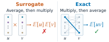

> 图解：同样的两步验证过程，左侧替代目标先把后续分支的接受率按目标分布平均，再与前一步接受率相乘；右侧真实目标先沿每条“提出—接受”路径计算概率质量，再对路径求和。两种运算顺序在存在分支依赖时并不等价。

由此，文章要解决的并不只是一个近似误差，而是一个更实际的问题：**如果训练 Loss 给错误的分支加权，它会不会把草稿模型推向错误方向？**

## WTV 的偏差不只影响数值，还能反转梯度

### 两步窗口下的精确差距

先看 $\gamma=2$ 的最小例子。真实 EAL 可以写成：

$$
J_2=a_1+\sum_vm_1(v)a_2(hv)=a_1+a_1\mathbb E_{v\sim r_1}[a_2]
$$

WTV 则写成：

$$
\widetilde J_{\mathrm{WTV},2}=a_1+a_1\mathbb E_{p_1}[a_2]
$$

差别集中在第二项：真实目标用 $m_1(v)$ 给分支加权，WTV 实际使用 $a_1p_1(v)$。为把二者放到同一个目标采样轨迹上，论文定义路径权重：

$$
b_i(v)=\min\left(1,\frac{q_i(v\mid h_i)}{p_i(v\mid h_i)}\right)
$$

它满足关键恒等式：

$$
p_i(v\mid h_i)b_i(v)=m_i(v\mid h_i)
$$

因此 $\mathbb E_{p_1}[b_1]=a_1$，真实目标也可写为 $J_2=a_1+\mathbb E_{p_1}[b_1a_2]$。两式相减，偏差恰好是一个协方差：

$$
J_2-\widetilde J_{\mathrm{WTV},2}=\operatorname{Cov}_{p_1}(b_1,a_2)
$$

WTV 把“同一条轨迹上的路径权重与后续接受率的联合平均”替换成了“两个边际平均的乘积”。协方差可正可负，所以 WTV 既不是真实 EAL 的一般上界，也不是一般下界。更长的窗口中，每个前缀乘积都有类似的分支错配。

### 一个梯度方向完全相反的反例

设词表只有 $\{A,B\}$，第一步：

$$
p_1=(0.4,0.6),\qquad q_1=(0.8,0.2)
$$

所以 $a_1=0.6$。第二步目标分布分别为：

$$
p_2(\cdot\mid hA)=(0.9,0.1),\qquad p_2(\cdot\mid hB)=(0.1,0.9)
$$

草稿模型在两条分支上共享 $q_2=(\theta,1-\theta)$，且 $0.1<\theta<0.9$。于是 $a_2(hA)=0.1+\theta$，$a_2(hB)=1.1-\theta$。枚举四条两步路径可得：

$$
J_2=0.86+0.20\theta
$$

$$
\widetilde J_{\mathrm{WTV},2}=1.02-0.12\theta
$$

真实目标希望增大 $\theta$，WTV 却希望减小 $\theta$。在 $\theta=0.5$ 时，两者数值都为 0.96，但梯度分别为 $+0.20$ 和 $-0.12$。

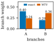

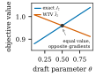

> 图解：左图比较第二步的分支权重。真实目标按“提出—接受”质量给 $A$、$B$ 分支分配 0.4 和 0.2，WTV 则按目标比例重新分配为 0.24 和 0.36。右图横轴为共享草稿参数 $\theta$，纵轴为目标值；两条曲线在 $\theta=0.5$ 相交，但真实目标随 $\theta$ 增大而上升，WTV 却下降，梯度方向相反。

笔者认为，这个反例是全文最重要的理论提醒：**低方差、形式简洁的替代目标，如果均值本身就偏了，优化得越稳定也可能越偏离真实需求。** 协方差公式则把这个理论问题变成了可在训练批次中实际记录和检查的诊断量。

## REAL：先无偏估计真实 EAL，再降低估计方差

解决了“为什么不能直接连乘边际接受率”之后，下一个问题是：真实 EAL 要对指数级路径求和，怎样变成可训练、可反向传播的 Loss？REAL 分两步完成：先构造无偏的路径估计器，再通过条件边际化得到更低方差的分支估计器。

### 路径估计器：用目标采样轨迹恢复接受分支

固定前缀时，至少接受 $k$ 个 Token 的精确概率为：

$$
P(L\ge k\mid h)=\sum_{y_{1:k}\in\mathcal V^k}\prod_{i=1}^{k}m_i(y_i\mid h_i)
$$

直接计算需要枚举 $|\mathcal V|^k$ 条路径，不可行。REAL 改为复用从冻结目标模型采样的连续轨迹 $y_{1:\gamma}\sim p$，令：

$$
W_0=1,\qquad W_k=\prod_{i=1}^{k}b_i
$$

由 $p_i b_i=m_i$ 可得：

$$
\mathbb E_{y\sim p}[W_k]=P(L\ge k)
$$

因此路径估计器是无偏的：

$$
\widehat J_{\mathrm{Path}}=\sum_{k=1}^{\gamma}W_k,\qquad \mathbb E_{y\sim p}[\widehat J_{\mathrm{Path}}]=J_\gamma
$$

它只需已采样 Token 在 $p$ 和 $q$ 下的 log-probability，不必枚举词表路径。但每一项都保留采样得到的 $b_k$，轨迹越长，随机性越容易积累。

### 分支估计器：把每一项最后一个随机因子换成条件均值

路径估计器的每一项中，最后一个因子后面没有其他路径因子，因此可以精确边际化。由于：

$$
\mathbb E[b_k\mid h_k]=a_k(h_k)
$$

把 $b_k$ 换成其条件期望 $a_k$，得到分支估计器：

$$
\widehat J_{\mathrm{Branch}}=\sum_{k=1}^{\gamma}W_{k-1}a_k,\qquad \mathbb E_{y\sim p}[\widehat J_{\mathrm{Branch}}]=J_\gamma
$$

例如 $\gamma=3$ 时：

- 路径估计器：$b_1+b_1b_2+b_1b_2b_3$；
- 分支估计器：$a_1+b_1a_2+b_1b_2a_3$。

这就是 Rao–Blackwellization：保留前面真实采样路径，只对每一项最后一个 Token 做全词表求和。它既不改变期望，又减少了一部分采样噪声。

实际计算流程如下：

1. 从目标模型采样轨迹 $y_{1:\gamma}\sim p$；
2. 对每个位置计算 $b_k=\min(1,q_\theta(y_k\mid h_k)/p(y_k\mid h_k))$；
3. 累乘得到 $W_k=\prod_{i=1}^{k}b_i$；
4. 计算全词表重叠 $a_k=\sum_v\min(p(v\mid h_k),q_\theta(v\mid h_k))$；
5. 返回 $\widehat J_{\mathrm{Branch}}=\sum_{k=1}^{\gamma}W_{k-1}a_k$。

### 梯度仍然无偏，两项都参与反向传播

因为目标分布 $p$ 不依赖草稿参数 $\theta$，路径与分支估计器都满足：

$$
\nabla_\theta J_\gamma=\mathbb E_{y\sim p}[\nabla_\theta\widehat J]
$$

分支估计器的梯度包含两部分：

$$
\nabla_\theta\widehat J_{\mathrm{Branch}}=\sum_kW_{k-1}\nabla_\theta a_k+\sum_ka_k\nabla_\theta W_{k-1}
$$

第一项优化当前位置的全词表接受重叠，第二项优化到达此前缀的路径权重。实验中的“detach $W$”失败说明，第二项不能随手删掉。

RB 的方差保证也作用于梯度。令 $\mathrm{Var}_k^s$ 表示第 $k$ 项的梯度方差，则：

$$
\mathrm{Var}_k^{\mathrm{Branch}}\le \mathrm{Var}_k^{\mathrm{Path}}
$$

也就是说，分支估计器保持相同期望梯度，同时每一项都不比路径估计器更嘈杂。

### 最终 Loss：真实 EAL 与辅助 CE 协同

REAL 使用分支估计器构造最终训练目标：

$$
\mathcal L_{\mathrm{REAL}}=\lambda\left(1-\frac{\widehat J_{\mathrm{Branch}}}{\gamma}\right)+(1-\lambda)\ell_{\mathrm{CE}}
$$

固定窗口 $\gamma$ 用于归一化，辅助 Cross-Entropy（CE）用于稳定从头训练早期的梯度。主实验固定 $\lambda=0.9$。

这个设计工程上很克制：**只改训练 Loss，不改草稿架构、训练流水线或推理过程。** 论文也提供了[参考实现](https://github.com/King-ty/speculators/tree/real-loss)。

## 实验：9 类任务、5 个种子，只比较 Loss 的影响

### 共享配置与公平比较

主实验使用冻结的 Qwen3.6-35B-A3B MoE 目标模型和 Domino 块并行草稿模型。所有方法共享训练数据、架构、优化器和训练预算，只改变 Loss；草稿块大小为 8，即 1 个 anchor 加 $\gamma=7$ 个候选 Token。

| 组件 | 设置 |
|---|---|
| 目标模型 | 冻结的 Qwen3.6-35B-A3B（MoE） |
| 草稿模型 | Domino 块并行 drafter，5 层，对应目标层 2/20/37 |
| 隐藏与嵌入 | GRU hidden dim 1024，embedding dim 256 |
| 草稿块 | 每轮 8 Token（1 anchor + 7 proposals），4096 anchors |
| 训练数据 | Open-PerfectBlend prompts，目标模型在 $T=1.0$ 下重新生成 continuations |
| 优化器 | 隐藏层矩阵使用 Muon，学习率 $2\times10^{-4}$ |
| 其余参数 | AdamW，学习率 $1\times10^{-4}$ |
| 训练预算 | 3 epochs，约 140K steps |
| Batch | 每 rank 每步 16384 Token |
| 课程策略 | 同一 Loss 同时作用于 base/final logits，$\lambda_{\mathrm{base}}$ 从 1 线性降至 0 |
| 评测 | 9 个子集，每个 80 requests，最多输出 2048 Token |
| 采样 | $T=1.0$，top-$p$ 0.95，top-$k$ 20 |
| 提案方式 | greedy（argmax）和 probabilistic（$p/q$ rejection） |

base-anchored 课程训练写为：

$$
\mathcal L_t=(1-c_t)\mathcal L_{\mathrm{recipe}}(z_{\mathrm{final}})+c_t\mathcal L_{\mathrm{recipe}}(z_{\mathrm{base}})
$$

其中 $c_t=\lambda_{\mathrm{base}}$ 在主训练预算内从 1 线性降至 0，它与 REAL Loss 内固定的 $\lambda$ 不是同一个系数。

| 方法 | Loss 配置 |
|---|---|
| static LK | $\{\mathrm{TV}:0.9,\mathrm{CE}:0.1\}$，采用 DSpark recipe 的静态 LK 目标 |
| WTV | $\{\mathrm{WTV}:0.9,\mathrm{CE}:0.1\}$ |
| VSD | $\{\mathrm{VSD}:0.9,\mathrm{CE}:0.1\}$，weighted-likelihood M-step，路径接受权重 detach，在有效 block 上自归一化并除以 $\gamma$ |
| DBLast | $\{\mathrm{DBLast}:0.9,\mathrm{CE}:0.1\}$，接受阈值 $\tau=0.1$ |
| REAL w/o RB | $\{\widehat J_{\mathrm{Path}}:0.9,\mathrm{CE}:0.1\}$ |
| REAL | $\{\widehat J_{\mathrm{Branch}}:0.9,\mathrm{CE}:0.1\}$ |
| REAL w/o CE&RB | $\{\widehat J_{\mathrm{Path}}:1.0\}$ |
| REAL w/o CE | $\{\widehat J_{\mathrm{Branch}}:1.0\}$ |
| pure CE | $\{\mathrm{CE}:1.0\}$ |

评测覆盖 HumanEval、GSM8K、Natural Questions、RAG、CNN/DailyMail、BFCL、德英 WMT、MATH-500 和 MBPP。vLLM 记录的服务接受长度为：

$$
\mathrm{AL}=1+\frac{N_{\mathrm{accepted}}}{N_{\mathrm{rounds}}}
$$

这里的 $+1$ 是每轮的 bonus token，因此服务 AL 与前面不计修正 Token 的 $L$ 有口径差异。概率服务使用 5 个种子 $\{0,777,13,1234,999983\}$，每个种子重复 3 次；greedy 服务使用默认种子重复 3 次。

### 概率服务：REAL 总平均分最高，且每个子集都由 REAL 系列夺魁

| 方法 | Avg | HumanEval | GSM8K | NQ | RAG | CNN/DM | BFCL | WMT | MATH-500 | MBPP |
|---|---:|---:|---:|---:|---:|---:|---:|---:|---:|---:|
| static LK | 4.740 | 5.227 | 5.899 | 3.643 | 4.449 | 4.171 | 3.968 | 4.542 | 5.752 | 5.011 |
| WTV | 4.715 | 5.208 | 5.891 | 3.610 | 4.426 | 4.144 | 3.923 | 4.522 | 5.744 | 4.967 |
| VSD | 4.657 | 5.122 | 5.963 | 3.514 | 4.356 | 4.017 | 3.956 | 4.383 | 5.716 | 4.887 |
| DBLast | 4.749 | 5.222 | 5.998 | 3.615 | 4.437 | 4.155 | 4.022 | 4.511 | 5.789 | 4.992 |
| REAL w/o RB | **4.791** | 5.264 | **6.030** | **3.649** | 4.498 | 4.196 | **4.023** | 4.574 | **5.846** | 5.041 |
| REAL | **4.792** | **5.270** | 6.021 | 3.645 | **4.499** | **4.218** | 4.007 | **4.590** | 5.831 | **5.047** |

> 表格说明：数值为 3 个 epoch 后、5 个种子平均的概率服务 AL，Avg 是 9 个子集的等权平均。REAL 与 REAL w/o RB 分别为 4.792 和 4.791；每个子集的最高值都来自这两者之一，说明优势不是由单个任务拉动。

REAL 相对 WTV 的平均 AL 提升为 0.077，相对 static LK 为 0.052。绝对数字看似不大，但它在统一架构和训练预算下由 Loss 单独带来，而且跨任务一致。

### Greedy 服务：static LK 更强，REAL 在 EAL 类目标中最好

| 方法 | Avg | HumanEval | GSM8K | NQ | RAG | CNN/DM | BFCL | WMT | MATH-500 | MBPP |
|---|---:|---:|---:|---:|---:|---:|---:|---:|---:|---:|
| static LK | **4.544** | 5.000 | 5.555 | **3.533** | **4.349** | **4.123** | **3.665** | **4.460** | 5.425 | **4.783** |
| WTV | 4.530 | 5.021 | 5.617 | 3.518 | 4.300 | 4.092 | 3.612 | 4.440 | 5.411 | 4.757 |
| VSD | 4.497 | 4.988 | 5.587 | 3.462 | 4.283 | 3.988 | 3.636 | 4.373 | 5.421 | 4.736 |
| DBLast | 4.513 | 5.000 | 5.600 | 3.471 | 4.266 | 4.039 | 3.618 | 4.428 | **5.469** | 4.731 |
| REAL w/o RB | 4.515 | 5.002 | 5.582 | 3.482 | 4.292 | 4.062 | 3.611 | 4.396 | 5.453 | 4.751 |
| REAL | **4.537** | **5.039** | **5.638** | 3.504 | 4.284 | 4.066 | 3.651 | 4.420 | 5.465 | 4.766 |

> 表格说明：这是 greedy 提案、目标模型仍采样时的 3 次重复平均。static LK 以 4.544 排名第一；REAL 为 4.537，在 EAL 类目标中最好。REAL 的推导面向随机拒绝采样，因此不能把概率服务优势无条件外推到确定性解码。

### 接受长度优势也转化为端到端吞吐优势

| 方法 | Throughput（tokens/s） |
|---|---:|
| static LK | 4622.1 |
| WTV | 4553.0 |
| VSD | 4535.8 |
| DBLast | 4648.6 |
| REAL w/o RB | **4664.8** |
| REAL | **4662.0** |

> 表格说明：在 batch size 80、3 个 epoch checkpoint、5 个种子、9 个子集和每种子 3 次重复下，REAL w/o RB 与 REAL 的 vLLM 聚合输出吞吐位居前两名。结果支持将 AL 作为速度代理，但这里报告的是吞吐，不应把 AL 差值直接换算成固定加速倍数。

### 提升主要来自更长接受前缀，而非只优化第一个 Token

接受保留率 $S_k=P(L\ge k)$ 表示一轮至少接受 $k$ 个草稿 Token 的概率。

| $k$ | static LK | WTV | VSD | DBLast | REAL | REAL w/o RB |
|---|---:|---:|---:|---:|---:|---:|
| 1 | **0.847** | 0.844 | 0.847 | 0.844 | 0.847 | 0.847 |
| 2 | 0.704 | 0.699 | 0.697 | 0.702 | **0.706** | 0.705 |
| 3 | 0.588 | 0.584 | 0.575 | 0.589 | **0.594** | 0.593 |
| 4 | 0.496 | 0.493 | 0.480 | 0.500 | **0.505** | 0.504 |
| 5 | 0.421 | 0.419 | 0.403 | 0.425 | 0.432 | **0.432** |
| 6 | 0.360 | 0.357 | 0.340 | 0.362 | 0.370 | **0.371** |
| 7 | 0.306 | 0.304 | 0.286 | 0.304 | 0.315 | **0.316** |

> 表格说明：第 1 位各方法接近，static LK 略高，符合其单步目标；REAL 在 $k=2$–$4$ 领先，REAL w/o RB 在 $k=5$–$7$ 领先。到第 7 位，两者分别保留 0.315 和 0.316，高于 static LK 的 0.306 与 WTV 的 0.304。

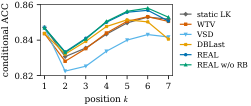

> 图解：横轴为草稿位置 $k$，纵轴为条件接受率 $c_k$，即前 $k-1$ 个 Token 已接受时第 $k$ 个 Token 被接受的概率。REAL 系列在后续位置保持更强的条件接受能力，与保留率表中“长接受前缀更多”的结论一致。

### 排名不依赖某个幸运种子

| 方法 | 0 | 777 | 13 | 1234 | 999983 | mean |
|---|---:|---:|---:|---:|---:|---:|
| static LK | 4.739 | 4.735 | 4.739 | 4.746 | 4.743 | 4.740 |
| WTV | 4.714 | 4.726 | 4.706 | 4.715 | 4.714 | 4.715 |
| VSD | 4.652 | 4.669 | 4.649 | 4.659 | 4.657 | 4.657 |
| DBLast | 4.757 | 4.748 | 4.745 | 4.744 | 4.751 | 4.749 |
| REAL w/o RB | 4.787 | 4.787 | 4.786 | **4.799** | **4.796** | 4.791 |
| REAL | **4.804** | **4.788** | **4.787** | 4.797 | 4.783 | **4.792** |

> 表格说明：所有方法在 5 个种子上的最大跨度都不超过 0.021 AL，REAL 与 REAL w/o RB 在每个种子上均领先其余方法，主排名具有种子稳定性。

## 训练诊断：WTV 形式的近似指标也会“偏袒”WTV

主结果说明 REAL 在实际服务中更好，接下来的问题是：训练过程中能否直接观察到理论预测的分支偏差？

### 训练代理指标与服务 AL 给出相反排名

论文使用一个基于 argmax 准确率的训练 EAL 代理：

$$
\sum_k\prod_{i\le k}\mathrm{acc}_i
$$

其中 $\mathrm{acc}_i$ 是第 $i$ 个位置的 argmax accuracy。这个代理同样采用“边际量连乘”的形式，因此天然更接近 WTV 的目标。

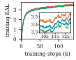

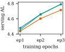

> 图解：三条曲线分别对应 WTV、REAL 和 REAL w/o RB。左图纵轴为训练 EAL 代理，WTV 全程占优；右图纵轴为每个 epoch 结束时的实际概率服务 AL，REAL 反而领先 WTV。REAL w/o RB 在早期略低于 REAL，从 epoch 2 起二者接近，说明 RB 的帮助主要体现在训练早期。相反排名表明，不能用 WTV 形式的代理指标可靠评判不同草稿训练目标。

### 同一轨迹上，WTV 持续低估分支 EAL

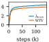

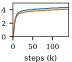

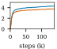

> 图解：三个面板分别对应 REAL、WTV 和 REAL w/o RB 的训练过程；每幅图比较同一批轨迹上的分支 EAL 估计 $\widehat J_{\mathrm{Branch}}$ 与 WTV 替代值，横轴为训练进度，纵轴为目标估计值。三种情况下 WTV 曲线都持续低于分支估计，说明替代目标漏掉了一部分真实接受长度。

### 协方差始终为正，解释了系统性低估

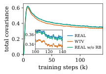

> 图解：横轴为训练进度，纵轴是 6 个相邻位置对 $(b_k,a_{k+1})$ 的协方差之和。三种方法都经历早期尖峰、随后下降并进入非零平台；协方差全程为正，REAL 与 REAL w/o RB 几乎重合且持续高于 WTV。这正好对应上一组图中 WTV 对真实 EAL 的持续低估。

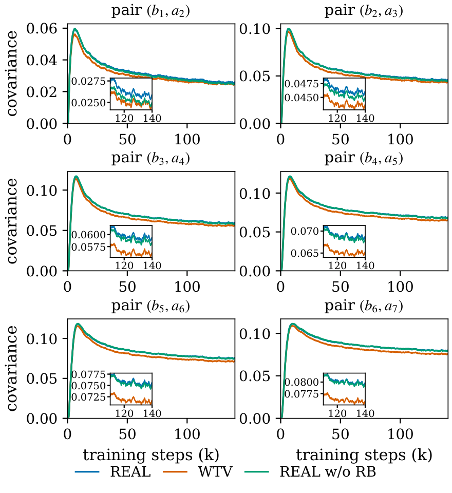

> 图解：每个面板展示一个相邻位置对 $(b_k,a_{k+1})$，$k=1,\ldots,6$，横轴为训练进度，纵轴为该位置对的协方差。各位置总体延续“早期尖峰—下降—非零平台”的趋势，且较后位置通常有更大的协方差，说明分支依赖并非只存在于某一个局部位置。

## 消融实验：RB、CE、温度和训练预算各自改变了什么

### RB 不一定提高最终 AL，但显著降低梯度方差

下表是 $\mathrm{Var}_{\mathrm{Branch}}/\mathrm{Var}_{\mathrm{Path}}$，数值越低，方差减少越多。

| epoch | $k=1$ | $k=2$ | $k=3$ | $k=4$ | $k=5$ | $k=6$ | $k=7$ | agg |
|---|---:|---:|---:|---:|---:|---:|---:|---:|
| **REAL checkpoints** |  |  |  |  |  |  |  |  |
| ep1 | 0 | 0.17 | 0.44 | 0.45 | 0.61 | 0.56 | 0.73 | 0.47 |
| ep2 | 0 | 0.17 | 0.38 | 0.49 | 0.59 | 0.65 | 0.66 | 0.48 |
| ep3 | 0 | 0.20 | 0.40 | 0.48 | 0.47 | 0.55 | 0.67 | 0.43 |
| **REAL w/o RB checkpoints** |  |  |  |  |  |  |  |  |
| ep1 | 0 | 0.24 | 0.44 | 0.45 | 0.42 | 0.58 | 0.68 | 0.47 |
| ep2 | 0 | 0.16 | 0.35 | 0.45 | 0.61 | 0.48 | 0.64 | 0.42 |
| ep3 | 0 | 0.19 | 0.36 | 0.46 | 0.54 | 0.63 | 0.62 | 0.44 |

> 表格说明：$k=1$ 的 0 是结构性的——固定前缀下 $a_1$ 是确定量，而 $b_1$ 仍来自采样。$k=2$ 的方差降低 76%–84%，聚合梯度方差降低 52%–58%。RB 在所有 checkpoint 的所有位置都降低了逐项梯度方差。

REAL 与 REAL w/o RB 在 $T=1$ 的最终概率 AL 几乎相同（4.792 对 4.791），但 RB 版本早期收敛更好、greedy AL 更高（4.537 对 4.515），温度变化下也更稳。因此，RB 的价值主要是优化稳定性与跨设置泛化，而不是保证每个终点指标都显著提升。

### 辅助 CE 与真实 EAL 项缺一不可

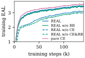

> 图解：横轴为训练进度，纵轴为训练 EAL 代理，曲线比较 REAL、REAL w/o RB 及其去除 CE 的版本，并加入 pure CE。去掉 CE 后两种 REAL 变体的轨迹都下降；pure CE 虽然在该代理上可超过 REAL，却没有带来更好的实际服务 AL，再次说明代理指标与服务指标并不等价。

| 方法 | greedy | probabilistic |
|---|---:|---:|
| REAL w/o CE&RB | 4.369 | 4.588 |
| REAL w/o CE | 4.397 | 4.624 |
| pure CE | 4.508 | 4.668 |
| REAL w/o RB | 4.515 | 4.791 |
| REAL | **4.537** | **4.792** |

> 表格说明：无论是否使用 RB，去掉辅助 CE 都会降低两种服务协议下的 AL；pure CE 也落后于完整 REAL。这说明辅助 CE 负责稳定训练，真实 EAL 项负责对齐服务目标，两者都有独立贡献。

### 温度越低，REAL 的优势越弱

| 方法 | $T=1.0$ | $T=0.7$ | $T=0.5$ |
|---|---:|---:|---:|
| static LK | 4.740 | 4.925 | **5.002** |
| WTV | 4.715 | 4.867 | 4.981 |
| VSD | 4.657 | 4.842 | 4.928 |
| DBLast | 4.749 | 4.912 | 4.975 |
| REAL w/o RB | 4.791 | 4.919 | 4.964 |
| REAL | **4.792** | **4.935** | 4.993 |

> 表格说明：数值为 5 个种子、9 个子集的平均概率服务 AL。降温后所有方法的 AL 都提高，但 REAL 的领先优势收窄；$T=0.5$ 时 static LK 反超。REAL w/o RB 对降温更敏感，进一步体现 RB 的跨温度稳定性。

这与理论设定一致：REAL 面向 stochastic rejection sampling，越接近确定性解码，其精确建模随机接受分支的优势越小。

### 训练收益持续增长，并非早期偶然领先

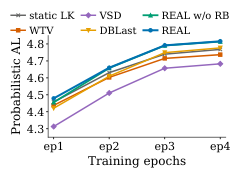

> 图解：横轴为训练 epoch，纵轴为 9 个子集、5 个种子平均的概率服务 AL，包含继续训练到 epoch 4 的结果。REAL 在每个 epoch 都取得最高 AL；其相对 WTV 的领先从 epoch 1 的 0.041 增至 epoch 3 的 0.077。

| 方法 | ep1 greedy | ep1 prob. | ep2 greedy | ep2 prob. | ep3 greedy | ep3 prob. | ep4 greedy | ep4 prob. |
|---|---:|---:|---:|---:|---:|---:|---:|---:|---:|
| static LK | **4.319** | 4.458 | **4.473** | 4.631 | **4.544** | 4.740 | **4.570** | 4.768 |
| WTV | 4.302 | 4.438 | 4.428 | 4.603 | 4.530 | 4.715 | 4.548 | 4.737 |
| VSD | 4.239 | 4.313 | 4.378 | 4.511 | 4.497 | 4.657 | 4.511 | 4.683 |
| DBLast | 4.270 | 4.421 | 4.403 | 4.610 | 4.513 | 4.749 | 4.545 | 4.777 |
| REAL w/o RB | 4.260 | 4.456 | 4.413 | 4.658 | 4.515 | 4.791 | 4.533 | 4.814 |
| REAL | 4.289 | **4.479** | 4.425 | **4.660** | 4.537 | **4.792** | 4.556 | **4.816** |

> 表格说明：完整逐 epoch 结果显示，REAL 与 REAL w/o RB 到 epoch 4 仍继续提升，概率 AL 分别达到 4.816 和 4.814。真实 EAL 的收益会随训练积累，而不是在第一个 epoch 后就饱和。

## 与 D-PACE 的关系：位置加权可以和 REAL 组合

D-PACE 不直接优化 EAL，而是对 CE 做动态位置加权，因此与 REAL 正交，主实验将其单独比较。实现中位置加权系数为 $\alpha=0.5$。

| 方法 | greedy | probabilistic |
|---|---:|---:|
| D-PACE | 4.535 | 4.760 |
| REAL w/o RB | 4.515 | 4.791 |
| REAL | **4.537** | **4.792** |

> 表格说明：完整 3 epoch 预算下，D-PACE 的概率 AL 为 4.760，低于 REAL 的 4.792；greedy AL 为 4.535，也略低于 REAL 的 4.537。

进一步把 D-PACE 加权用于 REAL 的辅助 CE 项，可以带来额外收益。

| 方法 | ep3 greedy | ep4 greedy | ep3 prob. | ep4 prob. |
|---|---:|---:|---:|---:|
| D-PACE | 4.535 | 4.555 | 4.760 | 4.784 |
| REAL w/o RB-CE | 4.515 | 4.533 | 4.791 | 4.814 |
| REAL w/o RB-D-PACE | 4.516 | 4.528 | **4.797** | **4.838** |
| REAL-CE | 4.537 | **4.556** | 4.792 | 4.816 |
| REAL-D-PACE | **4.538** | 4.554 | 4.796 | 4.823 |

> 表格说明：后缀 CE 和 D-PACE 分别表示标准辅助 CE 与 D-PACE 加权 CE。3 epoch 时，两种 REAL 变体换成 D-PACE 加权后概率 AL 分别由 4.791、4.792 提高到 4.797、4.796；4 epoch 时 REAL w/o RB-D-PACE 达到 4.838，REAL-D-PACE 达到 4.823，高于单独 D-PACE 的 4.784。

这说明 REAL 并未排斥其他训练技巧：精确 EAL 项解决“优化什么”，位置加权 CE 则改善“怎样稳定学习”。

## 附录推导：完整反例与方差保证

### 两步反例的完整枚举

第一步各 Token 的概率与接受质量如下。

| Token | $p_1$ | $q_1$ | $m_1=\min(p_1,q_1)$ |
|---|---:|---:|---:|
| $A$ | 0.4 | 0.8 | 0.4 |
| $B$ | 0.6 | 0.2 | 0.2 |

因此 $a_1=0.6$，路径权重为 $b_1(A)=1$、$b_1(B)=1/3$。两条分支的第二步接受率分别为：

$$
a_2(hA)=\min(0.9,\theta)+\min(0.1,1-\theta)=\theta+0.1
$$

$$
a_2(hB)=\min(0.1,\theta)+\min(0.9,1-\theta)=1.1-\theta
$$

| 路径 | 目标概率 | 提出且接受的概率质量 |
|---|---:|---:|
| $AA$ | $0.4\times0.9=0.36$ | $0.4\theta$ |
| $AB$ | $0.4\times0.1=0.04$ | $0.04$ |
| $BA$ | $0.6\times0.1=0.06$ | $0.2\times0.1=0.02$ |
| $BB$ | $0.6\times0.9=0.54$ | $0.2(1-\theta)$ |

于是 $P(L\ge2)=0.26+0.20\theta$，$J_2=0.86+0.20\theta$。WTV 按目标比例平均第二步，得到：

$$
\widetilde J_{\mathrm{WTV},2}=0.6+0.24a_2(hA)+0.36a_2(hB)=1.02-0.12\theta
$$

在目标样本上，分支估计为 $\widehat J(A)=0.6+0.1+\theta$，$\widehat J(B)=0.6+\frac13(1.1-\theta)$。按目标概率做 $0.4\widehat J(A)+0.6\widehat J(B)$，恰好恢复 $J_2$。

在 $\theta=0.5$ 时，分支、WTV 和路径梯度的均值分别为 $+0.20$、$-0.12$、$+0.20$，方差分别约为 0.427、0.3456、0.479。WTV 方差最小，但均值有偏。若有 $M$ 条独立轨迹，其梯度均方误差为：

$$
\frac{64}{625}+\frac{216}{625M}
$$

即使 $M$ 增大，偏差项也不会消失；两个无偏估计器的 MSE 则按 $1/M$ 消失。

### 替代目标还会反转模型排名

设第一步 $p_1=(0.5,0.5)$，两个草稿分别为 $q_1^{(1)}=(0.70,0.30)$ 和 $q_1^{(2)}=(0.35,0.65)$。第二步在 $hA$ 上 $p_2=(0.5,0.5)$、$q_2=(0.6,0.4)$，在 $hB$ 上 $p_2=(0.05,0.95)$、$q_2=(0.95,0.05)$，所以 $a_2(hA)=0.9$、$a_2(hB)=0.1$。

| 指标 | Draft 1 | Draft 2 |
|---|---:|---:|
| $a_1$ | 0.80 | 0.85 |
| $\widetilde J_{\mathrm{WTV},2}$ | 1.200 | **1.275** |
| $J_2$（精确） | **1.280** | 1.215 |

Draft 1 的单步接受率更低，真实两步目标却更高。WTV 选择 Draft 2，精确目标选择 Draft 1，说明偏差不是一个对所有模型相同的常数偏移，而会改变模型比较结论。

### RB 梯度方差保证的证明要点

对固定前缀，路径与分支估计器的第 $k$ 项分别为：

$$
T_k^{\mathrm{Path}}=W_{k-1}b_k,\qquad T_k^{\mathrm{Branch}}=W_{k-1}a_k
$$

二者都无偏，期望均为 $S_k=P(L\ge k)$。对应梯度为：

$$
g_k^{\mathrm{Path}}=b_k\nabla_\theta W_{k-1}+W_{k-1}\nabla_\theta b_k
$$

$$
g_k^{\mathrm{Branch}}=a_k\nabla_\theta W_{k-1}+W_{k-1}\nabla_\theta a_k
$$

分支梯度是给定 $h_k$ 时路径梯度的条件均值。令残差：

$$
r_k=g_k^{\mathrm{Path}}-g_k^{\mathrm{Branch}}
$$

则 $\mathbb E[r_k\mid h_k]=0$。设共同梯度均值为 $\mu_k$，有：

$$
g_k^{\mathrm{Path}}-\mu_k=(g_k^{\mathrm{Branch}}-\mu_k)+r_k
$$

由于 $g_k^{\mathrm{Branch}}-\mu_k$ 在给定 $h_k$ 时固定，交叉项期望为 0，所以：

$$
\mathrm{Var}_k^{\mathrm{Path}}=\mathrm{Var}_k^{\mathrm{Branch}}+\mathbb E[\lVert r_k\rVert^2]
$$

右侧第二项非负，因此 $\mathrm{Var}_k^{\mathrm{Branch}}\le\mathrm{Var}_k^{\mathrm{Path}}$。减少的均方误差，正好来自对每项最后 Token 的边际化。

## 复现细节：比例方向、mask、成本与评测协议

### 训练与推理的比例方向不能写反

- 训练时在目标采样 Token 上使用 $b_i=\min(1,q(y_i)/p(y_i))$；
- 推理时对草稿提案使用 $\alpha_i=\min(1,p(v)/q(v))$；
- 目标 log-probabilities 需要 detach，草稿 log-probabilities 不 detach；
- Loss 始终除以固定 $\gamma$，不能除以随机的有效长度；
- EOS 计为可接受 Token，EOS 后的位置被 mask；
- mask 必须保持前缀连续，确保 $a_k$ 的全词表求和精确；
- 前缀权重 $W$ 与重叠 $a$ 都参与反向传播。

概率服务中，草稿 Token $y\sim q$ 以 $\min(1,p(y)/q(y))$ 接受；拒绝后从 $p-q$ 正部的归一化分布采样修正 Token。greedy 服务则让草稿提出 argmax Token，目标模型仍从 $p$ 采样。

诊断日志包括分支估计 `eal_j_b`、同轨迹 WTV 值 `eal_j_wtv`、逐位置 $a$ 与 $b$ 的均值，以及逐位置对的协方差；所有诊断张量都以 sum/total 对记录。

### 记录的训练耗时相近，但不是严格的增量成本测量

| 方法 | global steps | median（ms） | IQR $[Q_1,Q_3]$ |
|---|---|---:|---|
| WTV | 1,000–10,999 | 847.4 | [843.0, 855.4] |
| WTV | 50,000–59,999 | 850.2 | [845.2, 859.7] |
| WTV | 100,000–109,999 | 849.7 | [844.7, 859.1] |
| VSD | 1,000–10,999 | 834.7 | [830.0, 845.1] |
| VSD | 50,000–59,999 | 840.8 | [834.5, 854.2] |
| VSD | 100,000–109,999 | 845.9 | [838.5, 862.6] |
| DBLast | 1,000–10,999 | 838.3 | [833.8, 847.5] |
| DBLast | 50,000–59,999 | 839.5 | [834.9, 849.0] |
| DBLast | 100,000–109,999 | 839.4 | [834.7, 849.7] |
| REAL w/o RB | 1,000–10,999 | 835.5 | [831.4, 844.2] |
| REAL w/o RB | 50,000–59,999 | 836.2 | [832.0, 845.7] |
| REAL w/o RB | 100,000–109,999 | 838.6 | [834.0, 849.6] |
| REAL | 1,000–10,999 | 844.5 | [839.6, 854.2] |
| REAL | 50,000–59,999 | 846.7 | [841.2, 858.5] |
| REAL | 100,000–109,999 | 845.0 | [840.2, 855.2] |

> 表格说明：每个 epoch 取一个 10,000-step 窗口，不做离群值过滤；计时覆盖 batch fetch 到 optimizer 完成，包括同步和共享诊断。各 EAL 类目标的记录耗时相近，但软件构建与资源竞争未受控，因此不能据此精确分离 Loss 本身的增量成本。

## 小规模先导实验：无偏并不等于可以稳定训练

主研究之前，论文先用 Qwen3-8B 目标模型和 Qwen3-0.6B 草稿模型，在 GSM8K prompts 上训练，并用 64 个 held-out prompts 评测。设置 $\gamma=7$、温度 1、完整 softmax，训练窗口为 1024 Token。

| 目标 | Acceptance length（$T=1$） |
|---|---:|
| Base draft | 2.5833 |
| CE（KL） | 3.1354 |
| TV（$\gamma=1$） | 2.3750 |
| LK$^\lambda$ | 3.6406 |
| WTV | 3.9375 |
| $\widehat J_{\mathrm{Branch}}$ | 3.5312 |
| $\widehat J_{\mathrm{Path}}$ | 0.5052 |
| WTV on greedy data | 2.5000 |
| $\widehat J_{\mathrm{Branch}}$ with KL | 3.6302 |
| $\widehat J_{\mathrm{Path}}$ with KL | 3.1458 |
| $\widehat J_{\mathrm{Branch}}$, detach $W$ | 1.5573 |

这组结果带来五个重要教训：

1. **小规模实验没有证明无偏目标显著优于 WTV。** 此时位置对相关性较小、评测方差较大、训练有限，结论不确定。
2. **纯路径目标很脆弱。** 四次训练全部崩溃：$b\to0$ 会把 Loss 集中到幸存位置，形成正反馈；路径目标平均比分支目标低 3.03 AL。
3. **detach $W$ 会失败。** 其 AL 仅 1.5573，支持保留前缀权重梯度。
4. **辅助 Loss 能稳定训练。** 纯分支目标四次仅一次成功，AL 为 3.53；加入 KL 后训练稳定并达到 3.63，这促成了主实验的辅助 CE 设计。
5. **数据采样方式很重要。** WTV 在 greedy decodes 上训练只有 2.50，在 sampled continuations 上达到 3.94，支持真实接受目标应使用目标采样轨迹。

这部分也避免了“无偏估计必然更好”的简单叙事：无偏性解决目标错误，方差与辅助 Loss 解决优化可行性，两者必须同时考虑。

## 后续尝试：降方差与强化早期位置仍未带来服务收益

REAL 提高了平均 AL，但连续解码轮次之间仍有明显波动。评测中，请求内部波动约占总服务方差的 89%，因此论文尝试两个扩展。

### REAL-V：均值—方差目标

$$
J_V=\mu-\lambda_{\mathrm{var}}(M_2-\mu^2)
$$

其中 $M_2=\sum_k(2k-1)S_k$ 是接受草稿 Token 数的二阶矩，$\mu$ 是均值，$S_k=P(L\ge k)$。

### REAL-K：只优化前 $K$ 个位置

$$
J_K=\mathbb E[\min(L,K)]=\sum_{k=1}^{K}S_k
$$

当 $K=\gamma$ 时退化为完整窗口目标。实验从训练 2 个 epoch 的 REAL checkpoint 热启动，恢复 optimizer、scheduler 和训练状态，再训练 1 个 epoch，设 $K=5$、$\lambda_{\mathrm{var}}=0.05$。

此外还加入均值保护项：

$$
\frac{\lambda\rho}{\gamma}[\mu_{\min}-\mu]_+
$$

其中 $\mu_{\min}=\mu_0-\delta$，$\mu_0$ 是原 REAL 训练结束时的分支 EAL 均值，$\delta=0.05$，$\rho=0.9$，仅在 $\mu<\mu_{\min}$ 时启用。其正则强度约为 $6.5\lambda_{\mathrm{var,ref}}$，而 $\lambda_{\mathrm{var,ref}}=\delta/V_0\approx0.0077$，$V_0$ 为测得的请求内部方差。

| 指标 | WTV | REAL | REAL-V | REAL-K |
|---|---:|---:|---:|---:|
| Validation $\widehat J_{\mathrm{Branch}}$ | 4.3570 | 4.3795 | 4.3790 | 4.3669 |
| Within var.（greedy） | 6.499 | 6.554 | 6.548 | 6.526 |
| Within var.（prob.） | 6.252 | 6.340 | 6.343 | 6.312 |
| Between var.（greedy） | 0.804 | 0.825 | 0.830 | 0.818 |
| Between var.（prob.） | 0.878 | 0.890 | 0.890 | 0.839 |
| Max streak（greedy） | 50 | 26 | 31 | 23 |
| Max streak（prob.） | 33 | 20 | 31 | 17 |

> 表格说明：REAL-V 在两种服务协议下都没有稳定降低请求内部方差。REAL-K 将最长低接受连续轮数从 REAL 的 26/20 降至 23/17（greedy/probabilistic），WTV 对应值则长达 50/33；但这种改善没有转化为更高的正式服务 AL。

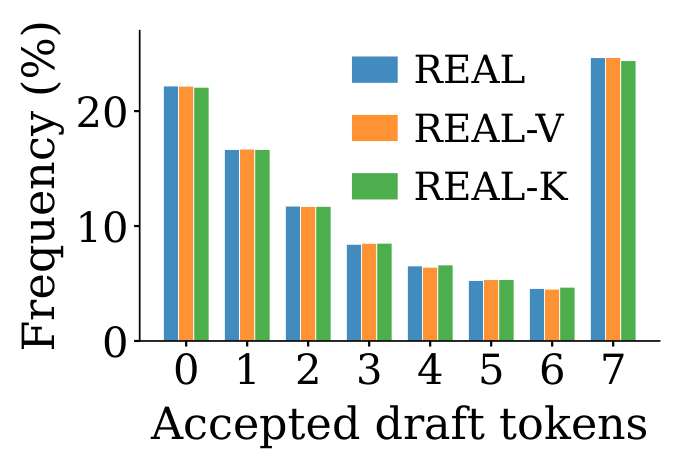

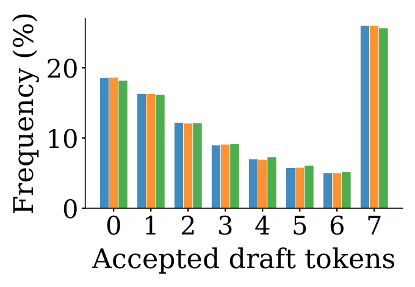

> 图解：两图分别对应 greedy 与概率服务，横轴为一轮接受的草稿 Token 数，纵轴为相应解码轮的分布。REAL、REAL-V、REAL-K 的直方图几乎一致：从接受 0 到 6 个 Token 的频次总体单调下降，在接受 7 个 Token 处明显上升，显示显著的全窗口接受尾部。

| $K$ | REAL | REAL-K |
|---|---:|---:|
| 1 | 0.81 | 0.82 |
| 2 | 1.46 | 1.47 |
| 3 | 1.99 | 2.01 |
| 4 | 2.43 | 2.45 |
| 5 | 2.80 | 2.82 |
| 6 | 3.11 | 3.13 |
| 7 | 3.37 | 3.39 |

> 表格说明：REAL-K 使用 $K=5$ 训练，但在所有截断位置的概率 $J_K$ 都比 REAL 高 0.01–0.02，说明目标确实把接受能力向早期位置移动。不过辅助指标的这点收益没有延续到正式服务 AL，REAL-K 反而更低。

## REAL 与既有工作的位置

草稿架构方面，Medusa 使用独立头，Hydra 使用顺序依赖头，EAGLE 系列进行特征级自回归，GLIDE 追求更低开销；块并行草稿则从 blockwise decoding、多 Token 预测头发展到 DFlash、Domino、DSpark 和 P-EAGLE，扩散式变体还支持双向生成。REAL 不绑定其中某一种架构。

训练目标方面，常见方法包括：

- **分布匹配**：CE、forward KL distillation，以及使用 draft rollouts 的 on-policy 变体；它们主要优化 Token 级相似度。
- **单步接受率**：TV、LK 类目标直接优化 $1-\mathrm{TV}(p,q)$。
- **多步替代目标**：end-to-end TV、DFly 的 TV 阶段和 WTV 连乘各步接受率，但没有保留真实接受 Token 的分支分布。
- **其他接受导向方法**：D-PACE 对 CE 做位置加权，DBLast 和 VSD 使用接受导向或变分替代目标，另有目标对齐训练与扩散奖励。
- **并行的精确目标工作**：EDR 通过额外动态规划最小化精确期望解码轮数，BV Loss 面向块验证，FReDraft 使用草稿 rollout、接受边际化和过采样 Token 惩罚。

与这些方法相比，REAL 的特点是：在标准逐 Token 随机验证下，直接构造无偏、可微的真实 EAL 估计，只替换现有训练流水线中的 Loss。树结构提案、验证控制、草稿—目标分离等系统优化则与其正交。

## 结论：真正对齐接受长度，还要让估计可优化

- **WTV 的结构性偏差来自协方差**：它用边际平均的乘积替代路径权重与后续接受率的联合平均，可能反转梯度和模型排名。
- **路径权重恢复真实分支**：在目标采样轨迹上使用 $b_i=\min(1,q/p)$，可构造真实 EAL 的无偏、可微路径估计器。
- **RB 让目标更适合训练**：分支估计器边际化每项最后一步，保持期望梯度不变，并将聚合梯度方差降低 52%–58%。
- **服务收益跨任务与种子成立**：在 9 个子集、5 个种子、$T=1$ 概率服务下，REAL 平均 AL 达 4.792，并在端到端吞吐中位居前二。
- **优势有明确边界**：低温与 greedy 场景下 static LK 更强；辅助 CE 对稳定训练不可少，方差正则和早期位置目标尚未带来正式服务收益。

当前评测仍限于一个目标模型、一种草稿架构和一种采样数据方案，VSD 与 DBLast 也采用 Loss 级适配而非完整系统复现；未来需要在更多模型、验证方式和服务温度下检验真实 EAL 训练的普适性。

> 本文参考自 [Loss: Optimizing Real Expected Acceptance Length for Speculative Decoding](https://arxiv.org/abs/2611.14399v1)