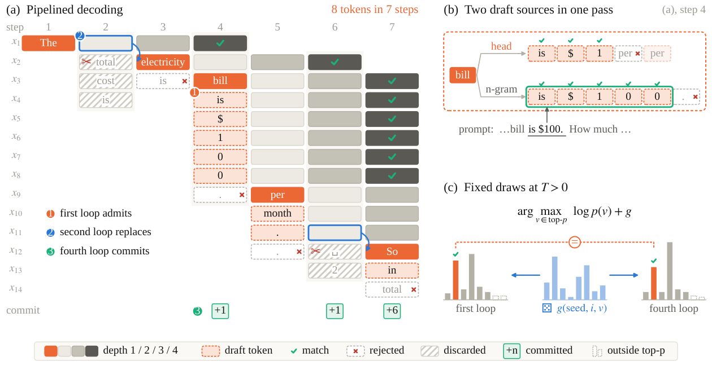
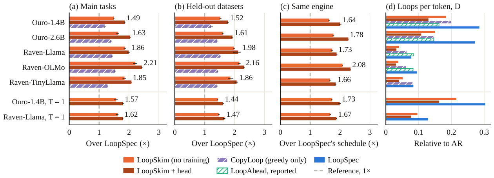
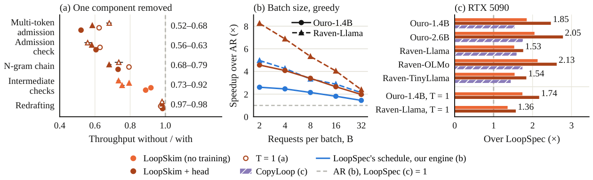

# LoopSkim：多层校验让循环模型无损解码提速

循环语言模型用反复执行同一组参数换取更强能力，却也让每个 token 都要串行完成全部循环，解码延迟随之增加。LoopSkim 的核心思路是：**把模型本来就会经过的每个中间深度都变成验证器**，让多条草稿链提前计算、尽早纠错，只有完整深度的结果才能提交。在 H200、BF16、单请求的主实验中，无需训练的 LoopSkim 相对自回归解码平均提速 **7.66 倍（greedy）和 4.87 倍（$T=1$）**；它相对 LoopSpec 的加速比之比平均为 **1.73 倍**，加入可选草稿头后达到 **1.99 倍**。更重要的是，固定每个位置的随机噪声后，这一加速在精确算术下不改变 greedy 输出，也不改变 top-$p$ 采样分布。

## 为什么循环模型需要新的投机解码

Looped Language Model（循环语言模型）会在每个 token 上多次执行同一个权重共享模块。Ouro 最多 2.6B 参数就能对标最高 12B 的模型，Raven 则能通过增加测试时循环次数改善推理；代价是 Autoregressive Decoding（AR，自回归解码）必须完成当前 token 的全部 $R$ 次循环，才能开始下一个 token。

小 batch 下，一次前向传播同时处理多个位置，通常远比逐位置执行便宜。因此，LoopSpec、WaveFront 等方法把浅层 readout 当作草稿器，让新 token 开始浅层计算时，较早的 token 继续完成深层计算，形成流水线。

但已有方案卡在两个选择上：

- **每步只草稿一个 token**：错误代价低，但每步最多提交一个 token，流水线上限明显。
- **每步草稿多个 token**：提交上限提高，可一旦错误直到完整深度才被发现，其后的所有位置都要废弃并重算。

LoopSkim 观察到，Ouro 本来就被训练为每次循环后都能 readout，Raven 也能在随机循环数后 readout；草稿 token 又无论如何都会经过这些深度。于是，中间深度不需要额外前向传播，就能承担验证工作。

### 用两个因素理解加速

位置 $i$ 在深度 $\ell$ 的状态经过输出层，得到 $p_\ell(\cdot\mid x_{<i})$，完整深度 $R$ 的分布才是目标模型分布。流水线每一步让所有活跃位置前进 $d$ 次循环，$d$ 称为 stride。

设平均每步提交 $\tau$ 个 token，$D$ 表示相对 AR 的串行循环数，$t_{\mathrm{AR}}$ 是 AR 每次循环的解码时间，$t_{\mathrm{loop}}$ 是流水线每步时间除以 $d$，则：

$$
D = \frac{d}{R\tau}, \qquad
\mathrm{speedup} = \frac{1}{D}\cdot\frac{t_{\mathrm{AR}}}{t_{\mathrm{loop}}}
$$

只接纳一个新位置会把 $\tau$ 限在 1 以内；每步接纳 $G$ 个草稿 token，则上限变为 $1+G$。代价是一次前向传播更宽：若有 $C$ 条草稿链和 $R/d-1$ 个更深的活跃组，单步最多携带 $(C+R/d-1)(1+G)$ 个 token。LoopSkim 要做的就是提高 $\tau$，同时用中间校验控制无效计算和单步开销。

### 与相关方法的差别

| 方法 | 草稿来源 | 每步草稿 | 完整深度前的校验 | 发现矛盾后的处理 | 无损采样实验 |
|---|---|---:|---|---|---|
| LoopSpec | 浅层 readout | 1 | 无 | 完整深度验证 | 有 |
| WaveFront | 浅层 readout | 1 | 无 | 完整深度验证 | 未评估 |
| DAS-Wave | 浅层 readout | 最多 24 | 无 | 另做完整深度验证 | 未评估 |
| LoopAhead | 训练得到的 drafter | 树状，最多 3 | Ouro 深度 2；Raven 深度 4、8 | 暂停矛盾草稿 | 有 |
| CopyLoop | 上下文复制 | $K$ | Ouro 深度 1；Raven 深度 4 | 替换 | 未评估 |
| **LoopSkim** | 上下文，另可选草稿头 | 每条链 $G$ | Ouro 深度 1、2、3；Raven 深度 2、4、8、16 | 立即替换并截断 | 有 |

**这个设计的关键不是“更早退出”，而是“更早纠错”**：自适应循环或 early exit 会改变模型输出，LoopSkim 只改变提前计算什么，完整深度提交什么仍由目标模型决定。

## LoopSkim：一条流水线，多个深度共同验证

> 图解：(a) 在 $R=4$ 的 Ouro-1.4B greedy 示例中，两条草稿链配合下，8 个 token 只需 7 个单循环流水线步骤，而 AR 需要 $8\times4=32$ 次循环。(b) 第 4 步中，n-gram 链接纳的 token 比草稿头更多，因此保留 n-gram 链。(c) $T>0$ 时，同一位置的所有 readout 都加入相同 Gumbel 噪声 $g$，于是每次校验只需比较两个已经确定的 token。

### 第一步：从上下文或草稿头提出多个 token

默认的 **n-gram chain** 不需要训练。它寻找以最新 token 结尾、在此前文本中最后一次出现的最长后缀，依次尝试长度 4 到 2，然后复制其后续最多 $G$ 个 token。查找在 CPU 上完成，不需要额外 forward pass。

有训练数据时，可以加入第二条链：一个 16.8M 参数的单层 draft head。它读取最近窗口的浅层状态，一次预测后续 $G$ 个位置的浅层状态，再由原模型输出层转成草稿 token。两条链在同一步提出候选，谁通过入口校验的连续前缀更长，就保留谁；打平时选择草稿头。

### 第二步：入口校验，只接纳最长一致前缀

设最新 token 为 $x_P$，某条链提出 $u_1,\ldots,u_G$。它们与 $x_P$ 一起执行第一步，在入口深度 $\ell_1=d$ 得到 readout。位置 $P+j-1$ 已经读完 $u_j$ 之前的输入，因此它在 $\ell_1$ 的输出 $\hat{x}^{(\ell_1)}_{P+j}$ 正好可以检查 $u_j$。

接纳长度 $a$ 是最长的连续一致前缀：

$$
a = \max\left\{0\le j\le G: u_r=\hat{x}^{(\ell_1)}_{P+r},\ \forall 1\le r\le j\right\}
$$

位置 $P,\ldots,P+a$ 组成一个新组；下一个 readout token 成为最新 token，其余草稿被丢弃。图中的例子里，n-gram 链复制了“is 1 0 0 .”，入口 readout 重现前五个 token，却在句号位置给出“per”，于是保留前五项并从“per”继续。

### 第三步：中间深度发现矛盾，立即替换并截断

一个包含 $n$ 个位置的组到达中间校验深度 $\ell$ 时，每个位置的 readout 都与它后面的 token 比较。第一个不一致的位置为：

$$
m=\min\left\{1\le j\le n:x_{P_0+j}\ne\hat{x}^{(\ell)}_{P_0+j}\right\}
$$

如果这样的 $m$ 存在，就用 $\hat{x}^{(\ell)}_{P_0+m}$ 替换原 token，丢弃该位置及之后的所有位置，包括更晚的组，再从纠正后的 token 重启流水线。每步按 **最深组到入口校验** 的顺序处理 readout；一旦发生替换，本步立即结束，不再接纳新草稿。

这意味着错误不必等到深度 $R$ 才暴露。图中第 2 步，第二循环在“The”后读出“electricity”，与第一循环的“total”冲突，于是从“total”开始的内容全部丢弃，第 3 步改从“electricity”继续。

### 第四步：只有完整深度可以提交

组到达 $R$ 后，仍按位置顺序检查。所有被完整深度 readout 重现的 token 依次提交；遇到第一个不一致时，提交用于替换它的完整深度 token，并丢弃其余未提交内容。浅层 readout 和草稿链只能影响调度，永远不能绕过完整深度直接写入最终输出。

## 无损采样：让同一位置共享同一组随机数

Greedy 下，校验只是比较两个 argmax token，完整深度自然等于 AR。采样的难点在于：即使两个深度的分布完全相同，独立随机抽样也可能给出不同 token，导致中间校验频繁误伤。

LoopSkim 为 seed $s$、位置 $i$、词表 token $v$ 预先固定独立同分布的 Gumbel(0,1) 噪声 $g_{s,i,v}$。任何深度、任何草稿链在该位置的 readout 都使用：

$$
\hat{x}_i^{(\ell)}=\operatorname*{arg\,max}_{v\in\mathcal{V}_p^{(\ell)}}\left[\log p_\ell(v\mid x_{<i})+g_{s,i,v}\right]
$$

其中 $\mathcal{V}_p^{(\ell)}$ 是深度 $\ell$ 的 top-$p$ 集合，greedy 可视为 $g\equiv0$。根据 Gumbel-max trick，完整深度的 $\hat{x}_i^{(R)}$ 仍是普通 top-$p$ 分布的样本。

固定噪声同时解决两个问题：

- **保证无损**：完整深度 token 只由 seed 和已提交前缀决定。接纳、替换或丢弃草稿，只改变提前计算的内容。
- **提高校验一致性**：浅层和深层复用相同噪声，两个分布越接近，扰动后的 argmax 越容易一致。

论文测得，在 Ouro-1.4B 和 Raven-Llama 上，这种共享噪声让浅层与完整深度抽中同一 token 的概率达到理论最大耦合值 $1-\mathrm{TV}$ 的 **99.4%–99.9%**；独立抽样只有 **79.6%–94.8%**。

Raven 还会从随机初始状态开始循环。LoopSkim 同样让初始状态 $\xi_{s,i}$ 只取决于 seed、位置和隐藏维度。否则，多条链各自抽状态、再按草稿接纳结果选链，会让状态被“是否赞同草稿”这一事件间接选择，破坏目标分布。

### 无损性的归纳证明

证明依赖三个直观性质：

1. 每个位置读到的缓存或同步状态，都等于 AR 根据当前前缀算出的状态。
2. 某个 token 改变后，该位置及之后的状态全部失效并被重写，之前的状态保持不变。
3. 只有输入均已提交的位置，其完整深度 readout 才能提交下一个 token。

假设已提交前缀 $x_{\le c}$ 与 AR 相同。下一 token 来自位置 $c$ 的完整深度 readout；由前两条性质，它读取的就是 AR 状态，并使用同一噪声 $g_{s,c+1,\cdot}$，因此得到 AR 的 $x_{c+1}$。归纳下去，任意时刻 LoopSkim 的已提交序列都是同噪声 AR 输出的前缀，终止时二者完全相同。

草稿 token、链选择、中间校验和替换都不进入提交值，所以浅层 readout 与草稿头甚至可以使用不同温度或截断策略，而不影响无损结论。最老组的第一个位置只读取已提交 token，不会被校验删除，并且会在 $R/d$ 步内提交一个 token，因此算法也保证持续推进。

## 实现细节与默认配置

| 配置 | Ouro | Raven |
|---|---|---|
| 每条链草稿长度 $G$ | 8 | 8 |
| Stride $d$ | 1 | greedy 为 2；$T>0$ 为 4 |
| 校验深度 $\Lambda$ | 1、2、3、4 | greedy：2、4、8、16、32；$T>0$：4、8、16、32 |
| 单步 token 数 | 36；加草稿头为 45 | greedy：144，加头为 153；$T>0$：72，加头为 81 |
| $T>0$ 时草稿头温度 | $0.7T$ | $T$ |
| 浅层剪枝 margin | 3 nats | 无 |

完整解码循环可以概括为：先由各链草稿并执行一次流水线 forward；再从深到浅处理校验，遇到首个矛盾就替换、截断并进入下一步；若完整深度无矛盾则提交整组；最后比较各链的入口接纳长度，保留最优链并形成新组。

草稿头读取最近 $w=32$ 个位置，将浅层状态与下一 token 的 embedding 拼接，再配合 $G-1$ 个 learned query，经一个宽度 1,024、8 个 attention heads、MLP 宽度 2,048 的 causal decoder layer，预测后续浅层状态。它面向入口分布 $p_{\ell_1}$ 而不是完整深度分布 $p_R$ 训练：

$$
\mathcal{L}(\phi)=\frac{1}{G}\sum_{j=1}^{G}\left[\mathrm{CE}\left(p_{\ell_1}(\cdot\mid x_{<P+j}),q_{\phi,j}\right)+\lambda\,\mathrm{SmoothL1}\left(\tilde h_j,h^{(\ell_1)}_{P+j-1}\right)\right]
$$

其中 $\lambda=0.2$，训练 16,000 步，batch size 256，学习率 $3\times10^{-4}$ 并采用 cosine decay。生成模型自身续写需要每个模型 2.24–4.16 H200-hours，训练本身只需单张 H200 上 4.2–16.9 分钟。

所有任务共用一套主配置，它在 768 条不参与评估的 GSM8K、MATH 和 MBPP 配置 prompt 上选择。相比之下，LoopSpec 和 CopyLoop 都在被评估 prompt 上逐 cell 选择最快配置，这对 LoopSkim 是更严格的比较条件。

## 实验设置：五个模型，数学、代码与推理任务

主实验使用 Ouro-1.4B、Ouro-2.6B（$R=4$），以及 Raven-Llama、Raven-OLMo、Raven-TinyLlama（$R=32$）。所有模型测试 greedy；Ouro-1.4B 和 Raven-Llama 还测试 $T=1$、top-$p=0.9$ 采样。

| 数据 | Prompt 数 | 输出上限 | 子集与格式 |
|---|---:|---:|---|
| GSM8K | 1,319 | 512 | test set，LoopSpec 格式 |
| MATH500 | 500 | 2,048 | 全部，LoopSpec 格式 |
| BBH | 540 | 1,024 | 每个子任务前 20 题，LoopSpec 格式 |
| HumanEval+ | 164 | 1,024 | 全部，LoopSpec 格式 |
| MBPP+ | 378 | 1,024 | 全部，LoopSpec 格式 |
| SVAMP | 1,000 | 512 | train 与 test 全部，作为 held-out |
| OlympiadBench | 199 | 2,048 | 英文纯文本数学题子集，held-out |
| MMLU-Pro | 278 | 1,024 | 每类 20 道测试题，5-shot CoT |
| BigCodeBench | 200 | 1,024 | Complete prompt 子集，held-out |
| Spec-Bench | 480 | 1,024 | 六类各 80 条，Vicuna 首轮 |
| PG-19 | 32 | 256 | 32 本书，1K–32K 上下文 |
| Thinking：GSM8K | 1,319 | 4,096 | chat template |
| Thinking：MATH500 | 500 | 8,192 / 32,768 | chat template |
| Thinking：AIME24、AIME25 | 各 30 | 16,384 / 32,768 | chat template |

除批量实验外，速度均指单张 H200、BF16、单请求的 decode throughput。每种方法的 speedup 先除以 **自身引擎中的 AR**，跨方法再比较 speedup 的比值，并用几何平均汇总。每个 cell 重复三次；不计 prefill，若计入 prefill，LoopSkim + head 保留原 decode-only speedup 的 0.71–0.90。

## 主结果：无需训练也全面快于 LoopSpec

下表完整保留主实验数值。每项是相对各自 AR 的 speedup，格式为三次重复的均值 $\pm$ 标准差；括号中是相对 LoopSpec 的 speedup 比值。“—”表示沿用 LoopSpec 设置未运行。LoopSkim 默认不训练，“+ head”加入可选草稿头；BBH 使用的草稿头训练数据不含任何 BBH 问题。

### Greedy decoding

| 模型 | 方法 | GSM8K | MATH500 | BBH | HumanEval+ | MBPP+ | 几何平均 |
|---|---|---:|---:|---:|---:|---:|---:|
| Ouro-1.4B | LoopSpec | 2.88±0.07 | 3.13±0.06 | 2.78±0.06 | 3.19±0.15 | 2.87±0.02 | 2.97±0.03 |
|  | CopyLoop | 3.39±0.20 (1.18) | 3.31±0.11 (1.06) | 3.23±0.12 (1.16) | 5.49±0.18 (1.72) | 2.74±0.10 (0.95) | 3.53±0.08 (1.19) |
|  | **LoopSkim** | 3.81±0.02 (1.32) | 3.79±0.14 (1.21) | **5.44±0.17** (1.96) | 6.90±0.22 (2.16) | 3.18±0.02 (1.11) | 4.44±0.06 (1.49) |
|  | **+ head** | **5.01±0.02** (1.74) | **5.24±0.20** (1.67) | 5.20±0.13 (1.87) | **8.57±0.16** (2.69) | **4.38±0.12** (1.53) | **5.52±0.08** (1.86) |
| Ouro-2.6B | LoopSpec | 3.27±0.04 | 3.39±0.04 | 2.94±0.11 | 3.23±0.04 | 3.17±0.14 | 3.20±0.04 |
|  | CopyLoop | 4.27±0.02 (1.31) | 4.90±0.02 (1.45) | 4.15±0.09 (1.41) | 6.26±0.02 (1.94) | 3.33±0.06 (1.05) | 4.48±0.02 (1.40) |
|  | **LoopSkim** | 4.36±0.26 (1.33) | 5.97±0.24 (1.76) | **6.40±0.15** (2.18) | 7.10±0.02 (2.20) | 3.23±0.07 (1.02) | 5.20±0.11 (1.63) |
|  | **+ head** | **6.14±0.02** (1.88) | **7.70±0.04** (2.27) | 6.11±0.16 (2.08) | **8.77±0.05** (2.72) | **4.72±0.07** (1.49) | **6.54±0.05** (2.04) |
| Raven-Llama | LoopSpec | 4.29±0.08 | 6.49±0.12 | 5.60±0.25 | 6.33±0.14 | 5.36±0.11 | 5.56±0.06 |
|  | CopyLoop | 5.31±0.17 (1.24) | 9.97±0.23 (1.54) | 8.63±0.20 (1.54) | 10.94±0.48 (1.73) | 6.49±0.08 (1.21) | 7.98±0.11 (1.44) |
|  | **LoopSkim** | 6.10±0.37 (1.42) | 13.97±0.31 (2.15) | **11.45±0.29** (2.04) | 14.01±0.41 (2.21) | 8.56±0.27 (1.60) | 10.32±0.09 (1.86) |
|  | **+ head** | **6.71±0.09** (1.56) | **15.52±0.64** (2.39) | 10.53±0.29 (1.88) | **16.10±0.48** (2.54) | **9.48±0.09** (1.77) | **11.08±0.12** (1.99) |
| Raven-OLMo | LoopSpec | 5.27±0.03 | 4.36±0.07 | 4.57±0.05 | 6.15±0.08 | 6.19±0.01 | 5.25±0.01 |
|  | CopyLoop | 6.67±0.24 (1.27) | 6.51±0.08 (1.49) | 7.04±0.14 (1.54) | 10.24±0.15 (1.67) | 10.78±0.42 (1.74) | 8.05±0.16 (1.53) |
|  | **LoopSkim** | 8.70±0.48 (1.65) | 10.29±0.29 (2.36) | **11.38±0.49** (2.49) | 14.61±0.21 (2.38) | 14.18±0.53 (2.29) | 11.61±0.33 (2.21) |
|  | **+ head** | **10.34±0.04** (1.96) | **11.39±0.06** (2.61) | 10.82±0.26 (2.37) | **16.15±0.28** (2.63) | **16.55±0.54** (2.67) | **12.78±0.07** (2.43) |
| Raven-TinyLlama | LoopSpec | 5.32±0.20 | — | — | 6.69±0.14 | 5.93±0.18 | 5.95±0.06 |
|  | CopyLoop | 6.07±0.15 (1.14) | — | — | 10.55±0.32 (1.58) | 6.88±0.33 (1.16) | 7.61±0.01 (1.28) |
|  | **LoopSkim** | 8.50±0.43 (1.60) | — | — | 15.97±0.35 (2.39) | 9.81±0.15 (1.65) | 11.00±0.21 (1.85) |
|  | **+ head** | **9.79±0.18** (1.84) | — | — | **16.98±0.14** (2.54) | **11.46±0.11** (1.93) | **12.40±0.12** (2.08) |

### Sampling：$T=1$，top-$p=0.9$

| 模型 | 方法 | GSM8K | MATH500 | BBH | HumanEval+ | MBPP+ | 几何平均 |
|---|---|---:|---:|---:|---:|---:|---:|
| Ouro-1.4B | LoopSpec | 2.34±0.01 | 2.39±0.01 | 2.24±0.01 | 2.59±0.06 | 2.43±0.08 | 2.40±0.02 |
|  | **LoopSkim** | 3.06±0.04 (1.31) | 3.47±0.17 (1.45) | **4.50±0.08** (2.01) | 5.16±0.07 (1.99) | 3.03±0.10 (1.25) | 3.76±0.09 (1.57) |
|  | **+ head** | **3.65±0.01** (1.56) | **4.34±0.00** (1.82) | 4.28±0.01 (1.91) | **5.77±0.06** (2.23) | **3.73±0.07** (1.53) | **4.29±0.01** (1.79) |
| Raven-Llama | LoopSpec | 3.53±0.06 | 4.11±0.02 | 4.11±0.01 | 4.00±0.07 | 3.79±0.03 | 3.90±0.01 |
|  | **LoopSkim** | 4.90±0.14 (1.39) | 6.18±0.27 (1.50) | **8.38±0.39** (2.04) | 6.74±0.01 (1.69) | 5.82±0.03 (1.54) | 6.30±0.16 (1.62) |
|  | **+ head** | **5.62±0.02** (1.59) | **7.25±0.04** (1.76) | 8.05±0.07 (1.96) | **7.58±0.01** (1.90) | **6.78±0.02** (1.79) | **7.00±0.02** (1.79) |

跨全部主实验 cell，无训练 LoopSkim 在 greedy 和 $T=1$ 下分别比 AR 快 **7.66 倍和 4.87 倍**。相对 LoopSpec 的平均比值为 **1.73 倍**，对 prompt 重采样得到的 95% 区间为 **1.71–1.74 倍**，并且在每个模型、任务和解码模式上都大于 1。Greedy 下相对 CopyLoop 平均为 **1.30 倍**；加头后，相对 LoopSpec 和 CopyLoop 分别提高到 **1.99 倍和 1.51 倍**。

> 图解：各模型任务采用几何平均，须线表示三次重复的范围。(a) 主任务和 (b) held-out 数据集展示相对 LoopSpec 的 speedup 比值，柱上数字对应无训练 LoopSkim；(c) 把 LoopSpec 调度移入作者引擎后，比较原始 throughput；(d) 比较相对 AR 的每输出 token 串行循环数 $D$，越低越好，并列出 LoopAhead 论文图中报告的值。

为了排除引擎差异，作者依据 LoopSpec 发布代码，在自己的引擎中复现其 proposal depth、草稿与接纳规则、CUDA Graph 和 host 同步方式。复现版每输出 token 循环数与官方实现相差不超过 3%；六个设置中速度为官方代码的 0.94–1.08 倍，Raven-OLMo 为 1.44 倍。

| 模型与模式 | LoopSkim / 同引擎 LoopSpec | LoopSkim + head / 同引擎 LoopSpec |
|---|---:|---:|
| Ouro-1.4B greedy | 1.64 | 2.00 |
| Ouro-2.6B greedy | 1.78 | 2.28 |
| Raven-Llama greedy | 1.73 | 1.88 |
| Raven-OLMo greedy | 2.08 | 2.35 |
| Raven-TinyLlama greedy | 1.66 | 1.85 |
| Ouro-1.4B $T=1$ | 1.73 | 1.99 |
| Raven-Llama $T=1$ | 1.67 | 1.88 |

即使统一引擎，无训练 LoopSkim 仍快 **1.64–2.08 倍**，加头后快 **1.85–2.35 倍**，且后者在每个 cell、每次重复中都更快。

## 消融实验：收益来自“多层校验 + 多 token + 双草稿链”

> 图解：(a) 删除一个组件后的 throughput 相对完整版本的比例，圆点为 Ouro，三角为 Raven；中间深度校验覆盖五个模型的 greedy 结果，其余组件在 Ouro-1.4B 和 Raven-Llama 上测试。(b) 横轴对应每批请求数，纵轴为 LoopSkim + head 相对作者 AR 的 speedup，任务是 GSM8K、MATH500 和 MBPP+ 的几何平均。(c) RTX 5090 上相对 LoopSpec 的 speedup 比值，数字为无训练 LoopSkim，须线仍是三次重复范围。

### 组件消融

| 删除的组件 | Ouro-1.4B greedy | Ouro-1.4B $T=1$ | Raven-Llama greedy | Raven-Llama $T=1$ |
|---|---:|---:|---:|---:|
| 多 token 接纳，令 $G=0$ | 0.521 (0.512–0.526) | 0.624 (0.618–0.633) | 0.585 (0.582–0.589) | 0.681 (0.667–0.693) |
| 入口校验 | 0.606 (0.603–0.608) | 0.629 (0.621–0.638) | 0.582 (0.577–0.586) | 0.559 (0.543–0.583) |
| n-gram 链 | 0.731 (0.726–0.741) | 0.793 (0.787–0.803) | 0.681 (0.675–0.692) | 0.735 (0.715–0.757) |
| 替换后重新草稿 | 0.984 (0.972–0.994) | 0.973 (0.968–0.981) | 0.982 (0.980–0.986) | 0.981 (0.975–0.991) |
| 中间深度校验 | 0.888 (0.875–0.895) | 0.862 (0.856–0.870) | 0.754 (0.748–0.766) | 0.792 (0.787–0.800) |
| Raven 两臂都用 stride 2，删除中间校验 | — | — | 0.552 (0.548–0.555) | — |
| 浅层不再共享完整深度噪声 | — | 0.764 (0.757–0.768) | — | 0.331 (0.326–0.341) |

没有中间校验时，各模型和模式只保留 **73%–92%** 的 throughput；在 Raven-Llama 相同 stride 2 下仅保留 **55.2%**。没有共享噪声时，Raven-Llama 采样 throughput 只剩 **33.1%**，每步提交 token 数从 1.38 降至 0.45。这说明“无损”并不要求浅层共享噪声，但 **高效率非常依赖它**。

草稿链也不是可有可无：$G=0$ 时只剩 52.1%–68.1%，移除 n-gram 链后剩 68.1%–79.3%。若彻底取消流水线，只做普通 prompt lookup speculative decoding，n-gram 链相对 AR 仅为 1.64–2.27 倍，两条链也只有 1.90–2.73 倍。

### 错误究竟在哪一层被发现

| 模式与模型 | 入口拒绝率 | 中间替换数 | 完整深度替换数 | 完整深度前的后续替换占比 | 每输出 token 的完整深度替换率 | 后续替换平均深度 |
|---|---:|---:|---:|---:|---:|---:|
| Greedy：Ouro-1.4B | 33.6% | 9,493 | 1,247 | 88.4% | 1.10% | 2.5 / 4 |
| Greedy：Ouro-2.6B | 25.3% | 5,759 | 719 | 88.9% | 0.69% | 2.5 / 4 |
| Greedy：Raven-Llama | 19.9% | 6,897 | 207 | 97.1% | 0.16% | 6.7 / 32 |
| Greedy：Raven-OLMo | 18.8% | 13,582 | 387 | 97.2% | 0.18% | 6.4 / 32 |
| Greedy：Raven-TinyLlama | 22.4% | 2,733 | 72 | 97.4% | 0.14% | 6.6 / 32 |
| Greedy：全部 | 22.9% | 38,464 | 2,632 | 93.6% | 0.43% | — |
| Greedy：全部 + head | 28.1% | 37,757 | 2,583 | 93.6% | 0.42% | — |
| $T=1$：Ouro-1.4B | 38.2% | 15,131 | 2,413 | 86.2% | 2.22% | 2.5 / 4 |
| $T=1$：Raven-Llama | 31.4% | 6,037 | 655 | 90.2% | 0.52% | 12.1 / 32 |
| $T=1$：全部 | 34.8% | 21,168 | 3,068 | 87.3% | 1.30% | — |
| $T=1$：全部 + head | 40.7% | 21,007 | 2,832 | 88.1% | 1.20% | — |

Greedy 下，入口之后的替换有 **94%** 发生在完整深度之前；完整深度只需替换 **0.43%** 的输出 token。Raven-Llama 的后续替换平均发生在 32 次循环中的第 **6.7** 次，因此错误 token 后面的位置只需白跑入口到完整深度之间约 **16%** 的循环；Ouro 对应比例为 48%–50%，所以深循环的 Raven 受益更大。

### 串行循环减少，但总计算量增加

| 指标 | 方法 | Ouro-1.4B greedy | Ouro-2.6B greedy | Raven-Llama greedy | Raven-OLMo greedy | Raven-TinyLlama greedy | Ouro-1.4B $T=1$ | Raven-Llama $T=1$ |
|---|---|---:|---:|---:|---:|---:|---:|---:|
| $D$ | LoopSpec | 0.2853 | 0.2725 | 0.0773 | 0.0954 | 0.0840 | 0.3032 | 0.1291 |
|  | CopyLoop | 0.1984 | 0.1475 | 0.0633 | 0.0619 | 0.0815 | — | — |
|  | LoopSkim | 0.1833 | 0.1498 | 0.0395 | 0.0380 | 0.0511 | 0.2151 | 0.0961 |
|  | **LoopSkim + head** | **0.1299** | **0.1078** | **0.0321** | **0.0310** | **0.0399** | **0.1628** | **0.0769** |
| 每步提交 $\tau$ | LoopSkim | 1.36 | 1.67 | 1.58 | 1.64 | 1.22 | 1.16 | 1.30 |
|  | LoopSkim + head | 1.92 | 2.32 | 1.95 | 2.02 | 1.57 | 1.54 | 1.63 |
| 单循环时间 / 自身 AR | LoopSpec | **1.17** | **1.13** | **2.27** | **2.16** | 2.11 | 1.40 | 1.99 |
|  | LoopSkim | 1.31 | 1.25 | 2.37 | 2.48 | **2.09** | **1.31** | **1.72** |
|  | LoopSkim + head | 1.46 | 1.36 | 2.77 | 2.75 | 2.29 | 1.47 | 1.91 |
| 全位置循环量 $W/(RN)$ | 同引擎 LoopSpec | **1.11** | **1.07** | **1.32** | **1.22** | **1.31** | **1.27** | **1.99** |
|  | LoopSkim | 6.60 | 5.39 | 5.69 | 5.47 | 7.36 | 7.74 | 6.92 |
|  | LoopSkim + head | 5.85 | 4.85 | 4.91 | 4.74 | 6.10 | 7.33 | 6.23 |

LoopSkim 在 greedy 下比 LoopSpec 少用 **1.56–2.51 倍** 的串行循环，$T=1$ 下少用 **1.34–1.41 倍**；加头后在所有设置中 $D$ 最小。单循环时间相对自身 AR 最多是 LoopSpec 对应值的 1.15 倍，加头后最多 1.27 倍，因此单请求场景的速度主要由 $D$ 决定。

但这并不是“免费减少计算”：所有位置累计的循环量是 AR 的 **4.74–7.74 倍**。它用更多并行计算换更低延迟，这是部署时最重要的成本边界。

## 泛化与扩展：held-out、长输出、批量和不同硬件

### Held-out 数据与 Spec-Bench

下表是相对基线的 speedup 比值。四个 held-out 数据集不参与配置选择或草稿头训练，过滤近重复后共有 1,677 条 prompt；Raven-TinyLlama 因 2,048 token 上下文限制只运行 SVAMP 和 BigCodeBench（BCB）。

| 模式 | 模型 | 方法 | SVAMP / LoopSpec | Olympiad / LoopSpec | MMLU-Pro / LoopSpec | BCB / LoopSpec | 均值 / LoopSpec | Spec-Bench / LoopSpec | 均值 / CopyLoop | Spec-Bench / CopyLoop |
|---|---|---|---:|---:|---:|---:|---:|---:|---:|---:|
| Greedy | Ouro-1.4B | LoopSkim | 1.36 | 1.26 | 1.39 | 2.27 | 1.52 | 1.46 | 1.25 | 1.18 |
|  |  | + head | 1.71 | 1.68 | 1.44 | 2.41 | 1.78 | 1.49 | 1.45 | 1.20 |
| Greedy | Ouro-2.6B | LoopSkim | 1.36 | 1.84 | 1.26 | 2.13 | 1.61 | 1.46 | 1.13 | 1.22 |
|  |  | + head | 1.86 | 2.25 | 1.42 | 2.34 | 1.93 | 1.54 | 1.36 | 1.28 |
| Greedy | Raven-Llama | LoopSkim | 1.29 | 2.34 | 2.01 | 2.53 | 1.98 | 2.66 | 1.30 | 1.49 |
|  |  | + head | 1.43 | 2.57 | 2.08 | 2.62 | 2.12 | 2.72 | 1.39 | 1.53 |
| Greedy | Raven-OLMo | LoopSkim | 1.43 | 2.23 | 2.47 | 2.77 | 2.16 | 2.45 | 1.50 | 1.45 |
|  |  | + head | 1.75 | 2.46 | 2.44 | 2.77 | 2.32 | 2.52 | 1.61 | 1.49 |
| Greedy | Raven-TinyLlama | LoopSkim | 1.45 | — | — | 2.38 | 1.86 | 2.13 | 1.33 | 1.35 |
|  |  | + head | 1.71 | — | — | 2.51 | 2.07 | 2.28 | 1.47 | 1.44 |
| $T=1$ | Ouro-1.4B | LoopSkim | 1.36 | 1.27 | 1.16 | 2.13 | 1.44 | 1.22 | — | — |
|  |  | + head | 1.60 | 1.55 | 1.24 | 2.21 | 1.61 | 1.23 | — | — |
| $T=1$ | Raven-Llama | LoopSkim | 1.35 | 1.44 | 1.37 | 1.76 | 1.47 | 1.27 | — | — |
|  |  | + head | 1.53 | 1.76 | 1.45 | 1.93 | 1.66 | 1.37 | — | — |

跨 held-out 数据，LoopSkim 和加头版相对 LoopSpec 的平均比值分别为 **1.69 倍和 1.90 倍**。二者在全部 26 个 cell 都快于 LoopSpec；相对 CopyLoop，加头版在全部 18 个 greedy cell 更快，无训练版在 17 个更快。

剔除任何解码器在任何重复中出现 repetition loop 的 prompt 后，结论仍成立：相对 LoopSpec 的平均比值为 **1.62 倍（无头）和 1.88 倍（有头）**，相对 CopyLoop 为 **1.27 倍和 1.48 倍**；无训练 LoopSkim 此时在 greedy 下比 AR 快 6.84 倍。

### 长链推理：输出越长，优势越明显

Ouro-1.4B-Thinking 使用 LoopSpec 的 thinking 任务和输出预算；采样为 $T=1$、top-$p=0.7$。下表保留完整结果，$D$ 为相对 AR 的串行循环量。

| 模式 | 方法或指标 | GSM8K 4K | MATH500 8K | AIME24 16K | AIME25 16K | AIME24 32K | AIME25 32K | MATH500 32K |
|---|---|---:|---:|---:|---:|---:|---:|---:|
| $T=1$ | LoopSpec / SGLang AR | 2.25 | 1.95 | 1.60 | 1.53 | 1.58 | 1.53 | 1.80 |
|  | LoopSkim / our AR | 3.04 | 3.20 | 2.99 | 2.96 | 3.05 | 3.15 | 3.46 |
|  | **LoopSkim + head / our AR** | **3.40** | **3.63** | **3.15** | **3.10** | **3.31** | **3.41** | **4.01** |
|  | LoopSkim / LoopSpec | 1.35 | 1.64 | 1.87 | 1.93 | 1.93 | 2.06 | 1.92 |
|  | **LoopSkim + head / LoopSpec** | **1.51** | **1.86** | **1.97** | **2.03** | **2.09** | **2.23** | **2.23** |
|  | 同引擎 LoopSpec / our AR | 2.13 | 2.02 | 1.76 | 1.73 | 1.70 | 1.68 | 1.93 |
|  | LoopSkim / 同引擎 LoopSpec | 1.43 | 1.58 | 1.70 | 1.71 | 1.79 | 1.88 | 1.79 |
|  | LoopSpec $D$ | 0.3123 | 0.2964 | 0.3021 | 0.3041 | 0.2976 | 0.2999 | 0.2919 |
|  | LoopSkim $D$ | 0.2467 | 0.2113 | 0.2043 | 0.2039 | 0.1939 | 0.1851 | 0.1950 |
| Greedy | LoopSpec / SGLang AR | 2.64 | 2.16 | 1.82 | 1.79 | 1.67 | 1.67 | 1.78 |
|  | CopyLoop / SGLang AR | 2.74 | 2.20 | 1.97 | 1.83 | 1.78 | 1.77 | 1.80 |
|  | LoopSkim / our AR | 3.34 | 3.76 | 4.08 | 3.85 | 5.48 | 5.51 | 5.71 |
|  | **LoopSkim + head / our AR** | **3.71** | **4.22** | **4.63** | **4.61** | **5.88** | **5.77** | **5.92** |
|  | LoopSkim / LoopSpec | 1.27 | 1.74 | 2.24 | 2.15 | 3.28 | 3.30 | 3.21 |
|  | **LoopSkim + head / LoopSpec** | **1.41** | **1.95** | **2.54** | **2.58** | **3.52** | **3.46** | **3.33** |
|  | LoopSkim / CopyLoop | 1.22 | 1.71 | 2.07 | 2.10 | 3.08 | 3.11 | 3.17 |

在原输出预算下，LoopSkim 在全部 8 个 cell 快于 LoopSpec，并在全部 4 个 greedy cell 快于 CopyLoop。$T=1$ 时，它相对 LoopSpec 的比值从 GSM8K 的 **1.35 倍** 增长到 AIME25 的 **1.93 倍**：LoopSpec 的 speedup 随长输出下降，而 LoopSkim 维持在 **2.96–3.20 倍**。

### 改变 Raven 循环次数

| 模式 | $R$ | LoopSkim + head / our AR | 同引擎 LoopSpec / our AR | 前者 / 后者 |
|---|---:|---:|---:|---:|
| Greedy | 8 | 4.52 | 2.36 | 1.92 |
|  | 16 | 6.97 | 3.67 | 1.90 |
|  | 32 | 10.91 | 5.88 | 1.86 |
| $T=1$ | 8 | 2.52 | 1.59 | 1.58 |
|  | 16 | 4.06 | 2.43 | 1.67 |
|  | 32 | 6.97 | 3.75 | 1.86 |

两种解码器都随 $R$ 增加而获得更高 speedup；greedy 下 LoopSkim + head 相对同引擎 LoopSpec 稳定为 **1.86–1.92 倍**。

### 批量与长上下文

批量版本中，$B$ 个请求共享每步 forward，完成的请求由下一请求替换；$G$、草稿链和 Raven stride 都按 batch size 重新选择。到 $B=32$ 时，LoopSkim + head 在所有任务上仍至少比 AR 快 **1.87 倍**。跨 GSM8K、MATH500、MBPP+ 和 $B=2$ 到 32，它相对批量 LoopSpec 快 **1.36–1.75 倍（Ouro-1.4B）和 1.12–1.66 倍（Raven-Llama）**。

PG-19 长上下文结果如下，均为 LoopSkim + head 相对对应基线的 speedup 比值：

| 基线与模型 | 1K | 2K | 4K | 8K | 16K | 32K | 几何平均 |
|---|---:|---:|---:|---:|---:|---:|---:|
| LoopSpec：Ouro-1.4B | 1.44 | 1.60 | 1.62 | 1.65 | 1.51 | 1.30 | 1.51 |
| LoopSpec：Ouro-2.6B | 1.33 | 1.39 | 1.38 | 1.44 | 1.54 | 1.33 | 1.40 |
| LoopSpec：Raven-Llama | 1.66 | 1.85 | 1.91 | 1.87 | 2.08 | 1.77 | 1.85 |
| CopyLoop：Ouro-1.4B | 1.38 | 1.67 | 1.79 | 1.91 | 1.75 | 1.50 | 1.66 |
| CopyLoop：Ouro-2.6B | 1.24 | 1.41 | 1.48 | 1.54 | 1.66 | 1.40 | 1.45 |
| CopyLoop：Raven-Llama | 1.14 | 1.41 | 1.58 | 1.59 | 1.78 | 1.81 | 1.53 |

每个上下文长度和每次重复中，它都快于两个基线。不过 attention 需要让一步中的每个 token 关注完整上下文，因此相对 LoopSpec 的优势在 Ouro-1.4B 的 32K 上下文降到 **1.30 倍**。单请求、1K–32K 三个采样长度下，峰值显存含权重为 AR 的 **1.01–1.09 倍**；32 请求、1K 或 4K 上下文下为 **1.02–1.20 倍**。

### 另一张 GPU 与从头训练的 Huginn

RTX 5090 上所有方法重新调参，结果仍是相对各自 AR 的 speedup；括号中为相对 LoopSpec 的比值。

| 方法 | Ouro-1.4B greedy | Ouro-2.6B greedy | Raven-Llama greedy | Raven-OLMo greedy | Raven-TinyLlama greedy | Ouro-1.4B $T=1$ | Raven-Llama $T=1$ |
|---|---:|---:|---:|---:|---:|---:|---:|
| LoopSpec | 2.59 | 2.75 | 5.21 | 5.03 | 6.07 | 2.26 | 4.05 |
| CopyLoop | 4.00 (1.54) | 4.81 (1.75) | 8.28 (1.59) | 8.75 (1.74) | 8.76 (1.44) | — | — |
| LoopSkim | 4.78 (1.85) | 5.64 (2.05) | 7.96 (1.53) | 10.69 (2.13) | 9.35 (1.54) | 3.94 (1.74) | 5.49 (1.36) |
| **LoopSkim + head** | **6.39 (2.47)** | **7.65 (2.78)** | **9.17 (1.76)** | **13.17 (2.62)** | **11.17 (1.84)** | **4.91 (2.17)** | **6.34 (1.57)** |
| 同引擎 LoopSpec / our AR | 2.77 | 2.91 | 5.22 | 5.47 | 6.19 | 2.35 | 3.84 |

无训练 LoopSkim 相对 LoopSpec 的比值为 **1.36–2.13 倍**，加头后为 **1.57–2.78 倍**。Greedy 下，无训练版相对 CopyLoop 为 0.96–1.22 倍，加头版为 1.11–1.60 倍，说明无头版本并非在每个 CopyLoop cell 都占优。

Huginn-0125 是从头训练的 3.5B recurrent-depth 模型，$R=32$。LoopSkim 使用 stride 4、校验深度 4/8/16/32，加头版使用 stride 8、校验深度 8/16/32。

| Prompt 范围 | 方法 | GSM8K | MATH500 | BBH | HumanEval+ | MBPP+ | 几何平均 |
|---|---|---:|---:|---:|---:|---:|---:|
| 全部 | LoopSkim | 4.40 | 10.55 | 6.16 | 9.98 | 7.90 | 7.42 |
|  | **LoopSkim + head** | **5.56** | **11.55** | **6.57** | **10.24** | **8.80** | **8.24** |
|  | CopyLoop | 4.14 | 6.46 | 4.83 | 7.61 | 6.34 | 5.74 |
|  | LoopSpec 调度 | 3.28 | 3.74 | 3.28 | 4.39 | 4.14 | 3.74 |
| 去除 repetition loop | LoopSkim | 3.96 | 4.76 | 5.83 | 9.08 | 4.91 | 5.47 |
|  | **LoopSkim + head** | **5.06** | **5.98** | **6.28** | **9.44** | **6.00** | **6.40** |
|  | CopyLoop | 3.78 | 3.59 | 4.72 | 7.02 | 4.24 | 4.53 |
|  | LoopSpec 调度 | 3.14 | 3.06 | 3.23 | 4.33 | 3.60 | 3.45 |

无训练 LoopSkim 相对 AR 快 **7.42 倍**，相对 LoopSpec 调度的 speedup 比值为 **1.98 倍**；去除 repetition loop 后仍为 **1.59 倍**。它在每个任务和每次重复中都快于两个基线。

## 实践中的“无损”：FP32 完全一致，BF16 存在数值误差

理论无损以精确算术为前提。作者把包括 attention 在内的所有操作切到 FP32、关闭 TF32，在全部七种模型与模式设置的 **3,300 条 prompt** 上解码 845,772 个 token。LoopSkim + head 在中间 readout 替换 58,965 次、完整深度替换 4,699 次，最终输出仍与作者 AR **逐 token 完全一致**。

BF16 下，矩阵乘法的舍入会受计算形状影响，多 token pass 和单 token pass 可能在接近平局时给出不同结果。因此，实际输出一致率需要单独看：

- Ouro greedy 主任务的 5,802 条 prompt 中，LoopSkim + head 与作者 AR 在 **75.5%** 的 prompt 上完全相同，无头版为 74.5%。
- LoopSpec 和 CopyLoop 与各自 SGLang AR 的完全相同比例分别为 **70.1% 和 70.6%**。
- 作者 AR 与 SGLang AR 只有 **68.9%** 完全相同，而两个 SGLang AR 彼此完全一致，说明差异来自 kernel 与 pass shape，而非 LoopSkim 独有问题。
- 相对共同 FP32 输出，LoopSkim + head 和作者 AR 的 BF16 输出分别有 39.5% 和 39.0% 的 prompt 出现差异，exact McNemar 检验 $p=0.50$。

准确率也没有显示出显著损失：

| 模型与模式 | 解码器 | GSM8K | MATH500 | BBH | HumanEval+ | MBPP+ |
|---|---|---:|---:|---:|---:|---:|
| Ouro-1.4B | Our AR | 78.5 | 72.6 | 69.6 | 65.9 | 64.8 |
|  | LoopSkim + head | 79.1 | 73.2 | 70.7 | 66.5 | 64.8 |
| Ouro-2.6B | Our AR | 86.0 | 57.4 | 77.8 | 73.2 | 67.7 |
|  | LoopSkim + head | 86.2 | 56.0 | 77.4 | 72.6 | 69.0 |
| Raven-Llama | Our AR | 51.9 | 35.4 | 32.8 | 11.0 | 23.8 |
|  | LoopSkim + head | 52.0 | 35.8 | 31.5 | 9.8 | 24.6 |
| Raven-OLMo | Our AR | 46.1 | 28.0 | 28.0 | 10.4 | 12.2 |
|  | LoopSkim + head | 45.3 | 27.6 | 28.7 | 11.0 | 11.6 |
| Raven-TinyLlama | Our AR | 43.7 | — | — | 14.0 | 23.0 |
|  | LoopSkim + head | 43.1 | — | — | 14.0 | 23.8 |
| Ouro-1.4B $T=1$ | Our AR | 67.0 | 62.9 | 62.8 | 57.3 | 53.6 |
|  | LoopSkim + head | 67.4 | 62.3 | 62.5 | 57.7 | 53.5 |
| Raven-Llama $T=1$ | Our AR | 36.4 | 21.5 | 33.5 | 5.9 | 10.2 |
|  | LoopSkim + head | 35.5 | 20.9 | 33.5 | 5.7 | 10.4 |

Greedy 下，179 道题只有 LoopSkim + head 答对，181 道只有 AR 答对；汇总准确率差为 **-0.01 个百分点**，95% 区间 [-0.29, +0.26]，符号翻转检验 $p=0.96$。$T=1$ 下差为 **-0.22 个百分点**，95% 区间 [-0.60, +0.14]，$p=0.24$。两个区间都包含零。

## 总结：把“深度”从延迟来源变成验证资源

- **核心机制**：LoopSkim 让草稿 token 在原本就要经过的多个深度接受校验，首个矛盾处立即替换并截断，只有完整深度能够提交。
- **无需训练**：默认 n-gram 链从上下文复制候选；可选单层草稿头提供第二条链，两者按入口接纳长度竞争，进一步提升吞吐。
- **无损采样**：固定每个位置的 Gumbel 噪声和 Raven 初始状态，使 greedy 输出及 top-$p$ 采样分布在精确算术下保持不变，FP32 实验也实现逐 token 一致。
- **主要收益**：H200 主实验中，无训练版本相对 AR 平均提速 7.66 倍（greedy）和 4.87 倍（$T=1$），相对 LoopSpec 的 speedup 比值平均 1.73 倍；同引擎比较仍快 1.64–2.08 倍。
- **适用边界**：它以 AR 的 4.74–7.74 倍总循环量换低延迟，优势依赖 batch、上下文长度和文本可重复性；模型规模目前最高 3.5B，生产引擎集成仍待完成。

未来值得关注的方向，是在真实 serving 中按负载自动控制草稿宽度与校验深度，并降低长上下文和能耗成本，让这套“多层自检”从单请求加速走向稳定的生产吞吐收益。

> 本文参考自 [Lossless Multi-Depth Speculative Decoding for Looped Language Models](http://arxiv.org/abs/2611.19896v1)