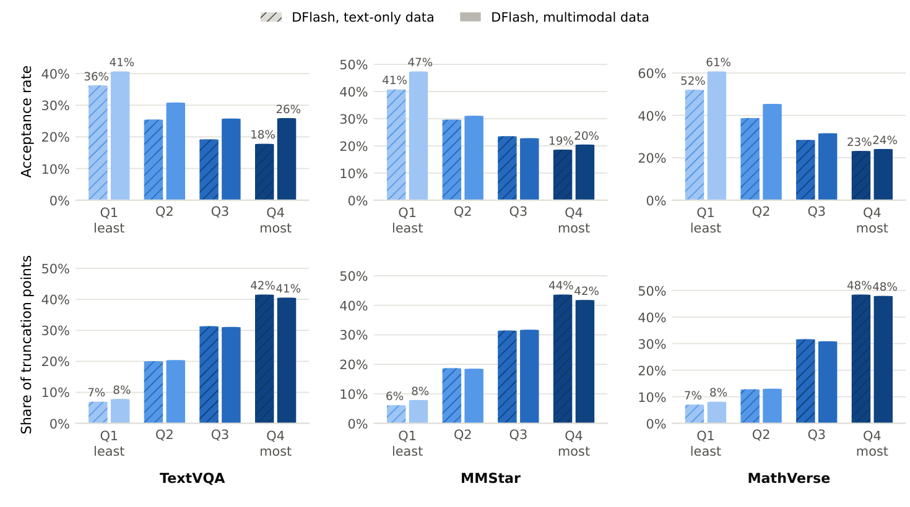
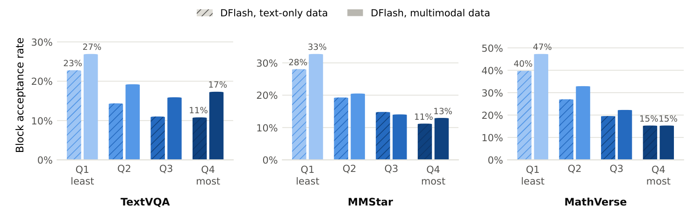
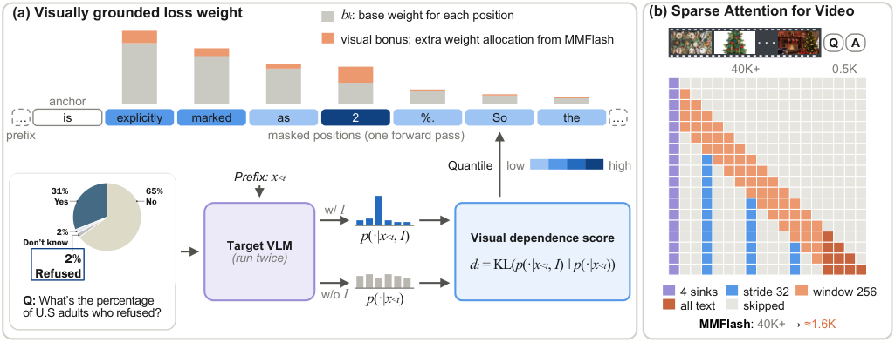
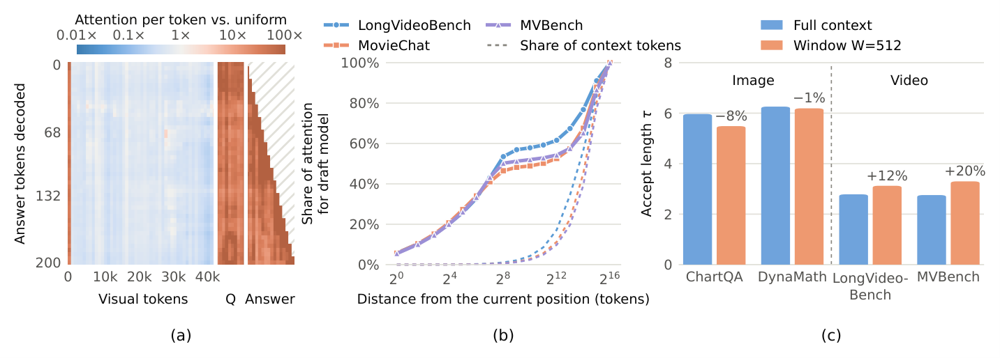
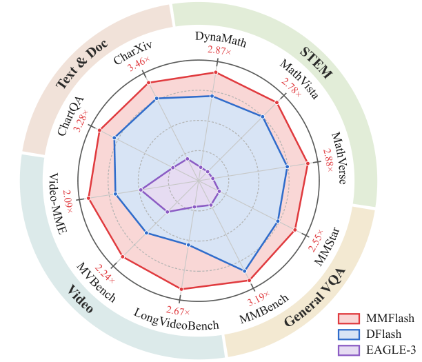

# MMFlash：视觉感知加权加速 VLM 投机解码

视觉语言模型（VLM）在生成图表答案、视觉推理结果和视频理解内容时，仍受自回归逐 token 解码的速度限制。MMFlash 要解决的关键问题是：扩散草稿模型虽然能一次提出整块 token，却特别容易在“必须看图才能确定”的位置被目标模型拒绝。它的核心思路是在训练时自适应加重这些视觉依赖且尚未学好的 token，并为长视频引入稀疏 Attention；整个过程仍由目标模型验证，因此不改变输出分布。实验中，MMFlash 在七个图像基准上的平均无损加速达到 **3.00–3.05×**，单任务最高达到 **3.58×**；在三个长视频基准上，结合稀疏 Attention 和轻量微调后平均加速达到 **2.33–2.71×**。

## 从逐 token 草稿到整块生成：MMFlash 站在什么基础上

投机解码可以理解成“先让轻量助手写草稿，再让大模型集中审稿”。草稿模型（drafter）连续提出候选 token，目标模型通过一次并行前向计算完成验证；只有符合目标模型解码策略的结果才被保留，因此加速是无损的。

这条路径的收益由两个因素共同决定：

- **草稿质量**：目标模型接受的 token 越多，每轮有效推进越远。
- **草稿成本**：如果生成草稿本身就要反复运行模型，节省的时间会被重新花掉。

Medusa 使用多个辅助解码头，EAGLE 系列利用目标模型特征并进行树结构验证，但它们仍带有自回归草稿的顺序开销。DFlash 则把 Diffusion Language Model（DLM，扩散语言模型）的并行去噪引入草稿阶段：一次前向计算就生成一个完整 block，使草稿 token 数不再等于顺序前向次数，也允许把省下的预算用于更深、更强的 drafter。

具体来说，DFlash 每次处理长度为 $B$ 的 block：第一个位置是锚点 token，后 $B-1$ 个位置初始为 mask，再并行填充。训练时，$z_k^\star$ 表示目标模型在第 $k$ 个 mask 位置选择的 token，$q_k$ 是 drafter 赋予它的概率。其损失为：

$$
\mathcal{L}_{\mathrm{DFlash}} = \sum_{k=1}^{B-1} w_k(-\log q_k),
\qquad
w_k = \exp\left(-\frac{k-1}{\gamma}\right)
$$

位置越靠后，权重越小，因为验证只接受 block 的连续前缀：一旦第 $k$ 个位置被拒绝，后面的候选都会丢弃。这个设计符合验证机制，但它只看位置，不看 token 是否需要视觉信息——这正是 MMFlash 要补上的一块。

在 VLM 上，已有方法处理视觉输入的方式大致有三类：把完整视觉 token 交给 drafter、只提供蒸馏后的视觉信息，或完全移除 drafter 的视觉 token。MMFlash 采用第三类。目标模型在 prefill 阶段已经把视觉内容融合进 hidden states，drafter 直接读取这些特征即可，无须重新编码图像，计算量也不再随视觉 token 数增长。

## 先找到失速点：越依赖图像，草稿越容易被拒绝

把 DFlash 直接迁移到多模态任务之前，作者先问了一个很具体的问题：草稿错误是否均匀分布在所有 token 上，还是集中在“不看图就答不对”的位置？

### 用目标模型自身定义视觉依赖

对同一个文本前缀，目标模型分别在有图像 $I$ 和无图像的条件下运行一次。两个 next-token 分布之间的 KL 散度，被定义为该 token 的视觉依赖分数：

$$
d = \mathrm{KL}\left(p(\cdot\mid \mathrm{prefix},I)\,\|\,p(\cdot\mid \mathrm{prefix})\right)
$$

如果移除图像后分布几乎不变，说明该位置主要靠语言上下文就能预测；如果分布变化很大，说明图像对目标模型的选择至关重要。这个指标直接来自被模仿的目标模型，比观察 drafter 的 Attention 更贴近“草稿能否被接受”这一目标。

实验使用 Qwen3.5-4B，并比较两个 DFlash drafter：官方纯文本训练版本，以及按官方配方在约 90 万多模态样本上训练的版本。每个基准随机抽取 200 个样本，每个样本最多选取 128 个锚点位置，再按视觉依赖把 token 分成 Q1 到 Q4 四个分位组，Q4 的视觉依赖最强。

> 图解：上排展示不同视觉依赖分位组中的 drafted token 接受率，下排展示各组包含的 block 截断点比例，截断点就是 block 内第一个与目标模型预测不一致的位置。跨基准、跨 drafter 的趋势一致：从 Q1 到 Q4，接受率持续下降，截断点则不断向高视觉依赖区域集中。

平均来看，接受率从 Q1 的 **46%** 降至 Q4 的 **22%**，相差 **2.1×**；Q4 集中了 **44%** 的截断点，而 Q1 只有 **7%**，Q3 与 Q4 合计占 **72%–80%**。更重要的是，仅仅换用多模态数据训练，并没有消除这道鸿沟。

附录进一步把分析粒度从 token 扩展到 block，并按 block 第一个预测 token 的视觉依赖分组。

> 图解：图中比较三个基准上不同 drafter 的 block 接受率，横轴按首个预测 token 的视觉依赖从 Q1 到 Q4 排列。平均 block 接受率从 Q1 的 **33%** 降到 Q4 的 **14%**，差距扩大为 **2.4×**。多模态训练在 Q1 带来约 5 个百分点的提升，在 Q4 却不足 3 个百分点，再次说明短板集中在高视觉依赖 token。

这组诊断把问题定位得很清楚：不是 drafter 完全学不会多模态，而是均匀训练把大量容量花在了已经容易预测的语言延续上，却没有重点攻克真正决定接受长度的视觉位置。

## MMFlash：把诊断信号变成动态训练权重

MMFlash 的基本做法不是另造一套复杂网络，而是重写 DFlash 的训练权重：视觉越重要、目标答案越明确、drafter 当前越容易出错的位置，获得的额外训练权重越大；学会之后，额外权重自动退场。

> 图解：图（a）中，目标 VLM 对同一前缀分别执行有图和无图前向计算，以两个 next-token 分布的 KL 散度得到视觉依赖 $d_t$；block 内每个 mask 位置保留基础权重 $b_k$，再获得由 $d_t$ 和当前预测误差决定的视觉奖励。图（b）展示视频场景的稀疏 Attention：保留关键文本和局部上下文，并抽样视觉 token，把超过 40K 的上下文压缩到约 1.6K。

### 先归一化，再用目标置信度门控

原始 KL 值无上界且呈重尾分布，不适合直接作为权重。作者因此用全训练语料 $\mathcal{D}$ 中的秩，把 $d_t$ 映射到 $[0,1]$：

$$
\tilde g_t = F_{\mathcal{D}}(d_t)
= \frac{1}{|\mathcal{D}|}\sum_{t'\in\mathcal{D}}\mathbf{1}[d_{t'}\le d_t]
$$

四个分位组分别对应 $\tilde g_t\in[0,0.25)$、$[0.25,0.5)$、$[0.5,0.75)$ 和 $[0.75,1]$。这种归一化不依赖 KL 的具体分布形态，不同数据集之间也更容易统一处理。

不过，“图像改变了预测”并不等于“目标模型给出了明确答案”。如果有图分布仍然很平坦，目标模型只是从多个近似并列的候选中选择一个，drafter 即使加大训练权重，也很难稳定复现这个选择。因此，作者用有图分布的熵 $H_t$ 衡量不确定性，并构造门控后的视觉 grounding 分数：

$$
g_t = \tilde g_t \cdot \exp(-H_t)
$$

$g_t$ 最高的地方同时满足两个条件：图像显著影响预测，而且目标模型对预测足够确信。这里才是额外训练最有可能转化为接受率的位置。

### 三项因子共同决定训练权重

MMFlash 最终使用下面的目标函数：

$$
w_k = b_k\left(1+\alpha g_k\left(1-\operatorname{sg}(q_k)\right)\right)
$$

$$
\mathcal{L}_{\mathrm{MMFlash}} = \sum_{k=1}^{B-1} w_k(-\log q_k)
$$

其中 $\operatorname{sg}(\cdot)$ 表示 stop-gradient，即权重中的 $q_k$ 只作为统计量，不参与反向传播。三个组成部分分别回答三个问题：

1. **这个位置在验证时是否重要？**  
   $b_k$ 是验证感知的位置权重。由于只有连续前缀会被接受，第 $k$ 个位置要有贡献，前面的位置也必须通过。作者用 drafter 的置信度估计这条“生存链”：

  $$
  b_k = \prod_{i=1}^{k}\bar q_i,
  \qquad
  \bar q_i = (1-\lambda)\operatorname{sg}(q_i)+\lambda
  $$

  平滑系数 $\lambda\in[0,1]$ 保证每个因子至少为 $\lambda$，避免一次低置信度预测把后续所有位置的梯度完全归零。

2. **这个目标 token 是否值得额外投入？**  
   $g_k$ 提供静态视觉权重，把容量优先分配给视觉依赖强且目标明确的 token。

3. **drafter 现在是否还没学会它？**  
   $1-\operatorname{sg}(q_k)$ 是动态误差项。预测越差，额外权重越大；随着 $q_k$ 接近 1，奖励逐渐消失，训练重点自然转向其他未掌握的位置。

默认设置为 $\lambda=0.5$、$\alpha=1$。视觉依赖分数可在训练前离线计算并随数据保存，因此不会增加训练阶段的额外前向开销。

这个设计聪明之处在于，它没有把“视觉 token 更重要”做成永久偏置，而是把它与当前错误概率相乘。这样既补足视觉短板，又避免后期过拟合视觉位置、反过来牺牲普通文本 token。

## 长视频的另一道瓶颈：上下文很长，有效 Attention 却很稀疏

图像基准的平均输入长度只有 477 tokens，而视频基准达到 41,218 tokens。DFlash 类 drafter 每一步都关注完整目标上下文，视频场景下这会带来越来越高的冗余计算。

作者先分析已经训练好的 MMFlash drafter，而不是直接假定局部窗口一定有效。

> 图解：图（a）展示一个 LongVideoBench 问题中，不同解码步骤对各上下文位置的 Attention，数值相对于均匀分配进行衡量；问题与已生成答案附近更集中，视觉 token 上则较分散。图（b）的实线表示距当前位置一定范围内的累计 Attention 占比，虚线表示对应上下文 token 占比。图（c）比较完整草稿上下文与最近 512 位置窗口下的接受长度：窗口会损害图像任务，却能改善视频任务。

最近的 256 个位置只占上下文 **0.8%**，却获得 **50.1%** 的 Attention；远处帧占上下文超过 **96%**，合计获得 **46%** Attention，但单个 token 获得的关注很少。这说明长视频上下文既存在明显局部性，也包含大量冗余视觉信息。

简单局部窗口可能丢掉回答问题所需的远处画面，因此 MMFlash 使用一种更有针对性的稀疏模式：

- 保留最前面的 **4 个 sink tokens**；
- 以 **32 为步长**抽样视觉 token；
- 保留 **全部文本 token**，确保问题和文本上下文完整可见；
- 保留最近 **256 个 token** 的局部窗口。

训练和推理使用同一套稀疏模式，避免上下文访问方式不一致。它并没有为每一帧学习复杂选择器，而是用很低的实现成本同时保留全局文本、稀疏视觉证据和局部生成状态。

## 实验设置：公平比较草稿质量与真实解码速度

### 数据与训练

作者从 LLaVA-OV-1.5-Instruct-Data 收集 100 万样本，用目标模型重新生成回答以对齐目标分布；移除总序列超过 4,096 tokens 的样本后，保留约 90 万条。目标模型生成时使用贪心解码、关闭 thinking mode，最多生成 4,096 个新 token。

主要实验以 Qwen3.5-4B 和 Qwen3.5-9B 为目标模型。默认 drafter 有 5 层，读取目标模型 5 层的 hidden states，block size 为 16，每个样本最多使用 512 个锚点；batch size 为 2，训练 6 个 epoch。学习率为 $6.0\times10^{-4}$，前 4% steps 线性 warmup，随后按 cosine schedule 衰减到零。训练使用 8 张 NVIDIA H100。

### 基线与推理配置

- **MTP**：Qwen3.5 原生支持的 Multi-Token Prediction 模块，比较不同 draft steps。
- **EAGLE-3**：树验证投机解码方法，使用与 MMFlash 相同的数据训练。
- **DFlash-z**：官方发布的纯文本 drafter，6 层，读取目标模型 8 层特征。
- **DFlash**：按官方设置在与 MMFlash 相同的数据上训练，5 层、5 个目标层特征，保证公平比较。
- **MMFlash**：与重训练 DFlash 保持无关超参数一致，只引入本文设计和必要的视频处理。

所有方法均设置 top-$p=0.95$、top-$k=20$，分别测试 $T=0$ 和 $T=1$。主实验 block size 为 16、并发数为 1，在单张 NVIDIA H200 上通过 SGLang 测量。

评估覆盖 ChartQA、CharXiv、MMStar、MMBench、DynaMath、MathVista、MathVerse 七个图像基准，以及 LongVideoBench、MVBench、Video-MME 三个视频基准。每个基准使用相同的 200 个随机样本。下文 $\tau$ 表示平均接受长度，Speedup 表示相对未使用投机解码 baseline 的解码加速比。

## 主结果：接受长度和实际速度同时领先

下图先从整体视角比较 MMFlash、EAGLE-3 与 DFlash 在 SGLang 上的解码加速。

> 图解：雷达图汇总 MMFlash 与 EAGLE-3、DFlash 在各项评估上的解码 Speedup，用来直观展示不同设置下的整体覆盖情况。精确数值以随后表格为准；MMFlash 的优势并非只来自某一个任务，而是在模型规模、采样温度和任务类型变化后仍然保持。

主表括号中的数字分别表示 MTP 的 draft steps、EAGLE-3 的 draft tree size，以及 DFlash/MMFlash 的 diffusion block size。为便于阅读，以下每个单元格均按“$\tau$ / Speedup”排列。

### 贪心解码：$T=0$

| 模型 | 方法 | ChartQA | CharXiv | MMStar | MMBench | DynaMath | MathVista | MathVerse | 平均 |
|---|---|---|---|---|---|---|---|---|---|
| Qwen3.5-4B | MTP (3) | 3.18 / 1.69× | 3.27 / 1.76× | 2.95 / 1.61× | 2.43 / 1.40× | 3.27 / 1.69× | 3.18 / 1.68× | 3.17 / 1.69× | 3.06 / 1.64× |
| Qwen3.5-4B | MTP (7) | 4.26 / 1.68× | 4.64 / 1.87× | 3.75 / 1.57× | 2.58 / 1.24× | 4.42 / 1.69× | 4.29 / 1.67× | 4.27 / 1.69× | 4.03 / 1.63× |
| Qwen3.5-4B | MTP (15) | 4.67 / 1.26× | 5.37 / 1.43× | 3.99 / 1.14× | 2.60 / 0.87× | 4.76 / 1.23× | 4.65 / 1.21× | 4.61 / 1.22× | 4.38 / 1.19× |
| Qwen3.5-4B | EAGLE-3 (16) | 4.31 / 1.74× | 4.38 / 1.86× | 3.49 / 1.49× | 2.61 / 1.08× | 4.29 / 1.67× | 4.02 / 1.56× | 3.95 / 1.68× | 3.86 / 1.58× |
| Qwen3.5-4B | DFlash-z (16) | 4.92 / 2.76× | 5.63 / 3.10× | 3.81 / 2.35× | 5.01 / 2.62× | 4.82 / 2.56× | 4.43 / 2.45× | 4.34 / 2.50× | 4.71 / 2.62× |
| Qwen3.5-4B | DFlash (16) | 5.43 / 2.97× | 5.60 / 3.13× | 4.05 / 2.31× | 5.17 / 2.93× | 5.57 / 2.57× | 5.16 / 2.53× | 4.84 / 2.62× | 5.12 / 2.72× |
| Qwen3.5-4B | **MMFlash (16)** | **5.97 / 3.28×** | **6.17 / 3.46×** | **4.49 / 2.55×** | **5.68 / 3.19×** | **6.26 / 2.87×** | **6.00 / 2.78×** | **5.35 / 2.88×** | **5.70 / 3.00×** |
| Qwen3.5-9B | MTP (3) | 3.32 / 1.83× | 3.28 / 1.87× | 3.01 / 1.73× | 2.88 / 1.57× | 3.38 / 1.80× | 3.26 / 1.80× | 3.24 / 1.80× | 3.20 / 1.77× |
| Qwen3.5-9B | MTP (7) | 4.66 / 1.88× | 4.60 / 1.94× | 3.91 / 1.66× | 3.55 / 1.41× | 4.74 / 1.77× | 4.52 / 1.78× | 4.43 / 1.77× | 4.34 / 1.74× |
| Qwen3.5-9B | MTP (15) | 5.27 / 1.38× | 5.27 / 1.47× | 4.20 / 1.18× | 3.75 / 0.99× | 5.25 / 1.30× | 5.08 / 1.32× | 4.90 / 1.30× | 4.81 / 1.27× |
| Qwen3.5-9B | EAGLE-3 (16) | 3.93 / 1.81× | 3.85 / 1.93× | 3.06 / 1.55× | 2.72 / 1.32× | 3.60 / 1.76× | 3.50 / 1.63× | 3.48 / 1.75× | 3.45 / 1.68× |
| Qwen3.5-9B | DFlash-z (16) | 5.22 / 3.03× | 5.27 / 3.15× | 3.93 / 2.46× | 3.67 / 2.11× | 4.96 / 2.75× | 4.77 / 2.75× | 4.52 / 2.67× | 4.62 / 2.70× |
| Qwen3.5-9B | DFlash (16) | 5.59 / 3.20× | 5.17 / 3.09× | 4.15 / 2.46× | 3.79 / 2.20× | 5.62 / 2.71× | 5.38 / 2.83× | 4.92 / 2.79× | 4.95 / 2.75× |
| Qwen3.5-9B | **MMFlash (16)** | **6.19 / 3.58×** | **5.67 / 3.42×** | **4.58 / 2.67×** | **4.20 / 2.39×** | **6.44 / 3.02×** | **6.49 / 3.17×** | **5.60 / 3.10×** | **5.60 / 3.05×** |

### 采样解码：$T=1$

| 模型 | 方法 | ChartQA | CharXiv | MMStar | MMBench | DynaMath | MathVista | MathVerse | 平均 |
|---|---|---|---|---|---|---|---|---|---|
| Qwen3.5-4B | MTP (3) | 3.04 / 1.58× | 3.07 / 1.60× | 2.74 / 1.48× | 2.41 / 1.34× | 3.17 / 1.59× | 3.00 / 1.54× | 3.00 / 1.57× | 2.92 / 1.53× |
| Qwen3.5-4B | MTP (7) | 3.93 / 1.53× | 4.26 / 1.68× | 3.41 / 1.40× | 2.58 / 1.14× | 4.22 / 1.55× | 3.97 / 1.49× | 3.91 / 1.52× | 3.75 / 1.48× |
| Qwen3.5-4B | MTP (15) | 4.33 / 1.14× | 4.76 / 1.24× | 3.57 / 0.99× | 2.62 / 0.86× | 4.55 / 1.14× | 4.33 / 1.08× | 4.22 / 1.11× | 4.06 / 1.08× |
| Qwen3.5-4B | EAGLE-3 (16) | 3.97 / 1.59× | 3.97 / 1.60× | 3.23 / 1.38× | 2.60 / 1.01× | 4.09 / 1.49× | 3.87 / 1.45× | 3.68 / 1.53× | 3.63 / 1.44× |
| Qwen3.5-4B | DFlash-z (16) | 4.49 / 2.42× | 5.00 / 2.66× | 3.43 / 2.06× | 4.81 / 2.12× | 4.64 / 2.41× | 4.14 / 2.19× | 4.01 / 2.28× | 4.36 / 2.30× |
| Qwen3.5-4B | DFlash (16) | 4.87 / 2.56× | 4.95 / 2.66× | 3.71 / 2.04× | 4.92 / 2.48× | 5.07 / 2.31× | 4.66 / 2.22× | 4.47 / 2.37× | 4.67 / 2.38× |
| Qwen3.5-4B | **MMFlash (16)** | **5.23 / 2.74×** | **5.39 / 2.86×** | **3.96 / 2.18×** | **5.25 / 2.58×** | **5.75 / 2.56×** | **5.23 / 2.37×** | **4.69 / 2.49×** | **5.07 / 2.54×** |
| Qwen3.5-9B | MTP (3) | 3.19 / 1.72× | 3.08 / 1.72× | 2.86 / 1.61× | 2.78 / 1.49× | 3.25 / 1.70× | 3.11 / 1.69× | 3.11 / 1.71× | 3.05 / 1.66× |
| Qwen3.5-9B | MTP (7) | 4.35 / 1.72× | 4.15 / 1.71× | 3.60 / 1.49× | 3.37 / 1.34× | 4.46 / 1.64× | 4.26 / 1.65× | 4.17 / 1.66× | 4.05 / 1.60× |
| Qwen3.5-9B | MTP (15) | 4.84 / 1.24× | 4.57 / 1.27× | 3.81 / 1.06× | 3.53 / 0.93× | 4.92 / 1.22× | 4.65 / 1.18× | 4.56 / 1.21× | 4.41 / 1.16× |
| Qwen3.5-9B | EAGLE-3 (16) | 3.60 / 1.67× | 3.56 / 1.72× | 2.84 / 1.42× | 2.59 / 1.23× | 3.46 / 1.61× | 3.32 / 1.50× | 3.29 / 1.62× | 3.24 / 1.54× |
| Qwen3.5-9B | DFlash-z (16) | 4.77 / 2.64× | 4.70 / 2.76× | 3.66 / 2.25× | 3.42 / 1.97× | 4.71 / 2.57× | 4.49 / 2.51× | 4.26 / 2.49× | 4.29 / 2.46× |
| Qwen3.5-9B | DFlash (16) | 4.94 / 2.75× | 4.50 / 2.65× | 3.74 / 2.18× | 3.55 / 2.02× | 5.24 / 2.52× | 4.85 / 2.52× | 4.53 / 2.57× | 4.48 / 2.46× |
| Qwen3.5-9B | **MMFlash (16)** | **5.54 / 3.22×** | **4.85 / 2.85×** | **4.13 / 2.37×** | **3.82 / 2.17×** | **6.07 / 2.77×** | **5.71 / 2.74×** | **5.10 / 2.81×** | **5.03 / 2.70×** |

MMFlash 在所有模型、基准和温度组合上，都取得了最高接受长度和最高 Speedup。$T=0$ 时，两种模型的平均加速分别为 **3.00×** 和 **3.05×**，比 DFlash 高 **10.3%–10.9%**；$T=1$ 时平均为 **2.54×–2.70×**，相对 DFlash 的提升为 **6.7%–9.8%**。论文汇总报告的最高单任务加速为 3.58×，相对 EAGLE-3 和 DFlash 的最高提升分别达到 195.4% 和 17.1%。

另一个值得注意的现象是，MTP 增加 draft steps 并不必然提速。例如 MTP (15) 虽然接受长度上升，但顺序草稿成本也增加，部分任务甚至低于 baseline。MMFlash 的整块并行生成正好避开了这个矛盾。

## 视频结果：稀疏 Attention 与少量微调形成互补

视频实验先直接把图像上训练的 drafter 迁移过来，再加入稀疏 Attention，最后在 LLaVA-Video-178K 的 2K 样本上微调 3 个 epoch。以下每个单元格仍为“$\tau$ / Speedup”，各基准标题下给出平均上下文长度。

| 模型 | 方法 | LongVideoBench（约41.6K） | MVBench（约42.3K） | Video-MME（约39.8K） |
|---|---|---|---|---|
| Qwen3.5-4B | MTP (15) | 3.99 / 1.31× | 3.80 / 1.09× | **3.50 / 1.00×** |
| Qwen3.5-4B | EAGLE-3 (4) | 2.04 / 1.63× | 1.91 / 1.45× | 1.92 / 1.43× |
| Qwen3.5-4B | DFlash (16) | 3.14 / 2.11× | 3.01 / 1.82× | 2.81 / 1.75× |
| Qwen3.5-4B | MMFlash (16) | 3.23 / 2.23× | 2.91 / 1.83× | 2.86 / 1.82× |
| Qwen3.5-4B | + sparse attn. | 3.81 / 2.44× | 3.50 / 2.05× | 3.20 / 1.93× |
| Qwen3.5-4B | + fine-tuning | **4.09 / 2.67×** | **3.83 / 2.24×** | 3.45 / **2.09×** |
| Qwen3.5-9B | MTP (15) | 4.07 / 1.34× | **3.94** / 1.26× | **3.73** / 1.10× |
| Qwen3.5-9B | EAGLE-3 (4) | 1.88 / 1.29× | 1.67 / 1.06× | 1.79 / 1.25× |
| Qwen3.5-9B | DFlash (16) | 3.56 / 2.71× | 3.19 / 2.37× | 3.21 / 2.22× |
| Qwen3.5-9B | MMFlash (16) | 3.63 / 2.79× | 3.23 / 2.42× | 3.28 / 2.27× |
| Qwen3.5-9B | + sparse attn. | 3.81 / 2.81× | 3.46 / 2.49× | 3.42 / 2.21× |
| Qwen3.5-9B | + fine-tuning | **4.16 / 3.07×** | 3.74 / **2.66×** | 3.63 / **2.39×** |

只加入稀疏 Attention、不额外训练，平均接受长度就提高 **11.1%**，Speedup 提高 **4.7%**；加入轻量视频微调后，两项增幅分别达到 **20.0%** 和 **13.7%**。最终三种视频任务上的平均 Speedup 为 **2.33×–2.71×**，比 DFlash 高 **11.2%–23.2%**。

这里不能简单把稀疏化理解成“少看所以更快”。它还改善了接受长度，说明减少冗余视觉上下文本身有助于小型 drafter 聚焦有效信息；微调则进一步让模型适应训练与推理中的视频上下文分布。

## 跨模型泛化：不是只适配 Qwen3.5

作者进一步在 Gemma4-E4B-it 和 Qwen3.8-27B 上训练并测试 drafter，EAGLE-3 与 MMFlash 使用相同的目标模型再生成数据。

| 模型 | 方法 | ChartQA（$\tau$ / Speedup） | MMStar（$\tau$ / Speedup） | DynaMath（$\tau$ / Speedup） |
|---|---|---|---|---|
| Gemma4-E4B-it | MTP (5, official) | 3.81 / 1.78× | 3.19 / 1.48× | 4.04 / 1.89× |
| Gemma4-E4B-it | MTP (15) | 4.73 / 1.66× | 3.74 / 1.33× | 5.17 / 1.75× |
| Gemma4-E4B-it | EAGLE-3 (16) | 4.87 / 2.27× | 4.04 / 1.50× | 6.23 / 1.90× |
| Gemma4-E4B-it | **MMFlash (16)** | **6.39 / 2.87×** | **4.83 / 2.10×** | **7.15 / 3.02×** |
| Qwen3.8-27B | MTP (7) | 5.19 / 2.90× | 4.55 / 2.59× | 5.48 / 3.07× |
| Qwen3.8-27B | MTP (15) | 6.36 / 2.47× | 5.25 / 2.16× | 6.63 / 2.68× |
| Qwen3.8-27B | **MMFlash (16)** | **6.37 / 4.18×** | **5.36 / 3.54×** | **7.57 / 4.71×** |

Gemma 上的 Speedup 为 **2.10×–3.02×**，Qwen3.8-27B 上达到 **3.54×–4.71×**。这表明视觉感知加权和扩散 block 草稿并不依赖某一个目标模型家族，而且在更大目标模型上仍有明显的加速空间。

## 诊断实验：并发、block 大小与 drafter 容量如何影响收益

主结果证明方法有效之后，还需要回答部署时更现实的问题：服务并发升高后还能不能提速？训练与测试 block 不一致是否会失效？更大的 drafter 和更多目标层特征值不值得？

### 高并发下的 SGLang 吞吐

下表每个并发单元格显示 decode throughput（tok/s）；MMFlash 行在括号中同时给出相对同并发 baseline 的 Speedup。平均 $\tau$ 单独列在末尾。

| 模型 | 任务 | 方法 | 并发1 | 并发4 | 并发8 | 并发16 | 并发32 | 平均 $\tau$ |
|---|---|---|---|---|---|---|---|---|
| Qwen3.5-4B | CharXiv | Baseline | 238 | 794 | 1,306 | 2,094 | 2,733 | — |
| Qwen3.5-4B | CharXiv | MMFlash | 826（3.46×） | 2,054（2.59×） | 3,102（2.37×） | 3,943（1.88×） | 4,395（1.61×） | 6.23 |
| Qwen3.5-4B | MMBench | Baseline | 242 | 453 | 672 | 1,141 | 1,748 | — |
| Qwen3.5-4B | MMBench | MMFlash | 772（3.19×） | 1,032（2.28×） | 1,451（2.16×） | 1,929（1.69×） | 2,364（1.35×） | 5.69 |
| Qwen3.5-4B | DynaMath | Baseline | 239 | 836 | 1,456 | 2,276 | 3,440 | — |
| Qwen3.5-4B | DynaMath | MMFlash | 685（2.87×） | 1,991（2.38×） | 3,081（2.12×） | 4,066（1.79×） | 4,643（1.35×） | 6.27 |
| Qwen3.5-9B | ChartQA | Baseline | 174 | 633 | 1,048 | 1,694 | 1,952 | — |
| Qwen3.5-9B | ChartQA | MMFlash | 623（3.58×） | 1,732（2.73×） | 2,438（2.33×） | 3,080（1.82×） | 3,685（1.89×） | 6.21 |
| Qwen3.5-9B | MMStar | Baseline | 172 | 633 | 1,064 | 1,697 | 2,462 | — |
| Qwen3.5-9B | MMStar | MMFlash | 460（2.67×） | 1,380（2.18×） | 1,964（1.85×） | 2,511（1.48×） | 2,814（1.14×） | 4.59 |
| Qwen3.5-9B | DynaMath | Baseline | 172 | 655 | 1,155 | 1,884 | 2,665 | — |
| Qwen3.5-9B | DynaMath | MMFlash | 520（3.02×） | 1,645（2.51×） | 2,541（2.20×） | 3,308（1.76×） | 3,792（1.42×） | 6.49 |

并发从 1 增至 32 时，所有任务仍保持加速。随着系统转向 compute-bound，Speedup 总体收窄，但在并发 16 时，MMFlash 在六个任务上的吞吐都高于 baseline 在并发 32 时的吞吐。这说明收益并非只在单请求、低负载环境中存在。

### vLLM 上的并发验证

作者还在 vLLM 的 FlashAttention backend 上重复实验，保持 benchmark、prompt、生成长度上限和 drafter 不变，由 vLLM 内置 DFlash speculator 提供草稿服务。

| 模型 | 任务 | 方法 | 并发1 | 并发4 | 并发8 | 并发16 | 并发32 | 平均 $\tau$ |
|---|---|---|---|---|---|---|---|---|
| Qwen3.5-4B | CharXiv | Baseline | 284 | 1,022 | 1,783 | 2,690 | 3,772 | — |
| Qwen3.5-4B | CharXiv | MMFlash | 907（3.19×） | 2,555（2.50×） | 3,634（2.04×） | 4,590（1.71×） | 5,514（1.46×） | 6.17 |
| Qwen3.5-4B | MMBench | Baseline | 274 | 479 | 705 | 1,051 | 1,768 | — |
| Qwen3.5-4B | MMBench | MMFlash | 923（3.37×） | 836（1.75×） | 1,347（1.91×） | 1,717（1.63×） | 2,859（1.62×） | 5.74 |
| Qwen3.5-4B | DynaMath | Baseline | 295 | 1,052 | 1,829 | 3,199 | 4,159 | — |
| Qwen3.5-4B | DynaMath | MMFlash | 821（2.78×） | 2,430（2.31×） | 3,685（2.02×） | 4,705（1.47×） | 5,323（1.28×） | 6.27 |
| Qwen3.5-9B | ChartQA | Baseline | 188 | 648 | 1,241 | 1,911 | 2,133 | — |
| Qwen3.5-9B | ChartQA | MMFlash | 701（3.72×） | 1,975（3.05×） | 2,795（2.25×） | 3,318（1.74×） | 3,500（1.64×） | 6.17 |
| Qwen3.5-9B | MMStar | Baseline | 190 | 700 | 1,253 | 2,080 | 3,076 | — |
| Qwen3.5-9B | MMStar | MMFlash | 529（2.79×） | 1,663（2.38×） | 2,461（1.96×） | 2,893（1.39×） | 3,606（1.17×） | 4.59 |
| Qwen3.5-9B | DynaMath | Baseline | 189 | 708 | 1,272 | 2,128 | 3,127 | — |
| Qwen3.5-9B | DynaMath | MMFlash | 602（3.18×） | 1,860（2.63×） | 2,810（2.21×） | 3,604（1.69×） | 4,001（1.28×） | 6.57 |

vLLM 上所有并发也都有效，Speedup 范围为 **1.17×–3.72×**，接受长度与 SGLang 接近。Qwen3.5-4B 的加速比通常较低，原因不是 MMFlash 在 vLLM 上退化，而是 vLLM 对 baseline 的改善更明显：相对 SGLang，baseline 吞吐提高 21%–38%，MMFlash 提高 17%–28%。Qwen3.5-9B 在低并发下则是 MMFlash 获益更多，因此并发 1 和 4 的 Speedup 高于 SGLang。

### 测试时 block size：16 最优，缩小时仍有韧性

所有 drafter 都以 block size 16 训练，只在测试时比较 8 和 16。每格为“$\tau$ / Speedup”。

| 模型 | 测试 block size | ChartQA | CharXiv | MMStar | MMBench | DynaMath | MathVista | MathVerse | 平均 |
|---|---|---|---|---|---|---|---|---|---|
| Qwen3.5-4B | 8 | 4.70 / 3.01× | 4.77 / 3.13× | 3.80 / 2.49× | 4.52 / 2.89× | 4.92 / 2.80× | 4.68 / 2.74× | 4.43 / 2.83× | 4.55 / 2.84× |
| Qwen3.5-4B | 16 | 5.97 / 3.28× | 6.17 / 3.46× | 4.49 / 2.55× | 5.68 / 3.19× | 6.26 / 2.87× | 6.00 / 2.78× | 5.35 / 2.88× | 5.70 / 3.00× |
| Qwen3.5-9B | 8 | 5.07 / 3.22× | 4.72 / 3.17× | 4.01 / 2.65× | 3.77 / 2.30× | 5.18 / 2.94× | 5.02 / 2.96× | 4.68 / 2.95× | 4.64 / 2.89× |
| Qwen3.5-9B | 16 | 6.19 / 3.58× | 5.67 / 3.42× | 4.58 / 2.67× | 4.20 / 2.39× | 6.44 / 3.02× | 6.49 / 3.17× | 5.60 / 3.10× | 5.60 / 3.05× |

把 block 从 16 缩至 8，平均接受长度下降 **18.7%**，因为单个 block 能接受的 token 数被直接截短；但平均 Speedup 只下降 **5.3%**，仍超过主表中的所有基线。ChartQA 和 CharXiv 上分别有 **28.8%** 和 **27.6%** 的 block 达到长度 8 的接受上限，说明较小 block 没有充分利用 drafter。这个结果也为部署时动态调整 block size 留出了空间。

### Drafter 深度：接受率继续涨，速度收益却会饱和

下面分别在 $T=0$ 和 $T=1$ 下比较 3、5、8 层 drafter。所有模型都以 block size 16 训练，并读取 5 个目标层的 hidden states。

**$T=0$：**

| 设置 | CharXiv（$\tau$ / Speedup） | MMBench（$\tau$ / Speedup） | DynaMath（$\tau$ / Speedup） |
|---|---|---|---|
| 3-L | 5.56 / 3.25× | 4.69 / 2.86× | 5.78 / 2.70× |
| 5-L | 6.17 / 3.46× | 5.68 / 3.19× | 6.26 / 2.87× |
| 8-L | 6.39 / 3.42× | 6.21 / 3.21× | 6.69 / 2.88× |

**$T=1$，top-$p=0.95$、top-$k=20$：**

| 设置 | CharXiv（$\tau$ / Speedup） | MMBench（$\tau$ / Speedup） | DynaMath（$\tau$ / Speedup） |
|---|---|---|---|
| 3-L | 4.91 / 2.59× | 4.50 / 2.48× | 5.34 / 2.43× |
| 5-L | 5.39 / 2.86× | 5.25 / 2.58× | 5.75 / 2.56× |
| 8-L | 5.59 / 2.83× | 5.88 / 2.67× | 5.94 / 2.54× |

从 3 层增至 8 层，$\tau$ 持续提高，说明 drafter 的能力可以随规模扩展。但更深的 drafter 每次草稿前向也更贵：从 3 到 5 层，平均 Speedup 提升 **6.7%–8.1%**；从 5 到 8 层，两种温度下的变化都不足 **1%**。因此默认 5 层是质量与成本之间更合理的折中。

### 读取多少目标层：更多语义信息不等于成比例提速

最后比较读取目标模型 5 层与 8 层 hidden states。drafter 均为 5 层，训练 block size 为 16。

**$T=0$：**

| 设置 | CharXiv（$\tau$ / Speedup） | MMBench（$\tau$ / Speedup） | DynaMath（$\tau$ / Speedup） |
|---|---|---|---|
| 5-H | 6.17 / 3.46× | 5.68 / 3.19× | 6.26 / 2.87× |
| 8-H | 6.18 / 3.47× | 6.01 / 3.20× | 6.37 / 2.88× |

**$T=1$：**

| 设置 | CharXiv（$\tau$ / Speedup） | MMBench（$\tau$ / Speedup） | DynaMath（$\tau$ / Speedup） |
|---|---|---|---|
| 5-H | 5.39 / 2.86× | 5.25 / 2.58× | 5.75 / 2.56× |
| 8-H | 5.40 / 2.86× | 5.40 / 2.59× | 5.83 / 2.57× |

从 5-H 增至 8-H，接受长度一致提升，说明更丰富的目标层语义确有帮助；但 Speedup 最多只增加 **0.01×**。与此同时，在线训练时间增加 **19.9%**，离线训练也需要保存更多特征，所以默认选择 5 个 taps。

## 复现细节：训练数据为什么要改写，在线训练为何更实际

附录中的训练数据处理对复现很关键。训练监督来自从回答 token 中采样的锚点及其后续 block，每个样本最多 512 个锚点。短回答只能产生很少的训练 block，却仍要承担图像和 prompt 的一次完整目标模型前向；回答短于 32 tokens 的样本会被直接丢弃。

多模态数据里大量 prompt 要求只回答一个单词、短语或选项字母。按原始 prompt 再生成时，**12.5%** 的回答不超过 8 tokens。作者因此把部分格式要求替换成“reason step by step”或“explain each option”，并对数学题、图表/文档/表格短答案问题追加类似指令；指定输出格式的任务、captioning/OCR 等生成任务和视频样本保持不变。

对 Qwen3.5-4B，共改写 **37.0%** 的 prompt。被替换答案格式要求的样本，其回答长度中位数从 **3 tokens** 增至 **130 tokens**；全训练集中不超过 8 tokens 的回答占比从 **12.5%** 降到 **1.0%**。这不是改变评测答案，而是提高每次目标模型前向所能产生的有效训练监督。

drafter 训练还需要目标模型 hidden states，有两种获取方式：

- **离线训练**：提前运行目标模型并保存 taps。特征只需计算一次，但存储随训练 token 数和读取层数增长，在本文数据规模上通常达到数十 TB。
- **在线训练**：每个 batch 同时运行目标模型和 drafter，实时计算并传递 hidden states。无须额外大规模存储，代价是每步都要运行目标模型并传输特征。

作者最终选择在线训练，以避免数十 TB 的特征存储开销。

## 总结与展望

- MMFlash 用有图与无图 next-token 分布的 KL 散度定位视觉依赖，发现 DFlash 的接受率从低视觉依赖组的 46% 降至高视觉依赖组的 22%。
- 核心创新是把位置衰减权重升级为“前缀生存概率 × 视觉重要性 × 当前预测误差”的动态加权，让 drafter 重点学习真正影响多模态接受长度的位置。
- 针对长视频，稀疏 Attention 保留 sink tokens、步长抽样的视觉 token、全部文本和局部窗口，同时降低冗余计算并改善草稿质量。
- 在七个图像基准上，MMFlash 的平均无损加速达到 3.00–3.05×；视频微调后平均为 2.33–2.71×，并在高并发、vLLM、Gemma 和 27B 模型上保持有效。
- 当前方法主要面向图像/视频输入、文本输出，视频部分仍依赖通用稀疏模式和轻量微调，长视频草稿也比图像更困难。

后续可以按问题选择视频视觉上下文、压缩跨帧冗余并开展帧级视觉依赖训练，也可把这一思想扩展到包含音频输入和流式语音输出的 omni-modal 模型。

> 本文参考自 [MMFlash: Faster Speculative Decoding for Vision-Language Models](https://arxiv.org/abs/2611.18482)