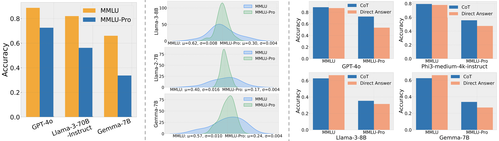
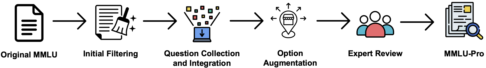
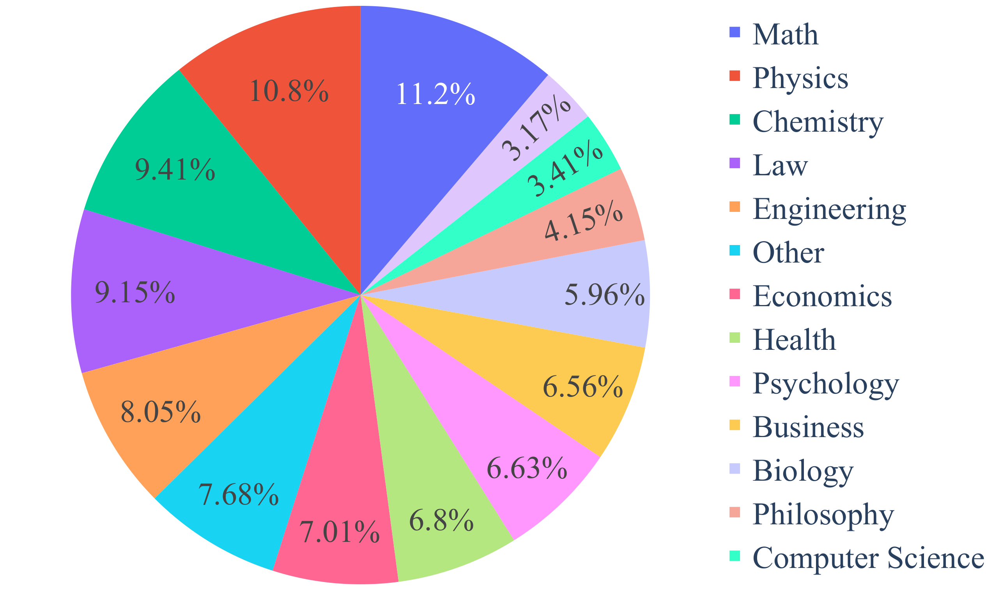
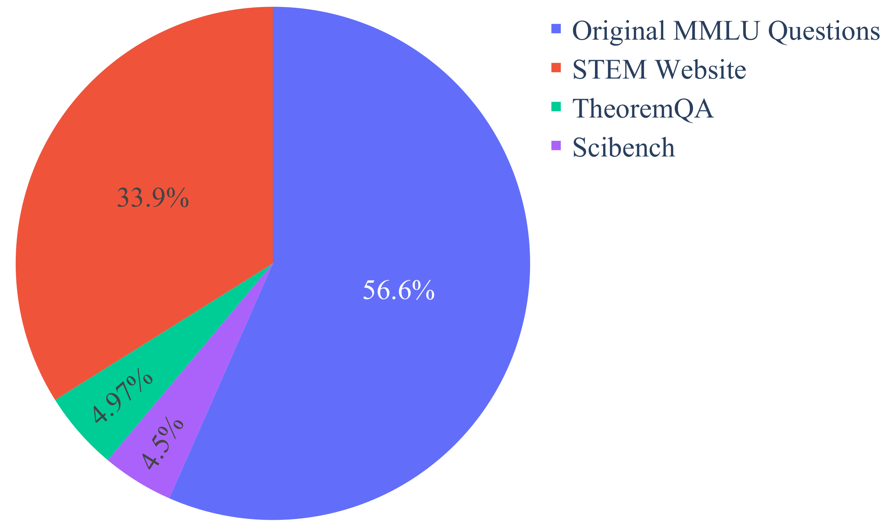
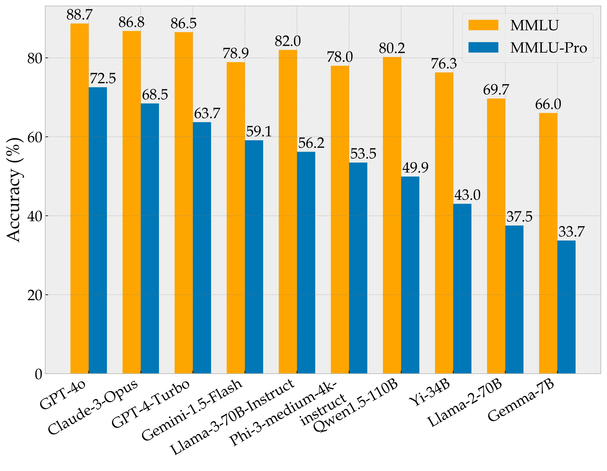
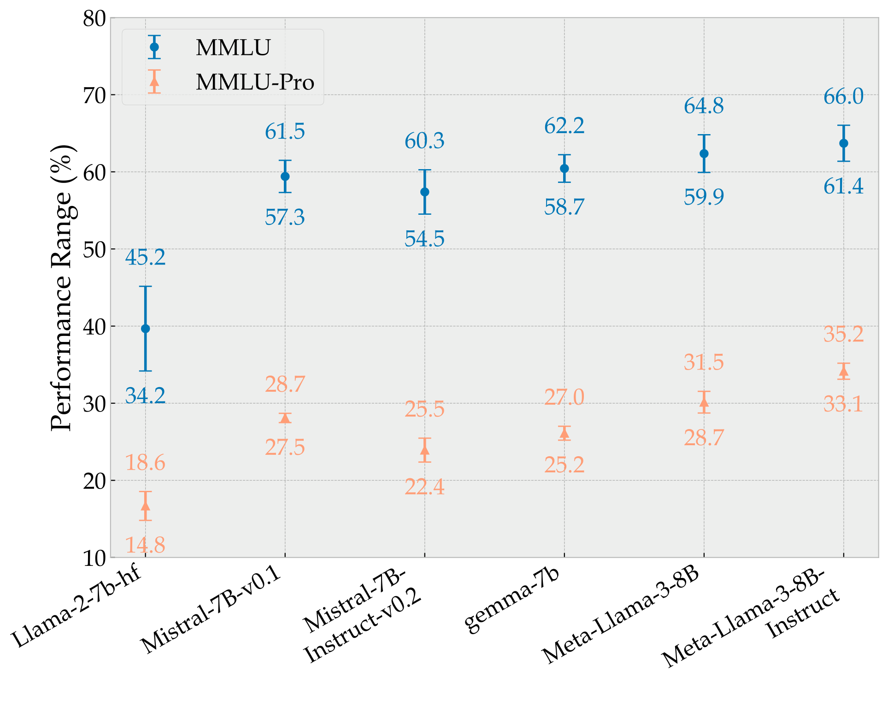

# MMLU-Pro：十选项与推理题提升模型评测区分度

当 GPT-4o 在 MMLU 上拿到 87.4%，而多款前沿模型挤在 86%–87% 时，榜单已经很难回答“谁更强”。这会干扰模型选型与能力追踪，四选一的知识题还可能让模型借排除法和猜测掩盖推理短板。MMLU-Pro 的思路很直接：清理简单题与噪声题，引入大学水平的推理题，并把选项从 4 个增至 10 个。最终，模型准确率较 MMLU 下降 16–33 个百分点，24 种提示词下的典型分数波动从 4–5 个百分点降至约 2 个百分点；GPT-4o 使用 Chain of Thought（CoT，思维链）后更提升了 19.1 个百分点。

> 图解：左图对比模型在 MMLU 与 MMLU-Pro 上的成绩差距，中图展示 24 种提示词下的准确率分布，轮廓越高、越窄代表成绩越稳定，右图比较 CoT 与直接作答。三组结果共同说明：MMLU-Pro 不仅更难，而且更依赖推理、更不容易因提示词变化而波动。

## 为什么 MMLU 不够用了

MMLU（Massive Multitask Language Understanding）覆盖 STEM、人文、社会科学等 57 个学科，长期是衡量大模型综合能力的事实标准。但前沿模型的快速进步，正在让这把“尺子”失去刻度。

GPT-4 在 2023 年 3 月取得 86.4% 后，MMLU 顶部成绩便趋于饱和。2024 年上半年发布的 GPT-4-Turbo、Gemini-1.5-Pro、Claude 和 LLaMA-3-400B 大多落在 86%–87%；GPT-4o 虽然在 MATH 和 Chatbot Arena 上取得更明显进步，在 MMLU 上却只提高约 1 个百分点。

问题不只是“分数太高”，还有“排名不够稳”。已有研究发现，提示词的轻微变化与不同计分方式都可能改变榜单顺序。论文把原因归纳为三点：

- **干扰项太少**：每题只有 3 个错误选项，模型可能利用选项 Shortcut，在未真正理解推理过程时答对。
- **知识题偏多**：尤其在 STEM 学科中，许多题更依赖知识回忆，而非多步推理；直接作答有时反而优于 CoT。
- **数据噪声拉低上限**：不可作答、信息不足或标注错误的题目，会让顶尖模型提前碰到并非由能力决定的成绩天花板。

GLUE、SuperGLUE、HELM、BigBench、ARC 等基准分别从语言理解、综合能力和科学推理等角度评估模型，OpenLLM Leaderboard 与 OpenCompass 则提供了统一比较入口。MMLU-Pro 要补上的，是“广泛学科覆盖、足够难度、稳定排名”这三者的交集。

## 12,032 道题是怎样筛出来的

MMLU-Pro 最终包含 14 个学科、12,032 道题。它不是简单地给 MMLU 增加难题，而是经过初筛、外部题源整合、选项扩充和两轮专家审核的完整流水线。

> 图解：构建流程从原始 MMLU 出发，先合并学科并删除过易题目，再引入 STEM Website、TheoremQA 和 SciBench；随后统一选择题格式、扩充干扰项，最后通过专家与模型协同检查答案、题目和选项质量。

### 第一步：合并学科，删除过易题目

作者先把原来的 57 个学科合并为 14 个大类，减少交叉与冗余。随后使用 Llama-2-7B、Llama-2-7B-Chat、Llama-2-13B、Llama-2-13B-Chat、Mistral-7B、Gemma-7B、Yi-6B 和 Yi-6B-Chat 共 8 个模型做题。

一道题若被超过 4 个模型答对，就被视为“过易”并删除。这一阶段共过滤 5,886 道题，占原始 13,937 道题的 42.23%，剩余 8,051 道。

| 学科 | 原始题数 | 过滤题数 | 过滤比例 | 剩余题数 |
|---|---:|---:|---:|---:|
| Biology | 454 | 225 | 49.56% | 229 |
| Business | 437 | 263 | 60.18% | 174 |
| Chemistry | 303 | 81 | 26.73% | 222 |
| Computer Science | 412 | 127 | 30.83% | 285 |
| Economics | 742 | 275 | 37.06% | 467 |
| Engineering | 145 | 55 | 37.93% | 90 |
| Health | 1,562 | 681 | 43.60% | 881 |
| History | 930 | 526 | 56.56% | 404 |
| Law | 1,763 | 623 | 35.34% | 1,140 |
| Math | 1,063 | 172 | 16.18% | 891 |
| Other | 2,340 | 1,301 | 55.60% | 1,039 |
| Philosophy | 2,012 | 764 | 37.97% | 1,248 |
| Physics | 629 | 169 | 26.87% | 460 |
| Psychology | 1,145 | 624 | 54.50% | 521 |
| **合计** | **13,937** | **5,886** | **42.23%** | **8,051** |

Business、History、Other 和 Psychology 的过滤比例都超过 50%，说明这些领域已有大量题目被当前模型掌握；Math 仅过滤 16.18%，原有题目的相对难度更高。

### 第二步：引入高质量题源，统一题目形式

在保留的 MMLU 题目之外，作者加入三类新来源：

- **STEM Website**：提供在线 STEM 题目及解答。
- **TheoremQA**：提供需要应用定理的人工标注题目。
- **SciBench**：提供来自大学考试的高阶科学题。

STEM Website 的题目带有完整解答，TheoremQA 则通常只有简短答案。为了把它们统一成选择题，作者使用 GPT-4-Turbo 从解答中抽取短答案，并生成 3 个合理但错误的选项，再由人工比对解答与抽取答案，删除答案不完整或错误的题目。

附录给出的构建提示还要求模型判断题目是否依赖图片、答案是否为图片、能否用短语作答，并以结构化形式输出正确答案和干扰项。这一步的意义不只是“格式转换”，更是把非文本、开放式或答案不明确的问题挡在后续流程之外。

### 第三步：把 4 个选项扩充到 10 个

GPT-4-Turbo 在原有 4 个选项之外生成 6 个新的干扰项。它们需要足够合理，不能靠明显的事实错误被轻松排除。

在每题只有一个正确答案、完全随机猜测的理想情况下，猜中概率会从 $1/4=25\%$ 降至 $1/10=10\%$。更重要的是，更多相似干扰项会压缩模型利用选项捷径的空间。

笔者认为，这个设计的关键不是“选项更多所以更难”这么简单，而是它同时针对两个评测痛点：一方面降低运气收益，另一方面减少模型因选项排列或表面特征产生的分数波动。作者也检查了选项扩充是否偏袒生成者，实验中 GPT-4-Turbo 并未因此获得额外优势。

### 第四步：两轮专家审核控制噪声

第一轮专家审核检查答案是否正确，并删除不适合选择题、信息不足、依赖图片或表格的题目。第二轮先让 Gemini-1.5-Pro 重新检查所有选项，寻找“其实也是正确答案”的 False Negative Option，再由专家定向复核。

审核发现的问题分布如下：

| 问题类型 | MMLU | TheoremQA | SciBench | STEM Website |
|---|---:|---:|---:|---:|
| 答案错误 | 350 | 0 | 11 | 483 |
| 干扰项实际为正确答案 | 1,953 | 5 | 15 | 293 |
| 不适合或无法作答的题目 | 385 | 1 | 15 | 862 |

对于被误当作错误选项的正确答案，专家会将其删除，同时保留真正的正确答案与有效干扰项。因此，最终并非每题都强行保留 10 个选项：83% 的题目有 10 个选项，17% 少于 10 个，平均每题 9.47 个选项。

## 学科与题源如何分布

解决了题目质量之后，下一个问题是覆盖是否均衡。MMLU-Pro 的 14 个学科既包含 Math、Physics、Engineering 等推理密集型领域，也保留 History、Law、Psychology 等知识密集型领域。

> 图解：图中展示 14 个学科的题目数量分布。Math、Physics、Chemistry、Law 等学科题量较多，History、Computer Science、Philosophy 等相对较少；全集合计 12,032 道题。

> 图解：图中比较原始 MMLU、STEM Website、TheoremQA 和 SciBench 四类来源。筛选后的 MMLU 占 56.60%，STEM Website 占 33.93%，TheoremQA 与 SciBench 分别占 4.97% 和 4.50%。

各学科的来源差异很大。Law、Other、Health、Philosophy 和 History 完全来自筛选后的 MMLU；Engineering 有 93.08% 来自 STEM Website；Math 与 Physics 的题源则更为多样。

| 学科 | 总题数 | MMLU | STEM Website | TheoremQA | SciBench |
|---|---:|---:|---:|---:|---:|
| Math | 1,351 | 846（62.66%） | 0 | 344（25.46%） | 161（11.92%） |
| Physics | 1,299 | 411（31.64%） | 617（47.50%） | 104（8.01%） | 167（12.86%） |
| Chemistry | 1,132 | 178（15.72%） | 741（65.46%） | 0 | 213（18.82%） |
| Law | 1,101 | 1,101（100%） | 0 | 0 | 0 |
| Engineering | 969 | 67（6.92%） | 902（93.08%） | 0 | 0 |
| Other | 924 | 924（100%） | 0 | 0 | 0 |
| Economics | 844 | 444（52.61%） | 400（47.39%） | 0 | 0 |
| Health | 818 | 818（100%） | 0 | 0 | 0 |
| Psychology | 798 | 493（61.78%） | 305（38.22%） | 0 | 0 |
| Business | 789 | 155（19.65%） | 560（70.99%） | 74（9.38%） | 0 |
| Biology | 717 | 219（30.54%） | 498（69.46%） | 0 | 0 |
| Philosophy | 499 | 499（100%） | 0 | 0 | 0 |
| Computer Science | 410 | 274（66.83%） | 60（14.63%） | 76（18.54%） | 0 |
| History | 381 | 381（100%） | 0 | 0 | 0 |
| **合计** | **12,032** | **6,810（56.60%）** | **4,083（33.93%）** | **598（4.97%）** | **541（4.50%）** |

## 怎么考：5-shot CoT 与答案提取

CoT 可以直观理解为“不仅报答案，还要写出解题步骤”；严格来说，它是在提示中提供带中间推理过程的示范，引导模型生成推理链后再给出答案。论文采用 5-shot CoT：每个学科选择 5 个代表性示例，并扩展示例中的选项，使其适配 MMLU-Pro。

例如，比较望远镜与人眼的集光能力时，提示示例会先指出集光能力与口径面积成正比，再计算：

$$
\frac{(50\ \mathrm{cm}/2)^2}{(5\ \mathrm{mm}/2)^2}
=\frac{500^2}{5^2}
=10000
$$

模型最后需要以“The answer is (E)”这样的格式作答。与主要关注语言概率的 Perplexity（PPL，困惑度）不同，这一设置直接考察模型能否完成推理并选出答案。

答案提取采用两级正则表达式：优先匹配“answer is (A)”到“answer is (J)”的规定格式；失败后，再匹配“Answer: A”一类变体。两种规则都失败时，评测脚本会随机选择一个选项，以保证每道题都有可计分答案。主结果表中，除 Gemini-1.5-Pro 和 Gemini-1.5-Flash 使用 0-shot 外，其余模型均使用 5-shot。

## 模型表现：GPT-4o 也只有 72.6%

作者评估了 50 多个开源与闭源模型。下表列出论文展示的代表性结果，数值均为准确率，单位为 %；学科列包含 3 个推理密集型领域和 3 个知识密集型领域。

| 类型 | 模型 | Overall | Math | Physics | Engineering | History | Law | Psychology |
|---|---|---:|---:|---:|---:|---:|---:|---:|
| 闭源 | GPT-4o | 72.6 | 76.1 | 74.7 | 55.0 | 70.1 | 51.0 | 79.2 |
| 闭源 | Gemini-1.5-Pro | 69.0 | 72.8 | 70.4 | 48.7 | 65.6 | 50.8 | 77.2 |
| 闭源 | Claude-3-Opus | 68.5 | 69.6 | 69.7 | 48.4 | 61.4 | 53.5 | 76.3 |
| 闭源 | GPT-4-Turbo | 63.7 | 62.8 | 61.0 | 35.9 | 67.7 | 51.2 | 78.3 |
| 闭源 | Gemini-1.5-Flash | 59.1 | 59.6 | 61.2 | 44.2 | 53.8 | 37.3 | 70.1 |
| 闭源 | Yi-large | 58.1 | 64.8 | 57.0 | 45.4 | 49.6 | 36.2 | 50.6 |
| 闭源 | Claude-3-Sonnet | 56.8 | 49.0 | 53.1 | 40.5 | 57.2 | 42.7 | 72.2 |
| 开源 | Llama-3-70B-Instruct | 56.2 | 54.0 | 49.6 | 43.6 | 56.9 | 39.9 | 70.2 |
| 开源 | Phi-3-medium-4k-instruct | 55.7 | 52.2 | 49.4 | 37.9 | 57.2 | 38.3 | 73.4 |
| 开源 | DeepSeek-V2-Chat | 54.8 | 53.7 | 54.0 | 31.9 | 45.3 | 40.6 | 66.2 |
| 开源 | Llama-3-70B | 52.8 | 49.7 | 49.8 | 35.0 | 57.7 | 35.0 | 71.4 |
| 开源 | Qwen1.5-72B-Chat | 52.6 | 52.3 | 44.2 | 36.6 | 55.9 | 38.5 | 67.7 |
| 开源 | Yi-1.5-34B-Chat | 52.3 | 56.2 | 49.4 | 34.4 | 52.8 | 34.8 | 64.3 |
| 开源 | MAmmoTH2-8x7B-Plus | 50.4 | 50.3 | 45.7 | 34.0 | 50.9 | 35.5 | 63.8 |
| 开源 | Qwen1.5-110B | 49.9 | 50.4 | 41.4 | 35.3 | 54.1 | 35.1 | 66.3 |
| 开源 | Phi-3-mini-4k-instruct | 45.7 | 41.8 | 41.0 | 28.7 | 41.5 | 28.5 | 65.2 |
| 开源 | Mixtral-8x7B-Instruct-v0.1 | 43.3 | 36.3 | 39.9 | 29.2 | 44.6 | 32.1 | 63.4 |
| 开源 | Yi-34B | 43.0 | 31.8 | 35.0 | 32.6 | 52.0 | 32.7 | 62.5 |
| 开源 | Mixtral-8x7B-v0.1 | 41.0 | 34.1 | 37.2 | 27.9 | 47.5 | 27.1 | 61.0 |
| 开源 | Llama-3-8B-Instruct | 41.0 | 36.1 | 34.4 | 31.3 | 42.3 | 26.5 | 59.4 |
| 开源 | Starling-7B | 37.9 | 34.9 | 38.5 | 27.0 | 43.6 | 24.7 | 32.5 |
| 开源 | c4ai-command-r-v01 | 37.9 | 26.3 | 28.3 | 24.8 | 47.5 | 34.0 | 58.5 |
| 开源 | Llama-2-70B | 37.5 | 26.8 | 28.2 | 23.5 | 45.9 | 28.6 | 59.0 |
| 开源 | OpenChat-3.5-8B | 37.2 | 36.2 | 30.5 | 26.9 | 39.9 | 24.6 | 54.5 |
| 开源 | InternMath-20B-Plus | 37.1 | 56.1 | 24.0 | 30.4 | 20.5 | 15.2 | 42.3 |
| 开源 | Llama3-Smaug-8B | 36.9 | 33.2 | 37.3 | 19.8 | 42.0 | 26.5 | 28.6 |
| 开源 | Llama-3-8B | 35.4 | 30.4 | 31.4 | 25.5 | 36.2 | 19.6 | 53.3 |
| 开源 | Gemma-7B | 33.7 | 25.1 | 27.6 | 22.7 | 36.8 | 21.7 | 51.8 |
| 开源 | InternMath-7B-Plus | 33.5 | 48.3 | 22.8 | 28.2 | 19.2 | 14.4 | 38.3 |
| 开源 | Zephyr-7B-Beta | 33.0 | 23.6 | 35.7 | 23.9 | 32.0 | 22.0 | 28.2 |
| 开源 | Mistral-7B-v0.1 | 30.9 | 23.5 | 24.8 | 22.4 | 32.6 | 20.7 | 48.9 |
| 开源 | Neo-7B-Instruct | 28.7 | 35.5 | 23.7 | 19.1 | 28.2 | 18.0 | 36.2 |
| 开源 | Llemma-7B | 23.5 | 21.6 | 25.7 | 23.8 | 15.2 | 14.8 | 29.6 |
| 开源 | Gemma-2B | 15.9 | 16.3 | 15.6 | 12.7 | 15.4 | 12.3 | 16.1 |

GPT-4o 以 72.6% 居首，Gemini-1.5-Pro 和 Claude-3-Opus 分别为 69.0% 和 68.5%。开源模型中，Llama-3-70B-Instruct 达到 56.2%，接近 Claude-3-Sonnet 的 56.8%，但与 GPT-4o、Claude-3-Opus 仍有明显差距。完整的分学科结果可在 [MMLU-Pro Leaderboard](https://huggingface.co/spaces/TIGER-Lab/MMLU-Pro) 查看。

Phi-3 系列的表现也值得关注：14B 的 Phi-3-medium-4k-instruct 达到 55.7%，3.8B 的 Phi-3-mini-4k-instruct 达到 45.7%。作者推测，这可能与其预训练使用高质量教育数据和代码有关。

不同学科揭示了不同短板：

- **Math 与 Physics**：模型差距被显著拉开，GPT-4o 均超过 74%，Mistral-7B-v0.1 则只有约 24%。
- **History 与 Psychology**：知识密集型学科的成绩下限整体更高；DeepSeek-V2-Chat 在这些领域相对偏弱，体现出推理与知识检索能力的不均衡。
- **Engineering**：新增 STEM Website 题目包含复杂公式推导和多步计算，GPT-4o 也只有 55.0%。
- **Law**：更多选项与更细致的法律情境要求更深的法律推理，多个模型在此明显失分。

## 与 MMLU 对照：更难、更吃推理、更稳

单看一组低分，还不能证明 benchmark 更好。真正关键的是，它能否拉开模型差距、激活推理能力，并减少无关因素造成的波动。作者因此从难度、推理强度和鲁棒性三个角度与 MMLU 对照。

### 难度：拥挤的分数段被重新拉开

> 图解：图中按模型比较 MMLU 与 MMLU-Pro 的准确率。MMLU 上挤在狭窄区间的模型，在 MMLU-Pro 上呈现出更大的分数差距，同时最高分下降，为后续模型进步留下空间。

Gemini-1.5-Flash、Llama-3-70B-Instruct、Phi-3-medium-4k-instruct 和 Qwen1.5-110B 在 MMLU 上都处于 78%–82% 的 4 个百分点区间；到了 MMLU-Pro，覆盖范围扩大到约 10 个百分点。GPT-4o、Claude-3-Opus 与 GPT-4-Turbo 之间的跨度，也从约 2 个百分点扩大到约 9 个百分点。

GPT-4o 与 GPT-4-Turbo 的差异尤其直观：两者在 MMLU 上只差约 1 个百分点，在 MMLU-Pro 上则相差 8.9 个百分点。GPT-4o 的 72.6% 还留下 27.4 个百分点的提升空间，而 MMLU 顶部只剩约 11.3 个百分点。

### 推理：CoT 从“可有可无”变成关键增益

| 模型 | MMLU CoT | MMLU 直接作答 | CoT 增益 | MMLU-Pro CoT | MMLU-Pro 直接作答 | CoT 增益 |
|---|---:|---:|---:|---:|---:|---:|
| GPT-4o | 88.7 | 87.2 | 1.5 | 72.6 | 53.5 | 19.1 |
| GPT-4-Turbo | 86.5 | 86.7 | -0.2 | 63.7 | 48.4 | 15.3 |
| Phi-3-medium-4k-instruct | 79.4 | 78.0 | 1.4 | 55.7 | 47.5 | 8.2 |
| Llama-3-8B | 62.7 | 66.6 | -3.9 | 35.4 | 31.5 | 3.9 |
| Gemma-7B | 62.4 | 66.0 | -3.6 | 33.7 | 27.0 | 6.7 |

在 MMLU 上，CoT 对强模型的帮助很小，对部分开源模型甚至产生负收益；在 MMLU-Pro 上，表中所有模型的 CoT 成绩都更高。GPT-4o 从直接作答的 53.5% 提升到 72.6%，增加 19.1 个百分点，GPT-4-Turbo 也增加 15.3 个百分点。

这组结果支持了作者的设计目标：MMLU-Pro 中的更多题目需要显式、多步的推导，而不是直接从记忆中检索一个事实。不过，CoT 增益本身不是推理能力的充分证明，它更像一个证据，说明题目对推理过程的依赖显著增强。

### 鲁棒性：提示词波动从约 4–5% 降至约 2%

> 图解：图中比较多个模型在 24 种合理提示词下的成绩范围。MMLU 的典型波动为 4–5 个百分点，最高达到 10.98 个百分点；MMLU-Pro 通常约为 2 个百分点，最大为 3.74 个百分点。

作者没有改变模型，只改变提示词风格，就能观察成绩对评测条件的敏感程度。MMLU-Pro 的波动明显收窄，意味着排名更不容易被某一次提示词选择左右。这并不能消除模型本身的不稳健，但说明 benchmark 的题目与选项设计能够降低一部分评测噪声。

## GPT-4o 的错题暴露了什么问题

为了理解剩余难点，作者随机抽取 GPT-4o 的 120 个错误预测，由专家判断原因。结果显示，最大问题不是单纯“不知道”，而是“知道却仍然推不对”。

| 错误类型 | 占比 | 典型表现 |
|---|---:|---|
| 推理错误 | 39% | 知识已召回，但逻辑关系或计算方向错误 |
| 缺少特定领域知识 | 35% | 金融规则、光学原理等专业概念使用错误 |
| 计算错误 | 12% | 公式正确，但代入、求和或数值计算出错 |
| 未作出最终选择 | 5% | 有生成内容，却未按规定格式选择答案 |
| 题意理解错误 | 4% | 误读问题范围或选项含义 |
| 生成异常 | 2% | 重复生成直至达到长度上限 |
| 标注错误 | 2% | 数据集中的标准答案存在问题 |
| 答案提取错误 | 1% | 输出格式异常，脚本无法提取选项 |

附录中的具体案例，把这些问题展示得很清楚：

- **金融知识**：汽车售价为 1,650 美元、首付 50 美元时，计息本金应为 $1650-50=1600$，而不是 1,650 美元。代入每年 12 次付款、总分期费用 240 美元、共 24 期后，年利率为 14.4%。
- **光学知识**：透镜置于不同介质时，应使用透镜与介质的折射率之比，而不是直接做差。令几何项为 $K=1/5.3$，在水中有：

$$
\frac{1}{f}=\left(\frac{1.53}{1.33}-1\right)\frac{1}{5.3}
$$

由此得到 $f=35.2$ 英寸。GPT-4o 错用 $1.53-1.33$ 得到 26.5 英寸，随后又选择了“最接近”的 25.2 英寸。

- **工程推理**：70°C 水的饱和蒸气压为 31.2 kPa，外部大气压为 100 kPa，压差应是 $100-31.2=68.8$ kPa，而非把两者相加。乘以活塞面积后，正确作用力约为 4.86 kN。
- **化学计算**：$C_{18}H_{34}O_3$ 的摩尔质量应为 $18\times12+34\times1+3\times16=298\ \mathrm{g/mol}$，GPT-4o 却算成 218。使用正确结果与 Graham 定律，90 秒内扩散量约为 0.38 millimicromole。
- **题意边界**：一道 Singer 平等原则题只问“人类”，模型却扩展成对所有人类与非人类动物的平等对待，选择了范围更大的选项。
- **生成异常**：模型在一道遗传题中反复生成同一段“重新计算”文本，直到触及长度上限，最终没有给出选项。

笔者认为，39% 推理错误与 12% 计算错误的拆分很有实践价值：前者需要改进逻辑推理与训练过程，后者则可能借助计算器或 Python 工具缓解。两者混为一谈，会错误判断模型真正需要补的能力。

## 实验成本、数据许可与局限

实验使用 NVIDIA A100 GPU，并通过 vLLM 加速推理。评估一个 7B 模型约需 20–30 分钟；闭源模型 API 评测累计处理约 20M 输入 Token 和 5M 输出 Token。闭源模型版本截至 2024 年 5 月，表中成绩应结合这一时间点理解。

数据许可方面，MMLU、TheoremQA 和 SciBench 均采用 MIT License，STEM Website 为开放许可，MMLU-Pro 数据集本身同样采用 MIT License。

MMLU-Pro 仍有两项明确局限：

- **选择题限制**：它适合稳定、自动化的能力比较，却不能充分衡量开放式回答中的理解深度、创造性与真实任务表达能力。
- **仅覆盖文本**：数据集不包含多模态评测，无法检验视觉、听觉与文本信息的联合理解。

此外，构建过程使用 GPT-4-Turbo 生成答案与干扰项、使用 Gemini-1.5-Pro 辅助复核，再由专家校验。两轮审核降低了噪声，但复杂学科题目的标注质量仍需要持续维护；错误分析中仍有 2% 的标注错误，也说明清理并非一劳永逸。

## 总结与展望

- MMLU-Pro 用 14 个学科、12,032 道题延续 MMLU 的广覆盖，同时把评测重心进一步推向复杂推理。
- 8 模型初筛、外部难题整合、4 到 10 选项扩充与两轮专家审核，共同降低了简单题、猜测收益和数据噪声。
- GPT-4o 仅取得 72.6%，模型间原本拥挤的分数段被拉开，benchmark 的区分度与后续提升空间都更大。
- GPT-4o 的 CoT 增益达到 19.1 个百分点，24 种提示词下的典型波动降至约 2%，说明新题更依赖推理，也更稳定。
- 对 GPT-4o 的 120 个错题分析显示，推理、专业知识与计算分别占 39%、35% 和 12%，为后续模型改进提供了明确方向。

MMLU-Pro 让文本模型的知识与推理评测重新有了分辨力，但要接近真实智能评估，还需要向开放式任务、多模态理解和可验证的工具使用扩展。

> 本文参考自 [MMLU-Pro: A More Robust and Challenging Multi-Task Language Understanding Benchmark](https://arxiv.org/abs/2406.01574)