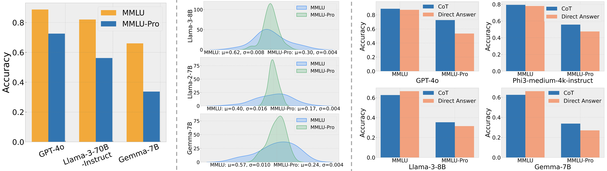

# MMLU-Pro：十选项与推理题提升模型评测区分度

MMLU 高分拥挤、易受提示词影响且偏知识回忆，已难区分前沿模型；MMLU-Pro 通过难题筛选、大学推理题与十选项设计，让模型分数下降 **16–33 个百分点**，24 种提示词下的典型波动从 **4–5 个百分点降至约 2 个**。

## 为什么 MMLU 不够用了

GPT-4o 在 MMLU 上达到 87.4%，多款前沿模型挤在 86%–87%。问题主要有三点：

- **干扰项少**：四选一容易借排除法、选项捷径和猜测得分。
- **知识题多**：不少 STEM 题依赖回忆，强模型使用 CoT 的收益很小。
- **数据有噪声**：错题、信息不足和错误标注压低成绩上限，也会扰动排名。

## 12,032 道题是怎样筛出来的

MMLU-Pro 最终覆盖 **14 个学科、12,032 道题**，构建流程包括：

- **删除过易题目**：将 MMLU 的 57 个学科合并为 14 类，用 8 个模型初筛；超过 4 个模型答对即删除，共过滤 5,886 题，占原题的 42.23%。
- **引入高难题源**：加入 STEM Website、TheoremQA 和 SciBench，统一转换为选择题，并人工检查答案。
- **扩充至十选项**：GPT-4-Turbo 生成合理干扰项，理想随机猜中率由 25% 降至 10%，同时压缩选项捷径空间。
- **两轮专家审核**：检查答案、题目可作答性及“干扰项其实正确”等问题。最终 83% 的题有 10 个选项，平均每题 9.47 个。

题源中，筛选后的 MMLU 占 56.60%，STEM Website 占 33.93%，TheoremQA 和 SciBench 分别占 4.97% 和 4.50%。评测主要采用 **5-shot CoT**，要求模型写出推理过程并按规定格式给答案。

## 模型表现：GPT-4o 也只有 72.6%

在 50 多个模型的评估中，GPT-4o 以 **72.6%** 居首，Gemini-1.5-Pro 和 Claude-3-Opus 分别为 69.0% 和 68.5%；开源模型中 Llama-3-70B-Instruct 达到 56.2%。GPT-4o 在 Engineering 上仅 55.0%，说明复杂推导与多步计算仍具挑战。

与 MMLU 对照，优势体现在：

- **更难、更能拉开差距**：GPT-4o 与 GPT-4-Turbo 的分差由约 1 个百分点扩大至 **8.9 个**；GPT-4o 仍有 27.4 个百分点的提升空间。
- **更依赖推理**：GPT-4o 使用 CoT 后从 53.5% 提升至 72.6%，增益 **19.1 个百分点**；GPT-4-Turbo 增益 15.3 个。
- **排名更稳定**：24 种提示词下，MMLU 波动最高达 10.98 个百分点，MMLU-Pro 最大为 3.74 个，通常约 2 个。

对 GPT-4o 的 120 个错题分析显示，推理错误占 **39%**，专业知识缺失占 35%，计算错误占 12%，主要瓶颈并非单纯“不知道”，而是“知道仍推不对”。

## 实验成本、数据许可与局限

评估一个 7B 模型约需 20–30 分钟；闭源模型版本截至 2024 年 5 月。MMLU-Pro 采用 MIT License，但仍有明确边界：选择题难以衡量开放式表达与创造性，数据集也不支持多模态评测；错题分析中仍有 2% 标注错误，质量维护不能停止。

MMLU-Pro 让文本模型的知识与推理评测重新具备分辨力，下一步仍需扩展到开放式任务、多模态理解和可验证的工具使用。

> 本文参考自 [MMLU-Pro: A More Robust and Challenging Multi-Task Language Understanding Benchmark](https://arxiv.org/abs/2406.01574)