# MagicDec：稀疏 KV 让长文大批次最高提速 2.51 倍

长上下文 RAG、文档分析和 Agent 工作流常常需要同时处理大批请求，但增大 Batch 虽然能提高吞吐量，却会拉高 Token 间延迟，传统 Speculative Decoding（SD，投机解码）也被认为只适合小 Batch。MagicDec 发现，序列足够长时，瓶颈会从计算重新转向 KV Cache 加载，于是目标模型可以用一次前向计算并行验证多个草稿 Token，而不必反复支付完整 KV 的加载成本。基于这一判断，它用**稀疏 KV Cache 构造草稿模型**，再按模型、硬件、任务、Batch 和序列长度选择草稿策略。实验中，LLaMA-3.1-8B 在 Batch Size 32–256 的中长序列服务上取得最高 **2.51×** 加速，同时降低延迟、提高吞吐，并保持目标模型的生成质量。

## 问题：Batch 提吞吐，为什么会牺牲延迟？

自回归解码像逐字写作：每生成一个 Token，都要把模型参数和历史上下文对应的 KV Cache 读入计算单元。KV Cache 保存各层 Attention 的 Key 和 Value，避免重复计算历史 Token；但它的容量随序列长度和 Batch Size 增长。

小 Batch、短序列时，参数加载往往是主要成本。把多个请求组成 Batch，可以摊薄参数读取，提高 GPU 利用率和吞吐量。但 Batch 继续增大后，两项成本开始抬头：

- **计算成本**：线性层的 Arithmetic Intensity（计算量与访存量之比）提高，逐渐转为 Compute-bound。
- **KV 加载成本**：它随 Batch Size 和序列长度扩展，不能像模型参数那样在不同请求间免费摊薄。

因此，吞吐优先的大 Batch 往往伴随更高的 Time-Between-Tokens（TBT，相邻输出 Token 的间隔）。量化、剪枝和直接裁剪目标模型的 KV Cache 虽然也能提速，却可能改变模型输出；MagicDec 关注的是另一条路径：利用 SD 无损加速，同时不牺牲大 Batch 的吞吐收益。

### SD 的传统困局

SD 可以理解为“先由助手连写几句，再由主笔一次性审校”。轻量 Draft Model 连续生成 $\gamma$ 个候选 Token，Target Model 并行验证，接受与目标模型一致的草稿，并在首个不一致处修正。验证始终由完整目标模型完成，因此方法可以不改变目标模型的输出分布。

小 Batch 时，验证多个 Token 能共享参数加载，并利用闲置算力。大 Batch、短序列时，算力已被普通解码占满，额外验证反而昂贵；如果草稿接受率又低，大量计算会浪费在被拒绝的 Token 上。这就是既有研究建议大 Batch 缩短 Speculation Length，甚至不用 SD 的原因。

MagicDec 的关键反问是：**这个结论是否只在短序列成立？**

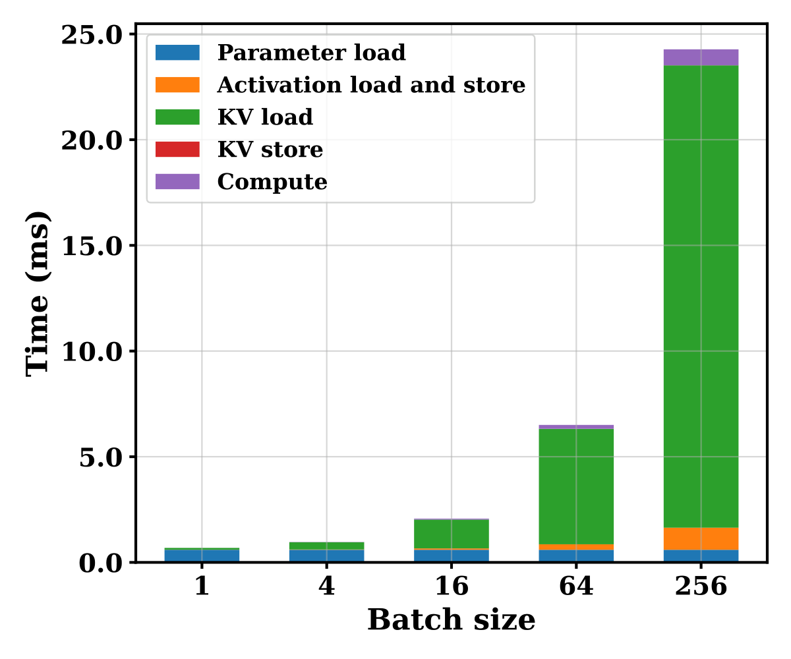

> 图解：横轴为 Batch Size，图中拆解输入长度 16384、8×H100 上 LLaMA-3.1-8B 的 KV Cache、权重、激活加载与计算耗时。Batch 增大后，KV 加载逐渐成为主导项，说明系统重新转向 Memory-bound。

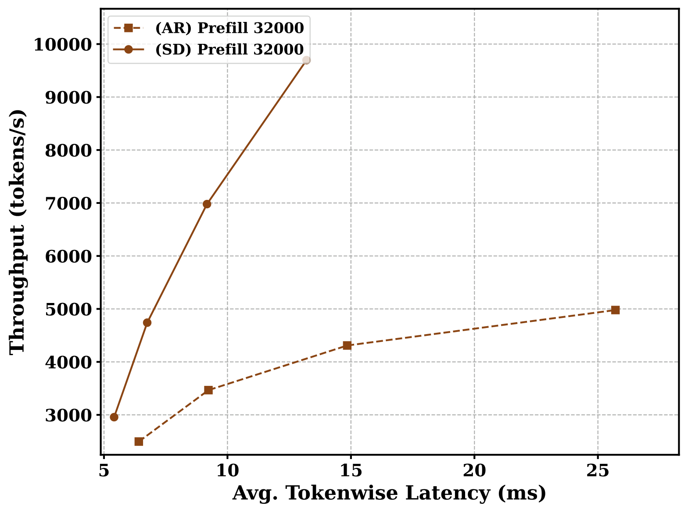

> 图解：横轴为单 Token 延迟，纵轴为吞吐量，比较 Prompt 长度 32K 时 LLaMA-3.1-8B 的自回归解码与 StreamingLLM 稀疏 KV 自投机。后者移动了吞吐—延迟折中曲线，而不是只用更高延迟换吞吐。

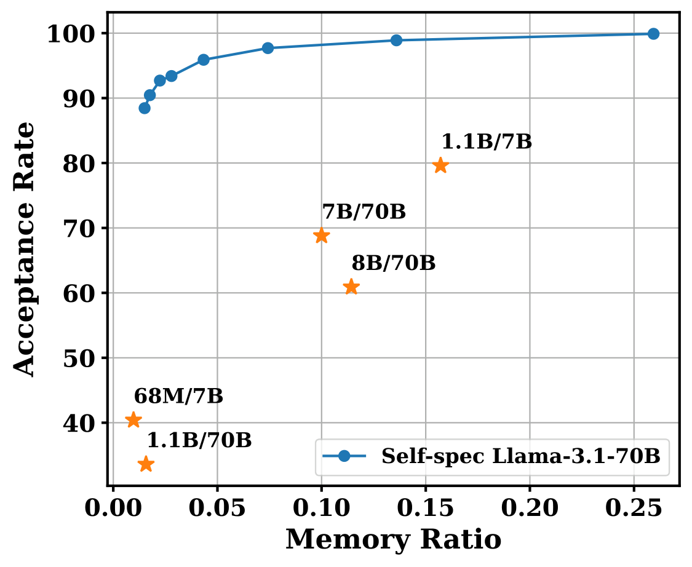

> 图解：横轴是草稿与目标模型的内存占用比，纵轴是草稿 Token 接受率，目标模型为 LLaMA-3.1-70B。Top-K 稀疏 KV 自投机在相近甚至更低内存比下获得更高接受率；单纯缩小模型难以达到约 90% 的接受率。

这三张图给出了全文主线：**长序列让验证重新变得便宜，稀疏 KV 则让草稿同时保持便宜和准确。**接下来需要把这个直觉写成可计算的条件。

## 分析：SD 能否加速，由三个比值决定

设 Batch Size 为 $B$，序列长度为 $S$。目标模型单步解码时间为 $T_T(B,S)$，草稿模型单步解码时间为 $T_D(B,S)$，目标模型一次验证 $\gamma$ 个 Token 的时间为 $T_V(B,S,\gamma)$。

草稿 Token 接受率为 $\alpha\in[0,1]$ 时，一次验证期望生成的 Token 数为：

$$
\Omega(\gamma,\alpha)=\frac{1-\alpha^{\gamma+1}}{1-\alpha}
$$

一轮 SD 的总耗时为：

$$
T_{Total}^{SD}=\gamma T_D(B,S)+T_V(B,S,\gamma)
$$

平均每个 Token 的 SD 延迟为 $T_{Avg}^{SD}=T_{Total}^{SD}/\Omega(\gamma,\alpha)$。把它与目标模型普通解码相比，可得：

$$
\frac{T_{Avg}^{SD}}{T_T}
=
\frac{1}{\Omega(\gamma,\alpha)}
\left(
\frac{\gamma T_D}{T_T}+
\frac{T_V(\gamma)}{T_T}
\right)
$$

这个比值小于 1，SD 才有收益。公式把问题拆成三个可独立优化的因素：

1. **验证—解码成本比** $T_V(\gamma)/T_T$：越接近 1 越好。
2. **草稿—目标成本比** $T_D/T_T$：越接近 0 越好。
3. **每轮期望生成长度** $\Omega(\gamma,\alpha)$：由接受率 $\alpha$ 和投机长度 $\gamma$ 共同决定，越大越好。

仅提高 $\gamma$ 并不一定有效：它会增加期望生成长度，也线性增加草稿步数，并提高验证成本。接受率低时，加长草稿尤其浪费。因此，MagicDec 不是固定一个 $\gamma$，而是把它与草稿策略一起优化。

### 长序列为什么会降低验证的相对成本？

短序列下，Batch 增大会让线性层转向 Compute-bound，验证新增的矩阵计算无法被访存成本掩盖，$T_V/T_T$ 明显上升。

中长序列下，KV Cache 成为更大的访存项。普通解码与并行验证都要读取同一份完整 KV，因此验证增加的计算可以被这部分共同成本摊薄。现代 GPU 的峰值 FLOPS 与显存带宽之比很高，Batch 增大时，KV 加载时间的增长往往比计算时间更显著。

于是存在一个由**模型、硬件和草稿策略共同决定的临界序列长度** $S_{inflection}$：

- 当 $S<S_{inflection}$ 时，计算瓶颈占主导，SD 加速比通常随 Batch 增大而下降。
- 当 $S\geq S_{inflection}$ 时，KV 瓶颈占主导，验证成本接近普通解码；配合合适的稀疏 KV 草稿，加速比可以随 Batch 增大而提高。

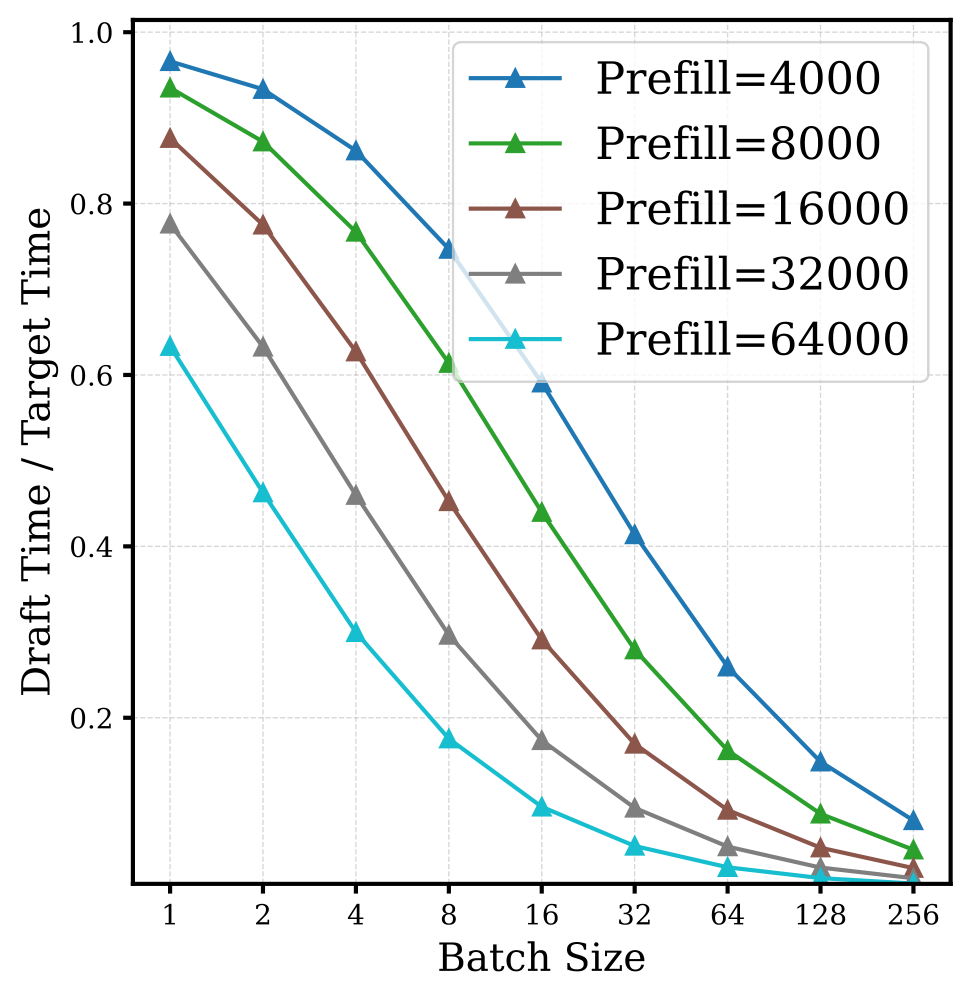

> 图解：横轴为 Batch Size，纵轴为 $T_D/T_T$，设置为 8×A100、$\gamma=3$。固定草稿 KV Budget 时，中长序列下该比值可随 Batch 增大而下降，为目标验证成本的小幅上升提供补偿。

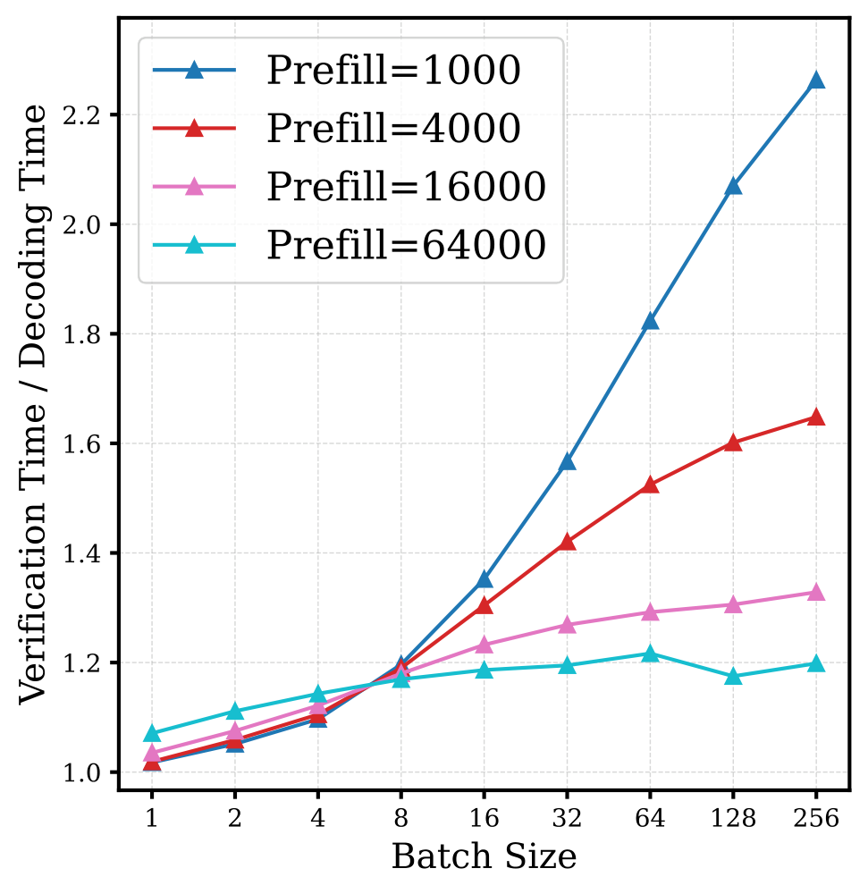

> 图解：横轴为 Batch Size，纵轴为 $T_V(\gamma)/T_T$。短序列的验证相对成本上升更快；长序列受共享 KV 加载影响，该比值更接近 1。

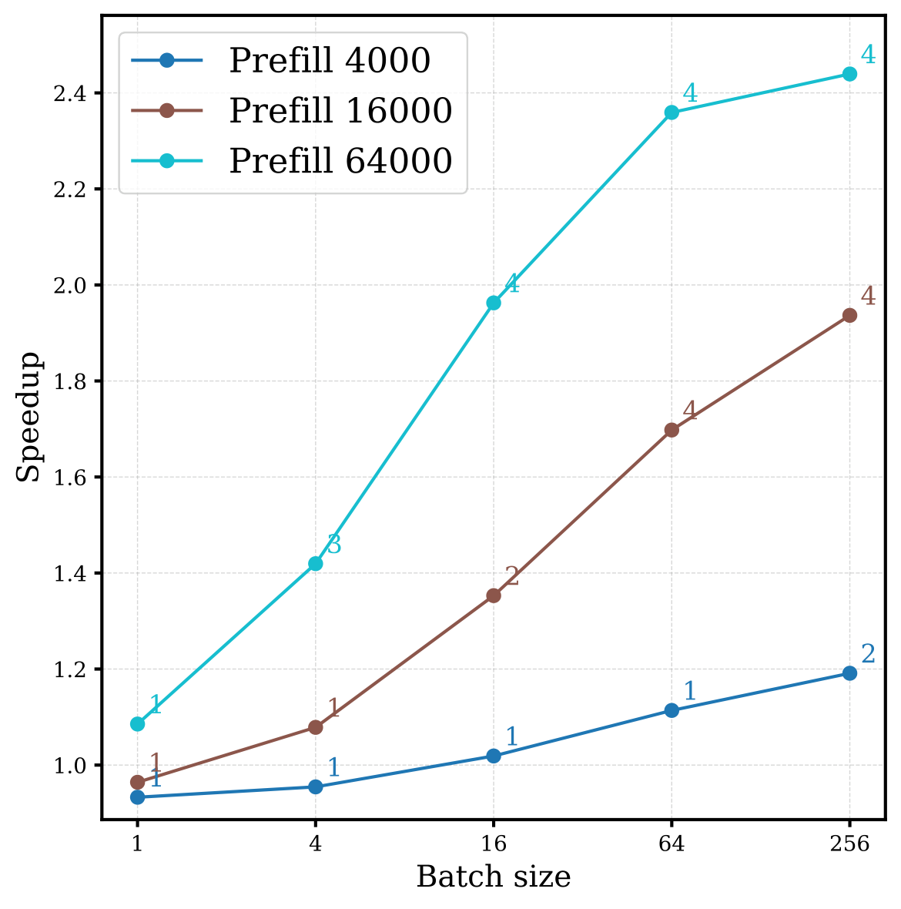

> 图解：横轴为 Batch Size，纵轴为理论加速比，草稿 KV Budget 为 512。对 LLaMA-3.1-8B，$S<4000$ 时加速比随 Batch 增大而下降，$S\geq4000$ 后则转为上升，与临界长度分析一致。

下面这组图进一步把成本比、加速比和硬件特性连起来。

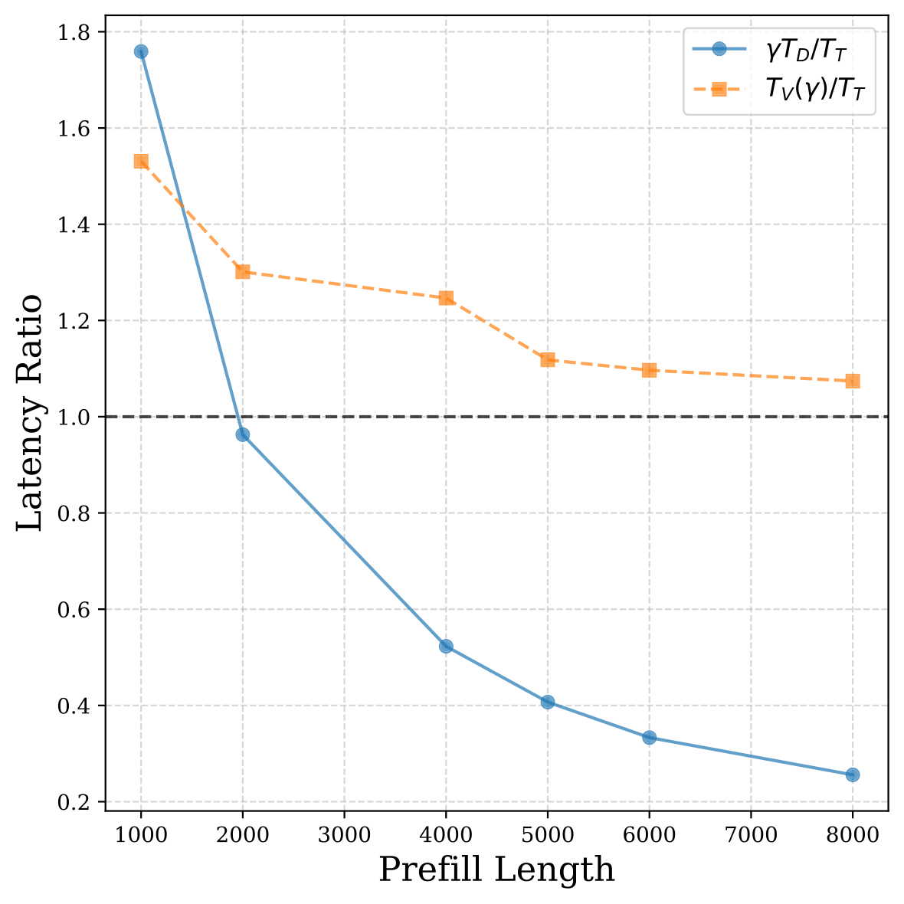

> 图解：横轴为序列长度，比较 LLaMA-2-7B-32K 在 Batch Size 256、$\gamma=3$ 时的 $\gamma T_D/T_T$ 与 $T_V(\gamma)/T_T$。序列变长后，固定 KV Budget 的草稿相对成本持续降低。

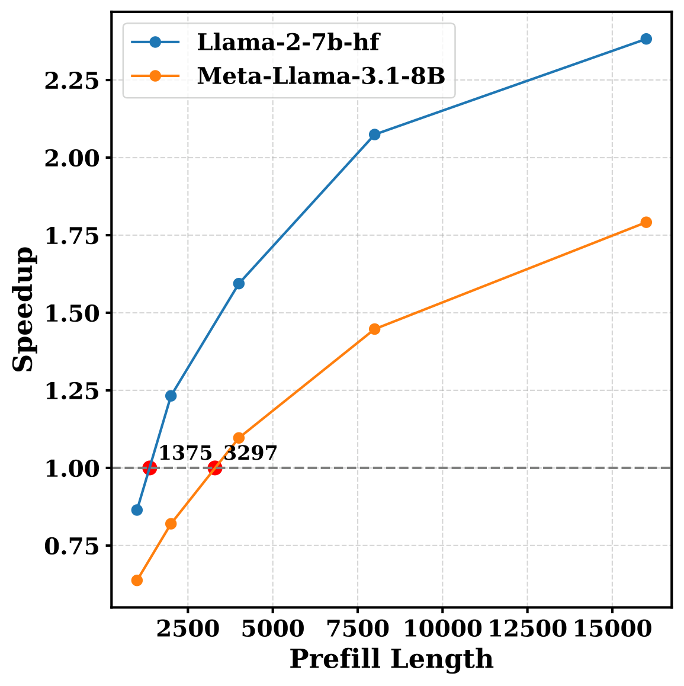

> 图解：横轴为序列长度，纵轴为理论加速比，统一假设 $\alpha=0.8$、Batch Size 为 256、草稿 KV Budget 为 512。它直观展示了临界长度两侧从减速到加速的变化。

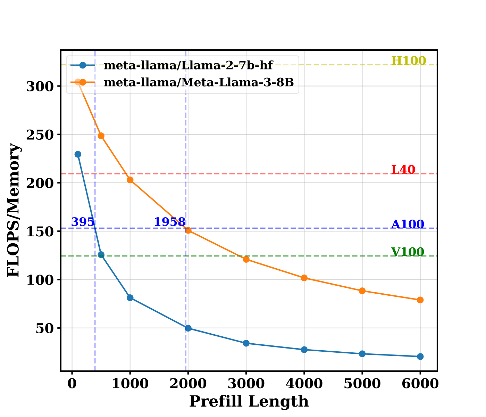

> 图解：横轴为序列长度，纵轴为理论 Arithmetic Intensity，用于比较不同模型进入 Memory-bound 区域的条件。采用 GQA（Grouped Query Attention，分组查询注意力）的 LLaMA-3.1-8B 减小了 KV 占用，因此需要更长序列才达到相同的 KV 瓶颈强度，临界长度也更高。

笔者认为，这里最有价值的并不是“SD 也能用于大 Batch”这一结论，而是给出了**可判定的适用边界**。部署者不必再凭经验一概禁用 SD，而应先确认当前工作负载是否跨过 $S_{inflection}$。

## 选择草稿：长上下文里，压缩 KV 比缩小模型更有效

传统 SD 通过减少 Draft Model 参数来降低权重加载成本，但长序列下，小模型未必“小”。KV Cache 随 Batch 线性增长，而草稿模型与目标模型的 KV 维度比例不同，草稿的总内存甚至可能接近或超过目标模型。

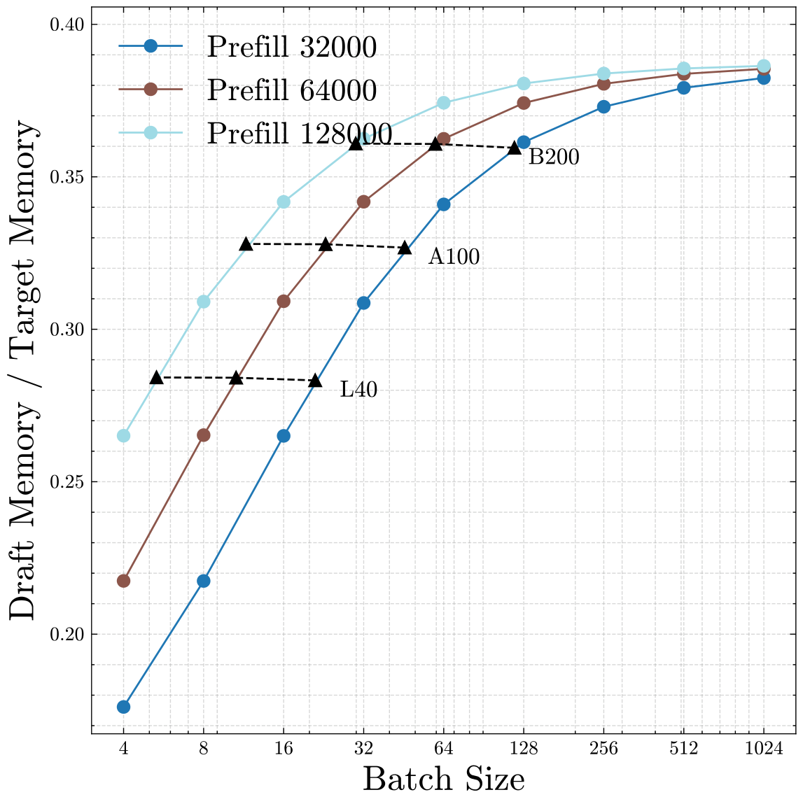

> 图解：横轴为 Batch Size，纵轴为草稿与目标模型的总内存占用比，不同曲线对应不同序列长度。使用 LLaMA-3.1-8B 为 70B 模型起草时，长序列、大 Batch 会显著抬高 KV 带来的内存比例。

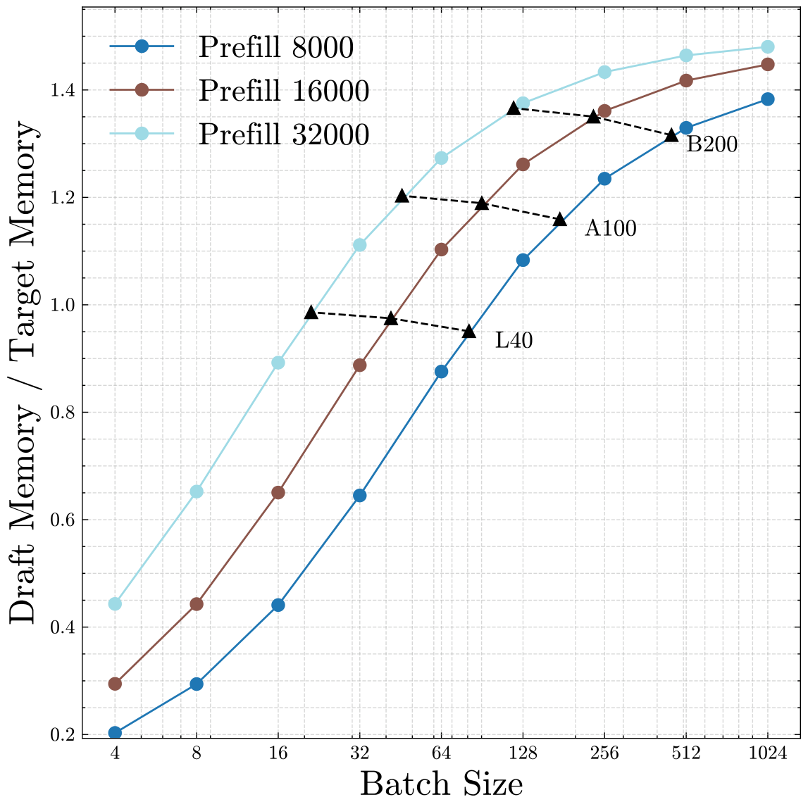

> 图解：坐标含义与上一图相同，目标与草稿改为 LLaMA-2-70B 和 LLaMA-2-7B。结合两组模型，草稿总内存最高可达到目标模型的约 38%–140%，说明“参数更少”不等于“解码状态更小”。

Self-speculation（自投机）提供了一种替代方案：草稿仍使用目标模型自身，但只保留稀疏 KV；验证阶段仍使用完整目标模型和完整 KV。这样做有三个直接收益：

- 草稿 KV Budget 固定后，其加载量不再随原始上下文长度同步增长。
- 草稿和目标共享模型表征，通常比异构小模型有更高的接受率。
- 不依赖词表匹配的小型 Draft Model，也不会遇到目标模型缺少合适小模型的问题。

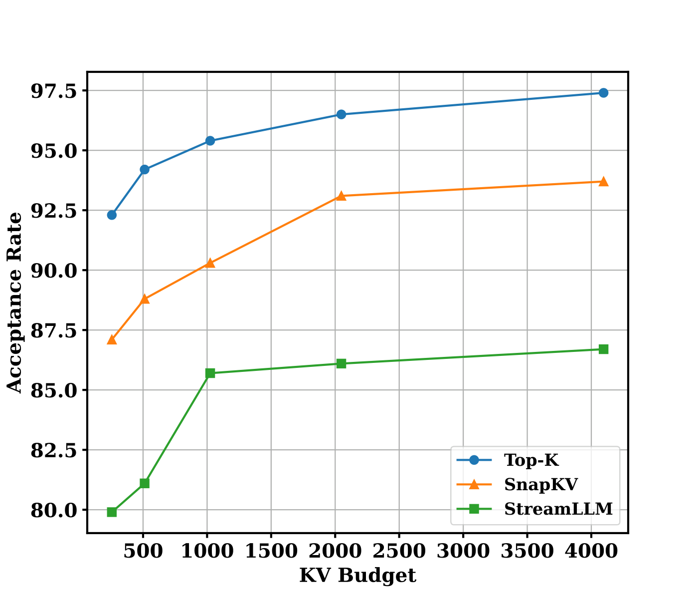

> 图解：横轴为草稿 KV Budget，纵轴为 LLaMA-3.1-8B 自投机的 Token 接受率，目标 KV 长度为 32000。不同稀疏算法的接受率及其增长速度不同；SnapKV 随 Budget 增加的提升更明显，StreamingLLM 的接受率上界相对较低。

不过，自投机仍需读取完整模型权重，所以它不是所有场景的最优解。序列不够长、Batch 不够大时，KV 尚未完全主导耗时，小模型的权重加载优势可能更重要；序列和 Batch 都足够大时，自投机的高接受率才会压过权重成本。MagicDec 因而把草稿模型大小、KV Budget 和压缩算法视为联合选择，而非固定使用一种 Draft。

## 方法：把草稿成本、接受率与验证成本放进同一个目标

### 系统流程：Prefill 选 KV，Decode 草稿与验证分离

MagicDec 的静态 KV 压缩系统先计算完整 Prompt 的 Prefill，并为草稿生成压缩 KV。解码时，草稿模型读取稀疏 KV 连续提出候选，目标模型读取完整 KV 并行验证。由于压缩只发生在草稿一侧，目标模型的验证依据没有缩水。

> 图解：流程分为 Prefill 与 Decode。Prefill 阶段由完整 KV 生成静态压缩 KV；Decode 阶段，稀疏 KV 供 Draft 使用，完整 KV 供 Target 验证，从而形成“低成本起草、无损目标验证”的闭环。
>
> 图片路径警告：未找到 `Plots/system_plot.pdf`，发布前请补充该图片。

对于带 KV 选择的草稿，设固定 Budget 为 $K$，选择算法为 $select$。一次草稿解码不仅包括模型计算，还包括从长度为 $S$ 的缓存中选择 KV 的开销：

$$
T_{D,select_K}(B,S)=T_D(B,K)+T_{select}(B,S,K)
$$

代入 SD 延迟公式，MagicDec 的优化目标为：

$$
\min_{T_{select},K,\gamma,\alpha}
\frac{1}{\Omega(\gamma,\alpha)}
\left[
\frac{\gamma\left(T_D(B,K)+T_{select}(B,S,K)\right)}{T_T(B,S)}
+
\frac{T_V(B,S,\gamma)}{T_T(B,S)}
\right]
$$

这个表达式明确区分了三类旋钮：

1. **Draft Model Size**：小模型降低权重成本，自投机提高接受率。
2. **Draft KV Budget**：更大 Budget 通常提高接受率，也增加草稿加载时间。
3. **KV Selection Algorithm**：动态选择可能更准，却要支付随 Batch 增长的搜索成本；静态选择在生成前完成，解码时没有同样的在线搜索负担。

不同序列在同一 Batch 中也可以采用不同 KV Budget：验证成本高的序列只需较低接受率即可避免减速，而验证便宜的序列值得用更大 Budget 换取更长的期望生成长度。这为异构请求的策略选择留下了空间。

### 静态还是动态：接受率不是唯一标准

Top-K Attention 能以很小 Budget 获得高接受率，但为每个 Query 搜索最近邻 KV 的代价过高。动态方法如 PQCache 保留按需选择能力；静态方法如 StreamingLLM、SnapKV 则预先确定稀疏缓存，以较低接受率换取更低运行开销。

MagicDec 在 32K 上下文的三个 Ruler 任务上比较 SnapKV 与 PQCache：多键大海捞针（niah-multikeys-3）、常用词提取（CWE）和问答（QA-1）。

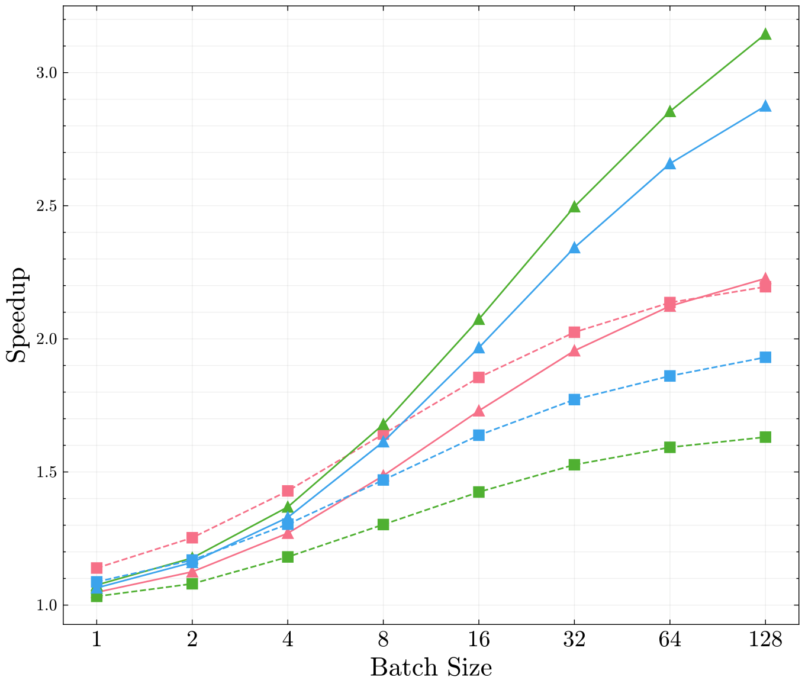

> 图解：比较三个 Ruler 任务中两种 KV 选择策略的理论加速比。CWE 和 QA-1 上二者接受率接近时，低选择成本的 SnapKV 更有优势；多键检索任务中，PQCache 可凭更高接受率暂时领先，但 Batch 增大后搜索开销会再次成为主导。

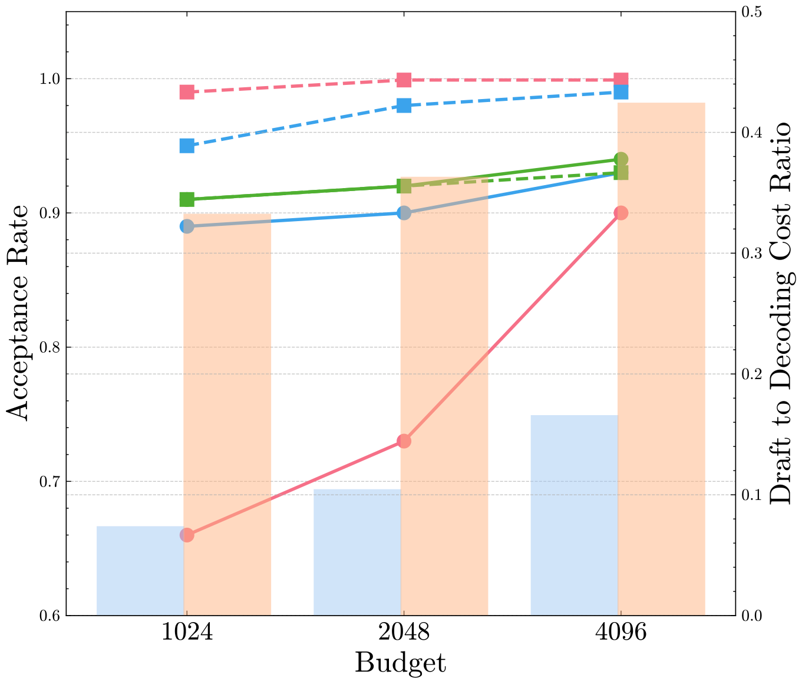

> 图解：该图联合呈现 SnapKV、PQCache 的 Draft-to-Target 成本比与接受率。最佳策略位于低成本、高接受率一侧，而不是单纯追求最高接受率。

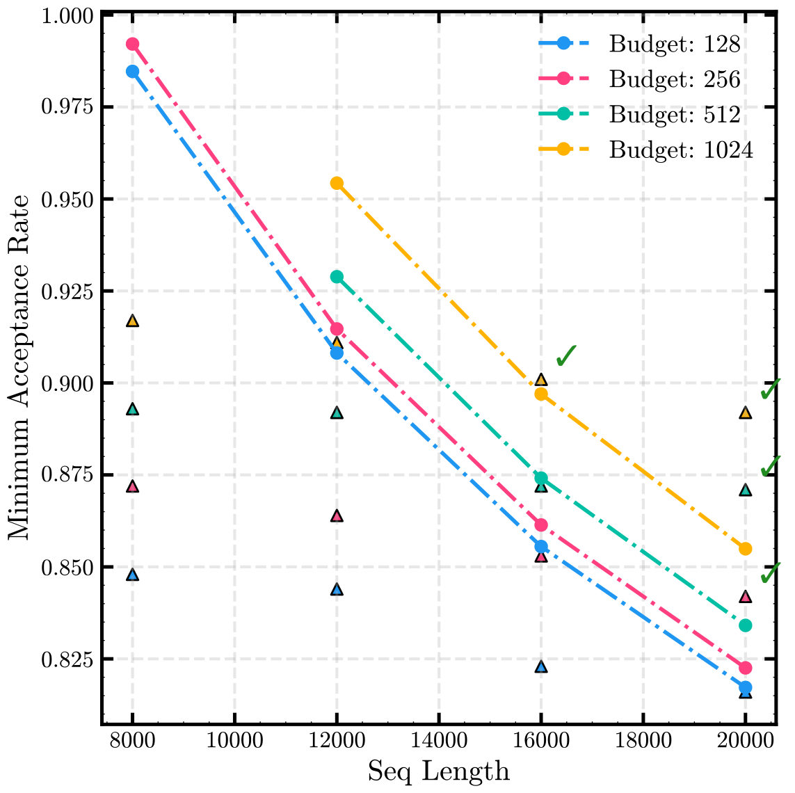

> 图解：横轴为序列长度，纵轴为 LLaMA-3.1-8B 自投机达到 1.8× 加速所需的最低接受率，不同颜色对应 KV Budget，并标出 PG-19 的实际接受率。实际接受率越过门槛的 Budget 才是可行选择；不同长度对应不同的可用 Budget 区间。

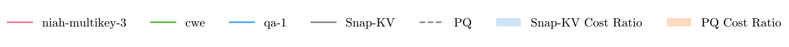

> 图例：用于对应上述三幅比较图中的算法、任务和曲线样式，不单独表示额外实验结果。

实验设置中，SnapKV 使用大小为 5 的平均池化核和 32 的观察窗口；PQCache 使用 16 个子向量，每个 Key 向量采用 8-bit 乘积量化。这里的结论不是“SnapKV 永远最好”，而是：**只有将 $T_{select}$、接受率和验证成本一起计算，才能选出当前任务的最优算法。**

## 实验：长序列跨临界点后，大 Batch 反而更有利

### 端到端加速与临界长度

端到端实验使用 LLaMA-3.1-8B 和 PG-19，采用 StreamingLLM 风格稀疏 KV 自投机。每个 Batch 中的一句话生成 96 个 Token，使用 Greedy Decoding，共测试 20 个 Batch；硬件为 8×A100、8 路 Tensor Parallelism，并比较草稿 KV Budget 256 与 512。

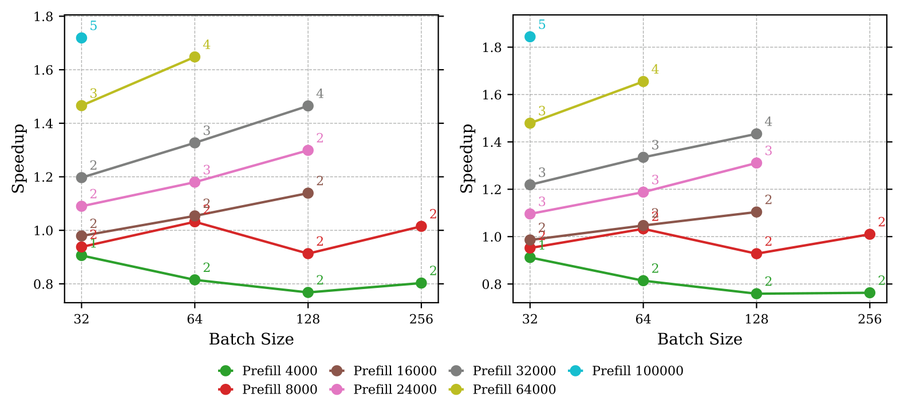

> 图解：横轴为 Batch Size，纵轴为相对自回归解码的端到端加速比，左右分别对应草稿 KV Budget 256 和 512，标注值为取得最高加速比的 $\gamma$。短序列、大 Batch 可能低于 1；序列超过约 4000 后，加速比总体随 Batch 增大而提高，大 Batch、长序列下更大的 KV Budget 也更有利。

不同硬件的结果进一步支持理论模型。下表沿用论文计时口径，$\gamma T_D(1)$ 表示一轮总草稿时间，$T_V(\gamma)$ 为验证时间，$\Omega$ 为每轮期望生成长度，$T^{AR}$ 与 $T^{SD}$ 分别为自回归和 SD 的平均 Token 延迟，$x=T^{AR}/T^{SD}$。

| Target | Draft | Task | GPU | Prefill | Bsz | $\gamma$ | $\gamma T_D(1)$ | $T_V(\gamma)$ | $\Omega$ | $T^{AR}$ | $T^{SD}$ | $x$ |
|---|---|---|---|---:|---:|---:|---:|---:|---:|---:|---:|---:|
| Llama3.1-8B | StreamingLLM | PG-19 | 8×L40 | 32000 | 32 | 3 | 44.11 | 45.12 | 3.00 | 36.62 | 30.32 | 1.21 |
| Llama2-7B-32K | StreamingLLM | PG-19 | 8×L40 | 8000 | 32 | 2 | 29.06 | 42.02 | 2.53 | 35.13 | 28.70 | 1.22 |
| Llama2-7B-32K | StreamingLLM | PG-19 | 8×L40 | 8000 | 64 | 3 | 58.33 | 74.85 | 3.14 | 62.92 | 42.96 | 1.46 |
| Llama3.1-8B | StreamingLLM | PG-19 | 4×H100 | 32000 | 32 | 3 | 15.09 | 18.30 | 2.82 | 17.32 | 12.16 | 1.42 |
| Llama2-7B-32K | StreamingLLM | PG-19 | 4×H100 | 8000 | 32 | 3 | 14.20 | 15.64 | 2.98 | 14.85 | 10.29 | 1.44 |
| Llama2-7B-32K | StreamingLLM | PG-19 | 4×H100 | 8000 | 64 | 4 | 23.63 | 27.90 | 3.37 | 26.17 | 15.58 | 1.68 |

相同设置下，H100 的加速比高于 A100 和 L40，符合其更高 FLOPS—显存带宽比的特征。非 GQA 的 LLaMA-2-7B-32K 在 8000 长度即可取得较高收益，而 GQA 的 LLaMA-3.1-8B 需要更长上下文才能形成同等强度的 KV 瓶颈。

### 草稿策略消融：小模型与自投机各有适用区

作者在 8×H100、PG-19 上，对 Prompt 长度 256、8192、32768 分别扫描最优 $\gamma$，比较小模型、压缩 KV 小模型与自投机。

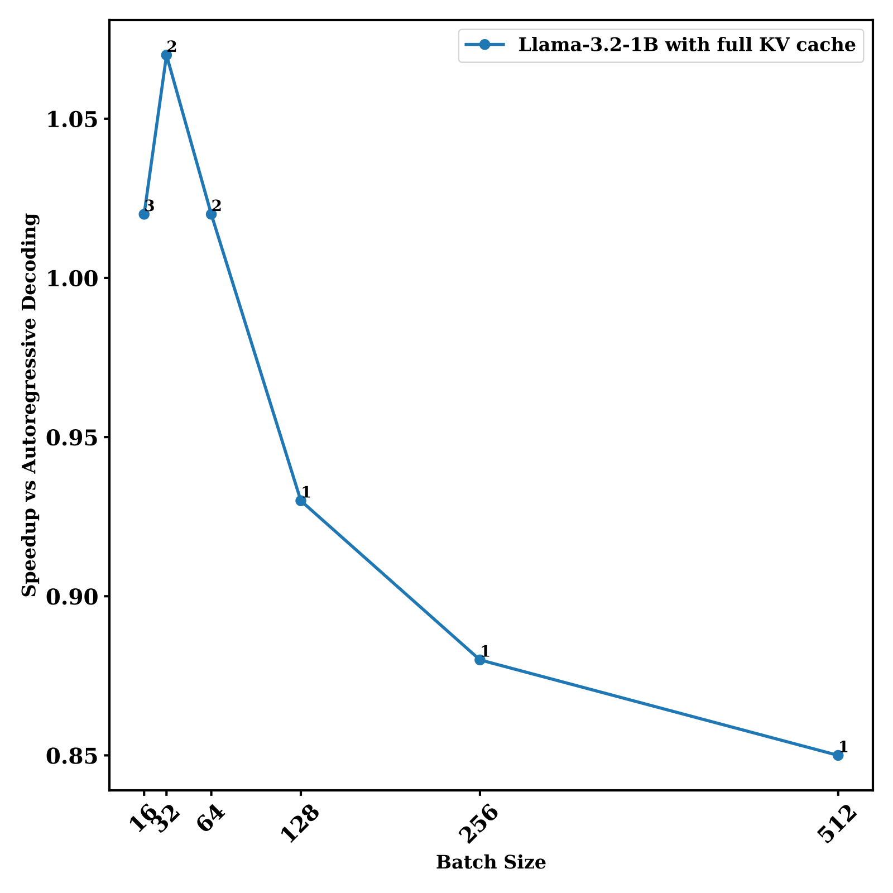

> 图解：横轴为 Batch Size，纵轴为加速比。短上下文下，KV 尚未主导耗时，传统 SD 会随 Batch 增大而失去优势，也对应既有研究主要观察到的区域。

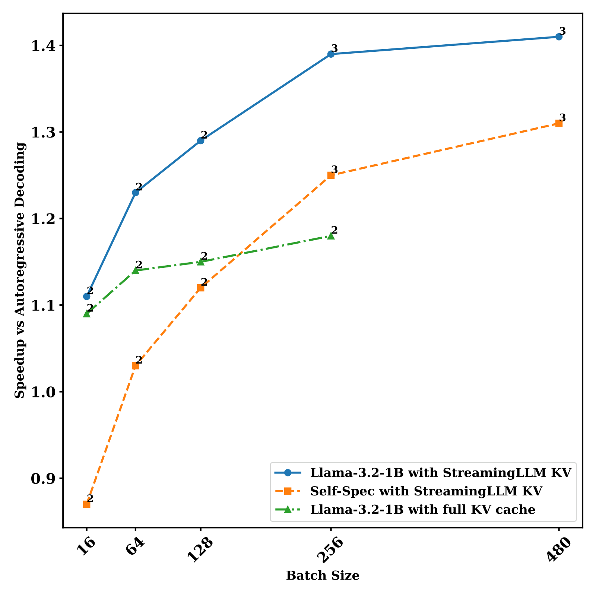

> 图解：横轴为 Batch Size，纵轴为加速比。中等长度且 Batch 不特别大时，带 KV 压缩的小草稿模型可凭较低权重成本优于自投机。

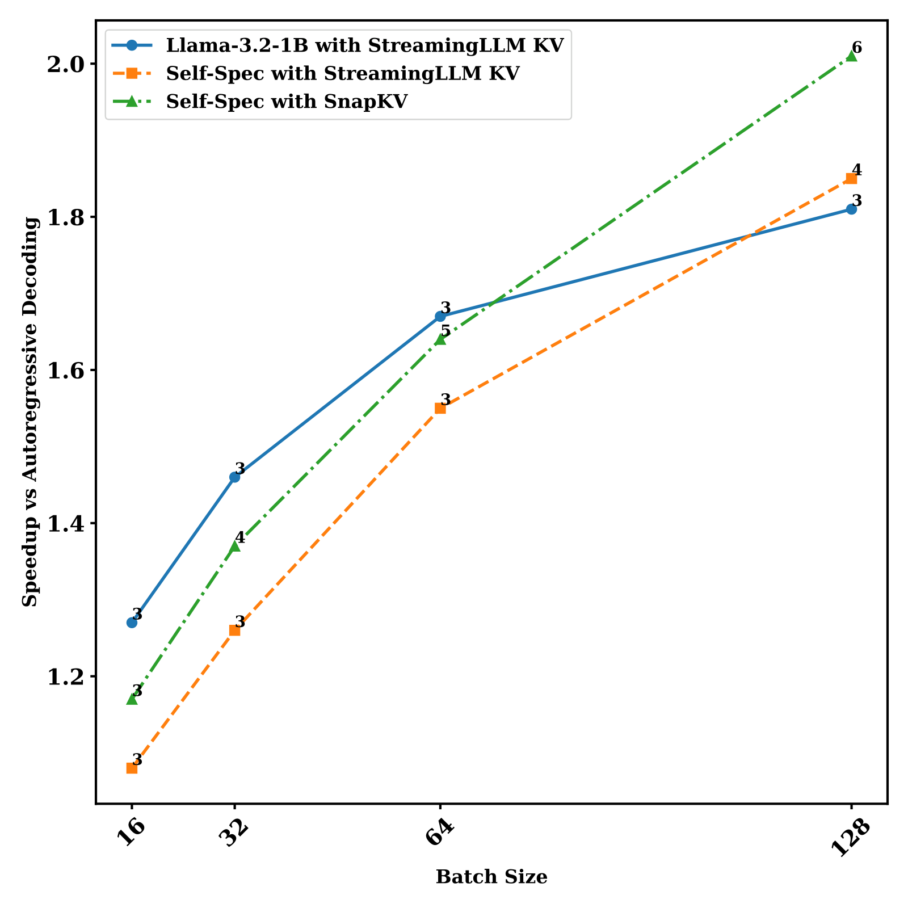

> 图解：横轴为 Batch Size，纵轴为加速比。长序列、大 Batch 下，KV 成为主导，自投机的草稿相对成本下降，高接受率使其最终超过小模型草稿。

这组消融说明，MagicDec 的理论模型不仅解释“为什么有效”，也正确预测了“何时该换一种草稿”。

### SnapKV 与 StreamingLLM：高接受率换来更高上限

对两种静态方法分别扫描最优 $\gamma$ 和 KV Budget 后，StreamingLLM 的最佳草稿 Budget 为 512，SnapKV 为 2049。SnapKV 虽然读取更多 KV，但接受率提升更快，因此所有测试设置中都取得更高加速比。

| Bsz | Draft | $\gamma$ | $\gamma T_D(1)$ | $T_V(\gamma)$ | $\Omega$ | $T^{AR}$ | $T^{SD}$ | $x$ |
|---:|---|---:|---:|---:|---:|---:|---:|---:|
| 16 | Llama3.2-1B(S) | 3 | 4.43 | 6.71 | 2.43 | 6.18 | 4.86 | 1.27 |
| 16 | StreamingLLM | 3 | 10.33 | 6.73 | 3.09 | 6.18 | 5.74 | 1.08 |
| 16 | SnapKV | 3 | 10.55 | 6.84 | 3.41 | 6.18 | 5.27 | 1.17 |
| 32 | Llama3.2-1B(S) | 3 | 4.71 | 9.70 | 2.43 | 9.10 | 6.22 | 1.46 |
| 32 | StreamingLLM | 3 | 11.55 | 9.74 | 3.06 | 9.10 | 7.20 | 1.26 |
| 32 | SnapKV | 4 | 15.79 | 10.36 | 4.03 | 9.10 | 6.64 | 1.37 |
| 64 | Llama3.2-1B(S) | 3 | 5.05 | 15.86 | 2.44 | 14.84 | 8.88 | 1.67 |
| 64 | StreamingLLM | 3 | 12.82 | 15.93 | 3.08 | 14.84 | 9.57 | 1.55 |
| 64 | SnapKV | 5 | 22.91 | 17.70 | 4.55 | 14.84 | 9.05 | 1.64 |
| 128 | Llama3.2-1B(S) | 3 | 5.79 | 28.51 | 2.43 | 26.07 | 14.43 | 1.81 |
| 128 | StreamingLLM | 4 | 18.96 | 30.34 | 3.57 | 26.07 | 14.06 | 1.85 |
| 128 | SnapKV | 6 | 33.33 | 31.60 | 5.07 | 26.07 | 12.96 | 2.01 |

> 表解：目标模型均为 Llama3.1-8B，任务为 PG-19，硬件为 8×H100，Prefill 为 32000。Batch 越大，高接受率策略越能支持更长的 $\gamma$；SnapKV 在 Bsz 128 时达到 2.01×，高于同组 StreamingLLM 的 1.85× 和小模型的 1.81×。

将 SnapKV 自投机扩展到不同任务和上下文长度后，最高结果出现在 8×H100、100K CWE、Batch Size 41：$T^{AR}=25.83$，$T^{SD}=10.29$，加速 **2.51×**。

| Task | GPU | Prefill | Bsz | $\gamma$ | $\gamma T_D(1)$ | $T_V(\gamma)$ | $\Omega$ | $T^{AR}$ | $T^{SD}$ | $x$ |
|---|---|---:|---:|---:|---:|---:|---:|---:|---:|---:|
| PG-19 | 8×H100 | 100000 | 41 | 7 | 34.34 | 28.50 | 5.61 | 25.96 | 11.35 | 2.29 |
| QA-1 | 8×H100 | 100000 | 41 | 11 | 53.90 | 29.89 | 7.93 | 25.90 | 10.64 | 2.43 |
| CWE | 8×H100 | 100000 | 41 | 11 | 53.98 | 29.93 | 8.21 | 25.83 | 10.29 | 2.51 |
| PG-19 | 8×H100 | 64000 | 64 | 6 | 32.89 | 28.80 | 5.41 | 25.52 | 11.54 | 2.21 |
| QA-1 | 8×H100 | 64000 | 64 | 7 | 38.40 | 29.11 | 6.08 | 25.43 | 11.20 | 2.27 |
| CWE | 8×H100 | 64000 | 64 | 8 | 43.91 | 29.29 | 6.83 | 25.48 | 10.81 | 2.36 |

> 表解：目标模型均为 Llama3.1-8B，草稿均为 SnapKV。任务越容易被草稿准确预测，$\Omega$ 和最优 $\gamma$ 越高，因此 2.51× 是特定任务与配置下的峰值，不应理解为所有负载的统一收益。

### 跨模型结果：收益趋势可以复现，峰值并不相同

| Target | Draft | GPU | Bsz | $\gamma$ | $\gamma T_D(1)$ | $T_V(\gamma)$ | $\Omega$ | $T^{AR}$ | $T^{SD}$ | $x$ |
|---|---|---|---:|---:|---:|---:|---:|---:|---:|---:|
| Mistral-7B-v0.3 | SnapKV | 8×H100 | 32 | 3 | 11.71 | 9.62 | 3.49 | 8.92 | 6.12 | 1.46 |
| Mistral-7B-v0.3 | SnapKV | 8×H100 | 64 | 3 | 13.64 | 15.64 | 3.47 | 14.49 | 8.44 | 1.72 |
| Mistral-7B-v0.3 | SnapKV | 8×H100 | 128 | 5 | 27.49 | 30.65 | 4.72 | 25.41 | 12.31 | 2.06 |
| Qwen-2.5-7B | SnapKV | 4×H100 | 32 | 3 | 11.40 | 9.26 | 3.40 | 8.20 | 6.07 | 1.35 |
| Qwen-2.5-7B | SnapKV | 4×H100 | 64 | 4 | 17.67 | 15.67 | 4.06 | 13.11 | 8.20 | 1.60 |
| Qwen-2.5-7B | SnapKV | 4×H100 | 128 | 5 | 27.22 | 28.51 | 4.62 | 22.79 | 12.06 | 1.89 |
| Qwen-2.5-32B | SnapKV | 8×H100 | 8 | 3 | 23.67 | 11.98 | 3.50 | 10.42 | 10.19 | 1.02 |
| Qwen-2.5-32B | SnapKV | 8×H100 | 16 | 3 | 25.27 | 15.29 | 3.52 | 13.36 | 11.52 | 1.16 |
| Qwen-2.5-32B | SnapKV | 8×H100 | 32 | 3 | 28.99 | 21.90 | 3.51 | 19.43 | 14.49 | 1.34 |
| Qwen-2.5-32B | Qwen-2.5-7B | 8×H100 | 8 | 2 | 9.04 | 11.31 | 2.32 | 10.42 | 8.74 | 1.19 |
| Qwen-2.5-32B | Qwen-2.5-7B | 8×H100 | 16 | 2 | 11.61 | 14.59 | 2.32 | 13.36 | 11.31 | 1.18 |
| Qwen-2.5-32B | Qwen-2.5-7B | 8×H100 | 32 | 2 | 16.72 | 20.87 | 2.31 | 19.43 | 16.27 | 1.19 |
| Qwen-2.5-32B | Qwen-2.5-7B(Streaming) | 8×H100 | 8 | 2 | 6.77 | 11.31 | 2.27 | 10.42 | 7.97 | 1.31 |
| Qwen-2.5-32B | Qwen-2.5-7B(Streaming) | 8×H100 | 16 | 2 | 7.21 | 14.59 | 2.26 | 13.36 | 9.64 | 1.39 |
| Qwen-2.5-32B | Qwen-2.5-7B(Streaming) | 8×H100 | 32 | 3 | 11.78 | 21.82 | 2.62 | 19.43 | 12.85 | 1.51 |

> 表解：任务均为 PG-19，Prefill 均为 32000。Mistral-7B-v0.3、Qwen-2.5-7B 和 Qwen-2.5-32B 的最高加速比分别为 2.06×、1.89× 和 1.51×。Qwen-2.5-32B 的小模型加入 Streaming KV 后，收益从约 1.19× 提升至最高 1.51×，再次体现 KV 优化的重要性。

## 实现与补充结果：理论趋势还要经得起系统工程

论文主结果来自基于 GPT-Fast 的自研后端，Attention 由 FlashInfer 加速，MLP 使用 Triton 矩阵乘法，模型通过 `torch.compile` 编译，并用 PyTorch CUDA Graphs 减少 CPU Kernel Launch 开销；Embedding 层也实现了 Tensor Parallelism。作者同时将系统集成到 MLC-LLM，以检查趋势是否依赖单一实现。

### 自研后端与 MLC-LLM

| Target | Backend | Task | GPU | Prefill | Bsz | $\gamma$ | $\gamma T_D(1)$ | $T_V(\gamma)$ | $\Omega$ | $T^{AR}$ | $T^{SD}$ | $x$ |
|---|---|---|---|---:|---:|---:|---:|---:|---:|---:|---:|---:|
| Llama3.1-8B | Ours | PG-19 | 8×H100 | 32000 | 16 | 3 | 10.96 | 6.91 | 3.42 | 6.41 | 5.41 | 1.18 |
| Llama3.1-8B | Ours | PG-19 | 8×H100 | 32000 | 32 | 4 | 16.69 | 10.39 | 4.10 | 9.23 | 6.75 | 1.37 |
| Llama3.1-8B | Ours | PG-19 | 8×H100 | 32000 | 64 | 5 | 23.96 | 17.45 | 4.59 | 14.85 | 9.17 | 1.62 |

| Target | Backend | Task | GPU | Prefill | Bsz | $\gamma$ | $T_D(1)$ | $T_V(\gamma)$ | Num Gen | AR Trput | SD Trput | $x$ |
|---|---|---|---|---:|---:|---:|---:|---:|---:|---:|---:|---:|
| Llama3.1-8B | MLC-LLM | PG-19 | 8×H100 | 32000 | 16 | 4 | 3.64 | 13.60 | 724 | 2471.4 | 2133.0 | 0.86 |
| Llama3.1-8B | MLC-LLM | PG-19 | 8×H100 | 32000 | 32 | 4 | 4.19 | 16.13 | 1455 | 3311.5 | 3664.5 | 1.11 |
| Llama3.1-8B | MLC-LLM | PG-19 | 8×H100 | 32000 | 64 | 5 | 5.27 | 28.26 | 2719 | 3930.0 | 4959.2 | 1.26 |

> 表解：两种后端的测量口径不同，不能直接逐格比较绝对时间；MLC-LLM 的验证时间还包含一步 Draft Decode。自研后端通过降低草稿与验证开销获得更高收益，但 MLC-LLM 同样呈现“加速比随 Batch 增大而提高”的趋势。

### A100 原始扫描：临界点与模型结构的关系

以下三组结果均使用 8×A100、8 路 Tensor Parallelism，KV Budget 为 512，$\gamma=2$。$S$ 为 Prefill 长度，$B$ 为 Batch Size。

**LLaMA-2-7B-32K，TinyLLaMA-1.1B 草稿**

| S | B | $\gamma T_D$ | $T_V$ | $\Omega$ | $T^{AR}$ | $T^{SD}$ | $x$ |
|---:|---:|---:|---:|---:|---:|---:|---:|
| 1024 | 32 | 8.21 | 9.55 | 2.19 | 8.27 | 8.70 | 0.95 |
| 1024 | 48 | 8.46 | 10.66 | 2.19 | 9.41 | 9.33 | 1.01 |
| 1024 | 64 | 9.26 | 13.05 | 2.19 | 10.83 | 10.80 | 1.00 |
| 1024 | 128 | 12.04 | 18.87 | 2.19 | 14.02 | 14.83 | 0.94 |
| 4000 | 32 | 8.46 | 13.21 | 2.19 | 11.89 | 10.52 | 1.13 |
| 4000 | 48 | 8.71 | 16.19 | 2.19 | 14.39 | 12.02 | 1.20 |
| 4000 | 64 | 9.35 | 21.83 | 2.19 | 19.28 | 14.88 | 1.30 |
| 4000 | 128 | 12.31 | 33.82 | 2.19 | 28.77 | 21.78 | 1.32 |
| 8000 | 32 | 8.61 | 18.40 | 2.18 | 16.53 | 13.02 | 1.27 |
| 8000 | 48 | 8.91 | 23.67 | 2.18 | 21.45 | 15.58 | 1.38 |
| 8000 | 64 | 9.58 | 34.32 | 2.18 | 31.49 | 20.80 | 1.51 |
| 8000 | 128 | 12.54 | 53.78 | 2.18 | 49.89 | 31.25 | 1.60 |
| 16000 | 32 | 8.78 | 27.79 | 2.17 | 26.28 | 17.46 | 1.50 |
| 16000 | 48 | 9.33 | 38.29 | 2.18 | 35.83 | 22.52 | 1.59 |
| 16000 | 64 | 9.92 | 58.14 | 2.17 | 55.08 | 31.99 | 1.72 |
| 24000 | 32 | 8.68 | 37.57 | 2.16 | 35.70 | 22.05 | 1.62 |
| 32000 | 32 | 8.83 | 47.35 | 2.17 | 44.94 | 26.55 | 1.69 |

**LLaMA-2-7B-32K，自投机**

| S | B | $\gamma T_D$ | $T_V$ | $\Omega$ | $T^{AR}$ | $T^{SD}$ | $x$ |
|---:|---:|---:|---:|---:|---:|---:|---:|
| 4000 | 32 | 15.42 | 13.17 | 2.56 | 11.89 | 11.69 | 1.02 |
| 4000 | 48 | 16.96 | 16.38 | 2.56 | 14.39 | 13.55 | 1.06 |
| 4000 | 64 | 19.75 | 22.01 | 2.57 | 19.28 | 16.82 | 1.15 |
| 4000 | 128 | 25.82 | 33.79 | 2.56 | 28.77 | 23.86 | 1.21 |
| 8000 | 32 | 15.70 | 18.23 | 2.53 | 16.53 | 13.99 | 1.18 |
| 8000 | 48 | 18.44 | 24.32 | 2.53 | 21.45 | 17.50 | 1.23 |
| 8000 | 64 | 20.03 | 34.30 | 2.53 | 31.49 | 22.05 | 1.43 |
| 8000 | 128 | 26.10 | 53.69 | 2.52 | 49.89 | 32.25 | 1.55 |
| 16000 | 32 | 16.06 | 27.54 | 2.50 | 26.28 | 18.02 | 1.46 |
| 16000 | 48 | 19.75 | 39.03 | 2.50 | 35.83 | 24.15 | 1.48 |
| 16000 | 64 | 20.87 | 58.15 | 2.51 | 55.08 | 32.16 | 1.71 |
| 24000 | 32 | 15.80 | 37.06 | 2.49 | 35.70 | 21.77 | 1.64 |
| 32000 | 32 | 16.19 | 46.55 | 2.50 | 44.94 | 25.64 | 1.75 |

**LLaMA-3.1-8B，自投机**

| S | B | $\gamma T_D$ | $T_V$ | $\Omega$ | $T^{AR}$ | $T^{SD}$ | $x$ |
|---:|---:|---:|---:|---:|---:|---:|---:|
| 4000 | 32 | 13.16 | 10.32 | 2.54 | 8.83 | 9.78 | 0.90 |
| 4000 | 64 | 16.48 | 13.55 | 2.54 | 10.07 | 12.36 | 0.81 |
| 4000 | 128 | 23.41 | 19.77 | 2.54 | 13.42 | 17.70 | 0.76 |
| 4000 | 256 | 39.29 | 35.05 | 2.53 | 23.23 | 30.46 | 0.76 |
| 8000 | 32 | 13.28 | 11.34 | 2.50 | 9.90 | 10.40 | 0.95 |
| 8000 | 64 | 16.98 | 16.06 | 2.51 | 14.16 | 13.72 | 1.03 |
| 8000 | 128 | 23.59 | 24.84 | 2.51 | 18.53 | 19.97 | 0.93 |
| 8000 | 256 | 39.32 | 46.44 | 2.51 | 35.35 | 34.99 | 1.01 |
| 16000 | 32 | 14.46 | 14.00 | 2.47 | 11.93 | 12.10 | 0.99 |
| 16000 | 64 | 18.00 | 21.15 | 2.48 | 17.17 | 16.40 | 1.05 |
| 16000 | 128 | 25.77 | 34.82 | 2.46 | 28.00 | 25.36 | 1.10 |
| 32000 | 32 | 14.12 | 19.04 | 2.46 | 17.13 | 14.05 | 1.22 |
| 32000 | 64 | 19.08 | 30.86 | 2.45 | 26.99 | 21.03 | 1.28 |
| 32000 | 128 | 28.26 | 54.98 | 2.45 | 47.24 | 34.94 | 1.35 |
| 64000 | 32 | 14.92 | 28.88 | 2.40 | 26.96 | 18.91 | 1.43 |
| 64000 | 64 | 18.25 | 50.19 | 2.40 | 46.09 | 29.22 | 1.58 |
| 100000 | 32 | 15.10 | 39.84 | 2.45 | 37.70 | 23.05 | 1.64 |

> 表解：原始数据提醒读者不要过度概括“Batch 越大越好”。LLaMA-3.1-8B 在 4000 长度时仍随 Batch 增大而减速，8000 长度也只有部分配置超过 1；真正的单调增益出现在更长上下文。非 GQA 的 LLaMA-2-7B-32K 更早进入 KV 主导区域。

相应的 LLaMA-2-7B-32K 端到端曲线如下。

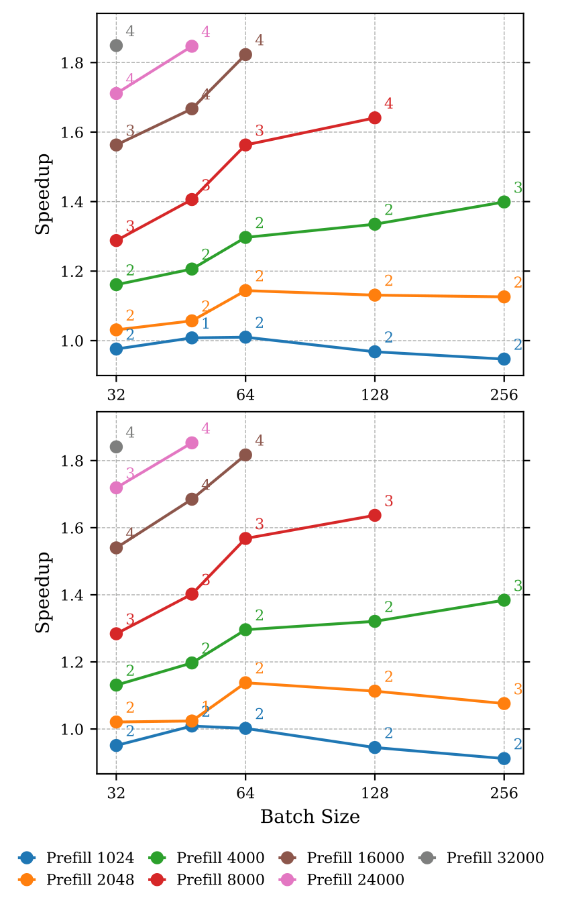

> 图解：横轴为 Batch Size，纵轴为端到端加速比，左右对应压缩 KV Budget 256 和 512，标注为最优 $\gamma$。小模型在较长上下文也获得收益，但接受率较低，草稿加长带来的 $\Omega$ 上限不如自投机。

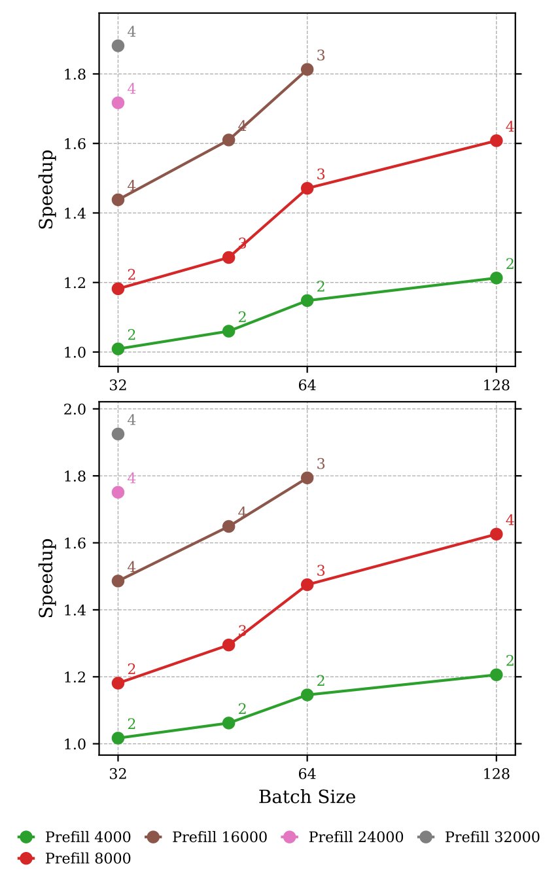

> 图解：坐标与 Budget 含义同上一图。自投机在 32K 长度、Batch Size 32 时达到 1.75×，高于同组小模型草稿的 1.69×，显示高接受率与固定 KV 成本共同作用。

## 与既有方法的关系：不是替代调度，而是补上长文解码的一块拼图

FlashDecoding、FlashDecoding++ 和 FasterTransformer 主要从系统 Kernel 层面降低延迟；Continuous Batching、Chunked Prefill 处理不同上下文与生成长度造成的调度问题。这些工作与 MagicDec 可以互补，因为本文主要研究**同构 Batch 的 Decode 阶段**。

与 TriForce 相比，二者都利用稀疏 KV 自投机，但目标区间不同：TriForce 面向小 Batch、极长序列，MagicDec 面向大 Batch、中长序列，并进一步研究草稿模型、KV Budget、选择算法和 $\gamma$ 的联合权衡。

既有 Batched SD 研究观察到接受 Token 数在 Batch 内不一致，会造成序列错位和额外计算，因此建议大 Batch 减少投机长度。MagicDec 并不否认这些开销，而是指出：短序列结论不能直接外推到 KV 主导的长序列。Speculation Parallelism 等将 Draft 与 Verify 重叠的方法，也可在 MagicDec 的低成本、高接受率草稿之上进一步降低验证开销。

## 结论与展望

- **SD 并非只适合小 Batch**：序列超过由模型、硬件和草稿策略决定的临界长度后，大 Batch 也能加速。
- **瓶颈转移是根因**：长上下文让 KV 加载重新成为主导，验证与解码共享这部分成本，$T_V/T_T$ 因而保持较低水平。
- **稀疏 KV 是核心草稿策略**：它同时降低草稿成本、提高接受率；固定 Budget 的草稿相对成本还可随 Batch 增大而下降。
- **策略必须按负载选择**：Draft Model Size、KV Budget、压缩算法和 $\gamma$ 需要联合优化，静态与动态 KV 选择没有脱离任务的绝对赢家。
- **收益有明确边界**：LLaMA-3.1-8B 最高达到 2.51×，Mistral 和 Qwen 也呈一致趋势，但短序列、大 Batch 仍可能减速。

MagicDec 只优化 Decode，尚未解决长上下文 Prefill 的成本；其收益也更利于 FLOPS—显存带宽比高、HBM 容量大的高端 GPU。下一步可与 Prefill/Decode 分离、分布式服务和 Offloading 结合，并降低通信与草稿验证开销，把这一结论扩展到更通用的 serving 系统。

> 本文参考自 [MagicDec: Breaking the Latency-Throughput Tradeoff for Long Context Generation with Speculative Decoding](https://arxiv.org/abs/2408.11049)