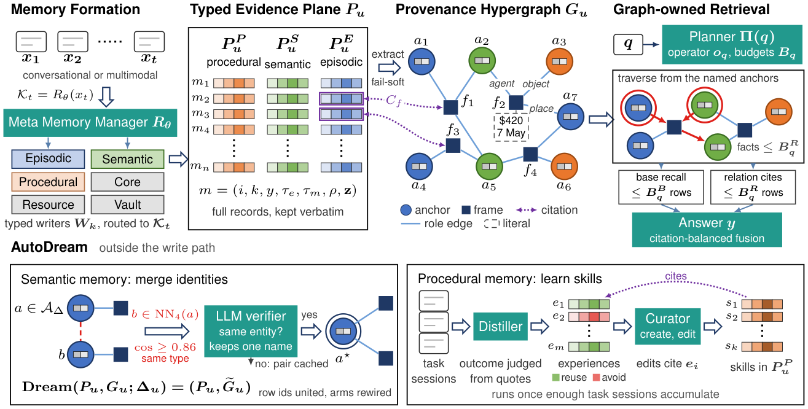
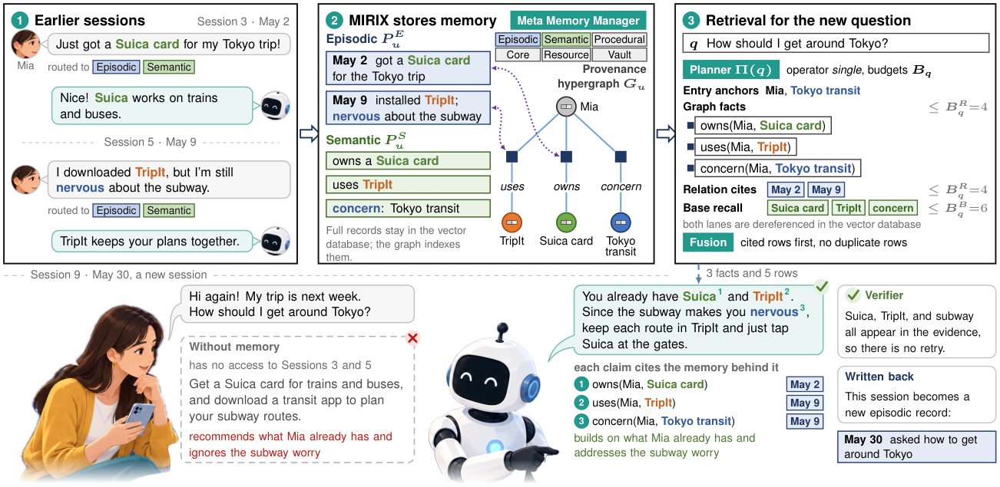
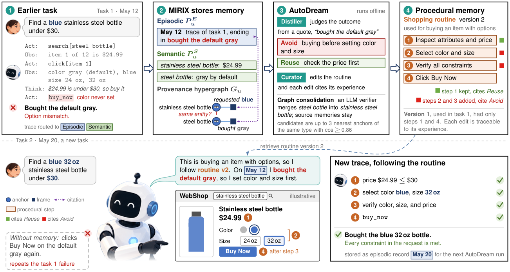
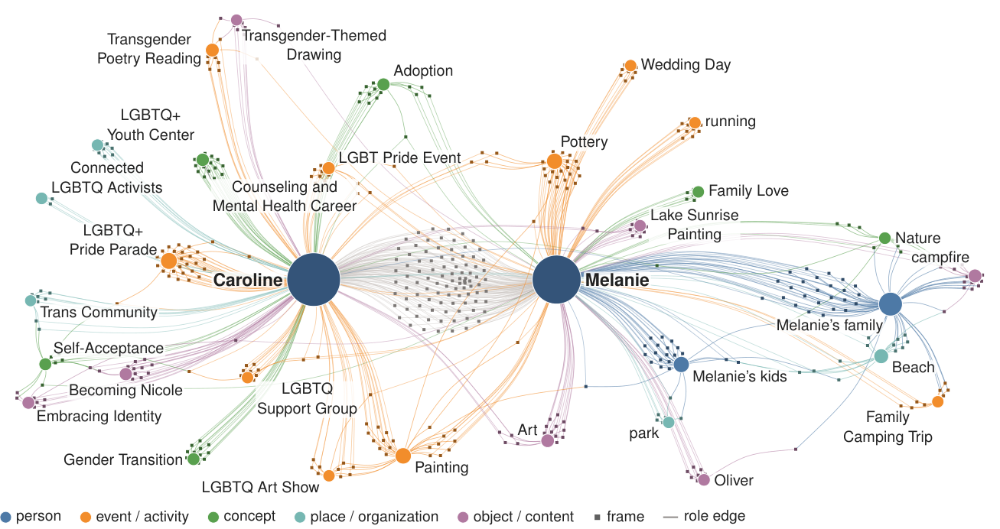
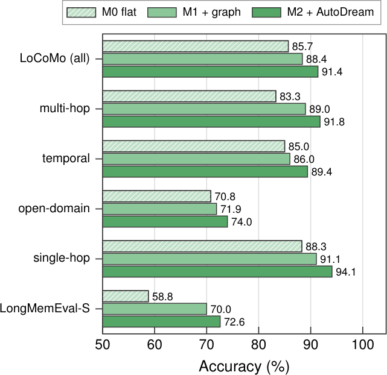
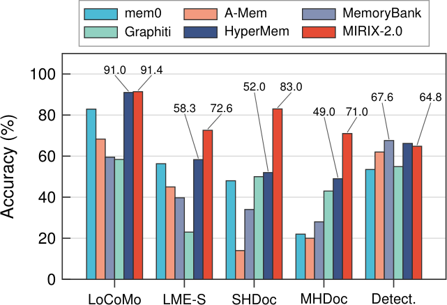
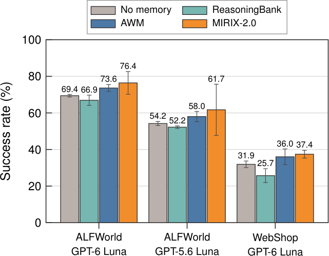
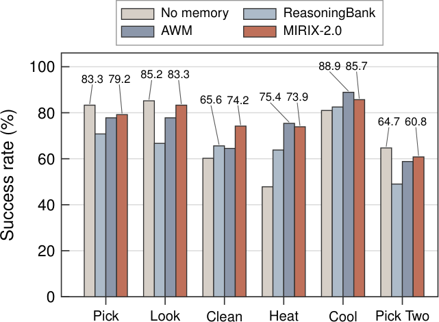
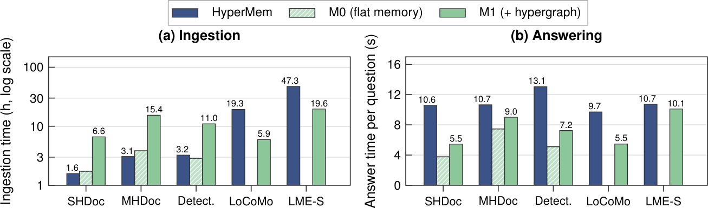

# MIRIX-2.0：来源超图统一用户记忆与技能

MIRIX-2.0 要解决的是长期记忆难以同时兼顾准确、实用与高效的问题：压缩会丢细节，全量保留又会带来越来越昂贵的检索。它的核心思路是让六类记忆 Agent 保存完整记录，再用带来源引用的 n 元超图做有预算的索引，并由 AutoDream 在写入路径之外整理实体、蒸馏技能。最终，系统在 LoCoMo 上达到 **91.4%**，在 LongMemEval-S 上达到 **72.6%**、比 HyperMem 高 **14.3 个百分点**；关闭 AutoDream 时，单跳与多跳文档问答也分别比 HyperMem 高 **31.0** 和 **22.0 个百分点**。同一套存储还能服务个性化问答与 Agent 技能复用，无需微调，并可搭配闭源或开源模型。

## 长期记忆为什么总是“顾此失彼”

一个个人助理可能积累数月的对话，一个任务 Agent 也会在不同 episode 中反复遇到相似问题。记忆的价值不只是“记住”，还包括回答个性化、遵守用户曾说过的约束，以及复用过去有效的做法。

真正部署时，记忆系统至少要同时满足三项要求：

- **准确**：姓名、日期、数量、两个相似事件的区别，以及事件之间的关系都不能丢。
- **实用**：无需训练，能接入团队已有模型；答案可追溯到原始记录；整理记忆时不能破坏证据。
- **高效**：历史不断增长时，单次问题读取的证据量、响应延迟和 Token 成本仍应受控。

已有路线往往只满足其中一部分。把记录压缩成事实或摘要虽然紧凑，却会永久丢失未进入摘要的细节；完整保存所有记录再进行相似度搜索，则要面对越来越大的噪声与检索范围。普通图记忆容易把一个多方参与的事实拆成孤立二元三元组，参数化记忆又需要训练，无法直接用于闭源模型。

HyperMem 和文件系统式记忆还存在另一种“自上而下”的可达性问题：细节能否被找到，取决于主题摘要或文件单行摘要是否提到它。摘要没写到的内容，可能只能依赖字符串搜索，既难以跨文件消解实体，也难以沿关系继续追踪。

更重要的是，**用户记忆与 Agent 记忆的需求并不相同**。用户记忆需要广泛保留历史并建立关联，因为未来的问题可能依赖任何一个小细节；Agent 记忆则需要从任务轨迹中提炼精确、可复用的技能，检索过多反而可能分散下一步行动的注意力。MIRIX-2.0 的目标，就是让同一个存储同时承担这两种角色。

## 总体架构：完整记录是底座，超图只是索引

> 图解：输入先由不同类型的写入 Agent 进入证据平面 $P_u$，完整记录始终保存在这里。来源超图 $G_u$ 只负责用带引用的 n 元事实框架组织索引；读取时在显式预算内遍历超图并取回源记录。AutoDream 独立在写入与读取主路径之外运行，分别承担语义实体合并与程序技能提炼。

对用户 $u$，系统接收对话或多模态输入流 $\mathcal X_u=(x_1,\ldots,x_T)$。每次写入时未来查询尚不可知，因此持久状态被拆成证据与索引两部分：

$$
\mathcal S_u^t=(P_u^t,G_u^t)
$$

其中，$P_u$ 是真实的记录系统，$G_u$ 是可重建、可容错的索引。系统后续回答查询 $q$ 时，只构造有界的证据集合 $\mathcal R(q;\mathcal S_u^t)$，而不是扫描全部历史。

这一分层对应三条路径：

1. **写入路径**：先提交完整记录，再抽取图结构。图写入失败不会回滚已经保存的记忆。
2. **读取路径**：规划查询、进入锚点、沿图扩展、取回被引用的记录。图读取报错时才回退到直接证据检索。
3. **AutoDream 路径**：在关键写入路径之外运行。语义记忆只改连接方式，程序记忆才修改可复用技能。

这个设计的关键不是“又加了一张图”，而是明确限制图的权力：图可以帮助找到证据，却不能取代证据，更不能在整理时悄悄删除证据。

## 六类写入 Agent：先保住完整证据

Meta Memory Manager 会把每个输入路由到需要更新的记忆类型。六种类型各有独立 Writer、Schema 和更新操作，只有 Episodic 与 Semantic 两类进入超图，其余类型保留各自的直接检索路径。

| 记忆类型 | 主要作用 | 是否进入超图 |
|---|---|---|
| Core | 持久保存用户与 Agent 状态 | 否 |
| Episodic | 保存带时间定位的事件 | 是 |
| Semantic | 保存持久事实与概念 | 是 |
| Procedural | 保存可执行工作流 | 否 |
| Resource | 保存文档与多模态材料 | 否 |
| Knowledge Vault | 保存敏感的逐字取值 | 否 |

对于被索引的记录，可表示为：

$$
m=(i,k,y,\tau_e,\tau_m,\rho,\mathbf z)
$$

其中，$i$ 是不可变的行标识，$k$ 表示 Episodic 或 Semantic，$y$ 是完整文本，$\tau_e$ 是事件发生时间，$\tau_m$ 是提及或写入时间，$\rho$ 记录来源与 chunk 信息，$\mathbf z$ 是检索 Embedding。

写入 Prompt 明确要求保留完整列表、姓名、数量、标题、地点和日期，而不是只留下主题梗概。计划中的事件也会连同计划日期保存。向量数据库提交成功后才开始建图，因此证据平面不是图构建的副产品。

为什么只索引两类记忆？因为跨记录关系遍历主要需要事件与事实证据。Core、Procedural、Resource 和 Knowledge Vault 有各自明确的读取方式，全部塞入图中只会扩大索引面，还会让敏感逐字值获得不必要的图入口。

## 来源超图：一条事实不再被拆成碎片

在每个用户的超图中，节点与边被定义为：

$$
G_u=(\mathcal A_u,\mathcal F_u,\mathcal E_u)
$$

$\mathcal A_u$ 是实体或概念锚点，$\mathcal F_u$ 是具体化的事实框架，$\mathcal E_u$ 是带角色类型的关联边。

### 锚点准入与实体规范化

锚点保存规范名称、实体类型、名称 Embedding，以及提及它的 Episodic 和 Semantic 记录标识。确定性名称键会统一大小写、标点、功能词、词序和保守的单复数变化，但保留数字。例如，*Mobile App* 与 *Mobile Apps* 可以归并，*10 Gallons* 与 *20 Gallons* 则必须保持不同。

准入规则会拒绝 *advice*、*details*、*information* 等泛化归档词，以及 *user*、*assistant* 这类对话角色伪实体。每条 Episodic 记录最多接纳 16 个锚点，Semantic 最多 18 个，以防图退化成关键词袋。

表面规范化无法判断两个相近名称是否真是同一实体，因此系统还会为每个实体检索最多四个余弦相似度不低于 $0.72$ 的已有锚点，再用每条记录一次 LLM 调用做保守判断。Embedding 只能提出候选，不能自行授权合并；不同数量、日期、型号以及相关但不同的概念都不得合并。

### n 元事实框架与字面量

每条 Episodic 或 Semantic 记录会被抽取为一组框架：

$$
f=\left(p,\{(r_j,a_j)\}_{j=1}^{d_f},\ell_f,\tau_e,\tau_m,C_f\right)
$$

$p$ 是规范谓词，$r_j$ 是锚点 $a_j$ 的开放词表角色，$\ell_f$ 保存字面属性，$C_f$ 则引用该事实来自哪些数据库记录。

例如，一次航班可以保留在同一个框架中，同时连接 traveler、origin、destination、carrier 和 companion，而不是拆成多条失去共同上下文的三元组。日期、价格、数量、时长和测量值作为字面量留在框架上，使 420 美元或“三个月”始终附着于它修饰的断言。

只有至少解析到两个不同锚点的框架才会实体化。如果确定性审计发现引号短语、数字或具体视觉内容遗漏，系统最多发起一次有界修复调用，而且只能补充源文本支持的框架，不能删除首次抽取的结果。视觉内容覆盖率低于 45% 时会触发检查，每次修复最多提交 12 个缺失项；单独缺日期不会触发修复，因为日期已经由来源信息保存。

### 相似事件不能因措辞相近而被合并

Semantic 与 Episodic 使用不同的身份规则。令 $\sigma(f)$ 表示排序后的“角色—锚点键”集合，持久语义事实的标识为：

$$
\operatorname{id}_S(f)=H(u,p,\sigma(f))
$$

这样，同一持久事实的多次支持会累计到同一个节点的引用中。事件框架则增加 occurrence key：

$$
\operatorname{id}_E(f)=H(u,p,\sigma(f),\chi(f))
$$

$$
\chi(f)=
\begin{cases}
\text{显式事件时间}, & \text{若已抽取}\\
\text{不可变记忆 ID}, & \text{否则}
\end{cases}
$$

因此，同一个有日期事件的多次提及可以共享框架；两次没有日期、措辞相似的跑步记录却不会合并。事件状态是“计划”还是“完成”也不改变其身份。这条规则同时保护了时间可追溯性与事件之间的边界。

> 图解：多轮会话先写为 Episodic 与 Semantic 记录。后续个性化问题从相关锚点进入超图，再同时取回图事实和源记录。例如 *owns(Mia, Suica card)* 会引用 5 月 2 日的原始记录；面对东京交通问题，规划器选择 single 操作，从 Mia 与 Tokyo transit 进入，最终返回三条事实和五行证据。

完整记录与 n 元框架解决了“保存什么”，接下来的问题是如何在不扫描全库的前提下“找到什么”。

## 有界检索：图负责选证据，而不是隐藏全库搜索

MIRIX-2.0 把检索看成构造一个有界证据集。Episodic 与 Semantic 候选必须先经过图，向量数据库只对图选出的标识解引用并重排，避免名义上使用图、实际上仍靠全表搜索完成任务。

### 查询规划与预算

确定性规划器将问题映射为：

$$
\Pi(q)=\left(o_q,\mathcal P_q,\mathcal C_q,\mathcal Y_q,\mathcal T_q,B_q^B,B_q^R\right)
$$

$o_q$ 是 single、temporal、intersection、list-union 或 count 操作；其余字段分别描述关系族、非关系约束、期望答案类型、时间约束，以及基础召回和关系引用两条通道的行预算。

| 查询操作 | 基础行预算 $B_q^B$ | 引用行预算 $B_q^R$ |
|---|---:|---:|
| Single | 6 | 4 |
| Temporal | 6 | 6 |
| Intersection | 7 | 7 |
| List-union | 7 | 9 |
| Count | 8 | 12 |

计数与集合构造需要看到更多成员，因此预算高于单值查询。无论历史多长，问题可检查的证据规模首先由操作类型决定，而不是由数据库总行数决定。

### 锚点入口与双证据通道

向量召回先取 15 个名称锚点；关系问题还可加入最多 16 个被问题精确命名的锚点。合并后按向量分数、精确命中、词面重合、谓词兼容、多词特异性和 hub 惩罚打分，最终保留 15 个。对数度数惩罚会抑制泛化 hub，但若关系问题明确命名某个人，系统不会简单把它当成噪声。

选中锚点后开启两条通道：

- **基础召回通道**：读取锚点直接关联的记录，并可沿 n 元框架补充框架引用及共同参与者的有界记录。
- **关系引用通道**：从精确命名锚点查询相邻框架，在 Neo4j 内先过滤谓词，再执行 240 个框架的上限；最多把 $B_q^R$ 条事实渲染给回答器，并取回它们精确引用的源记录。

事实分数综合关系、命名实体、字面约束、答案类型、时间、交集共享对象、参数绑定数、角色方向和事件状态。缺少事件时间时，会以半权重回退到源记录时间；交集问题则先保留真正共享对象的组，避免“较新”替代“同时满足两边条件”。

融合时优先放引用行，再放基础行，剩余容量由两条通道补齐且不按行 ID 重复。Episodic 近重复释义只有共享日历日期时才折叠，这与写入端的 occurrence identity 相呼应：相同措辞发生在不同日期，仍是不同事件。

### 回答时验证与复杂度

回答 Agent 最多调用检索器五次。草稿出现显式不确定、计数没有数字、时间答案没有时间、答案中的数字或月份不在证据账本与问题中、角色不兼容，或把计划事件计入已发生事件时，规则检查会追加一次搜索和一次重写。所有 intersection 问题也强制检查，因为只满足一侧的首次检索很容易“看起来完整”。

该验证器属于评测 Harness，而非记忆服务器，并且从不查看参考答案。它给每题增加的成本至多是一次搜索和一次模型调用。

忽略模型推理与索引数据库查询，一条记忆写图成本为 $O(d+h)$，其中 $d$ 是锚点数、$h$ 是框架数。检索后的排序与融合为 $O(K_A+K_F+K_M)$：$K_A=15$，$K_F=240$，$K_M=B_q^R$ 且最大为 12。系统不会从向量数据库物化一个无界证据集。

## AutoDream：语义只合并身份，程序才更新技能

AutoDream 的两种整理策略看似相反，实则对应两类记忆的不同风险：语义实体可以逐步消除重复，事件观察则不应被改写；任务经验则需要转成新的可执行指导。

### 语义 AutoDream：不改证据，只改连接

其约束可以直接写成：

$$
\operatorname{Dream}(P_u,G_u;\Delta_u)=(P_u,\widetilde G_u)
$$

输入是新写入的语义前沿 $\Delta_u$，输出只有整理后的超图 $\widetilde G_u$；证据平面 $P_u$ 原样返回。

只有 person、organization、location、object 和 concept 五类身份相对稳定、且由 Semantic 行支持的锚点可参与。每个前沿锚点从名称索引中取最近四项，排除自身后，仅保留余弦相似度至少 $0.86$ 且类型相同的候选对。event、date、content、method 与 other 被刻意排除，避免把不同事件或时间上下文折叠。

LLM 只能判断提交的一对是否指同一实体，并从两个已有名称中选规范名，不能创造第三个代表。确认合并后，系统合并源行标识、保留别名、累加提及数、保留最大准入分数，再把所有角色边重接到保留锚点；值和边转移完成后才删除旧锚点。并集、求和、最大值都满足交换律与结合律，因此重复合并的顺序不会改变可达证据。

实验协议中，摄入驱动每五个 chunk 显式调用一次，最后再调用一次，AutoDream 不会自行调度。中间轮最多验证 80 个新候选对，最终轮最多 120 个；若最终轮发生合并，修复轮最多再验证 60 个。明确否定会按“无序名称对＋类型”缓存，未因预算轮到验证的对则不会被误记为否定。其近邻生成成本为 $O(|\Delta_u|\log|\mathcal A_u|)$，LLM 验证次数也有硬上限。

### 程序 AutoDream：从轨迹蒸馏可追溯技能

程序路径在积累五个待处理任务 session 后后台启动。Distiller 根据转录中的引文判断任务结果，提炼“值得复用的经验”和“应当避免的错误”；Curator 再创建、编辑或删除 Procedural Store 中的技能，也可判断经验已被覆盖、不值得形成技能或暂缓处理。

引文检查是这条路径的安全边界：判断结果所引文字若不在转录中，结果会降级为 unclear；技能编辑所附引文只有校验通过才会记录。因此，即使 Distiller 与 Curator 都由 LLM 驱动，技能中的步骤仍能沿经验和引用回溯到原始 session。

> 图解：一次失败购买被 AutoDream 转成一条应避免的经验和一条可复用经验，Curator 据此修改购物 routine。后续任务读取新流程，更完整地检查购买约束。这里 *steel bottle* 与 *stainless steel bottle* 是语义身份合并示例，而技能更新发生在另一条程序记忆路径上。

博主认为，这个设计最聪明的地方在于把“事实整理”和“行为改进”分开授权：前者不能重写证据，后者虽会改变技能，却必须保留可核验出处。

## 系统边界与真实图实例

无论语言模型如何判断，以下四项性质由确定性代码保证：

1. 每个返回的图事实都暴露源记忆 ID。
2. 来自不同记录、没有日期的 Episodic occurrence 获得不同框架身份。
3. 检索与 Dream 都有显式候选和输出上限。
4. 图写入失败不会破坏已提交记忆，图读取异常会回退到直接证据检索。

LLM 负责路由、写入、抽取、修复、身份判断和技能蒸馏；确定性代码负责准入名单、候选白名单、框架身份、事件状态、来源绑定、查询操作、预算、合并代数与变更顺序。换句话说，模型可以提议，但不能越过安全边界直接删证据。

实现上，证据行保存在向量数据库，超图保存在 Neo4j。下面的实例来自 LoCoMo 的 conv-26 对话：完整图含 **792 个锚点、1,379 个框架和 3,303 条角色边**，图中仅展示出现最多的 32 个锚点及连接它们的 448 个框架。

> 图解：锚点按类型着色、按关联框架数调整大小，框架采用最近主题的颜色。Caroline 与 Melanie 是最大 hub，分别连接 650 和 529 个框架；仅连接两人的 94 个框架位于中间并绘成灰色。*Self-Acceptance* 通过来自 10 个 session 的 13 个框架，连接支持小组、游行、书籍与画作，体现跨会话证据聚合。图中省略了角色标签、日期字面量和源记录引用。该示例使用 Claude Haiku 5.5 抽取与 Cohere Embed v4 Embedding，并非主实验的默认模型配置。

## 实验设置：M0、M1、M2 到底比较什么

默认 MIRIX-2.0 同时启用来源超图与 AutoDream。消融配置不是三个发布版本，而是三种功能组合：

- **M0**：扁平向量记忆，无图、无 AutoDream，表中记为 MIRIX-1.0。
- **M1**：加入图索引与图检索，关闭 AutoDream。
- **M2**：完整图加 AutoDream。

会话实验报告三种配置；文档问答和图效率测量使用 M1；MemoryCD 记录未标明配置，不能用于推断 AutoDream 的独立贡献。Agent 实验只评估程序记忆蒸馏，不构成程序图消融。

用户记忆的回答器和抽取器使用 `gpt-4.1-mini`，温度 0、seed 42，主题抽取器为 `gpt-4.1-nano`，MIRIX-2.0 使用 `text-embedding-3-small`。LoCoMo 与 LongMemEval-S 由 `gpt-4o-mini` 进行三次多数投票评分；SHDocQA 和 MHDocQA 使用子串匹配，DetectiveQA 使用选项字母精确匹配；MemoryCD 使用 ROUGE-1、ROUGE-L、BLEU-4 和 BERTScore-F1。

## 用户记忆：关联检索与语义整理都有效

### 会话回忆

> 图解：图中比较 LoCoMo 总体及四类问题、LongMemEval-S 上的 M0、M1、M2。两个数据集都呈现“扁平记忆 < 加超图 < 再加 AutoDream”的顺序；其中图结构在 LongMemEval-S 上贡献更大，AutoDream 在 LoCoMo 四类问题上均继续提升。

LoCoMo 使用 1,540 道非对抗问题。M0 到 M1 的总体提升为 2.7 个百分点，其中 multi-hop 提升 5.7；M1 到 M2 再提升 3.0，且每个类别都改善。

| 方法 | Overall | Multi-hop | Temporal | Open | Single-hop |
|---|---:|---:|---:|---:|---:|
| mem0 | 82.9 | 80.5 | 80.4 | 66.7 | 86.6 |
| A-Mem | 68.3 | 68.8 | 55.5 | 61.5 | 73.8 |
| MemoryBank | 59.5 | 70.9 | 14.6 | 52.1 | 73.6 |
| Graphiti | 58.4 | 65.2 | 37.1 | 53.1 | 64.9 |
| HyperMem | 91.0 | 91.1 | 84.4 | **76.0** | **95.2** |
| MIRIX-1.0（M0） | 85.7 | 83.3 | 85.0 | 70.8 | 88.3 |
| MIRIX-2.0（M1，graph） | 88.4 | 89.0 | 86.0 | 71.9 | 91.1 |
| MIRIX-2.0（M2，graph + dream） | **91.4** | **91.8** | **89.4** | 74.0 | 94.1 |

M2 比作者自行复跑的 HyperMem 高 0.4 个百分点，优势主要在 temporal 和 multi-hop，分别高 5.0 和 0.7；open-domain 与 single-hop 仍由 HyperMem 更高。HyperMem 原论文报告 92.7%，但这里的统一比较使用作者保持原设置复跑得到的 91.0%。

LongMemEval-S 的 300 道题上，图结构带来 11.2 个百分点，AutoDream 再带来 2.6 个百分点。

| 方法 | Accuracy（%） |
|---|---:|
| mem0 | 56.3 |
| A-Mem | 45.0 |
| MemoryBank | 39.7 |
| Graphiti | 23.0 |
| HyperMem | 58.3 |
| MIRIX-1.0（M0） | 58.8 |
| MIRIX-2.0（M1，graph） | 70.0 |
| MIRIX-2.0（M2，graph + dream） | **72.6** |

这组结果与机制相吻合：n 元框架帮助连接相关证据，实体合并让同一实体的记录入口更集中，同时不改写事件，所以 temporal recall 也能受益。不过，这只是基于聚合结果的解释，仍需逐答案审计检索记录和合并锚点才能确认因果。

### 五项问答基准总览

> 图解：图中汇总 LoCoMo、LongMemEval-S 和三项文档问答。MIRIX-2.0 在其中四项领先；文档任务使用关闭 AutoDream 的 M1。唯一未领先的是 DetectiveQA，说明显式证据组织并不能自动保证侦探式推理。

SHDocQA 与 MHDocQA 各有 100 题，DetectiveQA 有 71 题。M1 在单跳和多跳文档任务上分别超过 HyperMem 31.0 和 22.0 个百分点，但 DetectiveQA 低于 MemoryBank 与 HyperMem。

| 方法 | SHDoc（%） | MHDoc（%） | Detective（%） |
|---|---:|---:|---:|
| mem0 | 48.0 | 22.0 | 53.5 |
| A-Mem | 14.0 | 20.0 | 62.0 |
| MemoryBank | 34.0 | 28.0 | **67.6** |
| Graphiti | 50.0 | 43.0 | 54.9 |
| HyperMem | 52.0 | 49.0 | 66.2 |
| MIRIX-2.0（M1） | **83.0** | **71.0** | 64.8 |

单跳需要精确保留事实，多跳还需要连接支持记录，结果符合“源细节＋关系结构”的设计目标。不过实验评估的是完整管线，并未分别隔离这两个特征；DetectiveQA 也无法仅凭总分区分是漏检索还是推理失败。

### 个性化摘要与评论生成

MemoryCD 使用 100 位 Home_and_Kitchen 用户。跨域记忆来自另外三个 Amazon 商品域，用来检验其他品类的偏好能否迁移到新域。

| 方法 | 跨域 R-1 | 跨域 R-L | 跨域 B-4 | 跨域 BERT | 单域 R-1 | 单域 R-L | 单域 B-4 | 单域 BERT |
|---|---:|---:|---:|---:|---:|---:|---:|---:|
| Long-context | .1493 | .1357 | .0162 | .8745 | .1675 | .1570 | **.0249** | **.8779** |
| RAG | .1559 | .1430 | .0145 | .8735 | .1670 | .1523 | .0196 | .8759 |
| mem0 | .1526 | .1420 | .0159 | .8749 | .1593 | .1472 | .0184 | .8767 |
| A-Mem | .1567 | .1428 | .0160 | .8746 | .1602 | .1521 | .0184 | .8764 |
| MemoryBank | .1409 | .1291 | .0131 | .8736 | .1584 | .1449 | .0188 | .8760 |
| Graphiti | .1534 | .1415 | .0139 | .8741 | .1520 | .1418 | .0172 | .8746 |
| MIRIX-2.0 | **.1603** | **.1510** | **.0209** | **.8754** | **.1715** | **.1617** | .0234 | **.8779** |

跨域评论摘要中，MIRIX-2.0 四项指标全部最高；单域下领先 ROUGE-1、ROUGE-L 并并列最高 BERTScore，但 BLEU-4 低于 Long-context。

相同用户和域上的评论生成结果如下：

| 方法 | 跨域 R-1 | 跨域 R-L | 跨域 B-4 | 跨域 BERT | 单域 R-1 | 单域 R-L | 单域 B-4 | 单域 BERT |
|---|---:|---:|---:|---:|---:|---:|---:|---:|
| Long-context | .2842 | .1434 | .0092 | .8521 | .2865 | .1455 | .0105 | .8520 |
| RAG | .2727 | .1354 | .0070 | .8484 | .2818 | .1407 | .0078 | .8498 |
| mem0 | .2783 | .1432 | .0087 | .8514 | .2780 | .1391 | .0083 | .8502 |
| A-Mem | .2836 | .1434 | .0094 | .8520 | .2857 | .1445 | .0101 | .8517 |
| MemoryBank | .2799 | .1424 | .0073 | .8505 | .2835 | .1424 | .0089 | .8514 |
| Graphiti | .2717 | .1379 | .0083 | .8496 | .2808 | .1441 | .0099 | .8512 |
| MIRIX-2.0 | **.2846** | **.1491** | **.0108** | **.8544** | **.2868** | **.1487** | **.0106** | **.8539** |

评论生成两种设置下都由 MIRIX-2.0 取得最高值，但不少差距很小：跨域 ROUGE-L 仅比次高值高 .0057，单域 ROUGE-1 只比 Long-context 高 .0003。并且这些文本指标不直接衡量事实一致性、偏好满足程度或用户认可度。

## Agent 记忆：技能有用，但并非越多越好

ALFWorld 使用 39 个训练任务和 134 个 held-out episode，单回合最多 50 步；WebShop 使用 40 个训练任务和 140 条测试指令，最多 15 步。每种记忆方法在相同 actor Prompt、backbone 和训练任务上学习，随后冻结记忆，结果取三次独立运行均值。

> 图解：图中比较无记忆、ReasoningBank、AWM 与 MIRIX-2.0 的成功率，误差来自三次运行。MIRIX-2.0 在 ALFWorld 两种 backbone 和 WebShop 上均取得记忆方法中的最高均值，但 ALFWorld 的波动较大，不能把均值领先等同于稳定优势。

### ALFWorld 分任务结果

| Model | 方法 | Pick（24） | Look（18） | Clean（31） | Heat（23） | Cool（21） | Pick Two（17） | All（%） | 全部平均步数 | 成功平均步数 |
|---|---|---:|---:|---:|---:|---:|---:|---:|---:|---:|
| GPT-6 Luna | No memory | 83.3 | 85.2 | 60.2 | 47.8 | 81.0 | 64.7 | 69.4±0.7 | 25.2 | 14.2 |
| GPT-6 Luna | ReasoningBank | 70.8 | 66.7 | 65.6 | 63.8 | 82.5 | 49.0 | 66.9±2.8 | 26.4 | 14.7 |
| GPT-6 Luna | AWM | 77.8 | 77.8 | 64.5 | **75.4** | **88.9** | 58.8 | 73.6±1.9 | 23.2 | 13.6 |
| GPT-6 Luna | MIRIX-2.0 | **79.2** | **83.3** | **74.2** | 73.9 | 85.7 | **60.8** | **76.4±6.2** | **21.9** | **13.2** |
| GPT-5.6 Luna | No memory | 73.6 | 63.0 | 37.6 | 50.7 | 66.7 | 37.3 | 54.2±1.1 | 31.6 | 16.1 |
| GPT-5.6 Luna | ReasoningBank | **75.0** | 50.0 | 50.5 | 53.6 | 46.0 | 31.4 | 52.2±0.7 | 31.4 | 14.4 |
| GPT-5.6 Luna | AWM | 69.4 | 61.1 | 44.1 | **63.8** | 65.1 | **47.1** | 58.0±2.8 | 29.9 | 15.3 |
| GPT-5.6 Luna | MIRIX-2.0 | 69.4 | **75.9** | **54.8** | **63.8** | **66.7** | 39.2 | **61.7±14.0** | **26.8** | **12.4** |

在 GPT-6 Luna 下，总体成功率从无记忆的 69.4% 提升到 76.4%，AWM 为 73.6%。Clean 和 Heat 相对无记忆分别提升 14.0 和 26.1 个百分点，但 Pick、Look、Pick Two 反而下降，说明可复用流程最擅长补足缺失的行动结构，也可能干扰模型原本已经会做的任务。

> 图解：图中展开 GPT-6 Luna 下六类 ALFWorld 任务的三次运行结果。MIRIX-2.0 并非全面超过无记忆或 AWM：它在 Clean 上优势明显，在 Heat、Cool 上未超过 AWM，而部分基础任务还受到检索流程的干扰。

成功 episode 的平均步数在两种 backbone 下都从 14.2 降至 13.2、从 16.1 降至 12.4，但不同方法成功的任务集合并不相同，不能把差异理解为同一批已解任务的严格配对比较。尤其 GPT-5.6 Luna 的标准差达到 14.0 个百分点，三次运行不足以确认稳定领先。

### WebShop 分品类结果

WebShop 只有 reward 为 1 才记为成功。

| 方法 | Fashion（30） | Beauty（21） | Electronics（29） | Garden（32） | Grocery（28） | All（%） | 全部平均步数 | 成功平均步数 |
|---|---:|---:|---:|---:|---:|---:|---:|---:|
| No memory | 54.4 | 31.7 | 21.8 | 19.8 | 32.1 | 31.9±1.8 | 7.9 | 6.2 |
| ReasoningBank | 43.3 | 33.3 | 12.6 | 17.7 | 23.8 | 25.7±3.8 | 10.2 | 6.9 |
| AWM | 53.3 | 31.7 | **28.7** | **27.1** | **38.1** | 36.0±4.3 | 9.1 | 6.9 |
| MIRIX-2.0 | **57.8** | **39.7** | 25.3 | **27.1** | **38.1** | **37.4±2.1** | **8.2** | **6.3** |

MIRIX-2.0 总体成功率最高，较无记忆高 5.5 个百分点、较 AWM 高 1.4；在 Fashion 与 Beauty 上领先，在 Garden 与 Grocery 上追平 AWM，在 Electronics 上落后。ReasoningBank 反而低于无记忆，再次说明“有经验记忆”本身并不保证收益，关键在于经验是否被提炼成适合当前任务的程序。

### MetaClaw-Bench：分数与产物完成率要分开看

Part I 共 346 题，跨度 30 天。Accuracy 是官方逐题平均分，结合文件检查与选择题部分得分；Completion 是 224 道文件检查题的完成率。

| Model | 技能模块 | Accuracy（%） | Completion（%） |
|---|---|---:|---:|
| GPT-5.2 | Baseline | 41.1 | 14.7 |
| GPT-5.2 | MetaClaw Skills | 44.0 | 17.1 |
| GPT-5.2 | MIRIX-2.0 | **49.2** | **27.7** |
| Qwen3.6-35B-A3B | Baseline | 40.3 | 12.1 |
| Qwen3.6-35B-A3B | MetaClaw Skills | 51.8 | **30.8** |
| Qwen3.6-35B-A3B | MIRIX-2.0 | **52.7** | **30.8** |

GPT-5.2 下，MIRIX-2.0 比 MetaClaw Skills 高 5.2 个百分点，文件完成率高 10.6；Qwen 下仅高 0.9，完成率持平。因此收益依赖 backbone 和指标。GPT-5.2 基线来自 MetaClaw 原论文报告，并非完全受控复跑，表中也没有独立运行方差或程序组件消融。

## 效率：查询更快，不代表写入与 Token 都更省

所有用户记忆计时都关闭 AutoDream，因此只描述 M1，不应直接套到完整 M2。摄入时间是总墙钟秒数，Ans./q 是每题检索加回答的平均秒数，Answer tokens 汇总所有问题的输入与输出。

> 图解：（a）比较摄入时间，（b）比较每题回答时间。图构建把成本前移到了文档摄入阶段，M1 比 M0 慢约 3.8–4.0 倍；但 M1 在全部五项基准上的回答都快于 HyperMem。文档任务中 M0 仍比 M1 回答更快，说明图检索的价值是改善结构化证据可达性，而非天然降低所有延迟。

| Benchmark | 方法 | Ingest（s） | Ans./q（s） | Answer tokens | Graph（nodes/edges） |
|---|---|---:|---:|---:|---|
| SHDoc | HyperMem | 5,665 | 10.55 | 3.79M | hypergraph |
| SHDoc | MIRIX-1.0（M0） | 6,227 | 3.76 | 763K | none |
| SHDoc | MIRIX-2.0（M1） | 23,784 | 5.45 | 1.40M | 29,341 / 33,526 |
| MHDoc | HyperMem | 11,031 | 10.65 | 3.06M | hypergraph |
| MHDoc | MIRIX-1.0（M0） | 13,792 | 7.46 | 1.23M | none |
| MHDoc | MIRIX-2.0（M1） | 55,301 | 9.01 | 1.33M | 49,046 / 55,288 |
| Detective | HyperMem | 11,653 | 13.05 | 0.35M | hypergraph |
| Detective | MIRIX-1.0（M0） | 10,321 | 5.11 | 706K | none |
| Detective | MIRIX-2.0（M1） | 39,491 | 7.24 | 1.16M | 36,987 / 46,651 |
| LoCoMo | HyperMem | 69,467 | 9.70 | 16.5M | hypergraph |
| LoCoMo | MIRIX-2.0（M1） | 21,416 | 5.46 | 15.7M | 23,820 / 32,394 |
| LongMemEval-S | HyperMem | 170,224 | 10.73 | 4.10M | hypergraph |
| LongMemEval-S | MIRIX-2.0（M1） | 70,626 | 10.10 | 4.02M | 181,131 / 205,428 |

M1 相对 HyperMem 每题快 0.63 秒到 5.81 秒，四项基准使用更少回答 Token；DetectiveQA 是例外，1.16M 对 0.35M，且准确率也更低。会话数据的摄入反而比 HyperMem 更快，文档数据则更慢，说明“建图成本”必须结合数据形态讨论。

Agent 侧也不能用步数代替 Token。训练 Token 包括 actor 交互和记忆学习，测试 Token 包括所有测试任务上的交互和检索，含失败任务；统计输入、输出、推理与缓存 Token，但不含 Embedding Token。

| Benchmark | 方法 | Training tokens（M） | Test tokens（M） | Success（%） |
|---|---|---:|---:|---:|
| ALFWorld | No memory | 0 | 2.147±0.048 | 69.4±0.7 |
| ALFWorld | ReasoningBank | **1.747±0.122** | **3.351±0.045** | 66.9±2.8 |
| ALFWorld | AWM | 2.749±0.059 | 3.674±0.332 | 73.6±1.9 |
| ALFWorld | MIRIX-2.0 | 2.253±0.100 | 3.813±0.490 | **76.4±6.2** |
| WebShop | No memory | 0 | 4.238±0.463 | 31.9±1.8 |
| WebShop | ReasoningBank | 2.010±0.242 | 6.620±0.674 | 25.7±3.8 |
| WebShop | AWM | 1.909±0.127 | 5.448±0.356 | 36.0±4.3 |
| WebShop | MIRIX-2.0 | **1.815±0.054** | **4.975±0.340** | **37.4±2.1** |

WebShop 上，MIRIX-2.0 在记忆方法中训练与测试 Token 都最少，同时成功率最高；ALFWorld 上虽然步数更少，测试 Token 却最高，可能因为每一步处理了更多检索上下文。相对无记忆，两项测试 Token 都增加，所以程序记忆应按成功率与复用价值评估，不能默认它一定省钱。

## 隐私、安全与部署边界

用户记忆会积累个人甚至敏感信息。Knowledge Vault 不进入超图只是减少索引暴露，并不能替代知情同意与访问控制。实际部署应允许用户查看、纠正和删除记忆，将记忆限定在所属用户范围内，并选择满足隐私要求的模型提供商或本地模型，因为存储内容仍会发送给模型。

来源引用让答案可追溯，却不能保证内容本身正确。对话中的注入内容也可能被保存，之后像可信信息一样被检索；错误技能还会持续影响后续行为。高风险场景中，合并身份和学习技能仍应由人复核，并定期审计存储内容。论文实验均使用公开基准，没有收集新数据或开展人类受试者研究；MemoryCD 使用公开发布的 Amazon 评论，未尝试识别评论者。

## 总结与展望

- **证据与索引分层**：六类 Agent 保存完整记录，数据库先提交、图后构建，使图故障不会摧毁记忆，答案也能回到源行。
- **n 元超图保护关系与时间身份**：一条多方事实不再拆碎，重复语义可累计证据，不同日期的相似事件仍保持独立。
- **检索与整理都有硬边界**：五类查询操作对应显式预算，AutoDream 只合并安全类型的语义锚点；程序技能则通过引文校验保持可追溯。
- **准确率收益较广，效率结论有前提**：五项问答中四项领先，LoCoMo 达 91.4%；关闭 AutoDream 的 M1 在五项计时中均快于 HyperMem，但文档摄入比扁平记忆慢 3.8–4.0 倍，完整 M2 成本尚未测量。
- **同一存储服务用户与 Agent**：ALFWorld、WebShop 和 MetaClaw-Bench 显示技能复用潜力，但部分任务会受记忆干扰，Agent 结果仅有三次运行且波动较大。

目前的分组消融还不能单独确认 n 元框架、源行引用、occurrence identity、回答验证器及程序记忆各组件的贡献，用户记忆单次运行与部分 LLM 评分也限制了结论强度；下一步更需要直接测量合并精度、细节保留率、技能引用覆盖和完整 AutoDream 成本，并在真实部署中检验长期收益。

> 本文参考自 [MIRIX-2.0: Multi-Agent Memory System](https://arxiv.org/abs/2611.12068)