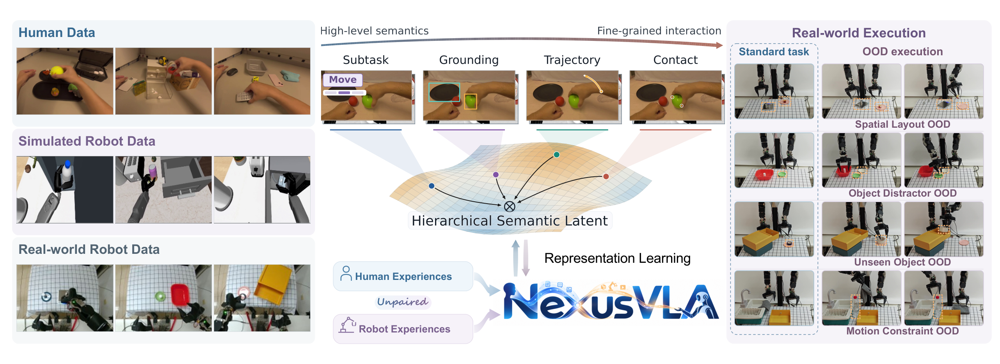
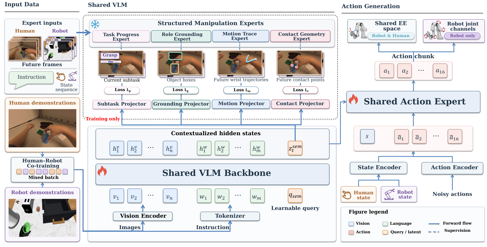
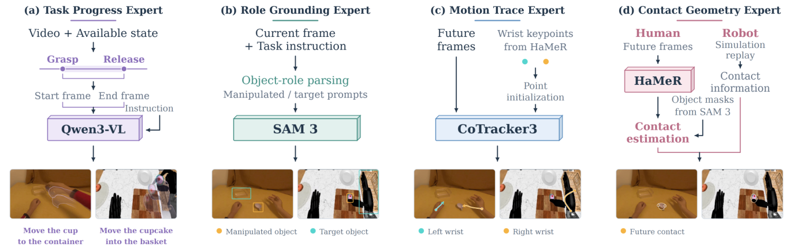
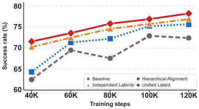
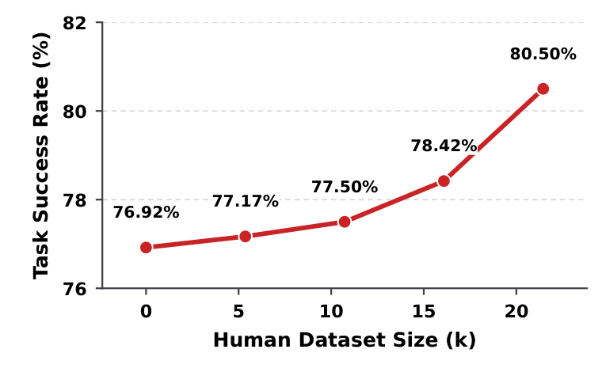
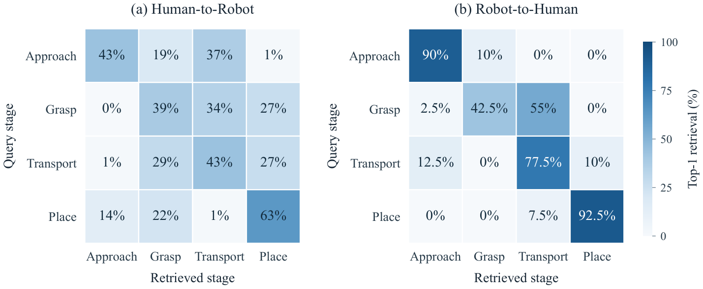
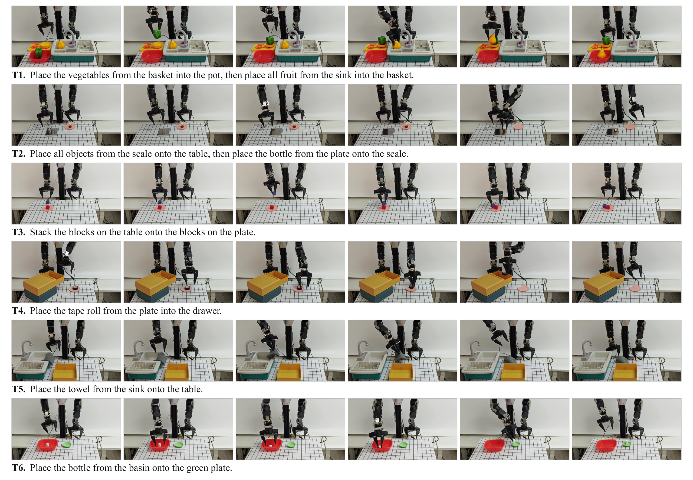
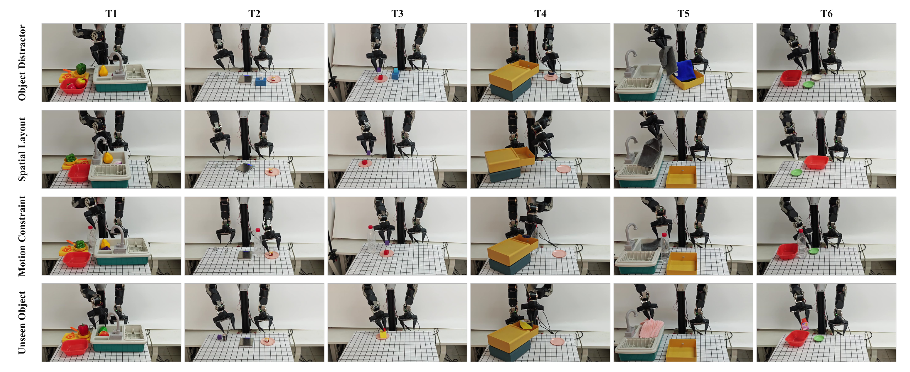
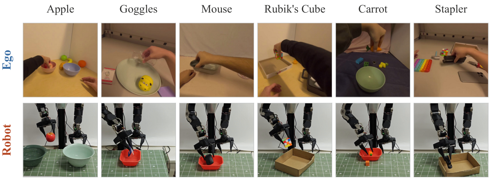
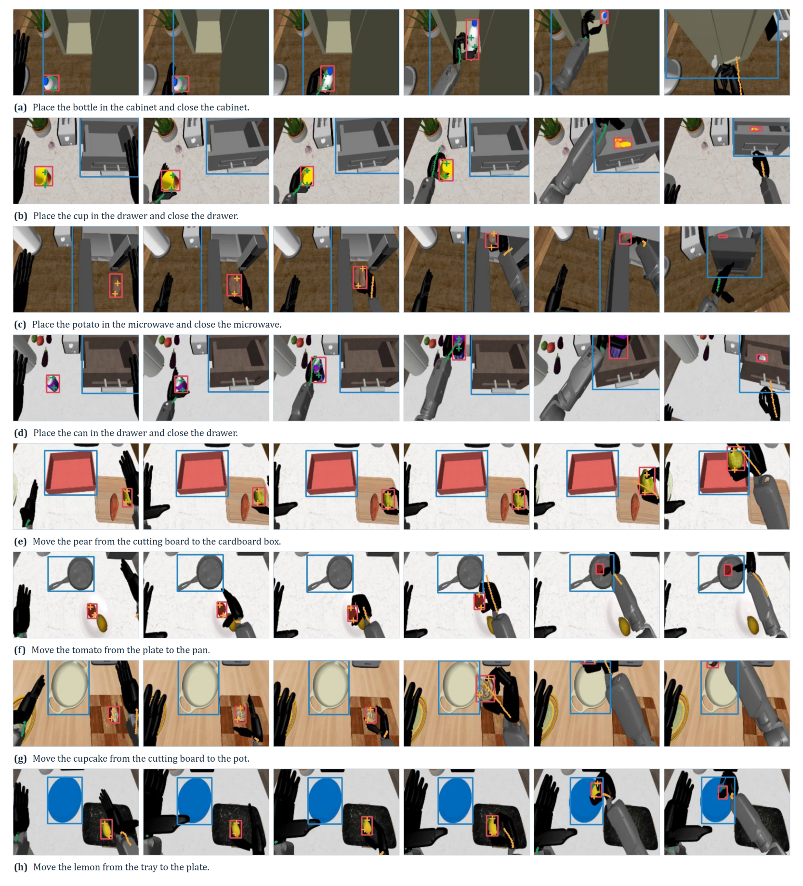

# Nexus-VLA：四层语义迁移人类操作经验

机器人示范昂贵，而第一视角人类视频里有海量操作经验，但人手与机器人在外观、运动结构和动作空间上的差异，让这些经验很难直接用于控制。这个问题卡住了 VLA（Vision-Language-Action，视觉—语言—动作模型）利用规模化人类数据、提升泛化能力的路径。Nexus-VLA 的核心思路是：把意图、空间、运动和接触四层共享语义压缩进同一个 Hierarchical Semantic Latent（分层语义潜变量），再让它与动作目标一起端到端训练。它在 RoboCasa-GR1 的 24 项任务上取得 **80.5%** 平均成功率，高于最强对比方法 ACE-Ego-0 的 72.8%；六类 OOD（Out-of-Distribution，分布外）测试平均成功率达到 **68.9%**，比 Baseline 高 20.7 个百分点。

> 图解：左侧是人类、仿真机器人和真实机器人三类不成对数据；中间把操作知识组织为 Subtask、Grounding、Trajectory、Contact 四层语义，并汇入 Hierarchical Semantic Latent；右侧展示标准任务与空间布局、干扰物、未见物体、运动约束等 OOD 执行。整幅图强调的不是把人类动作硬映射成关节指令，而是先学习跨身体共享的操作结构，再服务于机器人动作生成。

## 为什么人类视频很难直接教会机器人

人用手拿杯子，机器人用夹爪拿杯子，看起来差异很大，但二者都在完成“接近杯子—建立接触—搬运—放置”这一过程。真正可迁移的，往往不是某个关节角度，而是任务目标、物体与目标的位置关系、运动趋势，以及动作如何改变物体状态。

已有路线主要卡在四个地方：

- **多阶段迁移不够直接**：先在人类视频上预训练视觉或运动表示，再用机器人数据微调，人类知识只能间接影响最终策略；额外对齐阶段也增加了训练复杂度。
- **直接混训缺少共同监督**：把两类数据放进一个 batch，并不意味着模型自动知道人手的什么信息对应机器人的什么信息。
- **单层语义只覆盖局部**：只对齐任务意图，会丢掉轨迹和接触；只匹配手腕与末端轨迹，又可能忽略“拿什么、放到哪里”。
- **显式中间表示增加推理负担**：先生成 affordance map 或轨迹，再据此控制，虽然可解释，却会增加计算与决策延迟；纯潜变量方法若缺少语义监督，又难以形成精确的结构约束。

因此，这篇工作要同时回答两个问题：**跨身体知识应该按什么结构对齐，以及对齐后的知识怎样直接进入连续动作生成。** Nexus-VLA 分别用“四层语义”和“统一潜变量”回应它们。

## Nexus-VLA：一套骨架，两类数据，四层语义

Nexus-VLA 使用共享视觉语言骨干处理不成对的人类与机器人示范。训练时，Structured Manipulation Experts（SME，结构化操作专家）离线生成四类标签，轻量 Projector 用这些标签塑造语义 Token 的隐藏状态；动作头则通过 Flow Matching 学习连续动作。推理时只保留骨干与动作生成路径，不运行 SME，也不显式输出中间语义。

> 图解：左下的人类和机器人示范组成混合 batch，经共享 VLM Backbone 编码；底部视觉 Token、语言 Token 与可学习 Query $q_{\mathrm{sem}}$ 一起输入，顶部得到上下文化隐藏状态和 $z_t^{\mathrm{sem}}$。中间四个 Projector 只在训练时接受 SME 监督。右侧 Shared Action Expert 读取隐藏序列、本体状态和带噪动作，输出 16 步 Action chunk；人类与机器人共享末端空间，机器人还独有 joint channels。

### 四层语义：从“做什么”细化到“怎么接触”

四层语义并不是四个互不相关的标签，而是同一操作过程在不同抽象级别上的描述。它们既能在人类视频上定义，也能在机器人示范上定义，因此可以充当跨身体的共同监督。

| 语义层 | 回答的问题 | 训练预测目标 | 对控制的作用 |
|---|---|---|---|
| Intent | 做什么 | 当前局部子任务描述 | 明确局部任务目标 |
| Spatial | 操作什么、放到哪里 | 被操作物与目标区域的 2D 框及可见性 | 区分物体角色与空间关系 |
| Motion | 接下来怎么动 | 未来 $H$ 帧双手腕或双末端 2D 轨迹及可见性 | 提供运动趋势 |
| Interaction | 在哪里、是否接触 | 未来接触位置与接触状态 | 描述局部物理交互 |

笔者认为，这个设计最关键的地方不是“多加了四种 Loss”，而是**四种监督共同作用于同一个内部表示**。这样，模型必须在一个向量中同时保留目标、空间、运动和接触之间的一致性，而不是为每层各学一套彼此独立的特征。

### 一个语义 Token，装下多尺度操作知识

给定时刻 $t$ 的视觉观测 $o_t$ 和任务指令 $\ell$，视觉与语言 Token 分别记为 $V_t$、$T_t$。模型在序列末尾追加可学习语义 Token $q_{\mathrm{sem}}\in\mathbb{R}^d$，共享骨干 $F_\theta$ 输出：

$$
H_t=
[\widetilde V_t;\widetilde T_t;z_t^{\mathrm{sem}}]
=F_\theta([V_t;T_t;q_{\mathrm{sem}}])
$$

其中，$z_t^{\mathrm{sem}}\in\mathbb{R}^d$ 就是 Hierarchical Semantic Latent。由于语义 Token 位于序列末尾，它可以通过 causal self-attention 汇总此前的视觉和语言上下文，形成对当前场景与任务的紧凑编码。

对每个语义层 $k\in\mathcal K$，模型都从这个相同向量做预测：

$$
\hat y_t^k=g_k(z_t^{\mathrm{sem}}),\qquad
\mathcal K=\{\mathrm{intent},\mathrm{spatial},\mathrm{motion},\mathrm{interaction}\}
$$

总语义目标为各层归一化有效元素 Loss 的加权和：

$$
\mathcal L_{\mathrm{sem}}=\sum_{k\in\mathcal K}\lambda_k\bar\ell_t^k
$$

Projector 被刻意设计得很轻，避免复杂预测头“替”潜变量完成推理。训练结束后，这些预测头不承担在线中间推理，动作头直接读取包含 $z_t^{\mathrm{sem}}$ 的隐藏序列 $H_t$。

### 四类 SME：自动标注从哪里来

要让不成对数据共享监督，首先要以一致方式自动构造标签。四个 SME 都是冻结模块，只负责离线标注。

> 图解：（a）Task Progress Expert 根据抓握与释放事件切分片段，用 Qwen3-VL 生成局部子任务；（b）Role Grounding Expert 用 Qwen3-VL 解析物体角色，再由 SAM 3 生成逐帧框与可见性；（c）Motion Trace Expert 以手腕关键点初始化 CoTracker3，跟踪未来轨迹；（d）Contact Geometry Expert 在人类数据上结合 HaMeR 手部关键点与物体 mask 估计接触，在机器人数据上使用仿真重放获得接触信息。

具体流程如下：

1. **Task Progress Expert（TPE）**：从手或夹爪开合变化中识别关键交互事件，把片段起止帧与指令送入 Qwen3-VL。片段 $S_m=[t_m^s,t_m^e]$ 内所有帧共享同一个局部子任务标签。
2. **Role Grounding Expert（RGE）**：识别 manipuland（被操作物）与 target（目标），输出 $y_t^{\mathrm{spatial}}=\{b_t^{\mathrm{manip}},v_t^{\mathrm{manip}},b_t^{\mathrm{target}},v_t^{\mathrm{target}}\}$，其中 $b_t\in\mathbb{R}^4$ 是 2D 框，$v_t$ 表示可见性。
3. **Motion Trace Expert（MTE）**：人类双手腕来自手部关键点，机器人轨迹来自末端状态；二者都转换成未来 $H$ 帧的左右 2D 点序列 $y_t^{\mathrm{motion}}=\{p_{t+\tau}^{L},p_{t+\tau}^{R}\}_{\tau=1}^{H}$。
4. **Contact Geometry Expert（CGE）**：把接触位置表达在当前图像坐标中，并预测接触状态，形成 $y_t^{\mathrm{interaction}}=\{\mathcal C_t^L,s_t^L,\mathcal C_t^R,s_t^R\}$。

自动标注难免有检测错误、跟踪漂移和时间噪声。作者先重跑定位与分割以修复局部错误，再检查 mask 完整性、位置与尺度的突变、跟踪是否符合运动，以及视频、状态和标签的时间对齐。无法可靠恢复的示范按 episode 删除；仅局部缺标签的样本保留，但用 validity mask 屏蔽无效目标。

### 轻量预测头与掩码 Loss

四个 Projector 的结构如下，潜变量维度均为 2048。

| Projector | 架构 | 语义目标 |
|---|---|---|
| Subtask Projector | Linear（$2048\rightarrow768$）+ 1 层 causal Transformer | 局部子任务 |
| Grounding Projector | MLP（$2048\rightarrow512\rightarrow8$）+ visibility head | 被操作物—目标定位 |
| Motion Projector | MLP（$2048\rightarrow1024\rightarrow64$）+ visibility head | 未来双手腕轨迹 |
| Contact Projector | MLP（$2048\rightarrow512\rightarrow8$）+ existence head | 手—物接触几何 |

缺失标注、不可见目标和无效时刻统一通过 masked average 处理：

$$
\langle\ell_i\rangle_m=\frac{\sum_i m_i\ell_i}{\sum_i m_i+\epsilon}
$$

Intent 使用自回归文本 Loss；Spatial 对框回归采用 SmoothL1 与 GIoU，并对可见性使用 BCE（Binary Cross-Entropy，二元交叉熵）；Motion 预测未来 $H=16$ 帧轨迹及可见性；Interaction 对接触点使用 SmoothL1，对接触存在状态使用 BCE。四个分支权重均为 $\lambda_k=1.0$，语义目标在联合 Loss 中的总权重为 $\lambda_{\mathrm{sem}}=0.1$。

### 双空间动作：人类不必伪造机器人关节标签

共享语义解决了“学什么”，动作表示还要解决“用什么标签训练”。人手示范没有机器人关节控制量，但手腕与机器人末端都能描述相对环境的运动。于是作者把动作拆成共享空间和机器人专属空间：

$$
a_t=[a_t^{\mathrm{joint}};a_t^{\mathrm{wrist}}]\in\mathbb{R}^{d_j+d_w}
$$

人类与机器人的有效维 mask 分别为：

$$
M^{(\mathrm{human})}=[0_{d_j};1_{d_w}],\qquad
M^{(\mathrm{robot})}=[1_{d_j};1_{d_w}]
$$

机器人动作共 47 维，其中 29 维是关节动作，18 维是双手腕位姿。人类数据由 HaMeR 恢复左右手腕的 3D 位置与 6D 旋转，同样形成 18 维共享动作；其 29 维关节部分被 mask，而不是人为补造。

连续动作采用 conditional Flow Matching。把真实动作 chunk 与高斯噪声插值得到 $A_t^\tau$，目标速度为 $v_t^\star$，动作生成器根据本体状态与多模态上下文预测 $\hat v_t^\tau$。把动作 mask 扩展到整个 chunk 得到 $\Pi^{(e)}$，只在有效维度上计算：

$$
\mathcal L_{\mathrm{FM}}=
\mathbb E\left[
\frac{\left\|\Pi^{(e)}\odot(\hat v_t^\tau-v_t^\star)\right\|_2^2}
{\left\|\Pi^{(e)}\right\|_1+\epsilon}
\right]
$$

最终目标把动作与语义放在一起端到端优化：

$$
\mathcal L_{\mathrm{joint}}=\mathcal L_{\mathrm{FM}}+\lambda_{\mathrm{sem}}\mathcal L_{\mathrm{sem}}
$$

这意味着 $z_t^{\mathrm{sem}}$ 同时受到两股力量约束：既要能解释四层跨身体语义，又必须对连续动作生成有用。相比“先对齐、再微调”的多阶段流程，人类经验因此能在同一个优化过程中直接改变动作策略。

### 数据采样与推理路径

人类与机器人的总采样比例被显式设为 $1:2$，避免数据量自然决定训练贡献。同一来源内部再按数据集大小采样：对来源 $d$ 中的数据集 $j$，其权重为

$$
w_j=s_d\frac{n_j}{\sum_{k\in\mathcal D_d}n_k},\qquad
j\in\mathcal D_d,\qquad \sum_d s_d=1
$$

其中 $s_d$ 控制该身体来源的总占比，$n_j$ 是数据集样本数。推理时则简化为三步：

1. 视觉、指令与语义 Token 经共享骨干得到 $H_t$；
2. 动作 Token cross-attend 到 $H_t$，结合本体状态和带噪动作预测速度场；
3. 通过所学速度场生成动作 chunk，只执行其中的机器人关节动作分量。

**训练时监督很多，推理时路径很短**，这是统一潜变量相对显式多阶段语义推理的实际价值。

## 复现所需的模型与训练配置

Nexus-VLA 的视觉语言骨干是 Qwen2.5-VL-3B-Instruct，动作头是 Flow-Matching DiT（Diffusion Transformer）。主要结构如下。

| 配置 | VLM Backbone | Action Head |
|---|---|---|
| Backbone | Qwen2.5-VL-3B-Instruct | Flow-Matching DiT |
| Transformer 层数 | 36（LLM）/ 32（ViT） | 32 |
| Residual width | 2048 / 1280 | 1536 |
| Attention heads × dim. | $16\times128$ / $16\times80$ | $32\times48$ |
| 位置编码 | M-RoPE | Learned 1D + sinusoidal time |
| FFN intermediate width | 11008 / 3420 | 6144 |
| 输入 | 图像 + 文本 + $q_{\mathrm{sem}}$ | $s_t$、$A_t^\tau$、$\tau$、$H_t$ |
| 输出 | $H_t$、$z_t^{\mathrm{sem}}$ | $\hat v_t^\tau$ |

训练使用 24,000 条 RoboCasa-GR1 机器人轨迹和 21,446 条筛选后的 EgoDex 第一视角 pick-and-place 视频，两者不成对。算力为 2 个计算节点，每节点 8 张 NVIDIA H20E 141GB GPU。

| 配置 | 数值 | 配置 | 数值 |
|---|---:|---|---:|
| Action horizon | 16 | Training steps | 200K |
| Per-GPU batch size | 32 | Gradient accumulation | 1 |
| Global batch size | 512 | Learning rate | $3\times10^{-5}$ |
| Optimizer | AdamW | LR schedule | Cosine decay |
| Warmup ratio | 0.05 | Weight decay | $1\times10^{-5}$ |
| Human : Robot sampling | $1:2$ | Semantic branch weights $\lambda_k$ | 1.0 |
| Semantic weight $\lambda_{\mathrm{sem}}$ | 0.1 | Training precision | BF16 |

方法链路已经完整，接下来要看的是：提升究竟来自人类数据、分层监督，还是统一潜变量，以及它能否走出标准测试分布。

## 实验一：24 项任务平均成功率达到 80.5%

RoboCasa-GR1 基于 RoboCasa，包含 Fourier GR-1 机器人执行的 24 项操作任务，覆盖物体搬运和抽屉、柜门、微波炉等 articulated objects。主结果使用 150K steps checkpoint，Avg. 是 24 项任务的非加权平均，五组任务列则先在组内平均。

| 类型 | 方法 | Close | Cuttingboard | Placemat | Tray | Plate | Avg. |
|---|---|---:|---:|---:|---:|---:|---:|
| Foundation VLA | GR00T-N1.6 | 24.2 | 56.9 | 51.9 | 55.1 | 57.6 | 47.6 |
| Foundation VLA | ABot-M0 | 61.7 | 61.6 | 51.0 | 56.8 | 58.0 | 58.3 |
| Semantic Enhanced | VP-VLA | 54.3 | 60.8 | 54.5 | 46.0 | 53.5 | 53.8 |
| Semantic Enhanced | IntentVLA | 59.7 | 54.8 | 55.5 | 49.6 | 66.5 | 57.0 |
| Semantic Enhanced | ZR-0 | 41.7 | 83.6 | 74.8 | 72.0 | **84.2** | 69.3 |
| Human Experience | DyPES-VLA | 55.3 | 63.2 | 51.5 | 62.4 | 64.0 | 59.3 |
| Human Experience | JoyAI-RA 0.1 | **71.7** | 68.4 | 45.0 | 68.8 | 55.0 | 63.2 |
| Human Experience | ACE-Ego-0 | 59.0 | 83.2 | 70.5 | 78.0 | 76.5 | 72.8 |
| Ours | **Nexus-VLA** | 70.3 | **89.6** | **80.0** | **83.6** | 81.0 | **80.5** |

Nexus-VLA 在 Cuttingboard、Placemat、Tray 三组排名第一，在 Close、Plate 两组排名第二；总平均值比 ACE-Ego-0 高 **7.7 个百分点**。这说明收益并非只来自某一类任务，但它也不是每一组都最优，Close 组仍略低于 JoyAI-RA 0.1。

## 实验二：人类见过的物体，迁移增益最大

作者构造六类受控 OOD：光照变化、视觉噪声、新空间配置、新物体—容器组合、只在 EgoDex 人类示范中出现的 Ego-Object，以及两类训练都未出现的 Fully Unseen。每个设置进行 500 次 rollout。

| 方法 | Illumination | Visual Noise | Cross-Config. | Obj.-Receptacle | Ego-Object | Fully Unseen | Avg. |
|---|---:|---:|---:|---:|---:|---:|---:|
| Baseline | 62.0 | 58.4 | 51.2 | 45.0 | 40.8 | 31.6 | 48.2 |
| **Nexus-VLA** | **76.8** | **73.6** | **71.0** | **66.8** | **69.4** | **55.6** | **68.9** |

最值得看的是 Ego-Object：成功率从 40.8% 提升到 69.4%，差距 **28.6 个百分点**，是六项中最大的一项。这直接对应了“机器人训练没见过、但人类视频见过”的场景。Fully Unseen 上仍有 24.0 个百分点增益，说明表示还迁移到了两种数据都未覆盖的物体，但这部分不能再简单归因于某段对应的人类示范。

## 实验三：消融证明“混数据”本身不够

消融实验对机器人数据曝光量做了匹配：robot-only 变体在 120K steps 评估，使用人类示范的变体在 180K steps 评估，Human : Robot 为 $1:2$。

| 方法 | Human-Robot Co-training | Hierarchical Alignment | Semantic Representation | Success Rate（%）↑ |
|---|:---:|:---:|:---:|---:|
| Baseline | — | — | — | 72.42 |
| + Hierarchical Alignment | — | ✓ | — | 75.67 |
| + Human-Robot Co-training | ✓ | — | — | 71.75 |
| + Independent Latents | — | ✓ | Independent | 76.92 |
| + Unified Latent | — | ✓ | Unified | 78.25 |
| **Nexus-VLA** | ✓ | ✓ | Unified | **80.17** |

结果可以拆成三层：

- 加分层对齐，成功率从 72.42% 升至 75.67%，说明多层监督本身有效。
- 只加人类—机器人混训，相同评估步数下反而降到 71.75%；虽然它在 200K steps 达到 76.32%，超过 robot-only Baseline 的峰值 72.92%，但收敛更慢，证明简单混数据不是免费午餐。
- 在分层监督下，Unified Latent 比 Independent Latents 高 1.33 个百分点；完整模型再加入混训，又从 78.25% 提升到 80.17%。

> 图解：横轴是 Training steps（40K—120K），纵轴是 Success rate（60%—80%）。红色 Unified Latent 始终位于最高或接近最高，蓝色 Hierarchical Alignment 优于灰色 Baseline，橙色 Independent Latents 略低于 Unified。Unified Latent 在 60K steps 已达 73.58%，超过 Baseline 在 100K steps 的 72.92%，即用约少 40% 的训练步数取得更高成功率。

这组实验支撑了论文的核心判断：**收益不是来自堆更多语义分支，而是来自用统一、可被动作目标继续塑造的表示组织这些语义。**

## 实验四：人类数据扩大，成功率持续上升

作者从筛选后的 EgoDex 构造约 5.4k、10.7k、16.1k、21.4k 条示范的嵌套子集。混训变体都固定 $1:2$ 采样比例、150K steps；robot-only 参考在 100K steps 评估，以匹配预期机器人数据曝光量。

> 图解：横轴为人类数据集规模（千条），纵轴为任务成功率。0 条人类数据的参考值是 76.92%；约 5.4k、10.7k、16.1k、21.4k 时依次为 77.17%、77.50%、78.42%、80.50%。完整数据相对 robot-only 高 3.58 个百分点，混训内部从最小到最大子集提高 3.33 个百分点，最大单次增量出现在约 16.1k 到 21.4k，提升 2.08 个百分点。

在固定训练预算和采样比例下，成功率仍随人类数据池扩大而提高，说明变化不只是“多看了几批数据”，而与可访问的人类示范多样性有关。不过，论文只验证到 21,446 条，尚不能据此推断更大数据量下仍会同速增长。

## 实验五：潜变量真的能跨身体检索操作阶段

任务成功率只能间接说明表示有效，作者因此做了双向操作阶段检索。数据来自 20 条人类 `basic_pick_place` 示范和 8 条成功的机器人 `PnPCupToDrawerClose` 示范；每条在 Approach、Grasp、Transport、Place 四阶段各采 5 帧，共 400 张人类帧、160 张机器人帧。机器人关抽屉阶段被排除，以保持四阶段一致。

模型使用 150K checkpoint，将每帧独立编码成 2048 维 $z_i^{(e)}$。阶段标签只用于评估，不输入模型。跨身体检索先做 L2 归一化，再减去各身体域的均值并重新归一化：

$$
\widetilde z_i^{(e)}=
\frac{\hat z_i^{(e)}-\mu_e}
{\left\|\hat z_i^{(e)}-\mu_e\right\|_2},\qquad
\hat z_i^{(e)}=\frac{z_i^{(e)}}{\|z_i^{(e)}\|_2}
$$

最后按余弦相似度排序。同阶段候选视为正样本，指标包括 R@1（Recall at 1）、P@5（Precision at 5）和 mAP（mean Average Precision，平均精度均值）。四阶段均匀分布，因此 R@1 与 P@5 的随机期望均为 25%。域内检索会排除与 query 来自同一示范的样本。

> 图解：两张热图的纵轴都是 Query stage，横轴是 Top-1 Retrieved stage，颜色和数值表示百分比，对角线越高越好。Human-to-Robot 的四阶段对角线均值为 47.00%，Robot-to-Human 为 75.63%；Place 在两个方向分别达到 63.0% 和 92.5%。Grasp 与 Transport 有明显混淆，例如 Robot-to-Human 的 Grasp 有 55% 被检索为 Transport，说明动态相近阶段仍未完全分清。

| Retrieval | Queries | Candidates | R@1 | P@5 | mAP |
|---|---:|---:|---:|---:|---:|
| Human → Human | 400 | 380 | 88.25 | 83.30 | 51.92 |
| Robot → Robot | 160 | 140 | 90.00 | 84.75 | 79.06 |
| Human → Robot | 400 | 160 | 47.00 | 45.15 | 49.07 |
| Robot → Human | 160 | 400 | 75.63 | 70.50 | 49.19 |

跨身体结果明显高于随机水平，为共享语义提供了表示层面的证据；但两个方向差异很大，且只基于一对任务，因此它更适合作为机制验证，而不是普遍跨身体检索能力的完整 benchmark。

## 实验六：真实机器人上，OOD 增益更明显

真实实验包含六项任务，在标准设置和四种 OOD 下各进行 50 次 rollout，表中数值均为成功率（%）。Object Distractor 加入相似或无关物体，Spatial Layout 改变相对位置，Motion Constraint 用障碍物改变可行路径，Unseen Object 换成机器人训练中未见的操作物。

| 方法 | Standard | Object Distractor | Spatial Layout | Motion Constraint | Unseen Object | Avg. |
|---|---:|---:|---:|---:|---:|---:|
| $\pi_{0.5}$ | 64.0 | 48.0 | 50.0 | 44.0 | 40.0 | 49.2 |
| GR00T-N1.6 | 58.0 | 42.0 | 44.0 | 38.0 | 34.0 | 43.2 |
| Baseline | 70.0 | 50.0 | 52.0 | 46.0 | 42.0 | 52.0 |
| + Human-Robot Co-training | 74.0 | 56.0 | 58.0 | 52.0 | 48.0 | 57.6 |
| + Hierarchical Alignment + Unified Latent | 78.0 | 68.0 | 66.0 | 62.0 | 58.0 | 66.4 |
| **Nexus-VLA** | **82.0** | **76.0** | **74.0** | **70.0** | **68.0** | **74.0** |

完整模型在标准与全部 OOD 设置中均最高，平均 74.0%。相对 Baseline，标准设置高 12.0 个百分点，四种 OOD 高 22.0—26.0 个百分点；仅混训的平均值只提高 5.6 个百分点，而分层对齐与统一潜变量带来更显著的鲁棒性收益。

> 图解：T1—T6 每行是一项任务，六列按时间排列，依次覆盖多阶段蔬果转移、秤与桌面间物体转移、积木堆叠、胶带入抽屉、毛巾出水槽，以及瓶子放到绿盘。图中能看到接近、抓取、搬运和放置的完整过程，与表格中的 Standard 设置对应。

> 图解：列 T1—T6 与上一张图的六项标准任务一致；四行分别是 Object Distractor、Spatial Layout、Motion Constraint、Unseen Object。每格展示一个条件—任务组合的代表帧，可直观看到干扰物、布局变化、路径障碍和物体替换如何改变场景，而任务目标与成功判据保持不变。

### 只在人类视频中出现的六类物体

作者进一步从 EgoDex 选择苹果、护目镜、鼠标、魔方、胡萝卜、订书机六类物体，它们只出现在人类示范中，再为真实机器人构造对应任务，每项评估 50 次。

> 图解：六列依次是 Apple、Goggles、Mouse、Rubik's Cube、Carrot、Stapler；上排为 EgoDex 第一视角人类操作，下排为真实机器人执行。Robot-only Baseline 平均成功率为 47.0%，Nexus-VLA 达到 72.7%，高 25.7 个百分点，提供了人类侧物体经验迁移到真实机器人执行的直接证据。

## 逐任务结果与语义过程可视化

主表的组平均可能掩盖任务差异，附录给出了 24 项任务的完整结果。Nexus-VLA 在 18 项任务上取得含并列的最高成功率，另有 5 项排名第二；但并非逐项领先，例如 PlateToPan 上 ZR-0 更强，PlateToPlate 上 ACE-Ego-0 更强。

| Task | ZR-0 | JoyAI-RA 0.1 | ACE-Ego-0 | Nexus-VLA |
|---|---:|---:|---:|---:|
| CupToDrawerClose | 20.0 | **48.0** | 36.0 | **48.0** |
| PotatoToMicrowaveClose | 59.0 | 70.0 | 58.0 | **80.0** |
| MilkToMicrowaveClose | 45.0 | **84.0** | 56.0 | 74.0 |
| BottleToCabinetClose | 39.0 | 84.0 | 78.0 | **88.0** |
| WineToCabinetClose | 40.0 | 54.0 | **56.0** | **56.0** |
| CanToDrawerClose | 47.0 | **90.0** | 70.0 | 76.0 |
| CuttingboardToBasket | 82.0 | 88.0 | 84.0 | **92.0** |
| CuttingboardToCardboardBox | 79.0 | 46.0 | 84.0 | **94.0** |
| CuttingboardToPan | 92.0 | 92.0 | 92.0 | **96.0** |
| CuttingboardToPot | 85.0 | 80.0 | 84.0 | **88.0** |
| CuttingboardToTieredBasket | **80.0** | 36.0 | 72.0 | 78.0 |
| PlacematToBasket | 78.0 | 76.0 | 86.0 | **90.0** |
| PlacematToBowl | 87.0 | 52.0 | 72.0 | **92.0** |
| PlacematToPlate | 88.0 | 38.0 | 80.0 | **90.0** |
| PlacematToTieredShelf | 46.0 | 14.0 | 44.0 | **48.0** |
| TrayToCardboardBox | 81.0 | 82.0 | 78.0 | **86.0** |
| TrayToPlate | 81.0 | 88.0 | 90.0 | **92.0** |
| TrayToPot | 74.0 | 88.0 | **98.0** | 90.0 |
| TrayToTieredBasket | 74.0 | 62.0 | 74.0 | **76.0** |
| TrayToTieredShelf | 50.0 | 24.0 | 50.0 | **74.0** |
| PlateToBowl | 82.0 | 48.0 | 68.0 | **88.0** |
| PlateToCardboardBox | 81.0 | 38.0 | 70.0 | **84.0** |
| PlateToPan | **89.0** | 46.0 | 70.0 | 70.0 |
| PlateToPlate | 85.0 | 88.0 | **98.0** | 82.0 |
| **Average** | 69.3 | 63.2 | 72.8 | **80.5** |

较突出的提升包括 PlacematToBowl：相对 ACE-Ego-0 从 72.0% 提升到 92.0%；TrayToTieredShelf：从 50.0% 提升到 74.0%。这再次说明整体收益横跨 articulated interaction 与 object transfer，而不是被单个任务家族拉高。

> 图解：八行分别展示瓶子入柜并关柜、杯子入抽屉并关抽屉、土豆入微波炉并关门、罐子入抽屉并关抽屉，以及梨、番茄、纸杯蛋糕和柠檬的搬运；每行六帧按时间排列。彩色框和叠加标记突出任务相关物体、目标及运动或接触线索。这里可视化的是与潜变量相关的语义线索，不是把 $z_t^{\mathrm{sem}}$ 显式解码成符号；实际推理不需要生成这些中间输出。

## 总结：人类经验要进入动作，而不只是进入数据

- Nexus-VLA 用 Intent、Spatial、Motion、Interaction 四层监督，把不成对的人类与机器人示范放入同一跨身体语义结构。
- 一个共享的 Hierarchical Semantic Latent 同时接受多层语义与 Flow Matching 动作目标约束，推理时无需显式生成中间语义。
- 双空间动作表示让人类只监督共享手腕维度、机器人额外监督关节维度，避免伪造不存在的机器人关节标签。
- 模型在 RoboCasa-GR1 达到 80.5%，六类仿真 OOD 平均 68.9%，真实机器人五种设置平均 74.0%；消融显示简单混训不足，分层对齐与统一潜变量同样关键。
- 人类数据规模与跨身体检索实验进一步支持“人类经验被有效组织并迁移”的解释，Ego-Object 与真实六类物体上的增益尤其直接。

从实验边界看，目前验证仍集中于 pick-and-place 与相关操作、单一主要仿真机器人平台和有限的真实任务，离线 SME 的标注质量与成本也是实际扩展时必须考虑的因素；下一步值得检验这套分层潜变量能否覆盖更长时序、更复杂接触和更多机器人形态。

> 本文参考自 [Nexus-VLA: Bridging Human and Robot Experiences via a Shared Hierarchical Semantic Latent Space](http://arxiv.org/abs/2610.42021v1)