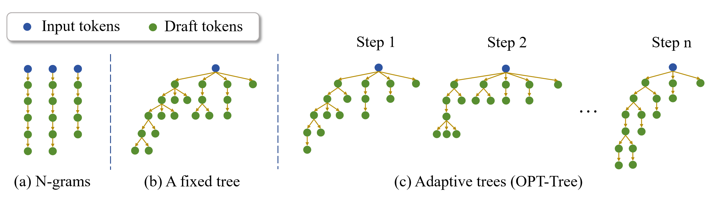
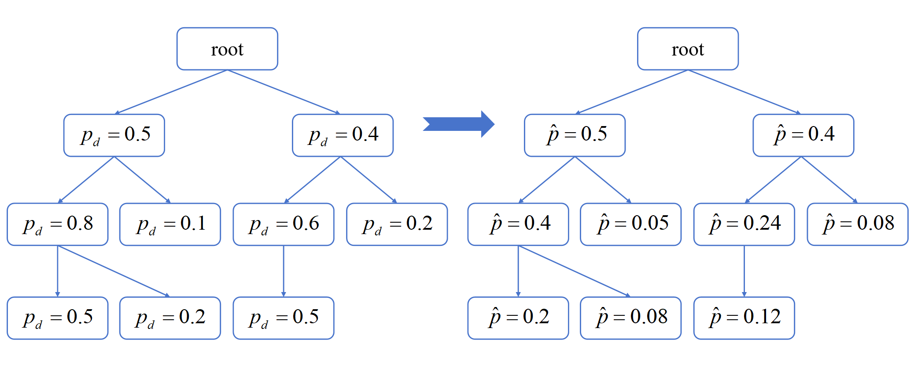
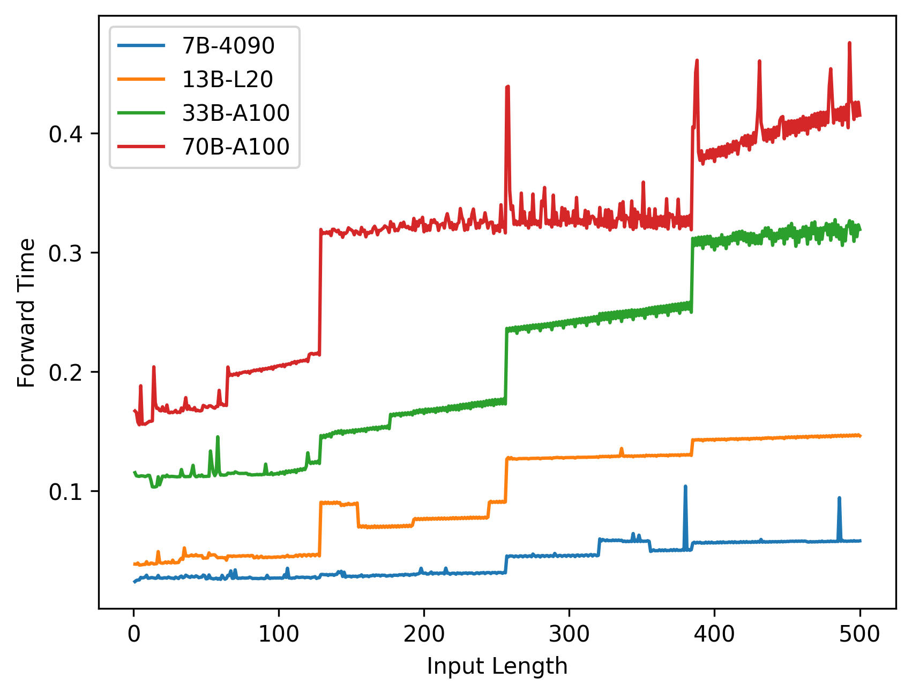
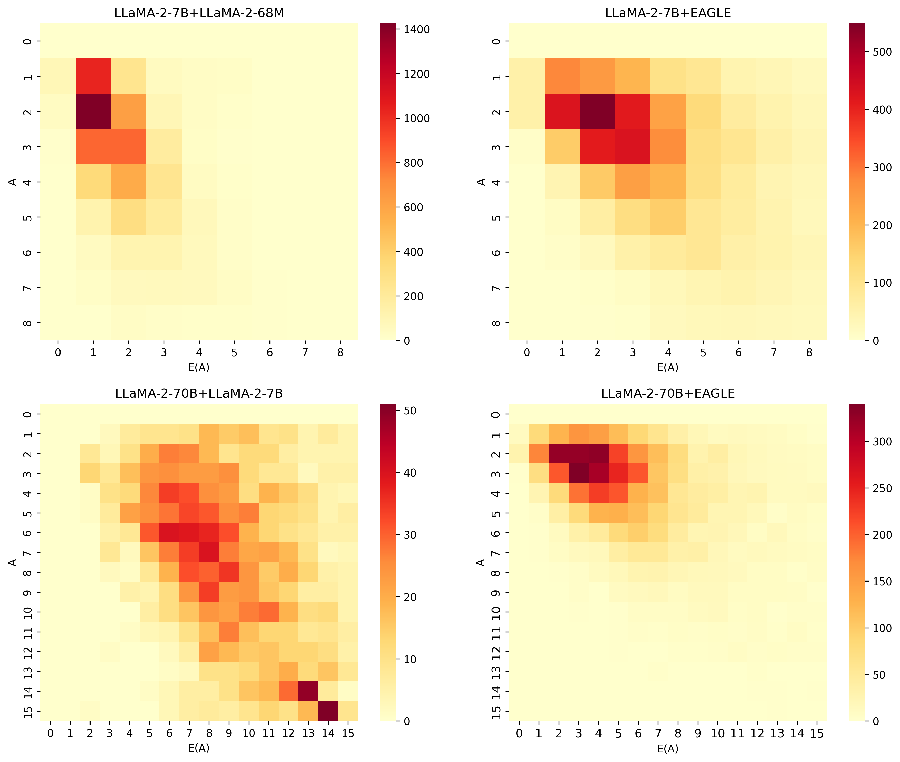
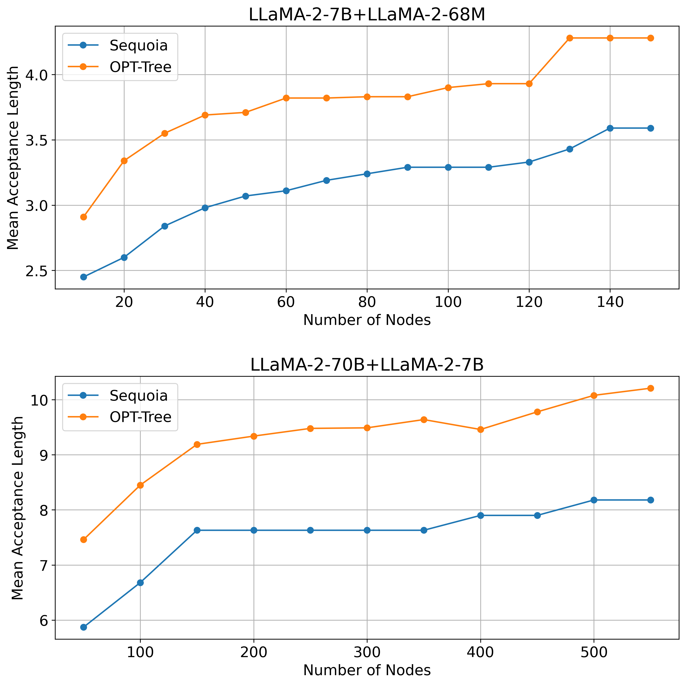
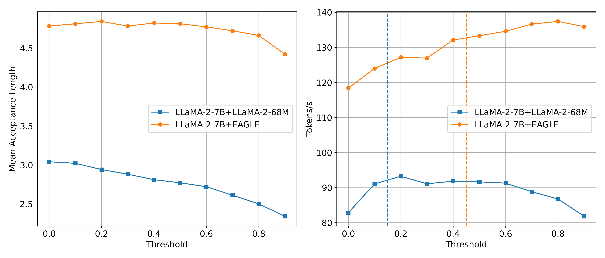
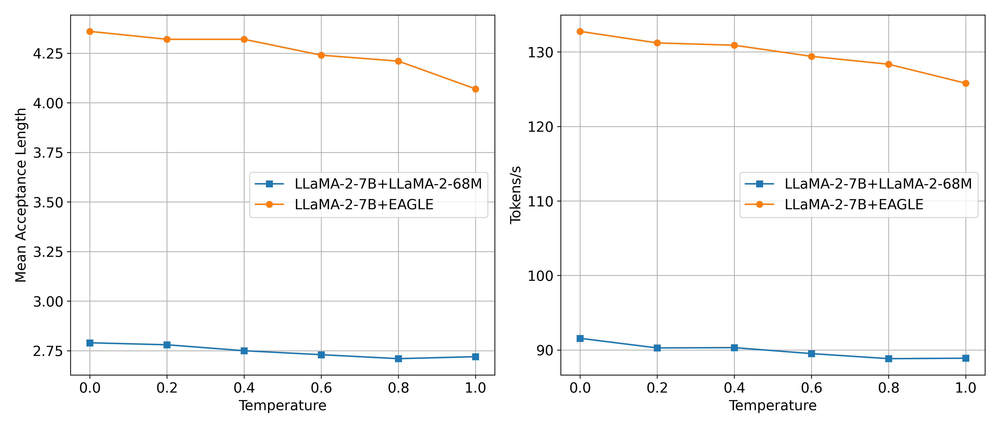

# OPT-Tree：自适应草稿树让投机解码提速3.2倍

大模型自回归解码每一步通常只生成一个 token，而投机解码虽然能“先起草、再验证”，却常因固定草稿结构浪费宝贵的节点预算。OPT-Tree 要解决的核心问题，就是如何根据当前输入动态安排草稿树的深度与分支，让有限节点尽可能覆盖更可能被目标模型接受的续写。它的做法很直接：用草稿模型的累积概率估计接受长度，再贪心地逐步扩展并裁剪出最优子树。实验中，OPT-Tree 相对原始自回归解码最高提速约 **3.2 倍**；当草稿模型足够强、节点数超过 500 时，平均接受长度还能继续增长并达到约 10 个 token。

## 固定草稿结构，为什么不是最优解？

投机解码（Speculative Decoding）可以类比成“junior 助手先写候选，资深模型集中审稿”：低成本草稿模型先生成多个候选，目标模型再并行验证。只要验证规则正确，就能在保持目标模型输出一致的前提下，一次推进多个 token。

真正影响效率的，不只是草稿模型准不准，还有候选内容如何组织。

> 图解：同一层节点共享位置索引。序列结构会在不同分支间重复计算公共前缀；固定树虽然消除了这种重复，却不能随输入变化；OPT-Tree 则在每个解码步骤重新调整树形，以争取更长的接受片段。

早期方法常用一条或多条序列作为草稿。例如，`A-B-C-D-E` 和 `A-B-C-F-G` 共有前缀 `A-B-C`，若分别验证，10 个节点里实际只有 7 个不同 token，公共前缀被重复计算。

树结构把公共前缀合并，再借助 Tree Attention Mask 并行验证所有分支，解决了冗余问题。但 Binary Tree、EAGLE Tree 等结构通常由启发式规则预先确定，整个解码过程中保持不变。

这里被忽略的一点是：**同样的节点预算，在不同上下文中的最佳分配方式并不相同。** 有时应该把预算集中给一条高置信度长路径，有时则应在浅层保留更多分支。OPT-Tree 的创新，正是把“选什么树”从一个离线固定问题，变成每个解码步骤都要解决的在线优化问题。

## 先明确目标：什么才算一次有效的加速？

给定当前输入序列 $\mathbf{x}=(x_1,x_2,\ldots,x_l)$，目标模型 $M$ 和草稿模型 $M_d$ 分别给出下一 token 的分布：

$$
p(y^{l+1}\mid x_1,x_2,\ldots,x_l),\qquad p_d(\hat{y}^{l+1}\mid x_1,x_2,\ldots,x_l)
$$

在树状投机解码中，$M_d$ 先经过若干次自回归推理，构造深度为 $d$ 的草稿树 $T$；随后 $M$ 一次性验证整棵树。

以 Greedy Sampling 为例，目标模型在每个位置选择概率最大的 token，形成一条“标准答案”路径。所有从根节点出发的草稿分支中，与该路径公共前缀最长的分支被接受。这样既能一次生成多个 token，又能保证结果与原目标模型贪心解码一致。

因此，一个直观的优化目标是最大化实际接受长度 $A$。问题在于，验证之前并不知道目标模型的选择，$A$ 无法直接用于构树。OPT-Tree 的关键桥梁，就是先利用草稿模型输出的概率，构造一个可计算的期望接受长度 $E(A)$。

## OPT-Tree：用累积概率寻找更值得验证的树

### 节点不只存 token，还存“走到这里”的概率

草稿树定义为 $T=(\mathbb{V},\mathbb{E})$，其中 $\mathbb{V}$ 和 $\mathbb{E}$ 分别是节点集合与边集合。第 $i$ 层第 $j$ 个节点写作 $(\hat{y}_j^i,\hat{p}_j^i)$：前者是采样得到的 token，后者是从根到该节点整条路径的条件概率乘积：

$$
\hat{p}_j^i=\prod_{\hat{y}\in\mathbb{P}(\hat{y}_j^i)}p_d(\hat{y})
$$

这里 $\mathbb{P}(\hat{y}_j^i)$ 包含该节点自身及其所有祖先节点，根节点的 $\hat{p}$ 视为正无穷。若一个节点有 $k$ 个子节点，它们就是该节点后续分布中贪心选出的 $k$ 个高概率 token。

这个定义带来一个简单但重要的性质：若 $v_i$ 位于 $v_j$ 的子树中，那么 $v_i$ 的 $\hat{p}$ 必然小于 $v_j$。因为子节点概率是在父节点路径概率上继续乘以不超过 1 的条件概率，所以越往树下走，累积概率越小。

> 图解：每个节点记录 token 及对应的 $\hat{p}$，路径越深，累积概率越小。把树中各节点的 $\hat{p}$ 相加，就得到该树的 $E(A)$；图例中的结果为 2.07。

### 把接受长度转化为可优化的分数

有效的草稿模型，其输出分布应尽量接近目标模型。因此，一个节点的 $\hat{p}$ 越高，它对应路径在验证时被接受的可能性通常也越大。

在这一近似下，期望接受长度可写成：

$$
E(A)=\sum_{(\hat{y}_j^i,\hat{p}_j^i)\in T}\prod_{\hat{y}\in\mathbb{P}(\hat{y}_j^i)}p_d(\hat{y})
=\sum_{(\hat{y}_j^i,\hat{p}_j^i)\in T}\hat{p}_j^i
$$

这个公式有清晰的直觉：一条路径只有当前缀全部被接受时，更深节点才可能贡献接受长度，因此每个节点对总期望的贡献，恰好是整条前缀路径的联合概率。

OPT-Tree 的目标随之明确：在节点预算 $n$ 下，寻找使 $E(A)$ 最大的树 $T_{opt}$。由于每个输入对应的概率分布不同，$T_{opt}$ 也应随解码步骤变化。

作者进一步用 $E_{sub}(T,n)$ 表示：在 $T$ 的所有“包含根节点且含 $n$ 个非根节点”的子树中，最大的 $E(A)$。根节点不计入节点预算，也不计入期望分数。

### 先逐层扩展，再留下概率最高的 n 个节点

OPT-Tree 的构树过程可以概括为四步：

1. 用当前最后一个 token 初始化根节点，并令初始分数 $E=0$。
2. 在树的最深层节点后续分布中，选择 $\hat{p}$ 最大的 $n$ 个候选，扩展下一层。
3. 若树深仍小于 $n$，且 $E_{sub}(T,n)-E>\delta$，就继续扩展；否则停止。
4. 从已生成的候选树中，选出 $\hat{p}$ 最大的 $n$ 个非根节点，组成最终 $T_{opt}$。

为什么直接挑选分数最高的 $n$ 个节点，不会得到一棵“断开的树”？反证即可：若某个入选节点的父节点未入选，根据累积概率单调递减的性质，父节点的 $\hat{p}$ 必然更高，那么父节点不可能被排除在 Top-$n$ 之外。因此，这些节点必然能形成一棵包含根节点的连通子树。

另一个性质是，随着 drafting step 增加，$E_{sub}(T,n)$ 单调不减。理论上可以一直扩展到分数不再增长，但实际系统不能只追求接受长度，因为草稿模型自身也要消耗时间。

这个设计的聪明之处在于，它没有额外训练一个“树形预测器”，而是复用草稿模型天然产生的概率信号，把结构优化变成了可在线执行的搜索与裁剪。

### 阈值 $\delta$：在接受长度与草稿成本之间刹车

对自回归草稿模型而言，树每加深一层，通常就要多进行一次 drafting，成本大致随深度增长。于是，$E(A)$ 最大的树不一定是实际速度最快的树。

OPT-Tree 引入阈值 $\delta$：当树再加深带来的 $E_{sub}(T,n)$ 增量不超过 $\delta$ 时，就停止扩展。设一次 drafting 时间与一次目标模型完整 decoding 时间之比为 $\mu$，作者建议实际将 $\delta$ 控制在 $\mu$ 与 1 之间。

如果加深一层带来的期望收益连 $\mu$ 都不到，就不值得为它多付一次 drafting 成本；而 $\delta$ 过大又会过早停止，使树太浅、接受长度下降。

### 一次完整解码如何执行？

拿到 $T_{opt}$ 后，完整流程如下：

1. 根据树结构计算对应的 Tree Attention Mask。
2. 目标模型执行 $P\leftarrow M(T_{opt},mask)$，并行得到各节点的后续预测。
3. 验证草稿树，找到最长可接受候选 $(y^{l+1},\ldots,y^{l+A})$。
4. 将接受片段拼接到原输入，开始下一轮解码。

若长度为 $A-1$ 的草稿路径命中，目标模型在验证时还会顺带给出它的下一个 token，因此总接受长度为 $A$。此外，目标模型和草稿模型都使用 Key/Value Cache；实际每一步 drafting 的输入长度可控制在 $n$，避免树预算增大后草稿推理成为明显瓶颈。

## 实验设置：与 Binary Tree 和 EAGLE Tree 正面对比

实验采用 LLaMA-2-7B、LLaMA-2-13B、LLaMA-2-70B 和 Vicuna-33B 作为目标模型，为它们搭配同系列小模型或相应的 EAGLE 草稿模型。硬件分别为单张 RTX 4090、单张 L20，以及用于 LLaMA-2-70B 和 Vicuna-33B 的 4 张 A100-PCIE-40GB。

除 EAGLE 固定使用 25 节点的启发式树外，节点预算从 $[25,50,60]$ 中按目标模型和计算资源选择，以最大化加速比。主实验温度为 0，评测数据集为 MT-Bench 和 GSM8K；对比指标包括平均接受长度 MAL（Mean Acceptance Length）、每秒生成 token 数，以及相对原始自回归解码的 Speedup。

> 图解：图中横轴为输入长度，纵轴为推理墙钟时间，展示四种目标模型在相应 GPU 上的变化。一定长度范围内，推理时间大体保持稳定，因此可以适当增加验证节点；超出范围后，验证成本会上升，节点预算不能无限扩大。

### MT-Bench：OPT-Tree 在所有组合中取得最高 MAL

下表中，“None”表示原始自回归解码；L 和 V 分别代表 LLaMA-2 与 Vicuna。Speedup 按生成速度计算。

| 目标模型 | 草稿模型 | 树结构 | MAL | Tokens/s | Speedup |
|---|---|---|---:|---:|---:|
| LLaMA-2-7B | None | - | 1.00 | 51.89 | 1.00 |
| LLaMA-2-7B | L-68M | Binary | 2.12 | 68.58 | 1.32 |
| LLaMA-2-7B | L-68M | EAGLE | 2.47 | 77.06 | 1.49 |
| LLaMA-2-7B | L-68M | **OPT-Tree** | **2.58** | **87.57** | **1.69** |
| LLaMA-2-7B | L-1B | Binary | 3.95 | 46.10 | 0.89 |
| LLaMA-2-7B | L-1B | EAGLE | 4.23 | 47.74 | 0.92 |
| LLaMA-2-7B | L-1B | **OPT-Tree** | **4.88** | **52.48** | **1.01** |
| LLaMA-2-7B | EAGLE | Binary | 3.40 | 107.91 | 2.08 |
| LLaMA-2-7B | EAGLE | EAGLE | 3.73 | 130.50 | 2.51 |
| LLaMA-2-7B | EAGLE | **OPT-Tree** | **4.36** | **132.75** | **2.56** |
| LLaMA-2-13B | None | - | 1.00 | 26.79 | 1.00 |
| LLaMA-2-13B | L-68M | Binary | 2.05 | 40.24 | 1.50 |
| LLaMA-2-13B | L-68M | EAGLE | 2.42 | 46.82 | 1.75 |
| LLaMA-2-13B | L-68M | **OPT-Tree** | **2.58** | **48.10** | **1.80** |
| LLaMA-2-13B | L-1B | Binary | 3.95 | 37.37 | 1.39 |
| LLaMA-2-13B | L-1B | EAGLE | 4.25 | 40.12 | 1.50 |
| LLaMA-2-13B | L-1B | **OPT-Tree** | **5.20** | **43.40** | **1.62** |
| LLaMA-2-13B | EAGLE | Binary | 3.54 | 66.24 | 2.47 |
| LLaMA-2-13B | EAGLE | EAGLE | 3.80 | 73.97 | 2.76 |
| LLaMA-2-13B | EAGLE | **OPT-Tree** | **4.35** | **76.61** | **2.86** |
| LLaMA-2-70B | None | - | 1.00 | 6.29 | 1.00 |
| LLaMA-2-70B | L-7B | Binary | 4.84 | 11.05 | 1.76 |
| LLaMA-2-70B | L-7B | EAGLE | 4.97 | 11.35 | 1.80 |
| LLaMA-2-70B | L-7B | **OPT-Tree** | **7.74** | **11.65** | **1.85** |
| LLaMA-2-70B | EAGLE | Binary | 3.39 | 17.02 | 2.71 |
| LLaMA-2-70B | EAGLE | EAGLE | 3.67 | 18.81 | 2.99 |
| LLaMA-2-70B | EAGLE | **OPT-Tree** | **4.06** | **19.21** | **3.05** |
| Vicuna-33B | None | - | 1.00 | 11.25 | 1.00 |
| Vicuna-33B | V-7B | Binary | 4.41 | 12.49 | 1.11 |
| Vicuna-33B | V-7B | EAGLE | 4.64 | 12.99 | 1.15 |
| Vicuna-33B | V-7B | **OPT-Tree** | **6.51** | **13.74** | **1.22** |
| Vicuna-33B | EAGLE | Binary | 2.35 | 21.13 | 1.88 |
| Vicuna-33B | EAGLE | EAGLE | 2.69 | 24.92 | 2.21 |
| Vicuna-33B | EAGLE | **OPT-Tree** | **3.06** | **25.17** | **2.24** |

最突出的提升出现在草稿模型较强的组合中。例如 LLaMA-2-70B + L-7B，OPT-Tree 的 MAL 从 EAGLE Tree 的 4.97 提升至 7.74；Vicuna-33B + V-7B 则从 4.64 提升至 6.51。这说明动态结构更能释放强草稿模型的潜力。

不过，MAL 的增长不会等比例转化为吞吐提升。OPT-Tree 往往比 Binary Tree 和 EAGLE Tree 更深，需要更多 drafting 步骤，因此 Tokens/s 的增幅通常小于 MAL 的增幅。

草稿模型的相对成本同样重要。LLaMA-2-1B 为 LLaMA-2-7B 起草时，两者推理时间差距太小，Binary Tree 和 EAGLE Tree 甚至无法加速；OPT-Tree 也只是勉强达到 1.01 倍。相反，EAGLE 用更少参数获得较强草稿能力，整体加速更明显。

### GSM8K：跨任务结果保持一致，最高加速约 3.21 倍

| 目标模型 | 草稿模型 | 树结构 | MAL | Tokens/s | Speedup |
|---|---|---|---:|---:|---:|
| LLaMA-2-7B | None | - | 1.00 | 52.76 | 1.00 |
| LLaMA-2-7B | L-68M | Binary | 2.20 | 73.49 | 1.39 |
| LLaMA-2-7B | L-68M | EAGLE | 2.63 | 85.62 | 1.62 |
| LLaMA-2-7B | L-68M | **OPT-Tree** | **2.78** | **96.43** | **1.83** |
| LLaMA-2-7B | L-1B | Binary | 3.55 | 40.69 | 0.77 |
| LLaMA-2-7B | L-1B | EAGLE | 3.87 | 44.42 | 0.84 |
| LLaMA-2-7B | L-1B | **OPT-Tree** | **4.46** | **50.83** | **0.96** |
| LLaMA-2-7B | EAGLE | Binary | 3.52 | 118.15 | 2.24 |
| LLaMA-2-7B | EAGLE | EAGLE | 3.83 | 137.41 | 2.60 |
| LLaMA-2-7B | EAGLE | **OPT-Tree** | **4.68** | **140.55** | **2.66** |
| LLaMA-2-13B | None | - | 1.00 | 27.10 | 1.00 |
| LLaMA-2-13B | L-68M | Binary | 2.21 | 45.18 | 1.67 |
| LLaMA-2-13B | L-68M | EAGLE | 2.60 | 52.83 | 1.95 |
| LLaMA-2-13B | L-68M | **OPT-Tree** | **2.81** | **53.54** | **1.98** |
| LLaMA-2-13B | L-1B | Binary | 3.76 | 36.54 | 1.35 |
| LLaMA-2-13B | L-1B | EAGLE | 4.10 | 37.29 | 1.38 |
| LLaMA-2-13B | L-1B | **OPT-Tree** | **5.10** | **42.97** | **1.59** |
| LLaMA-2-13B | EAGLE | Binary | 3.80 | 73.30 | 2.70 |
| LLaMA-2-13B | EAGLE | EAGLE | 4.06 | 80.47 | 2.97 |
| LLaMA-2-13B | EAGLE | **OPT-Tree** | **5.03** | **80.94** | **2.99** |
| LLaMA-2-70B | None | - | 1.00 | 6.38 | 1.00 |
| LLaMA-2-70B | L-7B | Binary | 4.85 | 11.20 | 1.76 |
| LLaMA-2-70B | L-7B | EAGLE | 4.98 | 11.51 | 1.80 |
| LLaMA-2-70B | L-7B | **OPT-Tree** | **7.62** | **12.10** | **1.90** |
| LLaMA-2-70B | EAGLE | Binary | 3.62 | 18.63 | 2.92 |
| LLaMA-2-70B | EAGLE | EAGLE | 3.91 | 20.42 | 3.20 |
| LLaMA-2-70B | EAGLE | **OPT-Tree** | **4.55** | **20.50** | **3.21** |
| Vicuna-33B | None | - | 1.00 | 10.74 | 1.00 |
| Vicuna-33B | V-7B | Binary | 4.95 | 13.15 | 1.22 |
| Vicuna-33B | V-7B | EAGLE | 4.81 | 13.38 | 1.25 |
| Vicuna-33B | V-7B | **OPT-Tree** | **6.35** | **13.98** | **1.30** |
| Vicuna-33B | EAGLE | Binary | 2.82 | 25.20 | 2.35 |
| Vicuna-33B | EAGLE | EAGLE | 3.15 | 28.37 | 2.64 |
| Vicuna-33B | EAGLE | **OPT-Tree** | **3.47** | **28.76** | **2.68** |

两个数据集上的趋势一致：OPT-Tree 在各组实验中均取得更高 MAL，并总体提升生成速度。论文报告的最高结果来自 GSM8K 上 LLaMA-2-70B + EAGLE，达到 20.50 Tokens/s 和约 3.21 倍加速。

需要注意，Tokens/s 会受到硬件和随机误差影响。作者也没有加入“只初始化一次固定 Attention Mask”等与树结构无关的工程技巧，以尽量保持与 EAGLE 的比较口径一致。

## 理论分数真的对应实际接受长度吗？

OPT-Tree 的理论基础，是 $E(A)$ 与实际接受长度 $A$ 正相关。为了验证这一点，作者在 4 组目标模型与草稿模型组合上，记录约 8000 个解码步骤的数据，并将 $E(A)$ 取整后统计。

> 图解：横轴为 $E(A)$，纵轴为实际 $A$，每个方格表示对应组合出现的次数，颜色越深代表次数越多。四组统计的密集区域大体沿主对角线分布，说明期望分数越高，实际接受长度通常也越大；更强的草稿模型会让分布向右下方的高值区域移动。

在 LLaMA-2-70B + LLaMA-2-7B 组合中，还能观察到 $E(A)=14$、$A=15$ 这样的高值。这既支持了概率近似目标的有效性，也说明 OPT-Tree 在强草稿模型和大树预算下仍有上升空间。

## 树变大之后，OPT-Tree 还能继续受益吗？

固定结构往往在节点增多后迅速饱和，因此作者进一步与可扩展的 Sequoia 比较。Sequoia 使用动态规划求树形，但需要提前用目标模型和草稿模型在样本上推理，以确定最佳结构；真正解码时，这棵树保持固定。实验使用 C4 的 200 个样本构造 Sequoia Tree，温度设为 0。

> 图解：横轴为草稿树节点数，纵轴为平均接受长度，分别展示 LLaMA-2-7B + LLaMA-2-68M 和 LLaMA-2-70B + LLaMA-2-7B 两组结果。各种树规模下 OPT-Tree 都优于 Sequoia；尤其在强草稿模型组合中，节点超过 500 后 OPT-Tree 的 MAL 仍继续增长。

对于 LLaMA-2-7B + LLaMA-2-68M，两种方法在节点少于约 130 时增长很快，超过约 140 后增速放缓。对于 LLaMA-2-70B + LLaMA-2-7B，Sequoia 在节点超过约 150 后趋于平坦，而 OPT-Tree 到 500 节点时仍能将 MAL 提升至约 10。

但“能接受更多”不等于“当前就能更快”。500 节点会让 LLaMA-2-70B 在 A100-PCIE-40GB 上付出很高的验证成本，实验中已无法带来实际加速。这个结果展示的是算法上限：它更适合未来更强的计算资源，而不是意味着大树预算在任何设备上都划算。

## 阈值如何影响最终速度？

为了验证停止条件，作者在 LLaMA-2-7B 上测试不同 $\delta$，分别使用 LLaMA-2-68M 和 EAGLE 作为草稿模型。

> 图解：左图是 MT-Bench 上不同阈值的 MAL，右图是对应 Tokens/s；右图蓝色和橙色虚线分别表示使用 LLaMA-2-68M 与 EAGLE 时的 $\mu$。LLaMA-2-68M 的 MAL 随阈值增大而下降，EAGLE 则有轻微波动，因为 $E(A)$ 与实际 $A$ 并非完全等价。

阈值太小，会继续扩展收益很低的深层节点，增加 drafting 开销；阈值太大，则会过早停止，降低接受长度。实验中，LLaMA-2-68M 在 $\delta=0.2$ 时加速最高，EAGLE 则在 $\delta=0.8$ 时最佳。这也说明阈值不是脱离模型与硬件的全局常数，而应结合 $\mu$ 调节。

## 随机采样下还能加速吗？

非 Greedy 设置中，作者只修改验证阶段可接受的 token，树构造仍优先采样高概率候选。随后将温度设为 1，在 MT-Bench 上评估主实验中的各组模型。

| 目标模型 | 草稿模型 | MAL | Tokens/s | Speedup |
|---|---|---:|---:|---:|
| LLaMA-2-7B | L-68M | 2.72 | 88.90 | 1.71 |
| LLaMA-2-7B | L-1B | 5.25 | 49.76 | 0.96 |
| LLaMA-2-7B | EAGLE | 4.07 | 125.79 | 2.42 |
| LLaMA-2-13B | L-68M | 2.26 | 43.45 | 1.62 |
| LLaMA-2-13B | L-1B | 4.23 | 37.84 | 1.41 |
| LLaMA-2-13B | EAGLE | 4.13 | 69.27 | 2.21 |
| LLaMA-2-70B | L-7B | 7.17 | 11.87 | 1.89 |
| LLaMA-2-70B | EAGLE | 4.09 | 18.92 | 3.01 |
| Vicuna-33B | V-7B | 4.91 | 13.48 | 1.20 |
| Vicuna-33B | EAGLE | 2.89 | 25.31 | 2.25 |

> 图解：左、右两图分别展示 MT-Bench 上 LLaMA-2-7B 的 MAL 与 Tokens/s 随温度的变化。总体而言，温度升高时两项指标都会下降，但温度为 1 时，OPT-Tree 相对原始自回归解码仍能提供明显加速。

原因并不复杂：构树时偏向高概率 token，而随机采样增加了目标模型选择其他候选的可能，使 $E(A)$ 与 $A$ 的正相关减弱。因此，温度大于 0 后 MAL 和 Speedup 略低于贪心设置，是符合预期的现象。

## 一个真实案例：一步最多接受哪些内容？

最后看一个更直观的例子。作者使用 LLaMA-2-70B 作为目标模型、LLaMA-2-7B 作为草稿模型，构建 50 节点 OPT-Tree，阈值设为 0.7，温度为 0。

> 图解：蓝底文本是输入 Prompt，蓝色文本是 LLaMA-2-7B 生成并被 LLaMA-2-70B 接受的草稿，红色文本则是目标模型在验证时生成的下一 token。每组“连续蓝字 + 后续红字”都在目标模型的一次解码步骤中产生。

该例的平均接受长度为 9.34，生成速度为 12.07 Tokens/s。大部分内容由草稿模型贡献，目标模型主要负责批量验证和补上下一 token。

草稿未被接受的位置也有规律：介词、连词、冠词、标点等语义不明显但语境依赖较强的 token 容易漏掉；新句开头由于与前一个词缺乏稳定的顺序关联，也更常被拒绝。这提示我们，树的自适应能力虽能提高覆盖率，却仍受草稿分布与目标分布差异的限制。

## 把 OPT-Tree 放回投机解码的发展脉络

现有 Drafting 方法大致分为两类：

- **Independent Drafting**：使用外部低成本模型。既可以直接采用同系列小模型，也可以像 SpecDec 那样训练非自回归草稿模型，或像 REST 一样通过检索构造草稿。
- **Self-Drafting**：复用目标模型自身的信息。例如 Early-Exiting、自适应跳层、Lookahead Decoding 的并行起草与验证、MEDUSA 的多解码头，以及 EAGLE 引入词嵌入的自回归草稿头。

验证结构则从序列走向树。序列验证存在公共前缀重复计算；启发式树解决了冗余，却缺少随输入变化的能力；Sequoia 能用动态规划构造可扩展树，但依赖提前采样，解码时结构仍固定。

OPT-Tree 并不替代这些草稿模型，而是补上了结构层面的在线自适应能力。它可用于任意自回归草稿模型，因此与 EAGLE 等强 Drafting 方法可以自然组合。

## 总结：真正被优化的是“节点预算的分配”

- OPT-Tree 将固定草稿树改为随每个输入动态变化的结构，使投机解码的节点预算得到更合理的深度与分支分配。
- 它用从根到节点的累积概率近似接受可能性，并以所有节点 $\hat{p}$ 之和构造期望接受长度 $E(A)$。
- 构树时先逐层贪心扩展，再选择 Top-$n$ 累积概率节点；借助父子概率单调性，可以保证结果始终是含根的连通子树。
- 在 MT-Bench 和 GSM8K 的多组模型组合上，OPT-Tree 均取得更高 MAL，相对原始自回归解码最高提速约 3.2 倍。
- 强草稿模型和大树预算能进一步抬高接受长度上限，但实际吞吐仍受 drafting 深度、验证成本、硬件与阈值影响，500 节点的结果不应直接理解为当前设备上的速度收益。

未来更值得探索的方向，是在保持自适应结构优势的同时进一步降低深层 drafting 与大规模并行验证的成本，让“更长的接受片段”更稳定地转化为真实吞吐。

> 本文参考自 [OPT-Tree: Speculative Decoding with Adaptive Draft Tree Structure](https://arxiv.org/abs/2406.17276)