# Open-HumanScale：5万小时练出泛化

机器人基础模型要把低成本的人类第一视角视频变成可迁移的操作能力，关键并不只是“多喂数据”，而是数据清洗、动作对齐与训练配方能否一起规模化。Open-HumanScale 用 **50,000 小时**带手部运动和语言标注的第一视角语料，配合统一动作空间与 World–Action Model，系统验证人类经验如何提升机器人泛化，并进一步引入人机混合训练和视觉目标条件。最硬的结果有两组：HumanWAM-Vanilla 在四项真实机器人任务上把视觉分布外平均成功率从 **2.5% 提到 67.5%**；HumanWAM-Goal 经机器人后训练，在 RoboTwin 2.0 上取得 **88.65%** 的平均成功率。更重要的是，论文把数据、训练代码、模型 checkpoint 和评测协议一并开放，让这些结论可以被复现，而不是停留在单一模型展示上。

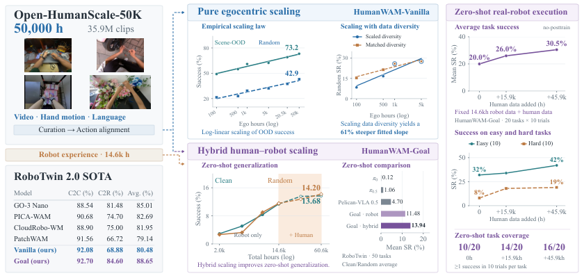

> 图解：整条技术路线分为两层。左侧先利用 50,000 小时人类第一视角数据学习通用操作先验，再通过机器人后训练获得 HumanWAM-Vanilla；右侧把人类与机器人经验联合训练，并加入视觉目标，得到能够零样本执行和按目标改变行为的 HumanWAM-Goal。图中的另一条主线是 Scaling：时长与任务、场景多样性共同增长时，下游泛化提升更明显。

## 为什么“有人类视频”还不等于“机器人会做事”

第一视角视频天然记录了人如何抓、放、折、插、整理物体，采集成本也远低于遥操作机器人轨迹。但把这种经验用于机器人控制，至少隔着三道门槛：

- **数据门槛**：互联网视频中大量片段没有清晰手部、动作估计跳变，或长时间处于静止状态；直接扩大时长，也会同步放大噪声。
- **接口门槛**：不同数据集使用不同相机坐标系、手腕轴方向和开合度定义。同样的物理动作，在数值上可能毫无一致性。
- **具身门槛**：人手与机器人夹爪的形态、关节和控制动力学不同。只学人类视频的模型通常仍需目标机器人示范，不能直接部署。

此前的 EgoScale、HumanScale 和 Dyna-2 已经表明，人类数据规模与验证损失或动作预测能力之间存在 Scaling 趋势。Open-HumanScale 的推进在于：它把评价推进到 **闭环任务成功率**，同时考察分布内、视觉分布外和完整环境随机化，并把“时长之外还该扩什么”拆成受控实验。

这篇文章实际回答了两层问题：纯人类预训练怎样稳定地转化为机器人能力；加入机器人数据与视觉目标后，能否进一步摆脱每个任务都要微调的范式。

## 第一步：把 10 万小时原料清成 5 万小时可训练经验

### 五个来源，统一成一种监督信号

Open-HumanScale-50K 汇集 HumanNet、EgoSuite-Open100K、EgoDex、Gen-HumanEgo 和 EgoVerse。原始数据共 104,289.41 小时，清洗后保留整整 50,000 小时、54 亿帧和 31,396,799 个物理 episode；由于长 episode 会在异常处切段，最终得到 35,934,235 个连续 clip。

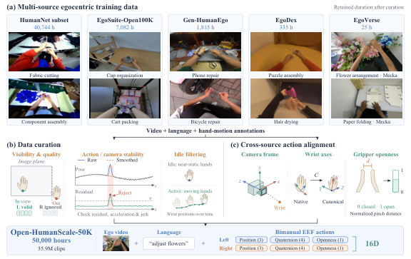

> 图解：(a) 展示五个数据源及保留时长，HumanNet 是主体；(b) 依次依据手部可见性、运动稳定性和有效操作活动筛选片段；(c) 对相机坐标系、手腕轴与夹爪开合度做跨源对齐。也就是说，“50K”不是原始视频简单拼盘，而是经过质量控制和几何统一后的训练集合。

| 数据集 | 清洗前时长（h） | 清洗前帧数（M） | 清洗后时长（h） | 清洗后帧数（M） | Episode 数 |
|---|---:|---:|---:|---:|---:|
| HumanNet subset | 90,275.25 | 9,749.73 | 40,743.58 | 4,400.31 | 30,833,247 |
| EgoSuite-Open100K | 11,193.99 | 1,208.95 | 7,081.65 | 764.82 | 348,724 |
| EgoDex | 829.45 | 89.58 | 335.43 | 36.23 | 163,537 |
| Gen-HumanEgo | 1,847.39 | 199.52 | 1,814.53 | 195.97 | 44,632 |
| EgoVerse | 143.33 | 15.48 | 24.81 | 2.68 | 6,659 |
| **总计** | **104,289.41** | **11,263.26** | **50,000.00** | **5,400.00** | **31,396,799** |

这些来源互补性很强：HumanNet 提供互联网级场景广度；EgoSuite 提供任务、场景标签和同步头、腕视角；EgoDex 聚焦 194 类桌面灵巧操作；Gen-HumanEgo 覆盖家庭、商业、工业和农业环境；EgoVerse 则补充多机构、多演示者数据。最终语料覆盖家庭、商业服务和工业操作，而非单一场景中的重复轨迹。

### 清洗不是“删坏帧”，而是在保留可学习因果关系

数据筛选主要做三件事：

1. **手部可见性**：把标注的三维末端执行器位置投影到图像中，只保留具有效视觉上下文的片段。若只有一只手可见，就只计算这只手的 Action Loss，并将另一只手排除在归一化统计之外；过近、过小或只剩边缘手指的画面也会被过滤。
2. **动作与相机稳定性**：比较原始和平滑轨迹，检查位置、姿态、加速度与 jerk 的异常变化；相机轨迹则检查突变和相对 chunk 起点的过大位移。异常帧被用作切分点，而不是把整段数据一并丢弃。
3. **静止片段过滤**：在 32 帧滑窗内测量末端位置变化，裁掉 chunk 两端的静止区间，并丢弃有效活动窗口不足 70% 的片段。

这个设计的价值在于，视频预测和动作预测需要看到的是“操作如何改变场景”，而不是大量静止画面或不稳定的姿态估计。

### 16 维统一动作：先统一物理含义，再谈混合训练

作者把人的双手与机器人的双夹爪都映射到末端执行器（EEF，End-Effector）空间。每个时刻的动作写成：

$$
\mathbf{a}_t =
[\mathbf{p}_t^L,\mathbf{q}_t^L,g_t^L,
 \mathbf{p}_t^R,\mathbf{q}_t^R,g_t^R]
\in \mathbb{R}^{16}
$$

其中，$\mathbf{p}_t^h\in\mathbb{R}^3$ 是位置，$\mathbf{q}_t^h\in\mathbb{R}^4$ 是按 $wxyz$ 排列的单位四元数，$g_t^h\in[0,1]$ 是开合度，$h\in\{L,R\}$ 表示左右手。这样不要求人与机器人共享关节构型，只要求“末端在哪里、朝向如何、张开多少”具有相同含义。

对齐又分三层：

- **相机坐标对齐**：利用每帧相机外参，把世界坐标中的手腕轨迹转换到对应时刻的相机坐标系。定义 $T_{AB}$ 为从坐标系 $B$ 到 $A$ 的变换，则

$$
T_{C_{\mathrm{cv}}E}^{h}(t)
= T_{WC_{\mathrm{cv}}}(t)^{-1}T_{WE}^{h}(t)
$$

  随后统一为 $+x$ 向右、$+y$ 向上、$+z$ 向后。对于采用 $+y$ 向下、$+z$ 向前的来源，用 $S=\operatorname{diag}(1,-1,-1)$ 左乘位置和旋转。
- **手腕轴对齐**：规定规范手腕坐标轴，再为每个来源和左右手估计固定旋转 $C_{s,h}$，得到 $R_{\mathrm{aligned}}^h(t)=R_{\mathrm{camera}}^h(t)C_{s,h}$。有手部关键点时使用正交 Procrustes 对齐，HumanNet 则结合投影轴与单目手部 landmark 确定轴排列和符号。
- **开合度对齐**：将拇指与食指指尖距离 $d$ 归一化到统一的 $[0,1]$：

$$
g=\operatorname{clip}\left(
\frac{d-d_{\mathrm{closed}}}{d_{\mathrm{open}}-d_{\mathrm{closed}}},
0,1\right)
$$

这套表示看起来像工程细节，实际上决定了多源监督能否指向同一个动作目标。后面的消融会证明，省略对齐会明显损失泛化。

## 第二步：纯人类预训练到底扩出了什么

### 统一实验协议，避免把后训练差异误当 Scaling

研究首先使用 HumanWAM-Vanilla。它以 Wan2.2-TI2V-5B 为视频骨干，增加一个深度相同的 Action Expert，构成 Mixture-of-Transformers；视频与动作 Expert 通过带 mask 的联合 Self-Attention 交换信息。

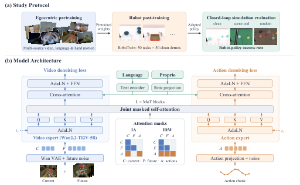

> 图解：(a) 是纯第一视角预训练、Clean 机器人示范后训练、闭环评测的三阶段流程；(b) 展示当前帧 token（C）、未来视频 token（F）和动作 token（A）的可见关系。Isolated Attention 只允许动作读取当前帧，推理时可不生成未来视频；Inverse-Dynamics Attention（IDM）还允许动作读取未来视频，推理时先预测视觉未来，再求动作。

默认研究配置采用 Isolated Attention 和相对相机坐标的 16 维动作。预训练统一使用 AdamW，峰值学习率 $10^{-4}$、weight decay 为 0.01，学习率在 100k steps 内做 cosine decay，前 5% 线性 warm-up。不同规模语料不能机械使用同一训练量：小语料容易过训练，大语料又可能欠训练，因此作者调整 global batch，并每 10k steps 保存、后训练和评测 checkpoint。

| 预训练时长（h） | 帧数（M） | Global batch size | 每 10k steps 对应 Epoch |
|---:|---:|---:|---:|
| 100 | 10.8 | 512 | 0.58 |
| 500 | 54.0 | 1,024 | 0.23 |
| 1,000 | 108.0 | 2,048 | 0.23 |
| 5,000 | 540.0 | 2,048 | 0.05 |
| 10,000 | 1,080 | 4,096 | 0.04 |
| 20,500 | 2,214 | 4,096 | 0.02 |
| 50,000 | 5,400 | 8,192 | 0.02 |

下游统一使用 RoboTwin 2.0：50 个 ALOHA-AgileX 双臂桌面任务，每任务 50 条 Clean 示范，后训练 12k steps、global batch 为 512。每个 checkpoint 在三种设置下均对全部任务各跑 50 episodes：

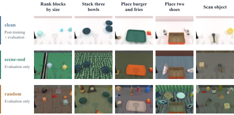

> 图解：**Clean** 保持示范采集时的纯背景、固定光照、无杂物和固定桌高；**Scene-OOD** 只随机背景与桌面纹理，用来隔离视觉场景变化；**Random** 进一步加入杂物、光照变化和最多 3 cm 的桌高扰动。三种设置分别报告各自最优 checkpoint，因为 Clean 最优并不必然意味着随机场景最优。

### 结论一：成功率随小时数近似对数线性增长，主要涨在分布外

作者用下式拟合预训练小时数 $H$ 与下游成功率：

$$
\mathrm{SR}=a+b\log_{10}H
$$

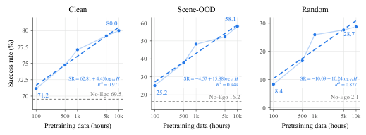

> 图解：横轴是第一视角预训练小时数，纵轴是 RoboTwin 成功率；蓝虚线为对数线性最小二乘拟合，灰虚线为无第一视角预训练基线。100 到 10,000 小时，Clean 从 71.2% 升至 80.0%，Scene-OOD 从 25.2% 升至 58.1%，Random 从 8.4% 升至 28.7%。三组拟合的 $R^2$ 分别为 0.971、0.949、0.877；每扩大十倍数据，拟合增益分别为 4.43、15.88、10.24 个百分点。

IDM Attention 加绝对相机位姿后，趋势仍然成立，但分布内性能更早饱和。

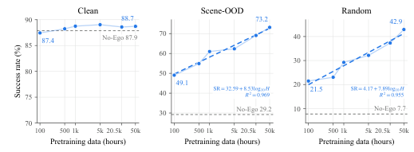

> 图解：Clean 在 100 到 50,000 小时间维持 87.4%–89.0%，无预训练基线已有 87.9%；真正的差距仍在分布外。Scene-OOD 从 49.1% 升至 73.2%，Random 从 21.5% 升至 42.9%，而无预训练分别只有 29.2% 和 7.7%。两条分布外拟合的 $R^2$ 达 0.969 和 0.955，说明这一经验规律不依赖某一种 Attention 或动作参数化。

这里要注意结论边界：论文验证的是 **100–50,000 小时、指定数据与训练配方下的经验对数线性关系**，不是无限扩展也必然成立的普遍定律。

### 结论二：扩时长，也要扩任务和场景覆盖

为了区分“更多重复轨迹”和“更多经验种类”，作者从 EgoSuite-Open100K 构造两组语料。Scaled-diversity 随时长增加任务与场景；Matched-diversity 在 100、500、1,000 小时子集中保持与 5,000 小时父语料相同的 2,288 个任务和 2,953 个场景，只增加覆盖范围内的轨迹。

| 语料系列 | 时长（h） | Clip 数 | 任务数 | 场景数 |
|---|---:|---:|---:|---:|
| Scaled-diversity | 100 | 62,206 | 62 | 222 |
| Scaled-diversity | 500 | 305,889 | 309 | 961 |
| Scaled-diversity | 1,000 | 589,216 | 547 | 1,442 |
| Matched-diversity | 100 | 81,076 | 2,288 | 2,953 |
| Matched-diversity | 500 | 345,053 | 2,288 | 2,953 |
| Matched-diversity | 1,000 | 653,567 | 2,288 | 2,953 |
| 共享父语料 | 5,000 | 2,813,547 | 2,288 | 2,953 |

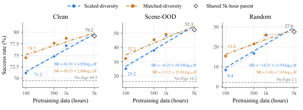

> 图解：蓝圆点代表多样性随时长增长，橙方块代表任务、场景集合固定；虚线和点划线分别拟合 $\mathrm{SR}=a+b\log_{10}H$。共同扩多样性的斜率在 Clean、Scene-OOD、Random 上分别比固定覆盖高 2.02、4.73、4.50，分布外收益尤其明显。

这给出一个很实用的数据策略：**预算增加时，优先引入新任务、新场景，而不只是给已有场景增加相似轨迹。**

### 结论三：预训练越大，机器人示范越省

作者比较 No-Ego、500 小时和 5,000 小时预训练三种初始化，并分别给每个任务 5、10、25、50 条机器人示范。

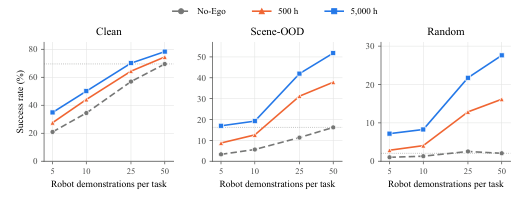

> 图解：横轴为每任务机器人示范数，纵轴为三种评测设置的成功率。500 小时模型在所有示范预算下都优于 No-Ego，5,000 小时模型又进一步提升。每任务 10 条示范时，Clean 从 No-Ego 的 34.5% 提升至 500 小时的 44.2%、5,000 小时的 50.1%；Random 则从 500 小时的 4.1% 提高到 5,000 小时的 8.3%。

更直观的是“达到同等能力需要多少示范”：No-Ego 每任务 50 条示范的 Scene-OOD 成绩，500 小时模型用 25 条即可超过，5,000 小时模型只需 5 条。每任务 25 条时，5,000 小时模型在 Scene-OOD 和 Random 上达到 42.0% 和 21.8%，也超过 500 小时模型使用 50 条时的 37.9% 和 16.2%。

### 结论四：跨源动作对齐不是可选项

在固定的四来源 1,000 小时语料上，Aligned 与 Raw 使用完全相同的视频、caption、采样和训练计划，唯一差别是是否统一相机坐标与手腕轴。

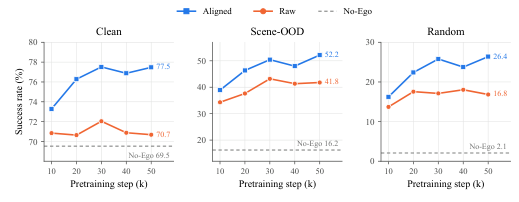

> 图解：每个点是对应预训练运行在某种评测设置下的最优后训练成功率，灰虚线为 No-Ego。Aligned 在所有预训练步数和三种设置上均优于 Raw；最佳 checkpoint 的 Clean 从 72.0% 提至 77.5%，Scene-OOD 从 43.2% 提至 52.2%，Random 从 18.0% 提至 26.4%。即使不对齐，多源人类预训练也优于 No-Ego，但对齐能进一步释放收益。

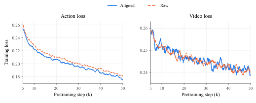

> 图解：横轴为预训练过程，纵轴分别为视频与动作 Loss。Aligned 的 Action Loss 更低，Video Loss 则与 Raw 接近。收益因此不是来自视频任务变简单，而是来自跨源动作监督变得更一致。

### 结论五：只预测视频不够，还要预测人怎么动

作者在相同 1,000 小时视频上比较 0%、约 50% 和 100% 时长带人类动作监督的配置；视频-only 版本把 Action Loss 权重设为零，所有模型在机器人后训练时都获得完整动作监督。

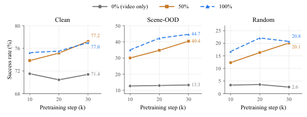

> 图解：横轴为预训练 steps，纵轴为后训练策略在三种条件下的成功率。20k steps 时，约 50% 动作监督相比纯视频把 Clean 从 70.4% 提至 75.2%，Scene-OOD 从 13.0% 提至 34.8%，Random 从 3.6% 提至 16.3%。10k–30k steps 间，纯视频的分布外表现几乎停滞，而联合预测人类运动和未来视频的模型持续改善。

**博主视角：**这项实验抓住了 World–Action Model 的关键。未来视频提供“世界会怎样变”，手部轨迹则明确“操作者怎样造成变化”；后者为控制学习补上了更直接的因果接口。

### 结论六：等时长下，人类数据在 500–5,000 小时区间更具优势

机器人对照语料来自 AgiBot Beta、XDOF/ABC-130k 和内部 Cobot Magic，统一只保留有语言标注、头部外参已验证且无底座或头相机运动的轨迹。

| 规模（h） | AgiBot Beta（h） | XDOF/ABC-130k（h） | Cobot（h） | 总帧数 |
|---:|---:|---:|---:|---:|
| 100 | 32.19 | 67.80 | — | 10,798,713 |
| 500 | 176.52 | 323.46 | — | 53,997,982 |
| 1,000 | 361.70 | 638.16 | — | 107,985,621 |
| 5,000 | 1,944.80 | 2,983.46 | 71.52 | 539,977,159 |

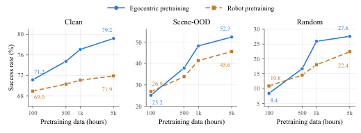

> 图解：横轴为预训练小时数，纵轴为同一 RoboTwin 后训练协议下的成功率。100 小时时，机器人数据在 Scene-OOD 和 Random 上略占优势；500–5,000 小时后，人类数据在三种设置上全面领先。5,000 小时人类预训练在 Scene-OOD、Random 上达到 52.3%、27.6%，机器人预训练为 45.6%、22.4%；甚至 1,000 小时人类模型也超过 5,000 小时机器人模型。

这并不说明机器人数据无用，而是说明在人类数据覆盖更广、采集更便宜的设定下，它能提供更丰富的可迁移操作先验；真正直接部署时，仍需要机器人数据补齐具身控制。

### 结论七：腕部相机不能直接硬加，需要多视角中间训练

人类预训练通常只有头部视角，而机器人常使用一个头相机和两个腕相机。作者比较 Single-view、Multi-view conditioning（三视角输入、只预测头部未来）和 Multi-view prediction（三视角输入与未来预测）。

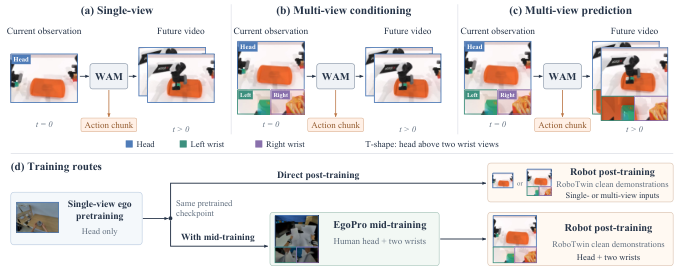

> 图解：左侧给出三种视角配置；右侧比较直接机器人后训练，与先用约 1,000 小时 EgoPro 同步头、腕人类视频做 mid-training 再后训练。中间训练的作用，是在引入腕部观察时保留原有人类预训练的泛化先验。

| 模型配置 | 视角配置 | Mid-training | Clean | Scene-OOD | Random |
|---|---|---|---:|---:|---:|
| Isolated attention（relative） | Single-view | None | 75.68 | 46.08 | 22.48 |
| Isolated attention（relative） | Multi-view conditioning | None | 74.60 | 34.08 | 12.92 |
| Isolated attention（relative） | Multi-view prediction | None | 75.04 | 33.00 | 14.84 |
| IDM attention（absolute） | Single-view | None | 88.48 | 62.00 | 28.56 |
| IDM attention（absolute） | Multi-view conditioning | None | 90.56 | 59.52 | 29.08 |
| IDM attention（absolute） | Multi-view conditioning | EgoPro | 90.28 | 61.20 | 30.68 |
| IDM attention（absolute） | Multi-view prediction | None | 89.84 | 56.28 | 26.16 |
| IDM attention（absolute） | Multi-view prediction | EgoPro | 88.72 | 58.80 | 27.36 |

在 Isolated Attention 下，直接加腕视角会把 Scene-OOD 从 46.08% 拉到 33%–34% 左右，Random 也近乎腰斩。IDM 下，Multi-view conditioning 加 EgoPro 后，Scene-OOD 回到 61.20%，接近单视角的 62.00%，Random 则升至 30.68%，超过单视角的 28.56%。因此最终模型选择 **Multi-view conditioning + EgoPro mid-training**，而不是预测全部三个视角的未来。

## HumanWAM-Vanilla：纯人类预训练能走到哪一步

### 训练与部署配置

最终 Vanilla 模型独占使用 Open-HumanScale-50K 预训练，采用 IDM Attention 和绝对相机坐标 EEF 位姿。动作 chunk 长 32，每四个动作步骤采一帧视频，每个样本共 9 帧；global batch 为 8,192，训练 100k steps，学习率从 $10^{-4}$ cosine 衰减至 $10^{-6}$。

推理时先产生未来视频 latent，再预测 32 步动作 chunk，执行前 24 步后根据新观察重新规划。EgoPro 中间训练负责适配三视角输入，机器人后训练配置如下：

| 设置 | 机器人示范 | Optimizer steps | Global batch size |
|---|---:|---:|---:|
| RoboTwin 2.0 | 2,500 | 24,000 | 512 |
| RoboDojo | 3,500 | 50,000 | 512 |
| Real robot | 50/task | 10,000 | 256 |

### RoboTwin 2.0：Clean 领先，Random 仍有差距

Clean2Clean 与 Clean2Random 使用同一个 checkpoint 和同一批 Clean 示范，每个设置每任务评测 100 episodes，共 5,000 次 rollout。

| 类型 | 方法 | Clean2Clean（%） | Clean2Random（%） | Average（%） |
|---|---|---:|---:|---:|
| VLA | Qwen-RobotManip-Context | 84.70 | 69.40 | 77.10 |
| VLA | GigaBrain-0.7 | 66.80 | 67.92 | 67.36 |
| VLA | $\pi_{0.5}$ | 70.70 | 46.00 | 58.35 |
| VLA | Spatial Forcing | 77.20 | 26.74 | 51.97 |
| VLA | X-VLA | 68.00 | 20.90 | 44.45 |
| VLA | Abot-M0 | 57.40 | 30.40 | 43.90 |
| VLA | GR00T-N1.7 | 43.60 | 20.70 | 32.20 |
| WAM | GO-3 Nano Preview | 88.54 | 81.48 | 85.01 |
| WAM | PICA-WAM | 90.68 | 74.70 | 82.69 |
| WAM | CloudRobo-WM | 88.90 | 75.00 | 81.95 |
| WAM | MWA-Phoenix | 86.54 | 72.42 | 79.48 |
| WAM | PatchWAM | 91.56 | 66.72 | 79.14 |
| WAM | ME-Dex-1.0 | 89.58 | 68.12 | 78.85 |
| WAM | EWAM | 82.16 | 72.08 | 77.12 |
| WAM | ViGAR | 82.00 | 67.02 | 74.51 |
| WAM | UniWAM | 75.12 | 67.56 | 71.34 |
| WAM | OpenWAM-$\alpha$ | 89.40 | 48.70 | 69.00 |
| WAM | 4D-WAM | 81.50 | 41.80 | 61.65 |
| WAM | **HumanWAM-Vanilla** | **92.08** | **68.88** | **80.48** |

Vanilla 的 Clean2Clean 在表中最高，平均成功率超过全部 VLA 和多数 WAM；但 Clean2Random 与 GO-3 Nano Preview 的 81.48% 仍有明显距离。论文没有把“纯人类预训练”包装成全面领先，而是明确指出基本 World–Action 架构在分布外仍有提升空间。

### RoboDojo：精确控制与长时程更突出，但并非全面第一

RoboDojo 包含 42 个双臂任务，考察泛化、精度、记忆、长时程和开放词汇。模型使用官方 3,500 条示范后训练，不包含专门的推理或记忆模块，也不与 agentic、双系统方法比较。下表每项均为“成功率（%）/ progress score”，Mean 是六组的等权平均。

| 类型 | 方法 | Gen-Std | Gen-Rand | Precision | Long-Horizon | Memory | Open | Mean |
|---|---|---|---|---|---|---|---|---|
| VLA | StarVLA-$\alpha$ | 5.00 / 7.54 | 0.00 / 0.33 | 4.33 / 9.90 | 6.50 / 14.15 | 2.44 / 3.34 | 0.58 / 0.68 | 3.14 / 5.99 |
| VLA | X-VLA | 12.00 / 17.90 | 1.00 / 3.04 | 12.00 / 18.32 | 9.75 / 16.53 | 3.56 / 4.76 | 0.50 / 0.55 | 6.47 / 10.18 |
| VLA | $\pi_{0.5}$ | 15.00 / 20.93 | 1.00 / 5.82 | 5.50 / 12.40 | 14.67 / 23.54 | 4.56 / 5.78 | 1.67 / 1.98 | 7.07 / 11.74 |
| VLA | Spatial Forcing | 15.00 / 21.25 | 4.00 / 6.98 | 10.58 / 17.33 | 14.58 / 23.26 | 4.11 / 5.43 | 1.58 / 1.78 | 8.31 / 12.67 |
| VLA | Hy-Embodied-0.5-VLA | 17.00 / 21.98 | 0.00 / 1.57 | 8.00 / 13.81 | 14.92 / 25.74 | 12.11 / 13.37 | 0.58 / 0.65 | 8.77 / 12.85 |
| VLA | Xiaomi-Robotics-1 | 28.00 / 35.65 | 6.00 / 11.44 | 18.83 / 26.69 | 23.67 / 38.39 | 6.56 / 7.81 | 3.58 / 3.94 | 14.44 / 20.65 |
| VLA | Galaxea G0.5 | 20.00 / 26.74 | 6.00 / 11.16 | 20.42 / 28.25 | 32.25 / 44.12 | 7.33 / 8.61 | 1.58 / 1.73 | 14.60 / 20.10 |
| VLA | DM0.5 | 18.00 / 23.49 | 4.00 / 8.06 | 16.75 / 24.82 | 19.50 / 33.70 | 47.44 / 47.74 | 2.08 / 2.43 | 17.96 / 23.37 |
| WAM | Fast-WAM | 2.00 / 4.33 | 0.00 / 0.34 | 0.00 / 1.96 | 5.17 / 9.14 | 3.44 / 3.55 | 0.42 / 0.42 | 1.84 / 3.29 |
| WAM | AHA-WAM | 6.00 / 10.32 | 0.00 / 1.26 | 2.42 / 5.86 | 2.67 / 8.61 | 2.78 / 2.97 | 0.83 / 0.88 | 2.45 / 4.98 |
| WAM | GigaWorld-Policy | 6.00 / 10.28 | 0.00 / 0.41 | 1.83 / 6.15 | 8.92 / 15.51 | 2.22 / 3.46 | 0.50 / 0.54 | 3.25 / 6.06 |
| WAM | X-WAM | 5.00 / 11.24 | 1.00 / 3.54 | 1.83 / 6.72 | 9.08 / 17.47 | 4.67 / 6.32 | 0.25 / 0.57 | 3.64 / 7.64 |
| WAM | OpenWAM-$\alpha$ | 25.56 / 33.16 | 4.11 / 8.26 | 9.25 / 18.45 | 25.33 / 34.93 | 9.11 / 10.41 | 1.08 / 1.41 | 12.41 / 17.77 |
| WAM | **HumanWAM-Vanilla** | **22.33 / 29.10** | **1.67 / 3.25** | **20.50 / 28.83** | **33.00 / 44.00** | **6.00 / 7.00** | **1.50 / 1.80** | **14.17 / 19.00** |

Vanilla 超过表中 WAM 基线的两项均值，接近 Galaxea G0.5；相对 OpenWAM-$\alpha$ 的优势主要集中在 Precision（20.50% 对 9.25%）和 Long-Horizon（33.00% 对 25.33%）。但 Memory、Gen-Rand 等组别并非最强，这也说明通用人类先验不能替代专门的记忆和推理机制。

### 真实机器人：视觉分布外平均成功率增加 65 个百分点

真实实验使用 Cobot Magic 双臂机器人，任务包括纸杯堆叠、毛巾折叠、抽屉收纳和桌面整理。No-Ego 与 Vanilla 都用每任务 50 条示范后训练；分布外通过分别或同时改变桌布和光照构造，每任务、每模型、每设置评测 10 次。

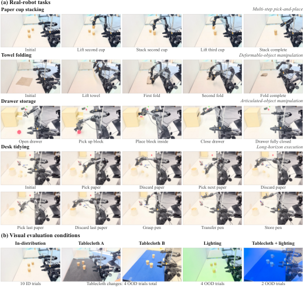

> 图解：四行任务覆盖多步抓取放置、可变形物体、关节物体和长时程整理；评测画面同时展示示范分布内的原始视觉条件，以及桌布、光照变化后的分布外条件。任务本身不变，变化集中在视觉外观上。

| 任务 | 分布内 No-Ego | 分布内 Vanilla | 分布外 No-Ego | 分布外 Vanilla |
|---|---:|---:|---:|---:|
| 纸杯堆叠 | 70.0 | **90.0** | 0.0 | **80.0** |
| 毛巾折叠 | 50.0 | **80.0** | 10.0 | **60.0** |
| 抽屉收纳 | 60.0 | **90.0** | 0.0 | **70.0** |
| 桌面整理 | 50.0 | **90.0** | 0.0 | **60.0** |
| **平均** | **57.5** | **87.5** | **2.5** | **67.5** |

Vanilla 在分布内提升 30.0 个百分点，在分布外提升 65.0 个百分点；No-Ego 在 40 次分布外试验中只成功一次。这是全文最直接支持“人类数据主要增强视觉泛化”的真实硬件证据。

### 消融：未来视频、绝对位姿有效，视频权重初始化反而没必要

以下实验都基于四来源 1,000 小时语料，预训练 20k steps、机器人后训练 12k steps。

| Attention | 动作表示 | 推理方式 | Clean | Scene-OOD | Random |
|---|---|---|---:|---:|---:|
| IA | Relative | Action-only | 76.28 | 46.36 | 22.40 |
| Mutual | Relative | Joint denoising | 81.28 | 57.96 | 32.92 |
| IDM | Relative | Video $\rightarrow$ action | 83.56 | 58.08 | 27.56 |
| Mutual | Absolute camera-frame | Joint denoising | 84.88 | 61.12 | 30.68 |
| **IDM** | **Absolute camera-frame** | **Video $\rightarrow$ action** | **88.48** | **62.00** | **28.56** |
| Optional-IDM | Relative | First-frame only | 73.44 | 48.44 | 23.40 |
| Optional-IDM | Relative | Video $\rightarrow$ action | 81.96 | 57.04 | 28.04 |

结果支持两点：动作读取未来视觉信息能提升 Clean 与 Scene-OOD；在 IDM 下把相对位姿换成绝对相机位姿，Clean 从 83.56% 提至 88.48%，Scene-OOD 从 58.08% 提至 62.00%。不过 Random 并非所有组合都同步受益，例如 Mutual + relative 的 Random 更高，不能将单一设置的最优理解成所有指标全面占优。

| Action Expert 初始化 | Clean | Scene-OOD | Random |
|---|---:|---:|---:|
| 插值 Wan2.2 权重 | 89.56 | 83.20 | 51.52 |
| 随机初始化 | 90.28 | 83.92 | 54.12 |

随机初始化与视频权重插值初始化在 Clean、Scene-OOD 上接近，Random 还更高。因此，Action Expert 不必机械继承视频骨干权重。

## HumanWAM-Goal：把“人类先验”推进到零样本执行

纯人类预训练仍绕不开目标任务示范，而纯机器人数据又受采集成本和场景多样性限制。HumanWAM-Goal 的解法是：**固定一部分机器人控制经验，持续加入人类经验，同时用一张目标图明确“最终要什么样”。**

视觉目标比语言更适合描述空间关系。例如“整理桌面”没有说明书应该放左还是放右、哪本书在最上面；目标图可以直接把这些决策作为推理时的上下文。它也让同一个冻结策略有机会仅通过换图改变行为，这就是论文所说的 Embodied In-Context Learning。

### 机器人数据与 49 维混合动作接口

机器人预训练语料约 14.6k 小时，真实机器人部分包含超过 110 万个 episode、八个记录域。864 个原始任务集合标签规范化后为 751 个，覆盖整理书与工具、折衣、备餐、家电操作和插线等活动。

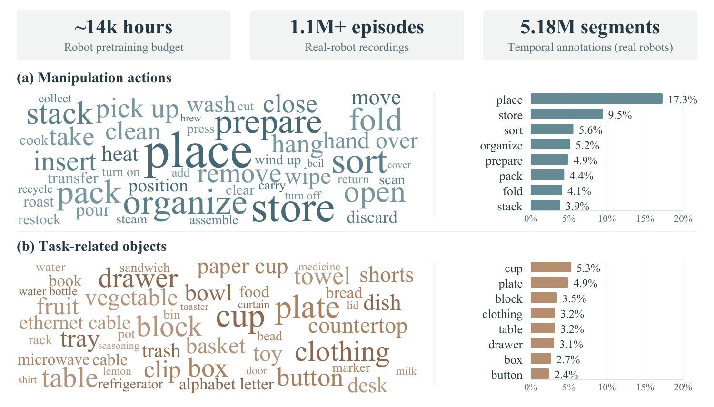

> 图解：顶部给出机器人数据预算；词云和条形图分别统计动作、物体标签，百分比以 751 个规范化任务集合标签为分母。place、fold、insert 分别出现在 130、31、20 个标签中，cup、plate、clothing 分别出现在 40、37、24 个标签中，反映语料的任务与物体覆盖面。

为了同时描述关节、人形躯干、移动底盘和跨具身 EEF 控制，16 维动作被扩展为 49 维：

$$
\mathbf{a}^{\mathrm{ext}}_t =
\left[
\underbrace{\mathbf{j}_t}_{23},\;
\underbrace{\mathbf{b}_t}_{3},\;
\underbrace{\mathbf{a}_t,\mathbf{p}^{H}_t,\mathbf{q}^{H}_t}_{23}
\right]
\in\mathbb{R}^{49}
$$

其中 $\mathbf{j}_t$ 是 23 维机器人关节状态，未使用的自由度补零并 mask；$\mathbf{b}_t=(x_t,y_t,\psi_t)$ 是底盘平移与 yaw；$\mathbf{a}_t$ 是 16 维双臂 EEF；7 维头部位姿只作为几何 metadata，不参与状态条件和动作预测 Loss。

跨具身零样本部署还做了三项关键处理：

- 夹爪开合改成物理开口宽度，以 0.12 m 为统一参考归一化；人手的拇指—食指三维距离也按同一米制表示。
- EEF 目标写成相对当前观察的 chunk 位移，并锚定当前头相机坐标：$\Delta\mathbf{p}(\tau\mid t)=\mathbf{R}^{H}(t)^{\top}(\mathbf{p}(\tau)-\mathbf{p}(t))$。姿态和底盘也采用相对表示，减少不同相机安装和工作空间偏置。
- 人与机器人共享 EEF 和底盘投影，关节分支使用具身特定投影；训练机器人时随机 dropout 关节分支，避免模型过度依赖本体关节状态，使共享 EEF 通路能够独立工作。

这套设计与 Vanilla 的绝对位姿并不矛盾：Vanilla 面向单一目标机器人后训练，绝对位姿更有利；Goal 面向多具身联合训练和直接部署，相对、米制、可跨域归一化的接口更合适。

### 架构：目标图替代两阶段未来视频级联

HumanWAM-Goal 基于 Cosmos3-Nano-16B，冻结 Qwen3-VL-based Reasoner 和 Wan VAE，训练共享的 Video–Action Generator 及相关投影。输入包括语言 $\ell$、当前观察 $\mathbf{o}_t$、本体状态 $\mathbf{s}_t$、可选历史 $\mathcal{H}_t$ 和目标图 $\mathbf{g}$：

$$
p_{\theta}\left(\mathbf{O}^{+}_t,\mathbf{A}_t\mid\mathbf{c}_t\right),
\qquad
\mathbf{c}_t=(\ell,\mathbf{o}_t,\mathbf{s}_t,\mathcal{H}_t,\mathbf{g})
$$

模型预测 12 帧未来视频和 $48\times49$ 的动作 chunk。

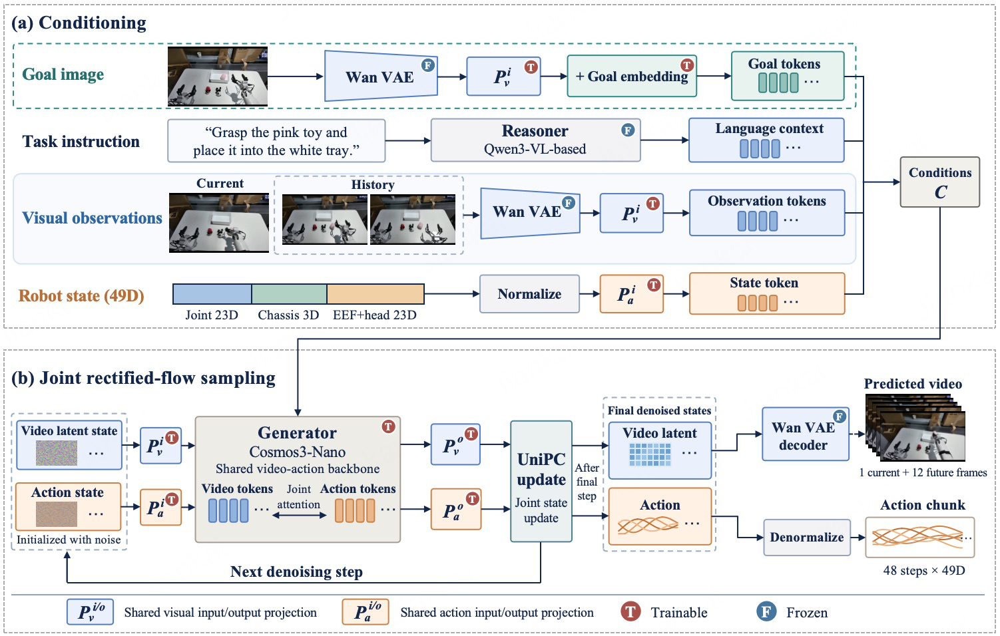

> 图解：(a) 当前图、历史图、语言、49 维状态和目标图共同构成条件；目标图单独编码，并加可学习 goal embedding，避免与当前观察混淆。(b) 视频和动作 token 在共享 Generator 中通过联合 Self-Attention 双向交互，条件 token 固定，UniPC 迭代同步去噪。真实控制时可不解码视频像素。

Vanilla 的语言条件版本需要“先生成完整未来，再预测动作”，顺序采样成本较高；Goal 已有干净目标 token 锚定空间终点，因此改成单阶段 Joint Rectified-Flow Sampling，保留视频—动作耦合，同时把顺序采样阶段减半。

### 联合训练配方与目标图来源

机器人-only 系列使用 2,005、4,261、8,475、14,618 小时机器人数据；Hybrid 系列固定 14,618 小时机器人数据，分别加入 15,901 或 45,938 小时人类数据，总预算约 30.5k 和 60.6k 小时。

训练时目标图在线采样自同一轨迹的未来头部画面：

- 40%：未来 2–8 秒的观察；
- 20%：episode 最后一帧；
- 20%：后续标注子任务的最后一帧；
- 20%：空目标，目标 token 整体移除，从而兼容纯语言执行。

优化使用 FusedAdam，基础学习率 $4\times10^{-5}$，global batch 为 1,024，500k-step schedule 中前 1,000 steps 线性 warm-up、随后线性衰减；动作投影、动作模态 embedding 和 goal embedding 使用 5 倍学习率，评测采用 EMA 权重。

RoboTwin 后训练每任务使用 50 条 Clean 示范。目标图中 20% 是真实终帧，80% 由 GPT Image 2.5 根据初始图和任务指令合成，所有模型在同一场景共享同一目标图，避免目标质量差异污染比较。

### RoboTwin 零样本与后训练必须分开看

| 设置 | 目标任务适配 | 每任务每条件 Episodes | 对应结果 |
|---|---|---:|---|
| Zero-shot | 无 | 50 | 零样本模型比较与 Scaling |
| Post-training | 50 Clean demos/task | 100 | 预训练规模曲线 |
| Leaderboard | 最佳配置 + augmentation | 100 | 完整后训练榜单比较 |

ALOHA-AgileX 不出现在预训练中。任务覆盖定义为 Clean 与 Random 平均成功率至少 2%，即 100 次试验至少成功两次；累计覆盖则是到某一预算为止，各 checkpoint 可解任务的并集。

#### 零样本比较：13.94% 不算高，但部署门槛显著不同

| 模型 | Clean | Random | Average |
|---|---:|---:|---:|
| LingBot-VLA 2.0 | ERR0 | ERR0 | ERR0 |
| LingBot-VA | ERR0 | ERR0 | ERR0 |
| OpenWAM | ERR0 | ERR0 | ERR0 |
| DM0.5 | ERR1 | ERR1 | ERR1 |
| GR00T N1.7 | ERR1 | ERR1 | ERR1 |
| DreamZero-AgiBot | ERR1 | ERR1 | ERR1 |
| LingBot-VA 2.0 | ERR2 | ERR2 | ERR2 |
| Fast-WAM | ERR2 | ERR2 | ERR2 |
| MV-WAM | ERR2 | ERR2 | ERR2 |
| InternVLA-A1.5 | 0.00 | 0.00 | 0.00 |
| InternW0-$\Delta$ | 0.00 | 0.00 | 0.00 |
| Zero-WAM | 0.00 | 0.00 | 0.00 |
| Hy-VLA-UMI | 0.00 | 0.00 | 0.00 |
| $\pi_0$ | 0.16 | 0.08 | 0.12 |
| $\pi_{0.5}$ | 0.88 | 1.24 | 1.06 |
| Pelican-VLA 0.5 | 5.36 | 4.04 | 4.70 |
| HumanWAM-Goal（Robot Only） | 11.40 | 11.56 | 11.48 |
| **HumanWAM-Goal（Human-Robot Hybrid）** | **13.68** | **14.20** | **13.94** |

ERR0 表示发布 checkpoint 缺少动作归一化统计，ERR1 表示没有兼容目标具身的控制映射，ERR2 表示没有适合该协议的公开预训练 checkpoint；0.00 则代表确实执行了 rollout，但没有成功 episode。因而这张表同时反映能力与可部署性，不能把 ERR 当作成功率零分。

HumanWAM-Goal 的跨源米制 EEF、相对位移和关节 mask，使全局归一化统计可以直接用于新机器人，再通过标准逆运动学执行，无需目标域重新校准。混合训练相对 Robot Only 增加 2.46 个百分点，但 **13.94% 的绝对成功率仍说明零样本远未饱和**。

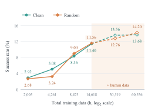

> 图解：横轴是六种独立训练的数据配置，纵轴是 Clean、Random 及其平均成功率。机器人数据从 2,005 扩到 14,618 小时，平均成功率由 2.80% 增至 11.48%；固定机器人数据后加入 15,901、45,938 小时人类数据，进一步达到 13.16% 和 13.94%。

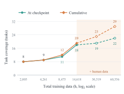

> 图解：纵轴为平均成功率达到至少 2% 的任务数。机器人-only 系列从 8/50 扩到 18/50；加入两档人类数据后分别覆盖 19/50 和 22/50，最大规模的累计覆盖达到 29/50。人类数据从 15.9k 增至 45.9k 小时时，Random 提升 1.44 个百分点，而 Clean 仅提升 0.12 个百分点，再次显示主要收益是环境鲁棒性。

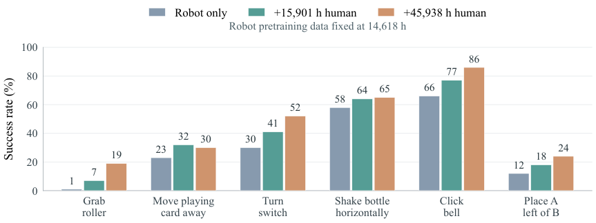

> 图解：横轴为固定 14,618 小时机器人数据上逐步增加的人类数据，纵轴是六个任务 Clean 与 Random 的平均成功率。Grab roller 从 1% 提至 19%，Move playing card away 从 23% 提至 30%，Turn switch 从 30% 提至 52%，Place A left of B 从 12% 提至 24%；已有基础的 Shake bottle horizontally、Click bell 也分别从 58% 到 65%、66% 到 86%。

#### 后训练：人类数据冲破 Random 平台，完整配置达到 88.65%

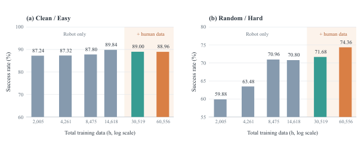

> 图解：横轴为预训练数据配置，纵轴为每任务 50 条 Clean 示范后训练的成功率。机器人-only 从 2,005 到 14,618 小时，Clean 从 87.24% 到 89.84%，Random 从 59.88% 到 70.80%；Random 在 8,475 小时后已出现平台。加入 15,901、45,938 小时人类数据后，Random 分别升至 71.68% 和 74.36%，Clean 则维持在约 89% 的饱和区。

最佳 Hybrid checkpoint 再结合光度数据增强和后训练改进后，榜单结果如下。它与上面的受控 Scaling 曲线不是同一配置，因此单独报告。

| 类型 | 方法 | Clean2Clean（%） | Clean2Random（%） | Average（%） |
|---|---|---:|---:|---:|
| VLA | Qwen-RobotManip-Context | 84.70 | 69.40 | 77.10 |
| VLA | GigaBrain-0.7 | 66.80 | 67.92 | 67.36 |
| VLA | $\pi_{0.5}$ | 70.70 | 46.00 | 58.35 |
| VLA | Spatial Forcing | 77.20 | 26.74 | 51.97 |
| VLA | X-VLA | 68.00 | 20.90 | 44.45 |
| VLA | Abot-M0 | 57.40 | 30.40 | 43.90 |
| VLA | GR00T-N1.7 | 43.60 | 20.70 | 32.20 |
| WAM | GO-3 Nano Preview | 88.54 | 81.48 | 85.01 |
| WAM | PICA-WAM | 90.68 | 74.70 | 82.69 |
| WAM | CloudRobo-WM | 88.90 | 75.00 | 81.95 |
| WAM | MWA-Phoenix | 86.54 | 72.42 | 79.48 |
| WAM | PatchWAM | 91.56 | 66.72 | 79.14 |
| WAM | ME-Dex-1.0 | 89.58 | 68.12 | 78.85 |
| WAM | EWAM | 82.16 | 72.08 | 77.12 |
| WAM | ViGAR | 82.00 | 67.02 | 74.51 |
| WAM | UniWAM | 75.12 | 67.56 | 71.34 |
| WAM | OpenWAM-$\alpha$ | 89.40 | 48.70 | 69.00 |
| WAM | 4D-WAM | 81.50 | 41.80 | 61.65 |
| WAM | HumanWAM-Vanilla | 92.08 | 68.88 | 80.48 |
| WAM | **HumanWAM-Goal** | **92.70** | **84.60** | **88.65** |

按论文引用的榜单结果，Goal 相对此前的 GO-3 Nano Preview 在 Clean、Random 和 Average 上分别高 4.16、3.12、3.64 个百分点。最值得注意的是，提升不再只发生在已饱和的 Clean，而主要把随机环境下的成功率也推到了 84.60%。

## 目标图是怎样生成并审验的

RoboTwin 本身不提供参考目标图，因此作者设计了一个不使用专家轨迹、终帧或隐藏模拟器状态的两阶段流程。

1. **场景定位**：初始头部图像以 $288\times224$ 为原生坐标，letterbox 后放大四倍至 $1152\times896$。作者为 50 个任务各写一份固定参考标注，包含物体 ID、描述、bbox、是否移动、最终状态和视觉验收条件；GPT-5.5 根据当前初始图与指令，把参考标注适配成结构化 JSON，而不是照抄参考场景坐标。
2. **图像编辑**：GPT Image 2.5 接收初始图、机器人外观表和像素对齐的几何 overlay，生成完成任务后的头部观察。提示词要求保持相机、背景、光照、物体数量与尺度，只移动指定物体，并删除所有框线和文字。
3. **审验与修复**：ChatGPT Astra High 独立检查目标与接收容器身份、任务关系、指定手臂、物体数量、背景与相机、接触和支撑、铰链及机器人结构。Fail 或 Uncertain 会反馈给定位或编辑阶段重新生成，并再次审验。

这里最重要的约束是：审验只保证 **视觉和指令一致性**，不证明隐藏物理状态真实可行，也不等于模拟器执行成功。

| 首轮审验结论 | 图片数 | 占比 |
|---|---:|---:|
| Pass | 6,380 | 90.7% |
| Fail | 542 | 7.7% |
| Uncertain | 110 | 1.6% |
| **总计** | **7,032** | **100.0%** |

7,032 张新生成图片经修复后全部通过审验；修复图允许可解释的透视变化和轻微尺寸差异，但仍拒绝目标错误、物体缺失或重复、任务关系错误、严重变形和多余手臂。其余 2,968 张评测目标是此前经独立审核批准复用的图片，总计 10,000 张。

## 真实机器人：从零样本到视觉 In-Context Learning

### 硬件、动作与评分协议

真实实验使用带轮式底盘和关节躯干的 Astribot S1。策略接收头相机、双腕相机 RGB 与本体状态，在统一 49 维空间中预测 48 步、1.6 秒的动作 chunk；PhyAI 通过 tensor parallelism 和优化 kernel，相比带 CUDA Graphs 的 PyTorch 基线实现 2.2 倍推理加速。

零样本套件包含 10 个 Easy 和 10 个 Hard 任务，每任务 10 次，每个 checkpoint 共 200 次 rollout。除二元成功率外，作者还把任务 $k$ 拆成 $M_k$ 个有序阶段，以权重 $w_{k,s}\in\{1,2,3,4\}$ 计算 0–10 分 progress：

$$
P_{k,r}=\sum_{s=1}^{M_k}w_{k,s}b_{k,r,s},
\qquad \sum_{s=1}^{M_k}w_{k,s}=10
$$

其中 $b_{k,r,s}\in\{0,1\}$ 表示该次 rollout 是否完成阶段 $s$。首阶段通常评估目标识别与接近，末阶段编码任务成功条件，从而区分“没看见或没接近”和“接触后操作失败”。

完整任务及评分如下，括号内是该里程碑最高分；二元成功单独判断，所以成功不一定代表 progress 为 10。

| ID | 任务 | 类别 | 评分里程碑 | 成功结果 |
|---|---|---|---|---|
| E1 | 抬起方块 | B | 接近（3）→ 抓住（4）→ 抬起（3） | 目标方块被持离支撑面 |
| E2 | 压缩海绵 | A | 接近（2）→ 接触（3）→ 按压（5） | 海绵完全压缩 |
| E3 | 打开精装书 | C | 接近（2）→ 触碰（2）→ 抓住（3）→ 打开（3） | 封面打开 |
| E4 | 按响桌铃 | A | 接近（3）→ 接触（3）→ 按下（4） | 铃被触发 |
| E5 | 按动圆珠笔 | A | 接近（3）→ 接触（3）→ 按下（4） | 按钮被按下 |
| E6 | 打开抽屉 | C | 接触（3）→ 抓住（4）→ 拉开（3） | 抽屉拉开 |
| E7 | 推开物体 | A | 接触（3）→ 操作（3）→ 完成（4） | 物体离开初始位置 |
| E8 | 抬起并摇晃瓶子 | B | 定位（3）→ 抓住（3）→ 抬起（4） | 瓶子抬起并摇晃 |
| E9 | 排列方块 | B | 抓住（2）→ 放置（3）→ 完成（5） | 方块达到目标排列 |
| E10 | 把方块放到托盘 | D | 抓住（3）→ 放置（3）→ 完成（4） | 方块位于托盘上 |
| H1 | 堆叠方块 | D | 抓住（3）→ 放置（3）→ 完成（4） | 一个方块叠在另一个上 |
| H2 | 把罐子放在书旁 | D | 抓住（3）→ 放置（3）→ 完成（4） | 罐子位于书旁 |
| H3 | 把杯子放到杯垫 | D | 抓住（3）→ 放置（3）→ 完成（4） | 杯子位于杯垫上 |
| H4 | 把鸡蛋放进碗 | D | 抓住（3）→ 放置（3）→ 完成（4） | 鸡蛋在碗内 |
| H5 | 把物体放到书堆上 | D | 抓住（3）→ 放置（3）→ 完成（4） | 物体位于书堆顶部 |
| H6 | 把胶棒放进笔筒 | B | 抓住（3）→ 放置（3）→ 完成（4） | 胶棒在笔筒内 |
| H7 | 叠两个碗 | E | 抓住（3）→ 放置（3）→ 完成（4） | 一个碗叠在另一个上 |
| H8 | 双手各提一瓶 | B | 左手抓（2）→ 左提（3）→ 右手抓（2）→ 右提（3） | 两个夹爪各提起一瓶 |
| H9 | 开抽屉并放入物体 | C | 抓抽屉（3）→ 开抽屉（3）→ 抓物体（2）→ 放置（2） | 抽屉打开且物体在内 |
| H10 | 把插头插入插线板 | E | 接近插头（2）→ 抓住（3）→ 插入（5） | 插头插入目标插座 |

类别 A–E 分别是接触与状态改变（4 项）、抓取与搬运（5 项）、关节开合（3 项）、空间放置与对齐（6 项）、堆叠与插入（2 项）。所有零样本任务统一使用指令“Complete the task shown in the goal image.”，具体目标由图片提供。

对于超出零样本可靠性的复杂任务，作者再做目标任务后训练：保留联合训练归一化统计，仅重算分布显著变化的通道；目标图在线来自后续两个子任务终帧、4 秒内未来帧或空目标；关节状态分支 dropout 为 20%，语言 dropout 为 10%，Action Loss 权重是 Video Loss 的 10 倍，并选取验证集 EEF 平均位移误差最小的 EMA checkpoint。

### 零样本 Scaling：成功率提高，也把可解任务从 10 项扩到 16 项

比较固定 14,618 小时机器人数据，与分别增加 0、15,901、45,938 小时人类数据的 checkpoint。全部直接部署，没有目标示范和参数更新。

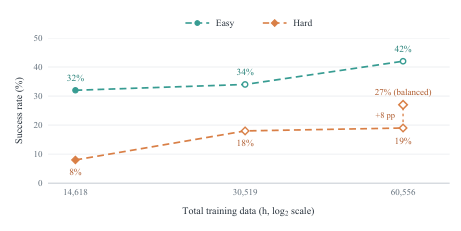

> 图解：横轴为总训练时长，纵轴为 Easy、Hard 任务成功率。Easy 从 32.0% 依次升至 34.0%、42.0%；Hard 从 8.0% 升至 18.0%、19.0%。在 60,556 小时处改用每个 batch 人机样本 1:1 的 robot-balanced sampling，Hard 再由 19.0% 提至 27.0%，图中虚线标出这额外 8 个百分点。

标准按比例采样在最大规模下约有 76% clip 来自人类数据，Hard 任务开始平台化。固定数据预算而强制人机 batch 均衡后，精确空间对齐和双臂协调任务明显改善：胶棒入笔筒从 10% 到 40%，叠两个碗从 0% 到 60%，双手各提一瓶从 30% 到 60%。这说明人类数据提供广度，但困难控制仍需要足够的机器人轨迹曝光。

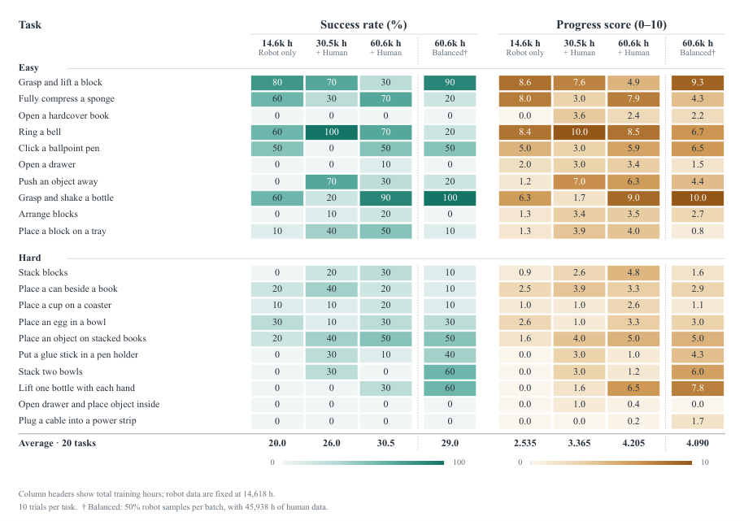

> 图解：左侧为任务成功率，右侧为平均 progress score。标准 Scaling 下，20 项平均成功率从 Robot Only 的 20.0% 增至 26.0% 和 30.5%，progress 从 2.535 增至 3.365 和 4.205；至少成功一次的任务数从 10/20 扩至 14/20、16/20。摇瓶从 60% 到 90%，方块入托盘从 10% 到 50%；原先完全不能完成的堆方块、排列方块、双手提瓶分别达到 30%、20%、30%。

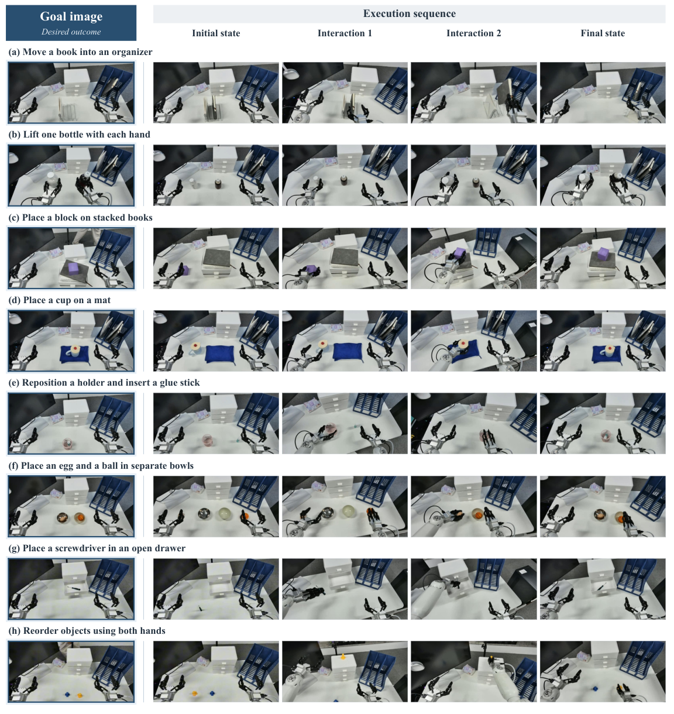

> 图解：每行左侧是推理时目标图，右侧四帧依次是初始场景、两个中间操作阶段和最终状态，覆盖搬运放置、双臂协作、物体重排和工具—容器交互。静态目标并未规定中间动作，但策略会先转动笔筒再插胶棒，也会协调双臂交换或分配物体。

### 视觉目标驱动的 ICL：冻结参数，只换目标图

这里的 In-Context Learning 不是往语言 Prompt 里塞更多示例，而是在同一个初始场景中替换目标图，观察同一个冻结策略是否改变物理轨迹。

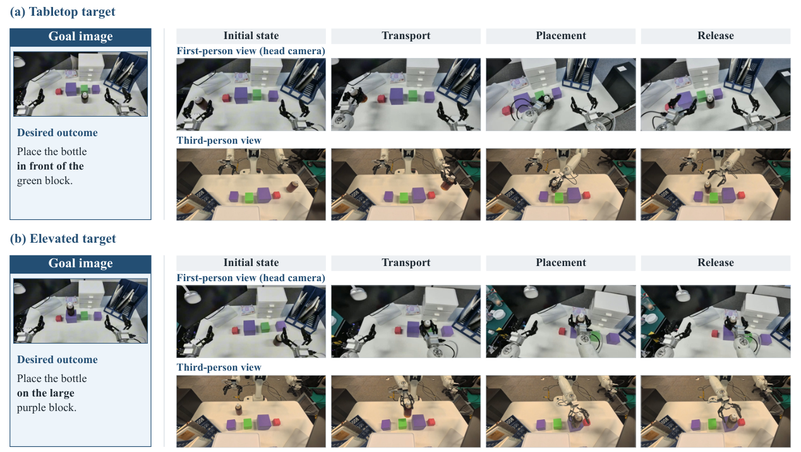

> 图解：两组 rollout 从同一个桌面场景出发，每组左侧为目标图，右侧为同步第一、第三人称关键帧。未经目标任务后训练，仅换目标图，策略就把瓶子放到绿块前方桌面，或紫色高块顶部。后者释放稳定性仍不完美，但空间目标接地能力已经在联合预训练后出现。

任务后训练完成后，参数再次严格冻结，目标变化可以扩展到多物体、组合约束。

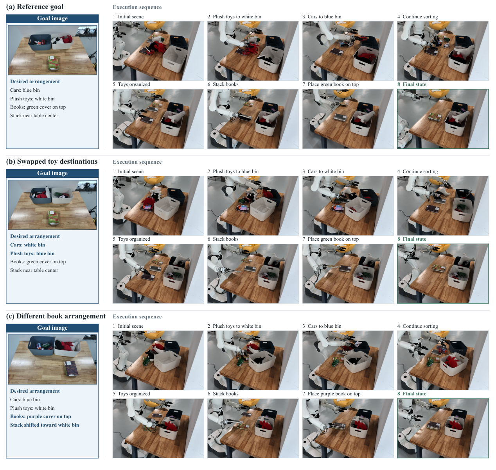

> 图解：每组左侧蓝框是目标图，右侧八帧按先上后下、每行从左到右排列，绿框标出终态。(a) 玩具车入蓝箱、毛绒玩具入白箱，绿书在书堆顶部；(b) 对调两类玩具的箱子的分配；(c) 保持玩具分配不变，改为紫书置顶并把书堆移向白箱。策略并非背诵唯一整理流程，而是根据目标同时修改分类、顺序和空间位置。

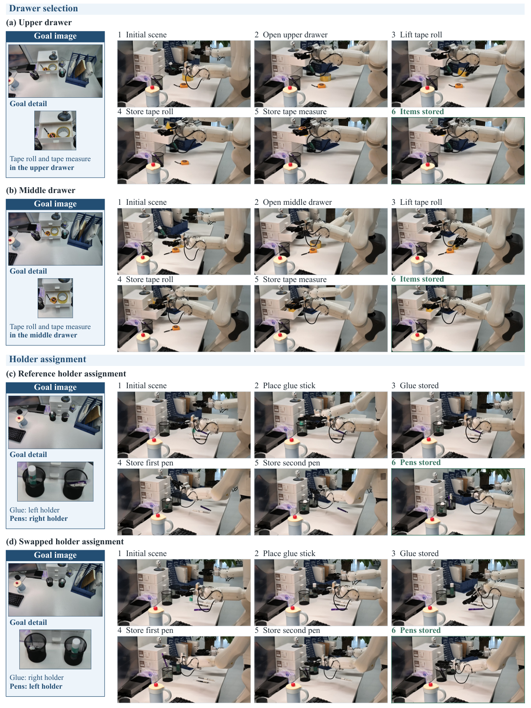

> 图解：左侧为目标图及局部放大，右侧六帧按时间排列。(a,b) 只改变目标图，策略分别打开上层或中层抽屉，再放入胶带卷和卷尺；(c,d) 对调胶棒与两支笔在左右笔筒中的目标位置，机器人相应反转放置关系。抽屉图展示关抽屉前的物品位置，笔筒图展示最后放笔后的终态。

更进一步，目标图里可以不是机器人，而是人的第一视角示范。

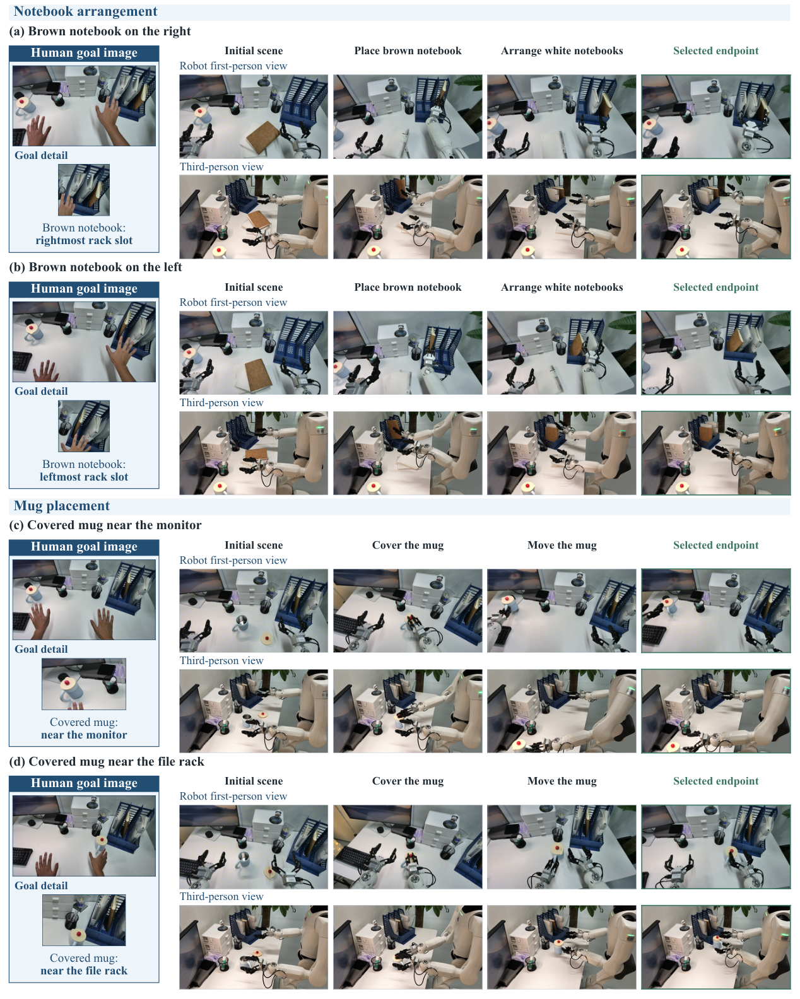

> 图解：左侧目标图带有人手，右侧是机器人同步第一、第三人称执行帧。(a,b) 要求把棕色笔记本放入最右或最左格，再整理白色笔记本；(c,d) 要求先给杯子盖盖，再放到显示器旁或文件架旁。尽管目标图的具身和视觉外观不同，冻结策略仍能读取空间关系并改变执行结果。

这些结果是配对 qualitative demonstration，不是大规模 ICL 成功率 benchmark；但它们清楚展示了“任务规范”和“控制参数”可以被目标图解耦。

### 长时程：把多个子目标串成连续工作流

视觉目标还能作为中间子目标，由上游规划器或用户依次提供，策略负责连续执行。

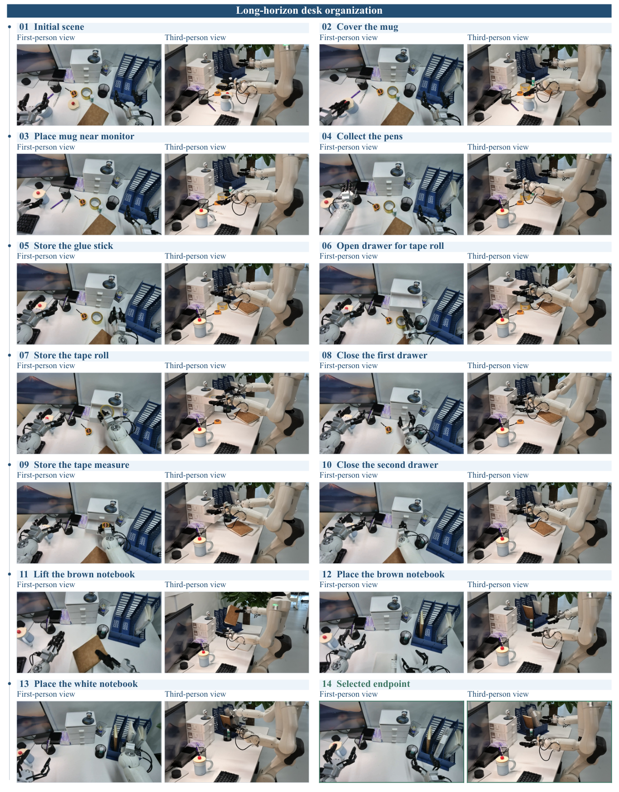

> 图解：同一次连续 rollout 的 14 个阶段，每阶段并列第一、第三人称视图。01–03 给杯子加盖并搬运，04–05 分类笔和胶棒，06–10 开合两个抽屉收纳胶带卷和卷尺，11–14 把笔记本插入竖架。后续动作没有碰倒已放好的杯子，也没有重新打开已关闭的抽屉。

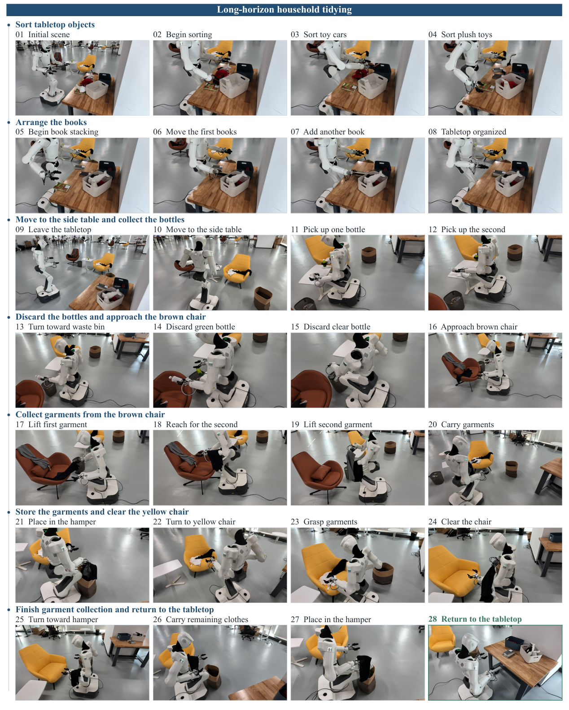

> 图解：同一连续序列跨多个工作区。01–08 在主桌分类玩具、堆书；09–15 移动至边桌，把两个空瓶丢入垃圾桶；16–27 到两把椅子收集衣物并放入洗衣篮；28 返回主桌。49 维动作空间同时承载底盘移动与双臂控制，使刚性物体、容器和可变形衣物操作可以连续衔接。

要注意，长时程结果来自任务特定后训练后的策略，不应与前面的完全零样本结果混为一谈；论文主要用连续轨迹展示技能串联能力，并未在这两张图中给出长时程平均成功率。

## 与已有工作的关系，以及仍未解决的问题

从架构看，DreamZero、LingBot-VA、Fast-WAM、OpenWAM 和 InternW0-$\Delta$ 都在探索视频预测与动作生成的信息流；ViGAR 已把视觉子目标用于组合操作。Open-HumanScale 的重点不是再发明一种复杂 WAM，而是用两种 Attention 配置验证 **数据 Scaling 的收益能跨架构成立**，再用目标图减少零样本任务定义的歧义。

从人类预训练看，EgoScale、HumanScale 更侧重 Validation Loss，Dyna-2 扩展到百万小时并考察零样本动作预测。本文补充的是闭环 Clean、Scene-OOD、Random 成功率，以及多样性、示范效率和跨源对齐的受控证据。

从通用策略看，$\pi_{0.7}$ 使用语言、行为 metadata 和视觉子目标组成多模态 Prompt，RoboICL 通过示范上下文和交互记忆保持参数冻结。HumanWAM-Goal 则把视觉目标 ICL 与人机经验规模联系起来，并展示从人类目标图到机器人执行的跨具身迁移。

不过仍有几个边界不能忽略：

- 纯人类模型的优势需要机器人后训练才能兑现；混合模型虽能零样本执行，但 RoboTwin 平均成功率只有 13.94%，真实机器人标准 Scaling 也只有 30.5%。
- 对数线性是观察区间内的经验拟合，不保证数据无限增长仍持续，更不替代数据质量控制。
- RoboDojo 表明记忆、随机泛化和开放任务仍弱，基础 WAM 没有专门推理与记忆模块。
- 合成目标图的自动审验不等于物理可行性验证；ICL 与长时程部分主要是定性案例，还需要更系统的成功率和失败模式评估。

## 总结：Scale 的对象不是小时数，而是可对齐的经验

- **数据层面**：Open-HumanScale-50K 将 104,289 小时多源原料清洗为 50,000 小时、3,594 万连续 clip，并统一手部运动、语言和几何动作监督。
- **规律层面**：100–50,000 小时内，下游成功率呈经验对数线性增长，最大收益集中在 Scene-OOD 和 Random；任务、场景多样性与时长共同扩展，比单纯增加重复轨迹更有效。
- **模型层面**：HumanWAM-Vanilla 证明纯人类预训练经机器人适配后可达到 92.08% Clean2Clean，并在真实视觉分布外把四项任务均值从 2.5% 提至 67.5%。
- **能力层面**：HumanWAM-Goal 通过人机混合数据、49 维物理动作接口和目标图条件，实现零样本执行、冻结参数的视觉 ICL 与多阶段技能串联，后训练平均成功率达到 88.65%。

下一步最值得验证的，是如何在继续扩大人类经验的同时，提高困难任务的绝对零样本可靠性，并用更严格的物理审验和定量协议评估视觉目标 ICL 与长时程执行。

> 本文参考自 [Open-HumanScale: An Open Recipe for Scaling Human and Robot Experience for Embodied Foundation Models](https://arxiv.org/abs/2611.06817)