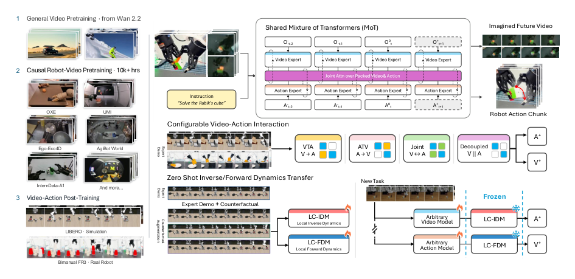
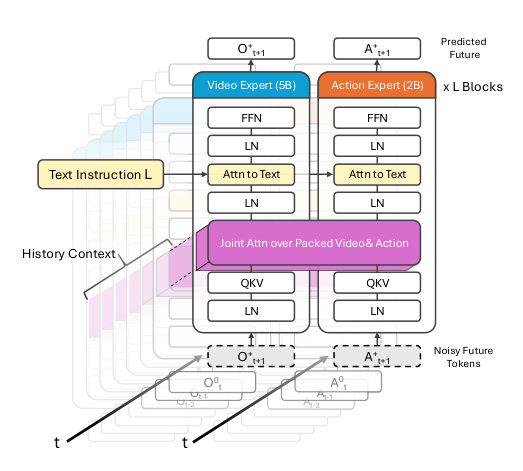
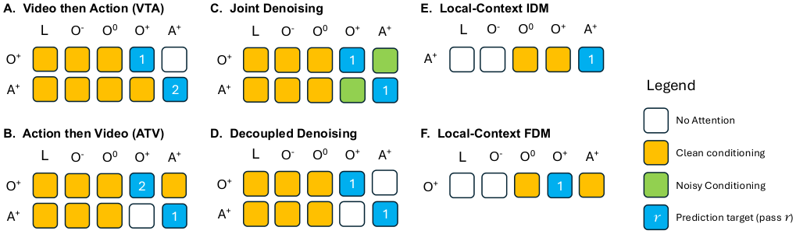
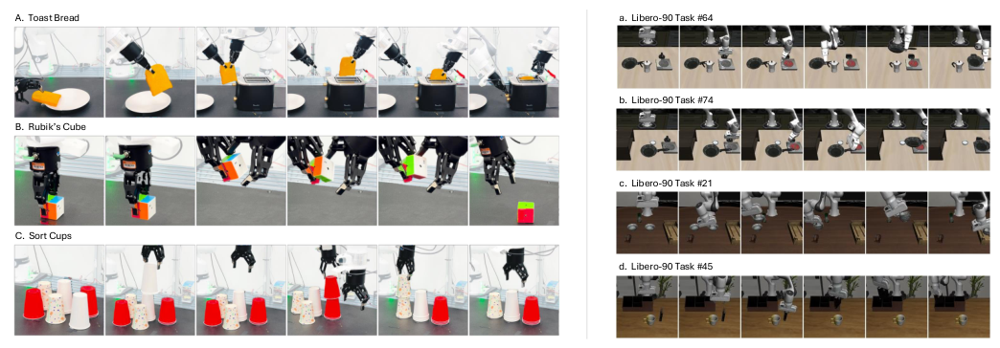
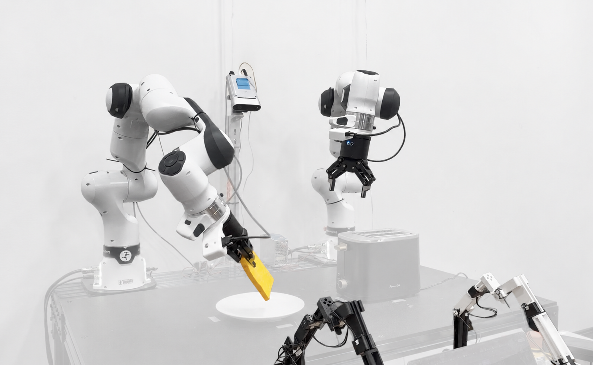

# OpenWAM：可组合的世界-动作模型开放框架

世界-动作模型（World-Action Model, WAM）把「预测未来画面」和「生成机器人动作」塞进同一个模型，但现有工作各用各的骨干、各定各的交互方式，谁也说不清到底哪个设计在起作用。斯坦福李飞飞、吴佳俊团队提出的 **OpenWAM** ，用一个共享的因果视频骨干加一套可配置的视频-动作交互架构，把「联合生成、先视频后动作、先动作后视频、完全解耦」四种模式放到同一套训练与评测协议下公平比较，并且让逆动力学、正动力学组件可以独立训练、即插即用。最硬的结果有两个：机器人视频因果预训练把 LIBERO-Long 上 VTA 模式的成功率从 68.4% 拉到 97.8%（+29.4 个点）；在新任务迁移中，配合反事实数据训练的冻结局部逆动力学模型平均成功率达 84.0%，而只用演示数据的全上下文逆模型只有 44.5%~47.0%。

## 一、背景：WAM 研究的两个「拦路虎」

WAM 的核心思想很直观：与其让策略直接从图像映射到动作（如 OpenVLA、$\pi_0$ 这类 VLA 模型），不如让模型先「想象」未来会发生什么，再据此行动。DreamZero、VideoVLA 采用视频与动作联合去噪，LingBot-VA 采用因果的「视频优先」路线，Fast-WAM 则在推理时压缩想象成本。方向很热闹，但问题也随之而来。

**第一个问题是「不可比」。** 视频和动作怎么交互，本身就是一个多维设计空间：可以联合生成、可以先后生成、也可以限制跨模态注意力。但每个系统都同时换了骨干网络、训练数据、目标函数和推理流程，一个更高的成功率根本无法干净地归因于某种视频-动作耦合方式。大家报的都是 LIBERO 分数，却并不是「控制变量」意义上的对比。

**第二个问题是「不可复用」。** 成功演示只覆盖了「状态-动作-结果」分布中很窄的一片——从每个状态出发，演示只给出一条成功的动作延续。这对模仿学习够用，但对逆动力学（从画面变化反推动作）和正动力学（从动作预测画面结果）来说监督信号远远不够，因为这两类模型必须知道「换一条动作会怎样」。失败、探索、反事实推演里其实藏着大量有效的物理转移样本，但标准的任务条件 WAM 目标函数并不知道怎么利用它们，更不知道换个任务后这些动力学组件还能不能复用。

OpenWAM 就是冲着这两个问题来的：对前者，提供一个固定骨干、固定协议、只改交互方式的受控试验台；对后者，定义可独立训练、可跨模型组合的局部动力学接口。

## 二、OpenWAM 总体框架

> 图解：OpenWAM 全景。 **左图** 是两阶段训练路径：从通用视频模型 Wan2.2 出发，先在无动作标注的机器人与人类交互视频上做因果预训练，再在仿真与真机演示上做视频-动作联合训练。 **右上图** 是共享的 Mixture-of-Transformers（MoT）架构，时间对齐的视频流与动作流通过联合注意力耦合，但各自保留独立的专家参数。 **右中图** 是可配置的跨模态注意力与生成顺序，同一架构支持 Joint、VTA（先视频后动作）、ATV（先动作后视频）、Decoupled（解耦）四种「交互程序」。 **右下图** 是独立训练的局部逆/正动力学模型：冻结的逆动力学（IDM）把任务适配后的视频模型生成的预测翻译成动作，正动力学（FDM）则预测候选动作的视觉后果。

整篇工作的贡献可以归纳为三点：

- **一个受控的 WAM 框架** ：因果视频骨干 + 可配置视频-动作模型，训练与评测协议完全共享；
- **局部上下文动力学接口** ：逆/正动力学模型用演示加反事实转移独立训练，并能与单独训练的预测器组合；
- **一组受控实证分析** ：量化视频预训练、交互设计、转移数据覆盖度、条件上下文范围对策略性能与组件复用的影响。

## 三、方法详解

### 3.1 形式化：一个联合分布，两种链式分解

先把符号定下来。$o_t$、$a_t$、$q_t$、$\ell$ 分别表示时刻 $t$ 的视觉观测、动作、本体感觉和语言指令；$O_t^-$、$A_t^-$ 是观测与动作历史，$O_t^0 = o_t$ 是当前观测。给定预测时域 $H$，未来动作轨迹与未来观测轨迹记为 $A_t^+ = (a_t, \ldots, a_{t+H-1})$ 和 $O_t^+ = (o_{t+1}, \ldots, o_{t+H})$，预测前可用的全部信息收进任务上下文 $\mathcal{C}_t = (O_t^-, O_t^0, A_t^-, q_t, \ell)$。

WAM 要对未来观测与动作的联合分布建模，而链式法则天然给出两种分解：

$$
p_{\mathrm{WAM}}(O_t^+, A_t^+ \mid \mathcal{C}_t)
=
\underbrace{p(O_t^+ \mid \mathcal{C}_t)}_{\mathrm{CVP}}
\,
\underbrace{p(A_t^+ \mid O_t^+, \mathcal{C}_t)}_{\mathrm{IDM}}
=
\underbrace{p(A_t^+ \mid \mathcal{C}_t)}_{\mathrm{VLA}}
\,
\underbrace{p(O_t^+ \mid A_t^+, \mathcal{C}_t)}_{\mathrm{FDM}}
$$

这四个因子正好对应四种角色： **CVP** （因果视频预测）提出未来画面， **VLA** 策略直接提出动作， **IDM** （逆动力学）把一段视觉转移「翻译」成动作， **FDM** （正动力学）预测给定动作的视觉后果。由此得到三条主要生成路线： **Joint** 同时生成两者， **VTA** 先生成视频再以此为条件生成动作， **ATV** 反过来。

笔者认为这个分解的聪明之处在于：它只是规定「接口」，并不强制所有因子共享同一份参数。这就为后文「视频预测器换任务、逆动力学组件冻结复用」的组合式实验埋下了伏笔。

### 3.2 开放因果机器人视频骨干

骨干从 Wan2.2-5B 初始化，在海量异质机器人操作与人类交互视频上继续预训练， **全程不用任何动作标注** 。这一步把通用视频先验适配到以机器人为中心的运动与物理交互上，同时保留独立的视频预测能力；产出的 checkpoint 被所有下游 OpenWAM 变体共享。

原始 Wan2.2 并不是时间因果的，因此预训练中引入了 **chunk-causal（块因果）预测** ：未来块可以 attend 当前观测、此前观测和已生成的块，但不能看更晚的块；块内 token 则联合去噪。这既提供了时序预测所需的方向性，又保留了块内扩散生成的效率。

值得强调的是，作者刻意把「时间因果性」和「跨模态交互」拆成两个独立的设计维度：块因果决定「哪些时刻可见」，交互程序决定「视频流与动作流谁跟谁说话」。这样视频骨干既能单独当预测器用，也能不改接口地接上动作分支。

### 3.3 可配置的视频-动作交互程序

> 图解：共享 MoT 架构。视频与动作两个模态各自拥有独立的归一化、投影和前馈参数（即各自的「专家」），在打包后的视频+动作 token 序列上汇合于一次联合注意力；任务文本通过单独的 cross-attention 注入。底部输入的是带噪的未来 token，后方的历史块作为上下文。这个设计的精髓是：骨干、token 化和目标函数全部共享， **唯一的变量是未来跨模态可见性与生成顺序** ——这才是真正的控制变量实验。

四种交互程序在同一骨干上运行：

- **Joint** ：视频与动作流同时去噪，带噪的未来 token 之间双向注意力，任何一条轨迹完成前双方就能互相参考；
- **VTA（Video-to-Action）** ：先不看未来动作、独立生成完整视频轨迹，再以生成的视频为条件生成动作；
- **ATV（Action-to-Video）** ：先生成动作，再以动作轨迹为条件预测视频后果；
- **Decoupled** ：两流同时生成，但未来 token 之间完全不做跨模态注意力（历史与任务指令仍然共享）。

> 图解：共享架构暴露的注意力掩码。(A)–(D) 是四种交互程序，(E)–(F) 是两个局部上下文动力学程序。列表示「该行可以条件在哪些流上」，格子颜色表示 attend 到什么内容，数字标注第几轮生成。E、F 各只有一行，因为逆模型只产出动作、正模型只产出观测。可以看到四种程序的差异被精确地压缩为掩码模式的不同，而不是架构的不同。

训练目标上，所有程序共用同一套 latent flow matching（流匹配）构造。对目标模态 $P \in \{\mathrm{O}, \mathrm{A}\}$，设 $Z_P^\star$ 为干净目标 latent，取 $\tau \sim \mathcal{U}[0,1]$、$\epsilon_P \sim \mathcal{N}(0, I)$，插值路径与目标速度为：

$$
Z_{P,\tau} = (1-\tau)\epsilon_P + \tau Z_P^\star, \quad u_P = Z_P^\star - \epsilon_P
$$

每个激活的预测阶段最小化：

$$
\mathcal{L}_P = \mathbb{E}\left[ \left\| v_{\theta,P}\left( Z_{P,\tau} \mid c_P, \tau \right) - u_P \right\|_2^2 \right]
$$

其中 $c_P$ 是该交互程序允许看见的历史、旁信息（本体感觉、文本）与跨模态轨迹；多目标程序直接对相应损失求和。顺序程序（VTA/ATV）训练时用 teacher forcing：第二阶段条件在 **真实记录** 的跨模态轨迹上；推理时再换成第一阶段 **自己生成** 的轨迹。训练与推理的掩码和时间对齐完全一致，只是条件轨迹的来源从「录得」变成「生成得」。

### 3.4 局部上下文动力学接口与反事实监督

架构层面的组合控制的是「一个模型内部谁跟谁通信」；但要复用一个 **独立训练** 的组件，还需要明确的条件边界。任务条件生成器可以依赖语言和非局部历史来指定行为，而一个可复用的局部动力学组件只应回答两类局部问题：这段视觉转移对应什么动作？这组动作会造成什么视觉后果？于是作者定义：

$$
p_{\mathrm{IDM}}^{\mathrm{local}} := p(A_t^+ \mid O_t^+, O_t^0, q_t), \quad
p_{\mathrm{FDM}}^{\mathrm{local}} := p(O_t^+ \mid A_t^+, O_t^0, q_t)
$$

局部 IDM 把给定的视觉轨迹落地为动作序列，局部 FDM 预测给定动作序列的视觉后果。两者都 **不接收语言、历史动作和 $t$ 之前的观测** 。注意论文特别澄清：条件范围和数据覆盖是两个独立的设计选择——局部上下文只是限制模型「能看什么输入」，并不决定「用什么数据训练」；反过来，全上下文模型也可以吃更宽的数据。后文实验正是把这两个因子交叉验证的。

数据侧，演示轨迹诱导出局部转移 $z = (O_t^0, q_t, A_t^+, O_t^+)$，其分布记为 $\mathcal{D}_{\mathrm{task}}^{\mathrm{loc}}$。为了拓宽监督，作者在仿真器里 **恢复演示中出现过的状态，然后从同一状态执行不同的后续动作序列** ，得到反事实分支 $z^{(b)} = (O_t^0, q_t, A_t^{+,(b)}, O_t^{+,(b)})$。这些分支共享初始条件，但各自走向不同的物理结局，且不要求完成任务。动力学模型的训练分布为：

$$
\mathcal{D}_{\mathrm{dyn}} = (1-\eta)\,\mathcal{D}_{\mathrm{task}}^{\mathrm{loc}} + \eta\,\mathcal{D}_{\mathrm{cf}}, \quad \eta \in [0,1]
$$

$\eta=0$ 是纯演示，$\eta=1$ 是纯反事实，实验中混合取 $\eta=0.6$。同一接口还天然兼容真机上的失败尝试与自由玩耍数据——因为每条转移无论任务成败都提供有效的动力学监督。

学习目标沿用 flow matching：局部 IDM 以观测到的未来为条件去噪动作，局部 FDM 以执行的动作序列为条件去噪未来观测：

$$
\mathcal{L}_{\mathrm{LC\text{-}IDM}} = \mathbb{E}\left[ \left\| v_{\theta_{\mathrm{ID}}}(Z_{\mathrm{A},\tau} \mid O^0, q_t, O^+, \tau) - u_{\mathrm{A}} \right\|_2^2 \right]
$$

$$
\mathcal{L}_{\mathrm{LC\text{-}FDM}} = \mathbb{E}\left[ \left\| v_{\theta_{\mathrm{FD}}}(Z_{\mathrm{O},\tau} \mid O^0, q_t, A^+, \tau) - u_{\mathrm{O}} \right\|_2^2 \right]
$$

推理时的组件组合是「显式轨迹接口」式的：视频预测器只把未来的 VAE latent 传给接收方 IDM， **不传 transformer 隐状态和 KV cache** 。视频到动作的组合为：

$$
\hat{O}_t^+ \sim p_\phi^{\mathrm{CVP}}(\cdot \mid \mathcal{C}_t), \quad
\hat{A}_t^+ \sim p_{\theta_{\mathrm{ID}}}^{\mathrm{LC\text{-}IDM}}(\cdot \mid \hat{O}_t^+, O_t^0, q_t)
$$

对称地，动作到视频的组合为：

$$
\hat{A}_t^+ \sim p_\psi^{\mathrm{VLA}}(\cdot \mid \mathcal{C}_t), \quad
\hat{O}_t^+ \sim p_{\theta_{\mathrm{FD}}}^{\mathrm{LC\text{-}FDM}}(\cdot \mid \hat{A}_t^+, O_t^0, q_t)
$$

这里的动作序列同样可以来自外部策略。作者称这是「学习到的组合」：分开训练的组件不必是同一个联合分布的因子，它们靠的是共享的轨迹接口而变得可替换。

## 四、实验验证

### 4.1 实验设置

**视频预训练语料** 覆盖真实机器人操作、人类交互视频与合成机器人轨迹，合计约 334 万条轨迹/take、14,640 小时，具体构成如下：

| 数据集 | 轨迹/take 数 | 小时数 | 来源类型 |
| --- | ---: | ---: | --- |
| Open X-Embodiment（49 个操作数据集） | 1,300,749 | 1,911.29 | 多本体机器人数据 |
| AgiBot World Beta | 1,003,672 | 2,976.4 | 真实机器人操作 |
| Ego-Exo4D v2 | 5,035 | 221.26 | 人类交互 |
| InternData-A1 | 637,498 | 7,433.91 | 合成机器人操作 |
| RoboCOIN | 183,157 | 1,306.83 | 真实双臂操作 |
| RoboMIND | 107,877 | 305.5 | 多本体机器人数据 |
| FastUMI-100K | 92,823 | 461.77 | 人类引导操作 |
| UMI 系列（UMI/DexUMI/UMI on Legs/MV-UMI） | 5,430 | 24.60 | 人类引导操作 |

预训练在 32 张 NVIDIA B200 上跑了 14 天。下游四种交互程序共享同一双流 MoT 骨干与训练配方，视频按 4 帧 latent 块处理，每块对齐一个 16 步动作块。

**仿真评测** 覆盖 LIBERO-Object / Goal / Spatial / Long 四个套件；组件迁移以 LIBERO-Long 为源分布，选了 4 个 LIBERO-90 目标任务，刻意覆盖不同类型的迁移挑战：

| 任务 | 目标行为 | 迁移挑战 |
| --- | --- | --- |
| 64 | 叠碗并把碗垛放进托盘 | 新技能组合 |
| 74 | 把书放进收纳盒左格 | 重定向已有操作 |
| 21 | 开炉灶并放上平底锅 | 物体与抓握变化 |
| 45 | 与任务 21 相同目标 | 额外的场景与布局偏移 |

**真机评测** 在双臂平台上进行（两条 Franka Research 3 机械臂 + 平行夹爪，两个腕部相机 + 一个居中第三人称相机），三个任务各有侧重：

| 任务 | 目标 | 主要挑战 |
| --- | --- | --- |
| Toast Bread | 插入面包并启动烤面包机 | 可变形物体与精细插入 |
| Rubik's Cube | 复原 2×2 魔方最后一层 | 接触丰富的推与转 |
| Sort Cups | 按颜色分拣杯子 | 顺序与排序可变 |

> 图解：评测任务。 **左侧** 是三个真机双臂任务，各展示一条成功 rollout 的采样帧； **右侧** 是用于组件迁移的 4 个 LIBERO-90 目标任务，它们都在 LIBERO-Long 源任务集之外，用来检验「换任务后冻结组件还能不能用」。

**评估协议** ：每个交互程序训练 3 个独立种子，每个 checkpoint 在 10 个任务上各跑 50 个闭环 episode（共 500 次），同一任务内所有程序共用同一组环境种子以共享初始条件；报告三种子成功率的均值与标准差。

### 4.2 原生策略性能：四种程序都能打

下表是四个 LIBERO 套件上的闭环成功率（%，三种子均值 ± 标准差；基线为已发表结果）：

| 方法 | Object | Goal | Spatial | Long | Mean |
| --- | ---: | ---: | ---: | ---: | ---: |
| OpenVLA | 88.4 | 79.2 | 84.7 | 53.7 | 76.5 |
| OpenVLA-OFT | 98.4 | 97.9 | 97.6 | 94.5 | 97.1 |
| $\pi_0$ | 98.8 | 95.8 | 96.8 | 85.2 | 94.1 |
| $\pi_{0.5}$ | 98.2 | 98.0 | 98.8 | 92.4 | 96.9 |
| GR00T-N1 | 97.6 | 93.0 | 94.4 | 90.6 | 93.9 |
| Motus | 99.8 | 96.6 | 96.8 | 97.6 | 97.7 |
| Fast-WAM | 100.0 | 97.0 | 98.2 | 95.2 | 97.6 |
| LingBot-VA | 99.6 | 97.2 | 98.5 | 98.5 | 98.5 |
| **OpenWAM-VTA** | 99.4±0.3 | 98.4±0.5 | 98.6±0.2 | 97.8±0.4 | **98.6** |
| **OpenWAM-ATV** | 98.0±0.4 | 97.2±0.2 | 96.6±0.6 | 95.4±0.3 | 96.8 |
| **OpenWAM-Joint** | 98.2±0.2 | 97.8±0.4 | 97.6±0.3 | 96.6±0.5 | 97.6 |
| **OpenWAM-Decoupled** | 99.0±0.3 | 98.0±0.2 | 97.8±0.5 | 97.0±0.4 | 98.0 |

OpenWAM-VTA 以 98.6 的均分小幅超过最强的 LingBot-VA（98.5），更重要的是：四种生成顺序在同一骨干上全部站住了脚，说明这个共享底座确实支持多种世界-动作交互方式，而不是只适合某一种特化策略。

**骨干初始化消融** 是全文最硬的一笔：固定 VTA 架构、任务监督与下游训练不变，原始 Wan2.2-5B 初始化在 LIBERO-Long 上只有 68.4%，换成机器人视频预训练的因果骨干后达到 97.8%（+29.4 个点）。附录进一步把这一对比推广到 Joint 程序，并加入随机初始化：

| 视频骨干初始化 | VTA（%） | Joint（%） |
| --- | ---: | ---: |
| 随机初始化 | 20.0 | 27.2 |
| 原始 Wan2.2 | 68.4 | 62.2 |
| 机器人视频预训练 | **97.8** | **96.6** |

机器人视频预训练对 VTA 提升 29.4 个点、对 Joint 提升 34.4 个点，且收益跨交互程序一致成立——视觉先验的适配远比「换个交互方式」更决定成败。

**真机闭环** 结果（成功率 %）：

| 方法 | Toast | Cube | Cups | Mean |
| --- | ---: | ---: | ---: | ---: |
| OpenWAM-VTA | 92.0 | 90.0 | 94.4 | 92.1 |
| OpenWAM-Joint | 90.0 | 94.0 | 91.7 | 91.9 |

在多视角、可变形、接触丰富的双臂场景下，两种程序都站上 90%+，框架的物理有效性得到验证。

### 4.3 组件可组合性：换任务后，冻结的逆动力学还能用吗？

这是全文最有意思的一组实验。做法：对 4 个 LIBERO 90 目标任务，只把视频预测器换成任务调优后的 VTA 模型的视频分支， **动作组件（源任务上训练的 IDM）保持冻结** 。先看源任务（LIBERO-Long）上的组合基线：

| 动作组件 | 监督方式 | 成功率（%） |
| --- | --- | ---: |
| 全上下文 IDM | 仅演示（即原生 VTA） | 97.8 |
| 全上下文 IDM | 混合（60% 反事实） | 92.2 |
| 局部上下文 IDM | 仅演示 | 25.8 |
| 局部上下文 IDM | 仅反事实 | 90.6 |
| 局部上下文 IDM | 混合 | **94.4** |

在源任务上，仅演示训练的局部 IDM 只有 25.8%——没有语言和历史，它确实「近视」。但加入反事实数据后直接飙到 90% 以上。再看迁移到 4 个 LIBERO-90 目标任务的表现（冻结动作组件 + 任务调优视频预测器，%）：

| 视频/策略 | 动作组件（冻结） | 64 组合 | 74 重定向 | 21 物体/抓握 | 45 场景偏移 | 迁移均值 |
| --- | --- | ---: | ---: | ---: | ---: | ---: |
| **任务调优 VTA（微调策略参考）** | — | 94 | 86 | 92 | 100 | 93.0 |
| 任务调优视频 | 全上下文 IDM，仅演示 | 88 | 90 | 0 | 0 | 44.5 |
| 任务调优视频 | 全上下文 IDM，混合 | 54 | 92 | 4 | 38 | 47.0 |
| 任务调优视频 | 局部 IDM，仅演示 | 36 | 50 | 0 | 0 | 21.5 |
| 任务调优视频 | 局部 IDM，仅反事实 | 80 | 92 | 90 | 76 | **84.5** |
| 任务调优视频 | 局部 IDM，混合 | 74 | 86 | 88 | 88 | **84.0** |
| **原始 VTA（未适配策略参考）** | — | 42 | 0 | 0 | 0 | 10.5 |

三组对比值得细品：

- **条件范围 × 数据覆盖存在强交互** ：混合监督把局部 IDM 的迁移均值从 21.5% 抬到 84.0%，但对全上下文 IDM 只从 44.5% 抬到 47.0%。在混合监督下，局部条件比全条件高出 37.0 个百分点，同时还保住 94.4% 的源任务成功率。原因不难理解：语言和历史让模型学会「抄近路」——依赖任务上下文而非局部物理规律，换任务后这些捷径全部失效。
- **逐任务看更扎心** ：仅演示的全上下文 IDM 在任务 64、74 上表现不错，但在任务 21、45 上直接 0%；而反事实训练的局部 IDM 在四个目标上全部有效，复用一致性明显更强。
- **84.0% 对 93.0%** ：冻结组件 + 只调视频预测器，已经达到端到端微调策略约九成的水平，而动作侧零训练成本。

### 4.4 动作条件的正动力学：模型真的「分得清」不同动作的后果吗？

局部 FDM 在 160 个上下文、每个 16 条动作分支共 2,560 条反事实未来上评测。除了 RGB 预测误差，作者还设计了 **outcome identification（结局识别）** 指标：从同一状态出发的 $K$ 条真实结局中，预测结果是否离「与其条件动作匹配的那条」最近（按 RGB MSE 衡量）：

| 监督方式 | RGB MSE ↓（×10⁻³） | Acc. K=2 ↑ | Acc. K=16 ↑ |
| --- | ---: | ---: | ---: |
| 仅演示 | 14.35 | 68.3 | 21.1 |
| 仅反事实 | **9.40** | **93.6** | **71.3** |
| 混合 | 9.62 | 91.8 | 67.7 |

反事实监督把 RGB MSE 降低 34.5%，把 16 选 1 的结局识别率从 21.1% 拉到 71.3%。这个数字的含金量在于：它证明模型学到的是「动作→后果」的因果对应，而不是对所有动作输出同一个「平均未来」。

### 4.5 架构消融与外部对比

**MoT 是否有必要？** 固定机器人视频预训练初始化，对比「视频动作共用同一个 DiT」与「双专家 MoT」：

| 架构 | VTA（%） | Joint（%） |
| --- | ---: | ---: |
| 非 MoT（共享 DiT） | 92.8 | 93.6 |
| MoT | **97.8** | **96.6** |

共享 DiT 已经不弱，MoT 仍带来 5.0 和 3.0 个点的提升——模态专属专家确实物有所值。

**与 UVA 的统一建模对比。** UVA 是最接近的已发布系统，在单一模型内联合训练策略、IDM、FDM。OpenWAM 也训练了一个多目标 checkpoint（60% 视频-动作联合 + 20% 局部 IDM + 20% 局部 FDM）与之公平对比（MSE 与 IDM 误差越低越好，成功率与 SSIM 越高越好）：

| 模型 | 策略成功率（%） | FDM MSE ↓（演示） | FDM SSIM ↑（演示） | IDM 位置误差 cm ↓（演示） | IDM 旋转误差 ° ↓（演示） | FDM MSE ↓（反事实） | FDM SSIM ↑（反事实） | IDM 位置 cm ↓（反事实） | IDM 旋转 ° ↓（反事实） |
| --- | ---: | ---: | ---: | ---: | ---: | ---: | ---: | ---: | ---: |
| OpenWAM LC-IDM，仅反事实 | -- | -- | -- | 1.76 | 2.39 | -- | -- | **1.17** | 3.60 |
| OpenWAM LC-IDM，混合 | -- | -- | -- | 0.44 | 1.21 | -- | -- | 1.22 | 3.68 |
| OpenWAM LC-FDM，仅反事实 | -- | 0.00734 | 0.9126 | -- | -- | **0.00940** | **0.8889** | -- | -- |
| OpenWAM LC-FDM，混合 | -- | 0.00186 | 0.9776 | -- | -- | 0.00962 | 0.8859 | -- | -- |
| OpenWAM 多目标 | **92.8** | **0.00058** | **0.9934** | **0.43** | **1.10** | 0.01416 | 0.8398 | 1.73 | **3.55** |
| UVA | 88.0 | 0.00279 | 0.9645 | 2.03 | 1.60 | 0.01514 | 0.8134 | 3.57 | 12.99 |

统一训练的 OpenWAM checkpoint 在策略成功率（92.8% vs 88.0%）和全部 IDM/FDM 指标上都压过 UVA。当然也存在预期中的权衡：多目标模型的反事实动力学精度弱于专门训练的单目标专家，策略分数也低于纯策略特化的 OpenWAM 变体（因为只有 60% 的更新在优化策略目标）。专用组件胜在精度，统一模型胜在便利，框架对两者都支持。

## 五、实现细节速览（附录精华）

### 5.1 模型与数据表示

- **双流骨干** ：30 层双流 MoT。视频专家隐藏维 3072、24 头 × 128 维、FFN 14336；动作专家隐藏维 2048、FFN 8192，注意力配置相同（Q/K/V 把 2048 维映射到 3072 维再投回）。动作专家从对应视频专家层的「宽度适配拷贝」初始化。
- **视觉观测** ：每次观测含主视角与腕部相机两张 128×128 图像，各自编码为 $8 \times 8 \times 48$ 的 VAE latent，沿宽度拼接成 $8 \times 16 \times 48$；按 $1 \times 2 \times 2$ 的时空 patch，每 latent 帧 32 个视频 token。视频 VAE 把每 4 个环境步压成 1 帧 latent，一个生成块含 4 帧未来 latent，对应 16 个环境步。
- **动作与本体感觉** ：每个动作 7 维（3 维末端位置 + 3 维轴角旋转 + 1 维夹爪）；每块条件在 8 维本体感觉（3 维位置 + 3 维轴角 + 2 维夹爪关节）上，该向量投影后 **加到** 两流的隐表示中，而不是作为序列 token 拼接。

### 5.2 训练与采样细节

下游统一用 AdamW（$\beta_1 = 0.9$，$\beta_2 = 0.95$，weight decay 0.1），学习率 $10^{-5}$、10 步 warmup 后恒定，单卡 batch 1、梯度累积 10 步（等效 batch 10），梯度范数裁剪 2.0，bf16 混合精度，共训 10,000 步。四种程序的数据、优化设置与目标完全相同，只改生成顺序与跨模态注意力。

噪声参数化取 $\sigma = 1 - \tau$（$\sigma=0$ 为干净数据），从 1000 级基础噪声网格均匀采样后按模态做 shift：

$$
S_s(\sigma) = \frac{s\sigma}{1 + (s-1)\sigma}, \quad s_V = 5.0, \quad s_A = 1.0
$$

并施加时间步相关的损失权重，强调中间噪声水平、纯噪声端点权重为零：

$$
w_P(\sigma) \propto \exp\left[-2\left(\sigma - \tfrac{1}{2}\right)^2\right] - e^{-1/2}
$$

两模态损失等权相加：$\mathcal{L} = \mathcal{L}_V + \mathcal{L}_A$。推理时每个模态 20 步去噪，视频用 CFG 5.0、动作不用 CFG，开启 KV cache，历史窗口 15 个生成块（60 帧 latent）。

### 5.3 LIBERO-Long-CF 反事实数据集

为给局部动力学提供监督，作者从 LIBERO-Long 十个任务的演示状态中分叉，执行修改后的未来动作序列，构建了 **LIBERO-Long-CF** ：32,000 条反事实片段（每任务 3,200 条），每段含 128 步控制与 129 帧同步双视角观测。规模对比：

| 指标 | 原始演示 | LIBERO-Long-CF |
| --- | ---: | ---: |
| 任务数 | 10 | 10 |
| 序列数 | 500 | 32,000 |
| 每序列控制数 | 均值 276.2 | 128 |
| 总控制数 | 138,090 | 4,096,000 |
| 时长 | 1.92 h | 56.9 h |

局部转移监督量放大约 **29.7 倍** 。干预方式分布：停止/缩放手臂运动 9.4%、反向/重定向平移 6.3%、轴偏置与脉冲 12.5%、专门 yaw 扰动 3.1%、噪声/随机手臂控制 12.5%、专门夹爪干预 31.3%、随机时长的手臂/夹爪干预 25.0%。75% 的片段从演示前缀状态出发，其余 25% 先执行额外扰动再出发；扰动起点平均离演示路径 3.34 cm。物理交互含量很高：90.4% 的片段含夹爪与物体接触，50.0% 含可检测抓取，72.3% 改变了物体构型——这正是「同状态、异动作、异结局」监督想要的。

### 5.4 真机设置

> 图解：真机双臂平台——两条 Franka FR3 机械臂配 Flexiv Grav 夹爪，通过双臂 GELLO 遥操作采集演示；两个腕部 RealSense D405（1280×720）加一个居中 Orbbec Femto Mega（1920×1080），全部 30 fps；关节位置、末端位姿、夹爪宽度与控制指令以 30 Hz 带时间戳记录。每个动作 20 维（每条臂 3 位置 + 6 维旋转 + 1 夹爪宽度），块内目标位姿相对于块起始位姿表示。Toast Bread 与 Rubik's Cube 各采 200 条演示，Sort Cups 采 180 条，每条 30 秒；评测分别跑 50、50、36 个闭环 episode。

## 六、总结与展望

- **统一试验台** ：OpenWAM 用共享因果视频骨干 + 可配置交互程序，把 Joint/VTA/ATV/Decoupled 四种视频-动作交互首次放到严格可控的对比协议下，VTA 以 98.6 的 LIBERO 均分达到 SOTA。
- **视频预训练是最大的单点收益** ：机器人视频因果预训练带来 29.4~34.4 个点的成功率提升，且跨交互程序一致成立。
- **反事实数据 + 局部上下文 = 可复用的动力学组件** ：冻结的局部 IDM 迁移到新任务达 84.0% 均值成功率，逼近端到端微调策略的 93.0%，而全上下文或仅演示的组合分别只有 47.0% 和 21.5%。
- **动力学监督确实学到了因果** ：反事实训练使 FDM 的 16 选 1 结局识别率从 21.1% 升至 71.3%，RGB 预测误差下降 34.5%。
- **全部开放** ：框架、预训练 checkpoint 与训练配方均开源，为后续 WAM 设计研究提供公共底座。

局限也同样清晰：组件复用目前主要在仿真中验证，真机上的动力学监督数据效率仍待解决；迁移实验仍需适配视频预测器，完整的视频-动作模型 zero-shot 迁移尚未证实；FDM 研究限于局部短时域预测。如何把「可替换的动力学组件」推向长时程规划与物理世界部署，是这个开放框架留给社区最值得期待的下一站。

> 本文参考自 [OpenWAM: An Open Framework for Composable World-Action Models](https://arxiv.org/abs/2610.07922)